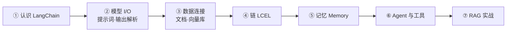
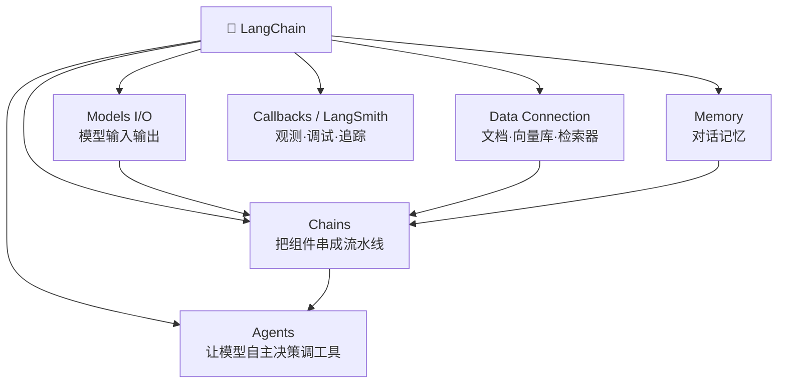
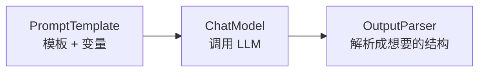
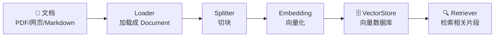
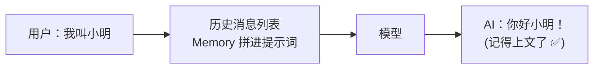
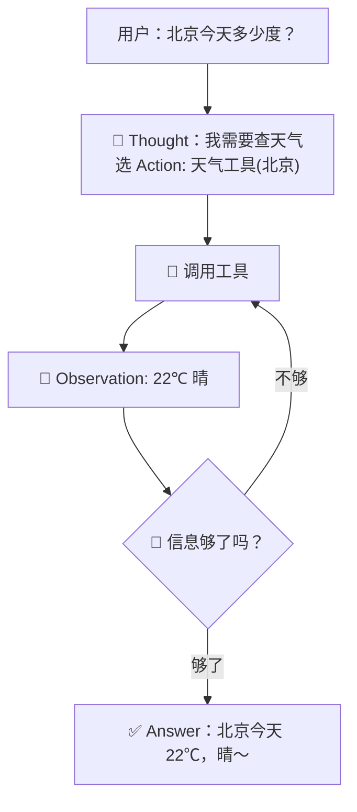
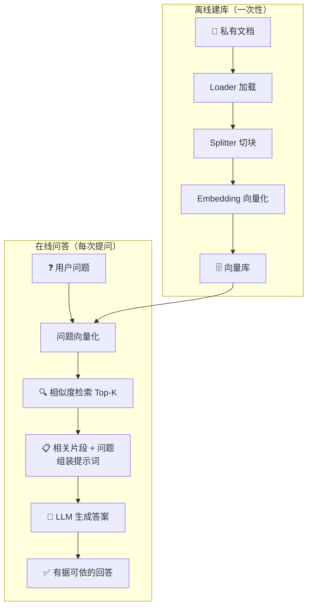
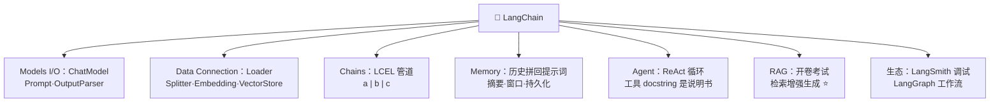

# 🦜 LangChain 学习笔记

> 一句话介绍：**LangChain = 大模型应用开发的"脚手架框架"**——把调用 LLM、拼提示词、查知识库、调工具、记上下文这些脏活累活全封装好，让你像搭积木一样快速构建 AI 应用（聊天机器人、RAG 问答、Agent…）✨
>
> 📌 代码基于 **LangChain 0.3.x**（Python 版，LCEL 写法为主），旧的 LLMChain 写法会标注说明～

---

## 📖 开篇：学习路线总览



| 章节 | 内容 | 难度 |
|------|------|------|
| 一 | LangChain 是什么、能干什么 | ⭐ |
| 二 | Models I/O：提示词模板 + 输出解析器 | ⭐⭐ |
| 三 | Data Connection：文档加载切分 + 向量库 | ⭐⭐⭐ |
| 四 | Chains：LCEL 管道语法（核心思想！）| ⭐⭐⭐ |
| 五 | Memory：让对话记住上下文 | ⭐⭐ |
| 六 | Agent + Tools：让 LLM 学会用工具 | ⭐⭐⭐⭐ |
| 七 | RAG 检索增强完整实战（重头戏！）| ⭐⭐⭐⭐ |

---

## 一、LangChain 是什么？🦜

### 1.1 为什么需要它？

裸调 OpenAI/通义千问 API 的痛点 😫：

| 痛点 | LangChain 的答案 |
|------|------------------|
| 提示词字符串拼接又乱又难维护 | **PromptTemplate 模板化** |
| 想让模型回答自己文档/数据库的内容，它不会 | **RAG：检索增强生成** |
| 模型不会算数、不能联网、查不了数据库 | **Agent + Tools 调用外部工具** |
| 多轮对话模型记不住前面说了啥 | **Memory 记忆管理** |
| 各家模型 API 不一样，换模型改一堆代码 | **统一接口，一行切换** |

### 1.2 核心组件全家福 🧩



### 1.3 安装速查

```bash
pip install langchain langchain-openai langchain-community
# 向量库以 Chroma + OpenAI Embeddings 为例
pip install chromadb
# LangChain 0.3 拆分包：核心 / 模型厂商 / 社区集成 分家安装，按需取用～
```

---

## 二、Models I/O：和模型对话的标准姿势 💬

**三步走**：写提示词 → 发给模型 → 解析输出



### 2.1 模型：ChatModel

```python
from langchain_openai import ChatOpenAI

# 国内模型（如通义/DeepSeek）只需改 base_url 和 key
llm = ChatOpenAI(
    model="qwen-plus",
    base_url="https://dashscope.aliyuncs.com/compatible-mode/v1",
    api_key="sk-xxx",
    temperature=0,        # 0 = 稳定不发散；越大越发散有创意
)

resp = llm.invoke("用一句话介绍你自己")
print(resp.content)
```

| 参数 | 说明 |
|------|------|
| `temperature` | 0~2：越低越确定（问答建议 0），越高越随机（写文案可调高）|
| `model` | 模型名 |
| `streaming` | 流式输出（打字机效果 ⌨️）|

### 2.2 提示词模板：告别字符串拼接 🧵

```python
from langchain_core.prompts import ChatPromptTemplate

# 消息列表模板：system 定人设，human 是用户输入
prompt = ChatPromptTemplate.from_messages([
    ("system", "你是一位{name}领域的专家，回答要简洁。"),
    ("human", "{question}"),
])

filled = prompt.invoke({"name": "编程", "question": "什么是递归？"})
print(filled)
```

> 🎀 `system`（设定角色规则）+ `human`（用户）+ `ai`（模型历史回复）三兄弟，多轮对话模板靠它们组合～

### 2.3 输出解析器：把"话痨"变"数据" 📋

```python
from langchain_core.output_parsers import JsonOutputParser, StrOutputParser
from pydantic import BaseModel, Field

# 结构化输出：让模型必须吐出指定 JSON
class Joke(BaseModel):
    setup: str = Field(description="笑话的开头")
    punchline: str = Field(description="笑点")

parser = JsonOutputParser(pydantic_object=Joke)

# 最常用的字符串解析器（取 .content）
str_parser = StrOutputParser()
```

| 解析器 | 用途 |
|--------|------|
| `StrOutputParser` | 取纯文本（最常用）|
| `JsonOutputParser` | 输出 JSON 并校验 |
| `PydanticOutputParser` | 强类型校验 |
| `with_structured_output` | 新姿势：模型原生函数调用，最稳 ⭐ |

---

## 三、Data Connection：喂私有知识给模型 📚



### 3.1 加载与切分

```python
from langchain_community.document_loaders import PyPDFLoader, TextLoader, WebBaseLoader
from langchain_text_splitters import RecursiveCharacterTextSplitter

# ① 加载（loader 输出 Document 列表：page_content + metadata）
docs = PyPDFLoader("报告.pdf").load()

# ② 切分：递归分隔符切分器（段落 → 句子 → 字符，层层回退，最常用！）
splitter = RecursiveCharacterTextSplitter(
    chunk_size=500,       # 每块 500 字符
    chunk_overlap=50,     # 块间重叠 50，防止句子被拦腰截断丢上下文
)
chunks = splitter.split_documents(docs)
```

| 参数 | 经验值 |
|------|--------|
| `chunk_size` | 300~1000（太小语义不完整，太大检索不精准）|
| `chunk_overlap` | chunk_size 的 10%~20% |

### 3.2 向量化与向量库

```python
from langchain_openai import OpenAIEmbeddings
from langchain_community.vectorstores import Chroma, FAISS

embeddings = OpenAIEmbeddings(model="text-embedding-3-small")

# 入库（本地/内存演示；生产用 Milvus、pgvector 等）
vectorstore = Chroma.from_documents(chunks, embeddings, persist_directory="./db")

# 语义检索：找最相似的 4 块
retriever = vectorstore.as_retriever(search_kwargs={"k": 4})
docs = retriever.invoke("LangChain 是什么？")
```

| 向量库 | 特点 |
|--------|------|
| FAISS | 内存级，快，适合演示/中小数据 |
| Chroma | 轻量易用，开发友好 |
| **Milvus / pgvector** | 分布式/数据库生态，**生产级** ⭐ |

> 💡 **Embedding 的意义**：把文字变成高维向量，语义相近 → 向量距离近。所以"怎么退货"能搜到"退换货政策"，不是靠关键词，是靠**语义**！✨

---

## 四、Chains：LCEL 管道语法 🚇（核心思想！）

> 🎀 **LCEL（LangChain Expression Language）**：用 `|` 把组件像水管一样接起来，数据从左流到右——这是 0.1+ 版本最重要的思想！

```python
from langchain_core.prompts import ChatPromptTemplate
from langchain_core.output_parsers import StrOutputParser
from langchain_core.runnables import RunnablePassthrough

prompt = ChatPromptTemplate.from_template(
    "你是资深程序员，用一段话解释 {topic}"
)

# 管道：模板 → 模型 → 解析器
chain = prompt | llm | StrOutputParser()

result = chain.invoke({"topic": "递归"})
print(result)   # 直接拿到字符串～

# 流式输出：一行切换，打字机效果！
for token in chain.stream({"topic": "递归"}):
    print(token, end="", flush=True)
```

| LCEL 能力 | 写法 |
|-----------|------|
| 顺序拼接 | `a | b | c` |
| 并行分叉 | `RunnableParallel` 或字典语法 `{"a": chain1, "b": chain2}` |
| 条件分支 | `RunnableBranch`（按条件路由）|
| 传入原值 | `RunnablePassthrough()`（常用于同时传 question 和检索结果）|
| 取字典字段 | `itemgetter("question")` |

```python
# 经典组合：问题原样传 + 检索结果一起进模板（RAG 骨架！）
rag_chain = (
    {"context": retriever, "question": RunnablePassthrough()}
    | prompt
    | llm
    | StrOutputParser()
)
print(rag_chain.invoke("公司的退货政策是什么？"))
```

> ⚠️ 旧版 `LLMChain(prompt=..., llm=...)` 已不推荐——**新代码一律 LCEL**！

---

## 五、Memory：让对话有记性 🧠

LLM 本身是"金鱼记忆" 🐟——每次请求独立，不记得上一轮。Memory 来救场：



```python
from langchain_core.chat_history import InMemoryChatMessageHistory
from langchain_core.runnables.history import RunnableWithMessageHistory

prompt = ChatPromptTemplate.from_messages([
    ("system", "你是一个乐于助人的助手。"),
    ("placeholder", "{chat_history}"),     # 历史消息插槽
    ("human", "{input}"),
])
chain = prompt | llm

# 会话存储：session_id 隔离不同用户的聊天记录
store = {}
def get_history(session_id: str):
    if session_id not in store:
        store[session_id] = InMemoryChatMessageHistory()
    return store[session_id]

chat = RunnableWithMessageHistory(
    chain, get_history,
    input_messages_key="input",
    history_messages_key="chat_history",
)

cfg = {"configurable": {"session_id": "user-001"}}
print(chat.invoke({"input": "我叫小明，喜欢打篮球"}, config=cfg).content)
print(chat.invoke({"input": "我叫什么名字？"}, config=cfg).content)   # 答得出"小明"！
```

| 记忆策略 | 特点 |
|----------|------|
| Buffer 完整历史 | 原样全存，token 越聊越多 💸 |
| **Summary 摘要** | 定期总结压缩历史 ⭐ |
| Window 滑动窗口 | 只保留最近 K 轮 |
| 向量记忆 | 历史也向量化，按相关性捞 |

> 🎀 **提醒**：记忆的本质 = **把历史消息塞回提示词**！生产环境 store 要换成 Redis/数据库，并做长度控制，不然 token 费用爆炸 💥

---

## 六、Agent：让模型学会"自己动手" 🤖

### 6.1 核心思想：ReAct 循环

> 模型自己判断：**思考（Thought）→ 行动（Action 调工具）→ 观察（Observation 看结果）→ 循环…直到给出最终答案**



### 6.2 定义工具 + 创建 Agent

```python
from langchain_core.tools import tool
from langchain.agents import create_tool_calling_agent, AgentExecutor

@tool
def get_weather(city: str) -> str:
    """查询指定城市的天气。city: 城市名"""   # ← docstring 就是给模型看的"说明书"！
    return f"{city}今天 22℃，晴"

@tool
def calc(expression: str) -> str:
    """计算数学表达式"""
    return str(eval(expression))

tools = [get_weather, calc]

prompt = ChatPromptTemplate.from_messages([
    ("system", "你是一个有用的助手"),
    ("placeholder", "{chat_history}"),
    ("human", "{input}"),
    ("placeholder", "{agent_scratchpad}"),   # Agent 思考/调工具的过程插槽（必须！）
])

agent = create_tool_calling_agent(llm, tools, prompt)
executor = AgentExecutor(agent=agent, tools=tools, verbose=True)  # verbose 看决策过程

print(executor.invoke({"input": "北京天气怎么样？如果气温乘以2是多少度？"})["output"])
```

### 6.3 关键点

| 要点 | 说明 |
|------|------|
| 工具的 `docstring` | **极其重要**！模型靠它决定"什么时候用哪个工具" |
| `agent_scratchpad` | 记录思考与工具调用的草稿纸，模板必须有 |
| `verbose=True` | 打印决策过程，调试神器 🔍 |
| 常用工具生态 | 搜索（Tavily）、Python REPL、SQL 查询、文件操作… |

> ⚠️ **Agent 的取舍**：自由度高但不可控、慢、烧 token——能写死流程（Chain）就别上 Agent！🚦

---

## 七、RAG 实战：完整流程 🎯（重头戏！）

### 7.1 什么是 RAG？

**RAG（Retrieval-Augmented Generation，检索增强生成）**：先从你的私有知识库里**检索**相关内容，再把内容塞进提示词让模型**生成**答案——"开卷考试" 📖，模型不用死记硬背（也记不住你的私有数据）！

| 痛点 | RAG 怎么救 |
|------|-----------|
| 模型知识过时 | 实时检索最新文档 |
| 模型不了解私有数据 | 文档入库，按需检索 |
| 幻觉（一本正经胡说八道）| 让模型"根据以下资料回答"，有据可依 ✅ |

### 7.2 完整流程图



### 7.3 完整可跑代码

```python
from langchain_openai import ChatOpenAI, OpenAIEmbeddings
from langchain_community.vectorstores import Chroma
from langchain_text_splitters import RecursiveCharacterTextSplitter
from langchain_core.prompts import ChatPromptTemplate
from langchain_core.output_parsers import StrOutputParser
from langchain_core.runnables import RunnablePassthrough

llm = ChatOpenAI(model="qwen-plus", temperature=0)

# ---------- ① 离线建库 ----------
docs = TextLoader("公司制度.txt", encoding="utf-8").load()
chunks = RecursiveCharacterTextSplitter(
    chunk_size=500, chunk_overlap=50
).split_documents(docs)

vectorstore = Chroma.from_documents(chunks, OpenAIEmbeddings(), persist_directory="./db")
retriever = vectorstore.as_retriever(search_kwargs={"k": 3})

# ---------- ② 在线问答 ----------
prompt = ChatPromptTemplate.from_template("""
请仅根据以下资料回答问题，资料里没有就老实说不知道～

【资料】
{context}

【问题】
{question}
""")

def format_docs(docs):
    return "\n\n".join(d.page_content for d in docs)

rag_chain = (
    {
        "context": retriever | format_docs,   # 检索 → 拼成文本
        "question": RunnablePassthrough(),     # 问题原样传
    }
    | prompt
    | llm
    | StrOutputParser()
)

print(rag_chain.invoke("年假有几天？"))
```

### 7.4 RAG 进阶话题（优化方向 ⬆️）

| 环节 | 优化手段 |
|------|----------|
| 检索 | 混合检索（向量 + 关键词 BM25）、重排序 Rerank ⭐ |
| 切分 | 按语义/标题切分、parent-child 小块检索大块喂 |
| 提示词 | 引用来源、拒答兜底（防幻觉）|
| 建库 | 增删改同步、元数据过滤（按部门/时间筛选）|
| 效果评估 | Ragas 等评估框架量化 |

---

## 八、生态工具 & 调试 🧰

| 工具 | 干什么 |
|------|--------|
| **LangSmith** | 全链路追踪调试：每一步的输入输出、token 消耗、延迟（生产必备 🔍）|
| **LangServe** | 把 chain 一键部署成 REST API |
| **LangGraph** | 复杂多步骤 Agent 工作流（状态机/循环图），Agent 进阶必学 ⭐ |
| Callbacks | 代码里挂回调：打日志、埋点 |

---

## 九、高频问题速查 🎯

| 问题 | 要点 |
|------|------|
| LangChain 是什么/解决什么？ | LLM 应用开发框架：模板/检索/记忆/工具/链的标准化封装 |
| LCEL 是什么？ | `|` 管道语法组装 Runnable，天然支持流式/并行/异步 |
| RAG 原理和流程？ | 离线：加载→切分→向量化→入库；在线：检索→拼提示词→生成 |
| chunk_size/overlap 怎么设？ | 300~1000 字符；重叠 10%~20%，平衡语义完整与检索精度 |
| Memory 原理？ | 历史消息拼回提示词；策略有 buffer/摘要/窗口 |
| Agent 原理？ | ReAct：思考→调工具→观察循环，直到能给最终答案 |
| 工具怎么被模型选中？ | 靠函数签名 + docstring 描述，模型决定调用 |
| Chain vs Agent 怎么选？ | 流程固定用 Chain（省 token 可控）；需自主决策用 Agent |
| 如何减少幻觉？ | RAG + 提示词约束"仅根据资料回答" + 拒答兜底 |
| 向量库选型？ | 演示 FAISS/Chroma；生产 Milvus/pgvector |

---

## 十、结语 🌸

LangChain 的知识树收好啦：



> 🎀 学习建议：
> 1. **先把 LCEL 管道思想吃透**——`prompt | llm | parser` 三件套是所有应用的骨架！
> 2. **RAG 是当下最实用的落地场景**：照着第七章代码亲手跑一遍"私有知识问答"，体验从建库到提问的全流程～
> 3. Agent 玩起来很爽但别迷信，**能用 Chain 固定流程就别让模型自由发挥** 🚦
>
> 大数据笔记集齐后又点亮 AI 技能树 🌱，接下来想学什么（RAG 进阶？LangGraph？还是深度学习框架）？人家随时待命～冲鸭！💪(๑•̀ㅂ•́)و✧
