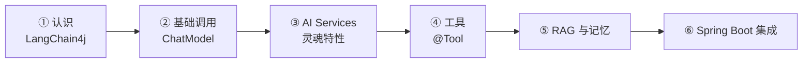
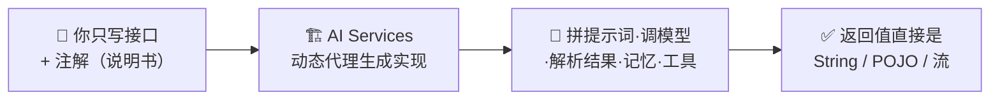
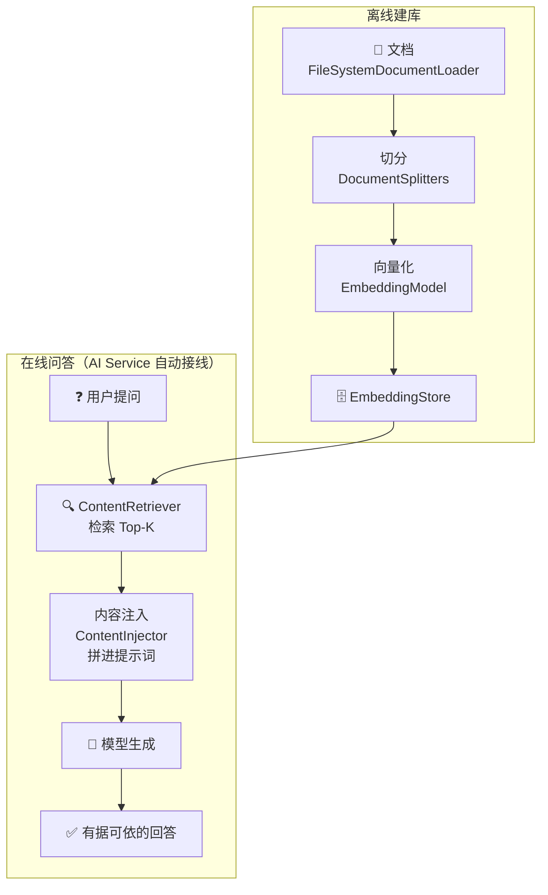
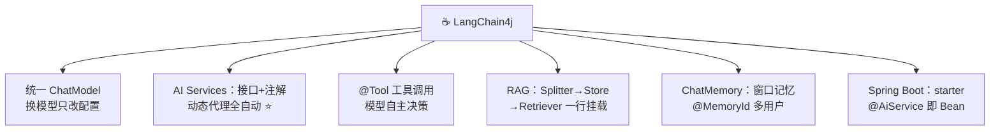

# ☕ LangChain4j 学习笔记

> 一句话介绍：**LangChain4j = Java 生态版的 LangChain**——把调用大模型、提示词模板、RAG、工具调用、对话记忆封装成**优雅的 Java API**，还能和 Spring Boot 无缝集成。Java 开发者搞 AI 应用，不用再羡慕 Python 啦！✨
>
> 📌 对照着 [LangChain.md](./LangChain.md)（Python 版）学更香——概念一一对应，只有写法不同～代码基于 **LangChain4j 1.x**！

---

## 📖 开篇：学习路线总览



| 章节 | 内容 | 难度 |
|------|------|------|
| 一 | LangChain4j 是什么、和 Python 版对比 | ⭐ |
| 二 | 快速开始：五种模型接入 | ⭐ |
| 三 | **AI Services：声明式接口（灵魂！）** | ⭐⭐⭐⭐ |
| 四 | 工具调用：@Tool 函数调用 | ⭐⭐⭐ |
| 五 | RAG + ChatMemory | ⭐⭐⭐⭐ |
| 六 | Spring Boot 集成（企业级姿势）| ⭐⭐⭐ |

---

## 一、LangChain4j 是什么？☕

### 1.1 为什么 Java 也需要它？

| 现实痛点 | LangChain4j 的答案 |
|----------|-------------------|
| AI 框架全是 Python，Java 项目接入难 | 纯 Java SDK，企业级生态直接用 |
| 各家大模型 API 风格不一 | 统一 `ChatModel` 接口，**换模型只改依赖+配置** |
| 想在 Spring 服务里加 AI 能力 | 提供 Spring Boot Starter，像写普通 Service 一样写 AI |
| RAG/工具/记忆自己造轮子太累 | 全家桶 API + 30+ 集成（向量库/模型）|

### 1.2 vs Python LangChain 对照表 🪞

| 概念 | Python LangChain | **LangChain4j** |
|------|------------------|-----------------|
| 编排思想 | LCEL 管道 `a\|b\|c` | **AI Services 声明式接口** ⭐ |
| 提示词模板 | ChatPromptTemplate | `@SystemMessage` / `@UserMessage` 注解 |
| 工具定义 | `@tool` 装饰器 | `@Tool` 注解 |
| 记忆 | RunnableWithMessageHistory | `ChatMemory` 挂到服务 |
| RAG | retriever + LCEL | `ContentRetriever` + AI Services 自动注入 |
| 向量库 | FAISS/Chroma/Milvus | InMemory/PGVector/Milvus/Chroma/Weaviate… |

> 🎀 最大的思想差异：Python 用"**管道**"组装，Java 用"**接口 + 注解**"声明——后者更像 **MyBatis Mapper** 的感觉：定义接口 + 注解，框架动态生成实现！

---

## 二、快速开始 🚀

### 2.1 Maven 依赖

```xml
<!-- 核心 + 模型厂商按需引入（以 OpenAI 兼容接口为例，可对接 DeepSeek/通义等） -->
<dependency>
    <groupId>dev.langchain4j</groupId>
    <artifactId>langchain4j-open-ai</artifactId>
    <version>1.0.0</version>
</dependency>
<!-- 常用伴生包：工具/记忆/RAG 高级 API -->
<dependency>
    <groupId>dev.langchain4j</groupId>
    <artifactId>langchain4j</artifactId>
    <version>1.0.0</version>
</dependency>
```

### 2.2 第一个程序：直呼模型

```java
import dev.langchain4j.model.openai.OpenAiChatModel;

OpenAiChatModel model = OpenAiChatModel.builder()
        .baseUrl("https://dashscope.aliyuncs.com/compatible-mode/v1")  // 国内模型兼容地址
        .apiKey("sk-xxx")
        .modelName("qwen-plus")
        .temperature(0.0)
        .build();

String answer = model.chat("用一句话解释递归");
System.out.println(answer);   // 简单场景直接 chat() 就够了～
```

### 2.3 支持的模型一览

| 厂商/方式 | 依赖 artifactId 后缀 |
|-----------|---------------------|
| OpenAI（兼容 DeepSeek、通义、智谱…）| `langchain4j-open-ai` |
| 本地模型 | `langchain4j-ollama` |
| Anthropic / Google / Azure | `langchain4j-anthropic` 等 |
| 国产直连 | `langchain4j-zhipu-ai`、`langchain4j-qianfan` 等 |

> 💡 **换模型 = 换一个 Model 类的构建**，上层 AI Services 代码**一行不改**——这就是统一接口的魅力！

---

## 三、AI Services：声明式接口（灵魂特性！）🪄

### 3.1 核心思想：像写 MyBatis Mapper 一样写 AI 调用



### 3.2 三步用起来：定义接口 → 配置 → 调用

```java
// ① 定义接口：注解就是提示词模板
interface Assistant {

    @SystemMessage("你是一位资深 Java 讲师，回答简洁幽默")   // 人设
    @UserMessage("请解释 {{it}}，不超过 50 字")              // 用户消息模板，{{it}} = 单参数
    String explain(String concept);
}

// ② 构建 AI Service
Assistant assistant = AiServices.builder(Assistant.class)
        .chatModel(model)
        .build();

// ③ 像调本地方法一样调 AI！
System.out.println(assistant.explain("多态"));
```

### 3.3 模板变量：@V

```java
interface Assistant {
    @SystemMessage("你是{{role}}，用{{style}}的语气回答")
    @UserMessage("介绍一下 {{topic}}")
    String chat(@V("role") String role,
                @V("style") String style,
                @V("topic") String topic);
}
```

| 注解 | 作用 |
|------|------|
| `@SystemMessage` | 系统提示词（人设/规则）|
| `@UserMessage` | 用户消息模板，`{{变量}}` 占位 |
| `@V("名")` | 多参数时绑定变量名 |
| `{{it}}` | 单参数时的内置占位符 |

### 3.4 结构化输出：返回值直接是 POJO 📋

```java
// 定义返回结构（自动转 JSON Schema 让模型输出 JSON，再反序列化）
record Book(String title, String author, double price) {}

interface Assistant {
    @UserMessage("推荐一本关于{{topic}}的书，返回 JSON")
    Book recommendBook(String topic);
}

Book book = assistant.recommendBook("并发编程");
System.out.println(book.title());   // 直接拿到对象，不用手写解析！✨
```

### 3.5 流式输出：TokenStream

```java
interface StreamingAssistant {
    @SystemMessage("你是有趣的讲师")
    TokenStream explain(String topic);
}

StreamingAssistant sa = AiServices.builder(StreamingAssistant.class)
        .streamingChatModel(streamingModel)     // 用流式模型
        .build();

sa.explain("JVM 内存模型")
  .onPartialResponse(token -> System.out.print(token))  // 打字机效果 ⌨️
  .onCompleteResponse(r -> System.out.println("\n[完]"))
  .onError(Throwable::printStackTrace)
  .start();
```

> 🎀 **总结**：AI Services = 提示词模板 + 模型调用 + 输出解析 + 后面的记忆/工具/RAG **全自动接线**——一个接口注解全搞定，这才是 Java 味儿的优雅！

---

## 四、工具调用：@Tool 🔧

让模型能"动手"：查数据库、调接口、算数学…

```java
import dev.langchain4j.agent.tool.Tool;

class WeatherTools {

    @Tool("查询指定城市的当前天气")           // ← 描述给模型看，决定何时调用！
    String getWeather(String city) {
        return city + " 今天 22℃，晴";
    }

    @Tool("计算数学表达式的值")
    double calc(String expression) {
        return 2 * 11;   // 示意：实际可接表达式引擎
    }
}

// 注册到 AI Service：一行！
interface Assistant {
    @SystemMessage("必要时使用工具回答")
    String chat(String question);
}

Assistant assistant = AiServices.builder(Assistant.class)
        .chatModel(model)
        .tools(new WeatherTools())     // 框架自动完成：函数签名→描述、调用→回填
        .build();

System.out.println(assistant.chat("北京天气怎样？气温乘 2 是多少？"));
// 模型自己决定：先调 getWeather("北京") → 再调 calc("22*2") → 汇总回答 ✅
```

| 要点 | 说明 |
|------|------|
| `@Tool("描述")` | **给模型的说明书**，写得越清楚调用越准（同 Python docstring）|
| 参数也可注解 | `@P("城市名，如：北京") String city` |
| 执行流程 | 模型返回工具调用请求 → 框架反射执行 → 结果回填消息 → 模型继续（自动循环）|

---

## 五、RAG 与 ChatMemory 📚🧠

### 5.1 RAG 全流程（Java 版）



```java
import dev.langchain4j.data.document.Document;
import dev.langchain4j.data.document.DocumentSplitter;
import dev.langchain4j.data.document.loader.FileSystemDocumentLoader;
import dev.langchain4j.data.document.splitter.DocumentSplitters;
import dev.langchain4j.model.embedding.EmbeddingModel;
import dev.langchain4j.store.embedding.EmbeddingStoreIngestor;
import dev.langchain4j.store.embedding.inmemory.InMemoryEmbeddingStore;
import dev.langchain4j.rag.content.retriever.EmbeddingStoreContentRetriever;

// ---------- ① 离线建库 ----------
Document doc = FileSystemDocumentLoader.loadDocument("公司制度.md");
DocumentSplitter splitter = DocumentSplitters.recursive(500, 50);  // 500字符，重叠50

EmbeddingStore<Embedding> store = new InMemoryEmbeddingStore<>();   // 生产换 PGVector/Milvus
EmbeddingStoreIngestor.ingest(doc, splitter, embeddingModel, store);

// ---------- ② 检索器：挂上向量库 ----------
ContentRetriever retriever = EmbeddingStoreContentRetriever.builder()
        .embeddingStore(store)
        .embeddingModel(embeddingModel)
        .maxResults(3)                       // Top-3
        .build();

// ---------- ③ AI Service 自动 RAG：调用时自动检索并注入！----------
interface DocAssistant {
    @SystemMessage("仅根据提供的资料回答，没有就说不知道")
    String ask(String question);
}

DocAssistant docAssistant = AiServices.builder(DocAssistant.class)
        .chatModel(model)
        .contentRetriever(retriever)    // ← 就这一行，RAG 就接好了！
        .build();

System.out.println(docAssistant.ask("年假有几天？"));
```

| 组件 | 职责 | 对应 Python 版 |
|------|------|----------------|
| `DocumentSplitter` | 切块（递归/段落/句子）| RecursiveCharacterTextSplitter |
| `EmbeddingStore` | 向量库（InMemory/PGVector/Milvus…）| Chroma/FAISS |
| `ContentRetriever` | 检索器 | retriever |
| `ContentInjector` | 把检索内容拼进提示词 | 手动 format_docs |
| **Easy-rag** | 零配置起步包（`langchain4j-easy-rag`）| —— |

### 5.2 ChatMemory：对话记忆

```java
import dev.langchain4j.memory.chat.MessageWindowChatMemory;
import dev.langchain4j.memory.chat.TokenWindowChatMemory;

Assistant assistant = AiServices.builder(Assistant.class)
        .chatModel(model)
        .chatMemory(MessageWindowChatMemory.withMaxMessages(10))  // 最多记10条
        // 或者：TokenWindowChatMemory.builder()
        //         .maxTokens(1000, tokenizer).build()  // 按token控制，更省钱
        .build();

assistant.chat("我叫小明");
System.out.println(assistant.chat("我叫什么？"));   // 记得！"小明" ✅
```

| 记忆实现 | 策略 | 说明 |
|----------|------|------|
| `MessageWindowChatMemory` | 滑动窗口（按条数）| 简单省事 |
| `TokenWindowChatMemory` | 滑动窗口（按 token）| 精准控费 ⭐ |
| `ChatMemoryProvider` | **按 memoryId 隔离多用户** | 每个会话独立记忆（生产必用）|

```java
// 多用户隔离：接口方法加 @MemoryId 参数即可！
interface Assistant {
    String chat(@MemoryId String userId, @UserMessage String message);
}

.chatMemoryProvider(userId -> MessageWindowChatMemory.withMaxMessages(10))
// 不同 userId → 不同记忆空间，互不串扰～
```

---

## 六、Spring Boot 集成 🏢（企业级姿势）

### 6.1 依赖 + 配置

```xml
<dependency>
    <groupId>dev.langchain4j</groupId>
    <artifactId>langchain4j-open-ai-spring-boot-starter</artifactId>
    <version>1.0.0</version>
</dependency>
<dependency>
    <groupId>dev.langchain4j</groupId>
    <artifactId>langchain4j-spring-boot-starter</artifactId>
    <version>1.0.0</version>
</dependency>
```

```yaml
langchain4j:
  open-ai:
    chat-model:
      base-url: https://dashscope.aliyuncs.com/compatible-mode/v1
      api-key: ${DASHSCOPE_KEY}
      model-name: qwen-plus
      temperature: 0.0
```

### 6.2 @AiService：声明即 Bean

```java
// 接口上打个注解，Spring 容器里就有它了！
@AiService
public interface Assistant {

    @SystemMessage("你是公司客服小助，回答简洁友好")
    String chat(String userMessage);
}

// Controller 里直接注入使用～
@RestController
class ChatController {
    private final Assistant assistant;      // 像普通 Service 一样注入 ✅

    ChatController(Assistant assistant) { this.assistant = assistant; }

    @PostMapping("/chat")
    String chat(@RequestBody String msg) {
        return assistant.chat(msg);
    }
}
```

> 🎀 **对比一下**：手动模式要自己 `AiServices.builder(...)`；starter 模式**注解一打、配置一写**，AI 能力像魔法一样融进 Spring 全家桶（DI、配置中心、监控全通用）——这就是 Java 企业级开发的丝滑体验！

---

## 七、生态与进阶 🧰

| 能力 | 说明 |
|------|------|
| **可观测** | `ChatModelListener` 监听请求/响应/错误；对接 LangSmith 思路一致 |
| **审核** | `ModerationModel` 内容安全审查 |
| **Agent/工作流** | 复杂编排可用社区方案 / 自研状态机；LangChain4j 官方也在推进 Agentic 能力（对标 [LangGraph](./LangGraph.md)）|
| **文档加载器** | 文件/URL/OCR（Azure Document Intelligence）/GitHub/Notion… 20+ |
| **向量库集成** | PGVector、Milvus、Chroma、Weaviate、Elasticsearch、Redis… 15+ |

---

## 八、高频问题速查 🎯

| 问题 | 要点 |
|------|------|
| LangChain4j 是什么？ | Java 版 LLM 应用框架：统一模型接口 + AI Services + RAG/工具/记忆 |
| 和 Python LangChain 区别？ | 概念相通；Python 用 LCEL 管道，Java 用 AI Services 声明式接口（类 MyBatis）|
| AI Services 原理？ | 动态代理：接口+注解 → 框架拼提示词、调模型、解析返回值 |
| 结构化输出怎么做？ | 方法返回类型直接写 POJO/record，框架自动 JSON Schema 约束 |
| 工具怎么定义？ | `@Tool("描述")` 方法 + `.tools(实例)` 注册，模型自动决定调用 |
| RAG 怎么接？ | Ingestor 建库 → ContentRetriever → `.contentRetriever()` 一行挂载 |
| 记忆怎么做？多用户隔离？ | ChatMemory（条数/Token 窗口）；`@MemoryId` + chatMemoryProvider 按用户隔离 |
| 怎么接 Spring Boot？ | starter + yaml 配置 + `@AiService` 注解，接口即 Bean |
| 换模型要改多少代码？ | 只换 Model 构建与依赖，AI Services 层零改动 |
| 流式输出？ | 返回 `TokenStream`（或 WebFlux `Flux<String>`），onPartialResponse 逐 token |

---

## 九、结语 🌸

LangChain4j 的知识树收好啦：



> 🎀 学习建议：
> 1. **AI Services 是全框架的灵魂**——先写三个接口跑通（普通/模板变量/POJO 返回），体会"声明式"的优雅！
> 2. 把第五章 RAG 例子跑起来，对照 [LangChain.md](./LangChain.md) 的 Python 版看：**概念 100% 相通，只是换了语法皮肤** 🪞
> 3. 企业开发重点看第六章：starter + `@AiService`，把 AI 能力当普通 Spring Bean 用才是生产正解～
>
> AI 框架三件套集齐 🎉：LangChain（Python 管道）+ LangGraph（Python 图）+ LangChain4j（Java 声明式）——无论后端是什么语言都能优雅拥抱大模型！还想学什么尽管吩咐～冲鸭！💪(๑•̀ㅂ•́)و✧
