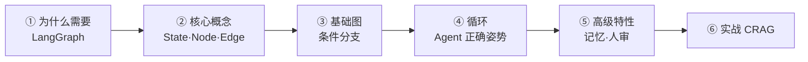
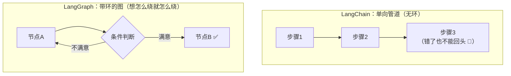
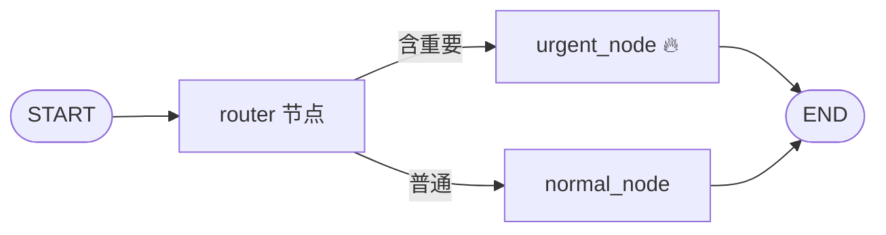
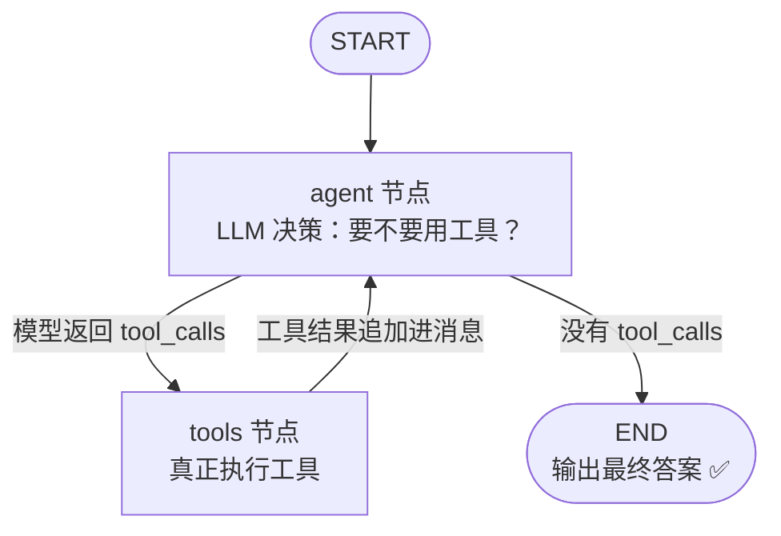
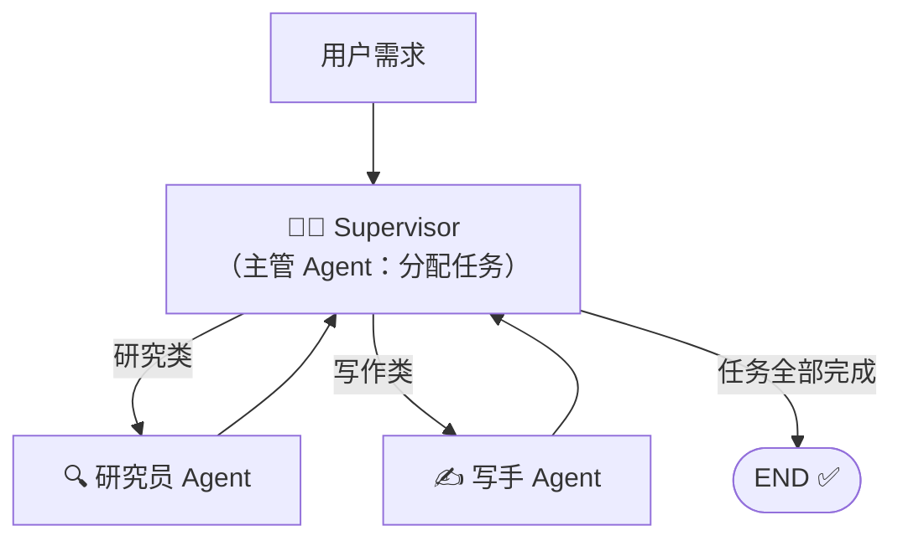
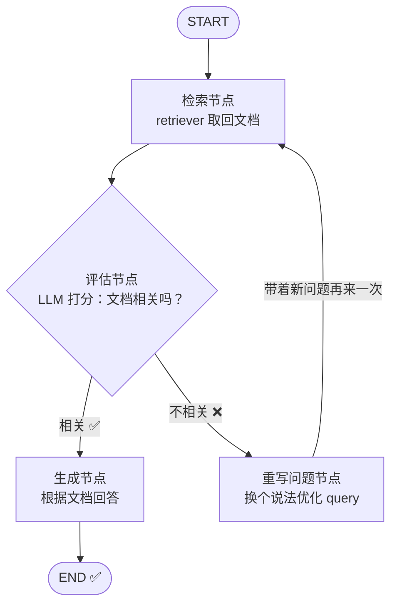
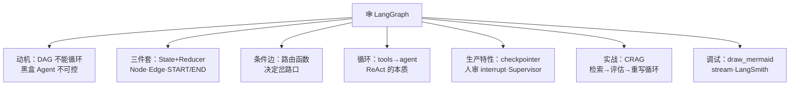

# 🕸️ LangGraph 学习笔记

> 一句话介绍：**LangGraph = 把 LLM 应用画成"带环的图"的低层级编排框架**——节点是步骤、边是路径、状态是共享黑板，还能循环、能回退、能暂停等人审批。构建**可控 Agent / 多步工作流 / 多 Agent 系统**的当代主力！✨
>
> 📌 学习前置：先看 [LangChain.md](./LangChain.md)（LCEL 和 Agent 基础），本篇是它的进阶续集～

---

## 📖 开篇：学习路线总览



| 章节 | 内容 | 难度 |
|------|------|------|
| 一 | LangChain 不够用在哪、图思维 | ⭐ |
| 二 | State / Node / Edge 三大件 | ⭐⭐ |
| 三 | 第一个图 + 条件路由 | ⭐⭐ |
| 四 | 循环：Tool Agent 的正确打开方式 | ⭐⭐⭐⭐ |
| 五 | 记忆 / 人审 / 多 Agent / 并行 | ⭐⭐⭐⭐ |
| 六 | 实战：带自我修正的循环 RAG | ⭐⭐⭐⭐ |

---

## 一、为什么需要 LangGraph？🤔

### 1.1 LangChain 的两个"天花板"

| 痛点 | 解释 |
|------|------|
| **链（LCEL）是单向 DAG** | `a | b | c` 只能从左往右流，**不能回头、不能循环**——而"试了不行再重试"恰恰是 Agent 的日常 |
| **AgentExecutor 是个黑盒** | 循环逻辑藏在框架里：想在中间插一步人工审批？想在第 3 轮强制停止？改不动 😫 |

### 1.2 LangGraph 的答案：显式的"状态机 + 图"



> 🎀 一句话：**LangChain 像流水线（传送带），LangGraph 像地铁线路图（可以换乘、可以绕圈）**～ReAct 循环、自我修正、人工审批，都是图里的一条环/一个中断点而已！

### 1.3 什么时候用什么？

| 场景 | 推荐 |
|------|------|
| 固定步骤的简单链 | LangChain LCEL（够用别上强度）|
| 需要循环/分支/重试/审批 | **LangGraph** ⭐ |
| 多个 Agent 协作（主管派活）| **LangGraph** ⭐ |
| 官方关系 | LangGraph 建立在 langchain-core 之上，全家桶无缝混用 |

---

## 二、核心概念：State · Node · Edge 🧱

### 2.1 三大件

```mermaid
flowchart TB
    S["🗄️ State 状态<br/>（全局共享的"黑板"）"] 
    N1["🔵 Node 节点 = 一个函数<br/>读状态 → 干活 → 返回状态更新"]
    E["➡️ Edge 边 = 路径<br/>告诉图下一步去哪"]
    S -.->|"所有节点共用"| N1
    N1 -.-> E
```

| 概念 | 是什么 | 怎么写 |
|------|--------|--------|
| **State** | 全局共享的数据结构（消息列表、中间结果…）| `TypedDict` 或 Pydantic 类 |
| **Node** | 一个普通函数：接收 state，返回**要更新的字段** | `graph.add_node("名字", 函数)` |
| **Edge** | 普通边（固定去向）/ 条件边（函数决定去向）| `add_edge` / `add_conditional_edges` |
| **START / END** | 特殊虚拟节点：入口和出口 | 从 `langgraph.graph` 导入 |

### 2.2 状态更新的关键：Reducer 🔄

```python
from typing import Annotated
from typing_extensions import TypedDict
import operator

class State(TypedDict):
    messages: Annotated[list, operator.add]   # ← 关键！新消息"追加"而不是"覆盖"
    count: int                                 # 无 reducer = 直接覆盖
```

| 写法 | 行为 |
|------|------|
| `count: int` | 节点返回 `{"count": 5}` → **覆盖**旧值 |
| `messages: Annotated[list, operator.add]` | 节点返回新列表 → **合并追加**（聊天记录必备！）|

> 💡 忘写 reducer 时如果两个节点都写同一字段会直接报错——**"聊天要追加，结果要覆盖"**，记住这句口诀～

---

## 三、第一个图：Hello Graph 👋

### 3.1 三步搭图：定义 → 连线 → 编译

```python
from typing_extensions import TypedDict
from langgraph.graph import StateGraph, START, END

# ① 定义状态
class State(TypedDict):
    text: str

# ② 定义节点（函数）
def step_a(state: State):
    return {"text": state["text"] + " → 经过A"}   # 返回要更新的字段

def step_b(state: State):
    return {"text": state["text"] + " → 经过B"}

# ③ 建图连线
builder = StateGraph(State)
builder.add_node("a", step_a)
builder.add_node("b", step_b)

builder.add_edge(START, "a")     # 入口 → a
builder.add_edge("a", "b")       # a → b（普通边）
builder.add_edge("b", END)       # b → 出口

graph = builder.compile()        # 编译成可执行对象

# 运行
result = graph.invoke({"text": "开始"})
print(result["text"])            # 开始 → 经过A → 经过B
```

### 3.2 条件边：给图装上"岔路口" 🚦

```python
def route(state: State) -> str:
    """返回值 = 下一个节点的名字（或 END）"""
    if "重要" in state["text"]:
        return "urgent"
    return "normal"

builder.add_conditional_edges(
    "router",          # 从哪个节点出发分流
    route,             # 路由函数
    {                  # （可选）返回值 → 节点名的映射，写清楚更直观
        "urgent": "urgent_node",
        "normal": "normal_node",
    },
)
```



> 🎀 普通边 = "下一站固定"；条件边 = "看路况决定拐哪条岔路"～

---

## 四、循环：Tool Agent 的正确打开方式 🤖

### 4.1 为什么循环这么重要？

ReAct 的本质 = **"调工具 → 看结果 → 不够就再调"** 的循环（见 [LangChain.md](./LangChain.md) 第六章）。LangGraph 里这个循环是**自己搭的，完全透明可控**：



### 4.2 手写一个 Tool Agent（约 30 行，五脏俱全）

```python
from langchain_openai import ChatOpenAI
from langchain_core.tools import tool
from langgraph.graph import StateGraph, START, END
from langgraph.graph.message import MessagesState   # 预置状态：带追加 reducer 的 messages

llm = ChatOpenAI(model="qwen-plus", temperature=0)

@tool
def search(query: str) -> str:
    """搜索互联网获取最新信息"""
    return f"【搜索结果】{query} 的答案是 42"

# agent 节点：把"模型+工具清单"绑定，让模型具备选择工具的能力
def agent(state: MessagesState):
    llm_with_tools = llm.bind_tools([search])
    return {"messages": [llm_with_tools.invoke(state["messages"])]}

# tools 节点：真正执行模型点名的工具
from langgraph.prebuilt import ToolNode
tool_node = ToolNode([search])

# 路由：看最后一条消息里有没有 tool_calls
def should_continue(state: MessagesState):
    last = state["messages"][-1]
    return "tools" if last.tool_calls else END

# 组装
builder = StateGraph(MessagesState)
builder.add_node("agent", agent)
builder.add_node("tools", tool_node)

builder.add_edge(START, "agent")
builder.add_conditional_edges("agent", should_continue, {"tools": "tools", END: END})
builder.add_edge("tools", "agent")        # ← 工具执行完回到 agent：循环诞生！🔁

app = builder.compile()

result = app.invoke(
    {"messages": [("user", "帮我搜索一下人生的答案")]}
)
print(result["messages"][-1].content)
```

**逐行看懂循环怎么转** 🔍：

| 步骤 | 发生什么 |
|------|----------|
| 1 | user 消息进 `agent`，模型决定调 `search`，返回带 `tool_calls` 的消息 |
| 2 | `should_continue` 发现 `tool_calls` → 路由到 `tools` |
| 3 | `ToolNode` 执行工具，把结果（ToolMessage）**追加**到 messages |
| 4 | 普通边 `tools → agent` 回到起点，模型看到工具结果再决策 |
| 5 | 模型觉得够了，不再返回 `tool_calls` → 路由到 END，输出答案 ✅ |

> 💡 **快捷方式**：`from langgraph.prebuilt import create_react_agent; agent = create_react_agent(llm, [search])` 一行搞定上面全部。但**手写一遍才能真懂**，面试讲得清！⭐

---

## 五、高级特性：生产级能力包 🎒

### 5.1 短期记忆：Checkpointer 💾

图默认"跑完就失忆"，加个 checkpointer 就能多轮对话 + 断点续跑：

```python
from langgraph.checkpoint.memory import MemorySaver

memory = MemorySaver()                  # 生产换 PostgresSaver / RedisSaver
app = builder.compile(checkpointer=memory)

config = {"configurable": {"thread_id": "user-001"}}   # 每个会话一个线程

app.invoke({"messages": [("user", "我叫小明")]}, config)
print(app.invoke({"messages": [("user", "我叫什么？")]}, config)
      ["messages"][-1].content)          # 答得出"小明"！
```

| 概念 | 说明 |
|------|------|
| `thread_id` | 会话隔离的单位（同 id 共享状态）|
| checkpoint | 每一步之后自动存档（状态 + 消息）|
| 好处 | 记忆、恢复、回放、人审，全靠它 |

### 5.2 人工审批：Human-in-the-loop ✋

在"危险操作"前暂停，等人点头再继续：

```python
app = builder.compile(
    checkpointer=memory,
    interrupt_before=["tools"],    # 执行 tools 节点【之前】暂停！
)

# 第一次调用：跑到 tools 前停下
app.invoke({"messages": [("user", "帮我删库")]}, config)

# 人工检查后放行（None 表示从断点继续）
app.invoke(None, config)
```

> 🎀 这就是"AI 转账前问你要密码"式安全设计——**框架级暂停/恢复**，AgentExecutor 时代要 hack 半天！

### 5.3 多 Agent 协作：Supervisor 主管模式 👔



| 模式 | 思路 |
|------|------|
| **Supervisor 主管** | 一个主管 Agent 路由任务给工人 Agent，工人干完汇报，主管决定结束与否 ⭐ 最常用 |
| Swarm 群游 | Agent 之间互相移交控制权（Handoff）|
| 分层 | 子图当"部门"，主管管部门头 |

> 💡 每个 Agent 就是一个子图/节点，**组合积木**而已——这就是 LangGraph 的"图套图"威力！

### 5.4 并行分支：fan-out / fan-in 🌀

```python
from langgraph.constants import Send

def fan_out(state):
    # 给每个待处理 item 动态派发一个 map_worker 实例（MapReduce 思想！）
    return [Send("map_worker", {"item": it}) for it in state["items"]]

builder.add_conditional_edges("prepare", fan_out, ["map_worker"])
builder.add_edge("map_worker", "reduce_node")   # 全部完成后汇合
```

> 🎀 有没有很眼熟？对！就是 **Spark 的 map → reduce** 思想：动态并行 + 最后汇总，数据密集型 Agent 任务的提速神器 ⚡

---

## 六、实战：带自我修正的循环 RAG（CRAG 思想）🎯

**普通 RAG 的痛点**：检索到不相关的垃圾也硬着头皮回答 😅 → **先评估检索质量，不行就重写问题再检索！**



```python
from typing_extensions import TypedDict
from langgraph.graph import StateGraph, START, END
from langchain_core.prompts import ChatPromptTemplate
from langchain_core.output_parsers import StrOutputParser

class CragState(TypedDict):
    question: str
    documents: list
    answer: str

# ① 检索节点
def retrieve(state: CragState):
    docs = retriever.invoke(state["question"])
    return {"documents": docs}

# ② 评估节点：让 LLM 当"质检员"
def grade_documents(state: CragState):
    prompt = ChatPromptTemplate.from_template(
        "文档能回答这个问题吗？只回答 yes 或 no。\n问题：{q}\n文档：{d}"
    )
    chain = prompt | llm | StrOutputParser()
    ok = [d for d in state["documents"]
          if "yes" in chain.invoke({"q": state["question"], "d": d.page_content}).lower()]
    return {"documents": ok}

def route_after_grade(state: CragState) -> str:
    return "generate" if state["documents"] else "rewrite"

# ③ 重写节点：换个问法
def rewrite(state: CragState):
    prompt = ChatPromptTemplate.from_template("把这个问题改写得更适合检索：{q}")
    new_q = (prompt | llm | StrOutputParser()).invoke({"q": state["question"]})
    return {"question": new_q}        # 新问题回去重新检索！

# ④ 生成节点
def generate(state: CragState):
    context = "\n\n".join(d.page_content for d in state["documents"])
    prompt = ChatPromptTemplate.from_template("仅根据资料回答：{c}\n问题：{q}")
    answer = (prompt | llm | StrOutputParser()).invoke(
        {"c": context, "q": state["question"]})
    return {"answer": answer}

builder = StateGraph(CragState)
builder.add_node("retrieve", retrieve)
builder.add_node("grade", grade_documents)
builder.add_node("rewrite", rewrite)
builder.add_node("generate", generate)

builder.add_edge(START, "retrieve")
builder.add_edge("retrieve", "grade")
builder.add_conditional_edges("grade", route_after_grade,
                              {"generate": "generate", "rewrite": "rewrite"})
builder.add_edge("rewrite", "retrieve")    # 🔁 修正循环
builder.add_edge("generate", END)

crag = builder.compile()
print(crag.invoke({"question": "公司的年假政策是什么？"})["answer"])
```

> 💡 **流程读一遍**：检索 → 质检 →（不合格？重写问题再来 🔁）→ 生成。这就是大名鼎鼎 **Self-RAG / CRAG** 的核心骨架，LangGraph 十几行就把论文思想落地了！有 Flink Watermark"迟到数据重试"内味了？**图 + 循环 + 条件边，天下工作流一个套路** 🌸

---

## 七、调试与可观测 🔭

| 手段 | 用法 |
|------|------|
| `graph.get_graph().draw_mermaid()` | **导出 mermaid 图**，直接可视化你的图结构！|
| `app.stream(input, stream_mode="updates")` | 流式看每个节点的增量更新 |
| `stream_mode="values"` | 每步之后的完整状态 |
| LangSmith | 全链路追踪：每轮循环的输入输出、token、耗时 |
| `recursion_limit` | 防死循环：`{"recursion_limit": 25}`（默认 25 步）|

```python
# 一行把图变成 mermaid 代码，贴到任何渲染器就能看 👀
print(app.get_graph().draw_mermaid())

for chunk in app.stream(input, stream_mode="updates"):
    print(chunk)    # {'agent': {'messages': [...]}, ...}
```

---

## 八、高频问题速查 🎯

| 问题 | 要点 |
|------|------|
| LangGraph 和 LangChain 区别？ | LCEL 是单向 DAG 管道；LangGraph 是带环的状态图，可循环/分支/暂停/恢复 |
| 三大核心概念？ | State（共享黑板）、Node（函数节点）、Edge（普通/条件边）|
| Reducer 是干嘛的？ | 定义状态字段的合并策略（覆盖 vs 追加），messages 必须 Annotated+add |
| 怎么实现循环？ | 边指回上游节点（tools → agent），配合条件边决定是否继续 |
| Agent 循环怎么终止？ | 路由函数看最后一条消息有无 tool_calls，没有则去 END |
| 记忆怎么实现？ | compile 时挂 checkpointer + thread_id（Memory/Postgres/Redis）|
| Human-in-the-loop？ | `interrupt_before=["节点"]` 暂停，人工确认后 `invoke(None)` 续跑 |
| 多 Agent 怎么组织？ | Supervisor 主管路由派活（最常用）；Swarm 互相移交；子图分层 |
| 并行怎么做？ | Send API fan-out 动态派发 + 汇合节点 fan-in（MapReduce 思想）|
| 防死循环？ | recursion_limit 限制步数 + 条件路由收敛设计 |
| create_react_agent 是什么？ | 官方预置的 Tool Agent 快捷方式（底层就是第四章那套图）|

---

## 九、结语 🌸

LangGraph 的知识树收好啦：



> 🎀 学习建议：
> 1. 先把**第四章手写 Tool Agent** 敲到能默写——它是所有 Agent 应用的"母题"！
> 2. `MessagesState` + `ToolNode` + `create_react_agent` 是预置轮子，但**面试要能手画图讲原理** 📝
> 3. 第六章 CRAG 是论文级思想的落地范本：**"检索 → 质检 → 修正 → 重试"**，这个套路能迁移到无数场景（代码生成、翻译、数据清洗…）
>
> 至此 AI 框架双璧点亮：LangChain（管道）+ LangGraph（图）🎉 接下来想学 RAG 进阶调优、Prompt 工程，还是深度学习（PyTorch）？人家随时开课～冲鸭！💪(๑•̀ㅂ•́)و✧
