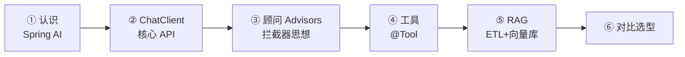
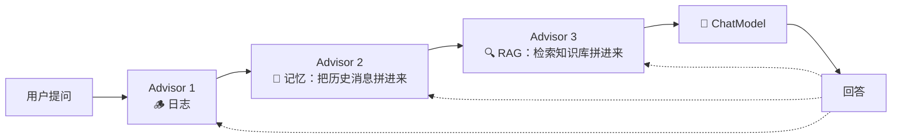
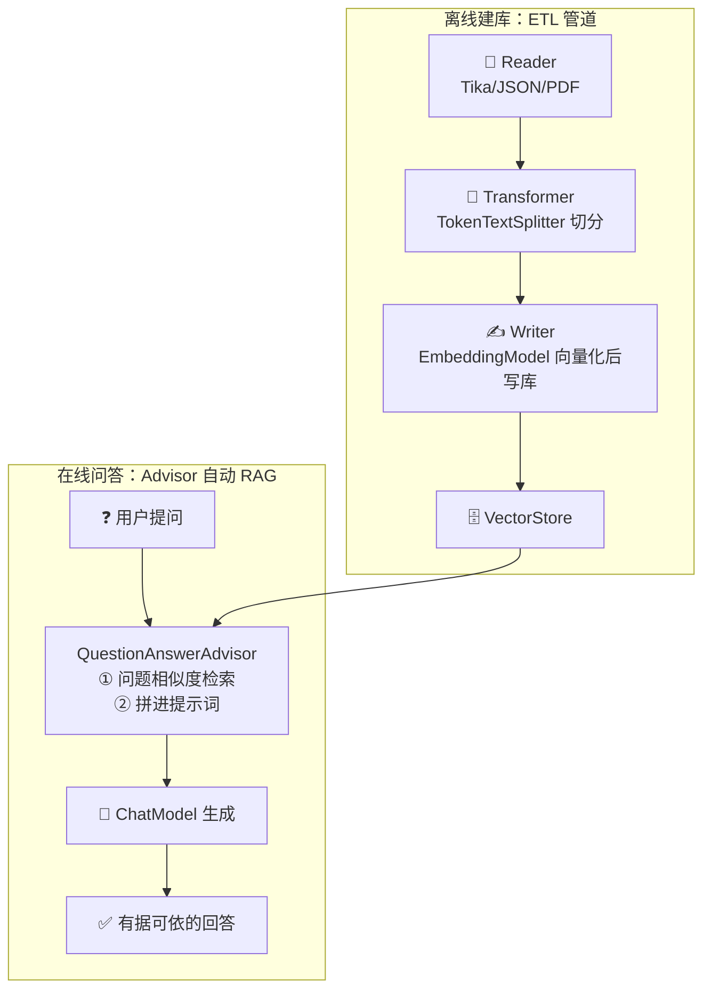
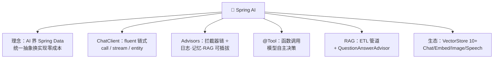

# 🌸 Spring AI 学习笔记

> 一句话介绍：**Spring AI = Spring 官方的 AI 应用框架**——把大模型、向量库、RAG、工具调用抽象成 **Spring 风格的统一 API**，就像 Spring Data 统一了数据库访问一样，现在 AI 能力也是"注入即用"～✨
>
> 📌 对照着 [LangChain4j.md](./LangChain4j.md) 一起看更香，两个都是 Java 生态选手！代码基于 **Spring AI 1.0 GA**！

---

## 📖 开篇：学习路线总览



| 章节 | 内容 | 难度 |
|------|------|------|
| 一 | Spring AI 是什么、解决什么 | ⭐ |
| 二 | 快速开始 + ChatClient 核心用法 | ⭐⭐ |
| 三 | Prompt 模板 + 结构化输出 | ⭐⭐ |
| 四 | **Advisors 顾问链（灵魂思想！）** | ⭐⭐⭐⭐ |
| 五 | Function Calling：@Tool | ⭐⭐⭐ |
| 六 | RAG：ETL 管道 + VectorStore | ⭐⭐⭐⭐ |
| 七 | ChatMemory + 模型抽象全景 + 选型对比 | ⭐⭐⭐ |

---

## 一、Spring AI 是什么？🌸

### 1.1 核心理念：AI 界的 "Spring Data"

```mermaid
flowchart TB
    subgraph spring["Spring 家族的"统一抽象"传统"]
        SD["Spring Data<br/>统一数据库访问<br/>（JPA/Redis/Mongo 换实现不改代码）"]
        SC["Spring Cloud<br/>统一微服务治理"]
        SA["Spring AI ⭐<br/>统一 AI 能力接入<br/>（OpenAI/Ollama/通义 换模型不改代码）"]
    end
```

| 它管什么 | 抽象成 |
|----------|--------|
| 各家大模型 Chat API | `ChatModel` / `ChatClient` |
| 向量库 | `VectorStore` |
| 文档处理 | ETL 管道（Reader/Transformer/Writer）|
| 工具调用 | `@Tool` + ToolCallback |
| 提示词增强/记忆/RAG | `Advisor` 顾问链 |

### 1.2 vs LangChain4j 一图流 🪞

| 对比 | Spring AI | LangChain4j |
|------|-----------|-------------|
| 出身 | **Spring 官方** | 社区 |
| 风格 | Spring 惯用法（Builder/Advisor/自动配置）| 独立框架（AI Services 动态代理）|
| 生态绑定 | 深度绑定 Spring Boot | 可脱离 Spring |
| 增强机制 | **Advisor 拦截器链**（像 AOP！）| 手动挂 ContentRetriever/ChatMemory |
| 记忆 | MessageChatMemoryAdvisor | ChatMemory |
| RAG | QuestionAnswerAdvisor | contentRetriever 一行挂载 |
| 选型 | Spring 技术栈首选 ⭐ | 非 Spring / 轻量场景灵活 |

> 🎀 一句话：**全家都用 Spring → Spring AI 顺势而为；想要轻量灵活 → LangChain4j 也很香**～

---

## 二、快速开始：ChatClient 🚀

### 2.1 依赖 + 配置

```xml
<dependencyManagement>
    <dependencies>
        <dependency>
            <groupId>org.springframework.ai</groupId>
            <artifactId>spring-ai-bom</artifactId>
            <version>1.0.0</version>
            <type>pom</type>
            <scope>import</scope>
        </dependency>
    </dependencies>
</dependencyManagement>

<dependencies>
    <!-- 1.0 版本命名：spring-ai-starter-model-{厂商} -->
    <dependency>
        <groupId>org.springframework.ai</groupId>
        <artifactId>spring-ai-starter-model-openai</artifactId>
    </dependency>
</dependencies>
```

```yaml
spring:
  ai:
    openai:
      base-url: https://dashscope.aliyuncs.com/compatible-mode/v1   # 国内兼容端点
      api-key: ${DASHSCOPE_KEY}
      chat:
        options:
          model: qwen-plus
          temperature: 0.0
```

### 2.2 ChatClient： fluent 风格三连

```java
@RestController
class ChatController {

    private final ChatClient chatClient;

    // 构造器注入 ChatClient.Builder（starter 自动配置好的～）
    ChatController(ChatClient.Builder builder) {
        this.chatClient = builder
                .defaultSystem("你是一位可爱的编程讲师")   // 全局默认人设
                .build();
    }

    @GetMapping("/chat")
    String chat(@RequestParam String q) {
        return chatClient.prompt()          // ① 开一个提问
                .user(q)                    // ② 用户消息
                .call()                     // ③ 同步调用
                .content();                 //    取文本结果
    }

    @GetMapping(value = "/stream", produces = "text/html;charset=UTF-8")
    Flux<String> stream(@RequestParam String q) {
        return chatClient.prompt().user(q)
                .stream()                   // 流式调用：打字机效果 ⌨️
                .content();
    }
}
```

| 调用方式 | 返回 | 场景 |
|----------|------|------|
| `.call()` | 同步完整结果 | 普通问答 |
| `.stream()` | `Flux<String>` | 打字机/WebFlux |
| `.messages(...)` | 附带历史消息 | 自己管理多轮时用 |

> 💡 和 LangChain4j 的"接口声明式"不同，Spring AI 走 **fluent 链式调用**——哪个顺手用哪个，本质都是"拼提示词 → 调模型 → 解析结果"～

---

## 三、Prompt 模板与结构化输出 📋

### 3.1 PromptTemplate

```java
PromptTemplate template = new PromptTemplate(
        "用一句话向 {role} 解释 {concept}"
);
Prompt prompt = template.create(Map.of(
        "role", "小学生",
        "concept", "递归"
));
String result = chatClient.prompt(prompt).call().content();
```

### 3.2 结构化输出：entity() 一行变 POJO

```java
record Book(String title, String author, int price) {}

// 框架自动生成 JSON Schema 约束模型输出，再反序列化成目标类
Book book = chatClient.prompt()
        .user("推荐一本并发编程的书")
        .call()
        .entity(Book.class);          // ← 就这一行！

System.out.println(book.title());
```

| 输出目标 | 写法 |
|----------|------|
| 字符串 | `.content()` |
| POJO / record | `.entity(Book.class)` |
| List<POJO> | `.entity(new ParameterizedTypeReference<List<Book>>() {})` |

---

## 四、Advisors 顾问链（灵魂思想！）🔗

### 4.1 Advisor = AI 界的拦截器/AOP

> 请求发出去**之前/之后**插入增强逻辑：记日志、加记忆、检索知识库、改写提示词……全部做成可插拔的 Advisor～



### 4.2 官方自带的三员大将

| Advisor | 干什么 |
|---------|--------|
| `SimpleLoggerAdvisor` | 打印请求/响应日志（调试必备）|
| `MessageChatMemoryAdvisor` | 自动带上对话历史（第七章细讲）|
| `QuestionAnswerAdvisor` | 自动 RAG：检索向量库拼进提示词（第六章细讲）|

```java
String answer = chatClient.prompt()
        .advisors(a -> a.param("conversationId", "user-001"))   // 传顾问参数
        .advisors(new MessageChatMemoryAdvisor(chatMemory))
        .user("我叫小明")
        .call().content();
```

### 4.3 自定义 Advisor：实现一圈洋葱 🧅

```java
public class RetryAdvisor implements CallAdvisor<String> {

    @Override
    public AdvisedResponse aroundCall(AdvisedRequest req, CallAdvisorChain chain) {
        System.out.println("请求前：做点增强（改 prompt / 加历史 / 检索）");
        AdvisedResponse resp = chain.nextAroundCall(req);   // 放行给下一环/模型
        System.out.println("响应后：做点收尾（日志 / 审计）");
        return resp;
    }

    @Override
    public String getName() { return "RetryAdvisor"; }
}
```

> 🎀 有没有 Spring MVC `HandlerInterceptor` 的既视感？**学过的 Spring 思想直接平移到 AI 世界**——这就是 Spring AI 对 Java 开发者最温柔的地方！

---

## 五、Function Calling：@Tool 🔧

```java
import org.springframework.ai.tool.annotation.Tool;

@Component
class WeatherTools {

    @Tool(description = "查询指定城市的当前天气")   // ← 给模型的说明书！
    String getWeather(String city) {
        return city + " 22℃，晴";
    }
}

// 挂载：链式调用时带上工具
String answer = chatClient.prompt()
        .user("北京天气如何？")
        .tools(new WeatherTools())      // 或 .toolCallbacks(...)
        .call().content();
// 模型自主决定调用 getWeather("北京") → 框架执行 → 结果回填 → 生成回答 ✅
```

| 要点 | 说明 |
|------|------|
| `@Tool(description=...)` | 描述质量决定调用准确度（和 LangChain4j 的 @Tool 同理）|
| 参数描述 | `@ToolParam(description="城市名") String city` |
| 执行循环 | 框架自动完成"模型点名 → 反射执行 → 回填再问"，全自动 🔁 |

---

## 六、RAG：ETL 管道 + VectorStore 📚

### 6.1 全流程图



### 6.2 完整代码

```java
import org.springframework.ai.reader.tika.TikaDocumentReader;
import org.springframework.ai.transformer.TokenTextSplitter;
import org.springframework.ai.vectorstore.SimpleVectorStore;

// ---------- ① 离线建库（ETL 一条龙）----------
Document doc = new TikaDocumentReader("classpath:公司制度.pdf").read().get(0);

List<Document> chunks = new TokenTextSplitter().apply(List.of(doc));  // 切分

SimpleVectorStore store = SimpleVectorStore.builder(embeddingModel).build();
store.add(chunks);    // 写入时自动向量化（生产换 PgVectorStore/RedisVectorStore/Milvus…）

// ---------- ② 在线问答：Advisor 一挂，RAG 完工！----------
QuestionAnswerAdvisor ragAdvisor = QuestionAnswerAdvisor.builder(store)
        .searchRequest(SearchRequest.builder().topK(3).build())
        .build();

String answer = chatClient.prompt()
        .advisors(ragAdvisor)
        .user("年假有几天？")
        .call().content();
```

| 组件 | 说明 | 生态 |
|------|------|------|
| `DocumentReader` | 读文档 | Tika（万能格式）/PDF/JSON/文本… |
| `TokenTextSplitter` | 切块 | 也可自定义 |
| `VectorStore` | 向量库统一抽象 | **Simple/PgVector/Redis/Milvus/Chroma/Weaviate/Elastic** 10+ 实现 |
| `EmbeddingModel` | 向量化 | 各厂商模型 |

> 💡 **换向量库 = 换一个 Store Bean**，ETL 和问答代码不动——`JdbcTemplate` 换数据源的老味道又来了～

---

## 七、记忆、模型全景与选型 🧠

### 7.1 ChatMemory + Advisor

```java
import org.springframework.ai.chat.memory.MessageWindowChatMemory;
import org.springframework.ai.chat.client.advisor.MessageChatMemoryAdvisor;

ChatMemory memory = MessageWindowChatMemory.builder()
        .maxMessages(20)
        .build();                      // 存储可换 JdbcChatMemoryRepository 持久化

ChatClient client = ChatClient.builder(chatModel)
        .defaultAdvisors(MessageChatMemoryAdvisor.builder(memory).build())
        .build();

// 请求时指定会话 id → 不同用户互不串扰
client.prompt()
      .advisors(a -> a.param(ChatMemory.CONVERSATION_ID, "user-001"))
      .user("我叫小明").call().content();
client.prompt()
      .advisors(a -> a.param(ChatMemory.CONVERSATION_ID, "user-001"))
      .user("我叫什么？").call().content();   // "小明" ✅
```

### 7.2 模型能力抽象全景 🗺️

| 接口 | 能力 | 备注 |
|------|------|------|
| `ChatModel` | 对话 | 核心，必学 |
| `EmbeddingModel` | 向量化 | RAG 必备 |
| `ImageModel` | 文生图 | DALL·E/通义万相等 |
| `SpeechModel` / `TranscriptionModel` | 语音合成/转文字 | 语音场景 |
| `ModerationModel` | 内容审核 | 安全兜底 |

### 7.3 高频问题速查 🎯

| 问题 | 要点 |
|------|------|
| Spring AI 是什么？ | Spring 官方 AI 框架：像 Spring Data 统一 DB 一样统一 AI 能力 |
| ChatClient 和 ChatModel 区别？ | ChatModel 是底层模型抽象；ChatClient 是 fluent 高级 API（含 Advisor/工具/记忆编排）|
| Advisor 是什么？ | 请求增强拦截器链（类比 AOP/Interceptor），官方提供记忆/RAG/日志顾问 |
| 结构化输出？ | `.entity(Class)` 自动 JSON Schema 约束 + 反序列化 |
| 工具调用？ | `@Tool(description=...)` + `.tools(实例)`，框架自动循环执行 |
| RAG 怎么做？ | ETL（Reader→Splitter→VectorStore）建库 + QuestionAnswerAdvisor 问答 |
| 换模型/向量库成本？ | 改依赖和配置，业务代码零改动（统一抽象的威力）|
| 记忆怎么隔离多用户？ | MessageWindowChatMemory + conversationId 参数 |
| 和 LangChain4j 怎么选？ | Spring 栈/企业级 → Spring AI；轻量/非 Spring → LangChain4j |
| 支持哪些模型？ | OpenAI 兼容（通义/DeepSeek）、Anthropic、Ollama、Azure、Vertex 等 |

---

## 八、结语 🌸

Spring AI 的知识树收好啦：



> 🎀 学习建议：
> 1. **Advisor 思想是本篇灵魂**——理解了"洋葱圈拦截器"，记忆/RAG/日志全是插拔组件，框架设计豁然开朗！
> 2. 把第六章 RAG 完整跑一遍，体会 **ETL 建库 + 一行 Advisor** 的丝滑～
> 3. Java AI 框架双雄对照着学：[LangChain4j](./LangChain4j.md)（声明式接口）vs Spring AI（fluent + Advisor），面试聊选型有话讲！
>
> AI 框架四件套集齐 🎉：LangChain + LangGraph + LangChain4j + Spring AI——Python/Java 双语言、管道/图/声明式/拦截器四思想全点亮！下一站想去哪？人家随时开课～冲鸭！💪(๑•̀ㅂ•́)و✧
