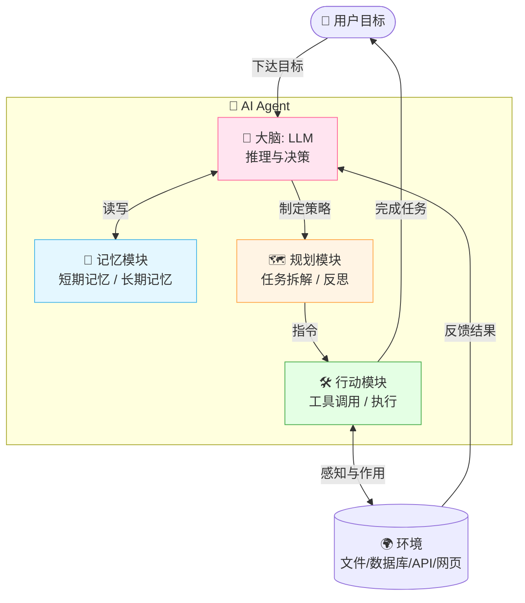
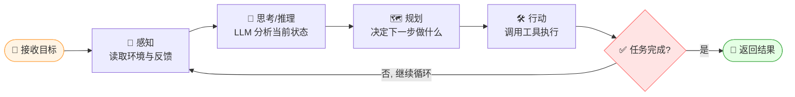
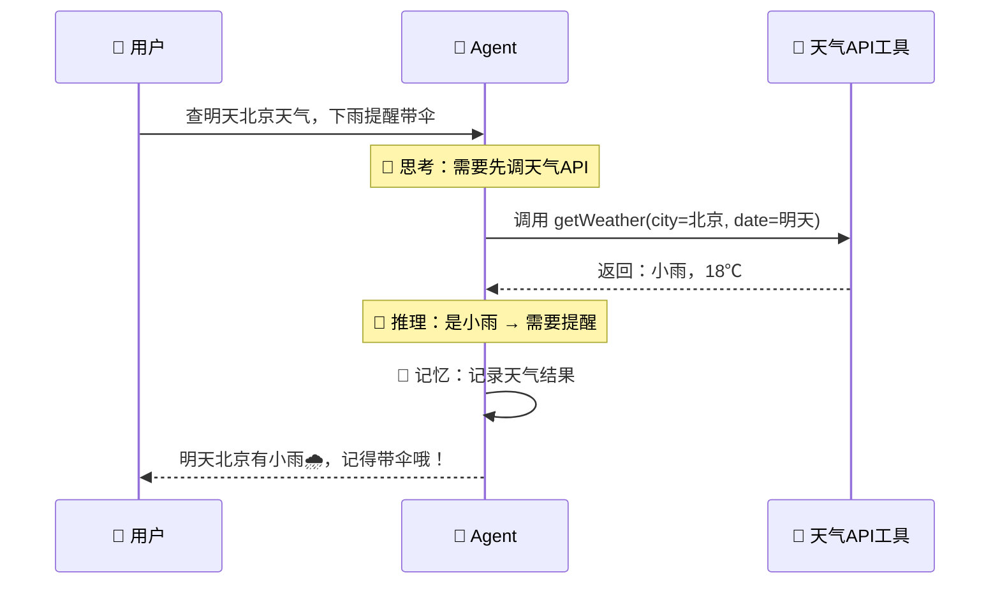
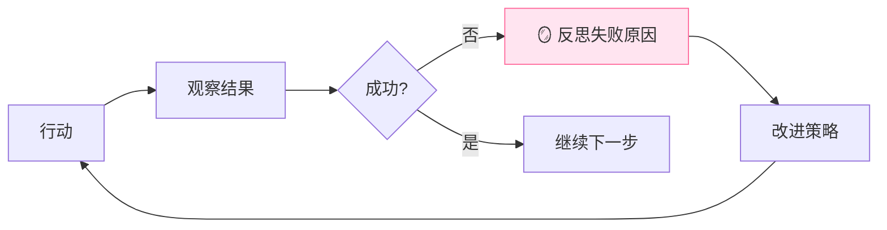
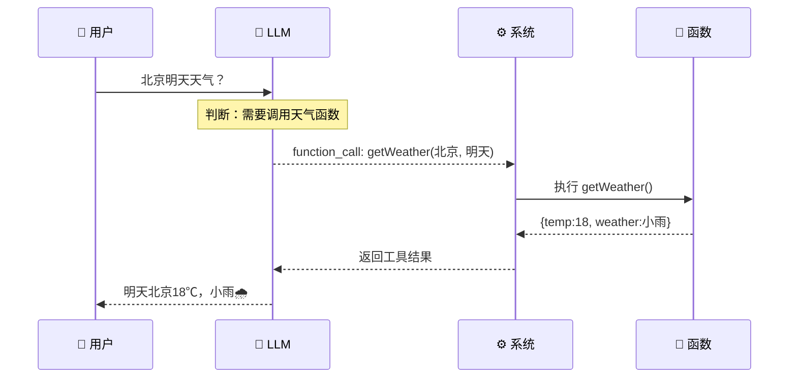
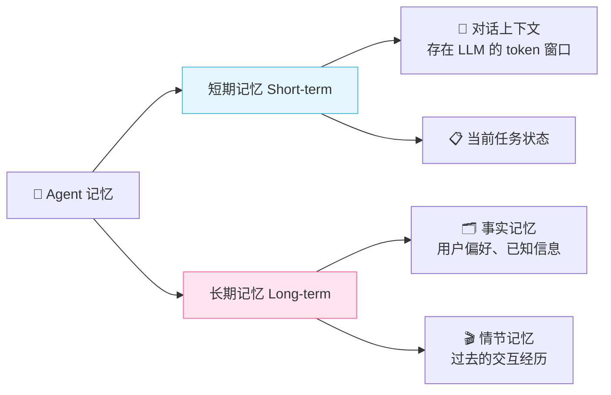
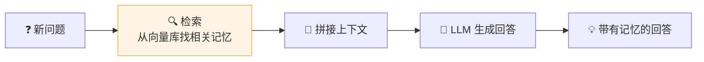
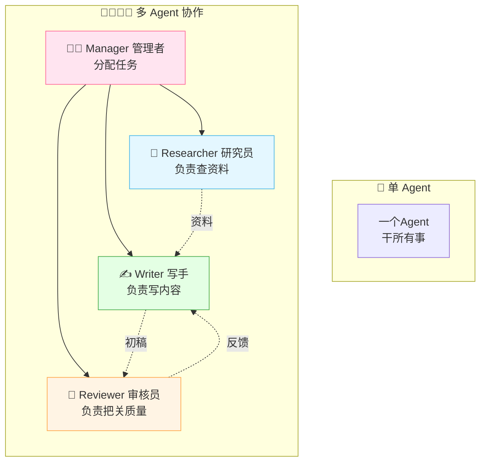
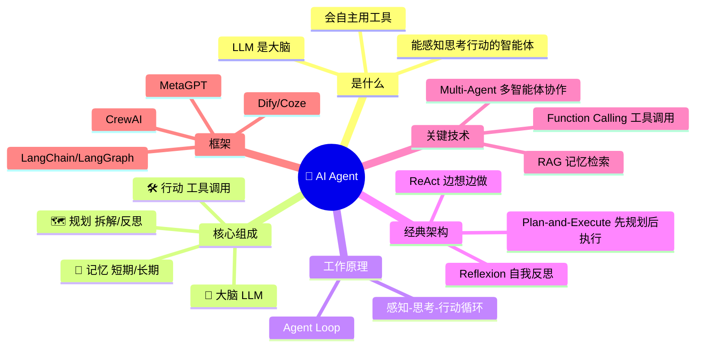

# 🤖 AI Agent 超全学习指南

> 嗨呀~ 欢迎来到 AI Agent 的奇妙世界！✨ 这份指南会带你从零开始，把 Agent 这块硬骨头啃得明明白白。准备好了吗？冲鸭！(ﾉ>ω<)ﾉ

---

## 📖 目录

- [一、什么是 AI Agent？](#一什么是-ai-agent)
- [二、Agent 的核心组成（五脏六腑）](#二agent-的核心组成五脏六腑)
- [三、Agent 是怎么工作的？](#三agent-是怎么工作的)
- [四、经典 Agent 架构大赏](#四经典-agent-架构大赏)
- [五、工具调用（Function Calling）](#五工具调用function-calling)
- [六、记忆系统](#六记忆系统)
- [七、多智能体系统（Multi-Agent）](#七多智能体系统multi-agent)
- [八、主流 Agent 框架](#八主流-agent-框架)
- [九、Agent 的应用场景](#九agent-的应用场景)
- [十、知识总结](#十知识总结)

---

## 一、什么是 AI Agent？

### 1.1 一句话定义

> **AI Agent（人工智能代理）** = 一个能**感知环境、自主思考决策、调用工具、采取行动**来完成目标的智能系统 🧠⚡

简单说，它不只会"聊天"，还会"干活"！你给它一个目标，它自己想办法拆解任务、找工具、一步步完成。

### 1.2 生活化比喻 🌰

把 AI Agent 想象成一个**超级实习生**：

| 比喻对象 | 对应 Agent 的能力 | 说明 |
|:---:|:---|:---|
| 👂 耳朵/眼睛 | **感知（Perception）** | 接收你的指令、读取环境信息 |
| 🧠 大脑 | **LLM + 规划** | 思考、推理、决定下一步干啥 |
| 📒 笔记本 | **记忆（Memory）** | 记住之前发生了啥 |
| 🔧 工具箱 | **工具调用（Tools）** | 查资料、算数、发邮件…… |
| ✋ 双手 | **行动（Action）** | 真正去执行任务 |

### 1.3 Agent vs 普通 LLM：到底有啥区别？

很多人会问：ChatGPT 不也是 AI 吗？它和 Agent 啥关系？看这张对比表就懂啦 👇

| 对比项 | 🗣️ 普通 LLM（如 ChatGPT） | 🤖 AI Agent |
|:---|:---|:---|
| **本质** | 语言模型，擅长生成文本 | 以 LLM 为大脑的智能体系统 |
| **交互方式** | 一问一答 | 给目标，自主完成多步任务 |
| **能否用工具** | ❌ 不能（或有限） | ✅ 能主动调用各种工具 |
| **是否有记忆** | 短期上下文 | 短期 + 长期记忆 |
| **自主性** | 低，被动响应 | 高，能自主规划、反思、纠错 |
| **典型场景** | "帮我写首诗" | "帮我查天气并订明天的机票" |

> 💡 **一句话总结**：LLM 是 Agent 的"大脑"，Agent 是给 LLM 装上了"手脚、工具和记忆"，让它从"只会说"变成"能做事"！

---

## 二、Agent 的核心组成（五脏六腑）

一个完整的 AI Agent 通常由 **四大核心模块** 组成，它们就像人的器官一样各司其职 🫀🫁🧠🦾。

### 2.1 整体架构图



### 2.2 四大模块详解

#### 🧠 大脑（LLM Brain）

- **是什么**：Agent 的核心推理引擎，通常是大语言模型（如 GPT-4、Claude）。
- **干什么**：理解目标、推理决策、生成自然语言。
- **地位**：没有它，Agent 就是个没有灵魂的空壳。

#### 📒 记忆（Memory）

记忆让 Agent 不会"鱼的记忆 7 秒"，分为两种：

| 类型 | 类比 | 说明 | 例子 |
|:---:|:---:|:---|:---|
| **短期记忆** | 🧠 工作记忆 | 当前对话/任务的上下文，存在 token 窗口里 | "你刚才说要看北京天气" |
| **长期记忆** | 💾 硬盘 | 跨会话持久化存储，通常借助向量数据库 | "用户偏好靠窗座位" |

#### 🗺️ 规划（Planning）

规划是 Agent 的"军师"，负责把大目标拆成小步骤：

- **任务拆解（Task Decomposition）**：把"做一顿饭"拆成"买菜→洗菜→切菜→炒菜"。
- **反思（Reflection）**：发现上一步搞砸了，及时调整策略。

#### 🛠️ 行动（Action）

行动模块是 Agent 的"双手"，负责真正去执行：

- **工具调用**：搜索引擎、计算器、API、代码解释器等。
- **环境交互**：读写文件、操作数据库、控制浏览器。

---

## 三、Agent 是怎么工作的？

Agent 的核心运行机制是一个 **"感知 → 思考 → 行动"的循环**，也叫 **Agent Loop（代理循环）** 🔄。它会不断循环，直到任务完成。

### 3.1 运行流程图



### 3.2 用一个例子串起来 🌰

假设目标：**"帮我查明天北京天气，如果下雨就提醒我带伞"**



看到没？Agent 自己**决定**要调用天气工具，**分析**结果后**判断**要提醒你，全程不需要你一步步指挥，这就是"自主性"的魔力！✨

---

## 四、经典 Agent 架构大赏

不同的 Agent 用不同的"思考方式"，下面是几种经典架构，面试常考哦~ 📝

### 4.1 ReAct（Reasoning + Acting）💡

最经典的架构！让 Agent **边想边做**，像人一样"自言自语"地推理。

**核心思想**：每一步都先 **思考（Thought）** 再 **行动（Action）**，然后 **观察（Observation）** 结果，循环往复。

```
Thought: 我需要先查天气
Action: getWeather(北京)
Observation: 小雨，18℃
Thought: 是雨天，需要提醒用户带伞
Action: notifyUser(明天带伞)
Observation: 已提醒
Thought: 任务完成
```

> 💡 ReAct = 推理和行动交替进行，是目前最主流的 Agent 模式！

### 4.2 Plan-and-Execute（先规划后执行）🗺️

**核心思想**：先一次性把任务拆成完整计划，再逐步执行。

```
Plan:
  1. 查北京天气
  2. 查航班信息
  3. 对比价格
  4. 下单订票

Execute: 按计划一步步执行...
```

- **优点**：全局视野好，适合复杂的长流程任务。
- **缺点**：计划可能脱离实际，不够灵活。

### 4.3 Reflexion（反思机制）🪞

**核心思想**：每次行动后**自我反思**，从失败中学习，下次做得更好。



### 4.4 三种架构对比

| 架构 | 核心特点 | 适合场景 | 优点 | 缺点 |
|:---:|:---|:---|:---|:---|
| **ReAct** | 边想边做，交替循环 | 大多数通用任务 | 灵活、主流 | 可能陷入循环 |
| **Plan-and-Execute** | 先全局规划再执行 | 复杂长流程任务 | 全局视野好 | 不够灵活 |
| **Reflexion** | 自我反思改进 | 需要高质量结果的任务 | 越做越好、会自我纠错 | 反复迭代耗时 |

> 🎀 **小贴士**：现代 Agent 往往是多种架构的**混合体**，比如 Plan-and-Execute + Reflexion，强强联合！

---

## 五、工具调用（Function Calling）

工具是 Agent 的"超能力"，没有工具，Agent 就只能动嘴皮子。而 **Function Calling（函数调用）** 是让 LLM 使用工具的标准方式 🦸。

### 5.1 什么是工具调用？

简单说：**让 LLM 输出一段结构化的"指令"，告诉系统该调用哪个函数、传什么参数**，系统执行后把结果喂回给 LLM。

### 5.2 工作原理流程



### 5.3 代码示例（伪代码）

下面是一个简化的工具调用示例，帮你理解整个流程 👇

```python
# 1. 定义工具（函数）
def get_weather(city: str, date: str) -> dict:
    """查询指定城市某天的天气"""
    # 实际会调用天气API
    return {"city": city, "date": date, "temp": 18, "weather": "小雨"}

# 2. 把工具描述告诉 LLM（让 LLM 知道有这个工具可用）
tools = [
    {
        "name": "get_weather",
        "description": "查询指定城市某天的天气",
        "parameters": {
            "type": "object",
            "properties": {
                "city": {"type": "string", "description": "城市名"},
                "date": {"type": "string", "description": "日期"}
            },
            "required": ["city", "date"]
        }
    }
]

# 3. LLM 决策：根据用户问题，判断是否调用工具
# LLM 返回 -> {"name": "get_weather", "arguments": {"city": "北京", "date": "明天"}}

# 4. 系统执行 LLM 指定的函数
result = get_weather(city="北京", date="明天")

# 5. 把结果喂回 LLM，让它组织最终回答
# LLM -> "明天北京18℃，有小雨，记得带伞哦~"
```

> 💡 **关键点**：LLM 本身**不执行**函数，它只是"建议"该调哪个函数。真正执行的是**外部系统**。这是出于安全考虑！

### 5.4 常见工具类型

| 工具类型 | 例子 | 用途 |
|:---:|:---|:---|
| 🔍 搜索类 | Google/Bing 搜索 API | 查找实时信息 |
| 🧮 计算类 | 计算器、代码解释器 | 精确计算、数据分析 |
| 📂 文件类 | 读写文件、操作数据库 | 数据处理 |
| 🌐 网络类 | API 调用、浏览器自动化 | 订票、发邮件、爬数据 |

---

## 六、记忆系统

记忆是 Agent 的"时间线"，让它能记住过去、服务现在 📒。

### 6.1 记忆的分类



### 6.2 短期记忆 vs 长期记忆

| 维度 | 🧠 短期记忆 | 💾 长期记忆 |
|:---|:---|:---|
| **存储位置** | LLM 的上下文窗口（token） | 外部数据库（通常是向量数据库） |
| **容量** | 有限（几K~几百K token） | 几乎无限 |
| **持久性** | 会话结束就没了 | 跨会话长期保存 |
| **类比** | 人的"工作记忆" | 人的"长期记忆" |
| **例子** | "你刚才说的那句话" | "用户喜欢喝美式咖啡" |

### 6.3 记忆与 RAG 的关系

**RAG（检索增强生成）** 其实就是长期记忆的实现方式之一！



> 🎀 **小结**：Agent 的记忆机制 = 短期上下文 + 基于 RAG 的长期记忆，让 Agent 既"记得当下"又"不忘过往"。

---

## 七、多智能体系统（Multi-Agent）

一个 Agent 孤军奋战多累呀！**Multi-Agent（多智能体）** 就是让多个 Agent 组队协作，各展所长 🤝。

### 7.1 什么是多智能体系统？

> 多个扮演不同**角色**的 Agent，通过**沟通协作**共同完成一个复杂任务。

### 7.2 协作模式



### 7.3 单 Agent vs 多 Agent

| 维度 | 🤖 单 Agent | 👨‍👩‍👧‍👦 多 Agent |
|:---|:---|:---|
| **复杂度** | 简单 | 复杂 |
| **适合任务** | 单一、线性任务 | 复杂、需要多种专业能力 |
| **优点** | 好实现、成本低 | 分工明确、质量高 |
| **缺点** | 复杂任务容易翻车 | 通信开销大、成本高 |

> 🎀 典型例子：MetaGPT 模拟软件公司，有产品经理、架构师、程序员、测试等不同 Agent 角色协作开发软件！

---

## 八、主流 Agent 框架

工欲善其事，必先利其器！下面是当前最火的 Agent 开发框架 🔥。

| 框架 | 语言 | 特点 | 适合场景 |
|:---:|:---:|:---|:---|
| **LangChain / LangGraph** | Python/JS | 生态最全，支持复杂工作流 | 通用 Agent 开发 |
| **AutoGPT** | Python | 早期爆款，自主性强 | 自动化任务实验 |
| **CrewAI** | Python | 角色扮演，多 Agent 协作优雅 | 多 Agent 系统 |
| **MetaGPT** | Python | 模拟软件公司多角色协作 | 自动化软件开发 |
| **Microsoft AutoGen** | Python | 多 Agent 对话框架 | 研究、代码生成 |
| **Dify / Coze** | 低代码 | 可视化搭建，门槛低 | 快速构建应用 |

> 💡 **新手建议**：入门可以从 **LangChain** 或低代码平台（**Dify/Coze**）开始，快速上手不踩坑~

---

## 九、Agent 的应用场景

Agent 已经渗透到各行各业啦，来看看它能干啥 🚀：

| 领域 | 应用例子 | Agent 做了啥 |
|:---:|:---|:---|
| 🖥️ 编程开发 | 自动写代码、修 Bug | 分析需求→写代码→测试→提交 |
| 📊 数据分析 | 自动生成报表 | 取数→清洗→分析→画图→总结 |
| 🛒 电商运营 | 自动选品、写文案 | 调研市场→选品→写详情页 |
| 🎧 客服支持 | 智能客服 | 理解问题→查知识库→调用系统→回复 |
| 🔬 科研辅助 | 文献综述、实验设计 | 搜论文→总结→找创新点 |
| 🏠 个人助理 | 日程管理、订票 | 理解需求→查信息→执行操作 |

---

## 十、知识总结

最后来张知识全景图，把所有知识点串起来，复习巩固 📝✨：



### 🎯 核心要点速记

1. **Agent = LLM 大脑 + 记忆 + 规划 + 工具行动**，能自主完成多步任务。
2. **与 LLM 的区别**：LLM 只会"说"，Agent 还会"做"（用工具、有记忆、能自主）。
3. **运行核心**是 **"感知→思考→行动"循环**，直到任务完成。
4. **经典架构**：ReAct（主流）、Plan-and-Execute、Reflexion（反思）。
5. **工具调用（Function Calling）** 是 Agent 的超能力，LLM 决策 + 系统执行。
6. **记忆** = 短期上下文 + 长期 RAG 检索。
7. **Multi-Agent** 让多个角色 Agent 协作，适合复杂任务。

---

> 🌸 哇~ 恭喜你把 AI Agent 的核心知识学完啦！Agent 的世界还在飞速发展，保持好奇心，继续探索吧！加油鸭！(ง •_•)ง💖
