# 🧩 CoT 思维链超全学习指南

> 嗨呀~ 欢迎来到 CoT（Chain of Thought，思维链）的世界！🧩 思维链是让大模型"先想后答"的技术，一句话就能让数学推理准确率翻倍！这份指南会带你从原理到实战，彻底搞懂 CoT。准备好了吗？冲鸭！(ﾉ>ω<)ﾉ

---

## 📖 目录

- [一、什么是 CoT？](#一什么是-cot)
- [二、为什么 CoT 有效？](#二为什么-cot-有效)
- [三、CoT 的两种形式](#三cot-的两种形式)
- [四、Zero-shot CoT](#四zero-shot-cot)
- [五、Few-shot CoT](#五few-shot-cot)
- [六、CoT 效果与适用场景](#六cot-效果与适用场景)
- [七、进阶：自我一致性](#七进阶自我一致性)
- [八、进阶：思维树 ToT](#八进阶思维树-tot)
- [九、进阶：思维图 GoT](#九进阶思维图-got)
- [十、CoT 实战技巧](#十cot-实战技巧)
- [十一、知识总结](#十一知识总结)

---

## 一、什么是 CoT？

### 1.1 一句话定义

> **CoT（Chain of Thought，思维链）** = 让大模型把推理过程一步步写出来，而不是直接给答案的提示技术。

简单说：**让 AI 先"想"再"答"** 🧠。

### 1.2 直观对比

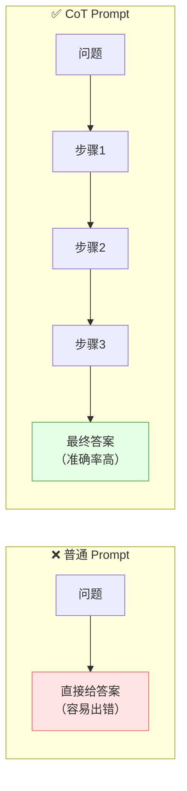

### 1.3 效果对比示例

**普通提示**：
```
问：小明有5个苹果，给了小红2个，又买了3个，现在有几个？
答：6个   ← 可能算错
```

**CoT 思维链**：
```
问：小明有5个苹果，给了小红2个，又买了3个，现在有几个？
请一步步思考。

答：让我们一步步计算：
  1. 起初有 5 个苹果
  2. 给了小红 2 个，剩 5 - 2 = 3 个
  3. 又买了 3 个，现在 3 + 3 = 6 个
  答案：6 个   ← 准确率大幅提升！
```

### 1.4 CoT 的诞生

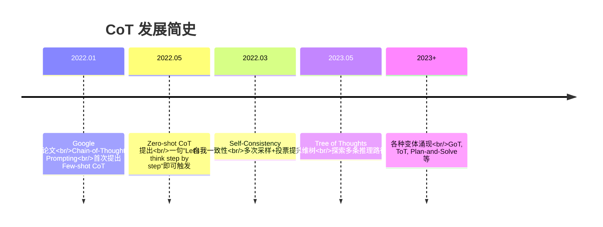

> 💡 **CoT 的发现**：研究者发现，大模型在数学推理、逻辑推理上表现不佳，但如果在 Prompt 里给出带推理过程的示例，模型也会学着"一步步推理"，准确率大幅提升！

---

## 二、为什么 CoT 有效？

### 2.1 核心原因：给模型更多"思考空间"

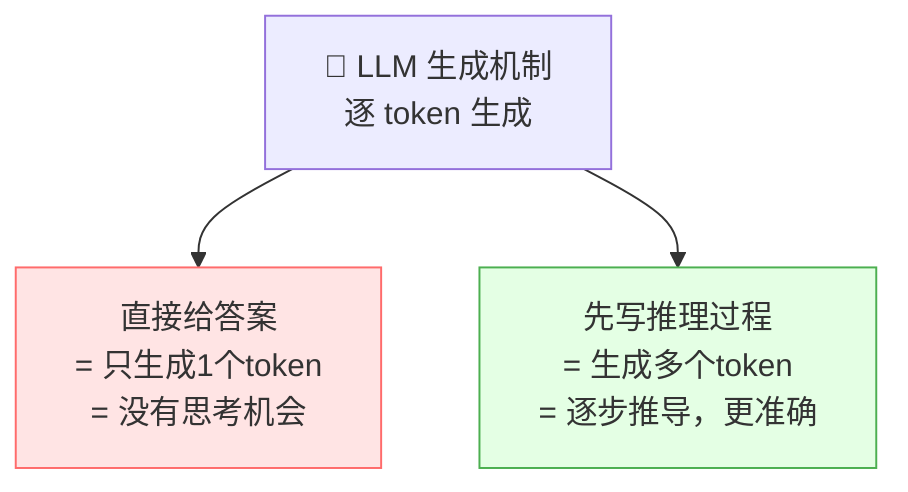

> 💡 **关键理解**：LLM 是"逐 token 生成"的。直接给答案时，中间没有"思考"的 token；而 CoT 让模型先生成推理步骤（中间 token），这些中间 token 帮助模型"理清思路"，最终答案更准确。

### 2.2 生活化比喻

| 场景 | 对应 CoT |
|:---|:---|
| 🧮 心算 vs 草稿纸 | 直接答 = 心算（容易错）；CoT = 用草稿纸（一步步算） |
| 🏃 冲刺 vs 走台阶 | 直接答 = 一步跳到终点（跳不到）；CoT = 走台阶（稳稳到达） |
| 📝 口述 vs 写作文 | 直接答 = 脱口而出；CoT = 先列提纲再写 |

### 2.3 三大原因

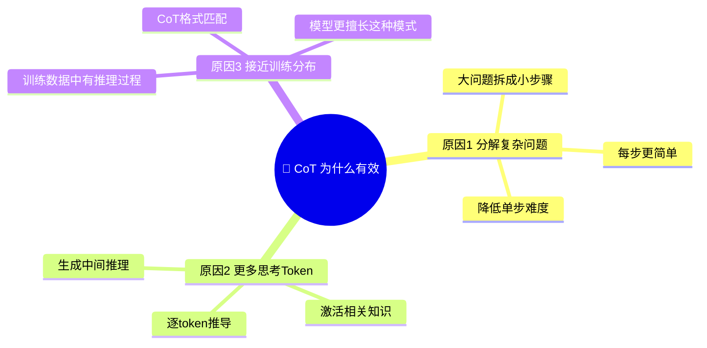

| 原因 | 说明 |
|:---|:---|
| **分解问题** | 把复杂问题拆成简单子问题，每步更容易 |
| **更多思考空间** | 中间 token 给模型"思考"的机会 |
| **匹配训练分布** | 训练数据中的推理类文本也是分步的 |

### 2.4 模型规模的涌现现象

> CoT 不是对所有模型都有效，它是一种**涌现能力**——只有模型规模足够大时才出现。

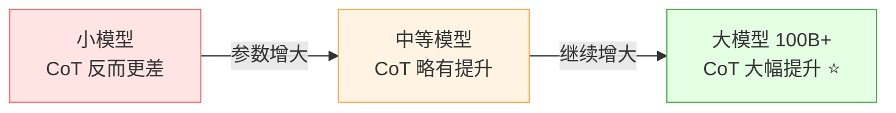

| 模型规模 | CoT 效果 |
|:---|:---|
| 小模型（<10B） | ❌ 可能更差（推理过程本身就不对） |
| 中等模型（10B~100B） | 🟡 略有提升 |
| 大模型（100B+） | ✅ 大幅提升（GPT-4、Claude 3.5 等） |

> 🎀 **结论**：CoT 是大模型的"专属技能"，小模型用了反而可能添乱！

---

## 三、CoT 的两种形式

### 3.1 总览

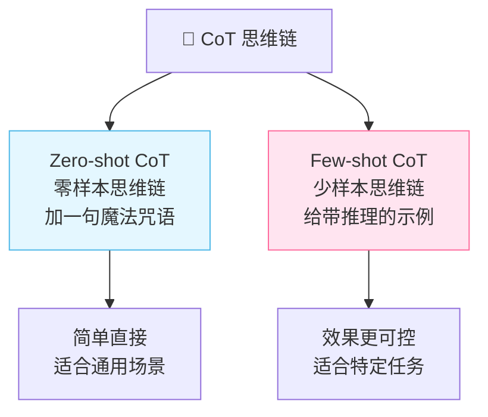

### 3.2 对比

| 对比 | Zero-shot CoT | Few-shot CoT |
|:---|:---|:---|
| **要不要示例** | 不要 | 要 2~8 个示例 |
| **触发方式** | 加一句"一步步思考" | 示例中包含推理过程 |
| **难度** | 极简 | 需要准备示例 |
| **效果** | 好 | 更好（可控性更强） |
| **适合** | 通用任务 | 特定领域/格式要求 |

---

## 四、Zero-shot CoT

### 4.1 什么是 Zero-shot CoT？

> **Zero-shot CoT** = 不给任何示例，只在问题后面加一句"魔法咒语"，就能触发模型的思维链推理。

### 4.2 魔法咒语

| 咒语 | 效果 |
|:---|:---|
| "请一步步思考" ⭐ | 中文最常用 |
| "Let's think step by step" ⭐ | 英文经典版 |
| "请展示你的推理过程" | 变体 |
| "Let's work this out in a step by step way to be sure we have the right answer" | 详细版 |

### 4.3 效果对比

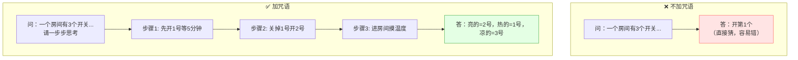

### 4.4 完整示例

```
问题：一个水池，进水管3小时注满，出水管5小时放完。
同时打开，几小时能注满？

请一步步思考。

回答：
让我们一步步计算：
  1. 进水管每小时注入 1/3 的水量
  2. 出水管每小时放出 1/5 的水量
  3. 同时打开，每小时净注入 = 1/3 - 1/5 = 5/15 - 3/15 = 2/15
  4. 注满时间 = 1 ÷ (2/15) = 15/2 = 7.5 小时
答案：7.5 小时
```

### 4.5 Zero-shot CoT 的优缺点

| 优点 | 缺点 |
|:---|:---|
| 极简，零成本 | 推理格式不可控 |
| 通用，不需准备示例 | 某些复杂任务效果有限 |
| 适合快速尝试 | 不同模型效果差异大 |

---

## 五、Few-shot CoT

### 5.1 什么是 Few-shot CoT？

> **Few-shot CoT** = 在 Prompt 中给出 2~8 个**带有推理过程**的示例，让模型学会"这种任务要这样一步步推理"。

### 5.2 与普通 Few-shot 的区别

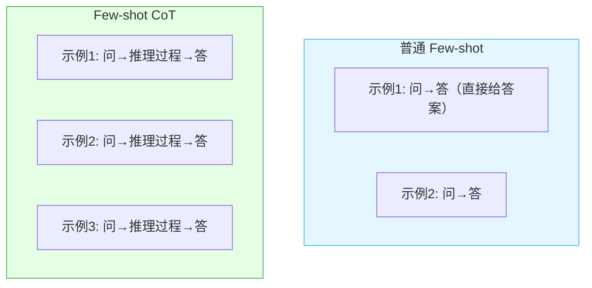

### 5.3 Few-shot CoT 示例

```
任务：数学应用题

示例1：
问：小明有10元，买了3个本子，每个2元，还剩多少钱？
推理：小明有10元，买了3个本子每个2元，花了3×2=6元，剩下10-6=4元。
答：4元。

示例2：
问：一个班有40人，其中60%是女生，女生有多少人？
推理：全班40人，60%是女生，所以女生有40×0.6=24人。
答：24人。

示例3：
问：一本书200页，每天看25页，几天看完？
推理：书共200页，每天看25页，需要200÷25=8天。
答：8天。

现在请回答：
问：一个长方形长8米宽5米，周长是多少？
推理：
```

> 💡 **关键**：每个示例都包含**推理过程**，模型学会了"先推理再回答"的模式。

### 5.4 Few-shot CoT 的设计要点

| 要点 | 说明 |
|:---|:---|
| **示例数量** | 2~8 个，太少不够，太多浪费 Token |
| **推理质量** | 示例的推理必须正确！模型会模仿错误推理 |
| **格式统一** | 所有示例的推理格式严格一致 |
| **多样性** | 示例覆盖不同类型/难度 |
| **难度匹配** | 示例难度和目标问题相近 |

### 5.5 推理格式模板

```
统一格式：
问：{问题}
推理：{推理步骤}
答：{最终答案}

✅ 格式统一 → 模型清晰
❌ 格式混乱 → 模型困惑
```

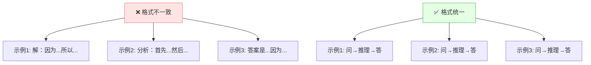

---

## 六、CoT 效果与适用场景

### 6.1 CoT 效果数据

> Google 论文显示，在 GSM8K（小学数学题）基准上：

| 方法 | GPT-3 (175B) 准确率 |
|:---|:---:|
| 直接回答 | 15.6% |
| Few-shot（无 CoT） | 17.7% |
| **Few-shot CoT** | **56.9%** ⭐ |

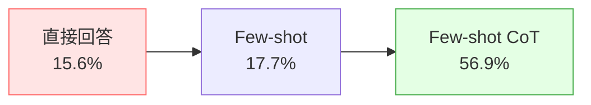

> 💡 CoT 让准确率从 15% 飙升到 57%，提升近 4 倍！

### 6.2 适合 CoT 的场景

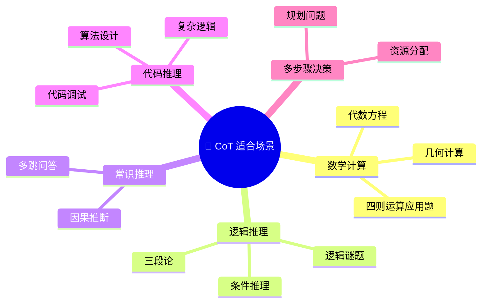

| 场景 | CoT 有用吗 | 原因 |
|:---|:---:|:---|
| **数学计算** | ✅ 非常有用 | 分步计算避免出错 |
| **逻辑推理** | ✅ 非常有用 | 层层推导 |
| **多条件判断** | ✅ 有用 | 逐一判断 |
| **多跳问答** | ✅ 有用 | 逐步找到答案链 |
| **代码推理** | ✅ 有用 | 分步设计算法 |
| 简单事实问答 | ❌ 没必要 | 直接知道答案 |
| 创意写作 | ❌ 没必要 | 不需要推理 |
| 翻译 | ❌ 没必要 | 直接翻译即可 |

### 6.3 不适合 CoT 的场景

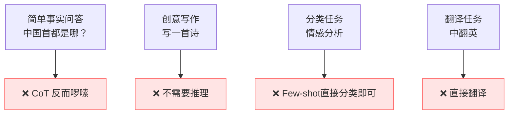

> 🎀 **判断标准**：需要"推理"的任务用 CoT，不需要推理的直接问就行！

---

## 七、进阶：自我一致性

### 7.1 什么是自我一致性？

> **Self-Consistency（自我一致性）** = 同一个问题用 CoT 多次推理（设置较高 Temperature），取**多数投票**作为最终答案。

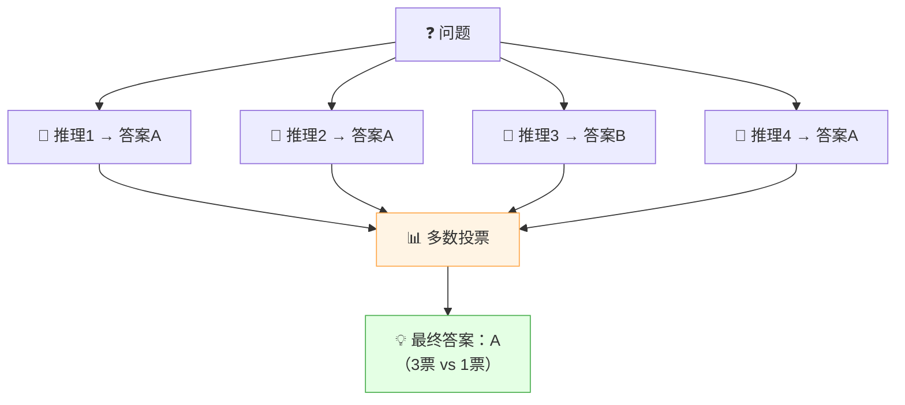

### 7.2 为什么有效？

| 单次 CoT | 自我一致性 |
|:---|:---|
| 只推理一次，可能出错 | 推理多次，取多数 |
| 正确路径只要 1 次 | 多条路径到达同一答案 → 更可信 |
| 随机性高 | 投票消除随机性 |

> 💡 **核心思想**：同一个正确答案，可能通过多条推理路径得到；而错误答案通常每条路径都不同。所以投票能过滤掉偶发错误！

### 7.3 工作流程

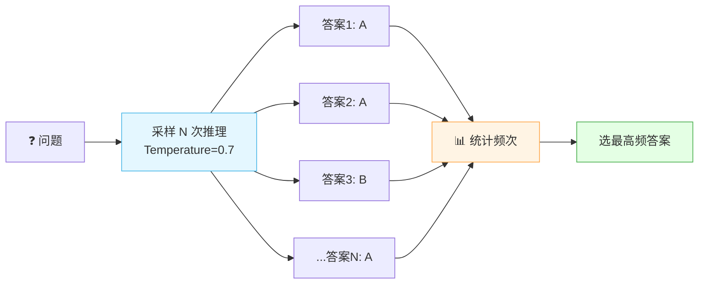

### 7.4 代码示例

```python
import openai
from collections import Counter

def self_consistency(question: str, n: int = 5) -> str:
    """自我一致性：多次采样 + 投票"""
    answers = []

    for i in range(n):
        response = openai.ChatCompletion.create(
            model="gpt-4",
            messages=[{
                "role": "user",
                "content": f"{question}\n请一步步思考。\n最后以'答案：'开头给出最终答案。"
            }],
            temperature=0.7,  # 较高温度，增加多样性
        )
        text = response.choices[0].message.content
        # 提取"答案：xxx"部分
        answer = text.split("答案：")[-1].strip()
        answers.append(answer)

    # 多数投票
    vote = Counter(answers)
    result = vote.most_common(1)[0][0]
    return result

# 使用
result = self_consistency("一个水池，进水管3小时注满，出水管5小时放完，同时打开几小时注满？")
print(f"最终答案：{result}")
```

### 7.5 效果对比

| 方法 | GSM8K 准确率 |
|:---|:---:|
| 直接回答 | 15.6% |
| Few-shot CoT | 56.9% |
| **Self-Consistency** | **74.4%** ⭐ |

> 🎀 **代价**：需要调用多次模型（通常 5~40 次），成本和延迟增加，但准确率显著提升！

### 7.6 适用场景

| 适合 | 不适合 |
|:---|:---|
| 数学题（有唯一答案） | 开放性问题（没有标准答案） |
| 逻辑推理题 | 创意写作 |
| 多选题 | 主观评价 |

---

## 八、进阶：思维树 ToT

### 8.1 CoT 的局限

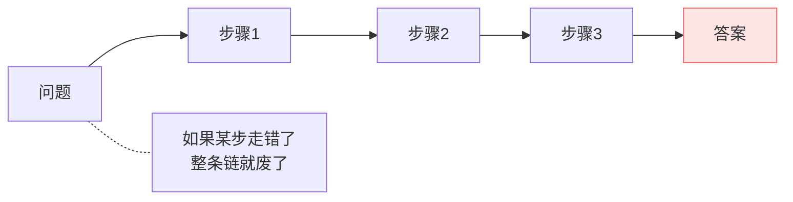

> CoT 是"一条路走到底"，如果中间某步推理错了，后面全错。ToT 解决了这个问题。

### 8.2 什么是思维树？

> **Tree of Thoughts（ToT，思维树）** = 在每一步生成多个可能的思路，评估后选最优路径继续，像搜索树一样探索。

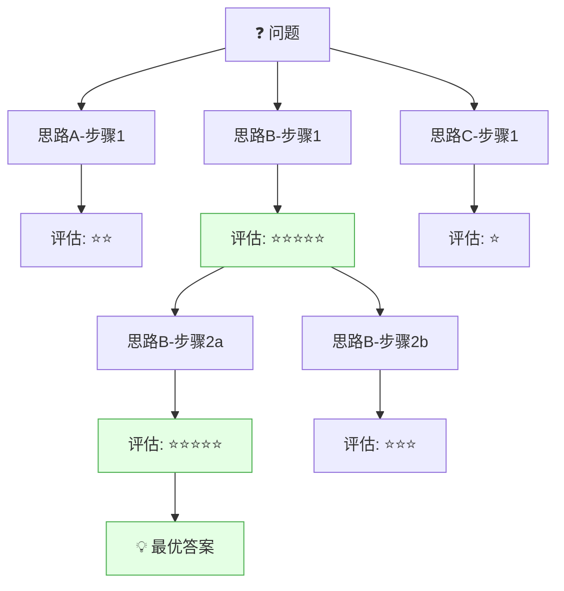

### 8.3 CoT vs ToT 对比

| 对比 | CoT 思维链 | ToT 思维树 |
|:---|:---|:---|
| **结构** | 链式（一条线） | 树状（多分支） |
| **每步选项** | 1 个 | 多个 |
| **评估** | 无 | 每步评估 |
| **回溯** | ❌ 不回溯 | ✅ 可回溯 |
| **成本** | 低 | 高 |
| **适合** | 常规推理 | 复杂规划、创意 |

### 8.4 ToT 四步流程

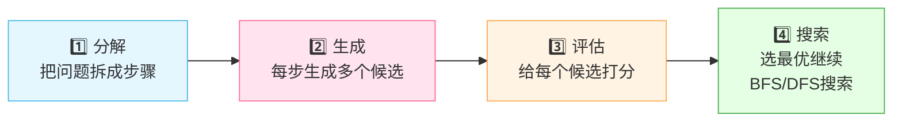

| 步骤 | 说明 |
|:---|:---|
| ① 分解 | 把问题拆成多个中间步骤 |
| ② 生成 | 每步生成多个可能的候选思路 |
| ③ 评估 | 让 LLM 给每个候选打分 |
| ④ 搜索 | 用 BFS/DFS 搜索最优路径 |

### 8.5 ToT 适用场景

| 适合 | 例子 |
|:---|:---|
| 创意发散 | "想10个创业点子，选出最好的" |
| 博弈规划 | 24 点游戏、填字游戏 |
| 复杂决策 | 多步规划、方案选择 |
| 需要回溯 | 某条路走不通可以换 |

---

## 九、进阶：思维图 GoT

### 9.1 什么是思维图？

> **Graph of Thoughts（GoT，思维图）** = 比 ToT 更进一步，允许思路之间**交叉合并**，形成图结构而非树结构。

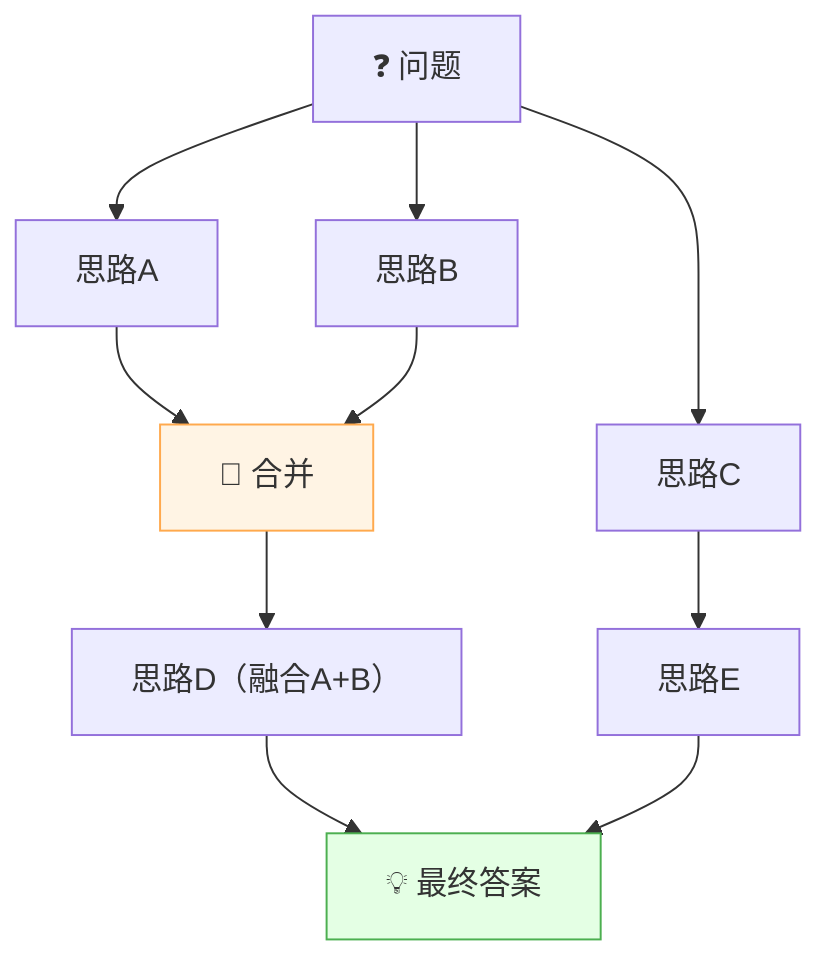

### 9.2 CoT → ToT → GoT 演进

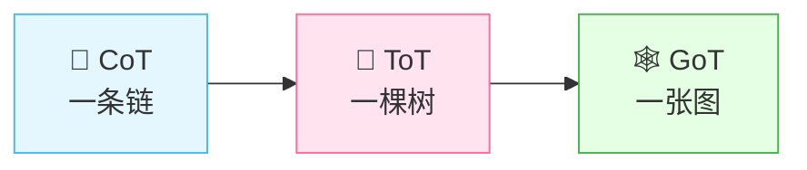

| 方法 | 结构 | 特点 | 成本 |
|:---|:---|:---|:---|
| **CoT** | 链（线性） | 一条路走到底 | 低 |
| **ToT** | 树（分支） | 多条路选最优 | 中 |
| **GoT** | 图（网状） | 多条路可交叉合并 | 高 |

### 9.3 其他 CoT 变体

| 变体 | 全称 | 特点 |
|:---|:---|:---|
| **CoT-SC** | CoT with Self-Consistency | 多次采样 + 投票 |
| **ToT** | Tree of Thoughts | 树状搜索 |
| **GoT** | Graph of Thoughts | 图状合并 |
| **PoT** | Program of Thoughts | 生成代码来推理 |
| **PS** | Plan-and-Solve | 先规划再执行 |
| **Auto-CoT** | Automatic CoT | 自动生成示例，无需人工 |

### 9.4 Plan-and-Solve CoT

> 先让模型制定计划，再按计划逐步执行。

```
问题：一个班级35人，男生比女生多5人，男生多少人？

请先制定解题计划，再按计划执行。

计划：
  1. 设女生人数为 x
  2. 男生人数为 x + 5
  3. 总人数 x + (x + 5) = 35
  4. 解方程求 x
  5. 男生 = x + 5

执行：
  1. 设女生 x 人
  2. 男生 x + 5 人
  3. x + x + 5 = 35 → 2x = 30 → x = 15
  4. 女生 15 人，男生 20 人
答案：男生 20 人
```

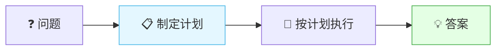

---

## 十、CoT 实战技巧

### 10.1 何时用 CoT？

```mermaid
flowchart TB
    Q["❓ 任务需要推理吗？"]
    Q -->|是| Q2["需要多步推导？"]
    Q2 -->|是| USE["✅ 用 CoT"]
    Q2 -->|否| Q3["需要精确计算？"]
    Q3 -->|是| USE
    Q3 -->|否| NO["❌ 不用 CoT<br/>直接问"]
    Q -->|否| NO

    style USE fill:#e4ffe4,stroke:#4caf50
    style NO fill:#ffe4e4,stroke:#ff6b6b
```

### 10.2 CoT 触发词汇总

| 触发词 | 适用场景 |
|:---|:---|
| "请一步步思考" ⭐ | 通用 |
| "Let's think step by step" ⭐ | 英文通用 |
| "请展示你的推理过程" | 需要展示推理 |
| "让我们一步步分析" | 分析类任务 |
| "先列出解题步骤，再回答" | 数学题 |
| "请先制定计划，再执行" | 复杂规划 |
| "Think step by step before answering" | 强调先想后答 |

### 10.3 CoT + 其他技巧组合

```mermaid
flowchart TB
    CoT["🧩 CoT 思维链"]
    CoT --> C1["CoT + Few-shot<br/>给带推理的示例"]
    CoT --> C2["CoT + RAG<br/>先检索再推理"]
    CoT --> C3["CoT + 工具调用<br/>推理中调工具"]
    CoT --> C4["CoT + 自我一致性<br/>多次投票"]
    CoT --> C5["CoT + 自我反思<br/>推理后检查"]

    style C1 fill:#e4f7ff,stroke:#4cb8e8
    style C2 fill:#e4ffe4,stroke:#4caf50
    style C3 fill:#ffe4f0,stroke:#ff6b9d
    style C4 fill:#fff4e4,stroke:#ffa94d
```

| 组合 | 效果 | 适合 |
|:---|:---|:---|
| CoT + Few-shot | 更可控的推理格式 | 特定领域推理 |
| CoT + RAG | 基于资料推理 | 知识问答 + 推理 |
| CoT + 工具调用 | 推理中查实时数据 | 需要外部数据 |
| CoT + 自我一致性 | 高精度推理 | 数学竞赛 |
| CoT + 自我反思 | 推理后自检 | 代码、逻辑 |

### 10.4 CoT + RAG 示例

```
【参考资料】
公司年假规定：
- 入职满1年：5天
- 入职满3年：10天
- 入职满10年：15天

【问题】
小明入职2年，小红入职5年，他们各有多少天年假？一共多少天？

【请一步步思考，根据参考资料回答。】

推理：
  1. 查规定：入职满1年5天，满3年10天，满10年15天
  2. 小明入职2年，在1~3年之间，按满1年算 = 5天
  3. 小红入职5年，在3~10年之间，按满3年算 = 10天
  4. 总计 5 + 10 = 15天
答案：小明5天，小红10天，共15天。
```

### 10.5 CoT + 自我反思示例

```
问题：一个长方体长5宽4高3，求表面积。

第一步：请一步步思考并回答。
推理：表面积 = 2×(长×宽 + 长×高 + 宽×高) = 2×(20+15+12) = 2×47 = 94
答案：94

第二步：请检查你的答案是否正确。
检查：长方体有6个面，三对相对面
  - 5×4 的面：2个 = 40
  - 5×3 的面：2个 = 30
  - 4×3 的面：2个 = 24
  总计 40+30+24 = 94 ✅
确认答案正确。
```

### 10.6 常见问题

| 问题 | 原因 | 解决 |
|:---|:---|:---|
| 推理过程太长 | 模型啰嗦 | 加"简洁推理"约束 |
| 推理和答案不一致 | 推理走偏 | 加"最终答案以推理为准" |
| 推理错误 | 模型能力不足 | 用更大模型或 Few-shot CoT |
| 不触发推理 | 触发词不够明显 | 用"请一步步思考"明确触发 |
| 格式混乱 | 没统一格式 | 用 Few-shot CoT 统一格式 |

---

## 十一、知识总结

最后用思维导图把所有知识点串起来 📝✨：

```mermaid
mindmap
  root((🧩 CoT 思维链))
    是什么
      先想后答
      一步步推理再给答案
      让模型有思考空间
    为什么有效
      分解复杂问题
      更多思考Token
      匹配训练分布
      大模型的涌现能力
    两种形式
      Zero-shot CoT
        加一句魔法咒语
        一步步思考
        简单通用
      Few-shot CoT
        给带推理的示例
        格式统一
        效果更可控
    效果
      数学推理大幅提升
      GSM8K从15到57
      适合推理类任务
    适用场景
      数学计算
      逻辑推理
      多步决策
      多跳问答
      不适合简单问答创意写作
    进阶变体
      自我一致性 多次投票
      思维树ToT 探索多路径
      思维图GoT 交叉合并
      Plan-and-Solve 先规划
      Auto-CoT 自动示例
    实战技巧
      触发词汇总
      与RAG组合
      与Few-shot组合
      与工具调用组合
      与自我反思组合
    注意事项
      大模型才有效
      推理质量要正确
      格式要统一
      简单任务不需要
```

### 🎯 核心要点速记

1. **CoT = 先想后答**：让模型把推理过程写出来，而不是直接给答案。
2. **核心原理**：给模型更多"思考空间"（中间 token），分解问题降低单步难度。
3. **Zero-shot CoT**：加一句"请一步步思考"即可触发，最简单。
4. **Few-shot CoT**：给带推理过程的示例，格式统一、质量正确，效果更好。
5. **效果惊人**：GSM8K 数学题从 15% 飙升到 57%，提升近 4 倍。
6. **适合推理类任务**：数学、逻辑、多步决策；简单问答/创意写作不需要。
7. **是涌现能力**：只有大模型（100B+）才有效，小模型用了可能更差。
8. **自我一致性**：多次采样 + 投票，进一步提升到 74%，适合有唯一答案的任务。
9. **思维树 ToT**：每步生成多个候选，评估后选最优，支持回溯，适合复杂规划。
10. **思维图 GoT**：允许思路交叉合并，比 ToT 更灵活，成本也更高。
11. **可组合使用**：CoT + RAG（基于资料推理）、CoT + 工具调用（推理中查数据）、CoT + 自我反思（推理后自检）。
12. **触发词**："请一步步思考"是最通用的魔法咒语。

---

> 🌸 哇~ 恭喜你把 CoT 思维链的核心知识学完啦！CoT 是让大模型推理能力质变的关键技术——一句话就能让准确率翻几倍，性价比极高！记住：**先想后答，AI 更靠谱！** 多练多试，加油鸭！(ง •_•)ง💖
