# 📐 Embedding 嵌入超全学习指南

> 嗨呀~ 欢迎来到 Embedding 的世界！📐 Embedding（嵌入/向量化）是让计算机"理解文字含义"的核心技术——把文字变成数字向量，让语义相近的文字在向量空间里也相近。它是搜索、推荐、RAG 的基石！这份指南会带你从原理到实战，彻底搞懂 Embedding。准备好了吗？冲鸭！(ﾉ>ω<)ﾉ

---

## 📖 目录

- [一、什么是 Embedding？](#一什么是-embedding)
- [二、为什么需要 Embedding？](#二为什么需要-embedding)
- [三、Embedding 的核心原理](#三embedding-的核心原理)
- [四、向量空间与相似度](#四向量空间与相似度)
- [五、Word Embedding 词嵌入](#五word-embedding-词嵌入)
- [六、Sentence/Text Embedding](#六sentencetext-embedding)
- [七、常见 Embedding 模型](#七常见-embedding-模型)
- [八、Embedding 应用场景](#八embedding-应用场景)
- [九、代码实战](#九代码实战)
- [十、Embedding 优化技巧](#十embedding-优化技巧)
- [十一、知识总结](#十一知识总结)

---

## 一、什么是 Embedding？

### 1.1 一句话定义

> **Embedding（嵌入/向量化）** = 把离散的数据（文字、图片、音频）映射成连续的数字向量，让计算机能通过数学计算来"理解"数据的语义。

简单说：**把文字变成一串数字，让计算机懂含义** 🔢。

### 1.2 直观理解

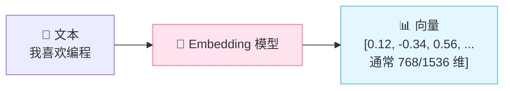

计算机不认识"我喜欢编程"这几个字，但它认识 `[0.12, -0.34, 0.56, ...]` 这串数字。Embedding 就是这个"翻译官"。

### 1.3 核心特性：语义相近 → 向量相近

> **Embedding 最神奇的特性**：语义相近的文字，向量也相近；语义不同的文字，向量相差大。

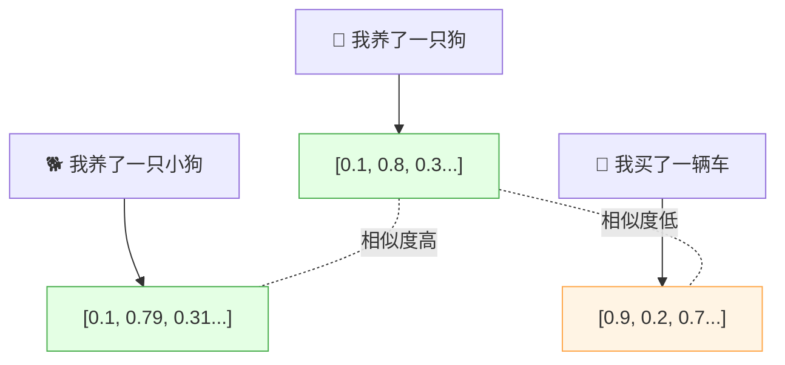

| 文本对比 | 语义关系 | 向量关系 |
|:---|:---|:---|
| "我养了一只狗" vs "我养了一只小狗" | 语义相近 ✅ | 向量相似度高 ✅ |
| "我养了一只狗" vs "我买了一辆车" | 语义不同 ❌ | 向量相似度低 ❌ |
| "苹果很好吃" vs "iPhone很好用" | 语义不同 | 向量相似度低 |
| "苹果很好吃" vs "香蕉味道不错" | 语义相近 | 向量相似度高 |

> 💡 **这就是 Embedding 的魔力**：它不只是把文字变数字，而是把"语义"编码进了向量中！

---

## 二、为什么需要 Embedding？

### 2.1 计算机不认识文字

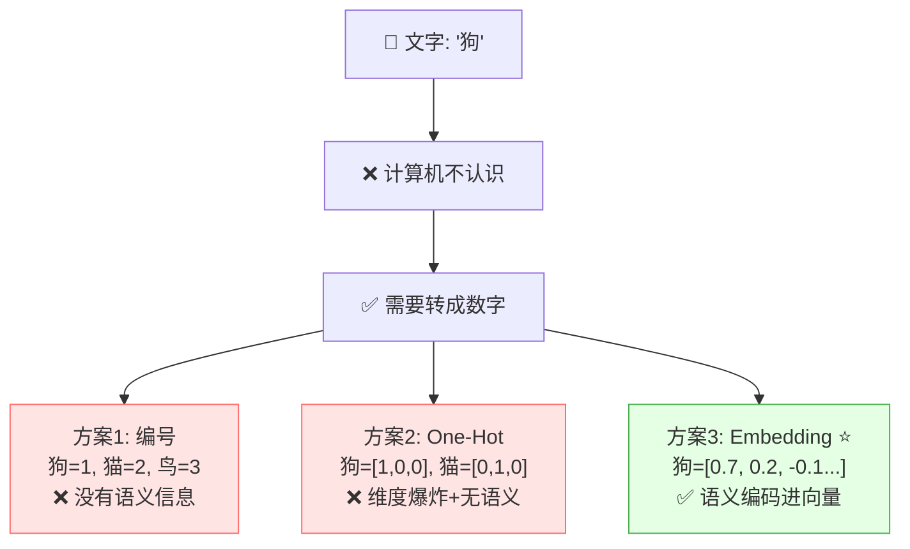

### 2.2 传统方法的局限

| 方法 | 例子 | 问题 |
|:---|:---|:---|
| **编号编码** | 狗=1, 猫=2, 鸟=3 | 数字大小无意义，1+2≠3，没有语义 |
| **One-Hot 独热** | 狗=[1,0,0], 猫=[0,1,0] | 维度爆炸（词表 10 万→10 万维），全正交无语义 |
| **TF-IDF** | 统计词频 | 只看词面匹配，不懂同义词 |
| **Embedding** ⭐ | 狗=[0.7,0.2,-0.1...] | 低维稠密，语义相近向量相近 |

### 2.3 Embedding 的优势

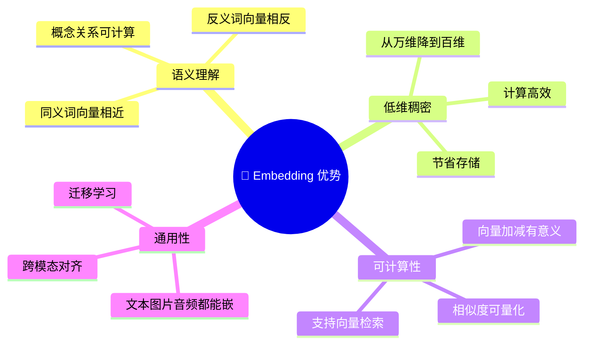

| 优势 | 说明 |
|:---|:---|
| **语义编码** | 向量中包含了语义信息，相近概念向量相近 |
| **低维高效** | 从几万维降到几百维，计算快 |
| **可计算** | 向量可以做加减、求相似度 |
| **通用性** | 文字、图片、音频都可以 Embedding |

### 2.4 经典例子：向量运算有语义

```
国王 - 男人 + 女人 ≈ 女王
中国 - 北京 + 日本 ≈ 东京
```

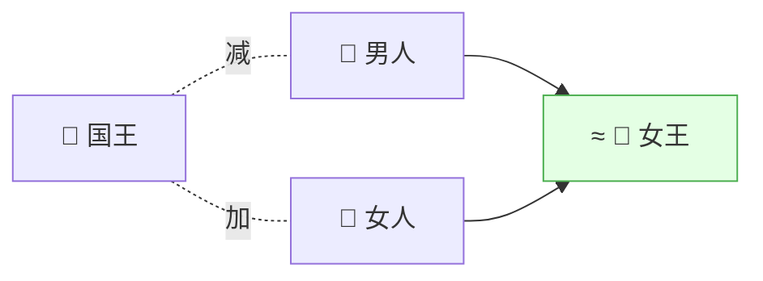

> 🎀 这说明 Embedding 不仅编码了"词"，还编码了词之间的"关系"！这就是为什么 Embedding 如此强大。

---

## 三、Embedding 的核心原理

### 3.1 Embedding 是怎么学出来的？

> Embedding 不是人为设计的，而是**模型从大量数据中自动学出来的**。

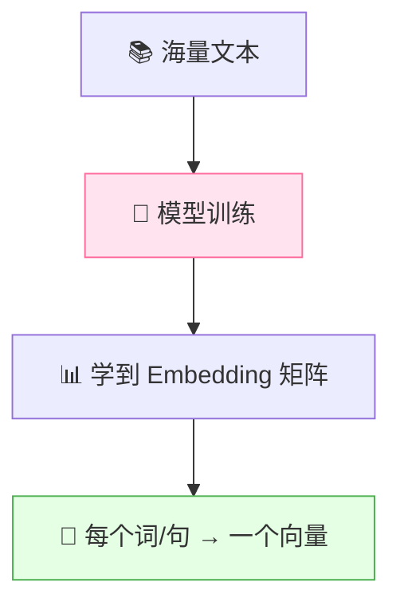

### 3.2 学习原理：上下文预测

> **核心思想**：语义相近的词，出现的上下文也相近。模型通过"预测上下文"来学习 Embedding。

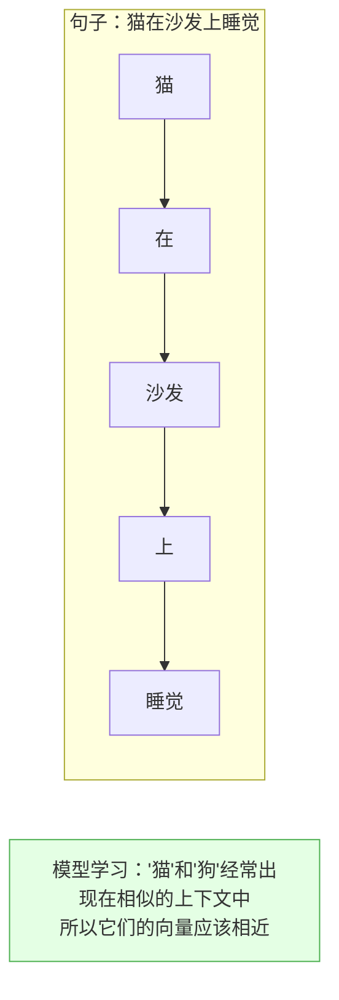

| 学习方式 | 说明 | 代表模型 |
|:---|:---|:---|
| **CBOW** | 用上下文预测中间词 | Word2Vec |
| **Skip-gram** | 用中间词预测上下文 | Word2Vec |
| **MLM 掩码** | 随机遮掩词，预测被遮掩的 | BERT |
| **对比学习** | 相似文本向量拉近，不相似推远 | SimCSE, BGE |

### 3.3 Embedding 矩阵

> 模型内部有一个 **Embedding 矩阵**，每一行就是一个词的向量。

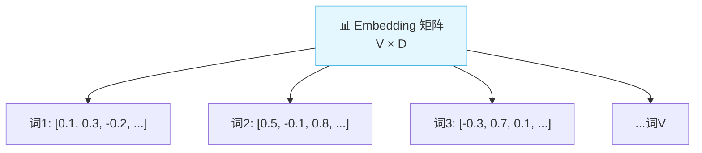

| 符号 | 含义 | 例子 |
|:---|:---|:---|
| V | 词表大小 | 5 万~30 万 |
| D | 向量维度 | 768、1024、1536 |
| 矩阵大小 | V × D | 5万 × 768 = 3840 万参数 |

### 3.4 从词到句子的 Embedding

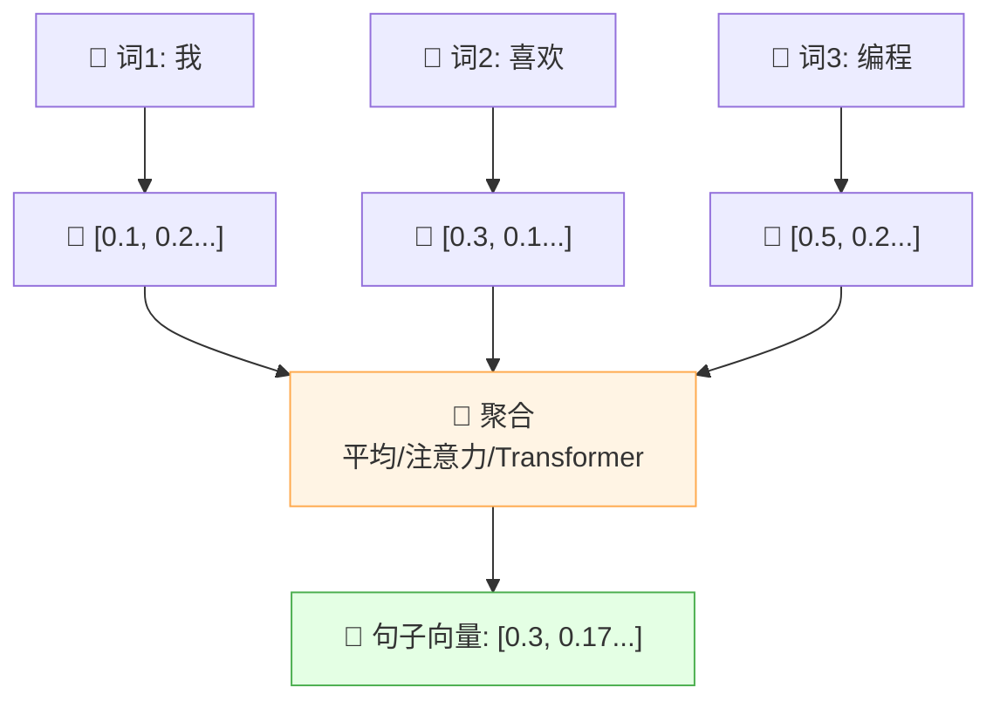

| 聚合方式 | 说明 | 效果 |
|:---|:---|:---|
| 平均池化 | 词向量取平均 | 简单但有效 |
| 最大池化 | 每维取最大值 | 保留显著特征 |
| **Transformer 编码** ⭐ | 通过 Self-Attention 聚合 | 效果最好 |
| CLS Token | 用特殊 [CLS] 位置的输出 | BERT 风格 |

---

## 四、向量空间与相似度

### 4.1 向量空间

> 所有 Embedding 向量构成的空间叫**向量空间**，语义相近的内容在这个空间里距离也近。

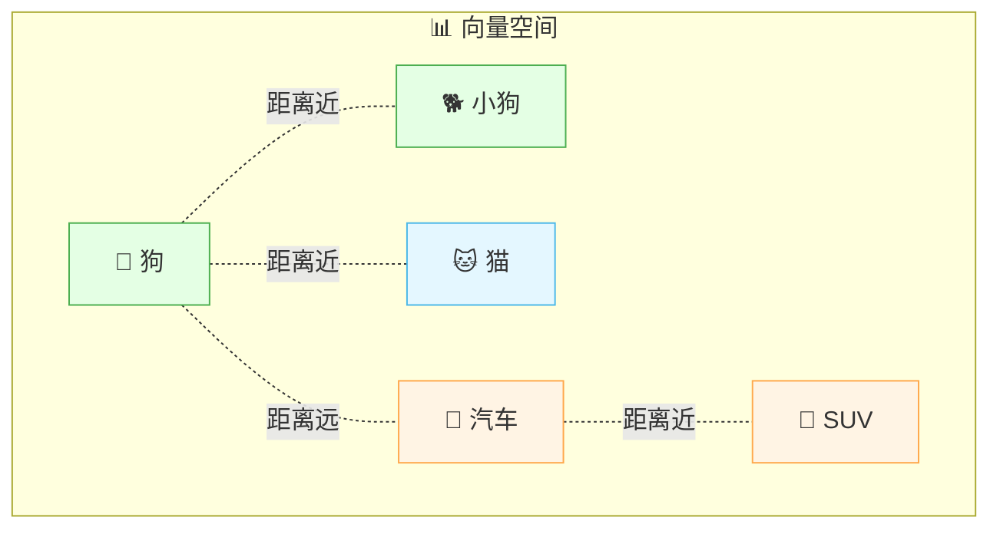

### 4.2 相似度计算方法

| 方法 | 公式 | 特点 | 常用度 |
|:---|:---|:---|:---:|
| **余弦相似度** ⭐ | cos(A,B) = A·B / (\|A\|·\|B\|) | 关注方向，不看长度 | ⭐⭐⭐ |
| 欧氏距离 | d = √(Σ(Ai-Bi)²) | 关注绝对距离 | ⭐⭐ |
| 内积（点积） | A·B = Σ(Ai×Bi) | 简单快速 | ⭐⭐ |
| 曼哈顿距离 | d = Σ\|Ai-Bi\| | L1 距离 | ⭐ |

### 4.3 余弦相似度详解（最常用）

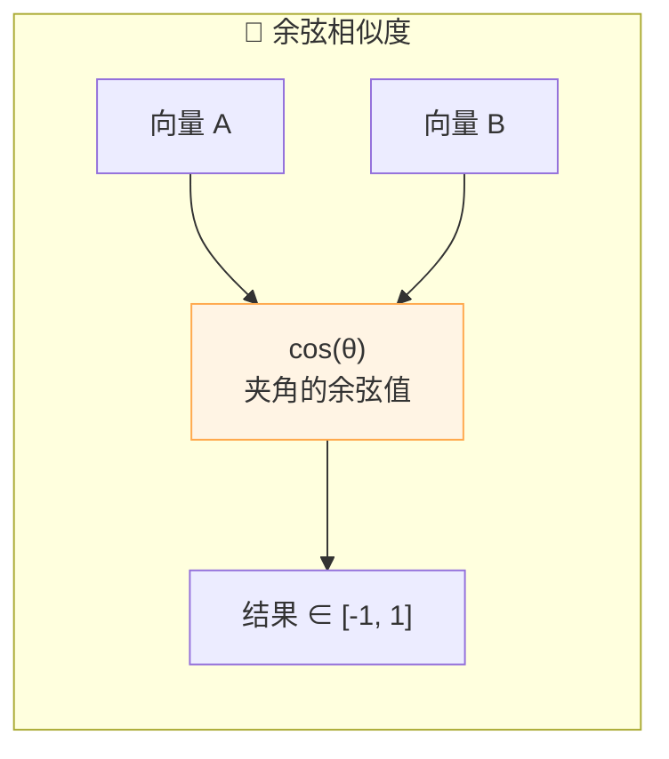

| 余弦值 | 含义 | 例子 |
|:---|:---|:---|
| **1** | 方向完全相同，最相似 | "狗" vs "小狗" |
| **0** | 正交，不相关 | "狗" vs "汽车" |
| **-1** | 方向相反 | "好" vs "坏" |
| **0.8+** | 很相似 | RAG 检索的典型阈值 |

> 💡 **余弦相似度为什么最常用？** 因为它只看向量"方向"，不看"长度"。两段文字长短不同但语义相近时，余弦相似度依然能识别出来。

### 4.4 相似度计算代码

```python
import numpy as np

# 两个向量
vec_a = np.array([0.1, 0.3, 0.5, 0.2])
vec_b = np.array([0.12, 0.28, 0.48, 0.22])

# 余弦相似度
def cosine_similarity(a, b):
    return np.dot(a, b) / (np.linalg.norm(a) * np.linalg.norm(b))

sim = cosine_similarity(vec_a, vec_b)
print(f"余弦相似度: {sim:.4f}")  # 约 0.998

# 欧氏距离
def euclidean_distance(a, b):
    return np.sqrt(np.sum((a - b) ** 2))

dist = euclidean_distance(vec_a, vec_b)
print(f"欧氏距离: {dist:.4f}")   # 约 0.049
```

### 4.5 向量检索原理


> 当知识库有百万级文档时，逐个比较太慢，需要用 **ANN（近似最近邻）** 算法加速。详见向量数据库章节。

---

## 五、Word Embedding 词嵌入

### 5.1 什么是 Word Embedding？

> **Word Embedding（词嵌入）** = 把单个词映射成向量的技术。是 Embedding 最早的形式。

### 5.2 发展历程

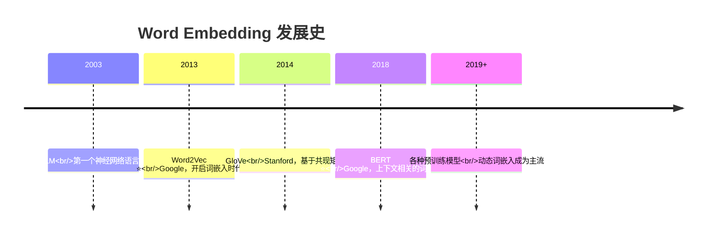

### 5.3 Word2Vec

> **Word2Vec** 是 Google 2013 年提出的，是词嵌入的经典方法。

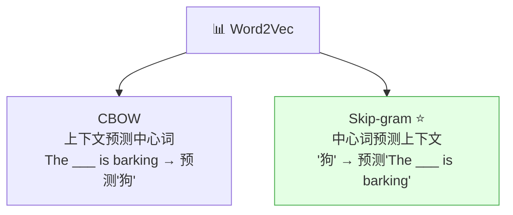

| 对比 | CBOW | Skip-gram |
|:---|:---|:---|
| 输入 | 上下文词 | 中心词 |
| 输出 | 中心词 | 上下文词 |
| 适合 | 大数据集 | 小数据集 |
| 效果 | 快 | 对低频词效果更好 |

### 5.4 Word2Vec 的经典案例

```python
# Word2Vec 经典向量运算

# 国王 - 男人 + 女人 ≈ 女王
king - man + woman ≈ queen

# 中国 - 北京 + 日本 ≈ 东京
china - beijing + japan ≈ tokyo

# 走 - 走过 + 看 ≈ 看过
walk - walked + see ≈ saw
```

> 🎀 这些例子说明 Word2Vec 学到了词与词之间的**语义关系**！

### 5.5 Word Embedding 的局限

| 局限 | 说明 | 例子 |
|:---|:---|:---|
| **一词多义** | 一个词只有一个向量 | "苹果"（水果）和"苹果"（公司）向量相同 |
| **没有上下文** | 不考虑句子上下文 | "我吃苹果"和"我买苹果手机"中的"苹果"向量一样 |
| **只到词级别** | 没有句子/文档向量 | 无法直接得到句子表示 |

### 5.6 动态词嵌入（BERT 时代）

> BERT 解决了一词多义问题：同一个词在不同上下文中向量不同！

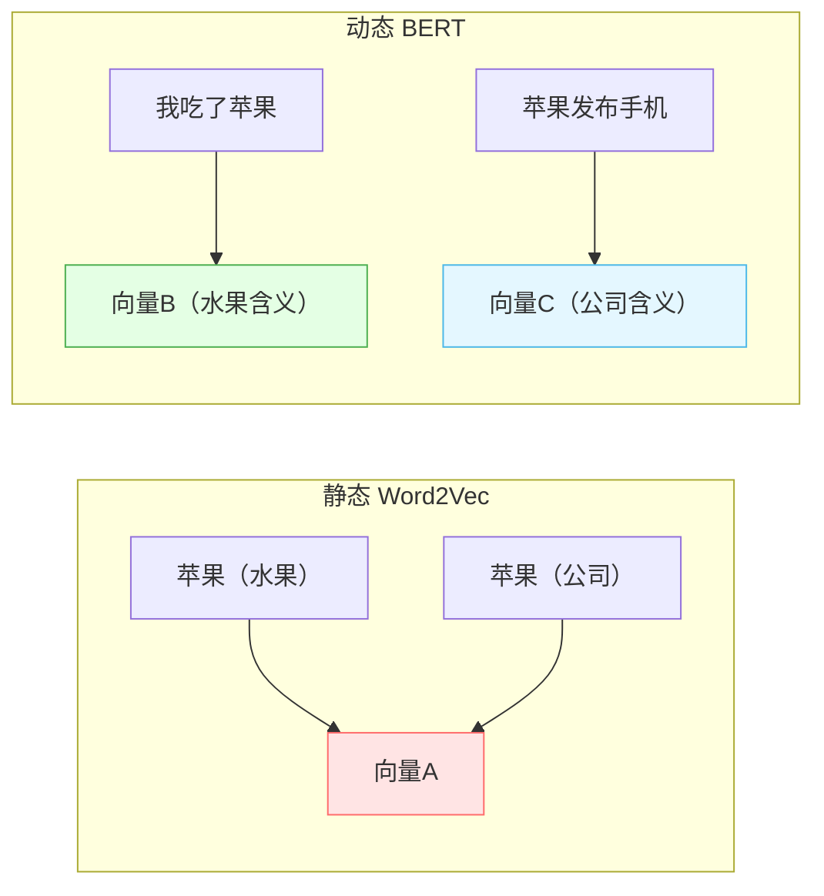

| 对比 | Word2Vec/GloVe | BERT Embedding |
|:---|:---|:---|
| 上下文 | ❌ 静态 | ✅ 动态，考虑上下文 |
| 一词多义 | ❌ 不支持 | ✅ 支持 |
| 计算成本 | 低 | 高 |
| 效果 | 一般 | 好 |

---

## 六、Sentence/Text Embedding

### 6.1 从词到句

> 实际应用中，我们通常需要**句子/段落级别**的向量，而不仅是单个词。Sentence Embedding 就是把整句话映射成一个向量。

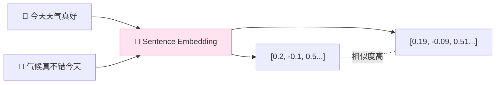

### 6.2 Sentence Embedding 方法演进

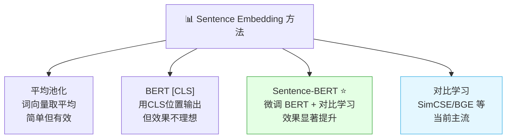

### 6.3 对比学习（当前主流）

> **对比学习** = 让模型学会"相似文本向量拉近，不相似文本推远"。

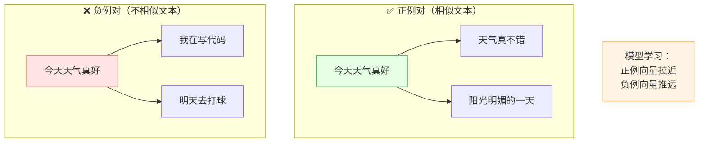

| 训练数据 | 说明 |
|:---|:---|
| **正例** | 语义相似的文本对（同义句、相邻段落） |
| **负例** | 语义不相似的文本对（随机采样） |
| **学习目标** | 正例向量距离小，负例向量距离大 |

### 6.4 主流 Sentence Embedding 方法

| 方法 | 原理 | 特点 |
|:---|:---|:---|
| **Sentence-BERT** | 在 BERT 上加池化层，用对比学习微调 | 经典，效果好 |
| **SimCSE** | 用 dropout 生成正例，对比学习 | 简单有效 |
| **对比学习+难负例** | 加入难区分的负例提升效果 | 当前主流（BGE/m3e） |
| **指令微调** | 让模型根据不同指令生成不同向量 | 最新趋势 |

---

## 七、常见 Embedding 模型

### 7.1 商业模型

| 模型 | 维度 | 特点 | 来源 |
|:---|:---:|:---|:---|
| **text-embedding-ada-002** | 1536 | OpenAI 经典版，效果好 | OpenAI |
| **text-embedding-3-small** | 1536 | OpenAI 新版，性价比高 | OpenAI |
| **text-embedding-3-large** | 3072 | OpenAI 最新，效果最好 | OpenAI |
| **Cohere Embed v3** | 1024 | 支持多语言 | Cohere |
| **Voyage AI** | 1024 | 检索优化 | Voyage |

### 7.2 开源模型

| 模型 | 维度 | 特点 | 来源 |
|:---|:---:|:---|:---|
| **BGE-m3** ⭐ | 1024 | 中文最好，多语言，多功能 | 智源 |
| **BGE-large-zh** | 1024 | 中文效果好 | 智源 |
| **m3e-base** | 768 | 中文友好，经典 | 开源 |
| **GTE-large-zh** | 1024 | 阿里出品，效果不错 | 阿里 |
| **Jina Embeddings v2** | 768 | 支持长文本（8K） | Jina |
| **E5-mistral** | 4096 | 微软出品，效果极好 | 微软 |
| **bge-reranker** | - | Rerank 模型（非 Embedding） | 智源 |

### 7.3 中文模型选型建议

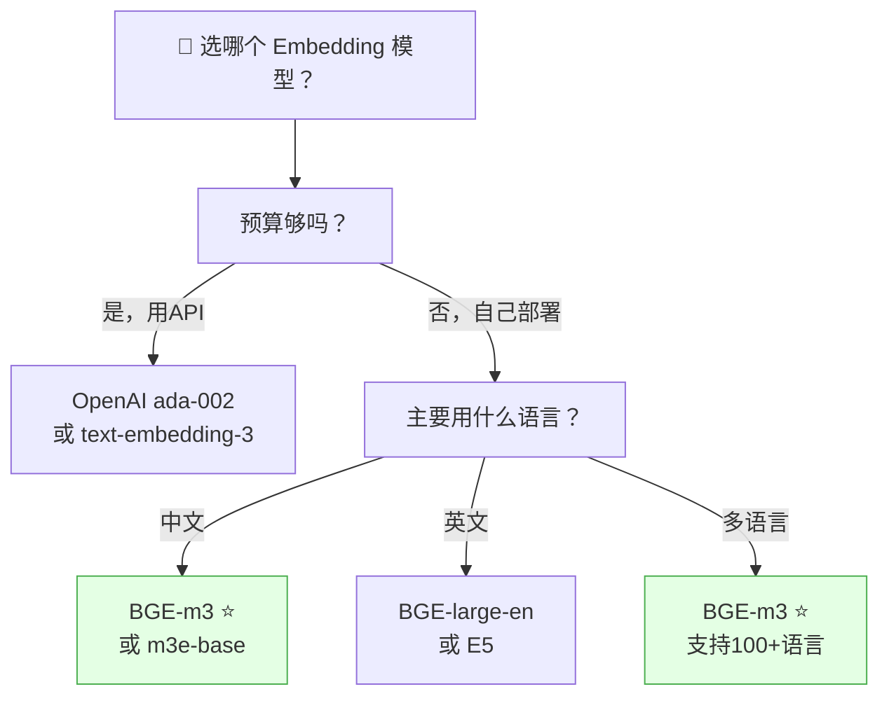

### 7.4 选型对比

| 对比项 | 商业模型（OpenAI） | 开源模型（BGE/m3e） |
|:---|:---|:---|
| 效果 | 优秀 | 接近，中文有时更好 |
| 成本 | 按 token 收费 | 免费 |
| 隐私 | 数据发到云端 | 可本地部署 |
| 部署 | API 调用 | 需要 GPU |
| 速度 | 取决于网络 | 本地快 |

> 🎀 **中文场景首推 BGE-m3**：免费、效果好、支持多语言、还有配套 Rerank 模型！

### 7.5 MTEB 排行榜

> **MTEB（Massive Text Embedding Benchmark）** 是评估 Embedding 模型的权威榜单。

| 排名靠前的模型 | 说明 |
|:---|:---|
| E5-mistral-7B | 微软出品，效果最好但模型大 |
| BGE-m3 | 智源出品，效果和效率平衡好 |
| text-embedding-3-large | OpenAI 最新，商业首选 |
| GTE-large | 阿里出品，效果好 |

---

## 八、Embedding 应用场景

### 8.1 应用全景

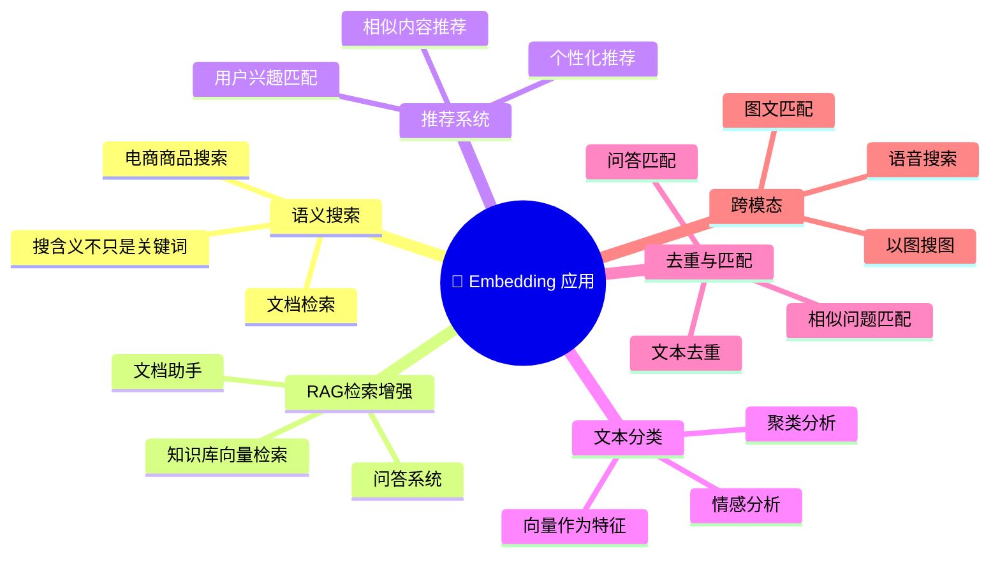

### 8.2 语义搜索

> 传统搜索靠关键词匹配，语义搜索靠含义匹配。

```mermaid
flowchart LR
    U["👤 搜索：手机没电怎么办"] --> E["📐 Embedding 向量化"]
    E --> S["🔍 与文档库向量对比"]
    S --> R["📊 找到最相似的文档"]
    R --> A["💡 返回：手机充电方法和电池保养"]

    style S fill:#fff4e4,stroke:#ffa94d
    style A fill:#e4ffe4,stroke:#4caf50
```

| 搜索方式 | 能找到"手机没电怎么办"吗 | 原因 |
|:---|:---|:---|
| 关键词搜索 | ❌ 可能找不到"充电方法" | 没有"没电""怎么办"关键词 |
| **语义搜索** | ✅ 能找到 | "没电"和"充电"语义相关 |

### 8.3 RAG 检索

```mermaid
flowchart LR
    Q["❓ 用户问题"] --> E1["📐 问题向量化"]
    DB["📚 知识库"] --> E2["📐 文档向量化"]
    E2 --> VDB["💾 向量数据库"]
    E1 --> VDB
    VDB --> R["🔍 检索 Top-K"]
    R --> LLM["🧠 LLM 生成回答"]

    style VDB fill:#fff4e4,stroke:#ffa94d
    style LLM fill:#e4ffe4,stroke:#4caf50
```

### 8.4 推荐系统

| 推荐场景 | Embedding 怎么用 |
|:---|:---|
| 相似文章推荐 | 找 Embedding 相近的文章 |
| 商品推荐 | 用户行为 Embedding ↔ 商品 Embedding 匹配 |
| 兴趣推荐 | 用户 Embedding ↔ 内容 Embedding 相似度排序 |

### 8.5 文本去重与匹配

```python
# 场景：问答系统中匹配相似问题

# 问题库
questions = [
    "怎么重置密码？",
    "密码忘了怎么办？",
    "如何修改密码？",
    "公司地址在哪？",
]

# 用户问
user_question = "密码记不起来了"

# 用 Embedding 找最相似的问题
# 结果：怎么重置密码？ → 密码忘了怎么办？
```

---

## 九、代码实战

### 9.1 使用 OpenAI Embedding

```python
import openai

# 文本向量化
response = openai.Embedding.create(
    model="text-embedding-ada-002",
    input="我喜欢编程"
)

embedding = response['data'][0]['embedding']
print(f"维度: {len(embedding)}")  # 1536
print(f"前5维: {embedding[:5]}")
```

### 9.2 使用开源模型（BGE/m3e）

```python
from sentence_transformers import SentenceTransformer

# 加载中文模型
model = SentenceTransformer('BAAI/bge-small-zh-v1.5')

# 单句向量化
embedding = model.encode("我喜欢编程")
print(f"维度: {len(embedding)}")  # 512

# 批量向量化
texts = ["我喜欢编程", "我爱写代码", "今天天气真好"]
embeddings = model.encode(texts)
print(f"批量维度: {embeddings.shape}")  # (3, 512)
```

### 9.3 相似度计算与检索

```python
from sentence_transformers import SentenceTransformer
import numpy as np

model = SentenceTransformer('BAAI/bge-small-zh-v1.5')

# 知识库
documents = [
    "Python 是一门解释型编程语言",
    "Java 是面向对象的编程语言",
    "机器学习是人工智能的分支",
    "深度学习使用神经网络",
    "RAG 是检索增强生成技术",
]

# 用户问题
query = "什么是 AI？"

# 向量化
doc_embeddings = model.encode(documents)
query_embedding = model.encode(query)

# 计算余弦相似度
similarities = model.cosine_similarity(
    [query_embedding], doc_embeddings
)[0]

# 排序取 Top-3
top_k = 3
top_indices = np.argsort(similarities)[::-1][:top_k]

for i in top_indices:
    print(f"相似度: {similarities[i]:.4f} | {documents[i]}")
# 输出：
# 相似度: 0.78 | 机器学习是人工智能的分支
# 相似度: 0.71 | 深度学习使用神经网络
# 相似度: 0.65 | RAG 是检索增强生成技术
```

### 9.4 与向量数据库集成（Chroma）

```python
import chromadb
from sentence_transformers import SentenceTransformer

# 自定义 Embedding 函数
model = SentenceTransformer('BAAI/bge-small-zh-v1.5')

class BGEEmbedding:
    def __call__(self, input):
        return model.encode(input).tolist()

# 创建 Chroma 客户端
client = chromadb.Client()
collection = client.create_collection(
    name="knowledge_base",
    embedding_function=BGEEmbedding()
)

# 添加文档
collection.add(
    documents=["Python是解释型语言", "Java是面向对象语言"],
    metadatas=[{"topic": "python"}, {"topic": "java"}],
    ids=["doc1", "doc2"]
)

# 语义检索
results = collection.query(
    query_texts=["什么是Python？"],
    n_results=2
)
print(results['documents'])
```

### 9.5 完整 RAG Embedding 流程

```mermaid
flowchart TB
    subgraph 离线["📁 离线阶段"]
        D1["📄 文档"] --> D2["✂️ 切分"]
        D2 --> D3["📐 BGE 向量化"]
        D3 --> D4["💾 存入 Chroma"]
    end

    subgraph 在线["🔎 在线阶段"]
        Q1["❓ 问题"] --> Q2["📐 BGE 向量化"]
        Q2 --> Q3["🔍 Chroma 检索"]
        Q3 --> Q4["📎 拼接上下文"]
        Q4 --> Q5["🧠 LLM 生成"]
    end

    D4 -.数据就绪.-> Q3

    style D3 fill:#ffe4f0,stroke:#ff6b9d
    style Q2 fill:#ffe4f0,stroke:#ff6b9d
    style Q3 fill:#fff4e4,stroke:#ffa94d
```

---

## 十、Embedding 优化技巧

### 10.1 数据预处理

| 技巧 | 说明 |
|:---|:---|
| **清洗数据** | 去噪、去 HTML 标签、统一编码 |
| **分段合理** | 切分时保持语义完整（段落/句子级） |
| **去除冗余** | 去掉重复内容，避免检索偏差 |
| **添加元数据** | 标题、分类、时间等 metadata 辅助过滤 |

### 10.2 模型选择与调优

```mermaid
flowchart TB
    A["🔧 Embedding 优化方向"]
    A --> B1["模型选择<br/>选适合任务的模型"]
    A --> B2["维度选择<br/>高维度高精度但慢"]
    A --> B3["微调模型<br/>领域数据微调"]
    A --> B4["归一化<br/>向量归一化提升检索"]

    style B1 fill:#e4ffe4,stroke:#4caf50
    style B3 fill:#fff4e4,stroke:#ffa94d
```

| 优化方向 | 说明 | 效果 |
|:---|:---|:---|
| **选对模型** | 中文用 BGE/m3e，英文用 E5 | 基础效果 |
| **维度选择** | 768 vs 1024 vs 1536 | 高维更精确但更慢 |
| **微调** | 用领域数据微调 Embedding 模型 | 领域效果提升 |
| **归一化** | 向量 L2 归一化 | 余弦相似度 = 内积，更快 |
| **指令前缀** | BGE 支持指令前缀优化 | 检索效果提升 |

### 10.3 BGE 指令前缀

```python
# BGE 模型支持指令前缀优化检索
from sentence_transformers import SentenceTransformer

model = SentenceTransformer('BAAI/bge-large-zh-v1.5')

# 查询时加指令前缀
query = "为这个句子生成表示以用于检索相关文章：" + "什么是机器学习？"
query_embedding = model.encode(query)

# 文档不需要加前缀
doc_embedding = model.encode("机器学习是AI的分支")
```

### 10.4 检索优化

| 技巧 | 说明 |
|:---|:---|
| **Rerank 重排序** | 初步检索后用 Cross-Encoder 精排 |
| **混合检索** | 向量检索 + 关键词检索（BM25） |
| **过滤** | 用 metadata 先缩小范围 |
| **分块策略** | 合理 chunk_size 提升精度 |

### 10.5 常见问题

| 问题 | 原因 | 解决 |
|:---|:---|:---|
| 检索不准 | 模型不匹配 | 换更合适的模型 |
| 向量维度太高 | 模型选择 | 降维（PCA）或换小模型 |
| 中文效果差 | 用了英文模型 | 换 BGE/m3e |
| 检索慢 | 暴力搜索 | 用向量数据库 + ANN 索引 |
| 相似但不对 | 缺少 Rerank | 加 Rerank 精排 |

---

## 十一、知识总结

最后用思维导图把所有知识点串起来 📝✨：

```mermaid
mindmap
  root((📐 Embedding))
    是什么
      把文字变成向量
      语义相近向量相近
      计算机理解语义的桥梁
    为什么需要
      计算机不认识文字
      编号和OneHot无语义
      Embedding低维稠密有语义
      向量运算有意义
    核心原理
      从海量文本学习
      上下文预测
      Embedding矩阵
      词到句子的聚合
    向量空间与相似度
      余弦相似度 最常用
      欧氏距离
      内积
      向量检索ANN
    Word Embedding
      Word2Vec CBOW和SkipGram
      GloVe 共现矩阵
      静态一词一义
      BERT动态一词多义
    Sentence Embedding
      平均池化
      Sentence-BERT
      对比学习 主流
      SimCSE BGE
    常见模型
      OpenAI ada-002
      BGE-m3 中文首选
      m3e-base 中文友好
      GTE 阿里出品
      E5 微软出品
    应用场景
      语义搜索
      RAG检索
      推荐系统
      文本去重
      跨模态
    优化技巧
      数据预处理
      模型选择
      微调
      归一化
      Rerank重排序
```

### 🎯 核心要点速记

1. **Embedding = 文字变向量**：让计算机通过数学计算理解文字语义。
2. **核心特性**：语义相近的文字，向量也相近——这是 Embedding 的魔力。
3. **优于传统编码**：比 One-Hot/TF-IDF 强，低维稠密且含语义信息。
4. **向量运算有意义**：国王 - 男人 +女人 ≈ 女王，说明 Embedding 编码了语义关系。
5. **学习原理**：通过上下文预测从海量文本中自动学习（Word2Vec/BERT/对比学习）。
6. **Word Embedding**：Word2Vec 是经典，但静态；BERT 是动态，解决一词多义。
7. **Sentence Embedding**：用对比学习训练（正例拉近、负例推远），当前主流。
8. **余弦相似度**最常用：关注向量方向而非长度，适合文本相似度计算。
9. **中文首推 BGE-m3**：免费、效果好、多语言、有配套 Rerank。
10. **核心应用**：语义搜索、RAG 检索、推荐系统、文本去重。
11. **优化方向**：选对模型、合理切分、加 Rerank、混合检索。
12. **与向量数据库配合**：Embedding 生成向量 → 向量数据库存储和检索 → ANN 加速。

---

> 🌸 哇~ 恭喜你把 Embedding 嵌入的核心知识学完啦！Embedding 是 AI 理解语义的基石——没有 Embedding，就没有语义搜索、没有 RAG、没有智能推荐。理解了"语义相近向量相近"这个核心思想，你就掌握了 Embedding 的灵魂！加油鸭！(ง •_•)ง💖
