# 🔧 AI 工具调用（Function Calling）超全学习指南

> 嗨呀~ 欢迎来到 AI 工具调用的世界！🔧 Function Calling（函数调用/工具调用）是让大模型"动起手来"的技术——不只是聊天，还能查天气、查数据库、调 API、执行代码！这是 AI Agent 的核心能力。这份指南会带你从原理到实战，把工具调用揉碎了喂给你。准备好了吗？冲鸭！(ﾉ>ω<)ﾉ

---

## 📖 目录

- [一、什么是 AI 工具调用？](#一什么是-ai-工具调用)
- [二、为什么需要工具调用？](#二为什么需要工具调用)
- [三、Function Calling 原理](#三function-calling-原理)
- [四、完整工作流程](#四完整工作流程)
- [五、工具定义（Function Schema）](#五工具定义function-schema)
- [六、主流模型的支持方式](#六主流模型的支持方式)
- [七、代码实战](#七代码实战)
- [八、工具调用 vs RAG vs 代码解释器](#八工具调用-vs-rag-vs-代码解释器)
- [九、进阶：并行调用与多轮调用](#九进阶并行调用与多轮调用)
- [十、最佳实践与常见问题](#十最佳实践与常见问题)
- [十一、知识总结](#十一知识总结)

---

## 一、什么是 AI 工具调用？

### 1.1 一句话定义

> **AI 工具调用（Function Calling / Tool Use）** = 让大模型根据用户需求，自动选择并调用外部工具（函数/API），获取结果后继续生成回答的能力。

简单说：**让 AI 不只是"说"，还能"做"** 🔧。

### 1.2 生活化比喻

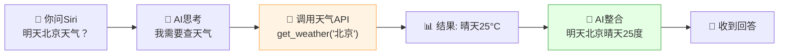

| 没有 Function Calling | 有 Function Calling |
|:---|:---|
| 😅 AI 只能瞎猜"明天可能晴天" | ✅ AI 调用天气 API，给你准确数据 |
| 😅 问"1+1等于几"可能算错 | ✅ 调用计算器，结果准确 |
| 😅 不懂最新信息 | ✅ 调用搜索 API，获取实时信息 |
| 😅 不能操作数据库 | ✅ 调用 SQL 查询，操作数据 |

### 1.3 核心价值

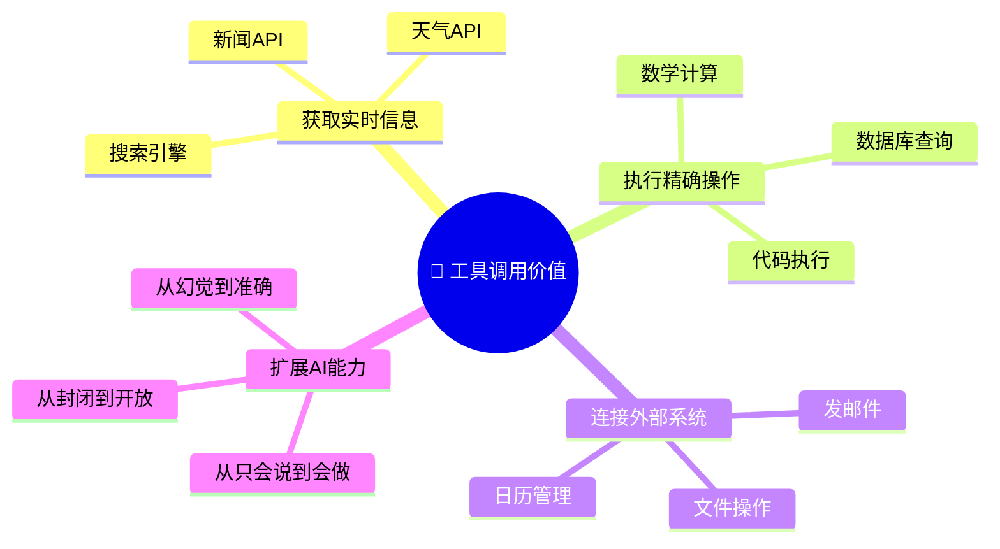

> 💡 **一句话总结**：Function Calling 把 LLM 从"闭门造车的聊天机器人"变成了"能连接万物的智能助手"！

---

## 二、为什么需要工具调用？

### 2.1 纯 LLM 的四大局限

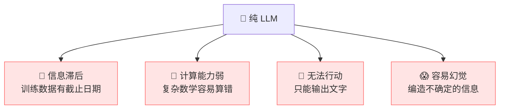

### 2.2 工具调用如何解决？

| 局限 | 痛点 | 工具调用解决方案 |
|:---|:---|:---|
| 📅 信息滞后 | 不知道昨天发生了什么 | 调用搜索 API 获取最新信息 |
| 🔢 计算能力弱 | "3.14 × 2.78 = ?" 可能算错 | 调用计算器/代码解释器 |
| 🚫 无法行动 | 只能告诉你怎么做，不能帮你做 | 调用 API 发邮件、订机票 |
| 😱 容易幻觉 | 不确定的信息瞎编 | 调用数据库查询真实数据 |

### 2.3 对比示例

**场景**：用户问"帮我查一下北京明天的天气，然后发邮件通知团队。"

| 方式 | 表现 |
|:---|:---|
| 纯 LLM | "我无法查询实时天气，也无法发邮件..." ❌ |
| LLM + Function Calling | ① 调用天气 API → 获取"晴天25°C" → ② 调用邮件 API → 发送通知 ✅ |

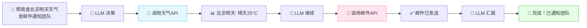

---

## 三、Function Calling 原理

### 3.1 核心思想

> 大模型本身**不执行**任何函数，它只做两件事：**① 决定调哪个函数、传什么参数 → ② 把函数返回结果整合成自然语言回答**。真正的执行在你的代码里。

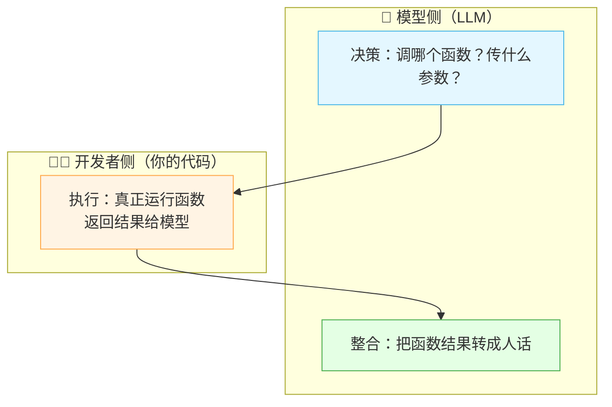

> 💡 **关键理解**：模型不是"调用"函数，而是"告诉你"该调什么函数、传什么参数。真正的执行在你的代码中完成！

### 3.2 三步核心流程

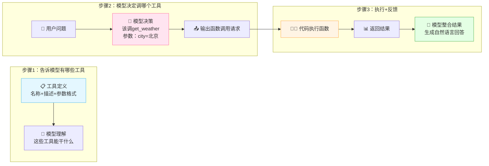

| 步骤 | 谁来做 | 做什么 |
|:---|:---|:---|
| ① 注册工具 | 开发者 | 把可用工具的"说明书"告诉模型 |
| ② 模型决策 | LLM | 分析用户意图，决定调哪个工具、传什么参数 |
| ③ 执行+反馈 | 开发者 + LLM | 代码执行函数→结果返回给模型→模型生成回答 |

### 3.3 一个具体例子

```
用户：北京明天天气怎么样？

模型内部思考：
  - 用户想知道天气
  - 可用工具中有 get_weather 函数
  - 城市 = "北京"，日期 = "明天"
  → 决定调用 get_weather(city="北京", date="明天")

模型输出（不是文字，而是函数调用）：
  {
    "function": "get_weather",
    "arguments": {"city": "北京", "date": "明天"}
  }

开发者代码执行函数，返回：
  {"temperature": 25, "condition": "晴", "humidity": 40}

模型收到结果，生成回答：
  "北京明天天气晴朗，气温25°C，湿度40%。适合出行哦！"
```

---

## 四、完整工作流程

### 4.1 交互流程图

```mermaid
sequenceDiagram
    participant U as 👤 用户
    participant A as 🤖 应用层
    participant L as 🧠 LLM
    participant T as 🔧 工具/API

    U->>A: 提问："北京明天天气？"
    A->>L: 发送问题 + 工具列表
    Note over L: 分析意图，决定调用工具
    L-->>A: 返回函数调用请求<br/>get_weather(city="北京")
    A->>T: 执行 get_weather("北京")
    T-->>A: 返回 {"temp":25,"condition":"晴"}
    A->>L: 把结果发回给模型
    Note over L: 整合结果生成回答
    L-->>A: "北京明天晴天25°C"
    A-->>U: 返回最终回答

    style L fill:#e4f7ff
    style T fill:#fff4e4
```

### 4.2 详细步骤说明

| 步骤 | 说明 | 关键点 |
|:---|:---|:---|
| ① 用户提问 | 用户发出请求 | 自然语言 |
| ② 发送工具列表 | 应用层把可用工具定义 + 用户问题一起发给 LLM | 工具 Schema |
| ③ 模型决策 | LLM 判断要不要调工具、调哪个、传什么参数 | 模型能力 |
| ④ 返回调用请求 | LLM 输出结构化的函数调用（非自然语言） | JSON 格式 |
| ⑤ 执行函数 | 应用层解析请求，真正执行函数 | 开发者代码 |
| ⑥ 返回结果 | 函数执行结果返回给 LLM | JSON 格式 |
| ⑦ 生成回答 | LLM 把结果整合成自然语言回答 | 最终输出 |

### 4.3 多轮工具调用

> 有时一个任务需要连续调用多个工具。

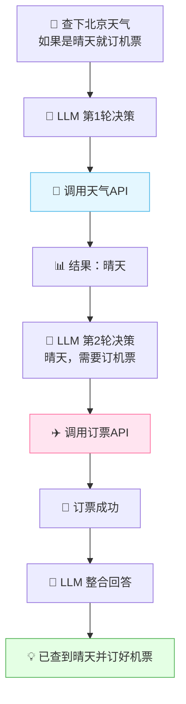

---

## 五、工具定义（Function Schema）

### 5.1 什么是工具定义？

> **工具定义（Function Schema）** = 告诉模型"有什么工具可用、每个工具做什么、需要什么参数"的说明书。

模型只能调用你告诉它的工具，而且必须按你定义的参数格式调用。

### 5.2 Schema 结构

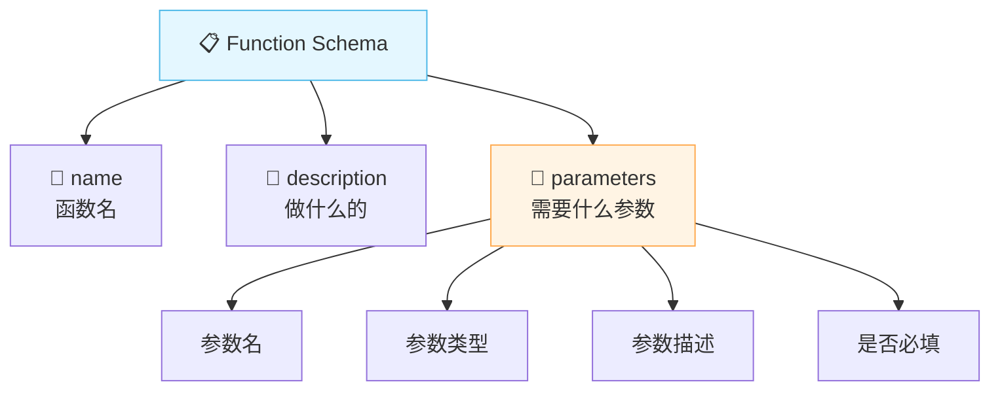

### 5.3 Schema 示例

```json
{
  "name": "get_weather",
  "description": "查询指定城市的天气预报",
  "parameters": {
    "type": "object",
    "properties": {
      "city": {
        "type": "string",
        "description": "城市名称，如：北京、上海"
      },
      "date": {
        "type": "string",
        "description": "日期，格式 YYYY-MM-DD",
        "default": "今天"
      },
      "unit": {
        "type": "string",
        "enum": ["celsius", "fahrenheit"],
        "description": "温度单位"
      }
    },
    "required": ["city"]
  }
}
```

| 字段 | 说明 |
|:---|:---|
| `name` | 函数名，模型用它来调用 |
| `description` | **最重要！** 告诉模型这个函数能干什么，模型据此判断要不要调 |
| `parameters.properties` | 每个参数的名称、类型、描述 |
| `parameters.required` | 哪些参数是必填的 |
| `enum` | 枚举值，限定参数取值范围 |

> 💡 **description 是灵魂！** 模型完全靠 description 来判断"该不该调这个函数"。描述越清晰，模型选择越准确。

### 5.4 常见工具类型

| 工具类型 | 例子 | 用途 |
|:---|:---|:---|
| 查询类 | 搜索、天气、股票 | 获取实时信息 |
| 计算类 | 计算器、代码执行 | 精确计算 |
| 数据库类 | SQL 查询、数据检索 | 查询私有数据 |
| 操作类 | 发邮件、创建日程 | 执行实际操作 |
| 多媒体类 | 图片生成、语音合成 | 生成多媒体内容 |

---

## 六、主流模型的支持方式

### 6.1 OpenAI Function Calling

OpenAI 是最早支持 Function Calling 的厂商，也是目前最成熟的。

```python
# OpenAI Function Calling 示例
response = openai.ChatCompletion.create(
    model="gpt-4",
    messages=[{"role": "user", "content": "北京明天天气？"}],
    tools=[{
        "type": "function",
        "function": {
            "name": "get_weather",
            "description": "查询指定城市的天气预报",
            "parameters": {
                "type": "object",
                "properties": {
                    "city": {"type": "string", "description": "城市名"}
                },
                "required": ["city"]
            }
        }
    }],
    tool_choice="auto"  # auto: 模型自己决定, none: 不调, 指定函数名: 强制调
)

# 模型返回的函数调用
tool_call = response.choices[0].message.tool_calls[0]
# tool_call.function.name = "get_weather"
# tool_call.function.arguments = '{"city": "北京"}'
```

### 6.2 各模型对比

| 模型 | 支持方式 | 并行调用 | 特点 |
|:---|:---|:---:|:---|
| **OpenAI GPT-4** | `tools` + `tool_choice` | ✅ | 最成熟，生态最好 |
| **Claude 3.5** | `tools` 参数 | ✅ | 支持复杂工具链 |
| **Gemini** | `function_declarations` | ✅ | Google 生态集成 |
| **Qwen** | `tools` 参数（兼容 OpenAI） | ✅ | 中文友好 |
| **LLaMA 3** | 需自行实现 | 视实现 | 开源，需框架支持 |
| **GLM-4** | `tools` 参数 | ✅ | 中文友好 |

> 🎀 **好消息**：大多数主流模型都兼容 OpenAI 的 Function Calling 格式，学一套即可！

### 6.3 tool_choice 参数

| 值 | 含义 |
|:---|:---|
| `"auto"` | 模型自己决定要不要调工具（默认） ⭐ |
| `"none"` | 禁止调用工具 |
| `{"type": "function", "function": {"name": "xxx"}}` | 强制调用指定函数 |

---

## 七、代码实战

### 7.1 完整 Python 示例

```python
import openai
import json

# 1. 定义工具函数（真正执行的代码）
def get_weather(city: str, date: str = "今天") -> dict:
    """查询天气（模拟实现）"""
    weather_data = {
        "北京": {"temperature": 25, "condition": "晴", "humidity": 40},
        "上海": {"temperature": 28, "condition": "多云", "humidity": 65},
    }
    return weather_data.get(city, {"error": "未找到该城市"})

def send_email(to: str, subject: str, body: str) -> str:
    """发邮件（模拟实现）"""
    return f"邮件已发送给 {to}，主题：{subject}"

# 2. 定义工具 Schema
tools = [
    {
        "type": "function",
        "function": {
            "name": "get_weather",
            "description": "查询指定城市的天气预报",
            "parameters": {
                "type": "object",
                "properties": {
                    "city": {
                        "type": "string",
                        "description": "城市名称，如：北京、上海"
                    },
                    "date": {
                        "type": "string",
                        "description": "日期，默认今天"
                    }
                },
                "required": ["city"]
            }
        }
    },
    {
        "type": "function",
        "function": {
            "name": "send_email",
            "description": "发送邮件给指定收件人",
            "parameters": {
                "type": "object",
                "properties": {
                    "to": {"type": "string", "description": "收件人邮箱"},
                    "subject": {"type": "string", "description": "邮件主题"},
                    "body": {"type": "string", "description": "邮件正文"}
                },
                "required": ["to", "subject", "body"]
            }
        }
    }
]

# 3. 函数映射表（名字 → 函数）
function_map = {
    "get_weather": get_weather,
    "send_email": send_email
}

# 4. 主流程
def chat_with_tools(user_message: str):
    messages = [{"role": "user", "content": user_message}]

    while True:
        # 调用模型
        response = openai.ChatCompletion.create(
            model="gpt-4",
            messages=messages,
            tools=tools,
            tool_choice="auto"
        )

        msg = response.choices[0].message
        messages.append(msg)

        # 如果模型没有调用工具，直接返回回答
        if not msg.tool_calls:
            return msg.content

        # 如果模型调用了工具，执行函数
        for tool_call in msg.tool_calls:
            func_name = tool_call.function.name
            func_args = json.loads(tool_call.function.arguments)

            print(f"🔧 调用函数: {func_name}({func_args})")

            # 执行真正的函数
            result = function_map[func_name](**func_args)

            # 把结果返回给模型
            messages.append({
                "role": "tool",
                "tool_call_id": tool_call.id,
                "content": json.dumps(result, ensure_ascii=False)
            })

        # 继续循环，让模型处理结果

# 5. 测试
answer = chat_with_tools("帮我查北京天气，如果是晴天就发邮件给 boss@company.com 通知团建")
print(answer)
```

### 7.2 执行流程

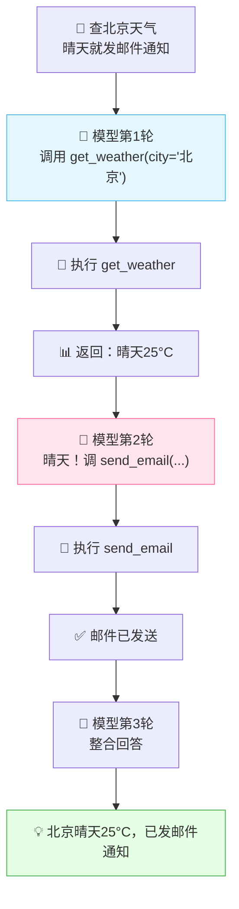

### 7.3 LangChain 工具调用示例

```python
from langchain.tools import tool
from langchain.chat_models import ChatOpenAI
from langchain.agents import create_tool_calling_agent, AgentExecutor

# 用装饰器定义工具
@tool
def get_weather(city: str) -> str:
    """查询指定城市的天气预报"""
    return f"{city}: 晴天 25°C"

@tool
def send_email(to: str, subject: str, body: str) -> str:
    """发送邮件给指定收件人"""
    return f"邮件已发送给 {to}"

# 创建 Agent
llm = ChatOpenAI(model="gpt-4")
tools = [get_weather, send_email]
agent = create_tool_calling_agent(llm, tools)
executor = AgentExecutor(agent=agent, tools=tools)

# 执行
result = executor.invoke({
    "input": "查北京天气，晴天就发邮件给 boss@company.com 通知团建"
})
print(result["output"])
```

### 7.4 代码结构总结

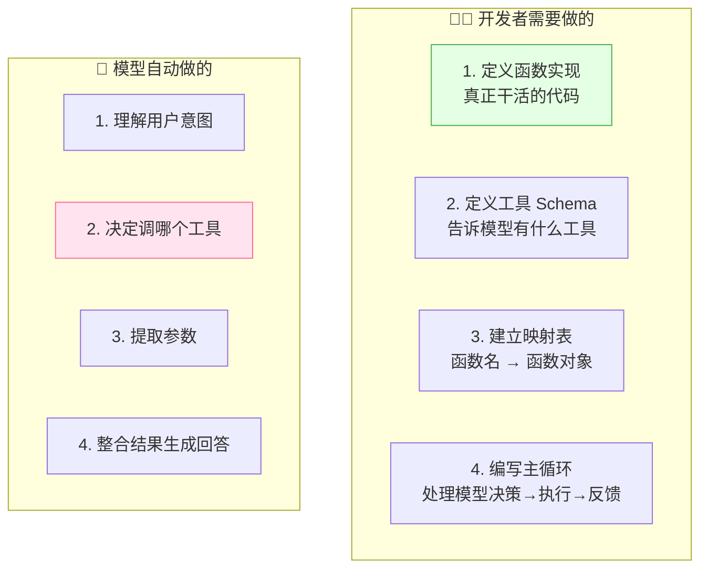

---

## 八、工具调用 vs RAG vs 代码解释器

### 8.1 三者对比

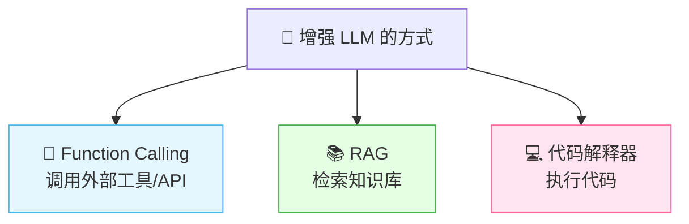

| 对比 | Function Calling | RAG | 代码解释器 |
|:---|:---|:---|:---|
| **做什么** | 调用外部函数/API | 检索知识库 | 执行代码 |
| **获取什么** | 实时数据/操作 | 文本知识 | 计算结果 |
| **适合** | 查天气、发邮件、查数据库 | 文档问答、知识检索 | 数据分析、数学计算 |
| **灵活性** | 高（自定义函数） | 中（文档检索） | 高（任意代码） |
| **安全性** | 需控制权限 | 安全 | 需沙箱隔离 |

### 8.2 它们可以组合使用！

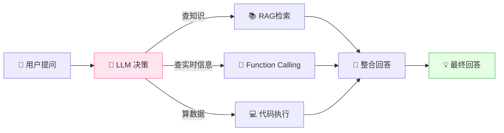

> 🎀 **最佳实践**：Function Calling 是 AI Agent 的"手"，RAG 是"书"，代码解释器是"计算器"。一个强大的 Agent 应该三者兼备！

---

## 九、进阶：并行调用与多轮调用

### 9.1 并行调用（Parallel Function Calling）

> 新一代模型（GPT-4、Claude 3.5）支持**一次性调用多个工具**，提高效率。

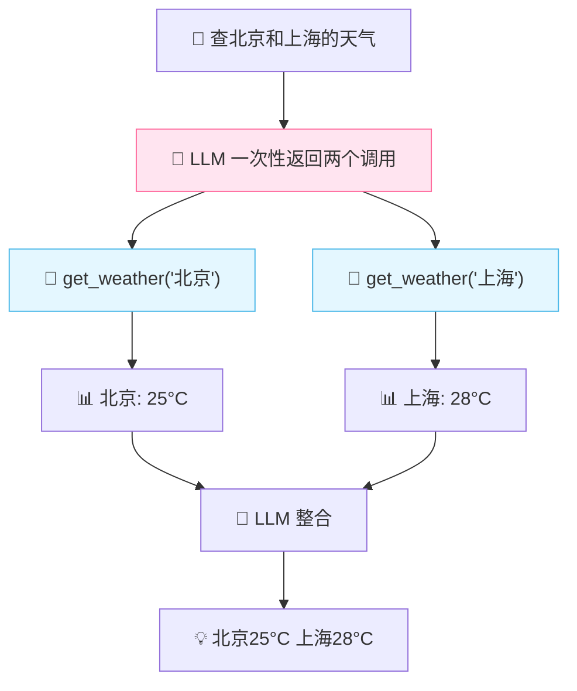

| 模式 | 说明 | 速度 |
|:---|:---|:---|
| 串行调用 | 一次调一个，等结果再调下一个 | 慢 |
| **并行调用** ⭐ | 一次调多个，同时执行 | 快 |

### 9.2 多轮调用（Multi-turn）

> 复杂任务需要多轮调用，前一个工具的结果影响下一个调用。

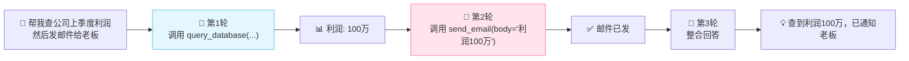

### 9.3 工具选择的智能性

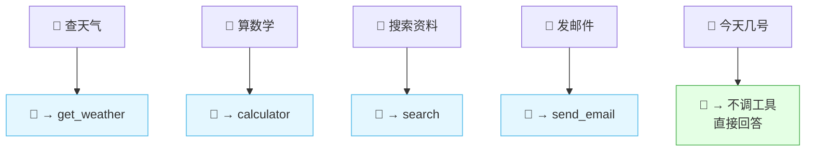

> 💡 模型会智能判断：该不该调工具？调哪个？如果不需要工具就能回答（如"今天几号"如果模型本身知道），就不会调用。

---

## 十、最佳实践与常见问题

### 10.1 最佳实践

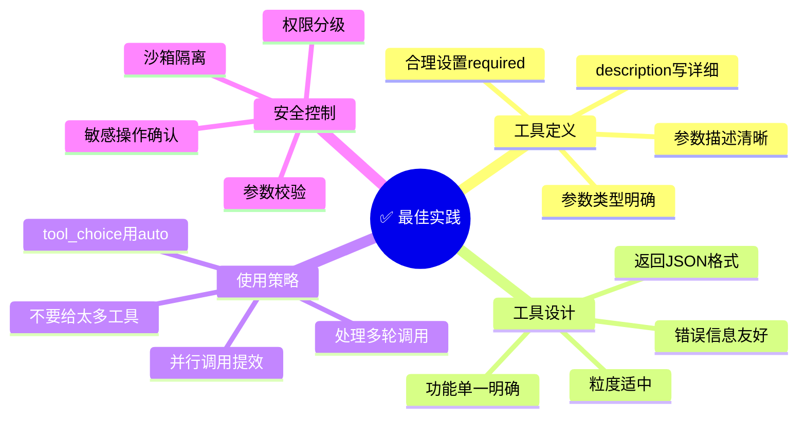

### 10.2 工具设计原则

| 原则 | 说明 | 好的 vs 坏的 |
|:---|:---|:---|
| **单一职责** | 一个工具做一件事 | ✅ `get_weather` ❌ `do_everything` |
| **描述清晰** | description 要详细 | ✅ "查询指定城市未来3天天气" ❌ "查天气" |
| **参数明确** | 类型、描述、必填都写清 | ✅ `city: string "城市名如北京"` |
| **返回规范** | 返回 JSON，包含状态和数据 | ✅ `{"status":"ok","temp":25}` |
| **粒度适中** | 不要太粗也不要太细 | ✅ `get_weather` + `send_email` |

### 10.3 常见问题与解决

| 问题 | 原因 | 解决方案 |
|:---|:---|:---|
| 模型不调工具 | description 不够清晰 | 完善 description，加示例 |
| 调错了工具 | 工具描述相似，混淆 | 区分描述，功能明确 |
| 参数提取错误 | 参数描述不清晰 | 加参数说明和示例 |
| 无限循环调用 | 模型一直调工具不收敛 | 限制最大轮次 |
| 工具执行报错 | 参数类型不匹配 | 做参数校验和类型转换 |
| 返回结果太长 | 函数返回大量数据 | 只返回关键字段 |

### 10.4 安全注意事项

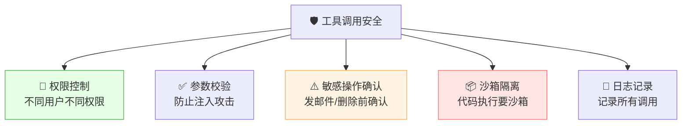

| 安全措施 | 说明 |
|:---|:---|
| 权限控制 | 只暴露用户有权使用的工具 |
| 参数校验 | 防止恶意参数注入 |
| 敏感操作确认 | 发邮件/删除/支付前要求确认 |
| 沙箱隔离 | 代码执行类工具需要沙箱 |
| 日志审计 | 记录所有工具调用 |
| 速率限制 | 防止频繁调用 |

---

## 十一、知识总结

最后用思维导图把所有知识点串起来 📝✨：

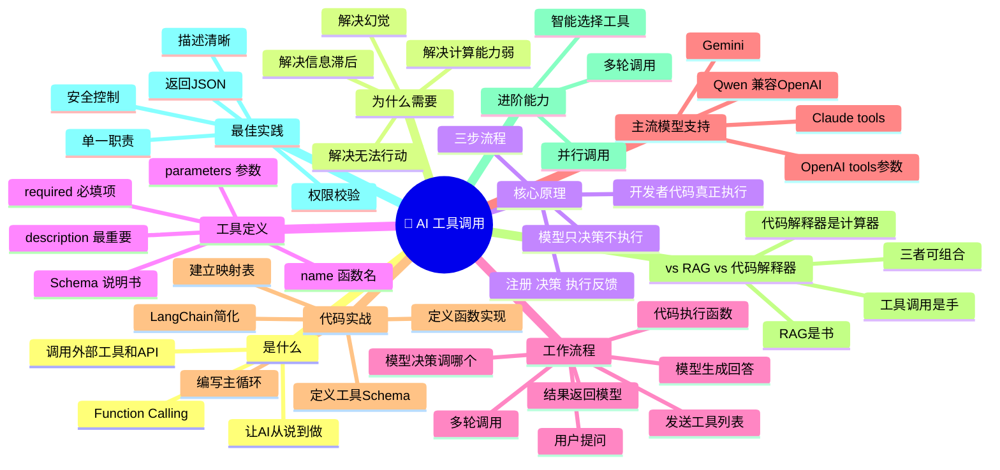

### 🎯 核心要点速记

1. **Function Calling = 让 AI 调用外部工具**，从"只会说"变成"能干活"。
2. **模型只决策，不执行**：模型决定调哪个函数、传什么参数，真正的执行在你的代码里。
3. **三步流程**：① 注册工具（给 Schema）→ ② 模型决策（返回调用请求）→ ③ 执行反馈（代码执行 + 模型整合）。
4. **Schema 三要素**：name（函数名）+ description（最重要的描述）+ parameters（参数格式）。
5. **description 是灵魂**：模型完全靠描述来判断该不该调用，描述越清晰越准确。
6. **大多数模型兼容 OpenAI 格式**：学一套 `tools` + `tool_choice` 即可。
7. **支持多轮调用**：前一个工具的结果可以影响下一个调用，实现复杂任务。
8. **支持并行调用**：GPT-4/Claude 3.5 可同时调多个工具，效率更高。
9. **与 RAG/代码解释器互补**：工具调用是"手"，RAG 是"书"，代码解释器是"计算器"。
10. **安全很重要**：权限控制、参数校验、敏感操作确认、沙箱隔离缺一不可。
11. **LangChain 简化开发**：用 `@tool` 装饰器 + Agent 自动处理调用循环。
12. **工具设计原则**：单一职责、描述清晰、返回规范、粒度适中。

---

> 🌸 哇~ 恭喜你把 AI 工具调用的核心知识学完啦！Function Calling 是 AI Agent 的核心能力——没有工具调用，Agent 就只是个聊天机器人；有了工具调用，Agent 就能真正帮你干活了！动手写一个工具调用试试吧，加油鸭！(ง •_•)ง💖
