# 🧠 LLM 大语言模型超全学习指南

> 嗨呀~ 欢迎来到大语言模型（LLM）的世界！🧠 LLM 是 ChatGPT、文心一言等 AI 应用的核心引擎，理解它能帮你搞懂 AI 的底层逻辑。这份指南会用大白话带你从原理到应用，把 LLM 揉碎了喂给你。准备好了吗？冲鸭！(ﾉ>ω<)ﾉ

---

## 📖 目录

- [一、什么是 LLM？](#一什么是-llm)
- [二、LLM 的基础：语言模型](#二llm-的基础语言模型)
- [三、核心架构：Transformer](#三核心架构transformer)
- [四、注意力机制（Attention）](#四注意力机制attention)
- [五、LLM 的训练流程](#五llm-的训练流程)
- [六、预训练范式演进](#六预训练范式演进)
- [七、模型微调（Fine-tuning）](#七模型微调fine-tuning)
- [八、提示工程与上下文学习](#八提示工程与上下文学习)
- [九、RAG 检索增强生成](#九rag-检索增强生成)
- [十、LLM 的能力与局限](#十llm-的能力与局限)
- [十一、知识总结](#十一知识总结)

---

## 一、什么是 LLM？

### 1.1 一句话定义

> **LLM（Large Language Model，大语言模型）** = 用海量文本数据训练的、拥有数十亿甚至万亿参数的、能理解和生成人类语言的大型神经网络模型。

简单说，它就像一个**读过互联网的超级大脑** 🧠，你给它一段话，它就能续写、回答、翻译、写代码……

### 1.2 LLM 的"大"体现在哪？

| 维度 | 传统语言模型 | LLM 大语言模型 |
|:---|:---|:---|
| **参数量** | 几万~几百万 | **数十亿~万亿**（GPT-4 估计 1.8 万亿） |
| **训练数据** | 几 GB | **几 TB 甚至 PB**（几乎整个互联网） |
| **算力需求** | 单 GPU | **数千张 GPU**，训练数月 |
| **能力** | 单一任务（如分类） | **通用能力**（写文章、写代码、推理） |
| **涌现能力** | 无 | 有（规模到一定程度后出现新能力） |

### 1.3 LLM 发展简史

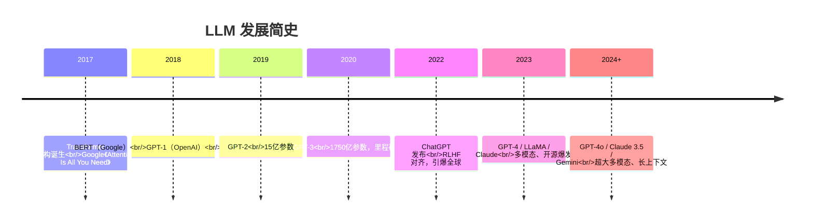

### 1.4 常见 LLM 家族

| 家族 | 代表模型 | 公司 |
|:---:|:---|:---|
| **GPT 系列** | GPT-3.5、GPT-4、GPT-4o | OpenAI |
| **Claude 系列** | Claude 3、Claude 3.5 | Anthropic |
| **Gemini 系列** | Gemini 1.5、2.0 | Google |
| **LLaMA 系列** | LLaMA 2、LLaMA 3 | Meta（开源） |
| **Qwen 系列** | Qwen、Qwen2 | 阿里（开源） |
| **GLM 系列** | ChatGLM、GLM-4 | 智谱 |

---

## 二、LLM 的基础：语言模型

### 2.1 什么是语言模型？

> **语言模型（Language Model，LM）** = 一个能计算"一段文字出现的概率"的模型。

核心任务：**根据前文，预测下一个字（token）是什么**。

```
输入："今天天气真"
语言模型预测下一个字 → "好"（概率最高）
输出："今天天气真好"
```

### 2.2 文字如何变成数字？Token 化

计算机不认识文字，得先转成数字。这个过程叫 **Tokenization（分词/词元化）**。

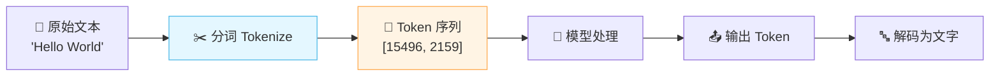

| 分词方式 | 例子 | 说明 |
|:---|:---|:---|
| 按字符 | "hello" → ['h','e','l','l','o'] | 太细，丢失词义 |
| 按词 | "我爱NLP" → ['我','爱','NLP'] | 词表太大，OOV 多 |
| **BPE（子词）** ⭐ | "playing" → ['play','ing'] | 主流，平衡粒度 |

> 💡 **BPE（Byte Pair Encoding）** 是 LLM 最常用的分词方式，把文本拆成"子词"单元，既不太长也不太碎。

### 2.3 语言模型的工作原理：下一个 token 预测

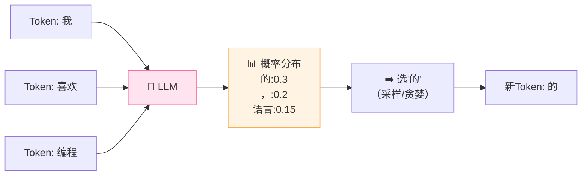

> 💡 LLM 本质就是**不断预测下一个 token，循环往复**，直到生成结束符或达到长度限制。这就是所谓的 **自回归（Autoregressive）生成**。

---

## 三、核心架构：Transformer

### 3.1 Transformer 是什么？

> **Transformer** 是 2017 年 Google 提出的神经网络架构，是所有现代 LLM 的基石。它用 **注意力机制** 替代了之前的 RNN/LSTM，能高效处理长文本。

**一句话总结**：没有 Transformer，就没有 ChatGPT！🌟

### 3.2 整体架构

Transformer 分两部分：**Encoder（编码器）** 和 **Decoder（解码器）**。

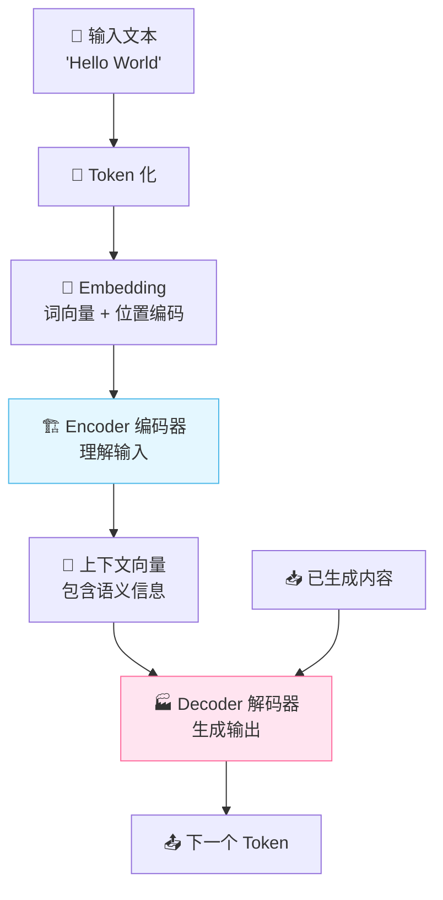

### 3.3 三大主流架构路线

不同模型基于 Transformer 的不同部分：

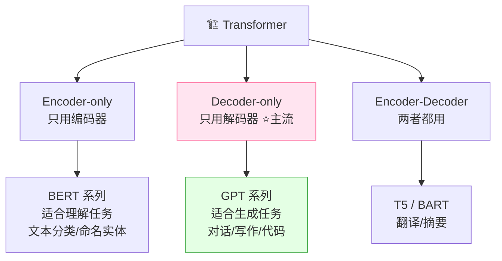

| 架构 | 代表模型 | 特点 | 适合 |
|:---:|:---|:---|:---|
| **Encoder-only** | BERT | 双向理解，看全句 | 理解任务（分类、检索） |
| **Decoder-only** ⭐ | GPT 系列、LLaMA | 单向生成，预测下一个 | 生成任务（对话、写作） |
| **Encoder-Decoder** | T5、BART | 先编码后解码 | 翻译、摘要 |

> 🎀 **当下主流是 Decoder-only**（GPT、LLaMA、Qwen 等都是），因为生成能力强、易扩展！

### 3.4 Transformer 核心组件

一个 Transformer 层包含：

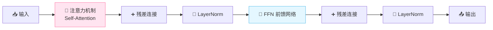

| 组件 | 作用 |
|:---|:---|
| **Self-Attention** | 让每个 token 关注其他 token，理解上下文 |
| **Feed Forward Network（FFN）** | 两层全连接，提取特征 |
| **残差连接（Residual）** | 跳过层，缓解梯度消失 |
| **LayerNorm** | 归一化，稳定训练 |
| **位置编码（Positional Encoding）** | 告诉模型 token 的位置信息 |

> 💡 **为什么需要位置编码？** 因为 Attention 机制本身没有顺序概念，"我爱你"和"你爱我"对它来说一样！加上位置编码才能区分顺序。

---

## 四、注意力机制（Attention）

### 4.1 直观理解

> **Attention（注意力机制）** = 让模型在处理当前词时，能"关注"到句子中其他相关的词，从而理解上下文。

**经典例子**："The animal didn't cross the street because **it** was too tired."

这里的 **"it"** 指的是 animal 还是 street？人能理解是 animal（累的是动物）。Attention 机制让模型也能搞懂这个指代关系！

### 4.2 Self-Attention 详解（QKV 模型）

Attention 用三个矩阵来计算：**Q（Query）、K（Key）、V（Value）**。

**生活化比喻** 🌰：去图书馆找书
- **Query（Q）**：你想找什么（搜索关键词）
- **Key（K）**：每本书的标签/书名（可被搜索的内容）
- **Value（V）**：每本书的实际内容

Q 和 K 匹配度越高，取出的 V 权重就越大！

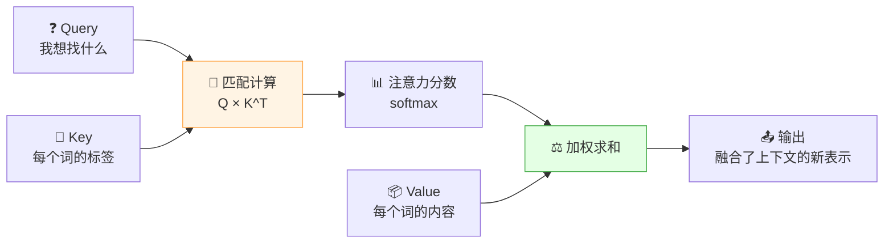

### 4.3 计算公式

$$\text{Attention}(Q, K, V) = \text{softmax}\left(\frac{QK^T}{\sqrt{d_k}}\right)V$$

拆解步骤：
1. **Q × K^T**：计算 Query 和每个 Key 的相似度（点积）
2. **÷ √d_k**：缩放（防止值过大，稳定训练）
3. **softmax**：归一化成权重（加起来=1）
4. **× V**：用权重对 Value 加权求和

### 4.4 多头注意力（Multi-Head Attention）

> 单个注意力可能只关注一种关系。**多头注意力** = 并行运行多个 Attention，各自关注不同方面，最后合并。

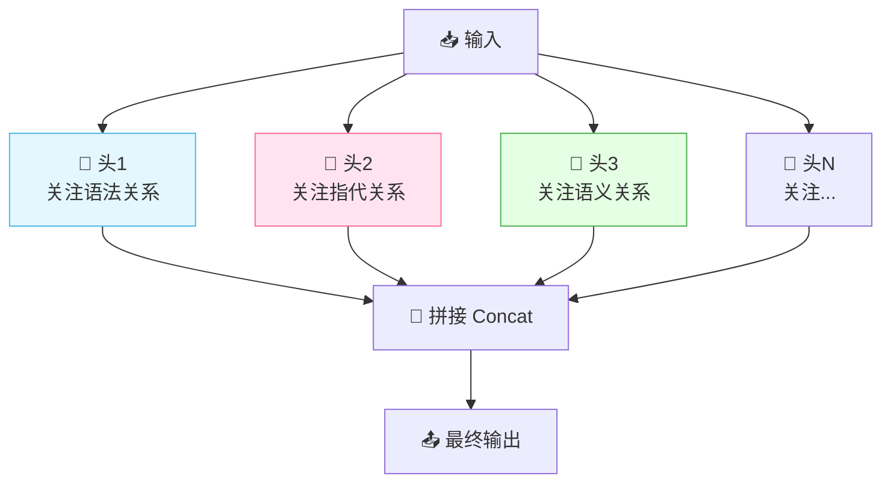

> 🎀 比如 GPT-3 用了 96 个头，每个头关注不同维度的信息，让模型理解更全面！

### 4.5 Attention 的优势

| 对比 | RNN/LSTM | Transformer Attention |
|:---|:---|:---|
| 长距离依赖 | 差（信息会衰减） | **好**（直接全局关注） |
| 并行计算 | ❌ 串行，慢 | ✅ **可并行，快** |
| 顺序处理 | 必须按顺序 | 一次性处理所有 |

---

## 五、LLM 的训练流程

### 5.1 三阶段训练范式

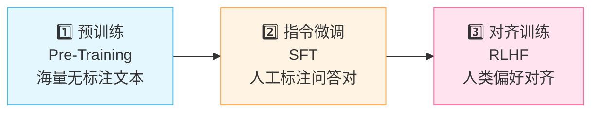

### 5.2 阶段一：预训练（Pre-Training）

> **目标**：让模型从海量文本中学习语言的"通用规律"。

| 项目 | 说明 |
|:---|:---|
| **数据** | 海量无标注文本（网页、书籍、论文） |
| **任务** | 预测下一个 token（Next Token Prediction） |
| **数据量** | 数 TB，数千亿 token |
| **算力** | 数千 GPU，训练数月 |
| **产出** | 基座模型（Base Model） |

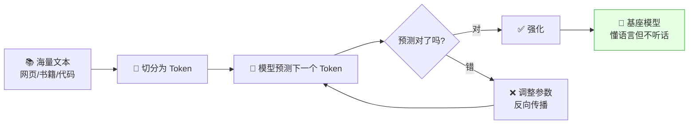

> ⚠️ **预训练后**的模型只是"懂语言"，但它不会回答问题——你问"你好"，它可能续写成"你好，世界"而不是回答你。需要下一步微调！

### 5.3 阶段二：指令微调（SFT）

> **目标**：让模型学会"听指令、回答问题"，变成一个合格的对话助手。

| 项目 | 说明 |
|:---|:---|
| **数据** | 人工标注的"指令-回答"对（几万~几十万条） |
| **任务** | 学习"按指令回答"的行为 |
| **方法** | 监督学习（有标注） |
| **产出** | 微调模型（会对话了） |

```
示例数据格式：
用户：请介绍一下 Java。
助手：Java 是一门面向对象的编程语言……（标注的好回答）
```

### 5.4 阶段三：对齐训练（RLHF）

> **目标**：让模型的回答更符合人类偏好（有用、无害、诚实）。

**RLHF（Reinforcement Learning from Human Feedback）** 分三步：

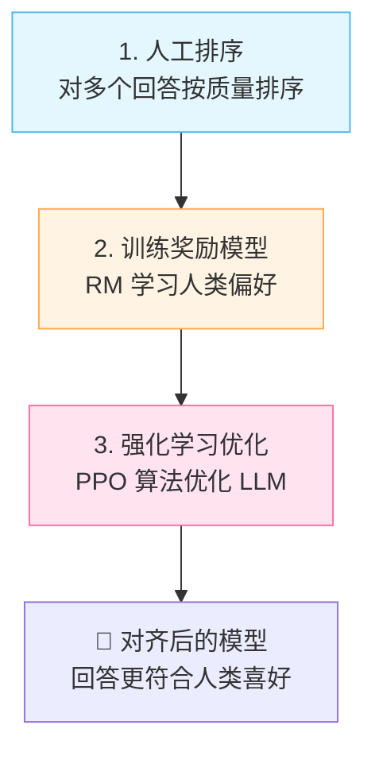

| RLHF 步骤 | 做什么 |
|:---|:---|
| ① 人工标注排序 | 让人类给模型多个回答打分排序 |
| ② 训练奖励模型（RM） | 用排序数据训练一个"裁判"模型 |
| ③ 强化学习（PPO） | LLM 根据裁判的评分优化自己 |

> 💡 **ChatGPT 的核心突破**就是 RLHF，让 GPT-3 从"续写机器"变成了"好用的助手"！

### 5.5 DPO：RLHF 的简化版

> **DPO（Direct Preference Optimization）** = 不需要训练奖励模型，直接用偏好数据优化 LLM。更简单高效！

| 对比 | RLHF | DPO |
|:---|:---|:---|
| 步骤 | 3 步（排序→RM→PPO） | 1 步（直接优化） |
| 复杂度 | 高 | 低 |
| 稳定性 | 不稳定（PPO 难调） | 稳定 |
| 效果 | 好 | 接近，主流趋势 |

---

## 六、预训练范式演进

### 6.1 四大预训练范式

| 范式 | 代表模型 | 训练方式 | 特点 |
|:---:|:---|:---|:---|
| **Encoder-only** | BERT | 随机遮掩词，预测被遮掩的词（MLM） | 双向理解，适合分类 |
| **Decoder-only** ⭐ | GPT | 预测下一个 token（自回归） | 生成能力强，主流 |
| **Encoder-Decoder** | T5 | 文本到文本统一任务 | 灵活，适合翻译 |
| **Prefix LM** | GLM | 部分双向 + 部分自回归 | 兼顾理解和生成 |

### 6.2 Decoder-only 为何成为主流？

1. **生成能力**强：自回归天生适合生成
2. **扩展性好**：规模增大后能力持续提升
3. **训练简单**：统一的"预测下一个 token"目标
4. **Zero-shot 能力**：大模型无需微调就能做各种任务

---

## 七、模型微调（Fine-tuning）

### 7.1 为什么要微调？

预训练模型是"通才"，但在特定领域可能不够专业。微调让模型成为"专才"。

### 7.2 微调方式分类

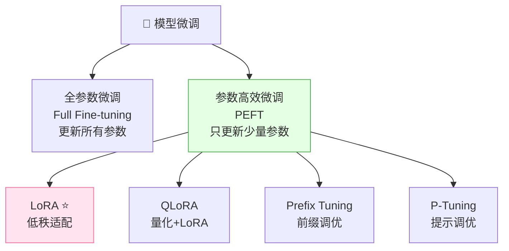

### 7.3 全参数微调 vs PEFT

| 对比 | 全参数微调 | PEFT（如 LoRA） |
|:---|:---|:---|
| **更新参数** | 所有参数 | <1% 参数 |
| **显存需求** | 巨大 | 小 |
| **训练速度** | 慢 | 快 |
| **效果** | 最好 | 接近全参数 |
| **存储** | 每任务存完整模型 | 只存小适配器 |

### 7.4 LoRA 原理（重点）⭐

> **LoRA（Low-Rank Adaptation）** = 冻结原始模型，只训练一个低秩的"适配矩阵"，实现高效微调。

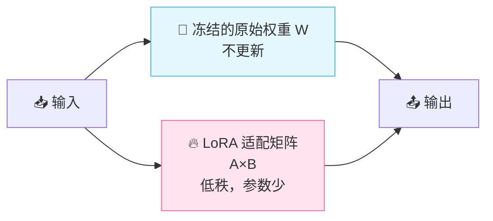

**原理**：原始权重 W 不动，额外加一个 ΔW = A × B（两个小矩阵的乘积），只训练 A 和 B。

```python
# LoRA 简化理解
# 原始：y = W·x         W 是 d×d，参数量 d²
# LoRA：y = (W + A·B)·x  A 是 d×r，B 是 r×d，r 远小于 d
# 只训练 A 和 B，参数量 = 2×d×r << d²
```

> 💡 比如 d=4096, r=8，原始参数 1600 万，LoRA 只要 6.5 万，减少了 99%！

---

## 八、提示工程与上下文学习

### 8.1 提示工程（Prompt Engineering）

> **提示工程** = 通过设计好的输入提示，引导 LLM 输出更好的结果。不需要改模型参数！

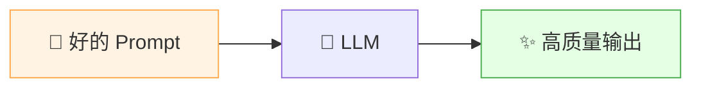

### 8.2 提示技巧

| 技巧 | 说明 | 例子 |
|:---|:---|:---|
| **明确角色** | 给模型设定身份 | "你是一个资深Java工程师…" |
| **提供示例** | 演示期望输出格式 | 给 2-3 个输入输出样例 |
| **拆分步骤** | 让模型分步思考 | "请一步步分析…" |
| **限定格式** | 规定输出格式 | "以 JSON 格式输出" |

### 8.3 Few-shot Learning（少样本学习）

> **Few-shot** = 在提示里给几个示例，让模型"照猫画虎"完成任务。

```
任务：情感分类

示例1：这部电影太精彩了！ → 正面
示例2：服务态度真差。 → 负面
示例3：味道一般般。 → 中性

请分类：物流速度快，包装好！ → ？
模型输出：正面
```

### 8.4 上下文学习（In-Context Learning）

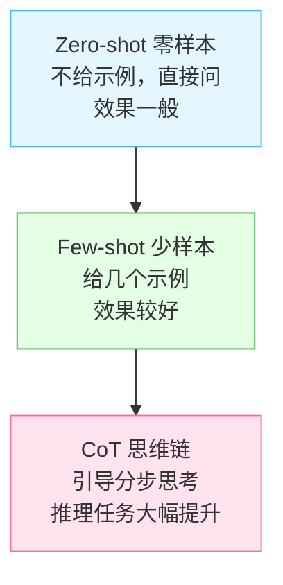

### 8.5 思维链（Chain of Thought, CoT）⭐

> **CoT** = 让模型把推理过程"写出来"，而不是直接给答案。大幅提升复杂推理能力！

```
普通提示：
问：小明有5个苹果，给了小红2个，又买了3个，现在有几个？
答：6个   ← 可能算错

CoT 思维链：
问：小明有5个苹果，给了小红2个，又买了3个，现在有几个？
答：让我们一步步算：
  1. 起初有 5 个
  2. 给了小红 2 个，剩 5-2=3 个
  3. 又买了 3 个，现在 3+3=6 个
  答案：6 个   ← 准确率大幅提升！
```

---

## 九、RAG 检索增强生成

### 9.1 为什么需要 RAG？

LLM 有几个硬伤：
- **知识截止**：训练数据有截止日期，不知道最新信息
- **容易幻觉**：会一本正经地胡说八道
- **领域不专**：对私有/专业领域知识了解有限

**RAG（Retrieval-Augmented Generation，检索增强生成）** 就是解决方案！

### 9.2 RAG 的核心思想

> **RAG** = 先从外部知识库**检索**相关资料，再把资料和问题一起喂给 LLM **生成**回答。

**生活化比喻** 🌰：开卷考试
- 没有 RAG = 闭卷考试，全靠记忆（容易记错）
- 有 RAG = 开卷考试，可以翻书找答案（准确多了）

### 9.3 RAG 工作流程

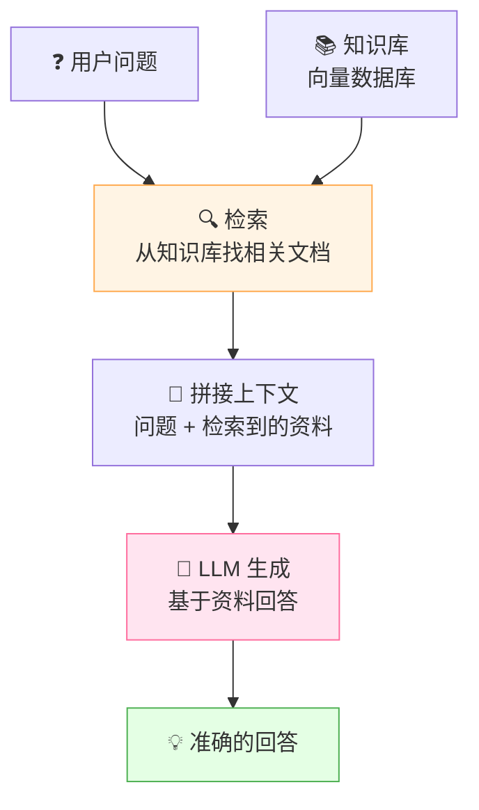

### 9.4 RAG 详细步骤

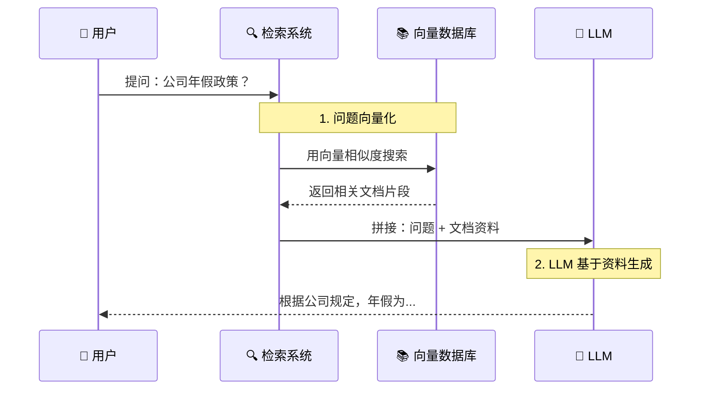

### 9.5 RAG 关键技术

| 环节 | 技术 | 说明 |
|:---|:---|:---|
| **文档切分** | 按段落/句子分块 | 把长文档拆成小片段 |
| **向量化** | Embedding 模型 | 把文本转成向量 |
| **向量存储** | 向量数据库（FAISS/Milvus） | 存储和高效检索向量 |
| **相似度检索** | 余弦相似度/内积 | 找最相关的片段 |
| **生成** | LLM | 基于检索结果生成回答 |

### 9.6 RAG vs 微调

| 对比 | RAG | 微调 |
|:---|:---|:---|
| **解决什么** | 知识更新、减少幻觉 | 改变模型行为/风格 |
| **更新成本** | 低（更新数据库） | 高（重新训练） |
| **实时性** | ✅ 可实时 | ❌ 需重新训练 |
| **可解释性** | ✅ 可追溯来源 | ❌ 黑盒 |
| **适合** | 知识问答、文档助手 | 特定风格、专业任务 |

> 🎀 **最佳实践**：RAG + 微调结合！微调让模型更擅长某领域，RAG 提供最新知识。

---

## 十、LLM 的能力与局限

### 10.1 LLM 的核心能力

| 能力 | 说明 | 例子 |
|:---|:---|:---|
| **文本生成** | 写文章、故事、代码 | "写一首关于春天的诗" |
| **文本理解** | 阅读理解、摘要、分类 | "总结这篇文章要点" |
| **翻译** | 多语言互译 | "把这段英文翻成中文" |
| **代码能力** | 写代码、修 Bug、解释代码 | "用 Python 写快排" |
| **推理** | 数学、逻辑推理 | "鸡兔同笼问题" |
| **多轮对话** | 上下文连续对话 | ChatGPT 聊天 |

### 10.2 涌现能力（Emergent Abilities）

> 当模型规模超过某个阈值后，**突然出现**小模型没有的能力，叫"涌现能力"。

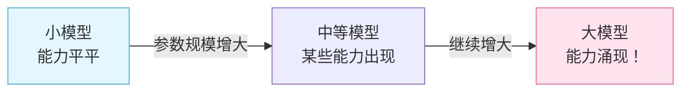

典型涌现能力：复杂推理、多语言翻译、代码生成等。

### 10.3 LLM 的局限性（常见问题）

| 问题 | 说明 | 危害 |
|:---|:---|:---|
| **幻觉（Hallucination）** ⭐ | 一本正经地编造事实 | 误导用户 |
| **知识截止** | 训练数据有截止日期 | 不知道最新信息 |
| **数学能力弱** | 复杂数学容易出错 | 计算不可靠 |
| **推理不稳定** | 逻辑推理可能前后矛盾 | 结果不可信 |
| **偏见** | 继承训练数据中的偏见 | 输出歧视内容 |
| **安全风险** | 可能被诱导生成有害内容 | 滥用风险 |

### 10.4 如何减少幻觉？

| 方法 | 说明 |
|:---|:---|
| **RAG** | 提供外部知识，让模型有据可依 |
| **CoT 思维链** | 让模型分步推理，减少跳步 |
| **温度调低** | 降低随机性，输出更确定 |
| **让模型说"不知道"** | 提示模型不确定时承认 |

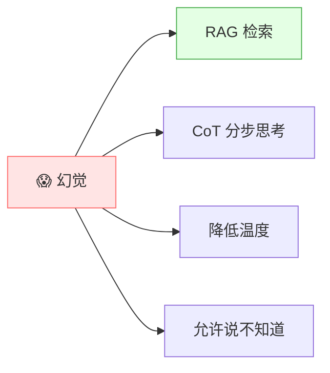

### 10.5 关键参数

| 参数 | 作用 | 建议 |
|:---|:---|:---|
| **Temperature（温度）** | 控制输出随机性 | 事实问答低(0~0.3)、创意写作高(0.7~1.0) |
| **Top-K** | 从概率最高的 K 个中选 | 通常 40 |
| **Top-P** | 累积概率达到 P 的候选 | 通常 0.9 |
| **Max Tokens** | 最大生成长度 | 按需设置 |
| **Context Window** | 上下文窗口大小 | 越大能处理越长文本 |

> 💡 **Temperature 直观理解**：温度=0 时总是选概率最高的（确定但死板）；温度高时更随机（有创意但可能跑偏）。

---

## 十一、知识总结

最后用思维导图把所有知识点串起来 📝✨：

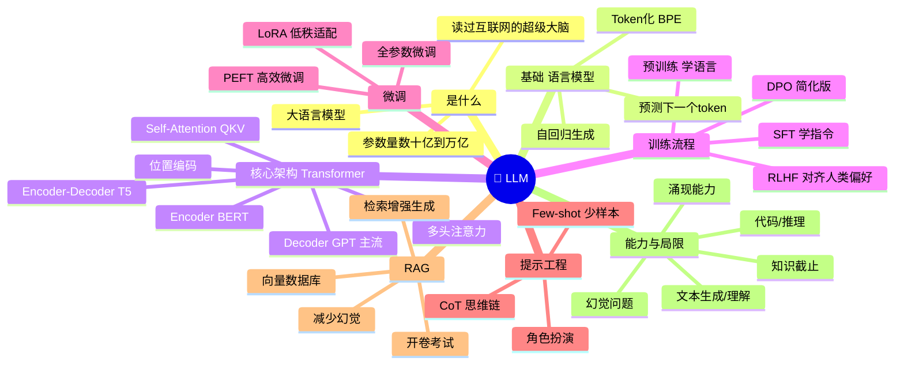

### 🎯 核心要点速记

1. **LLM 本质**：用海量数据训练的超大神经网络，核心能力是"预测下一个 token"。
2. **Transformer 是基石**：基于注意力机制，Decoder-only（GPT 路线）是主流。
3. **Attention（QKV）**：Query 查 Key 匹配，加权取 Value，让模型理解上下文。
4. **训练三阶段**：预训练（学语言）→ SFT（学指令）→ RLHF（对齐人类偏好）。
5. **RLHF**：让模型从"续写机器"变成"好用的助手"，ChatGPT 的核心突破。
6. **LoRA**：只训练低秩适配矩阵，参数量减少 99%，高效微调。
7. **Prompt + CoT**：不改模型，通过提示词设计提升效果；思维链让推理更强。
8. **RAG**：开卷考试，检索+生成，解决幻觉和知识截止问题。
9. **幻觉是最大局限**：通过 RAG、CoT、降温等方式缓解。
10. **Scaling Law**：模型越大、数据越多、算力越强，能力越强（涌现能力）。

---

> 🌸 哇~ 恭喜你把 LLM 大语言模型的核心知识学完啦！LLM 是当下 AI 的核心，理解了 Transformer、训练流程、微调、RAG 这些概念，就能看懂大部分 AI 应用的原理了！继续深入探索吧，加油鸭！(ง •_•)ง💖
