# 🔧 LoRA 低秩适配超全学习指南

> 嗨呀~ 欢迎来到 LoRA 的世界！🔧 LoRA（Low-Rank Adaptation）是大模型微调的"性价比之王"——只训练不到 1% 的参数，就能达到接近全参数微调的效果！这是让普通开发者也能微调大模型的关键技术。这份指南会带你从原理到实战，彻底搞懂 LoRA。准备好了吗？冲鸭！(ﾉ>ω<)ﾉ

---

## 📖 目录

- [一、什么是 LoRA？](#一什么是-lora)
- [二、为什么需要 LoRA？](#二为什么需要-lora)
- [三、核心原理：低秩分解](#三核心原理低秩分解)
- [四、LoRA 的数学原理](#四lora-的数学原理)
- [五、LoRA 的关键参数](#五lora-的关键参数)
- [六、LoRA 微调流程](#六lora-微调流程)
- [七、LoRA 变体家族](#七lora-变体家族)
- [八、LoRA vs 其他微调方法](#八lora-vs-其他微调方法)
- [九、代码实战](#九代码实战)
- [十、应用场景与最佳实践](#十应用场景与最佳实践)
- [十一、知识总结](#十一知识总结)

---

## 一、什么是 LoRA？

### 1.1 一句话定义

> **LoRA（Low-Rank Adaptation，低秩适配）** = 冻结预训练模型的所有参数，只在旁边加一个"低秩适配矩阵"来学习新知识，用极少参数实现高效微调。

简单说：**不动原模型，在旁边加个"小补丁"来学新东西** 🩹。

### 1.2 生活化比喻


| 比喻 | 全参数微调 | LoRA |
|:---|:---|:---|
| **装修方式** | 推倒重建 | 贴壁纸/换家具 |
| **成本** | 高 | 低 |
| **原结构** | 被修改 | 完全不动 |
| **存储** | 存整个房子 | 只存壁纸 |
| **切换风格** | 换房子 | 换壁纸（秒切换） |

### 1.3 LoRA 的诞生

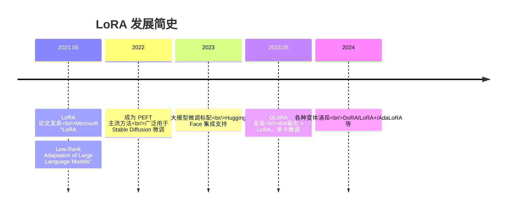

### 1.4 核心数据对比

| 对比 | 全参数微调 | LoRA |
|:---|:---|:---|
| **更新参数** | 100%（如 7B 全部） | **<1%**（如 7B 只训 ~20M） |
| **显存需求** | 高（如 7B 需 80GB+） | **低**（7B 需 ~10GB） |
| **训练速度** | 慢 | **快 2-3 倍** |
| **存储** | 每任务存完整模型 | 每任务存 ~20MB 适配器 |
| **切换任务** | 加载完整模型 | **秒切换适配器** |
| **效果** | 最好 | **接近全参数**（差距很小） |

---

## 二、为什么需要 LoRA？

### 2.1 全参数微调的痛点

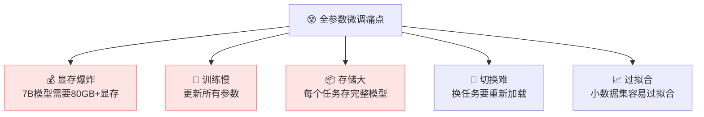

| 痛点 | 说明 |
|:---|:---|
| **显存爆炸** | 7B 模型全参微调需要 80GB+ 显存，普通开发者用不起 |
| **训练慢** | 更新所有参数，计算量大 |
| **存储大** | 每个下游任务要存一个完整模型副本 |
| **切换难** | 换任务要重新加载整个模型 |
| **过拟合** | 参数太多，小数据集容易过拟合 |

### 2.2 LoRA 怎么解决的？

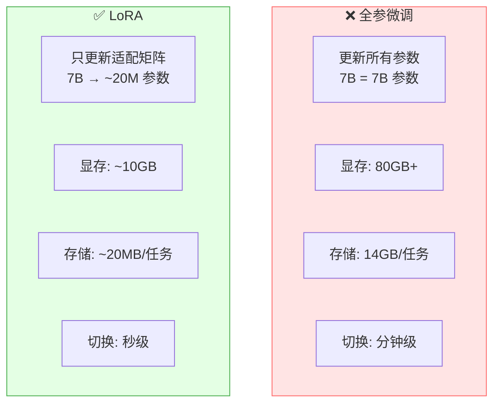

| 解决方案 | 效果 |
|:---|:---|
| **只训练低秩矩阵** | 参数减少 99%+ |
| **冻结原始权重** | 显存大幅下降 |
| **只存适配器** | 存储减少 99% |
| **适配器可热插拔** | 秒级切换任务 |

### 2.3 LoRA 的核心价值

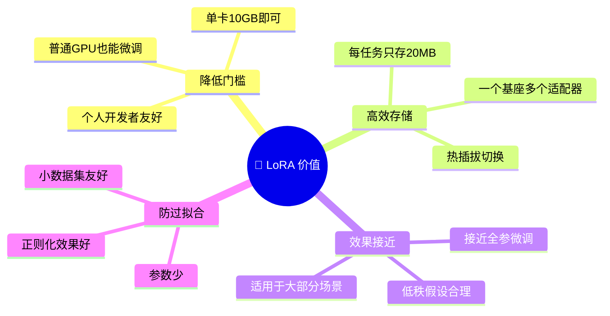

---

## 三、核心原理：低秩分解

### 3.1 核心思想

> **核心假设**：大模型在微调时，权重的变化量（ΔW）是"低秩"的——即可以用两个小矩阵的乘积来近似。

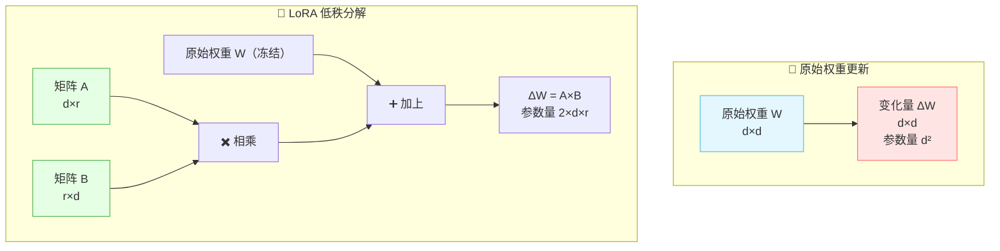

### 3.2 直观理解

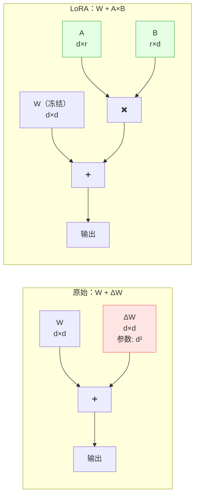

> 💡 **关键**：用两个小矩阵 A（d×r）和 B（r×d）的乘积，来替代一个大矩阵 ΔW（d×d）。当 r << d 时，参数量从 d² 降到 2dr。

### 3.3 参数量对比

```
以 7B 模型为例（d=4096, 假设有一层）：

全参数微调：  ΔW 参数量 = d × d = 4096 × 4096 = 16,777,216（1677万）

LoRA (r=8)：  A 参数量 = d × r = 4096 × 8 = 32,768
              B 参数量 = r × d = 8 × 4096 = 32,768
              总计 = 65,536（6.5万）

减少比例：65,536 / 16,777,216 ≈ 0.39%
```

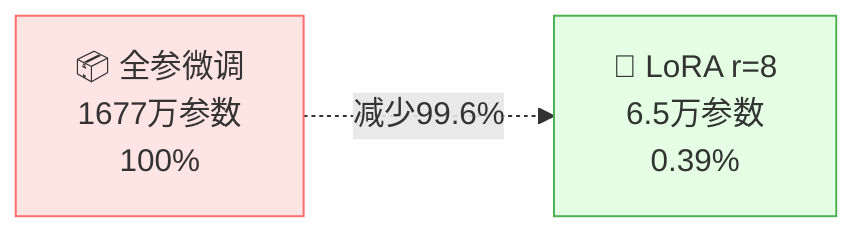

### 3.4 为什么"低秩"假设成立？

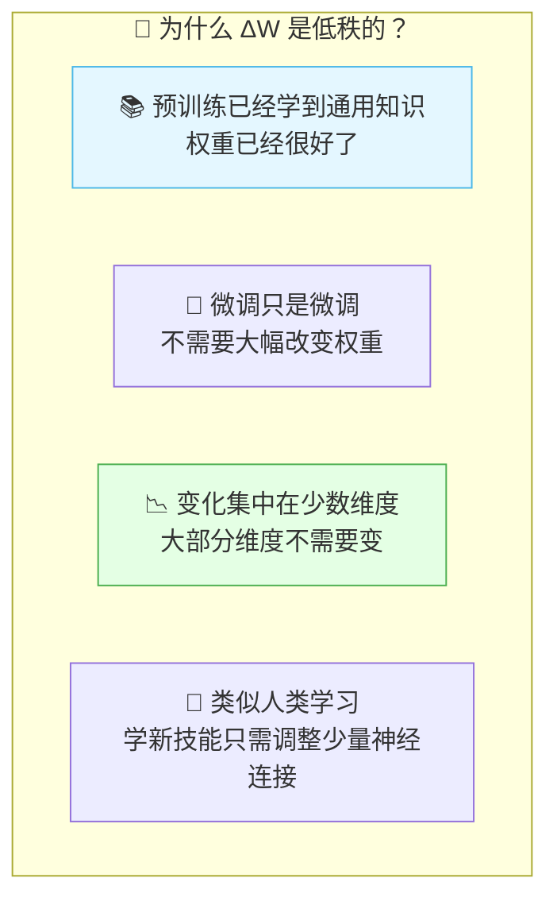

| 原因 | 说明 |
|:---|:---|
| **预训练权重已很好** | 大部分知识已学会，微调只需微调 |
| **变化集中** | 微调时权重变化集中在少数维度 |
| **任务特异性低秩** | 特定任务不需要改变所有参数 |
| **经验验证** | 实验证明 r=8 就足够好 |

---

## 四、LoRA 的数学原理

### 4.1 前向传播

**原始模型**：

$$h = Wx$$

- $W$：原始权重矩阵，$d \times d$
- $x$：输入向量，$d \times 1$
- $h$：输出向量，$d \times 1$

**LoRA 微调**：

$$h = Wx + \Delta Wx = Wx + BAx$$

- $W$：冻结的原始权重（不更新）
- $A$：降维矩阵，$d \times r$（可训练）
- $B$：升维矩阵，$r \times d$（可训练）
- $r$：秩（rank），远小于 $d$

### 4.2 矩阵维度

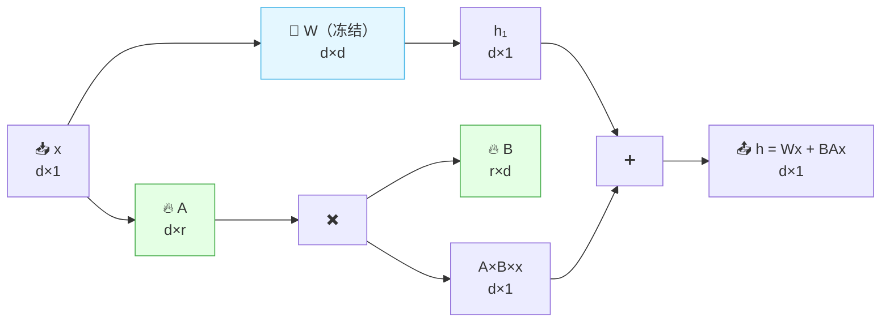

| 矩阵 | 维度 | 说明 | 是否训练 |
|:---|:---|:---|:---:|
| $W$ | $d \times d$ | 原始权重 | ❌ 冻结 |
| $A$ | $d \times r$ | 降维（高→低） | ✅ |
| $B$ | $r \times d$ | 升维（低→高） | ✅ |
| $\Delta W = BA$ | $d \times d$ | 权重变化量 | - |

### 4.3 初始化策略

> **关键**：训练开始时 $\Delta W = 0$，确保 LoRA 初始行为与原始模型一致。

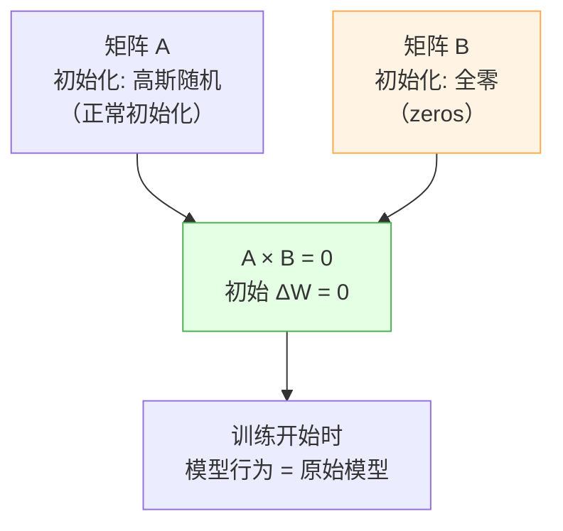

| 矩阵 | 初始化 | 原因 |
|:---|:---|:---|
| $A$ | 高斯随机 | 保证有梯度能训练 |
| $B$ | 全零 | 保证初始 $\Delta W = 0$ |

> 💡 **为什么这么初始化？** $B=0$ 时 $A \times B = 0$，所以 $\Delta W = 0$，模型初始行为和原模型完全一致。训练开始后 $B$ 逐渐学习，$\Delta W$ 逐渐变化。

### 4.4 缩放因子 α

$$h = Wx + \frac{\alpha}{r} BAx$$

| 参数 | 作用 | 说明 |
|:---|:---|:---|
| $r$ | 秩 | 控制矩阵大小，越小参数越少 |
| $\alpha$ | 缩放因子 | 控制 LoRA 的影响力度 |
| $\alpha/r$ | 实际缩放 | 通常设 $\alpha = 2r$，即缩放为 2 |

> 🎀 **缩放因子的作用**：当调整 $r$ 时，$\alpha/r$ 保持相对稳定，不用重新调超参数。通常 $\alpha = 16$ 或 $\alpha = 32$。

---

## 五、LoRA 的关键参数

### 5.1 参数总览

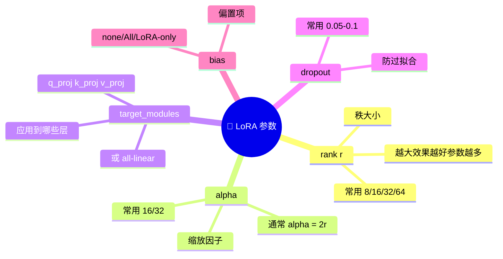

### 5.2 rank（秩 r）⭐

| r 值 | 参数量 | 效果 | 适合 |
|:---|:---|:---|:---|
| **r=4** | 最少 | 够用 | 简单任务 |
| **r=8** | 较少 | 好 ⭐ | **通用默认** |
| **r=16** | 中等 | 更好 | 复杂任务 |
| **r=32** | 较多 | 接近全参 | 高精度需求 |
| **r=64** | 多 | 接近全参 | 特殊场景 |

> 💡 **经验**：r=8 是最佳默认值，大部分任务 r=8 就够了。r 越大效果越好但参数越多，收益递减。

### 5.3 target_modules（应用层）

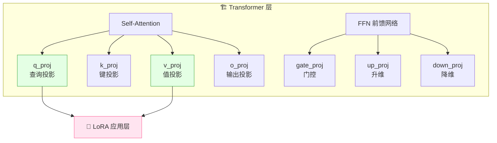

| 应用策略 | 说明 | 效果 |
|:---|:---|:---|
| **只 q_proj + v_proj** | 最常用，参数少 | 效果好（默认） |
| **q/k/v/o_proj** | Attention 全覆盖 | 更好 |
| **all-linear** | 所有线性层 | 最好，参数多 |
| **q/v/o + FFN** | 最全面 | 最好，参数最多 |

### 5.4 参数选择建议

| 场景 | r | alpha | target_modules | dropout |
|:---|:---|:---|:---|:---|
| **简单任务** | 8 | 16 | q_proj, v_proj | 0.05 |
| **通用默认** ⭐ | 8 | 16 | q_proj, v_proj | 0.05 |
| **复杂任务** | 16 | 32 | q_proj, k_proj, v_proj, o_proj | 0.1 |
| **最高精度** | 32 | 64 | all-linear | 0.1 |

---

## 六、LoRA 微调流程

### 6.1 完整流程

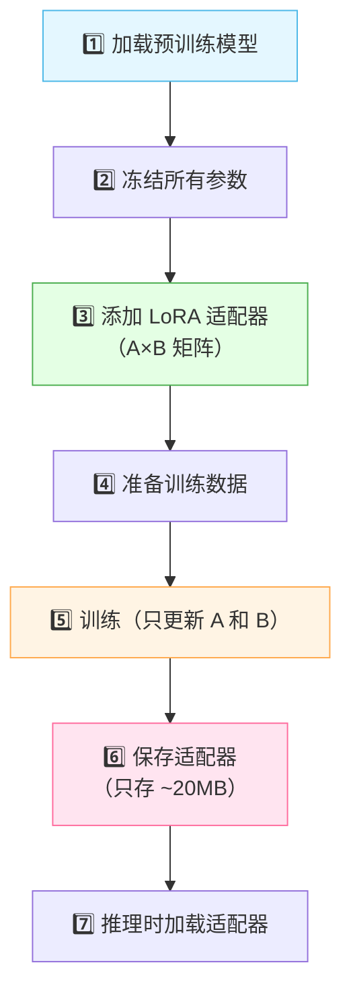

### 6.2 训练 vs 推理

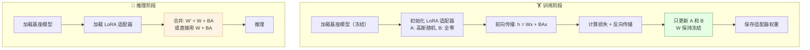

### 6.3 推理时的两种方式

| 方式 | 说明 | 优点 | 缺点 |
|:---|:---|:---|:---|
| **合并权重** | $W' = W + BA$ 后用合并后的 $W'$ | 无额外推理开销 | 不能热切换 |
| **不合并** | 计算时同时用 $W$ 和 $BA$ | 可热切换适配器 | 略有额外计算 |

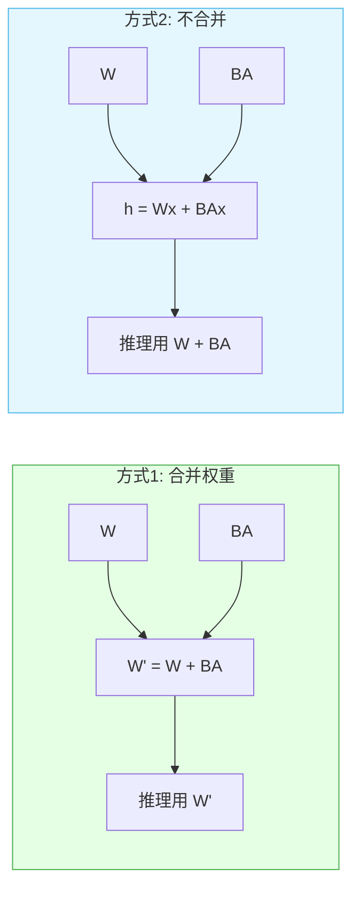

### 6.4 多任务热插拔

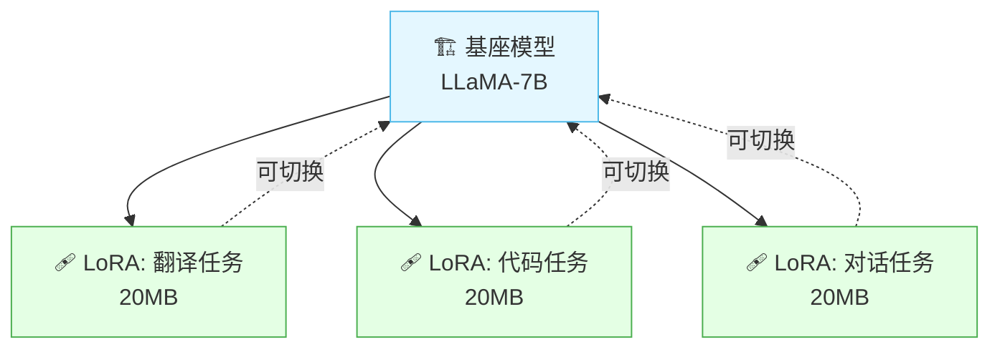

> 🎀 **LoRA 的热插拔**：一个基座模型 + 多个 LoRA 适配器，按需切换，秒级完成！

---

## 七、LoRA 变体家族

### 7.1 总览

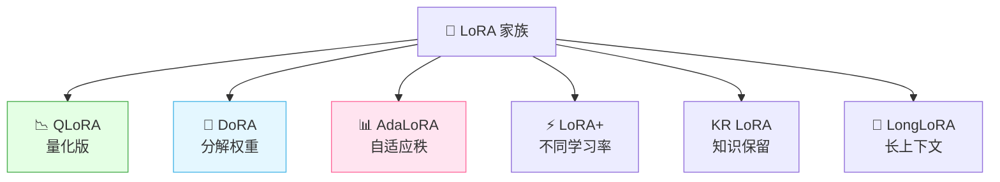

### 7.2 QLoRA ⭐（最重要）

> **QLoRA（Quantized LoRA）** = 4bit 量化基座模型 + LoRA 微调，让单张消费级 GPU 也能微调大模型！

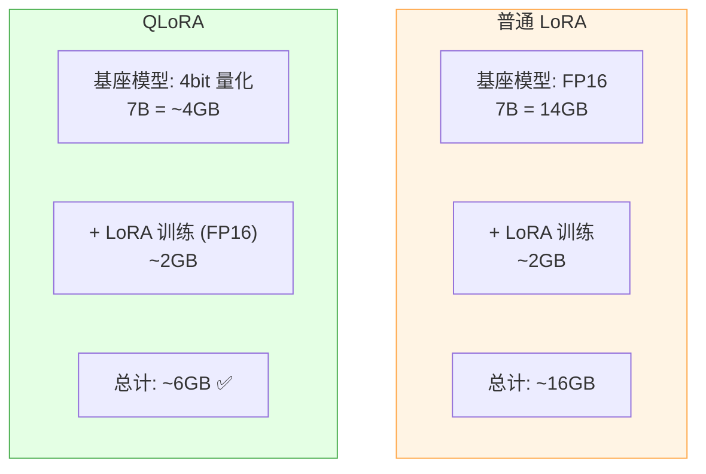

| 对比 | LoRA | QLoRA |
|:---|:---|:---|
| **基座精度** | FP16 | **4bit NF4** |
| **基座显存** | 14GB（7B） | **~4GB**（7B） |
| **总显存** | ~16GB | **~6GB** |
| **单卡可行** | 需要 16GB+ | **8GB 即可** ⭐ |
| **效果** | 好 | **接近 LoRA** |

### 7.3 其他变体

| 变体 | 核心改进 | 优势 |
|:---|:---|:---|
| **DoRA** | 把权重分解为方向 + 幅度 | 效果更好，接近全参 |
| **AdaLoRA** | 自适应调整每层的 r | 重要层 r 大，不重要层 r 小 |
| **LoRA+** | A 和 B 用不同学习率 | 收敛更快 |
| **LongLoRA** | 针对 long context 优化 | 长上下文微调更高效 |
| **VeRA** | 共享随机矩阵 | 参数量更少 |

### 7.4 选型建议

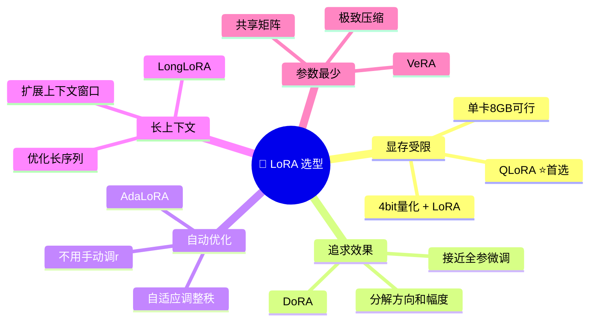

---

## 八、LoRA vs 其他微调方法

### 8.1 PEFT 方法全景

```mermaid
flowchart TB
    FT["🔧 模型微调"]
    FT --> Full["全参数微调<br/>Full Fine-tuning"]
    FT --> PEFT["参数高效微调<br/>PEFT"]

    PEFT --> LoRA["🔧 LoRA ⭐<br/>低秩适配"]
    PEFT --> Prefix["📝 Prefix Tuning<br/>前缀调优"]
    PEFT --> P["💡 P-Tuning<br/>提示调优"]
    PEFT --> Adapter["🔌 Adapter<br/>适配器层"]
    PEFT --> BN["📊 BitFit<br/>只调 bias"]

    style LoRA fill:#e4ffe4,stroke:#4caf50
```

### 8.2 详细对比

| 方法 | 原理 | 参数量 | 效果 | 推理开销 |
|:---|:---|:---|:---|:---|
| **全参数微调** | 更新所有参数 | 100% | 最好 | 无 |
| **LoRA** ⭐ | 低秩矩阵 | ~0.1-1% | 接近全参 | 无（可合并） |
| **Adapter** | 加中间层 | ~1-5% | 好 | 有（额外层） |
| **Prefix Tuning** | 加前缀向量 | ~0.1% | 一般 | 有 |
| **P-Tuning v2** | 每层加前缀 | ~0.1% | 好 | 有 |
| **BitFit** | 只调 bias | ~0.1% | 一般 | 无 |

### 8.3 LoRA 的优势

```mermaid
flowchart TB
    subgraph LoRA优势["✅ LoRA 为什么是主流"]
        A1["🚫 无推理开销<br/>权重可合并"]
        A2["💰 参数极少<br/><1%"]
        A3["📊 效果好<br/>接近全参"]
        A4["🔀 可热插拔<br/>多任务切换"]
        A5["🛠️ 工具支持<br/>HuggingFace/PEFT"]
    end

    style A1 fill:#e4ffe4,stroke:#4caf50
    style A3 fill:#e4ffe4,stroke:#4caf50
```

| 优势 | 说明 |
|:---|:---|
| **无推理开销** | 合并后和原模型一样快（Adapter 有额外层） |
| **效果最好** | 在 PEFT 方法中效果最接近全参 |
| **热插拔** | 多个适配器随时切换 |
| **工具完善** | HuggingFace PEFT 库完美支持 |

---

## 九、代码实战

### 9.1 用 HuggingFace PEFT 做 LoRA 微调

```python
from transformers import AutoModelForCausalLM, AutoTokenizer, TrainingArguments
from peft import LoraConfig, get_peft_model, TaskType
from datasets import load_dataset
from trl import SFTTrainer

# 1. 加载基座模型
model_name = "meta-llama/Llama-2-7b-hf"
model = AutoModelForCausalLM.from_pretrained(
    model_name,
    torch_dtype="float16",
    device_map="auto"
)
tokenizer = AutoTokenizer.from_pretrained(model_name)

# 2. 配置 LoRA
lora_config = LoraConfig(
    task_type=TaskType.CAUSAL_LM,
    r=8,                           # 秩
    lora_alpha=16,                 # 缩放因子
    lora_dropout=0.05,             # dropout
    target_modules=["q_proj", "v_proj"],  # 应用到哪些层
    bias="none"                    # 不训练 bias
)

# 3. 应用 LoRA 到模型
model = get_peft_model(model, lora_config)
model.print_trainable_parameters()
# 输出: trainable params: 6,553,600 || all params: 6,742,609,920 || trainable%: 0.097%

# 4. 准备数据
dataset = load_dataset("json", data_files="train.jsonl")

# 5. 训练
training_args = TrainingArguments(
    output_dir="./lora_output",
    num_train_epochs=3,
    per_device_train_batch_size=4,
    learning_rate=2e-4,
    save_steps=500,
    fp16=True
)

trainer = SFTTrainer(
    model=model,
    args=training_args,
    train_dataset=dataset["train"],
    tokenizer=tokenizer
)

trainer.train()

# 6. 保存适配器（只存 ~20MB！）
model.save_pretrained("./my_lora_adapter")
```

### 9.2 用 QLoRA 微调（显存更省）

```python
from transformers import AutoModelForCausalLM, BitsAndBytesConfig
from peft import LoraConfig, get_peft_model, prepare_model_for_kbit_training

# 1. 4bit 量化配置
bnb_config = BitsAndBytesConfig(
    load_in_4bit=True,                    # 4bit 量化
    bnb_4bit_quant_type="nf4",            # NF4 量化类型
    bnb_4bit_compute_dtype="float16",    # 计算精度
    bnb_4bit_use_double_quant=True        # 双重量化
)

# 2. 加载 4bit 模型
model = AutoModelForCausalLM.from_pretrained(
    "meta-llama/Llama-2-7b-hf",
    quantization_config=bnb_config,
    device_map="auto"
)

# 3. 准备模型用于量化训练
model = prepare_model_for_kbit_training(model)

# 4. LoRA 配置
lora_config = LoraConfig(
    r=8,
    lora_alpha=16,
    target_modules=["q_proj", "v_proj"],
    lora_dropout=0.05,
    bias="none",
    task_type="CAUSAL_LM"
)

model = get_peft_model(model, lora_config)
model.print_trainable_parameters()
# trainable params: 6,553,600 || trainable%: 0.097%

# 5. 训练（同上）
# ... trainer.train() ...
```

### 9.3 加载 LoRA 适配器推理

```python
from transformers import AutoModelForCausalLM, AutoTokenizer
from peft import PeftModel

# 1. 加载基座模型
base_model = AutoModelForCausalLM.from_pretrained(
    "meta-llama/Llama-2-7b-hf",
    torch_dtype="float16",
    device_map="auto"
)

# 2. 加载 LoRA 适配器
model = PeftModel.from_pretrained(
    base_model,
    "./my_lora_adapter"   # 适配器路径
)

tokenizer = AutoTokenizer.from_pretrained("meta-llama/Llama-2-7b-hf")

# 3. 推理
inputs = tokenizer("请解释什么是递归", return_tensors="pt").to("cuda")
outputs = model.generate(**inputs, max_new_tokens=200)
print(tokenizer.decode(outputs[0], skip_special_tokens=True))
```

### 9.4 合并权重（无需适配器）

```python
# 合并 LoRA 权重到基座模型
merged_model = model.merge_and_unload()

# 保存完整模型
merged_model.save_pretrained("./merged_model")

# 之后可直接加载合并后的模型，无需适配器
```

```mermaid
flowchart LR
    B["🏗️ 基座模型"] --> M["🔀 合并"]
    L["🩹 LoRA 适配器"] --> M
    M --> F["📦 合并后模型<br/>可独立使用"]

    style M fill:#fff4e4,stroke:#ffa94d
    style F fill:#e4ffe4,stroke:#4caf50
```

### 9.5 多适配器切换

```python
from peft import PeftModel

# 加载基座模型
base_model = AutoModelForCausalLM.from_pretrained(
    "meta-llama/Llama-2-7b-hf",
    device_map="auto"
)

# 加载多个适配器
model = PeftModel.from_pretrained(
    base_model,
    "./lora_translation",    # 翻译适配器
    adapter_name="translation"
)

model.load_adapter("./lora_code", adapter_name="code")       # 代码适配器
model.load_adapter("./lora_chat", adapter_name="chat")       # 对话适配器

# 切换适配器（秒级！）
model.set_adapter("translation")  # 切换到翻译
result = model.generate(...)       # 用翻译能力

model.set_adapter("code")          # 切换到代码
result = model.generate(...)       # 用代码能力

model.set_adapter("chat")          # 切换到对话
result = model.generate(...)       # 用对话能力
```

---

## 十、应用场景与最佳实践

### 10.1 适合 LoRA 的场景

```mermaid
mindmap
  root((🎯 LoRA 适合))
    领域定制
      医疗问答
      法律咨询
      金融分析
      教育辅导
    风格定制
      客服语气
      写作风格
      对话人设
    任务定制
      代码生成
      翻译
      摘要
      分类
    多任务
      一个基座
      多个适配器
      热插拔切换
```

### 10.2 最佳实践

```mermaid
flowchart TB
    subgraph 实践["📋 LoRA 最佳实践"]
        P1["1. 先试 r=8<br/>不够再加大"]
        P2["2. target_modules<br/>先 q_proj+v_proj<br/>不够加 all-linear"]
        P3["3. alpha = 2r<br/>保持缩放稳定"]
        P4["4. learning_rate<br/>1e-4 ~ 5e-4"]
        P5["5. 显存不够<br/>用 QLoRA"]
        P6["6. 数据量<br/>1000-100000条"]
    end

    style P1 fill:#e4ffe4,stroke:#4caf50
    style P5 fill:#e4f7ff,stroke:#4cb8e8
```

| 实践 | 建议 |
|:---|:---|
| **r 的选择** | 先 r=8，效果不够再加到 16/32 |
| **target_modules** | 先 q+v_proj，不够加 all-linear |
| **alpha** | 通常设为 2r（r=8→alpha=16） |
| **学习率** | 1e-4 ~ 5e-4（比全参微调高） |
| **显存不够** | 用 QLoRA（4bit 量化） |
| **数据量** | 1000~100000 条效果最好 |
| **epoch** | 3~5 轮，注意过拟合 |

### 10.3 常见问题

| 问题 | 原因 | 解决 |
|:---|:---|:---|
| **效果不好** | r 太小或 target 太少 | 加大 r，用 all-linear |
| **显存不够** | 基座模型太大 | 用 QLoRA |
| **过拟合** | 数据太少或 epoch 太多 | 加 dropout，减 epoch |
| **训练不稳定** | 学习率太高 | 降到 1e-4，加 warmup |
| **推理慢** | 没合并权重 | 用 merge_and_unload 合并 |

---

## 十一、知识总结

最后用思维导图把所有知识点串起来 📝✨：

```mermaid
mindmap
  root((🔧 LoRA))
    是什么
      低秩适配
      冻结原模型加小补丁
      参数减少99%
      大模型微调标配
    为什么需要
      全参微调显存爆炸
      存储成本高
      切换任务慢
      LoRA解决这些问题
    核心原理
      低秩分解
      ΔW = A×B
      A初始化高斯随机
      B初始化全零
      初始ΔW=0
      缩放因子alpha/r
    关键参数
      rank r 秩大小
        默认8
        越大效果越好
      alpha 缩放因子
        通常2r
      target_modules
        q_proj v_proj
        或all-linear
      dropout 防过拟合
    微调流程
      加载基座模型
      冻结所有参数
      添加LoRA适配器
      训练只更新A和B
      保存适配器20MB
      推理加载或合并
    变体家族
      QLoRA 4bit量化
      DoRA 分解方向幅度
      AdaLoRA 自适应秩
      LoRA+ 不同学习率
      LongLoRA 长上下文
    vs 其他方法
      vs全参 参数少效果接近
      vsAdapter 无推理开销
      vsPrefix 效果更好
      vsP-Tuning 可合并
    代码实战
      PEFT LoRA微调
      QLoRA量化微调
      加载适配器推理
      合并权重
      多适配器切换
    最佳实践
      r先试8
      alpha=2r
      先q+v_proj
      显存不够用QLoRA
      学习率1e-4到5e-4
      数据1000到10万条
```

### 🎯 核心要点速记

1. **LoRA = 低秩适配**：冻结原模型，只训练低秩矩阵 A×B，参数减少 99%。
2. **核心公式**：$h = Wx + BAx$，W 冻结，只训练 A 和 B。
3. **低秩假设**：微调时权重变化 ΔW 是低秩的，可以用小矩阵近似。
4. **初始化**：A 高斯随机，B 全零，保证初始 ΔW=0。
5. **r 是核心参数**：默认 r=8，越大效果越好但参数越多。
6. **alpha 缩放因子**：通常 alpha=2r，保持缩放稳定。
7. **target_modules**：默认 q_proj+v_proj，不够加 all-linear。
8. **QLoRA = 4bit 量化 + LoRA**：单卡 8GB 即可微调 7B 模型。
9. **无推理开销**：权重可合并（W'=W+BA），合并后和原模型一样快。
10. **热插拔**：一个基座 + 多个适配器，秒级切换任务。
11. **vs Adapter**：LoRA 无额外推理层，Adapter 有。
12. **HuggingFace PEFT**：标准工具，几行代码完成 LoRA 微调。

---

> 🌸 哇~ 恭喜你把 LoRA 低秩适配的核心知识学完啦！LoRA 是大模型微调的"性价比之王"——用不到 1% 的参数达到接近全参的效果。理解了 LoRA，你就能在自己的 GPU 上微调大模型了！快去试试吧，加油鸭！(ง •_•)ง💖
