# 🔌 MCP 模型上下文协议超全学习指南

> 嗨呀~ 欢迎来到 MCP 的世界！🔌 MCP（Model Context Protocol，模型上下文协议）是 Anthropic 2024 年底推出的开放协议，被称为"AI 界的 USB-C 接口"——它让 AI 模型用统一的方式连接各种外部工具和数据源！这份指南会带你从原理到实战，彻底搞懂 MCP。准备好了吗？冲鸭！(ﾉ>ω<)ﾉ

---

## 📖 目录

- [一、什么是 MCP？](#一什么是-mcp)
- [二、为什么需要 MCP？](#二为什么需要-mcp)
- [三、MCP 核心架构](#三mcp-核心架构)
- [四、三大核心能力](#四三大核心能力)
- [五、MCP 工作流程](#五mcp-工作流程)
- [六、MCP Server 开发](#六mcp-server-开发)
- [七、MCP Client 使用](#七mcp-client-使用)
- [八、MCP vs Function Calling](#八mcp-vs-function-calling)
- [九、常见 MCP Server](#九常见-mcp-server)
- [十、MCP 生态与前景](#十mcp-生态与前景)
- [十一、知识总结](#十一知识总结)

---

## 一、什么是 MCP？

### 1.1 一句话定义

> **MCP（Model Context Protocol，模型上下文协议）** = Anthropic 提出的开放标准协议，用统一的方式让 AI 模型连接外部数据源和工具，解决"M 个模型 × N 个工具"的集成难题。

简单说：**AI 界的 USB-C 接口** 🔌。

### 1.2 USB-C 比喻

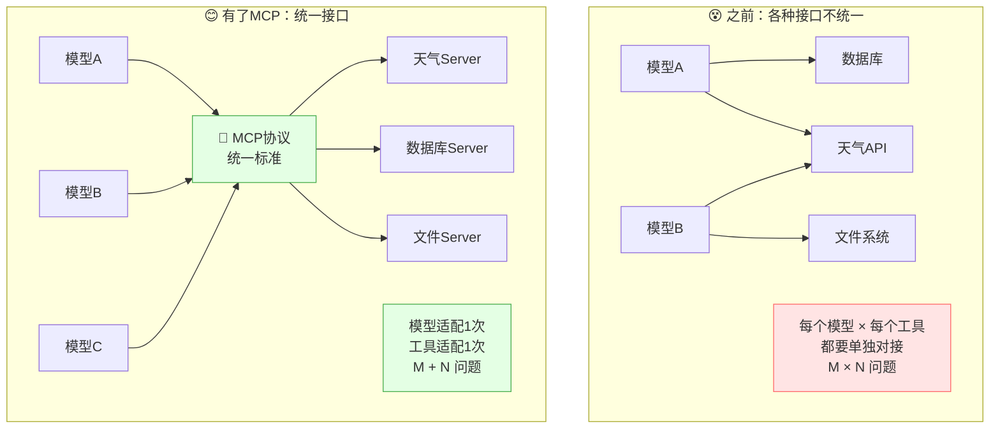

| 对比 | 没有 MCP | 有 MCP |
|:---|:---|:---|
| **集成方式** | 每个模型和每个工具单独对接 | 统一协议，一次对接 |
| **复杂度** | M × N（模型数 × 工具数） | M + N（各自适配协议） |
| **类比** | 每个手机不同充电口 | 统一 USB-C 接口 |

### 1.3 谁提出的？

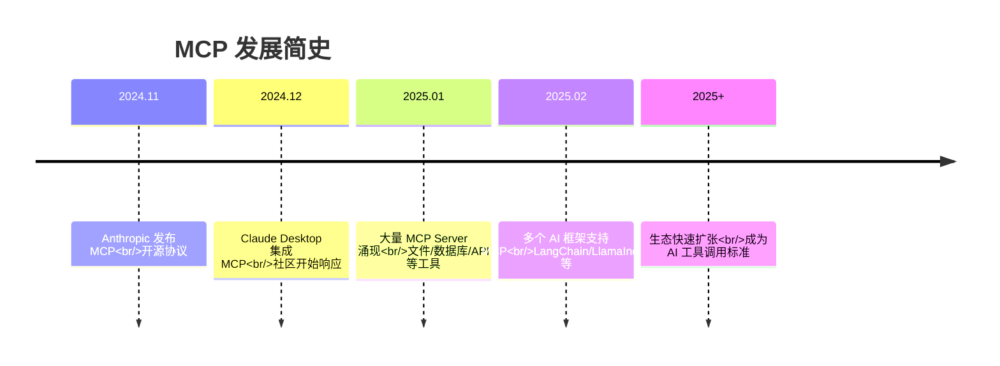

> 💡 **MCP 的目标**：就像 LSP（语言服务器协议）统一了编辑器和语言服务器一样，MCP 想统一 AI 模型和外部工具的连接方式。

---

## 二、为什么需要 MCP？

### 2.1 之前的痛点

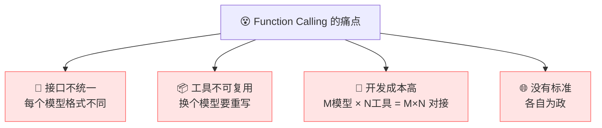

| 痛点 | 说明 |
|:---|:---|
| **接口不统一** | OpenAI、Claude、Gemini 的 Function Calling 格式各不相同 |
| **工具不可复用** | 为 OpenAI 写的工具，换 Claude 要重写 |
| **开发成本高** | 3 个模型 × 5 个工具 = 15 次对接 |
| **没有标准** | 每个人都自定义工具格式，无法共享 |

### 2.2 具体例子

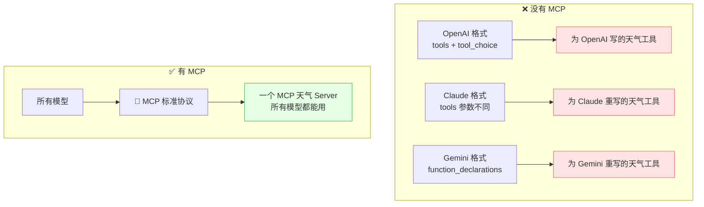

> 🎀 **MCP 的核心价值**：写一次工具，所有支持 MCP 的模型都能用！

### 2.3 MCP 的优势

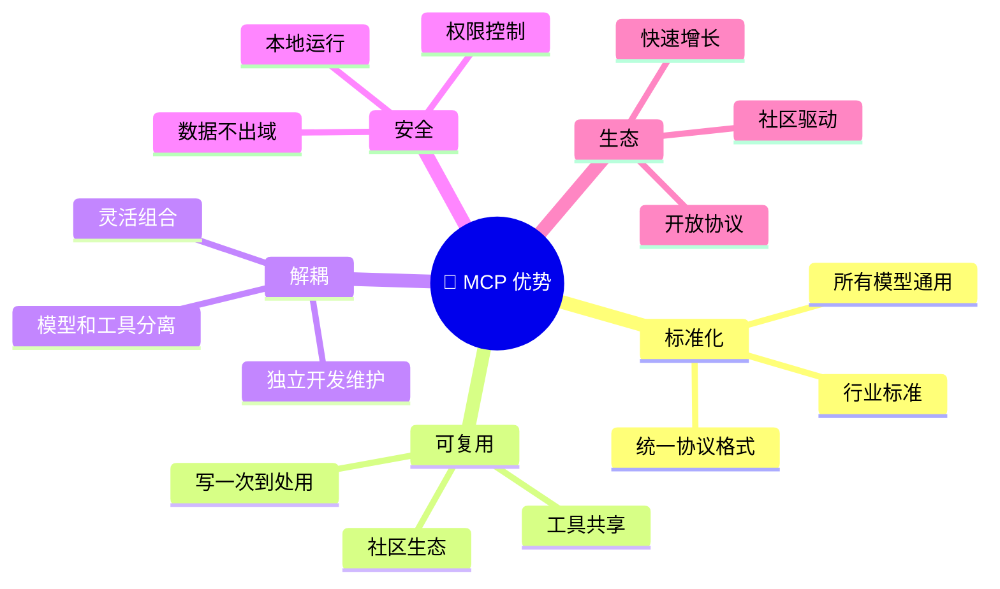

| 优势 | 说明 |
|:---|:---|
| **标准化** | 统一协议，所有模型通用 |
| **可复用** | 一个 MCP Server，所有模型都能用 |
| **解耦** | 模型和工具独立开发，灵活组合 |
| **安全** | 本地运行，权限可控 |
| **开放** | 开源协议，社区共建生态 |

---

## 三、MCP 核心架构

### 3.1 三大角色

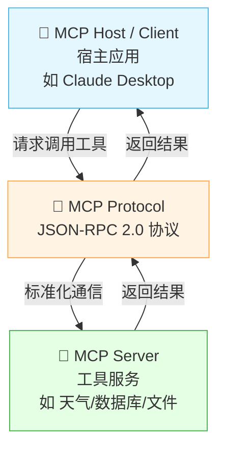

| 角色 | 说明 | 例子 |
|:---|:---|:---|
| **MCP Host（宿主）** | 运行 AI 模型的应用 | Claude Desktop、Cursor |
| **MCP Client（客户端）** | Host 中的 MCP 连接器 | 内嵌在 Host 中 |
| **MCP Server（服务端）** | 提供工具/数据的服务 | 天气 Server、数据库 Server |

### 3.2 架构详解

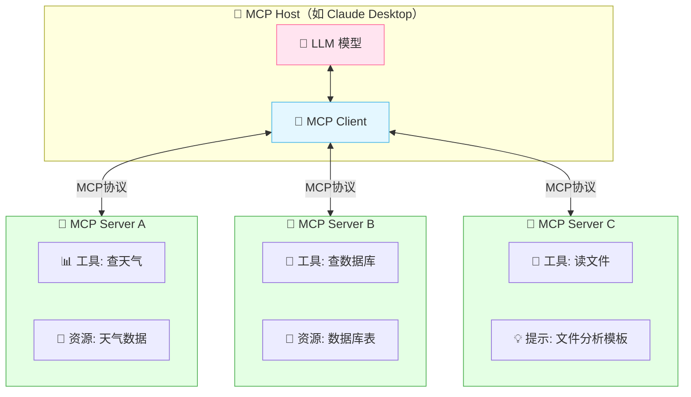

> 💡 **一个 Host 可以连接多个 MCP Server**！每个 Server 提供不同能力，模型可以自由组合使用。

### 3.3 通信协议

> MCP 基于 **JSON-RPC 2.0** 协议通信，支持 **stdio（标准输入输出）** 和 **SSE（Server-Sent Events）** 两种传输方式。

```json
// MCP 消息格式示例
{
  "jsonrpc": "2.0",
  "id": 1,
  "method": "tools/call",
  "params": {
    "name": "get_weather",
    "arguments": {
      "city": "北京"
    }
  }
}
```

| 传输方式 | 说明 | 适合 |
|:---|:---|:---|
| **stdio** | 标准输入输出 | 本地运行（Claude Desktop） |
| **SSE** | 服务器推送事件 | 远程运行（网络服务） |

---

## 四、三大核心能力

### 4.1 总览

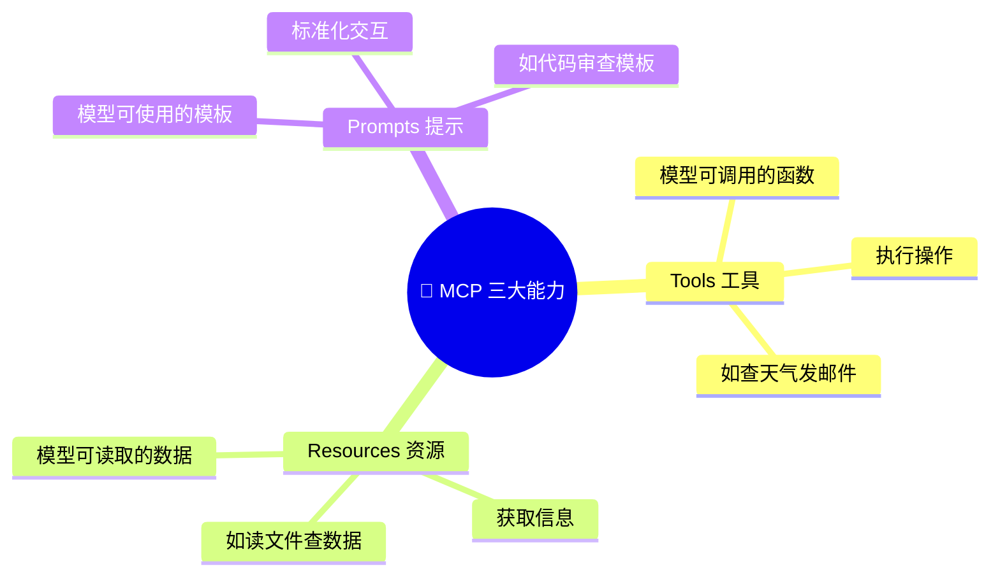

### 4.2 Tools（工具）

> **Tools** = 模型可以调用的函数，和 Function Calling 中的概念一致。

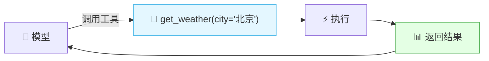

| 特性 | 说明 |
|:---|:---|
| **名称** | 工具的唯一标识 |
| **描述** | 告诉模型这个工具能干什么 |
| **参数 Schema** | 参数的 JSON Schema 定义 |
| **执行** | Server 端实际执行的代码 |

```json
// MCP 工具定义示例
{
  "name": "get_weather",
  "description": "查询指定城市的天气预报",
  "inputSchema": {
    "type": "object",
    "properties": {
      "city": {
        "type": "string",
        "description": "城市名称"
      }
    },
    "required": ["city"]
  }
}
```

### 4.3 Resources（资源）

> **Resources** = 模型可以读取的数据源，类似 REST API 的 GET 请求。

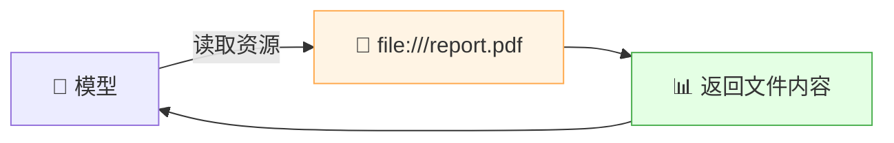

| 资源类型 | URI 示例 | 说明 |
|:---|:---|:---|
| 文件 | `file:///path/to/file` | 读取本地文件 |
| 数据库 | `db://table_name` | 查询数据库表 |
| API | `api://endpoint` | 获取 API 数据 |
| 自定义 | `custom://resource` | 自定义资源 |

```json
// MCP 资源定义示例
{
  "uri": "file:///reports/annual.pdf",
  "name": "年度报告",
  "description": "2024年公司年度报告",
  "mimeType": "application/pdf"
}
```

### 4.4 Prompts（提示模板）

> **Prompts** = 预定义的提示模板，让用户或模型可以复用标准化的交互方式。

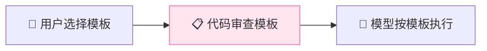

```json
// MCP 提示模板示例
{
  "name": "code_review",
  "description": "代码审查模板",
  "arguments": {
    "code": {
      "description": "要审查的代码",
      "required": true
    }
  }
}
```

### 4.5 三者对比

| 能力 | 方向 | 作用 | 类比 |
|:---|:---|:---|:---|
| **Tools** | 模型 → 外部 | 执行操作 | POST 请求 |
| **Resources** | 外部 → 模型 | 读取数据 | GET 请求 |
| **Prompts** | 用户 → 模型 | 标准化模板 | 模板函数 |

---

## 五、MCP 工作流程

### 5.1 完整交互流程

```mermaid
sequenceDiagram
    participant U as 👤 用户
    participant H as 🤖 Host (Claude)
    participant C as 🔌 MCP Client
    participant S as 🔧 MCP Server
    participant T as 📊 工具/API

    Note over C,S: 1. 初始化阶段
    C->>S: 建立连接 (stdio/SSE)
    C->>S: initialize()
    S-->>C: 返回 Server 能力清单
    C->>S: list_tools()
    S-->>C: 返回工具列表

    Note over U,T: 2. 使用阶段
    U->>H: 提问："北京天气？"
    H->>C: 查看可用工具
    C-->>H: 有 get_weather 工具
    Note over H: 模型决策调用 get_weather
    H->>C: 调用 get_weather(city="北京")
    C->>S: tools/call: get_weather
    S->>T: 执行天气查询
    T-->>S: 返回天气数据
    S-->>C: 返回结果
    C-->>H: 天气数据
    Note over H: 模型整合结果生成回答
    H-->>U: "北京明天晴天25°C"

    style H fill:#e4f7ff
    style S fill:#e4ffe4
```

### 5.2 步骤详解

| 步骤 | 说明 |
|:---|:---|
| ① 建立连接 | Client 和 Server 通过 stdio/SSE 建立连接 |
| ② 初始化 | Client 发送 initialize 请求，获取 Server 能力 |
| ③ 发现工具 | Client 调用 list_tools() 获取工具列表 |
| ④ 用户提问 | 用户向 Host 提问 |
| ⑤ 模型决策 | LLM 根据问题和工具列表，决定调哪个工具 |
| ⑥ 调用工具 | Client 向 Server 发送 tools/call 请求 |
| ⑦ 执行返回 | Server 执行函数，返回结果 |
| ⑧ 生成回答 | LLM 整合结果，生成自然语言回答 |

### 5.3 多 Server 组合

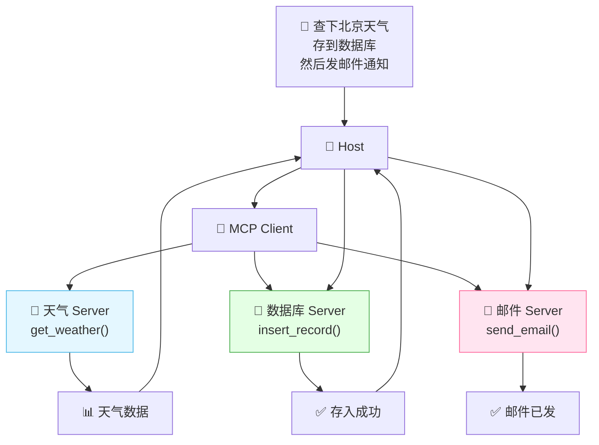

> 🎀 **MCP 的强大之处**：一个 Host 可以同时连接多个 Server，模型自由组合不同工具完成复杂任务！

---

## 六、MCP Server 开发

### 6.1 用 Python 开发 MCP Server

```python
from mcp.server import Server
from mcp.types import Tool, TextContent

# 1. 创建 Server 实例
server = Server("weather-server")

# 2. 定义工具
@server.list_tools()
async def list_tools() -> list[Tool]:
    return [
        Tool(
            name="get_weather",
            description="查询指定城市的天气预报",
            inputSchema={
                "type": "object",
                "properties": {
                    "city": {
                        "type": "string",
                        "description": "城市名称，如：北京、上海"
                    }
                },
                "required": ["city"]
            }
        )
    ]

# 3. 实现工具执行
@server.call_tool()
async def call_tool(name: str, arguments: dict) -> list[TextContent]:
    if name == "get_weather":
        city = arguments["city"]
        # 实际调用天气 API
        weather = get_weather_from_api(city)
        return [TextContent(
            type="text",
            text=f"{city}：{weather['condition']}，{weather['temperature']}°C"
        )]

# 4. 工具实现函数
def get_weather_from_api(city: str) -> dict:
    """模拟天气查询"""
    data = {
        "北京": {"temperature": 25, "condition": "晴"},
        "上海": {"temperature": 28, "condition": "多云"},
    }
    return data.get(city, {"temperature": 20, "condition": "未知"})

# 5. 启动 Server
if __name__ == "__main__":
    import asyncio
    from mcp.server.stdio import stdio_server

    async def main():
        async with stdio_server() as (read, write):
            await server.run(read, write)

    asyncio.run(main())
```

### 6.2 用 TypeScript 开发 MCP Server

```typescript
import { Server } from "@modelcontextprotocol/sdk/server";
import { StdioServerTransport } from "@modelcontextprotocol/sdk/server/stdio";

// 1. 创建 Server
const server = new Server(
  { name: "weather-server", version: "1.0.0" },
  { capabilities: { tools: {} } }
);

// 2. 定义工具
server.setRequestHandler(ListToolsRequestSchema, async () => ({
  tools: [
    {
      name: "get_weather",
      description: "查询指定城市的天气预报",
      inputSchema: {
        type: "object",
        properties: {
          city: { type: "string", description: "城市名称" }
        },
        required: ["city"]
      }
    }
  ]
}));

// 3. 实现工具调用
server.setRequestHandler(CallToolRequestSchema, async (request) => {
  const { name, arguments: args } = request.params;

  if (name === "get_weather") {
    const city = args.city as string;
    const weather = await getWeatherFromAPI(city);
    return {
      content: [{ type: "text", text: `${city}：${weather.condition}，${weather.temp}°C` }]
    };
  }
});

// 4. 启动
const transport = new StdioServerTransport();
await server.connect(transport);
```

### 6.3 Server 开发结构

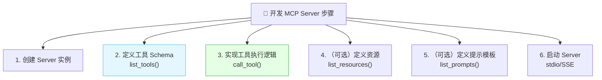

### 6.4 配置文件

在 Host（如 Claude Desktop）中配置 MCP Server：

```json
// Claude Desktop 配置文件
// 位置：~/Library/Application Support/Claude/claude_desktop_config.json
{
  "mcpServers": {
    "weather": {
      "command": "python",
      "args": ["/path/to/weather_server.py"]
    },
    "database": {
      "command": "node",
      "args": ["/path/to/db_server.js"]
    },
    "filesystem": {
      "command": "npx",
      "args": ["-y", "@modelcontextprotocol/server-filesystem", "/allowed/path"]
    }
  }
}
```

---

## 七、MCP Client 使用

### 7.1 在 Host 中使用

> 最简单的使用方式是配置到 Claude Desktop 等 Host 中，无需写代码。

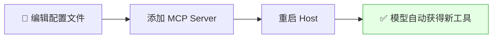

### 7.2 编程式使用 MCP Client

```python
from mcp import ClientSession, StdioServerParameters
from mcp.client.stdio import stdio_client

# 1. 配置 Server 连接参数
server_params = StdioServerParameters(
    command="python",
    args=["/path/to/weather_server.py"]
)

# 2. 连接 Server 并使用
async def main():
    async with stdio_client(server_params) as (read, write):
        async with ClientSession(read, write) as session:
            # 初始化连接
            await session.initialize()

            # 获取工具列表
            tools = await session.list_tools()
            print(f"可用工具: {[t.name for t in tools]}")

            # 调用工具
            result = await session.call_tool(
                name="get_weather",
                arguments={"city": "北京"}
            )
            print(f"结果: {result}")

# 3. 运行
import asyncio
asyncio.run(main())
```

### 7.3 在 LangChain 中使用 MCP

```python
from langchain_mcp import MCPToolkit

# 1. 连接 MCP Server
toolkit = MCPToolkit(
    transport="stdio",
    command="python",
    args=["/path/to/weather_server.py"]
)

# 2. 获取工具
tools = toolkit.get_tools()

# 3. 创建 Agent 使用
from langchain.agents import create_tool_calling_agent, AgentExecutor
from langchain.chat_models import ChatOpenAI

llm = ChatOpenAI(model="gpt-4")
agent = create_tool_calling_agent(llm, tools)
executor = AgentExecutor(agent=agent, tools=tools)

result = executor.invoke({"input": "北京天气怎么样？"})
print(result["output"])
```

---

## 八、MCP vs Function Calling

### 8.1 核心对比

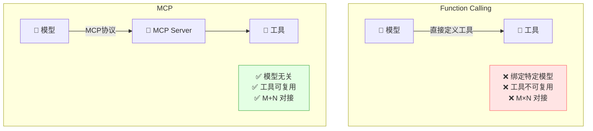

### 8.2 详细对比

| 对比 | Function Calling | MCP |
|:---|:---|:---|
| **标准化** | ❌ 各家格式不同 | ✅ 统一协议 |
| **可复用** | ❌ 换模型要重写 | ✅ 写一次到处用 |
| **集成成本** | M × N | M + N |
| **能力** | 只有工具调用 | 工具 + 资源 + 提示 |
| **传输方式** | API 调用 | stdio / SSE |
| **生态** | 各自为政 | 开放社区 |
| **成熟度** | 成熟 | 新兴但快速成长 |

### 8.3 关系：不是替代，是标准化

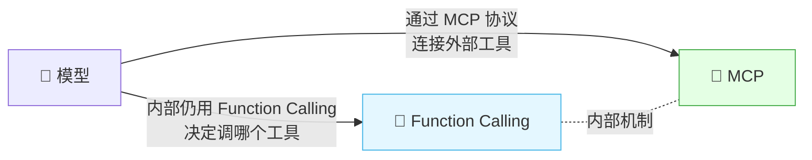

> 💡 **理解关键**：MCP 不是替代 Function Calling，而是把 Function Calling 的"工具定义和调用"标准化了。模型内部仍然在做 Function Calling（决策调哪个工具），只是工具的发现和执行通过 MCP 标准协议完成。

| 层面 | 职责 |
|:---|:---|
| **模型内部** | 仍用 Function Calling 机制决定调工具 |
| **MCP 协议** | 标准化工具的发现、定义、执行 |
| **MCP Server** | 封装具体工具实现 |

---

## 九、常见 MCP Server

### 9.1 官方/社区 Server

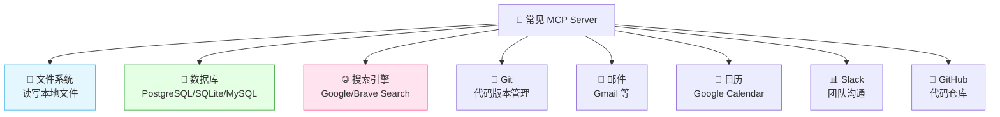

### 9.2 Server 列表

| Server | 能力 | 用途 |
|:---|:---|:---|
| **filesystem** | 读写文件 | 让 AI 操作本地文件 |
| **sqlite/postgres** | 数据库查询 | 让 AI 查询/操作数据库 |
| **brave-search** | 网络搜索 | 让 AI 搜索最新信息 |
| **git** | Git 操作 | 让 AI 管理代码版本 |
| **github** | GitHub API | 让 AI 操作 GitHub 仓库 |
| **google-drive** | 读取云盘 | 让 AI 读取 Google Drive 文件 |
| **slack** | 发消息 | 让 AI 发送 Slack 消息 |
| **puppeteer** | 浏览器自动化 | 让 AI 操控浏览器 |

### 9.3 使用示例：文件系统 Server

```json
// 配置文件系统 MCP Server
{
  "mcpServers": {
    "filesystem": {
      "command": "npx",
      "args": [
        "-y",
        "@modelcontextprotocol/server-filesystem",
        "/Users/username/Documents"
      ]
    }
  }
}
```

配置后，AI 就能：
- 📖 读取指定目录下的文件
- 📝 创建/修改文件
- 🔍 搜索文件
- 📁 列出目录内容

---

## 十、MCP 生态与前景

### 10.1 生态现状

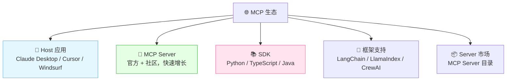

### 10.2 支持的 Host 应用

| Host | 说明 |
|:---|:---|
| **Claude Desktop** | Anthropic 官方桌面端，首发支持 |
| **Cursor** | AI 代码编辑器 |
| **Windsurf** | AI IDE |
| **LangChain** | 通过 toolkit 支持 |
| **自定义应用** | 通过 SDK 自己集成 |

### 10.3 支持的 SDK

| SDK | 语言 | 仓库 |
|:---|:---|:---|
| Python SDK | Python | `mcp` PyPI 包 |
| TypeScript SDK | TypeScript | `@modelcontextprotocol/sdk` |
| Java SDK | Java | 社区版 |
| Go SDK | Go | 社区版 |
| Rust SDK | Rust | 社区版 |

### 10.4 MCP 的意义

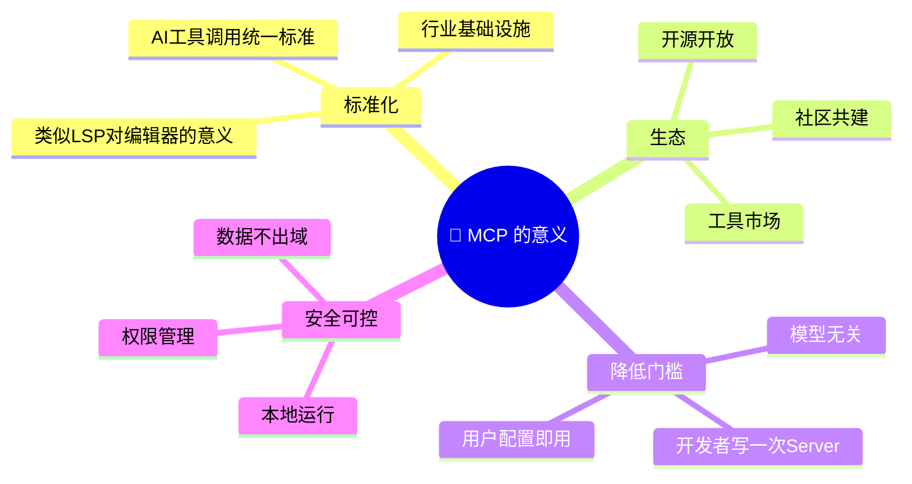

### 10.5 MCP 与 Agent 的关系

```mermaid
flowchart TB
    A["🤖 AI Agent"]
    A --> B["🧠 大脑: LLM"]
    A --> C["📝 思考: Prompt + CoT"]
    A --> D["🔧 手: MCP 连接工具"]
    A --> E["📚 知识: RAG"]
    A --> F["💾 记忆: 对话历史"]

    style D fill:#e4ffe4,stroke:#4caf50
```

> 🎀 **MCP 是 Agent 的"手"**！Agent 需要调用各种工具来完成任务，MCP 让 Agent 能用统一标准连接所有工具。没有 MCP，Agent 每换一个模型就要重新对接所有工具；有了 MCP，工具一次对接，所有 Agent 都能用。

---

## 十一、知识总结

最后用思维导图把所有知识点串起来 📝✨：

```mermaid
mindmap
  root((🔌 MCP))
    是什么
      模型上下文协议
      Anthropic 提出
      AI界的USB-C
      统一工具连接标准
    为什么需要
      Function Calling 不统一
      M模型×N工具=M×N对接
      工具不可复用
      MCP变为M+N
    核心架构
      Host 宿主应用
      Client 客户端连接器
      Server 工具服务端
      JSON-RPC 2.0协议
      stdio/SSE传输
    三大能力
      Tools 工具 执行操作
      Resources 资源 读取数据
      Prompts 提示 标准模板
    工作流程
      建立连接
      初始化获取能力
      发现工具列表
      模型决策调工具
      Server执行返回
      模型整合回答
    Server开发
      Python SDK
      TypeScript SDK
      定义工具Schema
      实现执行逻辑
      配置到Host
    vs Function Calling
      FC绑定特定模型
      MCP模型无关
      不是替代是标准化
      模型内部仍用FC
    常见Server
      文件系统
      数据库
      搜索引擎
      Git GitHub
      邮件日历
    生态前景
      Claude Cursor等Host
      多语言SDK
      框架支持LangChain
      社区快速增长
      Agent的标准接口
```

### 🎯 核心要点速记

1. **MCP = AI 界的 USB-C**：统一协议，让模型用标准方式连接外部工具和数据。
2. **解决 M×N 问题**：从"每个模型 × 每个工具单独对接"变成"各自适配一次协议"。
3. **三大角色**：Host（宿主）+ Client（连接器）+ Server（工具提供方）。
4. **通信协议**：基于 JSON-RPC 2.0，支持 stdio（本地）和 SSE（远程）。
5. **三大能力**：Tools（执行操作）+ Resources（读取数据）+ Prompts（提示模板）。
6. **一个 Host 连多个 Server**：模型可以自由组合不同工具完成复杂任务。
7. **开发简单**：用 Python/TS SDK，定义工具 Schema + 实现执行逻辑即可。
8. **配置即用**：在 Host 配置文件中添加 Server，重启后模型自动获得新工具。
9. **vs Function Calling**：MCP 不是替代 FC，而是把工具发现和调用标准化了。
10. **生态快速增长**：已有文件系统、数据库、搜索、Git 等大量 Server。
11. **多语言 SDK**：Python、TypeScript、Java、Go、Rust 都有。
12. **是 Agent 的"手"**：MCP 让 Agent 用统一标准连接所有工具，是 Agent 的标准接口。

---

> 🌸 哇~ 恭喜你把 MCP 模型上下文协议的核心知识学完啦！MCP 是 AI 工具调用领域的最新标准——就像 USB-C 统一了充电口一样，MCP 正在统一 AI 连接工具的方式。掌握了 MCP，你就站在了 AI 工程的最前沿！加油鸭！(ง •_•)ง💖
