# 💾 AI Memory 记忆系统超全学习指南

> 嗨呀~ 欢迎来到 AI Memory 的世界！💾 Memory（记忆）是让 AI 从"金鱼脑"变成"过目不忘"的关键技术——让 AI 能记住之前的对话、学到的知识、用户的偏好！这是 AI Agent 的核心组件。这份指南会带你从原理到实战，彻底搞懂 Memory。准备好了吗？冲鸭！(ﾉ>ω<)ﾉ

---

## 📖 目录

- [一、什么是 AI Memory？](#一什么是-ai-memory)
- [二、为什么需要 Memory？](#二为什么需要-memory)
- [三、记忆分类](#三记忆分类)
- [四、短期记忆（工作记忆）](#四短期记忆工作记忆)
- [五、长期记忆](#五长期记忆)
- [六、记忆检索策略](#六记忆检索策略)
- [七、Memory 管理策略](#七memory-管理策略)
- [八、主流 Memory 框架](#八主流-memory-框架)
- [九、代码实战](#九代码实战)
- [十、Memory 与 RAG 的关系](#十memory-与-rag-的关系)
- [十一、知识总结](#十一知识总结)

---

## 一、什么是 AI Memory？

### 1.1 一句话定义

> **AI Memory（记忆系统）** = 让 AI 能够存储、管理和检索历史信息的机制，使 AI 在多轮交互中保持上下文连贯性，并积累长期知识。

简单说：**让 AI 记住过去，才能更好应对未来** 🧠。

### 1.2 生活化比喻

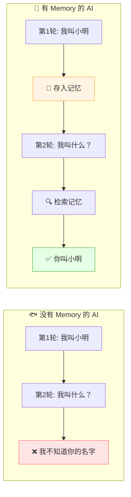

### 1.3 人类的记忆 vs AI 的记忆

| 对比 | 人类记忆 | AI 记忆 |
|:---|:---|:---|
| **短期记忆** | 工作记忆（7±2 个信息块） | 上下文窗口（Context Window） |
| **长期记忆** | 海马体→大脑皮层 | 向量数据库/知识图谱 |
| **回忆方式** | 联想回忆 | 相似度检索 |
| **遗忘机制** | 自然遗忘 | 主动管理（淘汰/压缩） |
| **学习积累** | 神经突触强化 | 向量更新/知识库更新 |

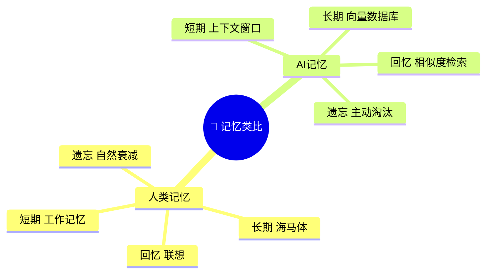

---

## 二、为什么需要 Memory？

### 2.1 纯 LLM 的"金鱼脑"问题

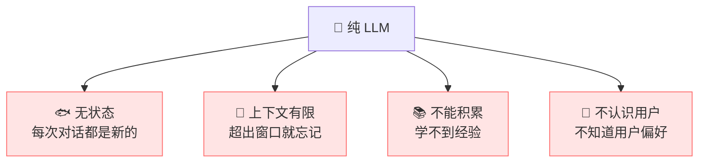

| 问题 | 说明 | 后果 |
|:---|:---|:---|
| **无状态** | 每次请求都是独立的 | 不记得之前说了什么 |
| **上下文有限** | Context Window 有大小限制（4K~128K） | 长对话超出就遗忘 |
| **不能积累** | 无法从经验中学习 | 同样问题反复问 |
| **不认识用户** | 不了解用户偏好和习惯 | 每次都要从头介绍 |

### 2.2 Memory 解决了什么？

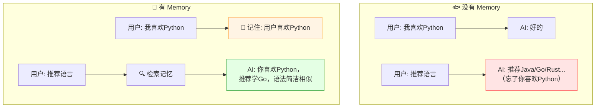

### 2.3 Memory 的核心价值

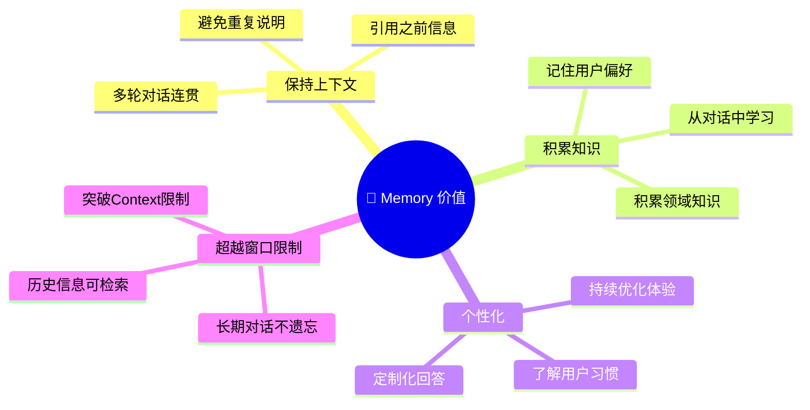

| 价值 | 说明 |
|:---|:---|
| **上下文连贯** | 多轮对话中引用之前的信息 |
| **知识积累** | 从历史交互中学习和积累 |
| **个性化** | 记住用户偏好，定制化回答 |
| **突破窗口** | 长期对话不再受 Context Window 限制 |

---

## 三、记忆分类

### 3.1 总览

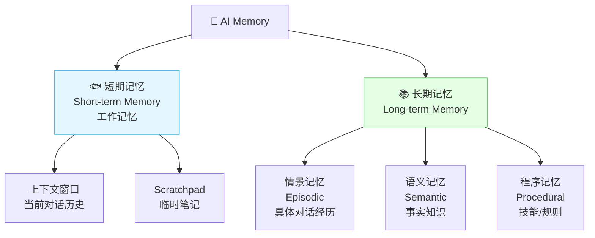

### 3.2 三种长期记忆（类比人类心理学）

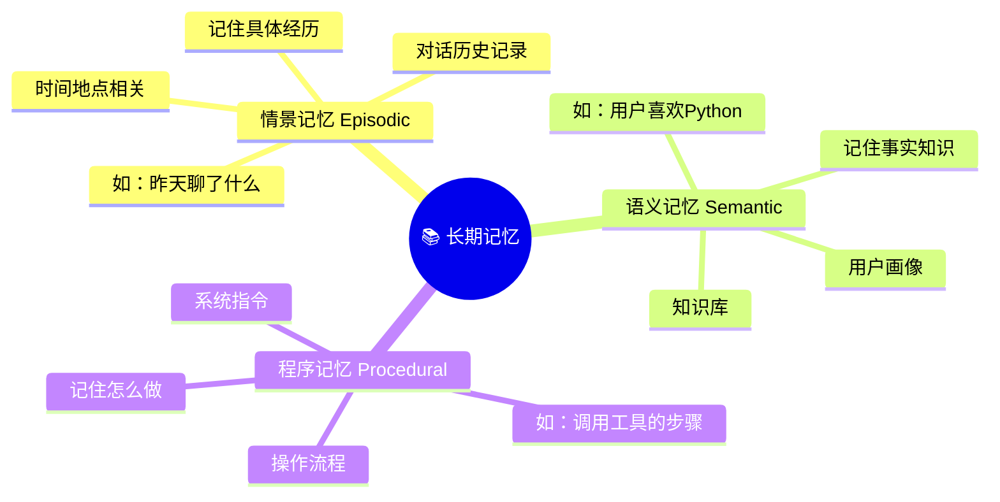

| 记忆类型 | 人类类比 | AI 类比 | 例子 |
|:---|:---|:---|:---|
| **情景记忆** | 记住昨天吃了什么 | 对话历史 | "用户上次问了天气" |
| **语义记忆** | 知道巴黎是法国首都 | 用户画像/知识库 | "用户是Java开发工程师" |
| **程序记忆** | 会骑自行车 | 系统指令/工具用法 | "查天气要调 get_weather" |

### 3.3 完整记忆架构

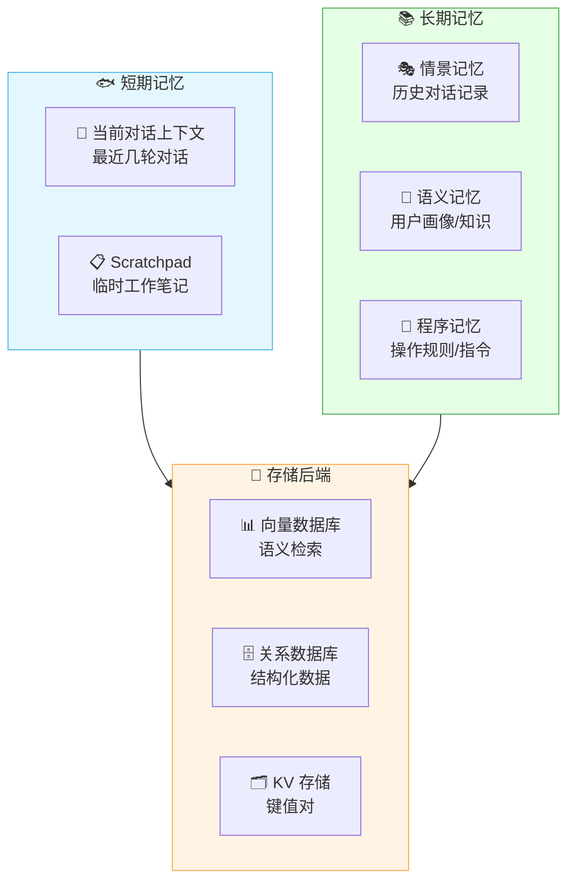

---

## 四、短期记忆（工作记忆）

### 4.1 什么是短期记忆？

> **短期记忆** = AI 当前正在处理的上下文信息，相当于人脑的"工作记忆"。

### 4.2 上下文窗口

> LLM 有一个 **Context Window（上下文窗口）**，能同时处理的最大 token 数。

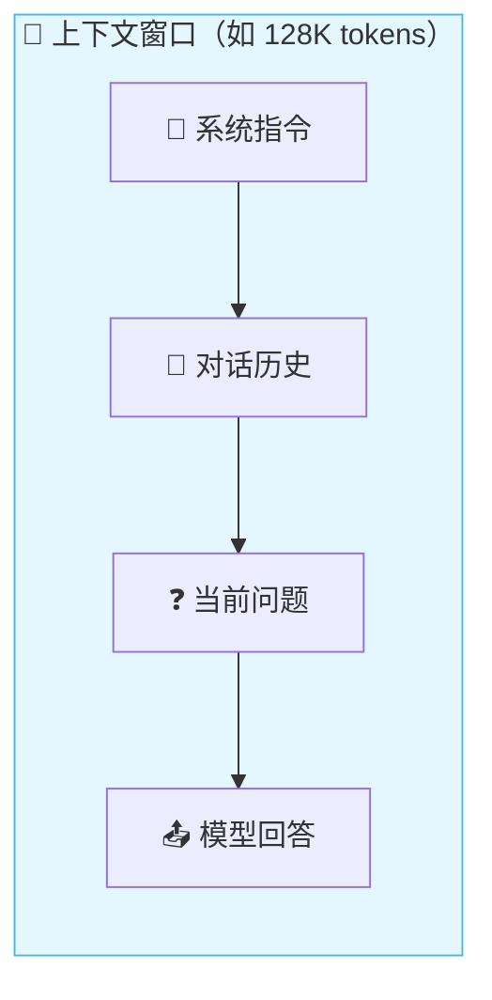

| 模型 | 上下文窗口 |
|:---|:---|
| GPT-3.5 | 4K / 16K |
| GPT-4 | 8K / 32K / 128K |
| Claude 3 | 200K |
| Claude 3.5 | 200K |
| Gemini 1.5 | 1M |
| GPT-4o | 128K |

### 4.3 对话历史管理

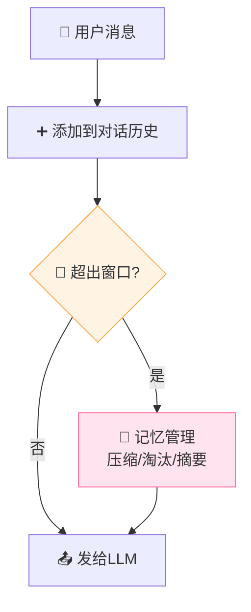

### 4.4 窗口超限怎么办？

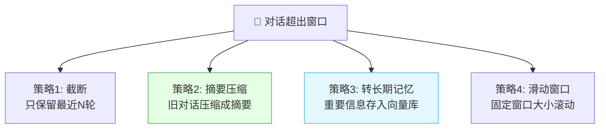

| 策略 | 说明 | 优点 | 缺点 |
|:---|:---|:---|:---|
| **截断** | 删除最早的对话 | 简单 | 丢失早期信息 |
| **摘要压缩** ⭐ | 旧对话压缩成摘要 | 保留要点 | 可能丢细节 |
| **转长期记忆** | 存入向量库 | 可检索 | 需要额外系统 |
| **滑动窗口** | 固定窗口滚动 | 平衡 | 中等复杂 |

### 4.5 摘要压缩示例

```
【原始对话历史（5轮，800 tokens）】
用户: 我叫小明
AI: 你好小明！
用户: 我喜欢Python
AI: Python很棒！
用户: 我在做Web开发
AI: ...

【压缩后摘要（50 tokens）】
摘要：用户叫小明，喜欢Python，在做Web开发。
```

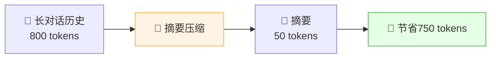

---

## 五、长期记忆

### 5.1 什么是长期记忆？

> **长期记忆** = 跨对话持久存储的信息，不随会话结束而消失。

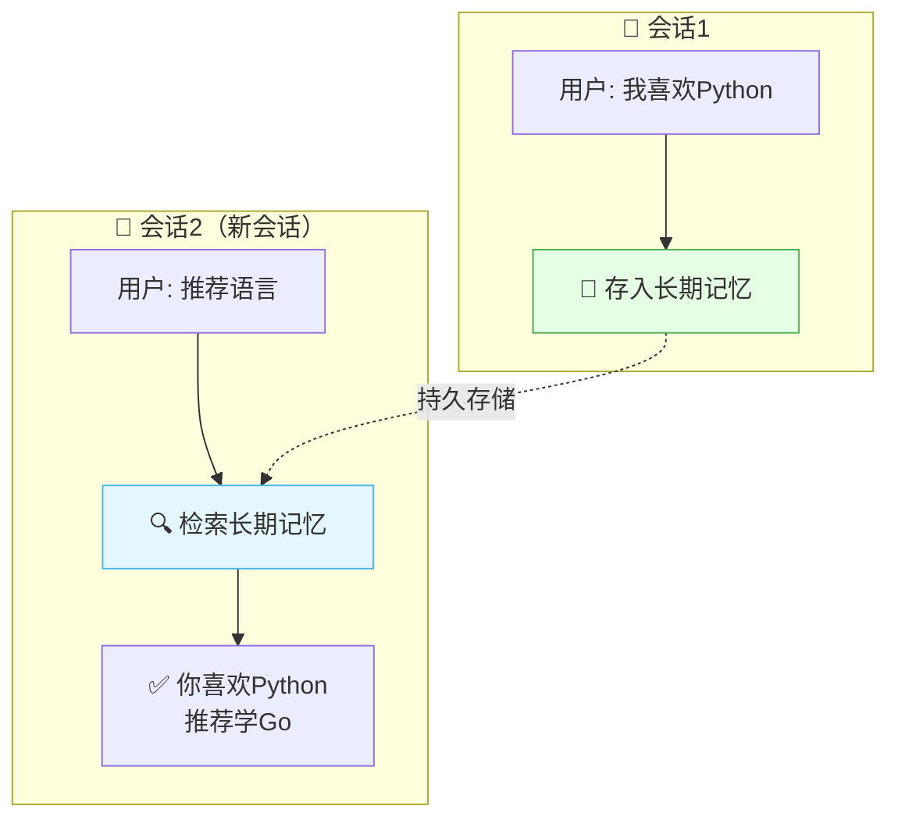

### 5.2 长期记忆的存储方式

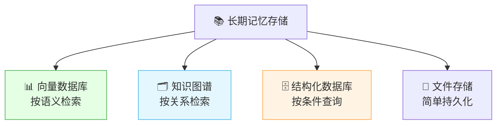

| 存储方式 | 适合 | 检索方式 | 例子 |
|:---|:---|:---|:---|
| **向量数据库** ⭐ | 对话历史、语义记忆 | 相似度检索 | "找到和'编程'相关的对话" |
| **知识图谱** | 关系型知识 | 图查询 | "用户→喜欢→Python" |
| **结构化数据库** | 用户画像、偏好 | 条件查询 | "用户偏好表" |
| **文件存储** | 简单场景 | 全文搜索 | JSON/文本文件 |

### 5.3 向量数据库存储（最常用）

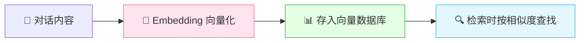

```python
# 向量数据库存储记忆
from chromadb import Client

client = Client()
collection = client.create_collection("chat_memory")

# 存入记忆
collection.add(
    documents=["用户喜欢Python", "用户在做Web开发", "用户叫小明"],
    metadatas=[
        {"type": "preference", "timestamp": "2025-01-01"},
        {"type": "info", "timestamp": "2025-01-02"},
        {"type": "info", "timestamp": "2025-01-01"}
    ],
    ids=["mem1", "mem2", "mem3"]
)

# 检索相关记忆
results = collection.query(
    query_texts=["用户喜欢什么编程语言？"],
    n_results=2
)
# 返回: "用户喜欢Python"
```

### 5.4 知识图谱存储

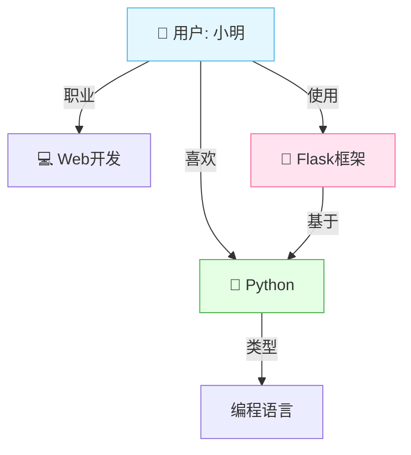

| 优势 | 说明 |
|:---|:---|
| 关系明确 | 实体间关系清晰 |
| 可推理 | 通过图关系推理新知识 |
| 结构化 | 适合存储结构化知识 |
| 查询灵活 | 支持多跳查询 |

### 5.5 用户画像（Profile Memory）

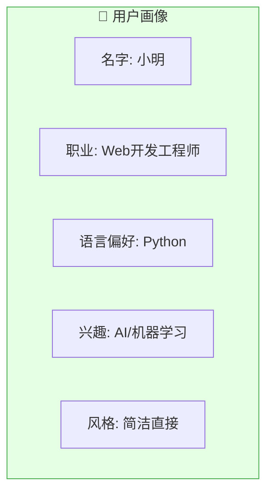

```json
// 用户画像存储示例
{
  "user_id": "user_001",
  "name": "小明",
  "preferences": {
    "language": "Python",
    "framework": "Flask",
    "answer_style": "concise"
  },
  "interests": ["AI", "Web开发", "机器学习"],
  "history_summary": "之前讨论过Python基础和Flask框架",
  "last_interaction": "2025-01-15T10:30:00"
}
```

---

## 六、记忆检索策略

### 6.1 检索流程

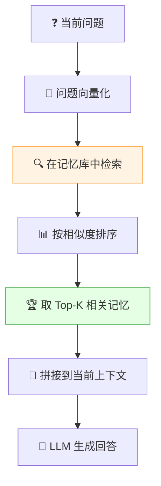

### 6.2 检索方法对比

| 方法 | 说明 | 优点 | 缺点 |
|:---|:---|:---|:---|
| **语义检索** ⭐ | Embedding 相似度 | 语义相关 | 可能遗漏关键词 |
| **关键词检索** | BM25/全文搜索 | 精确匹配 | 不懂同义词 |
| **时间检索** | 按时间排序取最近 | 时效性好 | 可能不相关 |
| **混合检索** ⭐ | 语义+关键词+时间 | 全面 | 复杂 |

### 6.3 混合检索（推荐）

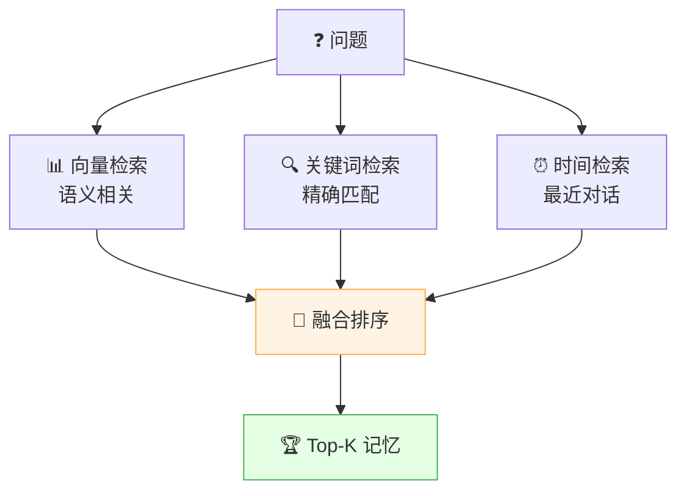

### 6.4 检索增强策略

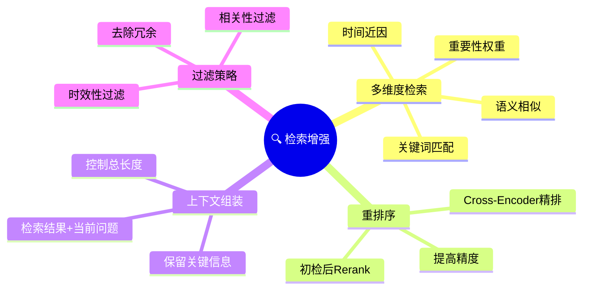

| 策略 | 说明 |
|:---|:---|
| **多维度检索** | 语义 + 关键词 + 时间组合 |
| **Rerank 重排序** | 初步检索后用 Cross-Encoder 精排 |
| **重要性评分** | 给记忆打重要性分，优先检索高分 |
| **时效性** | 最近的记忆权重更高 |
| **去冗余** | 去掉重复或高度相似的记忆 |

---

## 七、Memory 管理策略

### 7.1 记忆生命周期

```mermaid
flowchart LR
    A["📝 写入<br/>从对话中提取"] --> B["💾 存储<br/>向量化存入数据库"]
    B --> C["🔍 检索<br/>按需检索相关记忆"]
    C --> D["♻️ 更新<br/>修改/合并旧记忆"]
    D --> E["🗑️ 遗忘<br/>淘汰过期/低价值记忆"]

    style A fill:#e4f7ff,stroke:#4cb8e8
    style B fill:#e4ffe4,stroke:#4caf50
    style C fill:#fff4e4,stroke:#ffa94d
    style E fill:#ffe4e4,stroke:#ff6b6b
```

### 7.2 记忆写入

```mermaid
flowchart TB
    D["💬 对话内容"] --> E{"值得记住吗？"}
    E -->|"用户偏好"| S1["💾 存为语义记忆"]
    E -->|"重要事实"| S2["💾 存为语义记忆"]
    E -->|"工具用法"| S3["💾 存为程序记忆"]
    E -->|"有趣对话"| S4["💾 存为情景记忆"]
    E -->|"闲聊/无意义"| X["❌ 不存储"]

    style E fill:#fff4e4,stroke:#ffa94d
    style X fill:#ffe4e4,stroke:#ff6b6b
```

> 💡 **不是所有对话都值得记住！** 需要智能判断哪些信息有价值。

### 7.3 记忆遗忘机制

```mermaid
flowchart TB
    F["🗑️ 遗忘策略"]
    F --> F1["⏰ 时间遗忘<br/>超过N天未访问"]
    F --> F2["📊 频率遗忘<br/>从未被检索到"]
    F --> F3["🔗 重要性遗忘<br/>低重要性评分"]
    F --> F4["📦 容量遗忘<br/>超出最大容量淘汰最旧"]
    F --> F5["🔀 冗余遗忘<br/>合并重复记忆"]

    style F1 fill:#fff4e4,stroke:#ffa94d
    style F2 fill:#e4f7ff,stroke:#4cb8e8
    style F3 fill:#e4ffe4,stroke:#4caf50
```

| 遗忘策略 | 说明 | 类比 |
|:---|:---|:---|
| **时间遗忘** | 超过一定时间未访问就淘汰 | 人类自然遗忘 |
| **频率遗忘** | 从未被检索到的记忆淘汰 | "用进废退" |
| **重要性遗忘** | 重要性低的优先淘汰 | 记住重要的 |
| **容量遗忘** | 超出容量限制淘汰最旧的 | LRU 缓存 |
| **冗余遗忘** | 合并重复/相似的记忆 | 整理记忆 |

### 7.4 记忆更新与合并

```mermaid
flowchart TB
    N["📝 新信息: 用户现在喜欢Go了"] --> C{"有旧记忆吗？"}
    C -->|"有: 用户喜欢Python"| U["🔄 更新记忆"]
    U --> M["💾 合并: 用户原喜欢Python，现转Go"]
    C -->|"没有"| S["💾 直接存储"]

    style U fill:#fff4e4,stroke:#ffa94d
    style M fill:#e4ffe4,stroke:#4caf50
```

> 🎀 **记忆不是死的数据，而是活的系统**！需要不断更新、合并、淘汰，才能保持高效和准确。

### 7.5 Memory 管理总览

```mermaid
mindmap
  root((💾 Memory 管理))
    写入
      判断价值
      分类存储
      向量化
    检索
      多维度检索
      Rerank精排
      Top-K选取
    更新
      合并旧记忆
      修正错误
      补充新信息
    遗忘
      时间淘汰
      频率淘汰
      重要性淘汰
      容量淘汰
    重要性评分
      用户偏好高分
      事实知识高分
      闲聊低分
```

---

## 八、主流 Memory 框架

### 8.1 框架总览

```mermaid
flowchart TB
    F["💾 Memory 框架"]
    F --> L["🔗 LangChain Memory<br/>最流行的 Memory 模块"]
    F --> M["🧠 Mem0<br/>专为 AI 记忆设计"]
    F --> Z["🦜 Zep<br/>长期记忆服务"]
    F --> C["🧩 ChromaDB<br/>向量数据库可做记忆"]
    F --> LM["🧠 LlamaIndex Memory<br/>文档+记忆管理"]
    F --> C[" CrewAI Memory<br/>多Agent记忆"]

    style L fill:#e4f7ff,stroke:#4cb8e8
    style M fill:#e4ffe4,stroke:#4caf50
    style Z fill:#ffe4f0,stroke:#ff6b9d
```

### 8.2 LangChain Memory 模块

| LangChain Memory 类型 | 说明 |
|:---|:---|
| **ConversationBufferMemory** | 保存完整对话历史（最简单） |
| **ConversationBufferWindowMemory** | 只保留最近 N 轮对话 |
| **ConversationSummaryMemory** | 对话历史压缩成摘要 |
| **ConversationSummaryBufferMemory** | 摘要 + 缓冲混合 |
| **VectorStoreRetrieverMemory** | 向量数据库存储 + 检索 |
| **EntityMemory** | 记住对话中提到的实体关系 |

```mermaid
flowchart TB
    subgraph 简单["基础 Memory"]
        B["BufferMemory<br/>全量保存"]
        W["WindowMemory<br/>最近N轮"]
    end

    subgraph 高级["高级 Memory"]
        S["SummaryMemory<br/>摘要压缩"]
        SB["SummaryBuffer<br/>摘要+缓冲"]
        V["VectorMemory<br/>向量检索"]
        E["EntityMemory<br/>实体关系"]
    end

    style 简单 fill:#e4f7ff,stroke:#4cb8e8
    style 高级 fill:#e4ffe4,stroke:#4caf50
```

### 8.3 Mem0（专用 Memory 框架）

> **Mem0** 是专为 AI Agent 设计的记忆框架，支持用户画像、偏好记忆、长期对话。

| 特性 | 说明 |
|:---|:---|
| **用户画像** | 自动提取用户偏好 |
| **长期记忆** | 跨会话持久化 |
| **智能提取** | 从对话中自动提取有价值信息 |
| **向量检索** | 基于语义检索相关记忆 |
| **API 简洁** | 简单的 add/search 接口 |

### 8.4 框架对比

| 框架 | 特点 | 适合 |
|:---|:---|:---|
| **LangChain Memory** | 内置多种类型，易集成 | 快速原型 |
| **Mem0** | 专用记忆系统，功能丰富 | 生产级应用 |
| **Zep** | 长期记忆即服务 | 企业级 |
| **ChromaDB** | 向量数据库，自建记忆 | 自定义方案 |
| **LlamaIndex** | 文档+记忆管理 | RAG + 记忆 |

---

## 九、代码实战

### 9.1 LangChain ConversationBufferMemory

```python
from langchain.memory import ConversationBufferMemory
from langchain.chat_models import ChatOpenAI
from langchain.chains import ConversationChain

# 1. 创建记忆（保存完整对话历史）
memory = ConversationBufferMemory()

# 2. 创建对话链
llm = ChatOpenAI(model="gpt-4")
conversation = ConversationChain(
    llm=llm,
    memory=memory,
    verbose=True
)

# 3. 多轮对话
conversation.predict(input="我叫小明")
# AI: 你好小明！

conversation.predict(input="我喜欢Python")
# AI: Python很棒！

conversation.predict(input="我叫什么？")
# AI: 你叫小明！（有记忆了！）
```

### 9.2 ConversationBufferWindowMemory（窗口记忆）

```python
from langchain.memory import ConversationBufferWindowMemory

# 只保留最近 3 轮对话
memory = ConversationBufferWindowMemory(k=3)

# 第1轮
memory.save_context(
    {"input": "我叫小明"},
    {"output": "你好小明！"}
)

# 第2轮
memory.save_context(
    {"input": "我喜欢Python"},
    {"output": "Python很棒！"}
)

# ... 第5轮时，第1轮已被遗忘（超出窗口k=3）
```

### 9.3 ConversationSummaryMemory（摘要记忆）

```python
from langchain.memory import ConversationSummaryMemory

# 自动将对话历史压缩成摘要
memory = ConversationSummaryMemory(llm=ChatOpenAI())

# 对话会自动被压缩成摘要
# 如："用户叫小明，喜欢Python，在做Web开发"
```

### 9.4 向量数据库 Memory

```python
from langchain.memory import VectorStoreRetrieverMemory
from langchain.vectorstores import Chroma
from langchain.embeddings import HuggingFaceEmbeddings

# 1. 创建向量存储
embeddings = HuggingFaceEmbeddings(model_name="BAAI/bge-small-zh-v1.5")
vectorstore = Chroma(embedding_function=embeddings)

# 2. 创建向量记忆
memory = VectorStoreRetrieverMemory(
    retriever=vectorstore.as_retriever(search_kwargs={"k": 3})
)

# 3. 保存记忆
memory.save_context(
    {"input": "我叫小明"},
    {"output": "你好小明！"}
)
memory.save_context(
    {"input": "我喜欢Python"},
    {"output": "Python很棒！"}
)

# 4. 加载相关记忆（按当前问题检索）
relevant = memory.load_memory_variables(
    {"prompt": "用户喜欢什么？"}
)
# 返回最相关的记忆: "用户喜欢Python"
```

### 9.5 完整 Agent Memory 示例

```python
from langchain.chat_models import ChatOpenAI
from langchain.memory import (
    ConversationBufferWindowMemory,
    VectorStoreRetrieverMemory
)
from langchain.vectorstores import Chroma
from langchain.embeddings import HuggingFaceEmbeddings

class AgentWithMemory:
    def __init__(self):
        # 短期记忆：最近5轮对话
        self.short_term = ConversationBufferWindowMemory(k=5)

        # 长期记忆：向量数据库
        embeddings = HuggingFaceEmbeddings(
            model_name="BAAI/bge-small-zh-v1.5"
        )
        vectorstore = Chroma(embedding_function=embeddings)
        self.long_term = VectorStoreRetrieverMemory(
            retriever=vectorstore.as_retriever(search_kwargs={"k": 3})
        )

        self.llm = ChatOpenAI(model="gpt-4")

    def chat(self, user_input: str) -> str:
        # 1. 从短期记忆加载上下文
        short_context = self.short_term.load_memory_variables({})

        # 2. 从长期记忆检索相关信息
        long_context = self.long_term.load_memory_variables(
            {"prompt": user_input}
        )

        # 3. 拼接上下文
        context = f"""
        短期记忆: {short_context}
        长期记忆: {long_context}
        用户问题: {user_input}
        """

        # 4. LLM 生成回答
        response = self.llm.predict(context)

        # 5. 保存到短期记忆
        self.short_term.save_context(
            {"input": user_input},
            {"output": response}
        )

        # 6. 重要信息存入长期记忆
        if self._is_important(user_input):
            self.long_term.save_context(
                {"input": user_input},
                {"output": response}
            )

        return response

    def _is_important(self, text: str) -> bool:
        """简单判断是否值得长期记住"""
        keywords = ["喜欢", "我是", "记住", "我的", "偏好"]
        return any(kw in text for kw in keywords)

# 使用
agent = AgentWithMemory()
print(agent.chat("我叫小明，喜欢Python"))
print(agent.chat("推荐一门语言"))  # 会记住你叫小明喜欢Python
```

### 9.6 Memory 架构图

```mermaid
flowchart TB
    U["👤 用户输入"] --> ST["🐟 短期记忆<br/>最近N轮对话"]
    U --> LT["📚 长期记忆<br/>向量数据库检索"]
    ST --> C["📎 拼接上下文"]
    LT --> C
    C --> LLM["🧠 LLM 生成回答"]
    LLM --> R["📤 回答用户"]
    LLM --> E{"值得记住？"}
    E -->|"是"| SV["💾 存入长期记忆"]
    E -->|"否"| X["❌ 不存储"]
    R --> ST2["💾 存入短期记忆"]

    style ST fill:#e4f7ff,stroke:#4cb8e8
    style LT fill:#e4ffe4,stroke:#4caf50
    style LLM fill:#ffe4f0,stroke:#ff6b9d
```

---

## 十、Memory 与 RAG 的关系

### 10.1 Memory vs RAG

```mermaid
flowchart TB
    subgraph Memory["💾 Memory 记忆系统"]
        M1["存储：对话历史/用户偏好"]
        M2["检索：按当前问题检索相关记忆"]
        M3["目的：保持上下文连贯"]
    end

    subgraph RAG["📚 RAG 检索增强"]
        R1["存储：文档知识库"]
        R2["检索：按问题检索相关文档"]
        R3["目的：提供外部知识"]
    end

    style Memory fill:#e4f7ff,stroke:#4cb8e8
    style RAG fill:#e4ffe4,stroke:#4caf50
```

### 10.2 对比

| 对比 | Memory | RAG |
|:---|:---|:---|
| **存什么** | 对话历史、用户偏好 | 文档知识 |
| **来源** | 交互中产生 | 预先准备的文档 |
| **动态性** | 动态更新 | 相对静态 |
| **目的** | 保持上下文连贯 | 提供外部知识 |
| **时效性** | 记住过去交互 | 提供参考知识 |
| **技术** | 向量数据库+摘要 | 向量数据库+检索 |

### 10.3 Memory + RAG 组合

```mermaid
flowchart TB
    U["👤 用户问题"] --> M["💾 Memory<br/>检索相关对话历史"]
    U --> R["📚 RAG<br/>检索相关文档知识"]
    M --> C["📎 拼接上下文<br/>对话历史+文档知识+当前问题"]
    R --> C
    C --> LLM["🧠 LLM 生成回答"]
    LLM --> A["💡 回答"]

    style M fill:#e4f7ff,stroke:#4cb8e8
    style R fill:#e4ffe4,stroke:#4caf50
    style LLM fill:#ffe4f0,stroke:#ff6b9d
```

> 🎀 **Memory 和 RAG 是互补的！** Memory 记住"我们聊过什么"，RAG 提供"系统知道什么"。两者结合，AI 既有记忆又有知识！

### 10.4 在 Agent 中的位置

```mermaid
flowchart TB
    A["🤖 AI Agent"]
    A --> B["🧠 大脑: LLM"]
    A --> C["📝 思考: Prompt + CoT"]
    A --> D["🔧 手: 工具调用/MCP"]
    A --> E1["📚 知识: RAG"]
    A --> E2["💾 记忆: Memory"]
    A --> F["👀 感知: 输入理解"]

    style E2 fill:#e4ffe4,stroke:#4caf50
```

| Agent 组件 | 功能 | 类比 |
|:---|:---|:---|
| LLM | 核心推理 | 大脑 |
| Prompt + CoT | 引导思考 | 思维方式 |
| 工具调用/MCP | 执行操作 | 手 |
| RAG | 外部知识 | 书 |
| **Memory** ⭐ | 记忆上下文 | 海马体 |

---

## 十一、知识总结

最后用思维导图把所有知识点串起来 📝✨：

```mermaid
mindmap
  root((💾 AI Memory))
    是什么
      让AI记住过去的信息
      保持多轮对话连贯
      积累知识和偏好
      Agent的核心组件
    为什么需要
      LLM无状态金鱼脑
      上下文窗口有限
      不能积累经验
      不认识用户
    记忆分类
      短期记忆
        上下文窗口
        当前对话历史
        Scratchpad临时笔记
      长期记忆
        情景记忆 对话经历
        语义记忆 事实知识
        程序记忆 操作规则
    短期记忆管理
      截断策略
      摘要压缩
      转长期记忆
      滑动窗口
    长期记忆存储
      向量数据库 最常用
      知识图谱
      结构化数据库
      文件存储
      用户画像
    检索策略
      语义检索
      关键词检索
      时间检索
      混合检索 推荐
      Rerank重排序
    管理策略
      写入 判断价值
      检索 多维度
      更新 合并修正
      遗忘 时间频率重要性
      重要性评分
    主流框架
      LangChain Memory
      Mem0 专用框架
      Zep 长期记忆服务
      ChromaDB 向量库
    代码实战
      BufferMemory 全量
      WindowMemory 窗口
      SummaryMemory 摘要
      VectorMemory 向量
      完整Agent Memory
    与RAG的关系
      Memory记交互历史
      RAG存文档知识
      互补不替代
      组合使用效果最佳
```

### 🎯 核心要点速记

1. **Memory = AI 的记忆系统**：让 AI 记住过去，保持多轮对话连贯。
2. **解决金鱼脑问题**：LLM 无状态 + 上下文有限 → Memory 解决。
3. **两大分类**：短期记忆（上下文窗口）+ 长期记忆（持久存储）。
4. **三种长期记忆**：情景记忆（经历）、语义记忆（知识）、程序记忆（规则）。
5. **短期记忆管理**：窗口超限时用截断/摘要压缩/转长期记忆。
6. **长期记忆存储**：向量数据库最常用，知识图谱适合关系型知识。
7. **检索策略**：语义检索为主，混合检索（语义+关键词+时间）效果最好。
8. **需要遗忘机制**：时间/频率/重要性/容量淘汰，保持记忆高效。
9. **记忆是活的系统**：需要不断写入、更新、合并、遗忘。
10. **LangChain 提供多种 Memory**：Buffer/Window/Summary/Vector/Entity。
11. **Mem0 是专用框架**：专为 AI Agent 记忆设计，支持用户画像和长期记忆。
12. **Memory + RAG 互补**：Memory 记"聊过什么"，RAG 存"知道什么"，组合最强。

---

> 🌸 哇~ 恭喜你把 AI Memory 记忆系统的核心知识学完啦！Memory 是 AI Agent 的"海马体"——没有记忆，AI 就是金鱼脑；有了记忆，AI 才能真正成为智能助手。记住：**好的记忆系统 = 好的写入 + 好的检索 + 好的遗忘！** 加油鸭！(ง •_•)ง💖
