# 🤝 Multi-Agent 多智能体协作超全学习指南

> 嗨呀~ 欢迎来到 Multi-Agent 的世界！🤝 Multi-Agent（多智能体）就是让多个 AI Agent 分工协作，像团队一样完成复杂任务——产品经理写需求、程序员写代码、测试员测Bug！这是 AI 应用的前沿方向。这份指南会带你从原理到实战，彻底搞懂 Multi-Agent。准备好了吗？冲鸭！(ﾉ>ω<)ﾉ

---

## 📖 目录

- [一、什么是 Multi-Agent？](#一什么是-multi-agent)
- [二、为什么需要多智能体？](#二为什么需要多智能体)
- [三、Multi-Agent 架构模式](#三multi-agent-架构模式)
- [四、协作模式详解](#四协作模式详解)
- [五、Agent 间通信](#五agent-间通信)
- [六、主流 Multi-Agent 框架](#六主流-multi-agent-框架)
- [七、代码实战](#七代码实战)
- [八、Multi-Agent vs 单 Agent](#八multi-agent-vs-单-agent)
- [九、应用场景](#九应用场景)
- [十、挑战与最佳实践](#十挑战与最佳实践)
- [十一、知识总结](#十一知识总结)

---

## 一、什么是 Multi-Agent？

### 1.1 一句话定义

> **Multi-Agent（多智能体系统）** = 多个 AI Agent 各自承担不同角色，通过协作和通信共同完成复杂任务的系统。

简单说：**多个 AI 组队干活，分工明确，各司其职** 🤝。

### 1.2 生活化比喻

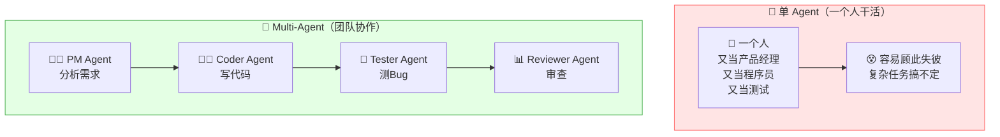

| 对比 | 单 Agent | Multi-Agent |
|:---|:---|:---|
| **类比** | 一个人干所有事 | 一个团队分工协作 |
| **角色** | 一个 Agent 做所有 | 每个 Agent 专门负责一块 |
| **复杂任务** | 容易出错 | 分工后更可靠 |
| **类比现实** | 全栈工程师 | 产品+开发+测试团队 |

### 1.3 一个具体例子

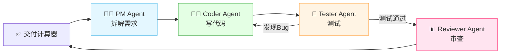

---

## 二、为什么需要多智能体？

### 2.1 单 Agent 的局限

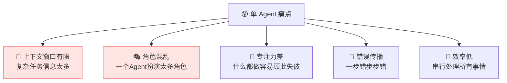

| 痛点 | 说明 |
|:---|:---|
| **上下文有限** | 复杂任务需要大量上下文，单 Agent 容易超窗口 |
| **角色混乱** | 一个 Agent 同时扮演程序员和测试员，容易冲突 |
| **专注力差** | 什么都做，每件事都做不好 |
| **错误传播** | 第一步错了，后面全跟着错 |
| **效率低** | 只能串行处理，不能并行 |

### 2.2 Multi-Agent 的优势

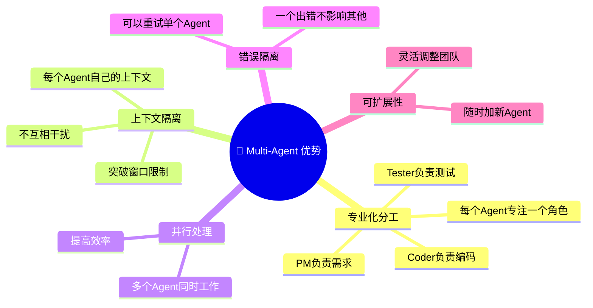

### 2.3 核心价值对比

| 维度 | 单 Agent | Multi-Agent |
|:---|:---|:---|
| **专业性** | 通才，啥都做 | 专才，各管一摊 |
| **上下文** | 共享一个窗口 | 各自独立，互不干扰 |
| **并行性** | 串行 | 可并行 |
| **容错** | 一错全错 | 错误可隔离 |
| **扩展性** | 加功能更复杂 | 加新 Agent 即可 |
| **成本** | 低 | 高（多个 Agent 调用） |

---

## 三、Multi-Agent 架构模式

### 3.1 四大架构模式

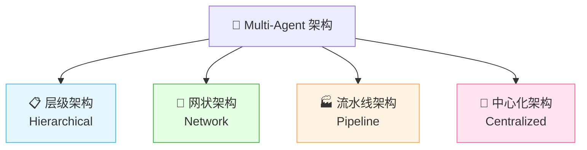

### 3.2 层级架构（Hierarchical）

> 像"公司组织架构"，上层管理者分配任务，下层执行。

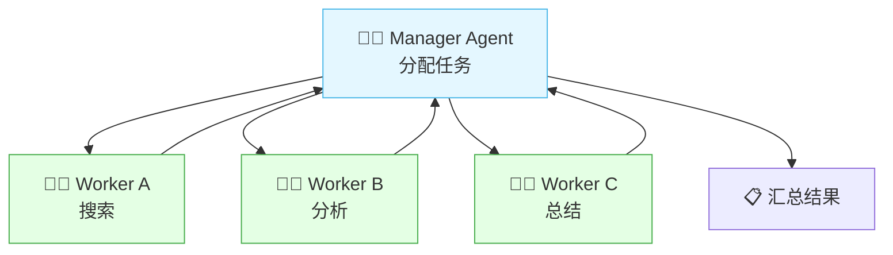

| 特点 | 说明 |
|:---|:---|
| **结构** | 管理者 → 执行者 |
| **决策** | 管理者分配任务 |
| **通信** | 上下级通信，不跨级 |
| **适合** | 任务可拆分、需要协调 |

### 3.3 网状架构（Network）

> Agent 之间自由通信，没有固定层级。

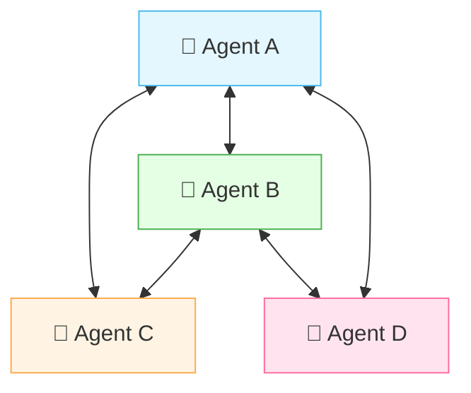

| 特点 | 说明 |
|:---|:---|
| **结构** | 扁平，无固定层级 |
| **通信** | 任意 Agent 之间可直接通信 |
| **灵活** | 动态协作 |
| **适合** | 创意讨论、头脑风暴 |

### 3.4 流水线架构（Pipeline）

> 像工厂流水线，每个 Agent 负责一道工序，依次传递。

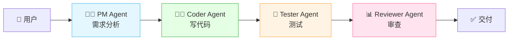

| 特点 | 说明 |
|:---|:---|
| **结构** | 线性流水 |
| **通信** | 前一个传给后一个 |
| **适合** | 步骤明确的任务 |

### 3.5 中心化架构（Centralized）

> 有一个中心协调者，负责所有 Agent 间的通信调度。

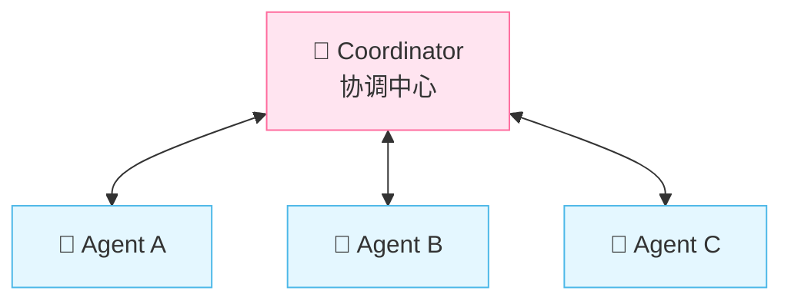

| 特点 | 说明 |
|:---|:---|
| **结构** | 中心协调 |
| **通信** | 所有通信经过中心 |
| **控制** | 中心统一调度 |
| **适合** | 需要严格控制流程 |

### 3.6 四种架构对比

| 架构 | 通信方式 | 控制方式 | 灵活性 | 适合 |
|:---|:---|:---|:---:|:---|
| **层级** | 上下级 | 管理者分配 | 中 | 可拆分任务 |
| **网状** | 任意直连 | 自由协作 | 高 | 创意讨论 |
| **流水线** | 依次传递 | 固定流程 | 低 | 明确步骤 |
| **中心化** | 经过中心 | 中心调度 | 中 | 严格控制 |

---

## 四、协作模式详解

### 4.1 五大协作模式

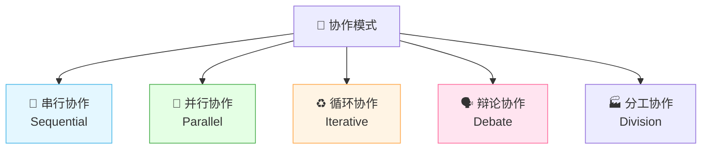

### 4.2 串行协作

> 一个接一个执行，前一个的输出是后一个的输入。

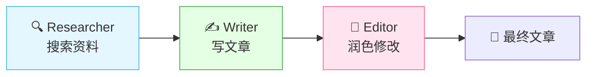

### 4.3 并行协作

> 多个 Agent 同时工作，最后汇总结果。

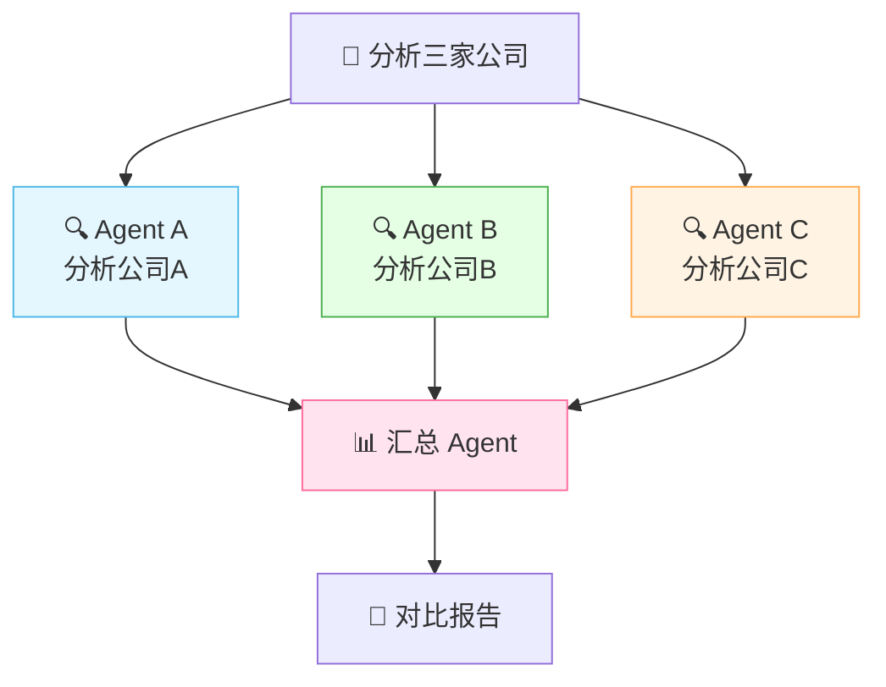

### 4.4 循环协作（迭代优化）

> Agent 之间反复交互，不断优化结果。

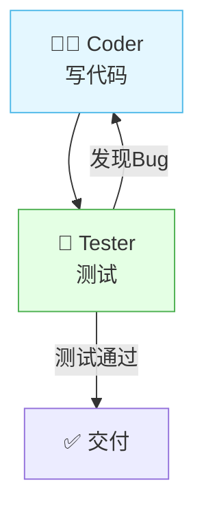

### 4.5 辩论协作

> 多个 Agent 持不同观点辩论，最终达成最优解。

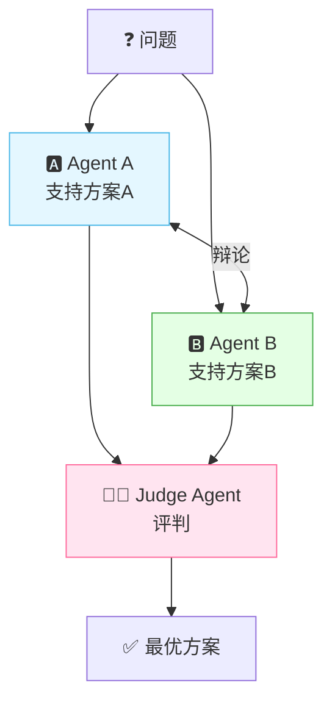

> 🎀 **辩论模式**特别适合需要多角度思考的决策任务！

### 4.6 分工协作

> 每个角色负责不同模块，最后组装。

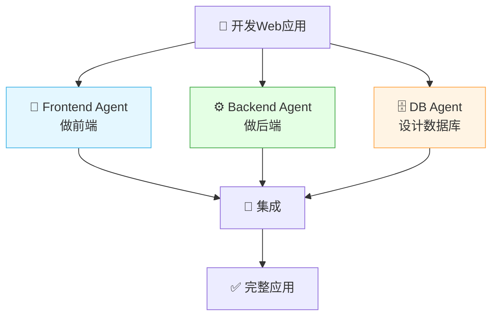

### 4.7 协作模式对比

| 模式 | 说明 | 适合 | 例子 |
|:---|:---|:---|:---|
| **串行** | 依次传递 | 流程化任务 | 搜索→写作→润色 |
| **并行** | 同时执行 | 独立子任务 | 分析多家公司 |
| **循环** | 反复迭代 | 需要优化 | 写码→测试→修Bug |
| **辩论** | 多角度辩论 | 决策任务 | 方案选择 |
| **分工** | 各做各的 | 模块化任务 | 前端+后端+数据库 |

---

## 五、Agent 间通信

### 5.1 通信方式

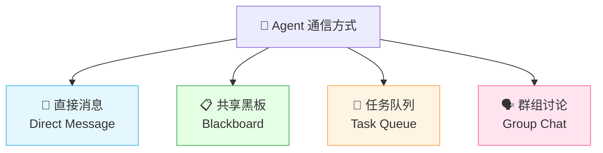

### 5.2 直接消息

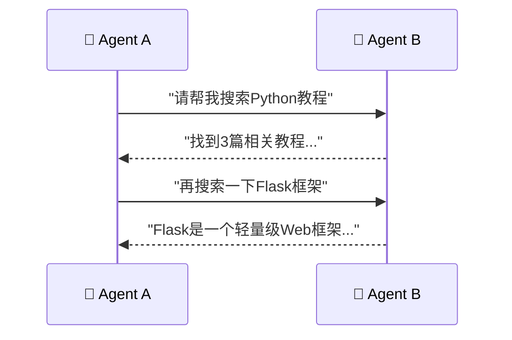

| 方式 | 说明 | 适合 |
|:---|:---|:---|
| **直接消息** | A 直接发消息给 B | 一对一协作 |
| **共享黑板** | 所有 Agent 读写共享空间 | 多 Agent 共享信息 |
| **任务队列** | 通过队列分配任务 | 异步协作 |
| **群组讨论** | 多个 Agent 在群里讨论 | 头脑风暴 |

### 5.3 共享黑板模式

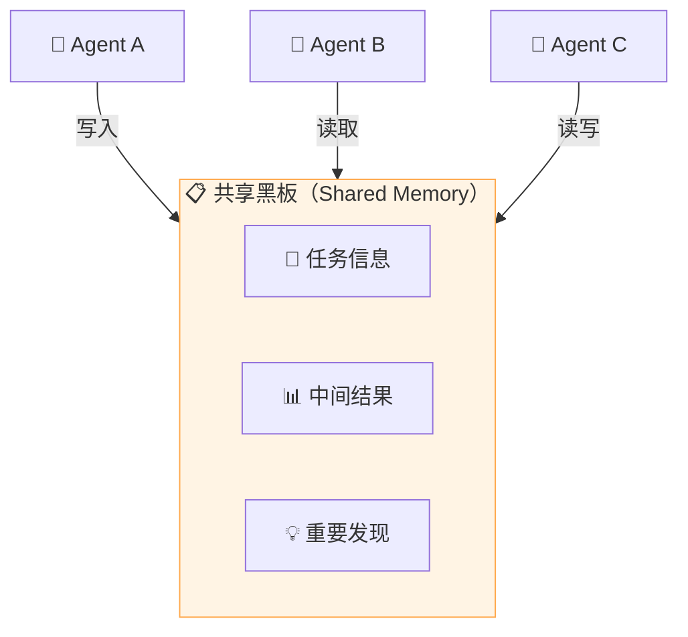

### 5.4 通信内容格式

```json
// Agent 间消息格式
{
  "from": "coder_agent",
  "to": "tester_agent",
  "type": "task",
  "content": {
    "action": "test_code",
    "code": "def add(a, b): return a + b",
    "test_cases": ["add(1,2)==3", "add(0,0)==0"]
  },
  "priority": "high",
  "reply_expected": true
}
```

| 字段 | 说明 |
|:---|:---|
| **from / to** | 发送者和接收者 |
| **type** | 消息类型（任务/结果/询问） |
| **content** | 具体内容 |
| **priority** | 优先级 |
| **reply_expected** | 是否需要回复 |

---

## 六、主流 Multi-Agent 框架

### 6.1 框架总览

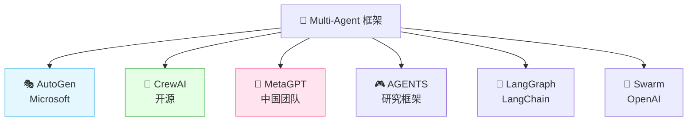

### 6.2 框架对比

| 框架 | 开发者 | 特点 | 适合 |
|:---|:---|:---|:---|
| **AutoGen** | Microsoft | 灵活的对话式协作 | 通用多 Agent 对话 |
| **CrewAI** | 开源 | 角色化，易上手 | 角色分工团队 |
| **MetaGPT** | 国内团队 | 模拟软件公司 | 软件开发 |
| **LangGraph** | LangChain | 图结构流程 | 复杂流程控制 |
| **Swarm** | OpenAI | 轻量级 | 教学/原型 |

### 6.3 AutoGen

> Microsoft 出品，Agent 之间通过对话协作，支持人类参与。

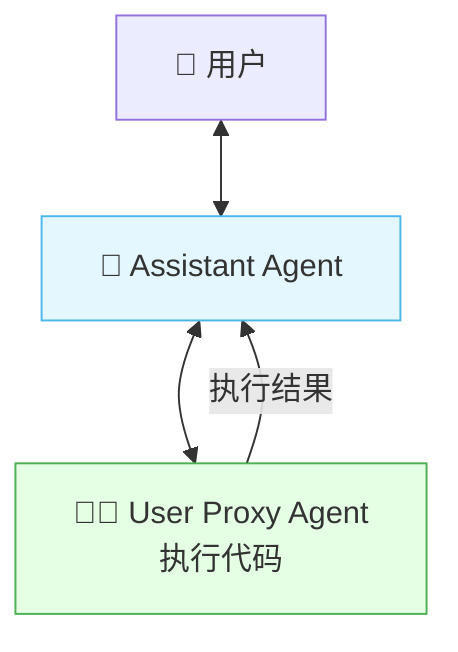

### 6.4 CrewAI

> 角色驱动的框架，像组建一个团队，每个 Agent 有角色、目标、工具。

```mermaid
flowchart TB
    subgraph Crew["🏴 CrewAI 团队"]
        A1["👩‍💼 Agent: PM<br/>角色: 产品经理<br/>目标: 分析需求<br/>工具: 搜索"]
        A2["👨‍💻 Agent: Coder<br/>角色: 程序员<br/>目标: 写代码<br/>工具: 代码执行"]
        A3["🧪 Agent: Tester<br/>角色: 测试员<br/>目标: 测试<br/>工具: 测试框架"]
    end

    T["📋 Tasks"] --> A1
    A1 --> A2
    A2 --> A3
    P["🔄 Process<br/>串行/并行"] -.管理.-> Crew

    style Crew fill:#e4ffe4,stroke:#4caf50
```

### 6.5 MetaGPT

> 模拟软件公司组织架构，PM→架构师→开发→测试。

```mermaid
flowchart TB
    U["👤 用户需求"] --> PM["👩‍💼 PM<br/>写需求文档"]
    PM --> AR["📐 Architect<br/>设计架构"]
    AR --> DEV["👨‍💻 Developer<br/>写代码"]
    DEV --> QA["🧪 QA<br/>测试"]
    QA --> R["✅ 交付"]

    style PM fill:#e4f7ff,stroke:#4cb8e8
    style AR fill:#e4ffe4,stroke:#4caf50
    style DEV fill:#fff4e4,stroke:#ffa94d
    style QA fill:#ffe4f0,stroke:#ff6b9d
```

### 6.6 LangGraph

> LangChain 出品，用图结构定义 Agent 间的工作流。

```mermaid
flowchart TB
    S["▶️ START"] --> A1["🤖 Agent A"]
    A1 --> C{"条件判断"}
    C -->|"需要搜索"| A2["🔍 Agent B"]
    C -->|"需要计算"| A3["🔢 Agent C"]
    A2 --> E["⏹️ END"]
    A3 --> E

    style C fill:#fff4e4,stroke:#ffa94d
    style E fill:#e4ffe4,stroke:#4caf50
```

---

## 七、代码实战

### 7.1 CrewAI 实现 Multi-Agent

```python
from crewai import Agent, Task, Crew, Process

# 1. 定义 Agent
researcher = Agent(
    role="研究员",
    goal="搜索并整理相关资料",
    backstory="你是一个专业的研究员，擅长搜索和整理信息",
    verbose=True,
    allow_delegation=False
)

writer = Agent(
    role="作家",
    goal="根据研究资料写一篇精彩文章",
    backstory="你是一个经验丰富的作家，擅长写作",
    verbose=True,
    allow_delegation=False
)

editor = Agent(
    role="编辑",
    goal="审查并润色文章",
    backstory="你是一个严格的编辑，追求完美",
    verbose=True,
    allow_delegation=False
)

# 2. 定义任务
research_task = Task(
    description="搜索关于AI Agent的最新进展",
    expected_output="一份包含3-5个要点的资料摘要",
    agent=researcher
)

write_task = Task(
    description="根据研究资料写一篇800字的科普文章",
    expected_output="一篇800字的Markdown格式文章",
    agent=writer
)

edit_task = Task(
    description="审查文章并润色",
    expected_output="一篇润色后的最终文章",
    agent=editor
)

# 3. 创建团队并执行
crew = Crew(
    agents=[researcher, writer, editor],
    tasks=[research_task, write_task, edit_task],
    process=Process.sequential  # 串行执行
)

# 4. 运行
result = crew.kickoff()
print(result)
```

### 7.2 AutoGen 实现 Multi-Agent

```python
import autogen

# 1. 配置 LLM
config_list = [
    {"model": "gpt-4", "api_key": "your-api-key"}
]

# 2. 创建 Agent
# 用户代理（执行代码）
user_proxy = autogen.UserProxyAgent(
    name="user_proxy",
    human_input_mode="NEVER",
    max_consecutive_auto_reply=10,
    is_termination_msg=lambda x: x.get("content", "").endswith("TERMINATE"),
    code_execution_config={"work_dir": "coding"}
)

# 助手 Agent
coder = autogen.AssistantAgent(
    name="coder",
    system_message="你是一个程序员，负责写代码",
    llm_config={"config_list": config_list}
)

# 审查 Agent
reviewer = autogen.AssistantAgent(
    name="reviewer",
    system_message="你是一个代码审查员，负责审查代码质量",
    llm_config={"config_list": config_list}
)

# 3. 创建群聊
groupchat = autogen.GroupChat(
    agents=[user_proxy, coder, reviewer],
    messages=[],
    max_round=20
)

manager = autogen.GroupChatManager(
    groupchat=groupchat,
    llm_config={"config_list": config_list}
)

# 4. 开始对话
user_proxy.initiate_chat(
    manager,
    message="请写一个Python快排算法并审查"
)
```

### 7.3 LangGraph 实现 Multi-Agent

```python
from langgraph.graph import StateGraph, END
from typing import TypedDict, Annotated
import operator

# 1. 定义状态
class AgentState(TypedDict):
    messages: Annotated[list, operator.add]
    next_agent: str

# 2. 定义 Agent 节点
def researcher_node(state: AgentState):
    # 研究员执行
    return {"messages": ["研究完成..."], "next_agent": "writer"}

def writer_node(state: AgentState):
    # 作家执行
    return {"messages": ["写作完成..."], "next_agent": "editor"}

def editor_node(state: AgentState):
    # 编辑执行
    return {"messages": ["编辑完成..."], "next_agent": END}

# 3. 构建图
workflow = StateGraph(AgentState)

# 添加节点
workflow.add_node("researcher", researcher_node)
workflow.add_node("writer", writer_node)
workflow.add_node("editor", editor_node)

# 添加边
workflow.set_entry_point("researcher")
workflow.add_edge("researcher", "writer")
workflow.add_edge("writer", "editor")
workflow.add_edge("editor", END)

# 4. 编译并运行
app = workflow.compile()
result = app.invoke({"messages": ["帮我写一篇AI科普文章"]})
print(result)
```

### 7.4 自定义 Multi-Agent

```python
from typing import List, Dict

class Agent:
    """单个 Agent"""

    def __init__(self, name: str, role: str, system_prompt: str):
        self.name = name
        self.role = role
        self.system_prompt = system_prompt
        self.history = []

    def run(self, task: str) -> str:
        """执行任务"""
        print(f"[{self.name}] 开始执行: {task}")
        # 这里调用 LLM
        result = self._call_llm(task)
        self.history.append({"task": task, "result": result})
        print(f"[{self.name}] 完成: {result[:50]}...")
        return result

    def _call_llm(self, task: str) -> str:
        """模拟 LLM 调用"""
        return f"{self.role}处理了: {task}"


class MultiAgentSystem:
    """多智能体系统"""

    def __init__(self):
        self.agents: Dict[str, Agent] = {}
        self.workflow = []

    def add_agent(self, agent: Agent):
        """添加 Agent"""
        self.agents[agent.name] = agent
        print(f"✅ 添加 Agent: {agent.name} ({agent.role})")

    def sequential(self, task: str, agent_order: List[str]) -> str:
        """串行协作"""
        print(f"\n🤝 串行协作开始: {task}")
        current_task = task

        for agent_name in agent_order:
            agent = self.agents[agent_name]
            result = agent.run(current_task)
            current_task = result  # 前一个的输出是后一个的输入

        return current_task

    def parallel(self, task: str, agent_names: List[str]) -> List[str]:
        """并行协作"""
        print(f"\n🔀 并行协作开始: {task}")
        results = []

        for agent_name in agent_names:
            agent = self.agents[agent_name]
            result = agent.run(task)
            results.append(result)

        return results

    def debate(self, question: str, agent_names: List[str],
               rounds: int = 3) -> str:
        """辩论协作"""
        print(f"\n🗣️ 辩论开始: {question}")

        for round_num in range(rounds):
            print(f"\n--- 第 {round_num+1} 轮 ---")
            for agent_name in agent_names:
                agent = self.agents[agent_name]
                # 每个 Agent 发表观点
                agent.run(f"辩论第{round_num+1}轮: {question}")

        return "辩论结束，达成共识"


# 使用
system = MultiAgentSystem()

# 添加 Agent
system.add_agent(Agent("researcher", "研究员",
    "你是一个专业研究员"))
system.add_agent(Agent("writer", "作家",
    "你是一个专业作家"))
system.add_agent(Agent("editor", "编辑",
    "你是一个专业编辑"))

# 串行协作
result = system.sequential(
    "写一篇AI科普文章",
    ["researcher", "writer", "editor"]
)

# 并行协作
results = system.parallel(
    "分析AI行业现状",
    ["researcher", "writer"]
)

# 辩论协作
system.debate(
    "AI是否会取代程序员",
    ["researcher", "writer"],
    rounds=2
)
```

### 7.5 Multi-Agent 执行流程

```mermaid
sequenceDiagram
    participant U as 👤 用户
    participant S as 🤝 Multi-Agent系统
    participant A as 🤖 Agent A
    participant B as 🤖 Agent B
    participant C as 🤖 Agent C

    U->>S: 提出任务
    S->>A: 分配子任务1
    A-->>S: 返回结果1
    S->>B: 分配子任务2（基于结果1）
    B-->>S: 返回结果2
    S->>C: 分配子任务3（基于结果2）
    C-->>S: 返回结果3
    S-->>U: 汇总返回最终结果
```

---

## 八、Multi-Agent vs 单 Agent

### 8.1 什么时候用 Multi-Agent？

```mermaid
flowchart TB
    Q["🤔 何时用 Multi-Agent？"]
    Q --> C1{"任务复杂？"}
    C1 -->|"简单"| S["✅ 单 Agent 够了"]
    C1 -->|"复杂"| C2{"需要多种角色？"}
    C2 -->|"是"| C3{"可以并行？"}
    C3 -->|"是"| M["✅ 用 Multi-Agent"]
    C3 -->|"否"| C4{"需要迭代优化？"}
    C4 -->|"是"| M
    C4 -->|"否"| S

    style S fill:#e4f7ff,stroke:#4cb8e8
    style M fill:#e4ffe4,stroke:#4caf50
```

### 8.2 详细对比

| 维度 | 单 Agent | Multi-Agent |
|:---|:---|:---|
| **成本** | 低（一次调用） | 高（多次调用） |
| **延迟** | 低 | 高（Agent 间通信） |
| **复杂性** | 低 | 高（需要协调） |
| **任务质量** | 简单任务好 | 复杂任务更好 |
| **适合任务** | 单一、简单 | 复杂、多步骤 |
| **可调试** | 容易 | 较难 |

### 8.3 选择建议

| 场景 | 推荐 | 原因 |
|:---|:---|:---|
| 简单问答 | 单 Agent | 不需要多角色 |
| 写一篇文章 | 单 Agent | 任务单一 |
| 开发一个软件 | Multi-Agent | 需要多种角色 |
| 多角度分析 | Multi-Agent | 需要辩论 |
| 并行搜索 | Multi-Agent | 可以并行加速 |
| 代码开发+测试 | Multi-Agent | 需要迭代优化 |

---

## 九、应用场景

### 9.1 软件开发

```mermaid
flowchart LR
    U["👤 开发需求"] --> PM["👩‍💼 PM Agent<br/>写需求"]
    PM --> AR["📐 Architect Agent<br/>设计"]
    AR --> DEV["👨‍💻 Dev Agent<br/>编码"]
    DEV --> QA["🧪 QA Agent<br/>测试"]
    QA -->|"Bug"| DEV
    QA -->|"通过"| R["✅ 交付"]

    style PM fill:#e4f7ff,stroke:#4cb8e8
    style DEV fill:#e4ffe4,stroke:#4caf50
    style QA fill:#fff4e4,stroke:#ffa94d
```

### 9.2 内容创作

```mermaid
flowchart LR
    U["👤 写文章"] --> R["🔍 Researcher<br/>搜集资料"]
    R --> W["✍️ Writer<br/>写初稿"]
    W --> E["📝 Editor<br/>润色"]
    E --> F["📊 Fact Checker<br/>核实"]
    F --> R2["✅ 发布"]

    style R fill:#e4f7ff,stroke:#4cb8e8
    style W fill:#e4ffe4,stroke:#4caf50
    style E fill:#ffe4f0,stroke:#ff6b9d
```

### 9.3 数据分析

```mermaid
flowchart TB
    U["👤 分析销售数据"] --> C["🔍 Collector<br/>收集数据"]
    C --> A["📊 Analyst<br/>分析趋势"]
    A --> V["📈 Visualizer<br/>做图表"]
    V --> W["✍️ Reporter<br/>写报告"]
    W --> R["✅ 分析报告"]

    style A fill:#e4f7ff,stroke:#4cb8e8
    style V fill:#e4ffe4,stroke:#4caf50
```

### 9.4 投资研究

```mermaid
flowchart TB
    U["👤 研究某股票"] --> A1["🔍 Agent A<br/>查财报"]
    U --> A2["📊 Agent B<br/>查行业"]
    U --> A3["🌐 Agent C<br/>查新闻"]
    A1 --> M["🧠 Analyst Agent<br/>综合分析"]
    A2 --> M
    A3 --> M
    M --> R["📈 投资建议"]

    style A1 fill:#e4f7ff,stroke:#4cb8e8
    style A2 fill:#e4ffe4,stroke:#4caf50
    style A3 fill:#fff4e4,stroke:#ffa94d
    style M fill:#ffe4f0,stroke:#ff6b9d
```

### 9.5 应用场景汇总

| 场景 | Agent 角色 | 协作模式 |
|:---|:---|:---|
| **软件开发** | PM + 架构师 + 开发 + 测试 | 流水线 + 循环 |
| **内容创作** | 研究 + 写作 + 编辑 + 核实 | 串行 |
| **数据分析** | 收集 + 分析 + 可视化 + 报告 | 串行 |
| **投资研究** | 财报 + 行业 + 新闻 + 分析 | 并行 + 汇总 |
| **客服系统** | 路由 + 问答 + 工单 + 升级 | 中心化 |
| **游戏 NPC** | 多个角色交互 | 网状 |

---

## 十、挑战与最佳实践

### 10.1 常见挑战

```mermaid
flowchart TB
    P["⚠️ Multi-Agent 挑战"]
    P --> P1["💰 成本高<br/>多个Agent多次调用LLM"]
    P --> P2["🐌 延迟大<br/>Agent间通信耗时"]
    P --> P3["🔄 死循环<br/>Agent互相推诿"]
    P --> P4["🤯 调试难<br/>多Agent交互复杂"]
    P --> P5["🎭 角色冲突<br/>Agent职责重叠"]

    style P1 fill:#ffe4e4,stroke:#ff6b6b
    style P3 fill:#ffe4e4,stroke:#ff6b6b
    style P4 fill:#ffe4e4,stroke:#ff6b6b
```

| 挑战 | 说明 | 解决 |
|:---|:---|:---|
| **成本高** | 每个 Agent 都要调 LLM | 用小模型 + 关键步骤用大模型 |
| **延迟大** | Agent 间通信开销 | 并行化 + 减少不必要的通信 |
| **死循环** | Agent 互相推任务 | 设最大轮次 + 终止条件 |
| **调试难** | 多个 Agent 交互 | 详细日志 + 可视化流程 |
| **角色冲突** | 职责重叠 | 明确角色边界 |

### 10.2 最佳实践

```mermaid
mindmap
  root((📋 最佳实践))
    角色设计
      职责明确
      避免重叠
      有清晰目标
    流程控制
      设最大轮次
      明确终止条件
      异常处理
    成本控制
      小模型做简单任务
      大模型做关键决策
      缓存中间结果
    通信优化
      减少不必要的通信
      批量传递信息
      共享黑板模式
    调试
      详细日志
      可视化流程
      单Agent测试
```

### 10.3 设计原则

| 原则 | 说明 |
|:---|:---|
| **单一职责** | 每个 Agent 只负责一件事 |
| **明确边界** | Agent 间职责不重叠 |
| **最小通信** | 减少不必要的 Agent 间通信 |
| **终止保障** | 必须有终止条件防止死循环 |
| **成本意识** | 用合适的模型，不是越大越好 |
| **可观测** | 日志记录每个 Agent 的行为 |

---

## 十一、知识总结

最后用思维导图把所有知识点串起来 📝✨：

```mermaid
mindmap
  root((🤝 Multi-Agent))
    是什么
      多个Agent协作
      分工明确各司其职
      像团队一样工作
    为什么需要
      单Agent上下文有限
      角色混乱
      专注力差
      错误传播
    架构模式
      层级 管理者分配
      网状 自由通信
      流水线 依次传递
      中心化 统一调度
    协作模式
      串行 依次传递
      并行 同时执行
      循环 迭代优化
      辩论 多角度讨论
      分工 各做各的
    Agent通信
      直接消息
      共享黑板
      任务队列
      群组讨论
    主流框架
      AutoGen 对话式
      CrewAI 角色驱动
      MetaGPT 模拟公司
      LangGraph 图结构
      Swarm 轻量级
    代码实战
      CrewAI实现
      AutoGen实现
      LangGraph实现
      自定义实现
    vs单Agent
      简单任务用单Agent
      复杂任务用Multi
      成本vs效果权衡
    应用场景
      软件开发
      内容创作
      数据分析
      投资研究
      客服系统
    挑战
      成本高
      延迟大
      死循环
      调试难
    最佳实践
      单一职责
      明确边界
      最小通信
      终止保障
      成本控制
```

### 🎯 核心要点速记

1. **Multi-Agent = 多个 Agent 协作**：分工明确，各司其职，像团队一样。
2. **解决单 Agent 局限**：上下文有限、角色混乱、专注力差、错误传播。
3. **四大架构**：层级、网状、流水线、中心化。
4. **五大协作模式**：串行、并行、循环、辩论、分工。
5. **通信方式**：直接消息、共享黑板、任务队列、群组讨论。
6. **AutoGen**：Microsoft 出品，对话式协作。
7. **CrewAI**：角色驱动，易上手，适合团队模拟。
8. **MetaGPT**：模拟软件公司，PM→架构→开发→测试。
9. **LangGraph**：用图结构定义工作流，灵活控制流程。
10. **简单任务用单 Agent**：Multi-Agent 成本高、延迟大。
11. **复杂任务用 Multi-Agent**：需要多角色、多步骤时效果更好。
12. **注意死循环**：必须设最大轮次和终止条件。

---

> 🌸 哇~ 恭喜你把 Multi-Agent 多智能体协作的核心知识学完啦！Multi-Agent 是 AI 应用的前沿方向——让多个 AI 像团队一样协作，解决更复杂的问题。记住：**不是任务越复杂越好用 Multi-Agent，而是要看是否真的需要多角色协作！** 加油鸭！(ง •_•)ง💖
