# 📚 RAG 检索增强生成超全学习指南

> 嗨呀~ 欢迎来到 RAG 的世界！📚 RAG（Retrieval-Augmented Generation）是让大模型"开卷考试"的神器，能解决幻觉、知识过期、领域不专三大痛点。这份指南会带你从原理到实战，把 RAG 揉碎了喂给你。准备好了吗？冲鸭！(ﾉ>ω<)ﾉ

---

## 📖 目录

- [一、什么是 RAG？](#一什么是-rag)
- [二、为什么需要 RAG？](#二为什么需要-rag)
- [三、RAG 核心流程](#三rag-核心流程)
- [四、数据准备阶段](#四数据准备阶段)
- [五、检索阶段](#五检索阶段)
- [六、生成阶段](#六生成阶段)
- [七、Embedding 向量化](#七embedding-向量化)
- [八、向量数据库](#八向量数据库)
- [九、RAG 进阶优化](#九rag-进阶优化)
- [十、RAG vs 微调 vs 预训练](#十rag-vs-微调-vs-预训练)
- [十一、主流框架与工具](#十一主流框架与工具)
- [十二、知识总结](#十二知识总结)

---

## 一、什么是 RAG？

### 1.1 一句话定义

> **RAG（Retrieval-Augmented Generation，检索增强生成）** = 先从外部知识库**检索**相关资料，再把资料和问题一起喂给 LLM **生成**回答的技术方案。

简单说：让大模型从"闭卷考试"变成"开卷考试" 📖。

### 1.2 核心思想

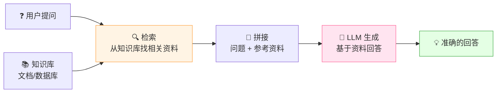

### 1.3 生活化比喻

| 场景 | 对应 RAG 的什么 |
|:---|:---|
| 📖 开卷考试，可以翻书找答案 | 检索知识库 |
| 📝 把找到的参考资料抄在试卷旁边 | 拼接上下文 |
| 🧠 根据参考资料写答案 | LLM 生成回答 |
| ❌ 闭卷考试，全靠脑子记 | 纯 LLM（容易记错 = 幻觉） |

> 💡 **核心价值**：RAG 让模型不再"瞎编"，而是"有理有据"地回答！

---

## 二、为什么需要 RAG？

### 2.1 纯 LLM 的三大痛点

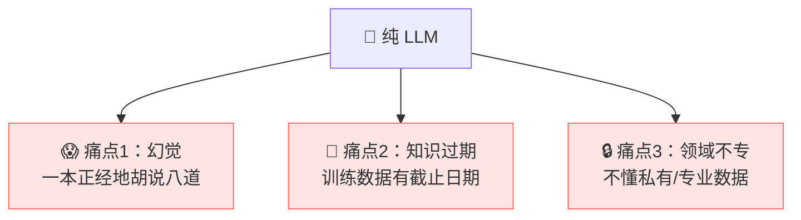

| 痛点 | 说明 | 例子 |
|:---|:---|:---|
| **幻觉** | 模型会编造看似合理但错误的内容 | 问"某公司CEO是谁"，它瞎编一个名字 |
| **知识过期** | 训练数据有截止日期 | GPT-4 不知道昨天的新闻 |
| **领域不专** | 不了解私有数据 | 不懂你公司的内部文档、产品手册 |

### 2.2 RAG 如何解决？

| 痛点 | RAG 怎么解决 |
|:---|:---|
| 😱 幻觉 | 提供外部知识作为依据，让模型"照着答" |
| 📅 知识过期 | 知识库可以随时更新，无需重新训练模型 |
| 🔒 领域不专 | 把私有数据放进知识库，模型就能查询 |

### 2.3 RAG 的核心优势

| 优势 | 说明 |
|:---|:---|
| **无需重新训练** | 更新知识只需更新数据库，成本极低 |
| **实时性** | 知识库可以实时更新，模型始终有最新信息 |
| **可追溯** | 能标注答案来源，可信度高 |
| **成本低** | 比微调/预训练便宜得多 |
| **安全** | 敏感数据留在自己的数据库，不用给模型 |

---

## 三、RAG 核心流程

### 3.1 全流程总览

RAG 分为两大阶段：**数据准备（离线）** 和 **查询检索（在线）**。

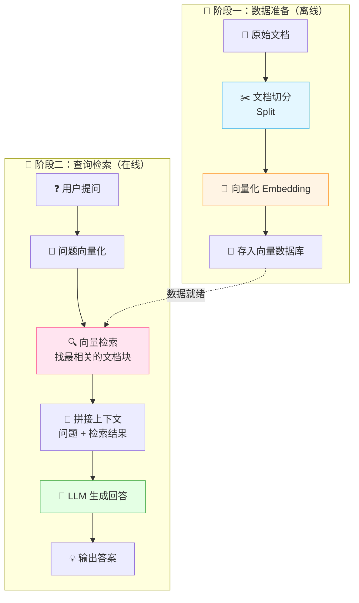

### 3.2 两大阶段详解

#### 阶段一：数据准备（离线，一次性）

| 步骤 | 做什么 | 关键技术 |
|:---|:---|:---|
| ① 文档加载 | 读取 PDF/Word/HTML/Markdown 等 | 文档解析器 |
| ② 文档切分 | 把长文档拆成小片段（Chunk） | 按字符/段落/语义切分 |
| ③ 向量化 | 把每个片段转成向量 | Embedding 模型 |
| ④ 存储 | 把向量和原文存入数据库 | 向量数据库 |

#### 阶段二：查询检索（在线，每次提问）

| 步骤 | 做什么 | 关键技术 |
|:---|:---|:---|
| ① 问题向量化 | 把用户问题转成向量 | 同一个 Embedding 模型 |
| ② 向量检索 | 找最相似的文档片段 | 余弦相似度等 |
| ③ 拼接上下文 | 问题 + 检索结果拼成 Prompt | Prompt 模板 |
| ④ LLM 生成 | 模型基于上下文回答 | GPT/Claude/本地模型 |

### 3.3 完整工作流序列图

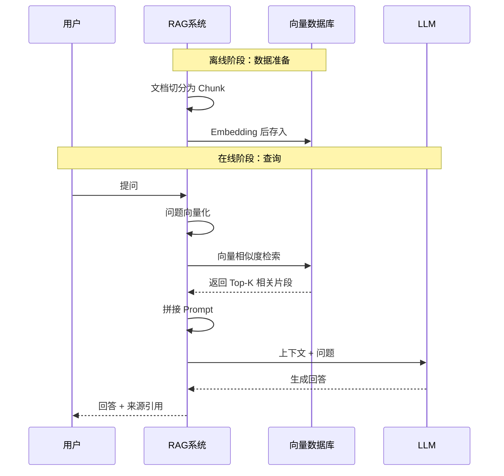

---

## 四、数据准备阶段

### 4.1 文档加载

RAG 的第一步是把各种格式的文档读进来。

| 文档类型 | 工具/库 |
|:---|:---|
| PDF | PyPDF2、pdfplumber、Unstructured |
| Word | python-docx |
| HTML | BeautifulSoup |
| Markdown | markdown 解析器 |
| Excel/CSV | pandas |
| 图片（OCR） | Tesseract、PaddleOCR |

```python
# LangChain 加载文档示例
from langchain.document_loaders import (
    PyPDFLoader, TextLoader, CSVLoader
)

# 加载 PDF
pdf_loader = PyPDFLoader("company_rules.pdf")
pdf_docs = pdf_loader.load()

# 加载文本
txt_loader = TextLoader("readme.txt")
txt_docs = txt_loader.load()
```

### 4.2 文档切分（Chunking）⭐

> **为什么要切分？** 因为 LLM 的上下文窗口有限（如 4K~128K token），而且整篇文档向量化后检索精度低。把文档切成小片段，检索更精准。

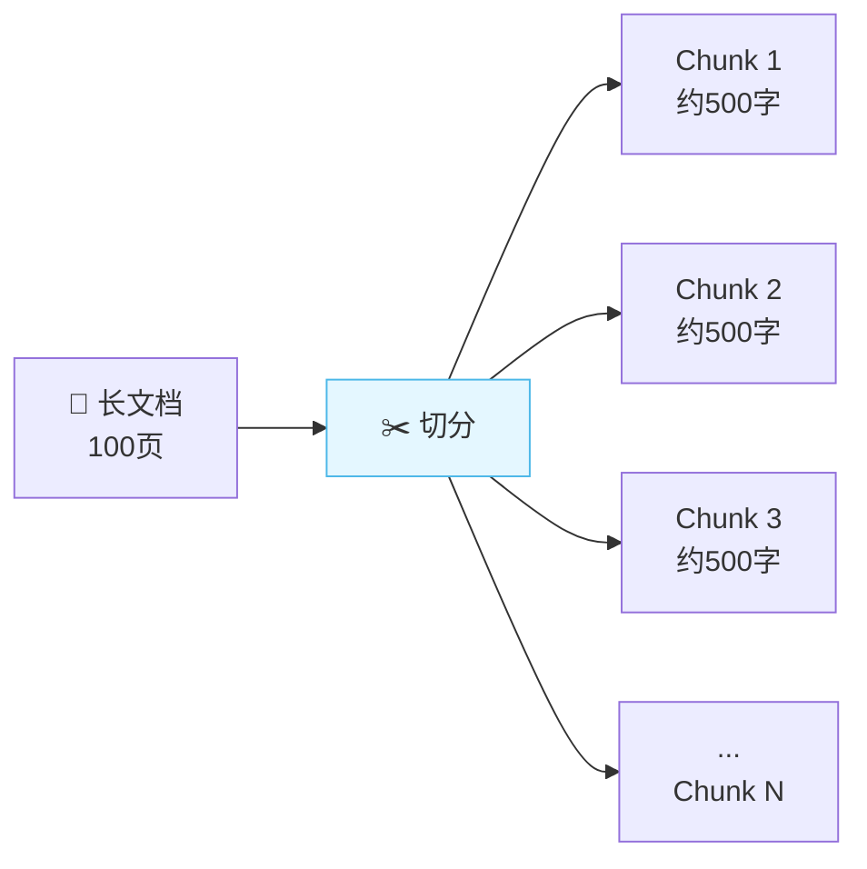

#### 切分策略

| 策略 | 说明 | 优点 | 缺点 |
|:---|:---|:---|:---|
| **固定长度切分** | 按字符数（如 500 字） | 简单 | 可能切断句子 |
| **按段落切分** | 按换行符/段落 | 保留语义 | 段落长度不一 |
| **递归切分** ⭐ | 先按段落，太长再按句子 | 平衡，主流 | - |
| **语义切分** | 按语义相似度切分 | 最精准 | 计算成本高 |

#### 关键参数

| 参数 | 说明 | 建议 |
|:---|:---|:---|
| `chunk_size` | 每个片段大小 | 300~500 token |
| `chunk_overlap` | 片段间重叠长度 | 50~100 token |

> 💡 **为什么要 overlap（重叠）？** 防止关键信息正好被切断！重叠部分确保上下文不断裂。

```python
# LangChain 递归切分示例
from langchain.text_splitter import RecursiveCharacterTextSplitter

splitter = RecursiveCharacterTextSplitter(
    chunk_size=500,        # 每段 500 字符
    chunk_overlap=50,      # 段间重叠 50 字符
    separators=["\n\n", "\n", "。", "！", "？", " ", ""]  # 按优先级切分
)

chunks = splitter.split_documents(docs)
```

### 4.3 切分对效果的影响

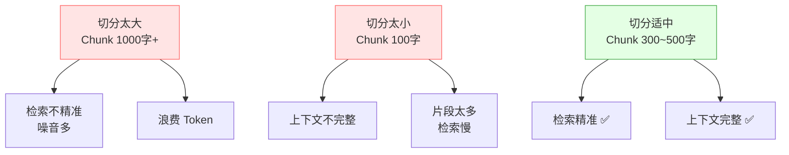

---

## 五、检索阶段

### 5.1 检索的核心：相似度计算

> 检索的本质 = 把用户问题和知识库中的每个片段都转成向量，然后计算向量间的**相似度**，取最相似的 Top-K 个。

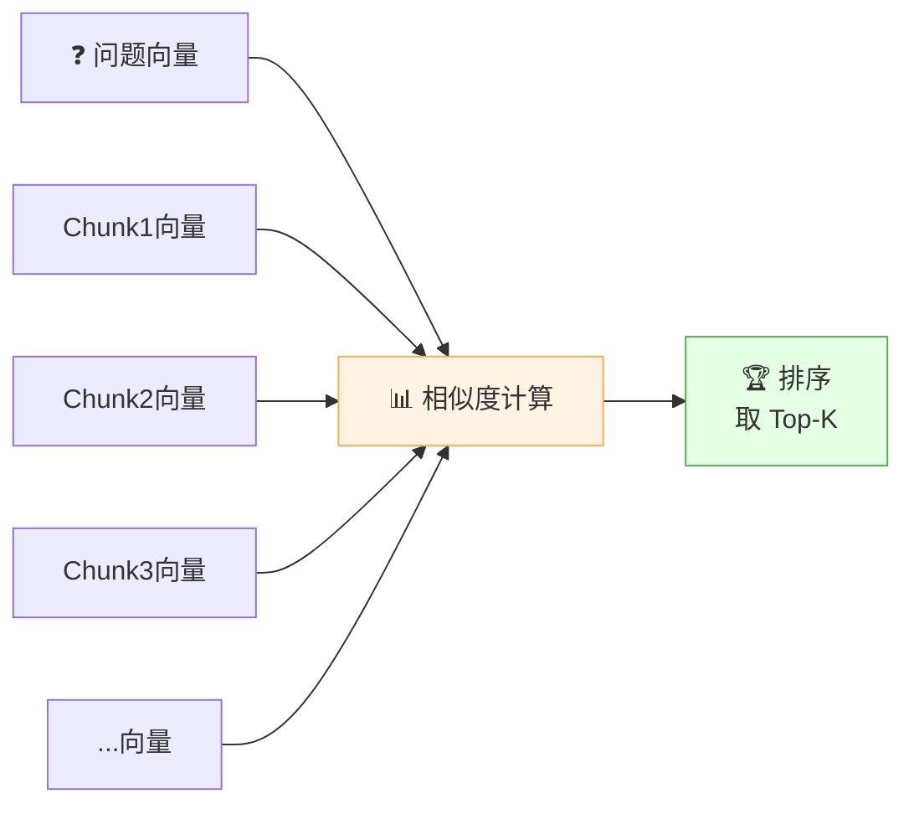

### 5.2 相似度计算方法

| 方法 | 公式 | 特点 |
|:---|:---|:---|
| **余弦相似度** ⭐ | cos(A,B) = A·B / (\|A\|·\|B\|) | 最常用，关注方向 |
| 欧氏距离 | d = √(Σ(Ai-Bi)²) | 关注绝对距离 |
| 内积（点积） | A·B = Σ(Ai×Bi) | 简单快速 |

> 🎀 **最常用的是余弦相似度**，它衡量两个向量的"方向"是否一致，不看长度。

### 5.3 检索策略

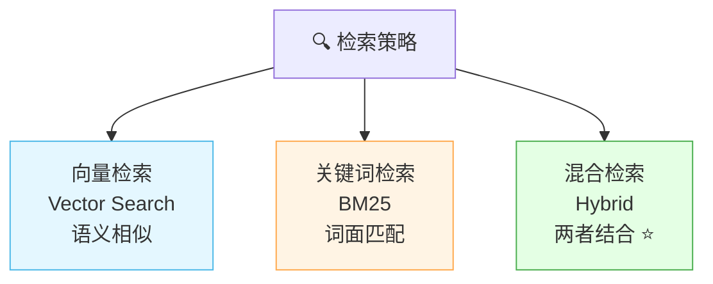

| 检索方式 | 原理 | 优点 | 缺点 |
|:---|:---|:---|:---|
| **向量检索** | 语义相似度 | 理解同义词、语义 | 可能漏掉精确关键词 |
| **关键词检索（BM25）** | 词频匹配 | 精确匹配关键词 | 不懂语义 |
| **混合检索** ⭐ | 向量 + 关键词 | 兼顾语义和精确 | 实现复杂 |

> 💡 **混合检索** 是目前的最佳实践！比如问"公司的年假制度"，向量检索能找到"休假规定"（语义相近），BM25 能精确匹配"年假"关键词。

### 5.4 检索结果数量（Top-K）

| Top-K | 效果 |
|:---|:---|
| K=1~3 | 只给最相关的，可能遗漏 |
| K=3~5 ⭐ | 平衡，主流选择 |
| K=10+ | 上下文太多，噪音多、Token 浪费 |

```python
# LangChain 向量检索示例
from langchain.vectorstores import Chroma

# 检索最相关的 5 个片段
docs = vectorstore.similarity_search(
    query="公司年假政策",
    k=5   # Top-5
)
```

---

## 六、生成阶段

### 6.1 Prompt 拼接

检索到相关片段后，要把它们和用户问题拼成一个完整的 Prompt，喂给 LLM。

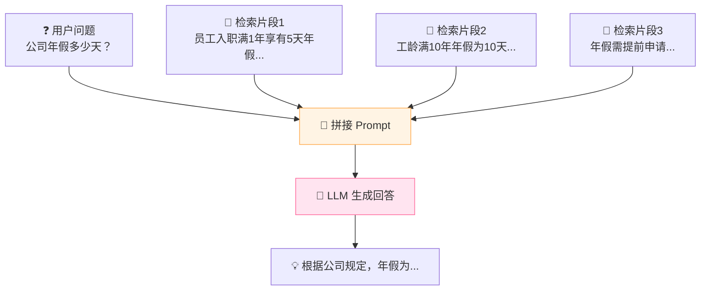

### 6.2 Prompt 模板设计

```
你是一个专业的问答助手。请根据以下参考资料回答用户问题。
如果参考资料中没有答案，请说"我不知道"，不要编造。

【参考资料】
{retrieved_context}

【用户问题】
{question}

【回答】
```

> 💡 **关键设计**：明确告诉模型"只根据资料回答"、"不知道就说不知道"，能有效减少幻觉！

### 6.3 LLM 生成回答

```python
# LangChain RAG 生成示例
from langchain.chains import RetrievalQA
from langchain.llms import OpenAI

# 创建 RAG 链
qa_chain = RetrievalQA.from_chain_type(
    llm=OpenAI(temperature=0),    # 事实问答温度调低
    retriever=vectorstore.as_retriever(search_kwargs={"k": 5}),
    return_source_documents=True   # 返回来源
)

# 提问
result = qa_chain({"query": "公司年假政策是什么？"})
print(result["result"])          # 回答
print(result["source_documents"])  # 来源文档
```

### 6.4 温度参数建议

| 场景 | Temperature | 说明 |
|:---|:---:|:---|
| 事实问答 | 0~0.3 | 确定性高，减少幻觉 |
| 摘要总结 | 0.3~0.5 | 适度灵活 |
| 创意写作 | 0.7~1.0 | RAG 场景少用 |

---

## 七、Embedding 向量化

### 7.1 什么是 Embedding？

> **Embedding（嵌入/向量化）** = 把文字转成一组数字（向量），让计算机能理解语义。

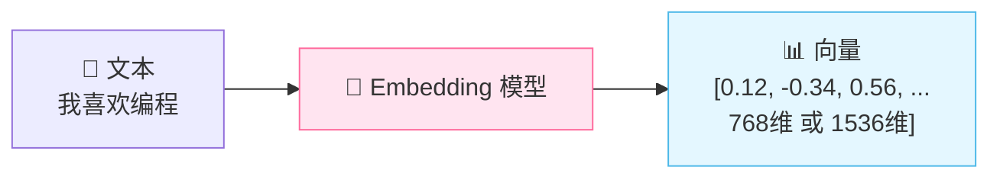

### 7.2 Embedding 的核心原理

语义相近的文字，向量也相近！

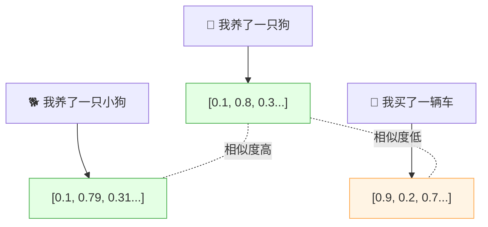

### 7.3 常见 Embedding 模型

| 模型 | 维度 | 特点 | 来源 |
|:---|:---:|:---|:---|
| **text-embedding-ada-002** | 1536 | OpenAI 出品，效果好 | 商业 API |
| text-embedding-3-small/large | 1536/3072 | OpenAI 新版 | 商业 API |
| **BGE 系列** ⭐ | 768/1024 | 中文效果好，开源 | 智源 |
| **m3e-base** | 768 | 中文友好，开源 | 开源 |
| **GTE 系列** | 768/1024 | 阿里出品，多语言 | 开源 |
| Jina Embeddings | 768 | 支持长文本 | 开源 |

> 🎀 **中文场景推荐**：BGE-m3 或 m3e-base，效果不输商业模型还免费！

### 7.4 Embedding 选型对比

| 对比项 | 商业模型（OpenAI） | 开源模型（BGE/m3e） |
|:---|:---|:---|
| 效果 | 优秀 | 接近，中文有时更好 |
| 成本 | 按 token 收费 | 免费 |
| 隐私 | 数据要发到云端 | 可本地部署 |
| 部署 | API 调用 | 需要 GPU/服务器 |

---

## 八、向量数据库

### 8.1 为什么不用传统数据库？

| 对比 | 传统数据库（MySQL） | 向量数据库 |
|:---|:---|:---|
| 存什么 | 结构化数据（数字、文本） | 高维向量 |
| 查询方式 | 精确匹配 WHERE | 相似度检索 |
| 查询速度 | 慢（逐行扫描） | 快（ANN 索引） |
| 例子 | `SELECT * WHERE name='张三'` | "找和这个问题语义相似的" |

> 💡 **核心区别**：传统数据库是"精确匹配"，向量数据库是"模糊语义匹配"。

### 8.2 向量检索原理：ANN（近似最近邻）

> 向量数据库不用"逐个比较"（太慢），而用 **ANN（Approximate Nearest Neighbor，近似最近邻）** 算法，在海量向量中快速找到最相似的 Top-K。

| ANN 算法 | 原理 | 代表 |
|:---|:---|:---|
| **HNSW** ⭐ | 分层小世界图，快速导航 | 大多数向量库默认 |
| IVF | 倒排文件，先聚类再搜索 | Faiss |
| PQ | 乘积量化，压缩向量节省内存 | Faiss |

### 8.3 常见向量数据库

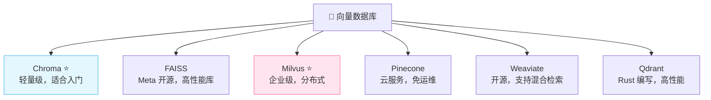

| 数据库 | 特点 | 适合场景 |
|:---|:---|:---|
| **Chroma** ⭐ | 轻量、易用、Python 友好 | 学习/原型/小项目 |
| **FAISS** | Meta 出品，纯计算库，非数据库 | 高性能检索 |
| **Milvus** ⭐ | 企业级、分布式、可扩展 | 大规模生产 |
| **Pinecone** | 全托管云服务 | 不想运维的团队 |
| **Qdrant** | Rust 写的，高性能 | 追求性能 |
| pgvector | PostgreSQL 插件 | 已有 PG 的项目 |

> 🎀 **入门推荐 Chroma**，生产推荐 **Milvus**，已有 PostgreSQL 用 **pgvector**！

### 8.4 代码示例：Chroma

```python
import chromadb
from chromadb.utils import embedding_functions

# 创建客户端
client = chromadb.Client()

# 创建集合（类似数据库表）
collection = client.create_collection(
    name="company_docs",
    embedding_function=embedding_functions.DefaultEmbeddingFunction()
)

# 添加文档
collection.add(
    documents=["年假政策：入职满1年享5天年假", "报销流程：填写报销单..."],
    metadatas=[{"source": "hr.md"}, {"source": "finance.md"}],
    ids=["doc1", "doc2"]
)

# 检索
results = collection.query(
    query_texts=["公司年假多少天"],
    n_results=3  # Top-3
)
```

---

## 九、RAG 进阶优化

基础 RAG（Naive RAG）效果往往不够好，需要进阶优化。

### 9.1 RAG 的三个层次

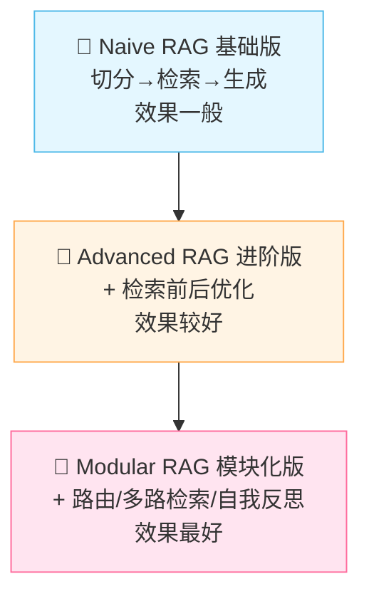

| 层次 | 特点 | 关键技术 |
|:---|:---|:---|
| **Naive RAG** | 最简单的流程 | 切分→检索→生成 |
| **Advanced RAG** | 检索前后加优化 | 查询重写、重排序、过滤 |
| **Modular RAG** | 模块化、可组合 | 路由、多路检索、自我反思 |

### 9.2 检索前优化（Pre-Retrieval）

> 目标：让"问题"更好，检索更准。

| 优化方法 | 说明 | 效果 |
|:---|:---|:---|
| **查询重写** | LLM 把口语化问题改写成关键词 | 提高检索命中率 |
| **查询扩展** | 一个问题扩展成多个相关问题 | 召回更多相关内容 |
| **HyDE** | 让 LLM 先生成假设答案，再用答案检索 | 语义匹配更好 |
| **多路查询** | 同一问题用不同角度检索 | 覆盖更全面 |

```python
# 查询重写示例
原始问题："最近有啥新规定？"
重写后："2024年公司最新规章制度变更"  # 更适合检索
```

### 9.3 检索后优化（Post-Retrieval）

> 目标：从检索结果中挑出真正有用的，去掉噪音。

| 优化方法 | 说明 | 效果 |
|:---|:---|:---|
| **重排序（Rerank）** ⭐ | 用专门模型对检索结果重新排序 | 大幅提升精度 |
| **去重** | 去掉重复/相似片段 | 减少冗余 |
| **过滤** | 按 metadata 过滤（时间、来源等） | 更精准 |
| **压缩** | 只保留片段中和问题相关的部分 | 节省 Token |

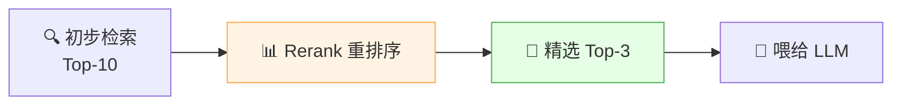

> 💡 **Rerank 是性价比最高的优化！** 用 Cross-Encoder 模型（如 bge-reranker）对初步检索结果重新打分排序，效果立竿见影。

### 9.4 Rerank 原理

| 检索方式 | 模型类型 | 速度 | 精度 |
|:---|:---|:---:|:---:|
| 向量检索（Bi-Encoder） | 双塔，问题和文档独立编码 | 快 | 中 |
| **Rerank（Cross-Encoder）** | 问题和文档一起编码 | 慢 | 高 |

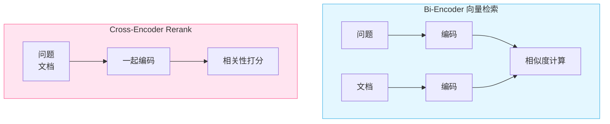

### 9.5 高级 RAG 架构

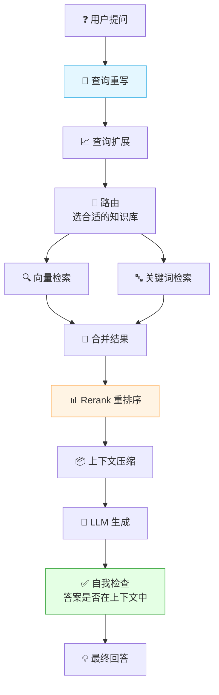

---

## 十、RAG vs 微调 vs 预训练

### 10.1 三种方案对比

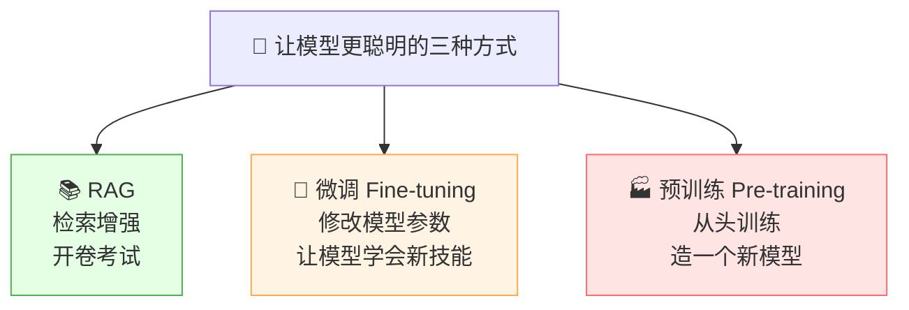

| 对比 | RAG | 微调 | 预训练 |
|:---|:---|:---|:---|
| **做什么** | 检索外部知识 | 调整模型参数 | 从头训练模型 |
| **成本** | 低 💚 | 中 💛 | 极高 💔 |
| **更新知识** | 实时更新 ✅ | 需重新训练 ❌ | 需重新训练 ❌ |
| **适合** | 知识问答、文档助手 | 调整风格/格式/专业领域 | 造新模型（极少用） |
| **解决幻觉** | ✅ 有效 | 一般 | 一般 |
| **可解释性** | ✅ 有来源 | ❌ 黑盒 | ❌ 黑盒 |
| **类比** | 开卷考试 | 培训员工技能 | 从小重新教育 |

### 10.2 什么时候用什么？

| 场景 | 推荐方案 | 原因 |
|:---|:---|:---|
| 公司内部知识问答 | **RAG** | 知识随时更新，需来源引用 |
| 让模型用特定语气说话 | **微调** | 改风格不改知识 |
| 医疗/法律专业问答 | **RAG + 微调** | 微调学专业表达，RAG 查最新法规 |
| 从零做一个中文模型 | **预训练** | 极少需要，慎选 |
| 代码助手 | **微调 + RAG** | 微调学代码能力，RAG 查最新 API |

> 🎀 **最佳实践**：RAG + 微调结合！微调让模型更擅长某领域，RAG 提供最新知识。

### 10.3 RAG + 微调协同


---

## 十一、主流框架与工具

### 11.1 RAG 框架对比

| 框架 | 特点 | 适合 |
|:---|:---|:---|
| **LangChain** ⭐ | 最流行，生态完整，功能全 | 通用 RAG 开发 |
| **LlamaIndex** ⭐ | 专注 RAG，数据处理强 | 文档问答场景 |
| **Haystack** | 老牌，工业级 | 生产环境 |
| **Dify** | 可视化，低代码 | 快速搭建 |
| **FastGPT** | 国产开源，开箱即用 | 快速部署 |
| **RAGFlow** | 深度文档解析强 | 复杂文档处理 |

### 11.2 LangChain 核心模块

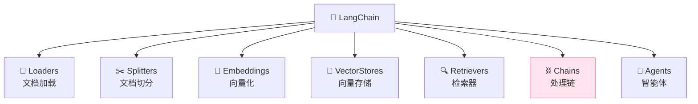

### 11.3 LlamaIndex 特点

> **LlamaIndex** 是专门为 RAG 设计的框架，在数据处理和索引方面比 LangChain 更精细。

```python
# LlamaIndex 快速示例
from llama_index import VectorStoreIndex, SimpleDirectoryReader

# 1. 加载文档
documents = SimpleDirectoryReader("./data").load_data()

# 2. 构建索引（自动切分+向量化+存储）
index = VectorStoreIndex.from_documents(documents)

# 3. 查询
query_engine = index.as_query_engine()
response = query_engine.query("公司年假政策是什么？")
print(response)
```

### 11.4 完整 RAG 代码示例（LangChain）

```python
from langchain.document_loaders import PyPDFLoader
from langchain.text_splitter import RecursiveCharacterTextSplitter
from langchain.embeddings import HuggingFaceEmbeddings
from langchain.vectorstores import Chroma
from langchain.llms import OpenAI
from langchain.chains import RetrievalQA

# 1. 加载文档
loader = PyPDFLoader("company_rules.pdf")
docs = loader.load()

# 2. 切分
splitter = RecursiveCharacterTextSplitter(
    chunk_size=500,
    chunk_overlap=50
)
chunks = splitter.split_documents(docs)

# 3. 向量化 + 存储
embeddings = HuggingFaceEmbeddings(model_name="BAAI/bge-small-zh")
vectorstore = Chroma.from_documents(chunks, embeddings)

# 4. 创建 RAG 链
qa = RetrievalQA.from_chain_type(
    llm=OpenAI(temperature=0),
    retriever=vectorstore.as_retriever(search_kwargs={"k": 5}),
    return_source_documents=True
)

# 5. 提问
result = qa({"query": "公司年假政策是什么？"})
print("回答：", result["result"])
print("来源：", [doc.metadata for doc in result["source_documents"]])
```

---

## 十二、知识总结

最后用思维导图把所有知识点串起来 📝✨：

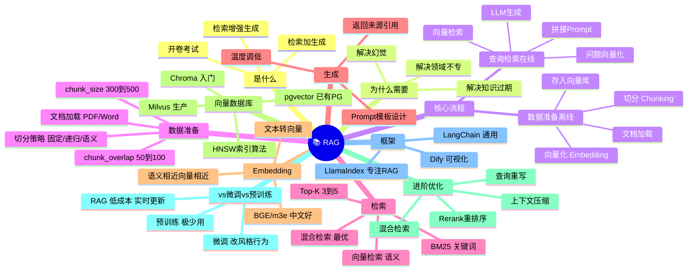

### 🎯 核心要点速记

1. **RAG = 检索 + 生成**：先从知识库检索相关资料，再让 LLM 基于资料回答。
2. **解决三大痛点**：幻觉、知识过期、领域不专。
3. **两大阶段**：数据准备（离线：切分→向量化→存储）+ 查询检索（在线：检索→拼接→生成）。
4. **切分是关键**：chunk_size 300~500，overlap 50~100，递归切分最主流。
5. **Embedding 是核心**：文本转向量，语义相近的文本向量也相近；中文推荐 BGE/m3e。
6. **向量数据库**：入门用 Chroma，生产用 Milvus，已有 PG 用 pgvector。
7. **检索方式**：向量检索（语义）+ BM25（关键词）= 混合检索（最优）。
8. **Rerank 重排序**是性价比最高的优化：用 Cross-Encoder 重新打分。
9. **Prompt 设计**：明确"只根据资料回答"、"不知道就说不知道"。
10. **RAG vs 微调**：RAG 解决"知识"问题（低成本、实时更新），微调解决"能力/风格"问题，最佳实践是两者结合。

---

> 🌸 哇~ 恭喜你把 RAG 检索增强生成的核心知识学完啦！RAG 是目前 AI 应用落地最主流的方案，掌握了切分、向量化、检索、Rerank 这些核心环节，你就能搭出一个高质量的智能问答系统了！动手实践一下，加油鸭！(ง •_•)ง💖
