# 🔄 ReAct 推理行动框架超全学习指南

> 嗨呀~ 欢迎来到 ReAct 的世界！🔄 ReAct = Reasoning + Acting（推理+行动），是让 AI Agent "边想边做"的经典框架——思考下一步该干什么，执行行动，观察结果，再继续思考！这是 Agent 最核心的运行模式。这份指南会带你从原理到实战，彻底搞懂 ReAct。准备好了吗？冲鸭！(ﾉ>ω<)ﾉ

---

## 📖 目录

- [一、什么是 ReAct？](#一什么是-react)
- [二、为什么需要 ReAct？](#二为什么需要-react)
- [三、ReAct 核心原理](#三react-核心原理)
- [四、ReAct 循环详解](#四react-循环详解)
- [五、ReAct vs 其他范式](#五react-vs-其他范式)
- [六、ReAct Prompt 设计](#六react-prompt-设计)
- [七、ReAct 完整示例](#七react-完整示例)
- [八、代码实战](#八代码实战)
- [九、ReACT 进阶与优化](#九react-进阶与优化)
- [十、ReAct 应用场景与局限](#十react-应用场景与局限)
- [十一、知识总结](#十一知识总结)

---

## 一、什么是 ReAct？

### 1.1 一句话定义

> **ReAct（Reasoning and Acting）** = 让 AI 交替进行"推理（Thought）"和"行动（Action）"的框架，每次行动后观察结果，再基于结果继续推理，直到完成任务。

简单说：**边想边做，做完再想，循环往复** 🔄。

### 1.2 名字由来

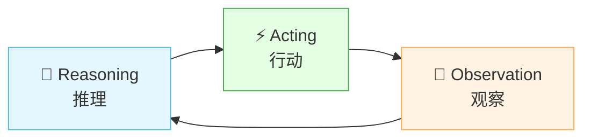

> **Re**asoning + **Act**ing = **ReAct** 🔄

### 1.3 生活化比喻

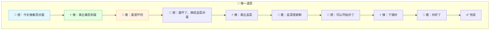

就像人做事情一样：**先想清楚做什么 → 去做 → 看结果 → 再想下一步**。ReAct 让 AI 也这样工作！

### 1.4 ReAct 的诞生

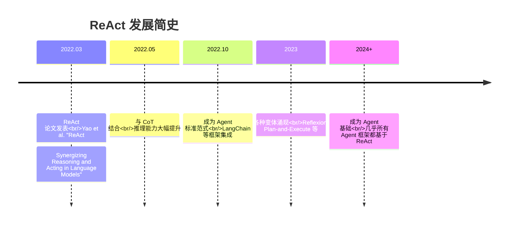

---

## 二、为什么需要 ReAct？

### 2.1 纯推理 vs 纯行动的局限

```mermaid
flowchart TB
    subgraph 纯推理["🧠 纯推理（如 CoT）"]
        A1["只在脑子里想"] --> A2["❌ 不能获取新信息"]
        A2 --> A3["❌ 不能执行操作"]
        A3 --> A4["❌ 不能纠错"]
    end

    subgraph 纯行动["⚡ 纯行动（如 Function Calling）"]
        B1["只调工具"] --> B2["❌ 没有推理规划"]
        B2 --> B3["❌ 不知道为什么调"]
        B3 --> B4["❌ 不能灵活调整"]
    end

    subgraph ReAct["🔄 ReAct（推理+行动）"]
        C1["边想边做"] --> C2["✅ 能获取新信息"]
        C2 --> C3["✅ 能执行操作"]
        C3 --> C4["✅ 能观察纠错"]
    end

    style 纯推理 fill:#ffe4e4,stroke:#ff6b6b
    style 纯行动 fill:#ffe4e4,stroke:#ff6b6b
    style ReAct fill:#e4ffe4,stroke:#4caf50
```

| 方式 | 推理 | 行动 | 观察 | 纠错 | 综合 |
|:---|:---:|:---:|:---:|:---:|:---:|
| 纯 CoT 推理 | ✅ | ❌ | ❌ | ❌ | ❌ |
| 纯行动（FC） | ❌ | ✅ | ❌ | ❌ | ❌ |
| **ReAct** ⭐ | ✅ | ✅ | ✅ | ✅ | ✅ |

### 2.2 ReAct 解决了什么？

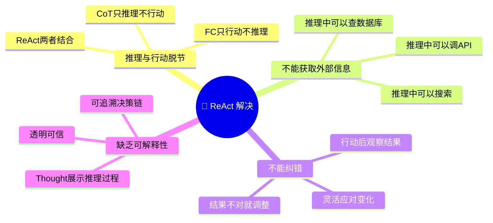

### 2.3 一个对比示例

**场景**：用户问"2025年最新的AI模型有哪些？"

| 方式 | 表现 |
|:---|:---|
| 纯 CoT | "我不知道2025年的信息..."（训练数据截止了） |
| 纯 FC | 直接调用搜索，但不分析为什么搜、搜什么 |
| **ReAct** | Thought: "需要搜索最新信息" → Action: search("2025 AI模型") → Observation: 搜索结果 → Thought: "整理结果" → Answer |

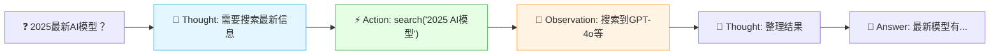

---

## 三、ReAct 核心原理

### 3.1 三要素：Thought-Action-Observation

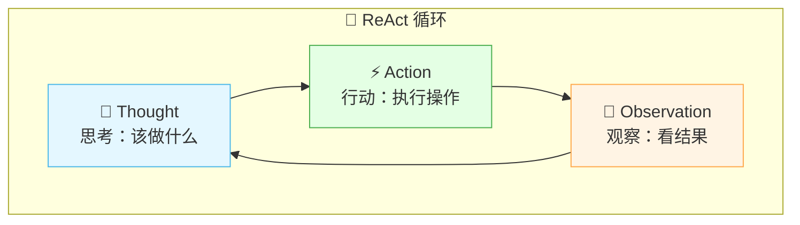

| 要素 | 说明 | 例子 |
|:---|:---|:---|
| **Thought（思考）** | 推理下一步该做什么 | "我需要先搜索信息" |
| **Action（行动）** | 执行具体操作 | "搜索'AI最新进展'" |
| **Observation（观察）** | 看行动的结果 | "搜索到3条相关结果" |

### 3.2 完整 ReAct 流程

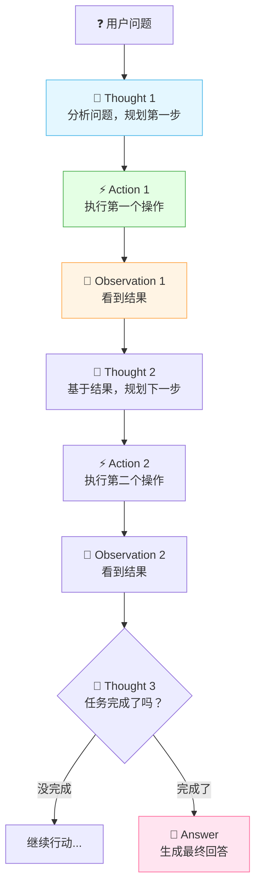

### 3.3 ReAct 循环的核心思想

> **核心思想**：不是一次性规划好所有步骤，而是**每一步都根据上一步的结果来决定下一步**。

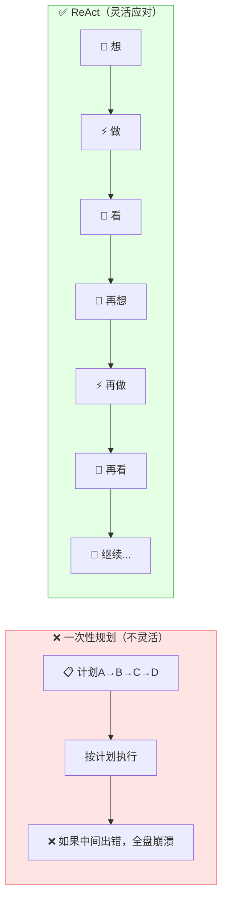

| 对比 | 一次性规划 | ReAct |
|:---|:---|:---|
| **规划方式** | 提前规划所有步骤 | 每步动态决策 |
| **出错处理** | 全盘崩溃 | 灵活调整 |
| **信息获取** | 不能获取新信息 | 每步可获取 |
| **适应性** | 差 | 强 |

---

## 四、ReAct 循环详解

### 4.1 单次循环

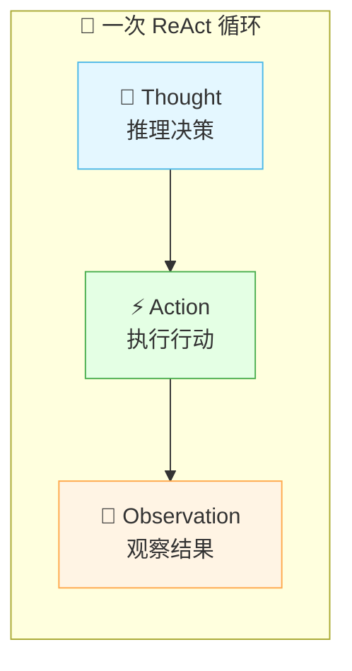

### 4.2 Thought（思考）详解

> **Thought** = 模型的内部推理过程，决定下一步做什么。

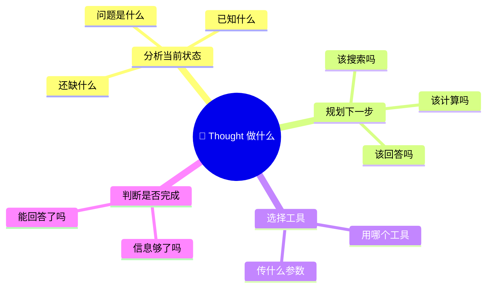

| Thought 类型 | 例子 |
|:---|:---|
| **分析问题** | "用户想知道天气，我需要查询天气信息" |
| **选择工具** | "我应该调用 get_weather 工具" |
| **解读结果** | "搜索结果显示北京25度晴天" |
| **判断完成** | "已经获得足够信息，可以回答了" |
| **纠错调整** | "搜索结果不相关，换个关键词再搜" |

### 4.3 Action（行动）详解

> **Action** = 执行具体操作，通常是调用工具。

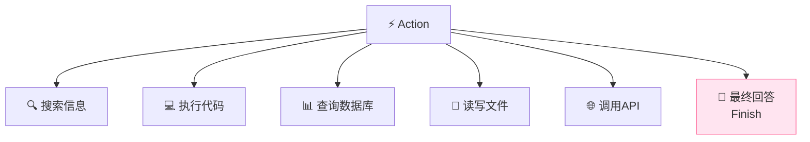

| Action 类型 | 说明 | 例子 |
|:---|:---|:---|
| **搜索** | 获取外部信息 | `search("Python教程")` |
| **计算** | 精确计算 | `calculate("3.14 * 2.78")` |
| **查数据库** | 查询私有数据 | `query_db("SELECT * FROM users")` |
| **执行代码** | 运行代码 | `run_python("print(1+1)")` |
| **最终回答** | 任务完成 | `Finish("答案是...")` |

### 4.4 Observation（观察）详解

> **Observation** = Action 执行后返回的结果。

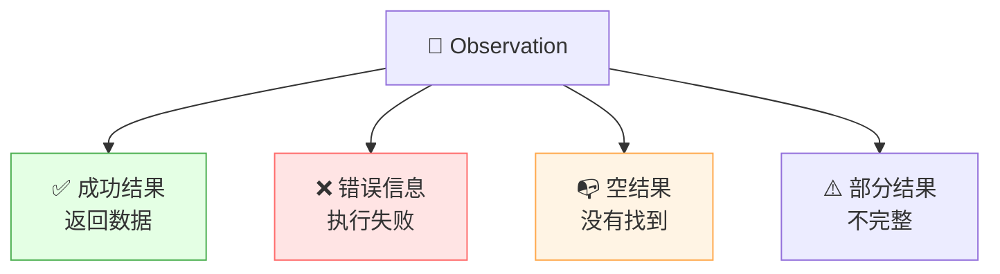

| Observation 类型 | 处理方式 |
|:---|:---|
| **成功结果** | 基于结果继续推理 |
| **错误信息** | 分析错误，调整策略 |
| **空结果** | 换关键词或换工具 |
| **部分结果** | 补充搜索或继续查询 |

### 4.5 循环终止条件

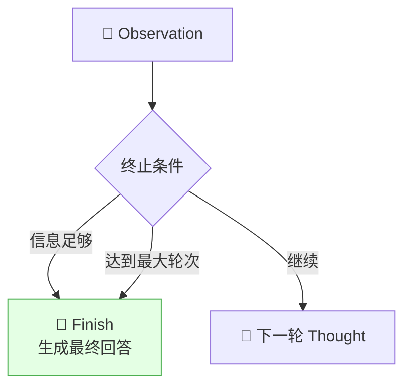

| 终止条件 | 说明 |
|:---|:---|
| **任务完成** | 获得足够信息，可以回答 |
| **最大轮次** | 防止无限循环（如最多 10 轮） |
| **无法完成** | 多次尝试失败，返回当前最佳结果 |

---

## 五、ReAct vs 其他范式

### 5.1 Agent 四大经典范式对比

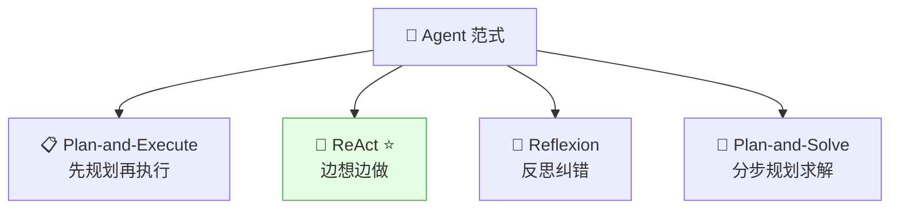

### 5.2 详细对比

| 范式 | 核心思想 | 优点 | 缺点 | 适合 |
|:---|:---|:---|:---|:---|
| **Plan-and-Execute** | 先制定完整计划，再逐步执行 | 有全局规划 | 不够灵活 | 步骤明确任务 |
| **ReAct** ⭐ | 边推理边行动，每步动态决策 | 灵活、可纠错 | 可能走弯路 | 通用场景 |
| **Reflexion** | ReAct + 自我反思 | 能从错误中学习 | 成本高 | 复杂任务 |
| **Plan-and-Solve** | 先规划再分步执行 | 结合规划和推理 | 规划阶段可能出错 | 数学推理 |

### 5.3 ReAct vs CoT

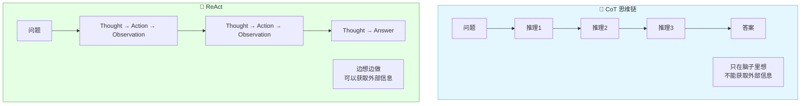

| 对比 | CoT | ReAct |
|:---|:---|:---|
| **推理** | ✅ 纯推理 | ✅ 推理+行动 |
| **能调工具** | ❌ | ✅ |
| **能获取信息** | ❌ | ✅ |
| **能纠错** | ❌ | ✅ |
| **成本** | 低 | 高（多轮调用） |
| **适合** | 纯推理题 | 需要外部信息的任务 |

> 🎀 **ReAct = CoT + 工具调用 + 观察反馈**！CoT 是 ReAct 的推理部分。

### 5.4 ReAct vs Reflexion

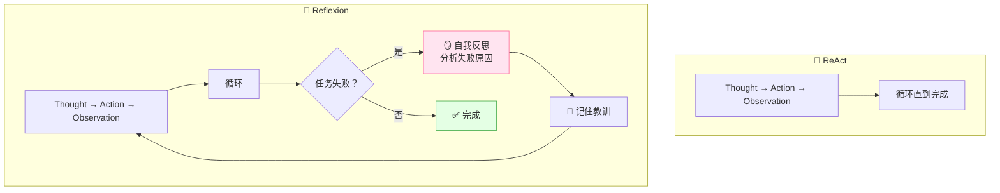

> Reflexion = ReAct + 自我反思。失败后反思原因，下次避免同样错误。

---

## 六、ReAct Prompt 设计

### 6.1 标准 ReAct Prompt 模板

```
尽可能回答以下问题。你可以使用以下工具：

{工具列表}

按照以下格式回答：

Question: 输入的问题
Thought: 你应该怎么思考
Action: 你要使用的工具
Action Input: 工具的输入参数
Observation: 工具返回的结果
...（Thought/Action/Observation 可以重复多次）
Thought: 我现在知道答案了
Final Answer: 最终回答

开始！

Question: {用户问题}
```

### 6.2 ReAct Prompt 关键要素

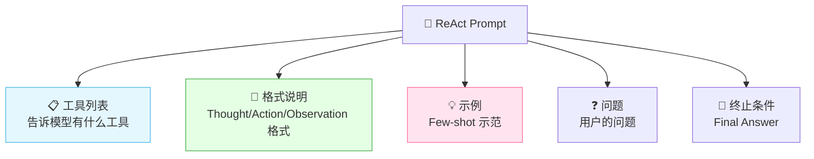

| 要素 | 说明 |
|:---|:---|
| **工具列表** | 列出可用工具及描述 |
| **格式说明** | 明确 Thought/Action/Observation 格式 |
| **示例** | 给 1-2 个完整 ReAct 示例 |
| **问题** | 用户要回答的问题 |
| **终止条件** | 模型知道何时输出 Final Answer |

### 6.3 Zero-shot ReAct

```
按照以下格式使用工具回答问题：

可以使用以下工具：
- search(query): 搜索互联网
- calculate(expression): 数学计算

格式：
Thought: 你的推理
Action: 工具名
Action Input: 工具参数
Observation: 工具返回结果
Final Answer: 最终答案

Question: 北京和上海的人口差是多少？
```

### 6.4 Few-shot ReAct（推荐）

```
可以使用以下工具：
- search(query): 搜索互联网
- calculate(expression): 数学计算

=== 示例 ===
Question: 珠穆朗玛峰比勃朗峰高多少米？
Thought: 我需要知道两座山的高度，然后计算差值。
Action: search
Action Input: 珠穆朗玛峰高度
Observation: 8848米
Thought: 现在需要勃朗峰的高度
Action: search
Action Input: 勃朗峰高度
Observation: 4810米
Thought: 现在可以计算差值了
Action: calculate
Action Input: 8848 - 4810
Observation: 4038
Thought: 我知道答案了
Final Answer: 珠穆朗玛峰比勃朗峰高4038米。

=== 现在请回答 ===
Question: {用户问题}
```

---

## 七、ReAct 完整示例

### 7.1 示例：查天气并推荐穿搭

```
Question: 北京明天天气怎么样？适合穿什么？

Thought: 我需要查询北京明天的天气信息
Action: search
Action Input: 北京明天天气预报
Observation: 北京明天晴天，气温15-25°C，微风

Thought: 我获得了天气信息。晴天15-25度，适合穿薄外套。
        我可以给出穿搭建议了。
Final Answer: 北京明天晴天，气温15-25°C。
             建议穿薄外套或卫衣，白天可以穿长袖T恤，
             早晚温差较大，记得带件外套。
```

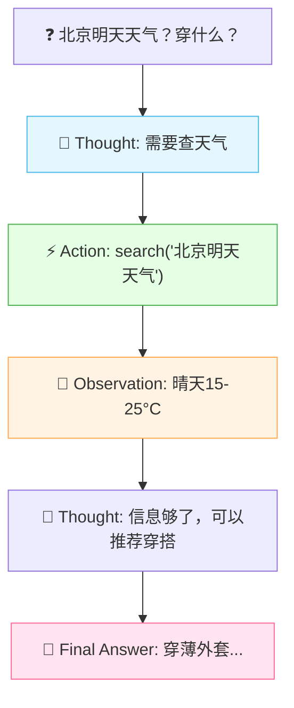

### 7.2 示例：多步搜索

```
Question: 帮我查一下Python之父是谁，他现在在哪个公司？

Thought: 我需要先搜索Python之父是谁
Action: search
Action Input: Python之父是谁
Observation: Python之父是Guido van Rossum

Thought: 现在需要查Guido van Rossum在哪个公司
Action: search
Action Input: Guido van Rossum现在哪个公司
Observation: Guido van Rossum目前退休，曾在Microsoft工作

Thought: 我获得了两个信息：
        1. Python之父是Guido van Rossum
        2. 他已退休，之前在Microsoft工作
        可以回答了。
Final Answer: Python之父是Guido van Rossum，
             他曾在Microsoft工作，目前已退休。
```

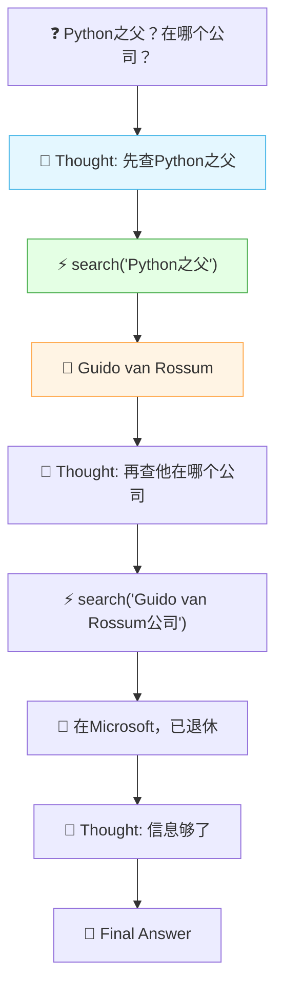

### 7.3 示例：纠错场景

```
Question: 3的平方根是多少？

Thought: 我需要计算3的平方根
Action: calculate
Action Input: sqrt(3)
Observation: Error: 不支持的函数

Thought: 计算器不支持sqrt函数，我换种方式。
        3的平方根约等于1.732
Action: calculate
Action Input: 1.732 * 1.732
Observation: 2.999824

Thought: 1.732的平方约等于3，所以3的平方根约为1.732
Final Answer: 3的平方根约等于1.732
```

```mermaid
flowchart TB
    Q["❓ √3 = ?"] --> T1["🧠 Thought: 计算√3"]
    T1 --> A1["⚡ calculate('sqrt(3)')"]
    A1 --> O1["❌ Error: 不支持"]
    O1 --> T2["🧠 Thought: 换种方式，用1.732验证"]
    T2 --> A2["⚡ calculate('1.732*1.732')"]
    A2 --> O2["👀 2.999824"]
    O2 --> T3["🧠 Thought: 验证通过，答案是1.732"]
    T3 --> FA["💬 Final Answer: ≈1.732"]

    style O1 fill:#ffe4e4,stroke:#ff6b6b
    style T2 fill:#fff4e4,stroke:#ffa94d
```

> 🎀 **纠错能力是 ReAct 的一大优势**！遇到错误不放弃，换种方式继续。

---

## 八、代码实战

### 8.1 ReAct Agent 完整实现

```python
import openai
import json
import re

class ReActAgent:
    """ReAct Agent 实现"""

    def __init__(self, tools: dict, max_iterations: int = 10):
        """
        tools: {工具名: 函数}
        max_iterations: 最大循环次数
        """
        self.tools = tools
        self.max_iterations = max_iterations
        self.llm_model = "gpt-4"

    def _build_prompt(self, question: str) -> str:
        """构建 ReAct Prompt"""
        tools_desc = "\n".join([
            f"- {name}: {func.__doc__ or '无描述'}"
            for name, func in self.tools.items()
        ])

        return f"""你可以使用以下工具回答问题：

可用工具：
{tools_desc}

请严格按照以下格式回答：

Thought: 你的推理过程
Action: 工具名称
Action Input: 工具参数（JSON格式）
Observation: 工具返回的结果
...（可以重复多次）
Thought: 我知道答案了
Final Answer: 最终回答

Question: {question}
Thought:"""

    def _parse_response(self, response: str) -> dict:
        """解析 LLM 返回的 Thought/Action/Action Input"""
        result = {"thought": "", "action": None,
                  "action_input": None, "final_answer": None}

        # 提取 Final Answer
        if "Final Answer:" in response:
            result["final_answer"] = response.split("Final Answer:")[-1].strip()
            return result

        # 提取 Thought
        if "Thought:" in response:
            thought_part = response.split("Thought:")[-1]
            if "Action:" in thought_part:
                result["thought"] = thought_part.split("Action:")[0].strip()
            else:
                result["thought"] = thought_part.strip()

        # 提取 Action
        if "Action:" in response:
            action_part = response.split("Action:")[-1]
            if "Action Input:" in action_part:
                result["action"] = action_part.split("Action Input:")[0].strip()

        # 提取 Action Input
        if "Action Input:" in response:
            input_part = response.split("Action Input:")[-1].strip()
            try:
                result["action_input"] = json.loads(input_part)
            except:
                result["action_input"] = input_part

        return result

    def _execute_action(self, action: str, action_input) -> str:
        """执行行动"""
        if action not in self.tools:
            return f"Error: 工具 {action} 不存在"

        try:
            func = self.tools[action]
            if isinstance(action_input, dict):
                result = func(**action_input)
            else:
                result = func(action_input)
            return str(result)
        except Exception as e:
            return f"Error: {str(e)}"

    def run(self, question: str) -> str:
        """运行 ReAct 循环"""
        prompt = self._build_prompt(question)
        messages = [{"role": "user", "content": prompt}]

        for i in range(self.max_iterations):
            print(f"\n--- 第 {i+1} 轮 ---")

            # 1. LLM 推理
            response = openai.ChatCompletion.create(
                model=self.llm_model,
                messages=messages,
                temperature=0
            )
            output = response.choices[0].message.content
            print(f"LLM输出:\n{output}")

            # 2. 解析输出
            parsed = self._parse_response(output)

            # 3. 如果有最终答案，返回
            if parsed["final_answer"]:
                return parsed["final_answer"]

            # 4. 执行 Action
            if parsed["action"]:
                observation = self._execute_action(
                    parsed["action"],
                    parsed["action_input"]
                )
                print(f"Observation: {observation}")

                # 5. 把 Observation 加到对话中
                messages.append({"role": "assistant", "content": output})
                messages.append({
                    "role": "user",
                    "content": f"Observation: {observation}\nThought:"
                })
            else:
                # 没有解析出 Action，继续
                messages.append({"role": "assistant", "content": output})
                messages.append({"role": "user", "content": "继续。Thought:"})

        return "达到最大循环次数，未能完成任务。"
```

### 8.2 定义工具

```python
# 定义工具函数
def search(query: str) -> str:
    """搜索互联网获取信息。参数: query(搜索关键词)"""
    # 模拟搜索
    mock_data = {
        "Python之父": "Python之父是Guido van Rossum",
        "Guido van Rossum": "Guido van Rossum曾在Microsoft工作，现已退休",
        "北京天气": "北京明天晴天，气温15-25°C",
    }
    for key, value in mock_data.items():
        if key in query:
            return value
    return f"搜索'{query}'未找到相关结果"

def calculate(expression: str) -> str:
    """数学计算。参数: expression(数学表达式)"""
    try:
        result = eval(expression)  # 生产环境不要用eval
        return str(result)
    except Exception as e:
        return f"计算错误: {e}"

# 创建 Agent
tools = {
    "search": search,
    "calculate": calculate
}

agent = ReActAgent(tools=tools, max_iterations=10)
```

### 8.3 运行 Agent

```python
# 运行 ReAct Agent
answer = agent.run("Python之父是谁？他现在在哪个公司？")
print(f"\n最终答案: {answer}")

# 输出示例：
# --- 第 1 轮 ---
# Thought: 我需要先搜索Python之父是谁
# Action: search
# Action Input: {"query": "Python之父"}
# Observation: Python之父是Guido van Rossum
#
# --- 第 2 轮 ---
# Thought: 现在需要查Guido van Rossum在哪个公司
# Action: search
# Action Input: {"query": "Guido van Rossum公司"}
# Observation: Guido van Rossum曾在Microsoft工作，现已退休
#
# --- 第 3 轮 ---
# Thought: 我获得了完整信息，可以回答了
# Final Answer: Python之父是Guido van Rossum，他曾在Microsoft工作，现已退休。
```

### 8.4 用 LangChain 实现 ReAct

```python
from langchain.agents import create_react_agent, AgentExecutor
from langchain.tools import tool
from langchain.chat_models import ChatOpenAI
from langchain import hub

# 定义工具
@tool
def search(query: str) -> str:
    """搜索互联网获取信息"""
    return f"搜索结果: {query}的信息..."

@tool
def calculate(expression: str) -> str:
    """数学计算"""
    return str(eval(expression))

# 创建 ReAct Agent
llm = ChatOpenAI(model="gpt-4", temperature=0)
tools = [search, calculate]

# 使用 LangChain 内置 ReAct Prompt
prompt = hub.pull("hwchase17/react")

agent = create_react_agent(llm, tools, prompt)
executor = AgentExecutor(
    agent=agent,
    tools=tools,
    verbose=True,      # 打印推理过程
    max_iterations=10   # 最大循环次数
)

# 运行
result = executor.invoke({
    "input": "3的平方加上4的平方等于多少？"
})
print(result["output"])
```

### 8.5 ReAct 执行流程图

```mermaid
sequenceDiagram
    participant U as 👤 用户
    participant A as 🤖 Agent
    participant L as 🧠 LLM
    participant T as 🔧 工具

    U->>A: 提出问题
    A->>L: 发送 ReAct Prompt

    loop ReAct 循环
        L-->>A: Thought + Action + Action Input
        Note over A: 解析 Action
        A->>T: 执行工具调用
        T-->>A: 返回 Observation
        A->>L: Thought + Observation
        Note over L: 判断是否完成
    end

    L-->>A: Final Answer
    A-->>U: 返回最终答案
```

---

## 九、ReAct 进阶与优化

### 9.1 ReAct 的常见问题与优化

```mermaid
flowchart TB
    P["⚠️ ReAct 常见问题"]
    P --> P1["🔄 无限循环<br/>不停调用工具"]
    P --> P2["📝 Prompt 过长<br/>多轮后超出窗口"]
    P --> P3["❌ 解析失败<br/>模型输出格式不对"]
    P --> P4["🐌 速度慢<br/>多轮调用 LLM"]
    P --> P5["💰 成本高<br/>每轮都要调 LLM"]

    style P1 fill:#ffe4e4,stroke:#ff6b6b
    style P2 fill:#ffe4e4,stroke:#ff6b6b
    style P3 fill:#ffe4e4,stroke:#ff6b6b
```

| 问题 | 原因 | 解决方案 |
|:---|:---|:---|
| **无限循环** | 模型不知道何时停止 | 设 max_iterations + 明确终止条件 |
| **Prompt 过长** | 多轮 Thought/Action/Observation 积累 | 摘要压缩旧轮次 |
| **解析失败** | 模型输出格式不规范 | 用 Function Calling 替代文本解析 |
| **速度慢** | 每轮都要调 LLM | 用更快模型 / 并行调用 |
| **成本高** | 多轮 LLM 调用 | 减少不必要的轮次 / 用小模型 |

### 9.2 ReAct + Function Calling（现代实现）

> 现代 Agent 框架不再用文本解析 ReAct，而是用 **Function Calling** 来实现 Action。

```mermaid
flowchart TB
    subgraph 传统["📝 传统 ReAct（文本解析）"]
        T1["LLM 输出文本<br/>Thought: ...<br/>Action: ..."] --> P1["正则解析文本"]
        P1 --> A1["提取 Action 和参数"]
    end

    subgraph 现代["🔧 现代 ReAct（Function Calling）"]
        T2["LLM 输出结构化<br/>tool_calls"] --> P2["直接解析 JSON"]
        P2 --> A2["执行函数"]
    end

    style 传统 fill:#ffe4e4,stroke:#ff6b6b
    style 现代 fill:#e4ffe4,stroke:#4caf50
```

| 对比 | 传统文本 ReAct | Function Calling ReAct |
|:---|:---|:---|
| **输出格式** | 自由文本 | 结构化 JSON |
| **解析方式** | 正则表达式 | 直接解析 JSON |
| **可靠性** | 容易解析失败 | 稳定 |
| **Thought** | 在文本中 | 在 reasoning 内容中 |

### 9.3 ReAct + Memory

```mermaid
flowchart TB
    Q["❓ 问题"] --> M["💾 加载记忆<br/>相关历史信息"]
    M --> R1["🔄 ReAct 循环"]
    R1 --> R2["Thought → Action → Observation"]
    R2 --> R3["..."]
    R3 --> FA["💬 Final Answer"]
    FA --> SM["💾 保存到记忆"]

    style M fill:#e4f7ff,stroke:#4cb8e8
    style SM fill:#e4ffe4,stroke:#4caf50
```

> ReAct + Memory = 有记忆的 Agent，能引用之前的交互。

### 9.4 ReAct + Reflexion

```mermaid
flowchart TB
    Q["❓ 问题"] --> R1["🔄 ReAct 循环"]
    R1 --> C{"完成？"}
    C -->|"是"| FA["✅ Final Answer"]
    C -->|"否"| REF["🪞 Reflexion<br/>反思失败原因"]
    REF --> L["📝 记住教训"]
    L --> R1

    style REF fill:#ffe4f0,stroke:#ff6b9d
    style L fill:#fff4e4,stroke:#ffa94d
```

> Reflexion = ReAct 失败后自我反思，记住教训，下次避免同样错误。

### 9.5 优化策略总览

```mermaid
mindmap
  root((🔧 ReAct 优化))
    速度优化
      用小模型做简单推理
      并行调用工具
      缓存工具结果
    成本优化
      减少不必要的轮次
      用小模型+大模型组合
      压缩对话历史
    可靠性优化
      Function Calling替代文本
      设置最大轮次
      异常处理和重试
    效果优化
      加入Few-shot示例
      加入Memory记忆
      加入Reflexion反思
      加入CoT推理引导
```

---

## 十、ReAct 应用场景与局限

### 10.1 适合 ReAct 的场景

```mermaid
mindmap
  root((🔄 ReAct 适合))
    需要外部信息
      搜索最新信息
      查询数据库
      调用API获取数据
    多步骤任务
      先查再算再答
      先搜索再总结
      先分析再决策
    需要纠错
      工具调用可能出错
      需要换策略重试
      需要动态调整
    需要可解释性
      Thought展示推理
      可追溯决策过程
      透明可信
```

| 适合 | 例子 |
|:---|:---|
| **需要搜索** | "最新的AI模型有哪些" |
| **多步推理** | "A公司的市值比B公司高多少" |
| **需要计算** | "3的平方根乘以5是多少" |
| **需要纠错** | 工具调用失败后换策略 |

### 10.2 不适合 ReAct 的场景

| 不适合 | 原因 | 替代方案 |
|:---|:---|:---|
| **简单问答** | 不需要多步推理 | 直接调用 LLM |
| **纯创意写作** | 不需要工具调用 | 直接 Prompt |
| **明确步骤的任务** | 步骤已知不需动态决策 | Plan-and-Execute |
| **实时性要求高** | ReAct 多轮调用慢 | 直接 Function Calling |

### 10.3 ReAct 的局限

```mermaid
flowchart TB
    L["⚠️ ReAct 的局限"]
    L --> L1["🐌 速度慢<br/>多轮 LLM 调用"]
    L --> L2["💰 成本高<br/>每轮都消耗 Token"]
    L --> L3["🔄 可能循环<br/>不停调用工具"]
    L --> L4["📏 上下文增长<br/>多轮后 Prompt 变长"]
    L --> L5["🎲 不确定性<br/>模型可能走弯路"]

    style L1 fill:#ffe4e4,stroke:#ff6b6b
    style L2 fill:#ffe4e4,stroke:#ff6b6b
```

---

## 十一、知识总结

最后用思维导图把所有知识点串起来 📝✨：

```mermaid
mindmap
  root((🔄 ReAct))
    是什么
      Reasoning + Acting
      边想边做循环往复
      Agent标准运行模式
      Thought Action Observation
    为什么需要
      纯CoT不能行动
      纯FC不能推理
      ReAct两者结合
      能获取信息能纠错
    核心三要素
      Thought 思考推理
      Action 执行行动
      Observation 观察结果
      循环直到完成
    循环流程
      用户问题
      Thought推理
      Action行动
      Observation观察
      判断是否完成
      没完成继续循环
      完成输出Final Answer
    vs 其他范式
      vs CoT 加了行动
      vs Plan-Execute 更灵活
      vs Reflexion 少了反思
      vs FC 加了推理
    Prompt设计
      工具列表
      格式说明
      Few-shot示例
      终止条件
    代码实战
      手写ReAct Agent
      解析Thought/Action
      执行工具
      LangChain实现
    进阶优化
      Function Calling替代文本
      加入Memory记忆
      加入Reflexion反思
      限制最大轮次
      摘要压缩历史
    应用场景
      需要外部信息
      多步骤任务
      需要纠错
      需要可解释性
    局限
      速度慢多轮调用
      成本高
      可能循环
      上下文增长
```

### 🎯 核心要点速记

1. **ReAct = Reasoning + Acting**：让 AI 边推理边行动，循环直到完成。
2. **三要素**：Thought（思考）→ Action（行动）→ Observation（观察），循环往复。
3. **核心优势**：比 CoT 能行动，比 FC 能推理，还能纠错和调整。
4. **动态决策**：不是一次性规划，而是每步根据结果决定下一步。
5. **纠错能力**：遇到错误不放弃，换策略继续——这是 ReAct 的一大优势。
6. **vs CoT**：ReAct = CoT + 工具调用 + 观察反馈。
7. **vs Reflexion**：Reflexion = ReAct + 自我反思（失败后记住教训）。
8. **现代实现用 Function Calling**：不再用文本解析，用结构化 JSON 更可靠。
9. **LangChain 支持**：`create_react_agent` 一行代码创建 ReAct Agent。
10. **需要限制最大轮次**：防止无限循环，通常设 5~10 轮。
11. **可组合 Memory/Reflexion**：ReAct + Memory = 有记忆的 Agent；ReAct + Reflexion = 能学习的 Agent。
12. **是 Agent 的标准运行模式**：几乎所有主流 Agent 框架都基于 ReAct。

---

> 🌸 哇~ 恭喜你把 ReAct 推理行动框架的核心知识学完啦！ReAct 是 AI Agent 最经典的运行模式——"边想边做"让 Agent 既能推理又能行动，还能纠错调整。理解了 ReAct，你就理解了 Agent 是怎么"活"起来的！加油鸭！(ง •_•)ง💖
