# 🎯 AI Skills 技能系统超全学习指南

> 嗪呀~ 欢迎来到 AI Skills 的世界！🎯 Skills（技能）是 AI Agent 能执行的具体能力——搜索、写代码、画图、分析数据……技能越多，Agent 越强大！这份指南会带你从概念到实战，彻底搞懂 AI Skills。准备好了吗？冲鸭！(ﾉ>ω<)ﾉ

---

## 📖 目录

- [一、什么是 AI Skills？](#一什么是-ai-skills)
- [二、Skills vs Tools vs Actions](#二skills-vs-tools-vs-actions)
- [三、技能分类](#三技能分类)
- [四、核心技能详解](#四核心技能详解)
- [五、技能开发与定义](#五技能开发与定义)
- [六、技能编排与组合](#六技能编排与组合)
- [七、技能市场与生态](#七技能市场与生态)
- [八、技能执行机制](#八技能执行机制)
- [九、代码实战](#九代码实战)
- [十、技能设计的最佳实践](#十技能设计的最佳实践)
- [十一、知识总结](#十一知识总结)

---

## 一、什么是 AI Skills？

### 1.1 一句话定义

> **AI Skills（技能）** = AI Agent 能够执行的具体能力单元，每个技能解决一类问题，如搜索信息、编写代码、生成图片等。

简单说：**Agent 会干的事，每一件就是一个技能** 🎯。

### 1.2 生活化比喻

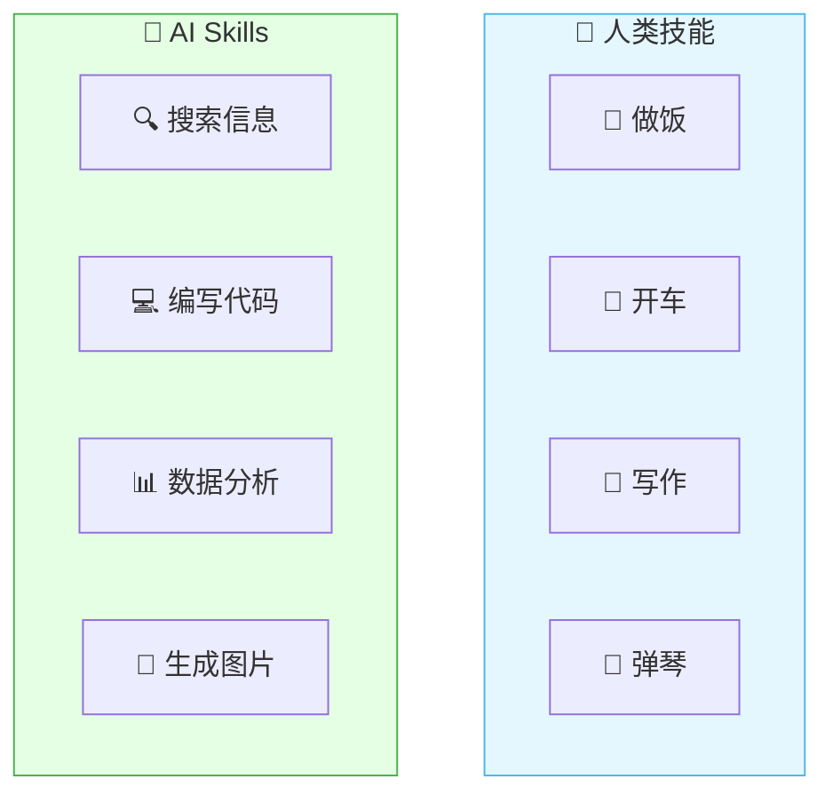

就像人有多项技能一样，AI Agent 也有多项技能。技能越多，Agent 能做的事就越多！

### 1.3 Skill 在 Agent 中的位置

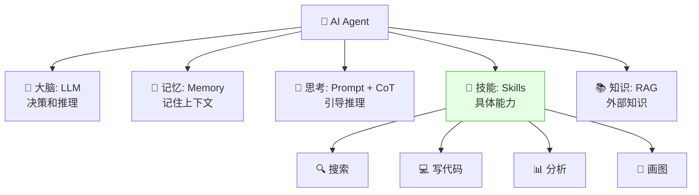

> 💡 **Skills 是 Agent 的"能力清单"**：大脑决定做什么，技能负责怎么做！

---

## 二、Skills vs Tools vs Actions

### 2.1 三者关系

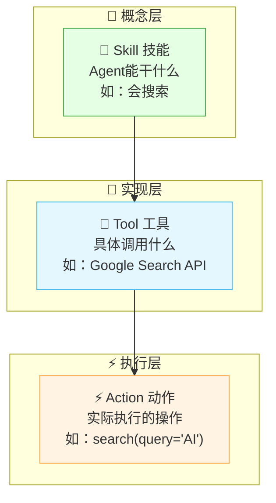

### 2.2 详细对比

| 概念 | 层面 | 说明 | 例子 |
|:---|:---|:---|:---|
| **Skill（技能）** | 能力层 | Agent 拥有的能力 | "会搜索信息" |
| **Tool（工具）** | 接口层 | 实现技能的具体工具 | "Google Search API" |
| **Action（动作）** | 执行层 | 一次具体调用 | "search('AI 最新进展')" |

### 2.3 一个例子理解

```
用户：帮我查一下最新的 AI 模型有哪些

Agent 决策过程：
  → 需要用「搜索」Skill（技能）
  → 调用 Google Search Tool（工具）
  → 执行 search(query="最新 AI 模型 2025")（动作）
  → 获取结果，整理回答
```


| 比喻 | Skill | Tool | Action |
|:---|:---|:---|:---|
| 做饭 | "会做饭" | "锅、刀、灶" | "切土豆、炒菜" |
| 编程 | "会编程" | "IDE、编译器" | "写函数、运行" |
| 搜索 | "会搜索" | "搜索引擎 API" | "搜索某个关键词" |

> 🎀 **简单记忆**：Skill = 会什么，Tool = 用什么，Action = 做什么！

---

## 三、技能分类

### 3.1 总览

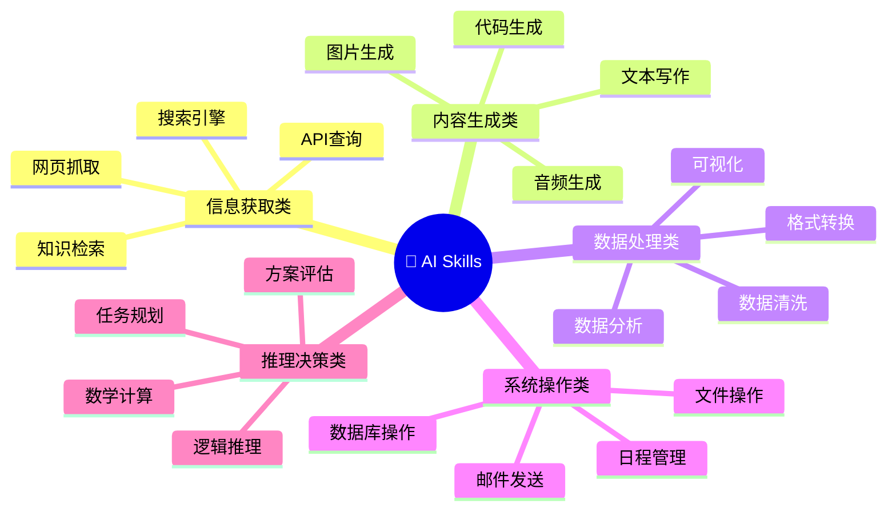

### 3.2 分类详解

| 类别 | 技能 | 说明 |
|:---|:---|:---|
| **信息获取** | 搜索、检索、爬虫 | 从外部获取信息 |
| **内容生成** | 写作、代码、画图 | 生成新内容 |
| **数据处理** | 分析、转换、可视化 | 处理结构化数据 |
| **系统操作** | 文件、数据库、邮件 | 操作外部系统 |
| **推理决策** | 计算、推理、规划 | 逻辑和数学 |

### 3.3 按复杂度分类

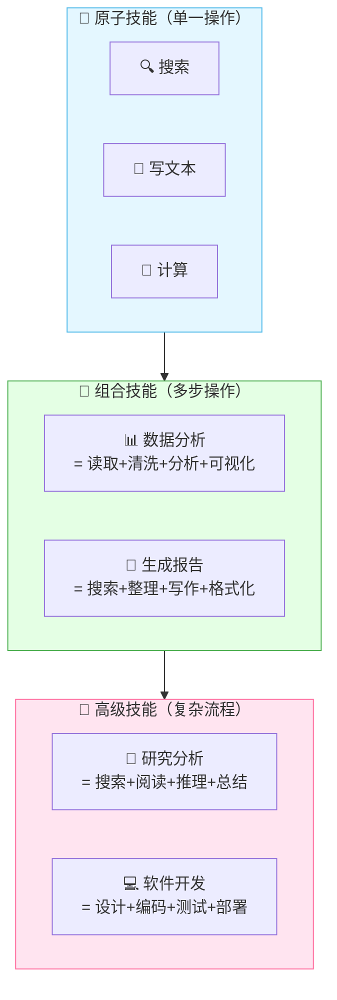

| 复杂度 | 说明 | 例子 |
|:---|:---|:---|
| **原子技能** | 单一操作 | 搜索、计算、翻译 |
| **组合技能** | 多个原子技能组合 | 数据分析 = 读取+清洗+分析+可视化 |
| **高级技能** | 复杂多步流程 | 研究分析 = 搜索+阅读+推理+总结 |

---

## 四、核心技能详解

### 4.1 搜索技能


| 搜索方式 | 说明 | 代表 |
|:---|:---|:---|
| **关键词搜索** | 按关键词匹配 | Google Search API |
| **语义搜索** | 按含义匹配 | 向量检索 |
| **混合搜索** | 关键词 + 语义 | Bing Search + Embedding |

### 4.2 代码执行技能

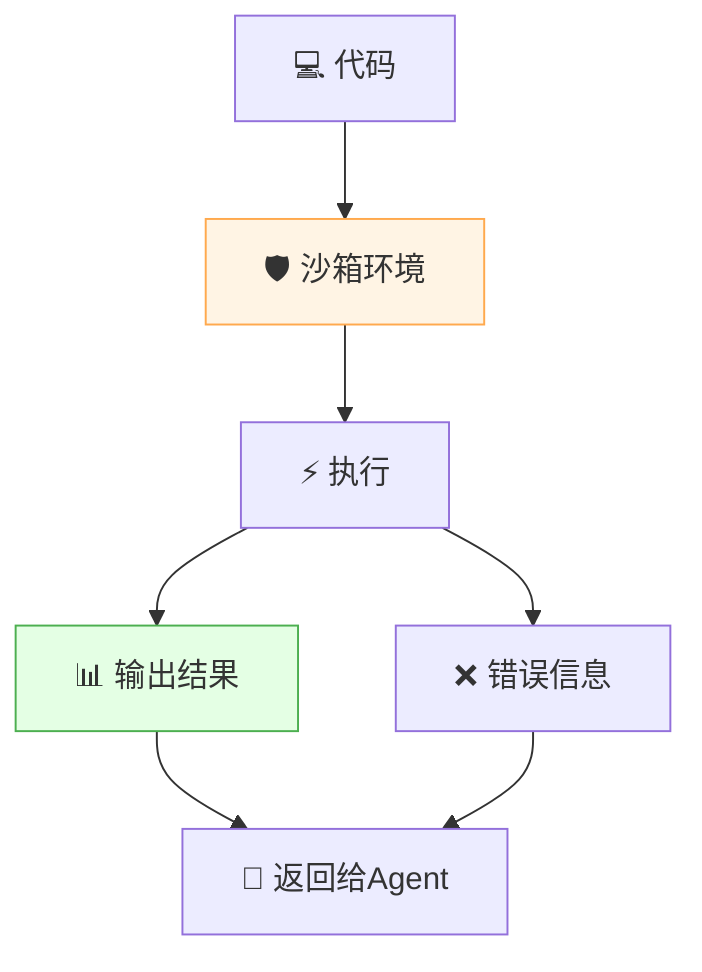

| 代码执行方式 | 说明 | 安全性 |
|:---|:---|:---|
| **沙箱执行** | 隔离环境运行代码 | ✅ 安全 |
| **Docker 容器** | 容器化执行 | ✅ 安全 |
| **直接执行** | 在主机直接运行 | ❌ 危险 |

> 💡 **代码执行技能必须注意安全！** 需要沙箱隔离、超时限制、资源限制。

### 4.3 数据分析技能


### 4.4 图片生成技能

| 模型 | 特点 | 适合 |
|:---|:---|:---|
| **DALL-E 3** | OpenAI 出品，质量高 | 通用图片 |
| **Midjourney** | 艺术风格强 | 创意设计 |
| **Stable Diffusion** | 开源可本地 | 自定义需求 |
| **GPT-4o 图片** | 多模态理解+生成 | 精确描述 |

### 4.5 文件操作技能

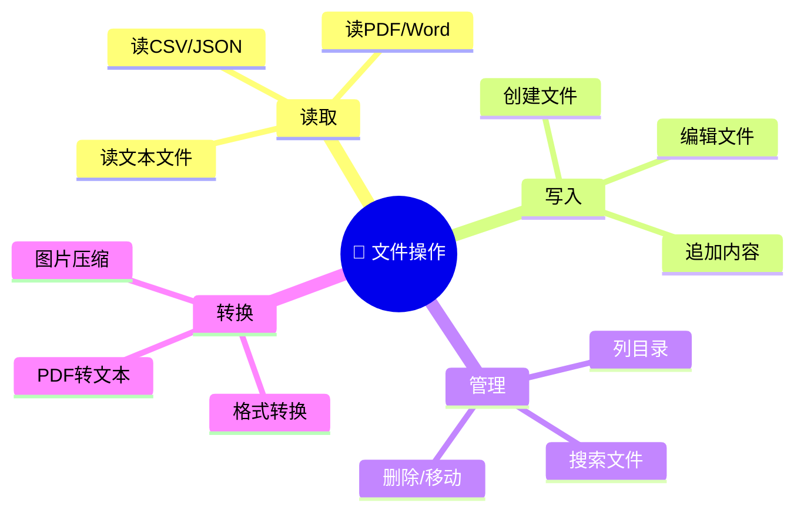

---

## 五、技能开发与定义

### 5.1 技能定义结构

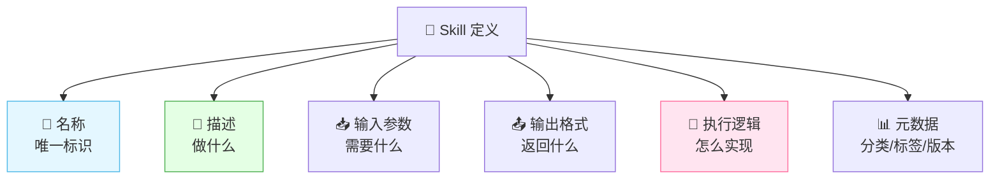

### 5.2 技能定义示例

```json
{
  "name": "web_search",
  "description": "在互联网上搜索信息，返回相关网页摘要",
  "category": "information_retrieval",
  "version": "1.0.0",
  "input": {
    "type": "object",
    "properties": {
      "query": {
        "type": "string",
        "description": "搜索关键词"
      },
      "max_results": {
        "type": "integer",
        "description": "最大返回结果数",
        "default": 5
      }
    },
    "required": ["query"]
  },
  "output": {
    "type": "array",
    "items": {
      "type": "object",
      "properties": {
        "title": {"type": "string"},
        "url": {"type": "string"},
        "snippet": {"type": "string"}
      }
    }
  },
  "timeout": 30,
  "retry": 3
}
```

### 5.3 技能定义要素

| 要素 | 说明 | 重要性 |
|:---|:---|:---:|
| **name** | 唯一标识，模型用它调用 | ⭐⭐⭐ |
| **description** | 告诉模型这个技能能干什么 | ⭐⭐⭐ |
| **input schema** | 输入参数定义 | ⭐⭐⭐ |
| **output schema** | 输出格式定义 | ⭐⭐ |
| **执行逻辑** | 实际代码实现 | ⭐⭐⭐ |
| **元数据** | 分类、标签、版本 | ⭐ |
| **超时** | 防止长时间挂起 | ⭐⭐ |
| **重试** | 失败后自动重试 | ⭐ |

> 💡 **description 是模型选择技能的依据！** 描述越清晰，模型选对技能的概率越高。

---

## 六、技能编排与组合

### 6.1 为什么要组合技能？

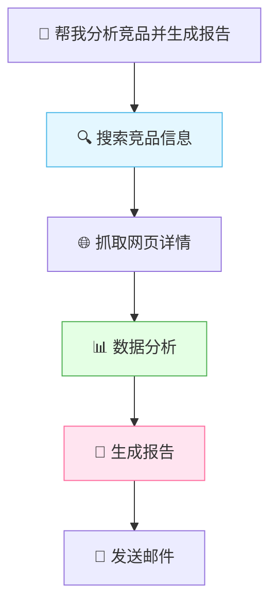

> 一个复杂任务往往需要多个技能按顺序或并行组合完成。

### 6.2 编排模式

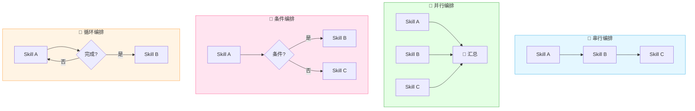

| 编排模式 | 说明 | 例子 |
|:---|:---|:---|
| **串行** | 按顺序执行 | 搜索→分析→写报告 |
| **并行** | 同时执行多个 | 同时搜索3个网站 |
| **条件** | 根据结果选择 | 如果找到→分析；没找到→换词搜 |
| **循环** | 重复执行直到完成 | 翻页搜索直到没结果 |

### 6.3 编排示例

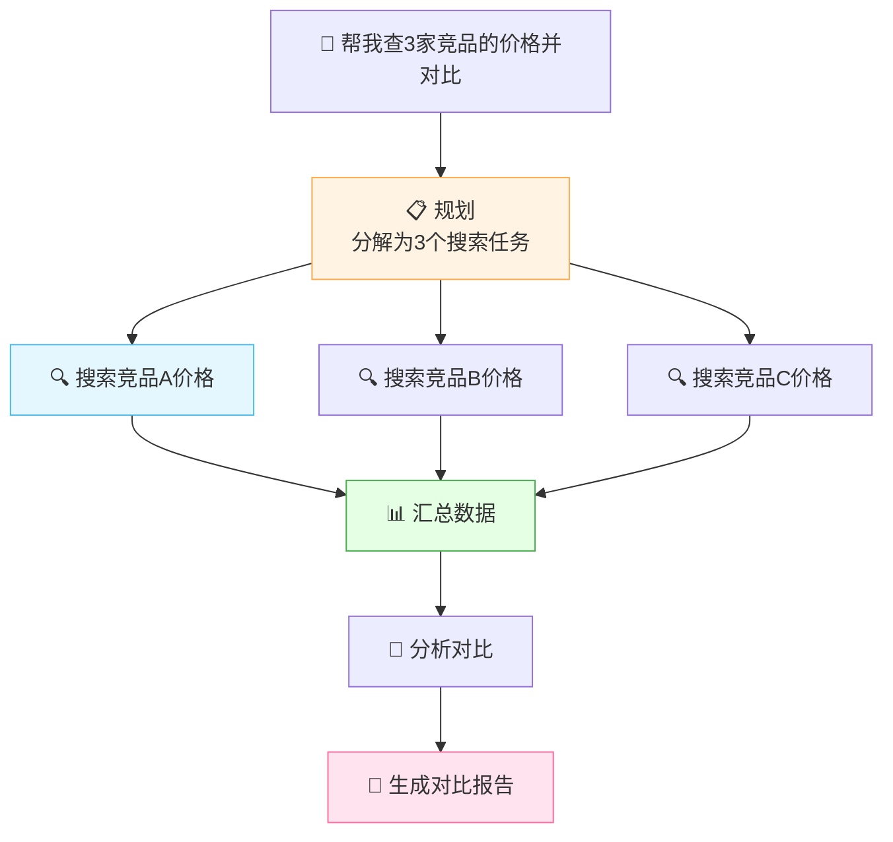

---

## 七、技能市场与生态

### 7.1 技能市场概念

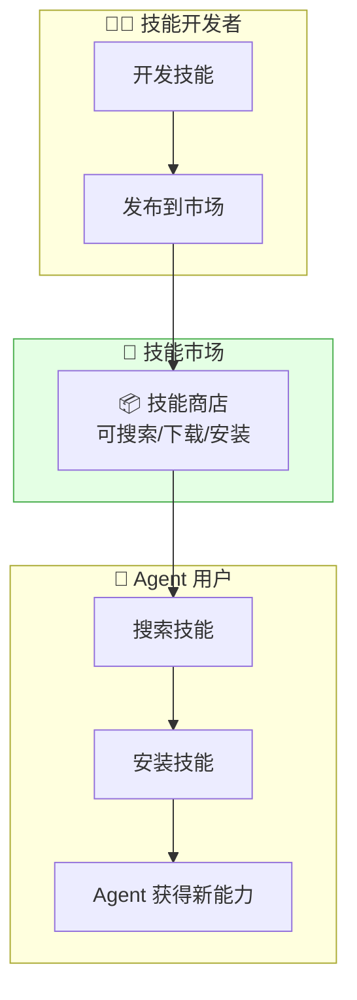

> 🎀 **就像手机 App Store 一样**：开发者发布技能，用户按需安装，Agent 立刻获得新能力！

### 7.2 现有技能生态

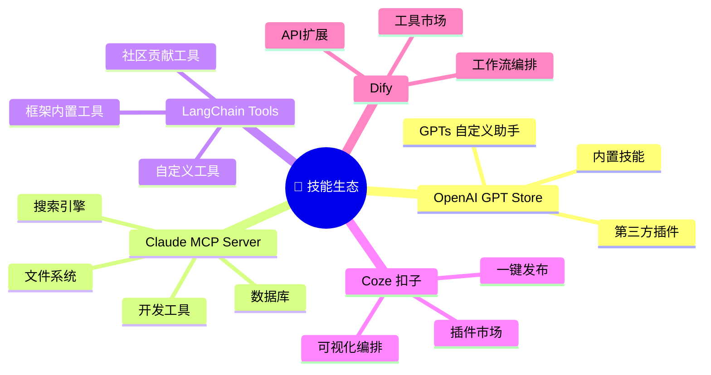

| 平台 | 技能形式 | 特点 |
|:---|:---|:---|
| **OpenAI GPT Store** | GPTs + Actions | 内置+第三方 |
| **Claude MCP** | MCP Server | 标准化协议 |
| **LangChain** | Tools | 开发者生态 |
| **Coze 扣子** | 插件 | 可视化，低门槛 |
| **Dify** | 工具/工作流 | 开源，可自建 |

### 7.3 技能复用与共享


| 复用方式 | 说明 |
|:---|:---|
| **直接安装** | 从市场安装现成技能 |
| **fork 修改** | 基于现有技能修改 |
| **组合复用** | 多个技能组合成新技能 |
| **API 调用** | 通过 API 调用他人技能 |

---

## 八、技能执行机制

### 8.1 执行流程

```mermaid
sequenceDiagram
    participant U as 👤 用户
    participant A as 🤖 Agent
    participant L as 🧠 LLM
    participant S as 🎯 Skill
    participant E as ⚡ 执行环境

    U->>A: "帮我搜索AI最新进展"
    A->>L: 分析意图+查看可用技能
    Note over L: 决策：调用 web_search 技能
    L-->>A: 选择 web_search(query="AI最新进展")
    A->>S: 调用技能
    S->>E: 在沙箱中执行
    E-->>S: 返回搜索结果
    S-->>A: 返回结构化结果
    A->>L: 把结果交给LLM整合
    L-->>A: 生成自然语言回答
    A-->>U: "AI最新进展有..."

    style L fill:#e4f7ff
    style S fill:#e4ffe4
    style E fill:#fff4e4
```

### 8.2 技能选择机制

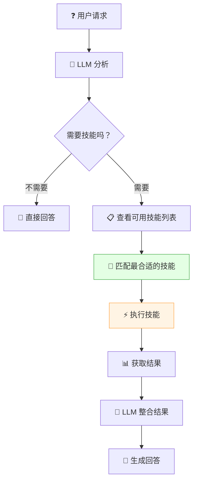

### 8.3 技能执行的安全控制

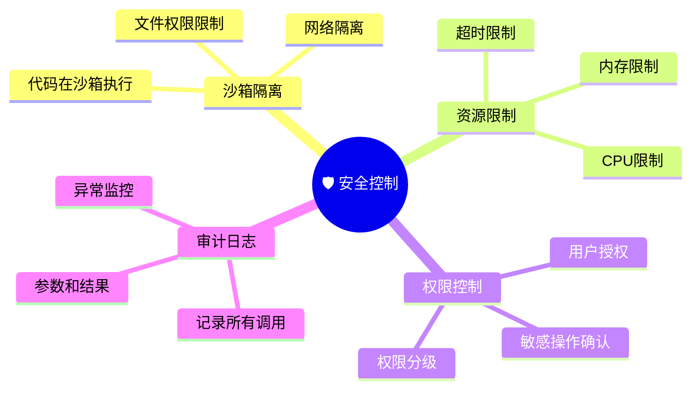

| 安全措施 | 说明 |
|:---|:---|
| **沙箱隔离** | 代码执行在隔离环境 |
| **超时限制** | 防止长时间挂起 |
| **资源限制** | CPU/内存/网络限制 |
| **权限控制** | 敏感操作需确认 |
| **审计日志** | 记录所有技能调用 |
| **输入验证** | 参数校验防注入 |

---

## 九、代码实战

### 9.1 定义一个搜索技能

```python
from typing import List, Dict

class WebSearchSkill:
    """搜索技能：在互联网上搜索信息"""

    def __init__(self):
        self.name = "web_search"
        self.description = "搜索互联网获取最新信息"
        self.category = "information_retrieval"

    def get_schema(self) -> dict:
        """返回技能定义"""
        return {
            "name": self.name,
            "description": self.description,
            "input": {
                "type": "object",
                "properties": {
                    "query": {
                        "type": "string",
                        "description": "搜索关键词"
                    },
                    "max_results": {
                        "type": "integer",
                        "description": "最大结果数",
                        "default": 5
                    }
                },
                "required": ["query"]
            }
        }

    def execute(self, query: str, max_results: int = 5) -> List[Dict]:
        """执行搜索"""
        # 这里调用实际搜索 API
        results = self._call_search_api(query, max_results)
        return results

    def _call_search_api(self, query: str, n: int) -> List[Dict]:
        """模拟搜索 API 调用"""
        return [
            {"title": f"结果{i}", "url": f"https://example.com/{i}",
             "snippet": f"关于{query}的结果{i}"}
            for i in range(1, n + 1)
        ]

# 使用
search_skill = WebSearchSkill()
print(search_skill.get_schema())
results = search_skill.execute("AI最新进展", 3)
```

### 9.2 定义一个代码执行技能

```python
import subprocess
import tempfile

class CodeExecutionSkill:
    """代码执行技能：在沙箱中运行Python代码"""

    def __init__(self):
        self.name = "run_python"
        self.description = "执行Python代码并返回结果"
        self.timeout = 30  # 30秒超时

    def get_schema(self) -> dict:
        return {
            "name": self.name,
            "description": self.description,
            "input": {
                "type": "object",
                "properties": {
                    "code": {
                        "type": "string",
                        "description": "要执行的Python代码"
                    }
                },
                "required": ["code"]
            }
        }

    def execute(self, code: str) -> dict:
        """安全执行代码"""
        try:
            # 在临时文件中执行（简化版，生产环境需要沙箱）
            with tempfile.NamedTemporaryFile(
                mode='w', suffix='.py', delete=False
            ) as f:
                f.write(code)
                f.flush()

                result = subprocess.run(
                    ['python', f.name],
                    capture_output=True,
                    text=True,
                    timeout=self.timeout
                )

                return {
                    "success": True,
                    "stdout": result.stdout,
                    "stderr": result.stderr,
                    "returncode": result.returncode
                }
        except subprocess.TimeoutExpired:
            return {"success": False, "error": "执行超时"}
        except Exception as e:
            return {"success": False, "error": str(e)}

# 使用
code_skill = CodeExecutionSkill()
result = code_skill.execute("print('Hello World!')")
print(result)  # {"success": True, "stdout": "Hello World!\n", ...}
```

### 9.3 技能管理器

```python
from typing import List, Dict, Optional

class SkillManager:
    """技能管理器：管理所有可用技能"""

    def __init__(self):
        self.skills = {}  # name → skill

    def register(self, skill):
        """注册技能"""
        schema = skill.get_schema()
        self.skills[skill.name] = skill
        print(f"✅ 注册技能: {skill.name}")

    def unregister(self, name: str):
        """注销技能"""
        if name in self.skills:
            del self.skills[name]
            print(f"❌ 注销技能: {name}")

    def list_skills(self) -> List[Dict]:
        """列出所有技能"""
        return [s.get_schema() for s in self.skills.values()]

    def get_skill(self, name: str):
        """获取技能"""
        return self.skills.get(name)

    def execute(self, name: str, **kwargs) -> dict:
        """执行指定技能"""
        skill = self.skills.get(name)
        if not skill:
            return {"success": False, "error": f"技能 {name} 不存在"}

        try:
            result = skill.execute(**kwargs)
            return {"success": True, "result": result}
        except Exception as e:
            return {"success": False, "error": str(e)}

# 使用
manager = SkillManager()

# 注册技能
manager.register(WebSearchSkill())
manager.register(CodeExecutionSkill())

# 列出技能
print(f"可用技能: {[s['name'] for s in manager.list_skills()]}")

# 执行技能
result = manager.execute("web_search", query="Python教程", max_results=3)
print(result)
```

### 9.4 与 LLM 集成

```python
import openai
import json

class AgentWithSkills:
    """带技能的 Agent"""

    def __init__(self):
        self.manager = SkillManager()
        self.llm_model = "gpt-4"

    def register_skill(self, skill):
        """注册技能"""
        self.manager.register(skill)

    def _get_tools_schema(self) -> list:
        """把技能列表转为 LLM tools 格式"""
        tools = []
        for skill_schema in self.manager.list_skills():
            tools.append({
                "type": "function",
                "function": {
                    "name": skill_schema["name"],
                    "description": skill_schema["description"],
                    "parameters": skill_schema["input"]
                }
            })
        return tools

    def chat(self, user_input: str) -> str:
        """与用户对话"""
        messages = [{"role": "user", "content": user_input}]
        tools = self._get_tools_schema()

        while True:
            # 1. 调用 LLM
            response = openai.ChatCompletion.create(
                model=self.llm_model,
                messages=messages,
                tools=tools,
                tool_choice="auto"
            )
            msg = response.choices[0].message
            messages.append(msg)

            # 2. 如果没有调用技能，返回回答
            if not msg.tool_calls:
                return msg.content

            # 3. 执行技能
            for tool_call in msg.tool_calls:
                name = tool_call.function.name
                args = json.loads(tool_call.function.arguments)
                print(f"🎯 执行技能: {name}({args})")

                # 调用技能管理器执行
                result = self.manager.execute(name, **args)

                # 把结果返回给 LLM
                messages.append({
                    "role": "tool",
                    "tool_call_id": tool_call.id,
                    "content": json.dumps(result, ensure_ascii=False)
                })

# 使用
agent = AgentWithSkills()
agent.register_skill(WebSearchSkill())
agent.register_skill(CodeExecutionSkill())

answer = agent.chat("帮我搜索Python教程，然后写一段Hello World代码运行一下")
print(answer)
```

### 9.5 技能执行架构

```mermaid
flowchart TB
    U["👤 用户请求"] --> LLM["🧠 LLM 决策"]
    LLM --> M["📋 技能管理器<br/>查找匹配技能"]
    M --> E["⚡ 执行技能"]
    E --> S["🛡️ 沙箱环境<br/>安全执行"]
    S --> R["📊 执行结果"]
    R --> LLM2["🧠 LLM 整合"]
    LLM2 --> A["💬 回答用户"]

    style M fill:#e4ffe4,stroke:#4caf50
    style S fill:#fff4e4,stroke:#ffa94d
    style LLM fill:#e4f7ff,stroke:#4cb8e8
```

---

## 十、技能设计的最佳实践

### 10.1 设计原则

```mermaid
mindmap
  root((🎯 技能设计原则))
    单一职责
      一个技能做一件事
      功能明确
      不混淆能力
    描述清晰
      name简洁
      description详细
      参数有说明
    安全第一
      沙箱执行
      权限控制
      输入验证
    可组合
      输出标准格式
      便于串联
      接口一致
    健壮性
      超时处理
      错误处理
      重试机制
```

### 10.2 设计原则详解

| 原则 | 说明 | 好的 vs 坏的 |
|:---|:---|:---|
| **单一职责** | 一个技能只做一件事 | ✅ `web_search` ❌ `search_and_analyze` |
| **描述清晰** | description 要详细 | ✅ "搜索互联网获取最新信息" ❌ "搜索" |
| **参数明确** | 每个参数有类型和描述 | ✅ `query: string "搜索关键词"` |
| **输出标准** | 返回结构化 JSON | ✅ `{"title","url","snippet"}` |
| **安全隔离** | 危险操作需沙箱 | ✅ 代码执行用沙箱 |
| **可组合** | 输出可作为其他技能输入 | ✅ 统一 JSON 格式 |

### 10.3 技能粒度

```mermaid
flowchart TB
    subgraph 太粗["❌ 粒度太粗"]
        A["do_everything<br/>啥都能干<br/>但啥都不精"]
    end

    subgraph 太细["❌ 粒度太细"]
        B1["open_file"]
        B2["read_file"]
        B3["close_file"]
        B4["太碎了"]
    end

    subgraph 合适["✅ 粒度合适"]
        C1["read_file<br/>读文件内容"]
        C2["write_file<br/>写文件内容"]
        C3["list_dir<br/>列目录"]
    end

    style 太粗 fill:#ffe4e4,stroke:#ff6b6b
    style 太细 fill:#ffe4e4,stroke:#ff6b6b
    style 合适 fill:#e4ffe4,stroke:#4caf50
```

### 10.4 技能模板

```python
class SkillTemplate:
    """技能模板：开发新技能时继承此类"""

    # 子类必须定义
    name: str = ""
    description: str = ""
    category: str = ""
    timeout: int = 30

    def get_schema(self) -> dict:
        """返回技能定义（子类实现）"""
        raise NotImplementedError

    def execute(self, **kwargs) -> dict:
        """执行技能（子类实现）"""
        raise NotImplementedError

    def validate_input(self, **kwargs) -> bool:
        """输入验证"""
        return True

    def safe_execute(self, **kwargs) -> dict:
        """安全执行（带异常处理）"""
        try:
            if not self.validate_input(**kwargs):
                return {"success": False, "error": "输入验证失败"}
            result = self.execute(**kwargs)
            return {"success": True, "result": result}
        except Exception as e:
            return {"success": False, "error": str(e)}
```

### 10.5 常见问题

| 问题 | 原因 | 解决 |
|:---|:---|:---|
| 模型选错技能 | description 不清晰 | 完善 description |
| 参数传错 | 参数描述不详细 | 加参数说明和示例 |
| 执行超时 | 没有超时控制 | 设 timeout |
| 结果不可用 | 输出格式不标准 | 统一 JSON 格式 |
| 安全风险 | 没有沙箱隔离 | 加沙箱+权限控制 |

---

## 十一、知识总结

最后用思维导图把所有知识点串起来 📝✨：

```mermaid
mindmap
  root((🎯 AI Skills))
    是什么
      Agent能执行的能力
      能力清单
      每个技能解决一类问题
    vs Tools vs Actions
      Skill 能力层 会什么
      Tool 接口层 用什么
      Action 执行层 做什么
    技能分类
      信息获取 搜索检索
      内容生成 写作代码画图
      数据处理 分析转换可视化
      系统操作 文件数据库邮件
      推理决策 计算推理规划
    按复杂度
      原子技能 单一操作
      组合技能 多步组合
      高级技能 复杂流程
    技能定义
      name 名称
      description 描述
      input 输入参数
      output 输出格式
      执行逻辑
      元数据
    技能编排
      串行 顺序执行
      并行 同时执行
      条件 根据结果选择
      循环 重复执行
    技能市场
      开发者发布
      用户安装
      复用共享
      GPT Store MCP Coze
    执行机制
      LLM决策选技能
      技能管理器查找
      沙箱安全执行
      结果返回LLM整合
    代码实战
      搜索技能
      代码执行技能
      技能管理器
      Agent集成
    最佳实践
      单一职责
      描述清晰
      安全第一
      可组合
      粒度合适
```

### 🎯 核心要点速记

1. **Skills = Agent 的能力清单**：每个技能解决一类问题。
2. **vs Tools/Actions**：Skill = 会什么（能力），Tool = 用什么（工具），Action = 做什么（动作）。
3. **五大分类**：信息获取、内容生成、数据处理、系统操作、推理决策。
4. **三种复杂度**：原子技能（单一）→ 组合技能（多步）→ 高级技能（复杂流程）。
5. **技能定义五要素**：name + description + input + output + 执行逻辑。
6. **description 是灵魂**：模型靠描述决定选不选这个技能。
7. **技能编排四种模式**：串行、并行、条件、循环。
8. **技能市场**：开发者发布，用户安装，Agent 立刻获得新能力。
9. **安全控制**：沙箱隔离、超时限制、权限控制、审计日志。
10. **设计原则**：单一职责、描述清晰、安全第一、可组合、粒度合适。
11. **与 MCP/Function Calling 关系**：Skills 是能力层概念，MCP/FC 是实现层技术。
12. **技能管理器**：统一注册、查找、执行所有技能。

---

> 🌸 哇~ 恭喜你把 AI Skills 技能系统的核心知识学完啦！Skills 是 Agent 的"能力清单"——技能越多，Agent 越强大。记住：**好的技能 = 单一职责 + 描述清晰 + 安全可组合！** 给 Agent 装上更多技能，让它变成全能助手吧！加油鸭！(ง •_•)ง💖
