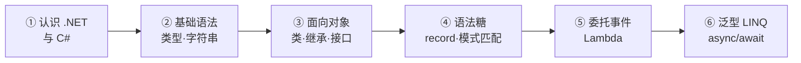
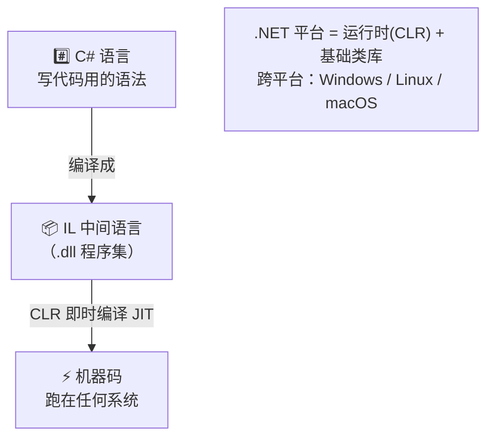
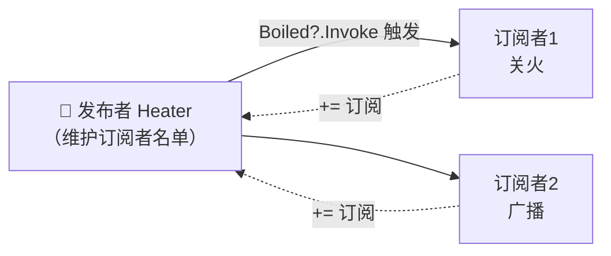
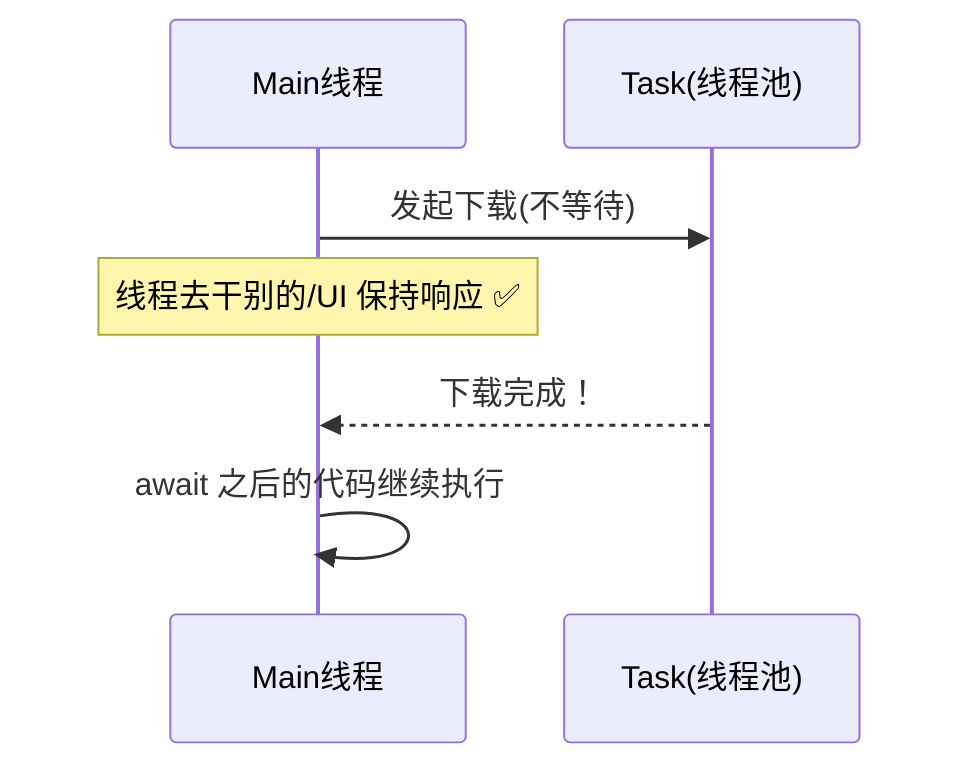
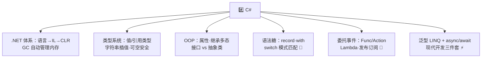

# #️⃣ C# 学习笔记

> 一句话介绍：**C# = 微软家的"六边形战士"**——语法优雅像 Java，功能犀利像 C++，还能写 Web、桌面、游戏（Unity!）、移动端全平台。现代 C#（.NET 8/9 时代）的语法糖多到甜掉牙 🍬！✨
>
> 📌 有 [C基础语法](./C基础语法.md) 底子学起来飞快，没学过也不怕，本篇从零起步～代码基于 **.NET 8+**！

---

## 📖 开篇：学习路线总览



| 章节 | 内容 | 难度 |
|------|------|------|
| 一 | C# 与 .NET 的关系、第一个程序 | ⭐ |
| 二 | 类型系统、字符串插值、集合 | ⭐⭐ |
| 三 | 面向对象：属性、继承、接口 | ⭐⭐⭐ |
| 四 | **现代语法糖：record、模式匹配** | ⭐⭐⭐ |
| 五 | **委托与事件**（对比 C 函数指针！）| ⭐⭐⭐⭐ |
| 六 | 泛型 LINQ + 异步 async/await | ⭐⭐⭐⭐ |

---

## 一、认识 C# 与 .NET 🌍

### 1.1 三者关系别搞混



| 概念 | 是什么 |
|------|--------|
| **C#** | 编程语言（语法本身）|
| **.NET** | 平台：运行时 + 海量基础库 |
| **CLR** | .NET 的虚拟机（GC、JIT 都在里面）|
| **ASP.NET Core** | 基于 .NET 的 Web 框架 |
| **Unity** | 用 C# 写脚本的游戏引擎 🎮 |

### 1.2 vs 前辈们

| 对比 | C# | C | Java |
|------|----|----|------|
| 内存管理 | **GC 自动** | 手动 malloc/free | GC 自动 |
| 指针 | 有但默认不用（安全模式）| 核心玩法 | 无 |
| 语法糖 | **超级多** 🍬 | 几乎没有 | 保守 |
| 属性/事件/迭代器/异步 | 原生支持 | 无 | 晚/弱 |
| 适用场景 | 全栈通吃 | 底层/嵌入式 | 企业后端/安卓 |

### 1.3 第一个程序（dotnet CLI）

```bash
dotnet new console -n HelloApp    # 创建控制台项目
cd HelloApp
dotnet run                         # 编译+运行一步到位！
```

```csharp
// 顶级语句（C# 9+）：连 Main 都不用写了！
Console.WriteLine("Hello, C#!");
```

> 🎀 对比 C 语言的 `#include + main + return 0`，现代 C# 一行搞定——这就是"生产力语言"的排面～

---

## 二、基础语法 🔢

### 2.1 类型系统：值类型 vs 引用类型 ⚖️

| | 值类型 | 引用类型 |
|---|--------|----------|
| 代表 | `int double bool char struct enum` | `class string 数组 record` |
| 存储 | **栈**上直接存值 | 栈存**地址**，值在**堆**上 |
| 赋值 | 复制一份（复印件 📄）| 复制地址（两个人看同一份 📎）|

```csharp
int a = 10;
var b = a;          // b 是独立副本，改 b 不影响 a
b = 99;
Console.WriteLine(a);   // 10

int[] arr1 = { 1, 2, 3 };
var arr2 = arr1;    // 两个变量指向同一个数组！
arr2[0] = 100;
Console.WriteLine(arr1[0]);   // 100（被"连坐"了 ⚠️）
```

### 2.2 变量与字符串插值 💬

```csharp
var name = "小明";              // var 类型推断（编译期确定，不是动态！）
int age = 18;
const double Pi = 3.14159;     // 常量

// 字符串插值：$"" 比 C 的 printf 格式化舒服太多！
Console.WriteLine($"我是{name}，明年{age + 1}岁");

// 原始字符串（C# 11）：JSON/正则不用疯狂转义了
var json = """{ "name": "Tom", "age": 3 }""";
```

| C 写法 | C# 写法 | 爽点 |
|--------|---------|------|
| `printf("%s=%d", s, n)` | `$"{s}={n}"` | 变量直接进字符串 ✅ |
| `char *s` + strcpy | `string` 不可变 + `+` 拼接 | 内置安全 |
| NULL 检查全家桶 | `?.` `??` `??=` | 空值处理一行流 |

```csharp
string? nick = null;                          // ? 表示可空引用类型（编译器帮盯）
Console.WriteLine(nick?.Length);              // null?.x → 不报错，直接得 null
Console.WriteLine(nick ?? "没绰号");           // null 时用默认值
nick ??= "新绰号";                             // 是 null 就赋值
```

### 2.3 集合（比 C 数组豪华多了 🏠）

```csharp
// 数组（定长）
int[] nums = { 1, 2, 3 };

// 常用集合（泛型，动态）
List<string> names = new() { "Alice", "Bob" };
names.Add("Carol");

Dictionary<string, int> ages = new()
{
    ["Alice"] = 18,
    ["Bob"] = 20
};
Console.WriteLine(ages["Alice"]);          // 18

HashSet<int> set = new() { 1, 2, 2, 3 };   // 自动去重 → {1,2,3}

foreach (var kv in ages)                   // foreach 遍历yyds
    Console.WriteLine($"{kv.Key}: {kv.Value}");
```

### 2.4 控制流：C 的超集

```csharp
// if / while / for / break / continue 和 C 一模一样，直接迁移～

// switch 语句（传统）
switch (day)
{
    case 6:
    case 7:
        Console.WriteLine("周末");
        break;
    default:
        Console.WriteLine("工作日");
        break;
}
// ⚠️ 和 C 不同：C# 的 switch【不会穿透】，每个 case 必须 break/return！
```

---

## 三、面向对象 🏛️

### 3.1 类与属性：告别 getter/setter 样板代码

```csharp
public class Student
{
    // 自动属性：一行 = 私有字段 + 读访问器 + 写访问器
    public string Name { get; set; }

    // 只读属性：只能构造时赋值
    public int Id { get; init; }          // init：只能在初始化时设置 🆕

    // 带逻辑的属性（像 C 的函数，但用起来像字段）
    private int _score;
    public int Score
    {
        get => _score;                    // 表达式体：=> 简写
        set => _score = value is < 0 or > 100 ? 0 : value;   // value 是隐式参数
    }

    public Student(int id, string name) => (Id, Name) = (id, name);   // 构造函数

    public void SayHi() => Console.WriteLine($"我是{Name}");
}

var s = new Student(1, "小明") { Name = "小明" };
s.SayHi();
```

| 对比 | Java 风格 | C# 属性 |
|------|-----------|---------|
| 读取 | `s.getName()` | `s.Name` ✨ |
| 设置 | `s.setName("x")` | `s.Name = "x"` |
| 本质 | 方法 | 编译成 get_Xxx/set_Xxx 方法（伪装成字段）|

### 3.2 继承与多态

```csharp
public class Animal                      // C# 只支持单继承（和 Java 一样）
{
    public virtual void Speak() => Console.WriteLine("...");     // virtual 允许被重写
}

public class Dog : Animal                // : 表示继承
{
    public override void Speak() => Console.WriteLine("汪汪！");  // override 重写
}

List<Animal> zoo = new() { new Animal(), new Dog() };
foreach (var a in zoo)
    a.Speak();                           // 多态：运行时看真实类型调用 ✅
```

| 关键字 | 作用 |
|--------|------|
| `virtual` | 父类声明"这个方法可以被重写" |
| `override` | 子类重写 |
| `sealed` | 禁止再被继承/重写（锁死 🔒）|
| `abstract` | 抽象：只声明不实现，子类必须实现 |
| `partial` | 类拆到多个文件（代码生成器最爱）|

### 3.3 接口与抽象类

```csharp
public interface IFlyable                // 接口约定：默认以 I 开头（约定俗成）
{
    void Fly();                          // 抽象成员
    void Land() => Console.WriteLine("降落");   // C# 8+ 默认实现 🍬
}

public class Bird : Animal, IFlyable     // 类只能单继承，但接口可以接任意多个！
{
    public void Fly() => Console.WriteLine("扇翅膀");
}
```

| 对比 | 抽象类 | 接口 |
|------|--------|------|
| 关系语义 | **是什么**（is-a）| **能做什么**（can-do）|
| 继承数量 | 单继承 | 多实现 |
| 可有字段/构造 | ✅ | ❌ |
| 使用时机 | 共享代码 + 模板 | 定义能力契约 |

---

## 四、现代语法糖大赏 🍬

### 4.1 record：一行定义不可变数据类

```csharp
// 传统写一个"数据类"要几十行；record 一行！
public record Point(int X, int Y);

var p1 = new Point(1, 2);
var p2 = p1 with { X = 10 };             // with 表达式：复制并改字段（不可变友好）

Console.WriteLine(p1);                    // Point { X = 1, Y = 2 }（自动漂亮打印 ✨）
Console.WriteLine(p1 == new Point(1, 2)); // True！record 自动按【值】比较相等
```

| 对比 | class | record |
|------|-------|--------|
| 相等比较 | 按引用（地址）| **按值** |
| 默认可变性 | 可变 | 不可变（init-only）|
| 适用 | 有行为/有状态 | DTO/配置/消息 等纯数据 ✅ |

### 4.2 模式匹配：switch 进化成完全体 🦋

```csharp
// C 的 switch 只能比整数/字符；C# 的 switch 表达式啥都能匹配！
static string Describe(object obj) => obj switch
{
    int n when n < 0     => "负数",
    int n                => $"整数 {n}",
    string s             => $"字符串：{s}",
    Point { X: 0, Y: 0 } => "原点",                 // 属性模式：匹配坐标(0,0)
    Point p              => $"点({p.X},{p.Y})",
    null                 => "空的",
    _                    => "不知道是啥"             // _ = default
};

// is + 模式：判类型+取值一步到位
if (obj is string s && s.Length > 3)
    Console.WriteLine($"长字符串：{s}");

// 关系/逻辑模式：直白如英语
bool IsHot(int t) => t is > 30 and < 50;
```

### 4.3 其他甜到齁的糖

```csharp
int? maybe = null;                        // 可空值类型（Nullable<int>）
int sure = maybe ?? 0;                    // ?? 兜底

var (x, y) = (1, 2);                      // 元组解构
(int A, int B) GetPair() => (1, 2);       // 方法返回多个值（告别出参指针！）

foreach (var (i, name) in names.Select((n, i) => (i, n)))  // 带索引遍历
    Console.WriteLine($"{i}: {name}");
```

---

## 五、委托与事件 🔔（C 函数指针的"豪华进化版"）

### 5.1 委托 = 类型安全的函数指针

> 还记得 [C 进阶](./C进阶特性.md) 的函数指针吗？`int (*fp)(int,int)` —— C# 把它包装成了**类型安全、可组合、自带语法糖**的委托！

```csharp
// 声明委托类型（签名匹配的方法都能装）
public delegate int MathOp(int a, int b);

static int Add(int a, int b) => a + b;
static int Sub(int a, int b) => a - b;

MathOp op = Add;
Console.WriteLine(op(3, 4));      // 7

op = Sub;
Console.WriteLine(op(3, 4));      // -1

// Lambda 表达式：匿名方法的糖
MathOp mul = (a, b) => a * b;
Console.WriteLine(mul(3, 4));     // 12
```

| C 函数指针 | C# 委托 |
|-----------|---------|
| `int (*fp)(int,int)` | `delegate int MathOp(int,int)` 或直接用 `Func<int,int,int>` |
| 无类型检查，乱传就崩 | **类型安全**，签名不符编译报错 ✅ |
| 手写函数指针数组 | `+=` 多播：一个委托挂一串方法 |

### 5.2 万能泛型委托：Action 与 Func（不用自己声明！）

| 内置委托 | 签名 | 用途 |
|----------|------|------|
| `Action<T>` | 无返回值 | 执行副作用 |
| `Func<T, TResult>` | 有返回值 | 计算求值 |
| `Predicate<T>` | 返回 bool | 判断条件 |

```csharp
Func<int, int, int> add = (a, b) => a + b;   // 最后一个类型参数是返回值
Action<string> log = msg => Console.WriteLine($"[LOG] {msg}");

log(add(1, 2).ToString());

// 委托当参数 → 回调（和 C 的 qsort 比较器一个思想！）
static List<int> Filter(List<int> list, Predicate<int> cond)
{
    var result = new List<int>();
    foreach (var x in list)
        if (cond(x)) result.Add(x);
    return result;
}

var evens = Filter(new List<int> { 1, 2, 3, 4, 5 }, x => x % 2 == 0);
// evens = [2, 4]
```

### 5.3 事件：发布-订阅模式 📢

```csharp
public class Heater                      // 经典案例：烧水壶
{
    public event Action<int>? Boiled;    // event 关键字：只许 += / -=，不许外部直接调用！

    public void Heat()
    {
        for (int t = 20; t <= 100; t += 40)
        {
            Console.WriteLine($"加热中... {t}℃");
            if (t >= 100)
                Boiled?.Invoke(t);       // 触发事件（所有订阅者依次被通知）
        }
    }
}

var heater = new Heater();
heater.Boiled += t => Console.WriteLine($"😱 水开了！{t}度，快关火");   // 订阅者1
heater.Boiled += t => Console.WriteLine($"📢 广播：水已烧开");           // 订阅者2
heater.Heat();
```



> 🎀 **事件 vs 普通委托字段**：`event` 加了双保险——外部**不能直接赋值清空**别人、**不能主动 Invoke** 触发，只有发布者自己能喊话～（GUI 按钮点击、消息总线，全是这套机制！）

---

## 六、泛型 LINQ 与异步 ⚡

### 6.1 泛型：类型安全的"模板"

```csharp
// 自定义泛型：T 是占位类型，约束 where 保证 T 有可比性
static T Max<T>(T a, T b) where T : IComparable<T>
    => a.CompareTo(b) >= 0 ? a : b;

Console.WriteLine(Max(3, 5));          // 5
Console.WriteLine(Max("apple", "banana"));  // banana

// 泛型集合：List<T> / Dictionary<K,V> 全是泛型的功劳
// 对比 C 的 void* 泛型（qsort）：编译期类型检查 + 无装箱拆箱 ⚡
```

### 6.2 LINQ：集合操作的天花板 🌊

```csharp
var students = new List<Student>
{
    new(1, "小明") { Score = 92 },
    new(2, "小红") { Score = 85 },
    new(3, "小刚") { Score = 58 },
};

// 链式查询：声明式写法，像 SQL 一样优雅！
var top = students
    .Where(s => s.Score >= 60)              // 过滤
    .OrderByDescending(s => s.Score)        // 排序
    .Select(s => new { s.Name, s.Score })   // 投影（匿名类型）
    .ToList();

top.ForEach(t => Console.WriteLine($"{t.Name}: {t.Score}"));
// 小明: 92
// 小红: 85

// 常用算子速记
var max = students.Max(s => s.Score);
var avg = students.Average(s => s.Score);
var byId = students.ToDictionary(s => s.Id);
var (pass, fail) = students.Partition(s => s.Score >= 60);   // .NET 10
```

| LINQ 算子 | 作用 | 对应手写循环 |
|-----------|------|--------------|
| `Where` | 过滤 | if + continue |
| `Select` | 映射 | new 一个装结果 |
| `OrderBy(Descending)` | 排序 | 冒泡/快排 😭 |
| `GroupBy` | 分组 | Dictionary 手动归堆 |
| `First / Single / Any / All / Count` | 聚合判断 | 计数器 |
| `Sum / Min / Max / Average` | 统计 | 累加器 |

### 6.3 异步编程：async/await 🌀

```csharp
// 同步下载：线程干等着，卡 UI 💀
// 异步：等的时候把线程还回去干别的，完了再回来继续～
static async Task<string> DownloadAsync(string url)
{
    using var http = new HttpClient();
    Console.WriteLine("开始下载...");
    string body = await http.GetStringAsync(url);   // await：挂起等结果，不阻塞线程
    Console.WriteLine("下载完成！");
    return body;
}

static async Task Main()
{
    // 并行等多个任务（饭和汤一起做 🍚🍲）
    Task<string> page1 = DownloadAsync("https://a.com");
    Task<string> page2 = DownloadAsync("https://b.com");
    string[] results = await Task.WhenAll(page1, page2);   // 一起等
}
```



| 要点 | 说明 |
|------|------|
| `async` | 标记方法是异步方法 |
| `await` | **异步等待**结果（期间不占线程）⭐ |
| `Task` | "未来会有结果"的凭证（类比 C 里的 future）|
| `Task.WhenAll` | 并行跑多个任务 |
| 返回值 | `Task`（无返回）/ `Task<T>`（有返回）|

---

## 七、高频问题速查 🎯

| 问题 | 要点 |
|------|------|
| C# 和 .NET 什么关系？ | C# 是语言；.NET 是平台（运行时+类库）；C# 编译成 IL 跑在 CLR 上 |
| 值类型和引用类型区别？ | 值类型栈上存值、赋值拷贝；引用类型堆上存、赋值拷地址 |
| string 可变吗？ | 不可变！拼接生成新对象；频繁拼用 StringBuilder |
| 属性(Property)是什么？ | 字段的安全包装，get/set 访问器，用起来像字段本质是方法 |
| virtual/override 干嘛的？ | 父类允许重写 + 子类重写 → 实现多态 |
| 抽象类 vs 接口？ | is-a 共享代码单继承 vs can-do 能力契约多实现 |
| record 和 class 区别？ | record 不可变、按值比较、一行定义——DTO 首选 |
| 委托是什么？ | 类型安全的函数指针；Action 无返回/Func 有返回 |
| event 和普通委托的区别？ | event 只能 +=/-=，外部不能赋值或触发（发布订阅）|
| LINQ 是什么？ | 集合的声明式查询（Where/Select/OrderBy 链式调用）|
| async/await 原理？ | 编译器生成状态机；await 挂起不阻塞线程，完成后继续 |
| ?. 和 ?? 是什么？ | 空条件运算符 / 空合并运算符（防 NullReferenceException）|

---

## 八、结语 🌸

C# 的知识树收好啦：



> 🎀 学习建议：
> 1. 装 **.NET SDK + VSCode/VS**，把第二章到第六章的代码全部亲手跑一遍——C# 的丝滑要跑起来才能体会！
> 2. 有 C 底子的同学重点对比两处：**指针 → 委托**（第五章）、**手写泛型 void* → 泛型 T**——感受"生产力语言"的进化 💪
> 3. 进阶方向：**ASP.NET Core**（Web 后端）、**Entity Framework**（ORM）、**Unity**（游戏）、**MAUI**（跨平台客户端）～
>
> C 家族又添一员 🎉：[C 基础](./C基础语法.md) + [C 进阶](./C进阶特性.md) + C#——从手动内存到 GC 世界全体验！还想学什么尽管吩咐～冲鸭！(๑•̀ㅂ•́)و✧
