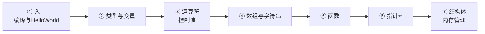
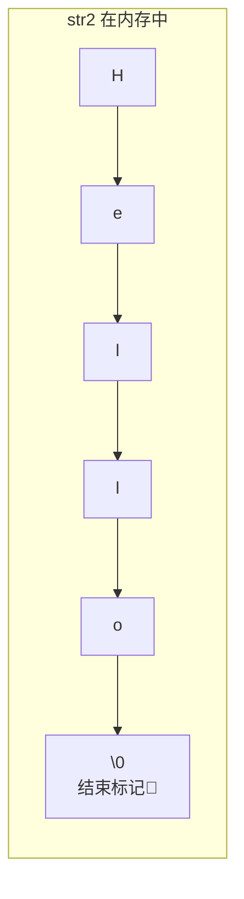
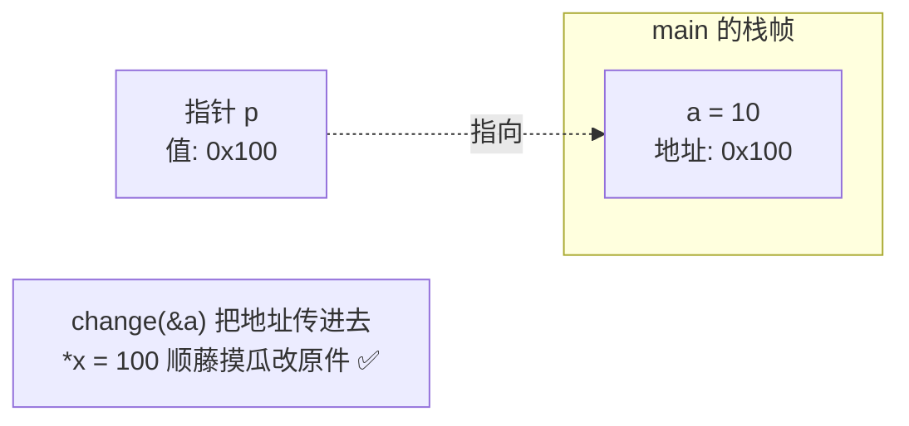
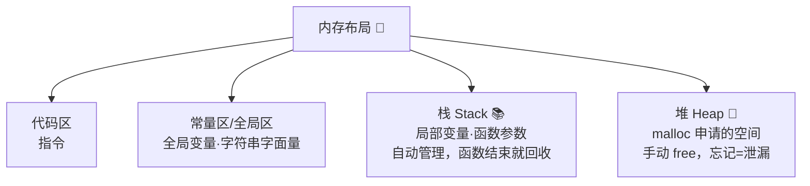
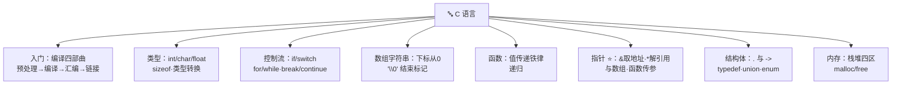

# 🔤 C 基础语法学习笔记

> 一句话介绍：**C 语言 = 一切编程语言的"地基"**——1972 年出生的老前辈，至今统治着操作系统、嵌入式、数据库内核等底层世界。学懂 C，就懂了"程序在内存里到底怎么跑的"！✨
>
> 📌 适合零基础入门，也适合从 Java/Python 转来补底层内功的同学～前置知识：无！

---

## 📖 开篇：学习路线总览



| 章节 | 内容 | 难度 |
|------|------|------|
| 一 | C 是什么、编译流程、第一个程序 | ⭐ |
| 二 | 数据类型、变量常量、类型转换 | ⭐⭐ |
| 三 | 运算符 + 控制流 | ⭐⭐ |
| 四 | 数组与字符串 | ⭐⭐ |
| 五 | 函数：值传递、递归 | ⭐⭐ |
| 六 | **指针（全篇灵魂 & 最大难关！）** | ⭐⭐⭐⭐⭐ |
| 七 | 结构体 + 内存管理（malloc/free）| ⭐⭐⭐⭐ |

---

## 一、入门：从编译到 Hello World 🌍

### 1.1 C 的江湖地位

| 领域 | 为什么是 C |
|------|-----------|
| 操作系统 | Linux/Windows 内核主体是 C |
| 嵌入式/物联网 | 单片机资源少，C 又小又快 ⚡ |
| 数据库/解释器 | MySQL、Redis、Python 解释器（CPython）核心 |
| 学其他语言 | C++/Rust/Java 的语法祖宗，懂 C 看谁都眼熟 |

### 1.2 程序是怎么跑起来的？编译四部曲 🔧


> 🎀 一句话：**预处理（文本替换）→ 编译（转汇编）→ 汇编（转机器码）→ 链接（拼上库函数）**。平时 `gcc hello.c` 一条命令四步全包～

```bash
gcc hello.c -o hello   # 编译并指定输出名
./hello                 # 运行
```

### 1.3 第一个程序

```c
#include <stdio.h>      // 标准输入输出头文件（printf 在这里）

int main(void) {        // 程序入口：main 函数
    printf("Hello, World!\n");   // \n 是换行
    return 0;           // 返回 0 表示程序正常结束
}
```

| 要素 | 说明 |
|------|------|
| `#include <stdio.h>` | 引入标准库（`<>` 系统库，`""` 自己写的头文件）|
| `main` | 程序从这里开始，`int` 返回值给操作系统 |
| `;` | **每条语句必须分号结尾**（新手忘分号报错第一名 🏆）|
| `{}` | 函数体/代码块 |

---

## 二、数据类型与变量 🔢

### 2.1 基本类型一览（64 位 Linux 典型值）

| 类型 | 字节 | 范围/说明 | 例子 |
|------|:---:|-----------|------|
| `char` | 1 | -128 ~ 127（本质是小整数）| `'A'`（65）|
| `short` | 2 | ±3.2 万 | |
| `int` | 4 | ±21 亿 | `100` |
| `long` | 8 | 超大 | `100L` |
| `float` | 4 | 6~7 位有效数字 | `3.14f` |
| `double` | 8 | 15~16 位有效数字 | `3.14` |
| `_Bool` | 1 | true/false（C99）| |

> ⚠️ `sizeof(type)` 可以实测大小；**`char` 也是整数**，`'A' + 1 == 66` 是合法的哦～

### 2.2 变量与常量

```c
int age = 18;                 // 变量：先定义后使用，必须带类型！
const double PI = 3.14159;    // 常量：const 修饰，改了就编译报错

#define MAX_SIZE 100          // 宏常量：预处理阶段纯文本替换（没有类型检查）
```

| 对比 | `const` | `#define` |
|------|---------|-----------|
| 生效时机 | 编译期，有类型检查 | 预处理期，纯替换 |
| 推荐 | ✅ 现代 C 首选 | 适合条件编译等场景 |

### 2.3 格式化输入输出 🖨️

```c
int a = 10;
double b = 3.14;
char c = 'X';

printf("a=%d b=%.2f c=%c\n", a, b, c);   // %d整数 %.2f保留2位小数 %c字符

scanf("%d", &a);      // 输入：注意 & 取地址！！（忘了 & 是新手崩溃第二大来源 💥）
```

| 占位符 | 对应类型 |
|--------|----------|
| `%d` / `%ld` | int / long |
| `%f` / `%.2f` | float（printf 里 double 也用 %f）|
| `%c` / `%s` | char / 字符串 |
| `%p` | 指针地址（调试神器 🔍）|
| `%zu` | sizeof 的结果 |

### 2.4 类型转换

```c
int a = 5, b = 2;
double r1 = a / b;          // ⚠️ 2.0！两个 int 相除先得 2，再转 double
double r2 = (double)a / b;  // ✅ 2.5：先强转 a 再除（强制转换）

// 隐式转换方向（小自动变大）：char → int → long → double
```

> 🎀 经典坑：**整数除法直接砍小数**！想要真实结果，先 `(double)` 强转～

---

## 三、运算符与控制流 🎛️

### 3.1 运算符速查

| 类别 | 运算符 | 备注 |
|------|--------|------|
| 算术 | `+ - * / %` | `%` 只能用于整数 |
| 关系 | `> < >= <= == !=` | **`==` 判等，`=` 赋值**（写成 if(a=0) 不报错但逻辑错 🕳️）|
| 逻辑 | `&& \|\| !` | **短路求值**：`&&` 左边假则右边不算 |
| 自增 | `++ --` | `a++` 先用后加；`++a` 先加后用 |
| 位运算 | `& \| ^ ~ << >>` | 直接操作二进制位（嵌入式/算法常用）|
| 三目 | `条件 ? a : b` | 迷你 if-else |
| 复合 | `+= -= *= ...` | |

```c
// 位运算小抄：n << 1 相当于乘2；n >> 1 除2；x & 1 判奇偶
int n = 5;
printf("%d %d\n", n << 1, n & 1);   // 10 1
```

### 3.2 条件语句

```c
if (score >= 90) {
    printf("优\n");
} else if (score >= 60) {
    printf("及格\n");
} else {
    printf("再接再厉\n");
}

switch (level) {           // 只能判断【整数/字符】
    case 'A':
        printf("棒\n");
        break;             // ⚠️ 不 break 会"穿透"继续执行下一个 case！
    case 'B':
        printf("良\n");
        break;
    default:
        printf("其他\n");
}
```

### 3.3 循环三兄弟

```c
// for：次数明确
for (int i = 0; i < 5; i++) { printf("%d ", i); }

// while：先判断后执行（可能一次都不跑）
int i = 0;
while (i < 5) { printf("%d ", i++); }

// do-while：先执行后判断（至少跑一次）
int j = 10;
do { printf("至少执行一次\n"); } while (j < 5);

// break：直接跳出整个循环；continue：跳过本次进入下一次
```

---

## 四、数组与字符串 📦

### 4.1 数组

```c
int scores[5] = {90, 85, 78, 92, 66};   // 定义即初始化
int zeros[10] = {0};                     // 全部初始化为 0
int matrix[2][3] = {{1,2,3},{4,5,6}};   // 二维数组

// ⚠️ 下标从 0 开始，scores[5] 越界！C 不检查越界，越界=行为未定义 💀
printf("%d %d\n", scores[0], matrix[1][2]);

int len = sizeof(scores) / sizeof(scores[0]);   // 数组长度经典算法：总大小/单元素大小
```

### 4.2 字符串 = 字符数组 + `'\0'`

```c
char str1[6] = {'H','e','l','l','o','\0'};  // 必须手动补 '\0' 结束符！
char str2[] = "Hello";                        // 字面量自动带 '\0'，大小是 6 不是 5！
char *str3 = "World";                         // 指向常量区字符串（内容不可修改 ⚠️）
```



### 4.3 常用字符串函数（`<string.h>`）

| 函数 | 作用 | 返回 |
|------|------|------|
| `strlen(s)` | 求长度（**不含 `\0`**）| size_t |
| `strcmp(a, b)` | 比较 | 0 相等 / 非 0 不等（不是 bool！）|
| `strcpy(dst, src)` | 复制 | ⚠️ dst 必须够大 |
| `strcat(dst, src)` | 拼接 | ⚠️ 同上 |
| `sprintf(buf, "%d", n)` | 格式化写入 | |

> 🎀 **判断字符串相等不能写 `==`**（那是在比地址）！必须 `strcmp(a,b) == 0`～

---

## 五、函数 🧩

```c
#include <stdio.h>

// 函数声明（原型）：告诉编译器"有这个函数"，定义可以放后面
int add(int a, int b);

int main(void) {
    int sum = add(3, 4);
    printf("%d\n", sum);
    return 0;
}

// 函数定义
int add(int a, int b) {
    return a + b;
}
```

### 5.1 值传递：C 的铁律 ⚖️

```c
void change(int x) { x = 100; }        // 改的是【副本】

int main(void) {
    int a = 10;
    change(a);
    printf("%d\n", a);    // 还是 10！因为传进去的是复印件 📄
}
```

> 🎀 C 的函数参数**永远是"复制一份传过去"**（值传递）。想在函数里改外部变量？→ 把**变量的地址**传进去（下一章指针登场！）

### 5.2 递归

```c
int factorial(int n) {
    if (n <= 1) return 1;              // 递归出口（没有就是死循环爆栈 💥）
    return n * factorial(n - 1);       // 自己调用自己
}
```

---

## 六、指针 ⭐（灵魂！慢慢来～）

### 6.1 什么是指针？

> **指针 = 存"内存地址"的变量**。内存像一排带编号的房间 🏠，指针就是写着"房间号"的小纸条～

```c
int a = 10;
int *p = &a;        // & 取地址：p 存了 a 的房间号
                    // *p 表示"顺着地址找到房间里的东西"（解引用）

printf("%p\n", p);  // 0x7ffd...（a 的地址）
printf("%d\n", *p); // 10（a 的值）
*p = 99;            // 通过地址改值 → a 变成 99！
```

| 符号 | 出现位置 | 含义 |
|------|----------|------|
| `&a` | 变量前 | 取 a 的**地址** |
| `int *p` | 定义时 | p 是**指针变量** |
| `*p` | 使用时 | 解引用：取/改指针指向的**内容** |

### 6.2 为什么需要指针？两大刚需 💡

```c
// 刚需①：让函数能修改外部变量（解决值传递）
void change(int *x) { *x = 100; }      // 传地址进来，改的是"原件"

int main(void) {
    int a = 10;
    change(&a);
    printf("%d\n", a);                 // 100 ✅
}

// 刚需②：动态内存 / 高效传大块数据（第七章）
```



### 6.3 指针与数组：一对好基友 👯

**数组名 ≈ 指向首元素的地址**（区别：数组名不可重新赋值）

```c
int arr[5] = {10, 20, 30, 40, 50};
int *p = arr;               // 等价于 &arr[0]

// 下面四种访问 arr[2] 的方式完全等价！
printf("%d %d %d %d\n",
       arr[2],      // 下标法
       *(p + 2),    // 指针法：地址+2个int大小，再解引用
       *(arr + 2),
       p[2]);
```

| 表达式 | 含义 |
|--------|------|
| `p + 1` | 地址移动**一个元素的大小**（不是 1 字节！）|
| `*(p + i)` ⇔ `p[i]` | 取第 i 个元素 |

### 6.4 指针与字符串

```c
char *s = "Hello";         // 指向常量区，s[0]='h' 💥 段错误
char buf[] = "Hello";      // 数组在栈上，buf[0]='h' ✅ 可以改
```

### 6.5 特殊指针一览

| 指针 | 是什么 | 场景 |
|------|--------|------|
| `NULL` | 空指针（地址 0），"谁也不指" | 指针初始化、判空 `if (p != NULL)` |
| 野指针 | 未初始化/已释放还用 | **严禁**！访问 = 行为未定义 💀 |
| `void *p` | 通用指针，"不知道类型" | malloc 返回值、通用接口（C 的泛型）|
| `int **pp` | 二级指针（指向指针的指针）| 修改指针本身、二维数组 |
| 函数指针 `int (*fp)(int)` | 指向函数的地址 | 回调、qsort 比较器 |

### 6.6 新手指针军规 📜

```c
int *p = NULL;    // ① 定义指针立刻初始化（不指就指 NULL）
if (p != NULL) {  // ② 用之前判空
    *p = 10;
}
free(p);
p = NULL;         // ③ free 之后立刻置 NULL（防"释放后使用"）
```

---

## 七、结构体与内存管理 🏗️

### 7.1 结构体：自己造类型

```c
#include <stdio.h>
#include <string.h>

// 定义结构体（把不同类型打包成一个新类型）
struct Student {
    int id;
    char name[20];
    double score;
};

int main(void) {
    struct Student s1 = {1, "小明", 95.5};

    struct Student *p = &s1;

    printf("%s %lf\n", s1.name, s1.score);   // 变量用 . 访问
    printf("%d\n", p->id);                    // 指针用 -> 访问（等价 (*p).id）

    strcpy(s1.name, "小红");                  // 字符数组赋值要用 strcpy，不能 = 
    return 0;
}
```

| 访问方式 | 语法 |
|----------|------|
| 变量.成员 | `s1.id` |
| 指针->成员 | `p->id`（`(*p).id` 的语法糖 🍬）|

```c
typedef struct Student {     // typedef：给类型起小名，以后不用写 struct
    int id;
    char name[20];
} Student;                   // 现在可以直接写 Student s1;
```

### 7.2 联合与枚举

```c
union Value {                // 联合：所有成员【共用同一块内存】（省空间）
    int i;
    double d;
    char c[8];               // sizeof = 最大成员的大小
};

enum Color { RED, GREEN, BLUE };   // 枚举：本质是 int 常量（RED=0, GREEN=1...）
enum Color fav = GREEN;
```

| 对比 | struct | union |
|------|--------|-------|
| 内存 | 各成员**各占各的** | 全员**共享一块**（同时只能用一个）|
| 大小 | 成员之和（+对齐）| 最大成员 |

### 7.3 内存四区 + 动态内存 ⚙️



```c
#include <stdlib.h>      // malloc/free 在这里

int *arr = (int *)malloc(10 * sizeof(int));   // 堆上申请 10 个 int（大小可运行时决定！）
if (arr == NULL) {                            // malloc 失败返回 NULL
    return 1;
}

for (int i = 0; i < 10; i++) arr[i] = i * 10;

free(arr);        // 用完必还！忘了 = 内存泄漏 💸
arr = NULL;       // 防野指针
```

| 函数 | 作用 |
|------|------|
| `malloc(n)` | 申请 n 字节（内容是垃圾值，不清零）|
| `calloc(10, 4)` | 申请 10 个 4 字节并**清零** |
| `realloc(p, n)` | 调整大小（扩容神器）|
| `free(p)` | 释放，**申请了就必须 free，且只能 free 一次** |

> 🎀 **栈 vs 堆**：栈是"食堂餐盘"（自动收走，但空间小，约几 MB）；堆是"自助仓库"（大而灵活，但要自己记得还钥匙 🔑）～
>
> 这也是 Rust/Java 里"所有权/GC"要解决的根本问题——**C 语言把管理内存的权力和痛苦都交给你**！

---

## 八、文件操作入门 📁

```c
#include <stdio.h>

// 写文件
FILE *fp = fopen("demo.txt", "w");    // "w"写(清空) "r"读 "a"追加
if (fp == NULL) {                     // 打开失败返回 NULL（文件不存在/没权限）
    perror("fopen");
    return 1;
}
fprintf(fp, "第 %d 行\n", 1);         // 像 printf 一样写
fputs("Hello\n", fp);
fclose(fp);                           // 打开必关闭！

// 读文件
FILE *fr = fopen("demo.txt", "r");
char line[128];
while (fgets(line, sizeof(line), fr) != NULL) {   // 逐行读
    printf("%s", line);
}
fclose(fr);
```

---

## 九、常见坑 & 高频问题 🎯

| 坑/问题 | 要点 |
|---------|------|
| 忘写 `;` 或 `&` | `scanf("%d", &a)` 忘 & → 段错误 💀 |
| `=` 写成 `==` | `if (a = 0)` 永假且不报错，超级隐蔽 |
| 数组越界 | C 不检查！`arr[5]`（长度 5 时）行为未定义 |
| 字符串没有 `\0` | printf 会一直读到撞上随机 `\0`（乱码）|
| 用 `==` 比字符串 | 比的是地址！用 `strcmp(a,b) == 0` |
| 整数除法 | `5/2 == 2`，要 `(double)5/2` |
| 修改字符串字面量 | `char *s="abc"; s[0]='x';` 段错误（常量区）|
| malloc 不 free | 内存泄漏；free 两次/野指针 = 崩溃 |
| 函数返回局部变量地址 | 栈帧已回收，返回悬空指针 💀 |
| switch 忘 break | case 穿透连着执行 |

**十道高频快问快答** 📝：

1. **C 程序执行入口？** → `main` 函数
2. **编译四阶段？** → 预处理 → 编译 → 汇编 → 链接
3. **`sizeof("Hello")` 是多少？** → 6（含 `\0`）
4. **指针是什么？** → 存内存地址的变量；`&` 取地址、`*` 解引用
5. **数组名和指针区别？** → 数组名是地址常量不可改；指针可运算可改指向
6. **值传递怎么改外部变量？** → 传地址（`&a`），函数内 `*x` 修改
7. **`.` 和 `->` 区别？** → 变量用 `.`，结构体指针用 `->`
8. **栈和堆区别？** → 栈自动管理空间小；堆手动 malloc/free 空间大
9. **struct 和 union 区别？** → struct 各占各的内存；union 共享一块
10. **什么是内存泄漏？** → malloc 的堆内存没 free，程序越跑越肥 💸

---

## 十、结语 🌸

C 基础语法的知识树收好啦：



> 🎀 学习建议：
> 1. **指针别怕，慢慢来**——把第六章"`&` 取地址、`*` 顺地址找内容"的比喻想通，画几张内存图，指针就通了！它是 C 的灵魂，也是 C++/Rust 的前置内功～
> 2. 每个"坑"都亲手踩一遍：故意越界、忘 free、忘 `&`——**见过的崩溃越多，内功越深** 🧘
> 3. 学完可以挑战小项目：通讯录（结构体+文件）、学生成绩管理系统（数组+函数）～
>
> 下一步可以去学 **C++（面向对象）** 或 **Rust（安全版 C）**，看到指针、内存这些概念会亲切 100 倍！还想学什么尽管吩咐～冲鸭！💪(๑•̀ㅂ•́)و✧
