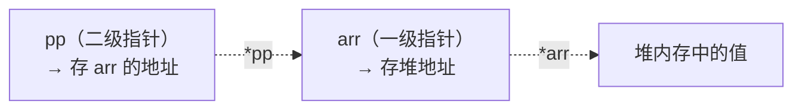
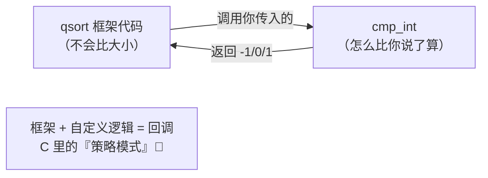
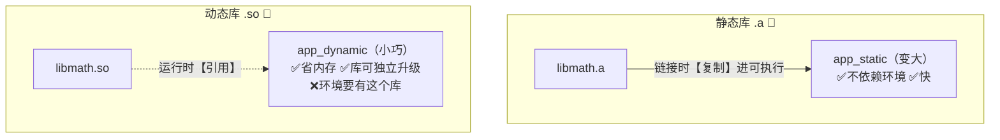
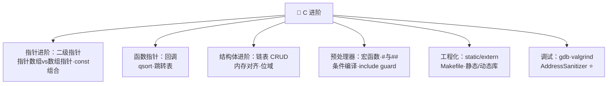

# 🚀 C 进阶特性学习笔记

> 一句话介绍：**C 进阶 = 把指针玩出花 + 把工程组织明白**——二级指针、函数指针、结构体对齐、链表、条件编译、多文件工程、静态/动态库……学完就能看懂真实项目的 C 代码了！✨
>
> 📌 前置知识：[C基础语法.md](./C基础语法.md)（尤其指针一章），本篇直接开飞机～

---

## 📖 开篇：学习路线总览


| 章节 | 内容 | 难度 |
|------|------|------|
| 一 | 二级指针、指针/数组指针、函数指针、const 组合 | ⭐⭐⭐⭐⭐ |
| 二 | 结构体进阶：链表实战、内存对齐、位域 | ⭐⭐⭐⭐ |
| 三 | 预处理：宏函数、#与##、条件编译 | ⭐⭐⭐ |
| 四 | 多文件工程：static/extern、Makefile、静态/动态库 | ⭐⭐⭐ |
| 五 | 柔性数组、变参函数、main 参数 | ⭐⭐⭐ |
| 六 | 内存错误排查 + gdb/valgrind 调试 | ⭐⭐⭐⭐ |

---

## 一、进阶指针：玩出花 🎯

### 1.1 二级指针：指针的指针

> 🎀 想想"值传递"：函数想改 `int` 要传 `int*`；那函数想改 `int*`（指针本身）呢？→ 传 `int**`！

```c
void allocMemory(int **pp, int n) {      // 想在函数内修改指针本身 → 传二级指针
    *pp = (int *)malloc(n * sizeof(int));
}

int main(void) {
    int *arr = NULL;
    allocMemory(&arr, 10);      // 把 arr 的地址传进去
    arr[0] = 42;                 // arr 已经指向堆内存了 ✅
    free(arr);
}
```



| 场景 | 用法 |
|------|------|
| 函数内修改指针 | `func(int **pp)`，调用 `func(&p)` |
| 二维动态数组 | `int **grid = malloc(...)` |
| 字符串数组 | `char *args[]` ≈ `char **args` |

### 1.2 指针数组 vs 数组指针（经典绕口令 🌀）

| 声明 | 读法 | 本质 | sizeof |
|------|------|------|--------|
| `int *p[5]` | p 是数组（5 个元素，每个是 `int*`）| **指针数组**：一堆指针 | 40（5×8）|
| `int (*p)[5]` | p 是指针（指向"含 5 个 int 的数组"）| **数组指针**：一个指针 | 8 |

```c
int *p1[5];        // 指针数组：可存 5 个 int 的地址（比如 5 行长度不一的字符串）
char *names[3] = {"Alice", "Bob", "Carol"};

int (*p2)[5];      // 数组指针：常用于接二维数组的一行
int matrix[3][5];
p2 = matrix;       // p2 指向 matrix 的第 0"行"
printf("%d\n", p2[1][2]);    // matrix[1][2] ✅
```

> 🎀 **阅读口诀（右左法则）**：从变量名出发，**先右后左**，括号优先。
> `int (*p)[5]`：p 先和 `*` 结合（括号里）→ p 是指针 → 右边 `[5]` → 指向"5 个 int 的数组" ✅

### 1.3 函数指针与回调 🔔

> **函数也住在内存里，也有地址** → 可以存进变量、当参数传递 → 这就是 C 的"回调/多态"！

```c
#include <stdlib.h>

// ① 声明函数指针类型：接收两个 void*、返回 int 的比较器
typedef int (*CompareFunc)(const void *, const void *);

int cmp_int(const void *a, const void *b) {
    return (*(int *)a) - (*(int *)b);     // 强转回 int* 再解引用比较
}

int main(void) {
    int arr[] = {5, 2, 9, 1, 7};

    // ② 标准库 qsort：把"怎么比较"作为参数传进去（回调！）
    qsort(arr, 5, sizeof(int), cmp_int);

    for (int i = 0; i < 5; i++) printf("%d ", arr[i]);   // 1 2 5 7 9
}
```



| 用法 | 例子 |
|------|------|
| 声明 | `int (*fp)(int, int);` |
| 赋值 | `fp = add;`（`&add` 也行）|
| 调用 | `fp(3, 4)` 或 `(*fp)(3, 4)` |
| 函数指针数组 | `int (*ops[])(int,int) = {add, sub};` → `ops[0](1,2)` 多态分发表！|

### 1.4 const 与指针的四种组合 ⚖️

| 声明 | 谁不能改 | 记忆 |
|------|----------|------|
| `const int *p` | `*p` 不能改（指向的内容只读）| **指**向常量的指针 |
| `int *const p` | `p` 不能改（指针本身只读）| 常量**指**针 |
| `const int *const p` | 都不能改 | 双保险 🛡️ |
| `int *p` | 都能改 | 自由散漫 |

> 🎀 口诀：**const 在 `*` 左边 → 内容只读；在 `*` 右边 → 指针只读**～

---

## 二、结构体进阶：链表与对齐 🔗

### 2.1 结构体自引用：链表节点

```c
typedef struct Node {
    int data;
    struct Node *next;      // 指向"下一个同类型节点"——链表的灵魂！
} Node;
```


### 2.2 单链表核心操作（增删查遍历）

```c
#include <stdio.h>
#include <stdlib.h>

// 头插法：新节点插到链表最前面 ⚡O(1)
Node *push_front(Node *head, int val) {
    Node *n = malloc(sizeof(Node));
    n->data = val;
    n->next = head;
    return n;                    // 新节点成为新头
}

// 删除第一个值为 val 的节点
Node *remove_val(Node *head, int val) {
    if (head == NULL) return NULL;
    if (head->data == val) {             // 删头节点
        Node *next = head->next;
        free(head);
        return next;
    }
    Node *cur = head;
    while (cur->next && cur->next->data != val)   // 找到目标的前一个
        cur = cur->next;
    if (cur->next) {                     // 删中间节点：先接后断！
        Node *victim = cur->next;
        cur->next = victim->next;
        free(victim);
    }
    return head;
}

void print_list(Node *head) {
    for (Node *p = head; p != NULL; p = p->next)
        printf("%d -> ", p->data);
    printf("NULL\n");
}

int main(void) {
    Node *head = NULL;
    for (int i = 1; i <= 3; i++) head = push_front(head, i * 10);
    print_list(head);            // 30 -> 20 -> 10 -> NULL
    head = remove_val(head, 20);
    print_list(head);            // 30 -> 10 -> NULL
}
```

> 💡 **链表 vs 数组**：数组随机访问 O(1) 但插删要搬移；链表插删 O(1)（改指针）但只能顺序找～**Redis 的 list、操作系统的内存块，全是链表思想**！

### 2.3 内存对齐：结构体大小的"玄学" 📐

```c
struct A {
    char c;      // 1 字节，但会填充到 4（对齐到下一个 int）
    int i;       // 4 字节
    char c2;     // 1 字节，尾部填充 3
};               // sizeof = 12，不是 6！
```

| 对齐规则 | 说明 |
|----------|------|
| 成员对齐 | 每个成员的偏移量必须是 `min(自身大小, 对齐系数)` 的整数倍 |
| 总大小对齐 | 结构体总大小必须是**最大成员对齐数**的整数倍 |
| 为什么要对齐 | CPU 按字长取数更快；不对齐可能多取一次甚至崩溃 |

```c
#pragma pack(1)        // 强制 1 字节对齐（网络协议/文件格式常用！）
struct Packet {
    char type;         // 偏移 0
    int  len;          // 偏移 1（不填充了）
};                     // sizeof = 5
#pragma pack()         // 恢复默认

// offsetof：算成员偏移量（对齐分析神器 🔍）
#include <stddef.h>
printf("%zu\n", offsetof(struct A, i));   // 4（前面填充了 3）
```

> 🎀 调整成员顺序能省内存：**大成员放前面**（`int` 在前 `char` 在后可能 8 字节搞定）～

### 2.4 位域：按"位"打包 🎛️

```c
struct Flags {
    unsigned int is_ok   : 1;   // 只占 1 位
    unsigned int level   : 3;   // 占 3 位（0~7）
    unsigned int reserved: 28;
};                              // 总共 4 字节，省到极致！
```

> 💡 嵌入式寄存器映射、网络协议头，位域是常客～

---

## 三、预处理器进阶 🏭

### 3.1 宏函数：威力大坑也大

```c
#define SQUARE(x) ((x) * (x))        // ① 每个参数、整体都要括号！

int a = 5;
printf("%d\n", SQUARE(a + 1));       // ((a+1)*(a+1)) = 36 ✅（没括号会变成 a+1*a+1=11 💥）
printf("%d\n", SQUARE(a++));         // ((a++)*(a++)) ⚠️ 副作用翻倍！宏是文本替换
```

| 宏的坑 | 原因 |
|--------|------|
| `SQUARE(a+1)` 算错 | 纯文本替换，没括号就翻车 |
| 参数带 `++` 副作用 | 参数被替换**多次** |
| 没类型检查 | 什么都给你替换（C++ 的 inline/模板更安全）|

### 3.2 # 和 ##：字符串化与拼接

```c
#define STR(x) #x              // 把参数变成字符串
printf("%s\n", STR(Hello));    // "Hello"

#define CAT(a, b) a##b         // 拼接 token
int CAT(my, var) = 10;         // int myvar = 10;

#define LOG(fmt, ...) printf("[LOG] " fmt "\n", __VA_ARGS__)   // 变参宏
LOG("x=%d y=%d", 1, 2);        // [LOG] x=1 y=2
```

### 3.3 条件编译与头文件保护 🛡️

```c
#ifndef MY_HEADER_H      // include guard：防止头文件被重复包含
#define MY_HEADER_H
// ... 声明内容 ...
#endif

#ifdef DEBUG
    #define LOG(...) printf(__VA_ARGS__)    // 调试版才打印
#else
    #define LOG(...)                        // 发布版变成空操作（零开销！）
#endif

#if defined(VERSION) && VERSION >= 2
// 版本相关代码
#endif
```

| 指令 | 用途 |
|------|------|
| `#ifndef/#define/#endif` | 头文件保护（必写！）|
| `#ifdef / #ifndef` | 按宏开关裁剪代码 |
| `#if / #elif / #else` | 按常量表达式编译 |
| `#undef` | 取消宏定义 |
| 预定义宏 | `__FILE__`、`__LINE__`、`__DATE__`（日志神器 📝）|

---

## 四、多文件工程与库 🏗️

### 4.1 .h 与 .c 分工 + static/extern

```c
// ---------- math_utils.h（对外"说明书"：只放声明）----------
#ifndef MATH_UTILS_H
#define MATH_UTILS_H
int add(int a, int b);        // 函数声明
extern int call_count;         // 变量声明（定义在 .c 里）
#endif

// ---------- math_utils.c（实现）----------
#include "math_utils.h"
int call_count = 0;            // 定义（唯一一份）
static int helper(int x) {     // static：只在本文件可见（私有！）
    return x * 2;
}
int add(int a, int b) {
    call_count++;
    return a + b;
}

// ---------- main.c ----------
#include <stdio.h>
#include "math_utils.h"
int main(void) {
    printf("%d\n", add(1, 2));
}
```

| 关键字 | 修饰函数 | 修饰全局变量 |
|--------|----------|--------------|
| `static` | 仅本文件可见（**私有** 🔒）| 仅本文件可见 |
| `extern` | 声明"定义在别处" | 跨文件共享（**公有** 🌍）|

> 🎀 工程规范：**头文件只放声明（类型/函数原型/extern 变量），定义全在 .c**——头文件就是模块的"对外接口说明书"～

### 4.2 手动编译与 Makefile 入门

```bash
# 笨办法：三步编译+链接
gcc -c main.c -o main.o          # main.c     → main.o
gcc -c math_utils.c -o math_utils.o
gcc main.o math_utils.o -o app   # 链接成可执行

# 文件一多就要疯 → Makefile 救场！
```

```makefile
CC = gcc
CFLAGS = -Wall -g                 # 警告全开 + 调试信息
OBJS = main.o math_utils.o

app: $(OBJS)
	$(CC) $(OBJS) -o app          # 注意：缩进必须是 Tab！

main.o: main.c math_utils.h
	$(CC) $(CFLAGS) -c main.c

math_utils.o: math_utils.c math_utils.h
	$(CC) $(CFLAGS) -c math_utils.c

clean:
	rm -f $(OBJS) app
```

```bash
make          # 只重编译改动的文件（按时间戳判断）⚡
make clean    # 清理
```

### 4.3 静态库 vs 动态库 📚

```bash
# 静态库 .a：打包进可执行文件（拷贝一份）
ar rcs libmath.a math_utils.o
gcc main.o -L. -lmath -o app_static      # -L找库目录 -l链库名

# 动态库 .so：运行时才加载（共享一份，升级不改程序）
gcc -shared -fPIC math_utils.c -o libmath.so
gcc main.c -L. -lmath -o app_dynamic
LD_LIBRARY_PATH=. ./app_dynamic          # 运行时指定库路径
```



| 对比 | 静态库 | 动态库 |
|------|--------|--------|
| 链接时机 | 编译链接时复制进程序 | 运行时加载 |
| 体积 | 可执行文件大 | 小 |
| 升级 | 要重新编译程序 | 换 .so 即可（系统 glibc 就是动态库！）|
| 依赖 | 无 | 运行环境必须有库 |

---

## 五、柔性数组、变参与 main 参数 🎒

### 5.1 柔性数组（C99）：一次 malloc 的艺术

```c
typedef struct {
    int len;
    char data[];          // 柔性数组成员：不占结构体大小，跟在屁股后面
} Buffer;

// 结构体+数据一次申请，一次释放，还连续（缓存友好 ⚡）
Buffer *buf = malloc(sizeof(Buffer) + 100);
buf->len = 100;
buf->data[0] = 'H';
free(buf);
```

### 5.2 变参函数：printf 的黑魔法 🪄

```c
#include <stdarg.h>

int sum_all(int count, ...) {         // count 先告诉有几个参数
    va_list args;
    va_start(args, count);            // 初始化参数游标
    int total = 0;
    for (int i = 0; i < count; i++)
        total += va_arg(args, int);   // 逐个取（按类型读）
    va_end(args);                     // 收尾
    return total;
}

int main(void) {
    printf("%d\n", sum_all(3, 10, 20, 30));   // 60
}
```

### 5.3 main 的参数与环境变量

```c
#include <stdio.h>

int main(int argc, char *argv[], char *envp[]) {
    // argc = 参数个数（含程序名）；argv = 参数字符串数组
    printf("程序名: %s\n", argv[0]);
    for (int i = 1; i < argc; i++)
        printf("参数%d: %s\n", i, argv[i]);
    return 0;
}
```

```bash
./app hello world
# 程序名: ./app
# 参数1: hello
# 参数2: world
```

> 💡 Linux 命令行工具全靠 `argc/argv` 接参数——`ls -l` 里的 `-l` 就是 `argv[1]`～

---

## 六、内存错误与调试工具 🔬

### 6.1 内存错误黑名单 ☠️

| 错误 | 代码 | 后果 |
|------|------|------|
| 忘 free | `p=malloc(8);` 用完不管 | 内存泄漏 💸 |
| 重复 free | `free(p); free(p);` | 崩溃 |
| 释放后使用 | `free(p); *p=1;` | 未定义行为（UAF）|
| 越界读写 | `p[100]=1;`（只申请了 10）| 破坏其他内存，诡异 bug |
| 返回栈地址 | `return buf;`（局部数组）| 悬空指针 |

### 6.2 调试三板斧 🛠️

```bash
# ① gcc 带调试信息
gcc -g -Wall app.c -o app

# ② gdb：断点/单步/查变量
gdb ./app
(gdb) break main          # 断点
(gdb) run                 # 运行
(gdb) next / step         # 单步（step 进函数）
(gdb) print p             # 看变量
(gdb) bt                  # 崩溃时看调用栈 ⭐
(gdb) quit

# ③ valgrind：内存泄漏侦探 🕵️
valgrind --leak-check=full ./app
# 会报告：definitely lost: 40 bytes（哪一行 malloc 没释放）

# ④ AddressSanitizer：编译器自带，又快又准 ⭐
gcc -fsanitize=address -g app.c -o app
./app     # 一越界立刻抓到，指明行号！
```

---

## 七、高频问题速查 🎯

| 问题 | 要点 |
|------|------|
| 二级指针什么时候用？ | 函数内要修改"指针本身"（如 malloc 出参）；二维动态数组 |
| `int *p[5]` 和 `int (*p)[5]` 区别？ | 指针数组（5 个指针）vs 数组指针（指向一行）|
| 函数指针有什么用？ | 回调（qsort 比较器）、函数跳转表——C 的"多态" |
| const int *p 和 int *const p？ | 前者内容只读，后者指针只读（看 const 在 * 哪边）|
| 结构体为什么要对齐？ | CPU 按字长访问更快；规则：成员偏移对齐自身大小、总大小对齐最大成员 |
| #pragma pack(1) 干嘛的？ | 取消填充，协议/文件解析按字节精确布局 |
| 链表和数组怎么选？ | 频繁插删 → 链表；随机访问 → 数组 |
| static 修饰函数/变量？ | 限定本文件可见（私有）；局部 static 变量还跨函数保持值 |
| extern 干嘛的？ | 声明"定义在别的文件"，跨文件共享全局变量/函数 |
| 静态库和动态库区别？ | 复制进程序 vs 运行时共享加载；升级方式与体积不同 |
| 宏函数的坑？ | 纯文本替换：参数要括号、防副作用、无类型检查 |
| 柔性数组是什么？ | 结构体末尾 `data[]`，一次 malloc 分配"头+变长数据" |
| 常见内存错误怎么查？ | -fsanitize=address（首选）、valgrind、gdb bt 看栈 |

---

## 八、结语 🌸

C 进阶的知识树收好啦：



> 🎀 学习建议：
> 1. **函数指针 + 回调**是 C 大型项目的骨架（Linux 内核到处都是），把 qsort 例子手写三遍！
> 2. **链表增删**必须练到白板能写——它是所有"数据结构"的第一课，也是面试手撕常客 ✍️
> 3. 装个 gcc + gdb，故意制造内存错误再用 `-fsanitize=address` 抓——**调试能力才是进阶的分水岭** 🧗
>
> C 的世界（基础+进阶）通关啦 🎉 接下来去 C++（面向对象）、Rust（安全内存）还是继续数据结构与算法？随时吩咐～冲鸭！💪(๑•̀ㅂ•́)و✧
