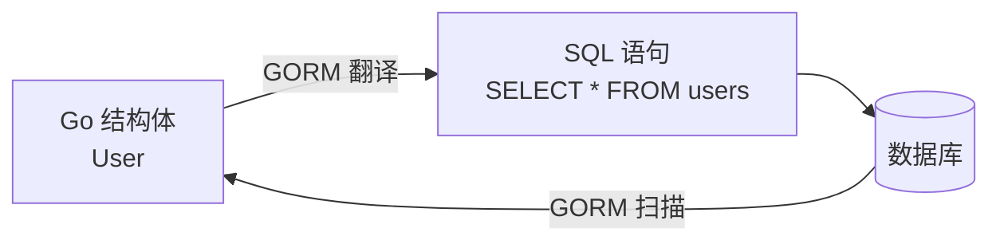
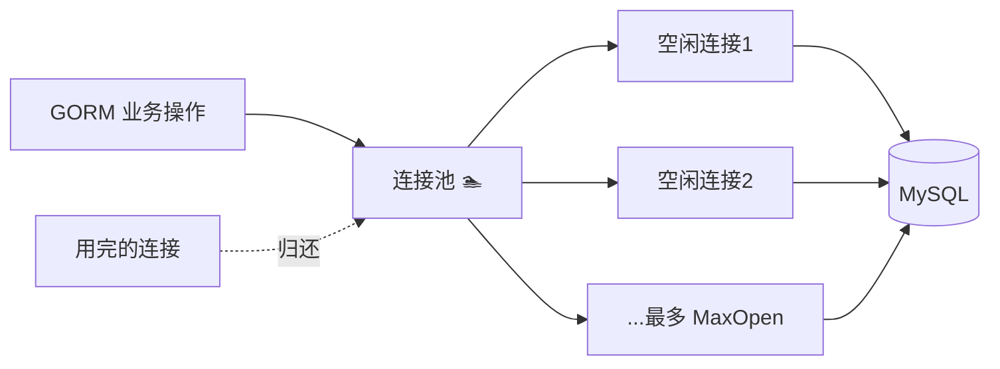
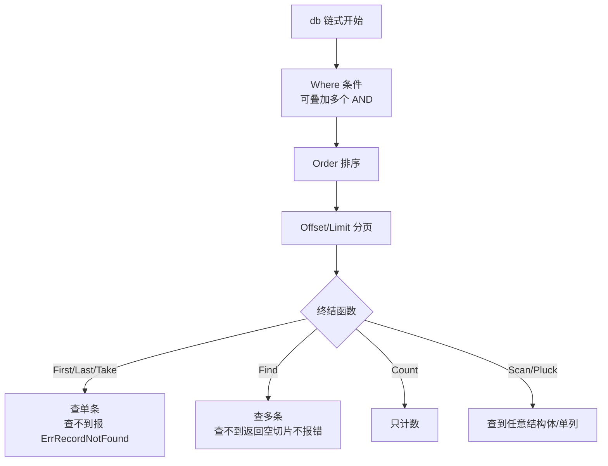
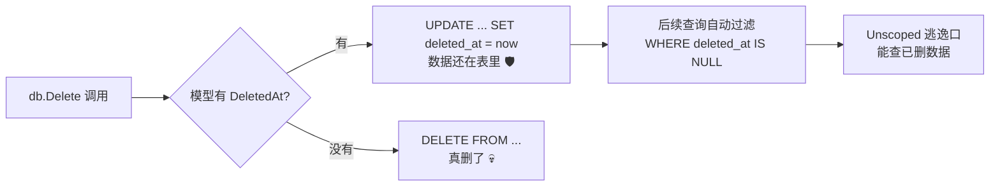
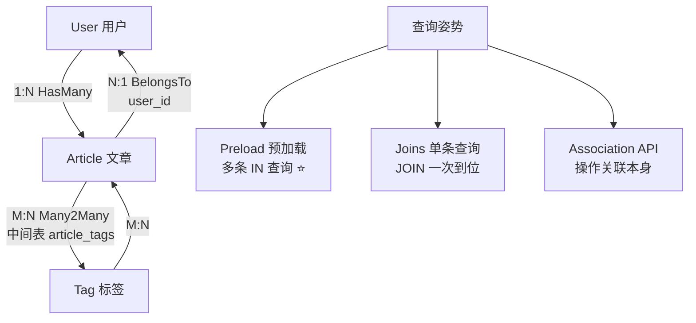
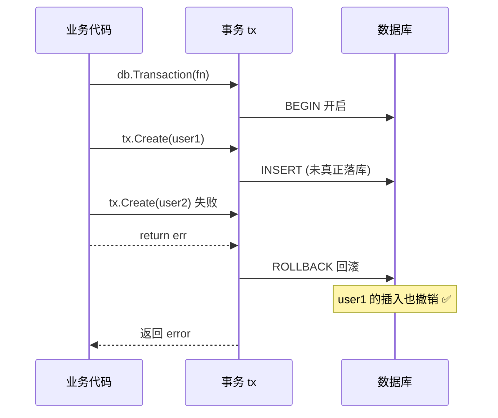
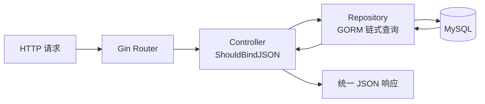
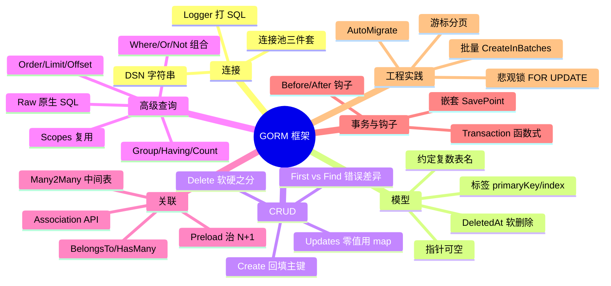

# 🗄️ GORM 框架超详细讲义

> 嘿嘿～Gin 学完能接客了，但数据总要找个地方住呀！🏠
> GORM 就是 Go 界最火的 **ORM 框架**（对象关系映射）：**写 Go 结构体 = 操作数据库表**，不用手拼 SQL～
> 这节课从连接 → 模型 → 增删改查 → 关联 → 事务，一条龙学完直接上手项目！💪

---

## 📚 目录一览

| 章节 | 主题 | 一句话理解 |
|------|------|-----------|
| 1 | ORM 是什么 | 结构体和表的翻译官 🈶 |
| 2 | 连接数据库 | 打开数据的大门 🚪 |
| 3 | 模型定义 | 结构体即表 📋 |
| 4 | 创建 Create | 往表里塞数据 ➕ |
| 5 | 查询 Query | 把数据捞出来 🔍 |
| 6 | 更新 Update | 修改数据 ✏️ |
| 7 | 删除 Delete | 清理数据 🗑️ |
| 8 | 高级查询 | 复杂条件也不怕 🧠 |
| 9 | 关联关系 | 表与表的羁绊 🤝 |
| 10 | 事务 | 要么全成要么全滚 🎲 |
| 11 | Hook 钩子 | 操作前后的自动化 🪝 |
| 12 | 迁移 Migration | 表结构自动管理 🏗️ |
| 13 | 性能优化 | 又快又稳的秘诀 ⚡ |
| 14 | 实战整合 | Gin + GORM 完整接线 🔌 |
| 15 | 踩坑大全 | 前人翻车后人乘凉 ⚠️ |

---

## 1️⃣ ORM 是什么：结构体和表的翻译官 🈶

### 1.1 没有 ORM 的日子 😢

```go
// 手拼 SQL：繁琐、易错、有 SQL 注入风险
query := fmt.Sprintf("SELECT * FROM users WHERE name = '%s'", name) // 危险！
rows, err := db.Query(query)
for rows.Next() {
    var u User
    rows.Scan(&u.ID, &u.Name, &u.Age) // 字段一多就疯了
}
```

### 1.2 有 ORM 之后 ✨

```go
// 写 Go 就是在操作数据库！
var user User
db.Where("name = ?", name).First(&user) // 自动防注入、自动扫描字段
```



**GORM 的能耐：**

| 能力 | 说明 |
|------|------|
| 🗺️ 全量 ORM | 增删改查、关联、事务、迁移全包 |
| 🪝 钩子 | 操作前后插入自定义逻辑 |
| 🔗 预加载 | 一条 SQL 解决 N+1 问题 |
| 🔌 多数据库 | MySQL / PostgreSQL / SQLite / SQL Server |
| 🔍 链式 API | `db.Where().Order().Find()` 丝滑拼接 |
| 🧩 插件生态 | 读写分离、分库分表都有现成的 |

---

## 2️⃣ 连接数据库：打开数据的大门 🚪

### 2.1 安装

```bash
go get -u gorm.io/gorm
go get -u gorm.io/driver/mysql        # MySQL 驱动
# 其他数据库：
# gorm.io/driver/postgres  PostgreSQL
# gorm.io/driver/sqlite    SQLite（学习练手神器）
# gorm.io/driver/sqlserver SQL Server
```

### 2.2 连接 MySQL

```go
package main

import (
    "log"
    "time"

    "gorm.io/driver/mysql"
    "gorm.io/gorm"
    "gorm.io/gorm/logger"
)

func main() {
    // DSN 格式：用户名:密码@tcp(地址:端口)/库名?参数
    dsn := "root:123456@tcp(127.0.0.1:3306)/mydb?charset=utf8mb4&parseTime=True&loc=Local"

    db, err := gorm.Open(mysql.Open(dsn), &gorm.Config{
        Logger: logger.Default.LogMode(logger.Info), // 打印 SQL（开发期超好用！）
    })
    if err != nil {
        log.Fatal("数据库连接失败:", err)
    }

    // 拿到底层 sql.DB 配置连接池（生产必配！）
    sqlDB, _ := db.DB()
    sqlDB.SetMaxIdleConns(10)           // 最大空闲连接
    sqlDB.SetMaxOpenConns(100)          // 最大打开连接
    sqlDB.SetConnMaxLifetime(time.Hour) // 连接最大存活时间
}
```

> 💡 DSN 参数解释：`charset=utf8mb4` 支持中文和 emoji；`parseTime=True` 把时间字段扫成 time.Time；`loc=Local` 用本地时区～

### 2.3 连接池工作示意



---

## 3️⃣ 模型定义：结构体即表 📋

### 3.1 基本模型

```go
type User struct {
    ID        uint           `gorm:"primaryKey"`                          // 主键
    Name      string         `gorm:"size:100;not null"`                   // varchar(100) 非空
    Age       int            `gorm:"default:18"`                          // 默认值 18
    Email     string         `gorm:"uniqueIndex"`                         // 唯一索引
    Birthday  *time.Time                                           // 指针类型才能存 NULL！
    CreatedAt time.Time                                                 // 创建时间（自动填充）
    UpdatedAt time.Time                                                 // 更新时间（自动填充）
    DeletedAt gorm.DeletedAt `gorm:"index"`                              // 软删除（见第7章）
}

// 约定：结构体名复数 = 表名 → User → users 表
// 字段名蛇形 = 列名 → UserName → user_name 列
```

### 3.2 常用标签速查 📇

| 标签 | 作用 | 示例 |
|------|------|------|
| `primaryKey` | 主键 | `gorm:"primaryKey"` |
| `autoIncrement` | 自增 | `gorm:"autoIncrement"` |
| `size:100` | 长度 | `gorm:"size:50"` |
| `not null` | 非空 | `gorm:"not null"` |
| `uniqueIndex` | 唯一索引 | `gorm:"uniqueIndex"` |
| `index` | 普通索引 | `gorm:"index"` |
| `default:18` | 默认值 | `gorm:"default:0"` |
| `column:xx` | 自定义列名 | `gorm:"column:user_name"` |
| `-` | 忽略此字段 | `gorm:"-"` |
| `type:text` | 指定类型 | `gorm:"type:longtext"` |
| `comment:备注` | 列注释 | `gorm:"comment:用户名"` |
| `precision, scale` | 精度 | `gorm:"precision:10;scale:2"`（金额！） |

### 3.3 类型映射表

| Go 类型 | MySQL 类型 |
|---------|-----------|
| `int` / `uint` | bigint / int |
| `string` | longtext（加 size → varchar） |
| `bool` | tinyint(1) |
| `time.Time` | datetime(3) |
| `float64` | double |
| `*time.Time` 等指针 | 对应类型，可 NULL |

> ⚠️ **NULL 大坑**：Go 的 `string`、`time.Time` 不能存 NULL！可空字段必须用**指针** `*string` 或 `sql.NullString`～

### 3.4 自定义表名

```go
// 方式一：实现 Tabler 接口
func (User) TableName() string {
    return "t_user" // 不叫 users 了，叫 t_user
}

// 方式二：临时指定
db.Table("my_users").Find(&users)
```

---

## 4️⃣ 创建 Create：往表里塞数据 ➕

```go
user := User{Name: "小樱", Age: 14}

// ① 单条插入
result := db.Create(&user)
result.Error        // 错误
result.RowsAffected // 影响行数：1
user.ID             // 插入后自动回填主键！✨

// ② 批量插入
users := []User{{Name: "知世"}, {Name: "小狼"}, {Name: "雪兔"}}
db.Create(&users) // 一条 SQL 塞全部
for _, u := range users {
    fmt.Println(u.ID) // 每个都有 ID 了
}

// ③ 指定字段插入（其他字段不写库，用数据库默认值）
db.Select("Name", "Age").Create(&user)
// INSERT INTO users (name, age) VALUES ('小樱', 14)

// ④ 排除字段插入
db.Omit("Age").Create(&user) // 不插 age 列

// ⑤ Map 插入（没有结构体也行）
db.Model(&User{}).Create(map[string]any{
    "Name": "桃矢", "Age": 17,
})
```

**Upsert：存在就更新，不存在就插入（MySQL 专属 ⭐）**

```go
import "gorm.io/gorm/clause"

// 冲突时更新指定列
db.Clauses(clause.OnConflict{
    Columns:   []clause.Column{{Name: "id"}}, // 冲突判断列
    DoUpdates: clause.AssignmentColumns([]string{"name", "age"}),
}).Create(&user)
// INSERT ... ON DUPLICATE KEY UPDATE name=..., age=...

// 冲突时啥也不干
db.Clauses(clause.OnConflict{DoNothing: true}).Create(&user)
```

---

## 5️⃣ 查询 Query：把数据捞出来 🔍

### 5.1 基础查询

```go
var user User
var users []User

// ① 主键查询
db.First(&user, 1)            // 按主键升序取第一条：SELECT * ORDER BY id LIMIT 1
db.Last(&user, 1)             // 按主键降序取第一条
db.Take(&user)                // 不排序取第一条

// ② 条件查询
db.First(&user, "name = ?", "小樱") // where name = '小樱'

// ③ 查全部
db.Find(&users)               // SELECT * FROM users

// ④ 条件查多条
db.Where("age > ?", 10).Find(&users)
db.Where("name IN ?", []string{"小樱", "知世"}).Find(&users)
db.Where("age BETWEEN ? AND ?", 10, 20).Find(&users)
db.Where("name LIKE ?", "%樱%").Find(&users)

// ⑤ 结构体条件（⚠️ 零值字段会被忽略！）
db.Where(&User{Name: "小樱", Age: 0}).Find(&users) // age=0 被忽略！

// ⑥ Map 条件（零值不会被忽略 ✅）
db.Where(map[string]any{"name": "小樱", "age": 0}).Find(&users)

// ⑦ 查不到不报错版
result := db.Where("name = ?", "不存在").Find(&users)
result.RowsAffected // 0（Find 查不到 RowsAffected=0，Error=nil）
// 对比：First 查不到 Error = ErrRecordNotFound ⚠️
```

### 5.2 First vs Take vs Find 的错误行为（重点 ⭐）

| 函数 | 查不到时 | 排序 |
|------|---------|------|
| `First` | `gorm.ErrRecordNotFound` | 主键升序 |
| `Last` | `gorm.ErrRecordNotFound` | 主键降序 |
| `Take` | `gorm.ErrRecordNotFound` | 不排序 |
| `Find` | **不报错**（空切片/零值） | 不排序 |

```go
var user User
err := db.First(&user, 999).Error
if errors.Is(err, gorm.ErrRecordNotFound) {
    fmt.Println("查无此人～")
}
```

### 5.3 选择字段 & 去重

```go
// 只查需要的列（省流量又快！）
db.Select("name", "age").Find(&users)
db.Select("COALESCE(age,?)", 18).Find(&users) // 表达式

// 去重
db.Distinct("name").Find(&users)

// 查成 map（不需要模型时）
var result map[string]any
db.Model(&User{}).Find(&result)
```

### 5.4 排序 / 分组 / 分页（Web 必备 ⭐）

```go
// 排序
db.Order("age desc, name asc").Find(&users)

// 分页：LIMIT + OFFSET
page, size := 2, 10
db.Offset((page - 1) * size).Limit(size).Find(&users)
// LIMIT 10 OFFSET 10（第2页）

// Group + Having 聚合
type Result struct {
    Age   int
    Total int
}
var results []Result
db.Model(&User{}).
    Select("age, count(*) as total").
    Group("age").
    Having("count(*) > ?", 2).
    Scan(&results) // Scan：查到非模型结构体用

// Count 计数（分页接口必备！）
var total int64
db.Model(&User{}).Where("age > ?", 10).Count(&total)
```

### 5.5 子查询

```go
// WHERE age > (SELECT AVG(age) FROM users)
db.Where("age > (?)", db.Model(&User{}).Select("AVG(age)")).Find(&users)

// FROM 子查询
subQuery := db.Select("name").Where("age > ?", 15).Model(&User{})
db.Table("(?) as u", subQuery).Find(&results)
```

### 5.6 查询流程图



---

## 6️⃣ 更新 Update：修改数据 ✏️

### 6.1 三种更新姿势

```go
// ① Save：全字段更新（哪怕零值也写进去！）
db.Save(&user) // UPDATE users SET name='xx', age=14, ... WHERE id=1

// ② Update：更新单个字段
db.Model(&user).Update("name", "小樱酱")
// UPDATE users SET name='小樱酱', updated_at='...' WHERE id=1

// ③ Updates：更新多个字段
// 结构体方式（⚠️ 零值字段被忽略！）
db.Model(&user).Updates(User{Name: "小樱", Age: 0})   // 只更新 name！
// Map 方式（✅ 零值也能更新）
db.Model(&user).Updates(map[string]any{"name": "小樱", "age": 0}) // 两个字段都更！
```

> ⚠️ **新手必踩坑**：结构体 Updates **跳过零值字段**（没法区分"没传"和"传了0"）！要更新零值 → 用 **map** 或 **Select**：
> ```go
> db.Model(&user).Select("Age").Updates(User{Age: 0}) // 强制更新 age=0
> ```

### 6.2 批量更新 & 表达式

```go
// 批量：不加 Where 就是全表更新（危险！）
db.Model(&User{}).Where("age < ?", 18).Update("status", "minor")

// 表达式自增自减
db.Model(&user).UpdateColumn("age", gorm.Expr("age + ?", 1)) // age = age + 1

// 阻止全局更新（安全默认）：无条件的 Update/Save 会报 ErrMissingWhereClause
db.Model(&User{}).Update("name", "x") // ❌ 报错！
db.Model(&User{}).Where("1=1").Update("name", "x") // ✅ 显式声明才允许
```

---

## 7️⃣ 删除 Delete：清理数据 🗑️

### 7.1 软删除 vs 硬删除

```go
// 模型里有 gorm.DeletedAt 字段 = 自动开启软删除！
type User struct {
    ID        uint
    Name      string
    DeletedAt gorm.DeletedAt `gorm:"index"` // 🌟 关键字段
}

// 软删除：不真删，把 deleted_at 填上时间
db.Delete(&user)   // UPDATE users SET deleted_at='2026-08-19...' WHERE id=1

// 软删除的效果：
db.Find(&users)                     // 自动 WHERE deleted_at IS NULL（看不见已删的）
db.First(&user, 1)                  // 查不到已删的
db.Unscoped().Find(&users)          // 包含已删除的（_raw 模式）
db.Unscoped().First(&user, 1)       // 能查到已删除的

// 真删除（物理删除）
db.Unscoped().Delete(&user) // DELETE FROM users WHERE id=1 💀

// 批量删除
db.Where("age < ?", 18).Delete(&User{})
```

### 7.2 软删除原理图



| 对比 | 软删除 | 硬删除 |
|------|--------|--------|
| SQL | UPDATE 填时间戳 | DELETE |
| 数据 | 还在表里（可恢复） | 没了 |
| 查询性能 | 每次多个条件（要索引！） | 表更轻 |
| 适用 | 订单/用户（可恢复审计） | 日志/临时数据 |

---

## 8️⃣ 高级查询：复杂条件也不怕 🧠

### 8.1 条件组合艺术

```go
// AND（多个 Where 叠加）
db.Where("name = ?", "小樱").Where("age > ?", 10).Find(&users)

// OR
db.Where("name = ?", "小樱").Or("age > ?", 20).Find(&users)

// 分组条件：Or 里套 And（括号！）
db.Where(
    db.Where("name = ?", "小樱").Or("name = ?", "知世"),
).Where("age > ?", 10).Find(&users)
// WHERE (name='小樱' OR name='知世') AND age > 10

// Not
db.Not("name = ?", "小樱").Find(&users)

// 内联条件
db.First(&user, "id = ? AND age > ?", 1, 10)
```

### 8.2 指定锁定（防超卖必备 ⭐）

```go
// 悲观锁：SELECT ... FOR UPDATE（事务里用）
db.Clauses(clause.Locking{Strength: "UPDATE"}).
    Where("id = ?", 1).
    First(&product)
// 其他事务动不了这行，直到你提交！

// 经典扣库存（并发安全）：
err := db.Transaction(func(tx *gorm.DB) error {
    var p Product
    if err := tx.Clauses(clause.Locking{Strength: "UPDATE"}).
        First(&p, productID).Error; err != nil {
        return err
    }
    if p.Stock <= 0 {
        return errors.New("库存不足")
    }
    return tx.Model(&p).UpdateColumn("stock", gorm.Expr("stock - 1")).Error
})
```

### 8.3 命名参数 & 原生 SQL

```go
// 命名参数（可读性好）
db.Where("name = @name OR age = @age", sql.Named("name", "小樱"), sql.Named("age", 14))
db.Where("name = @name", map[string]any{"name": "小樱"})

// 原生 SQL（GORM 搞不定的复杂查询直接写！）
var users []User
db.Raw("SELECT * FROM users WHERE age > ?", 10).Scan(&users)

db.Exec("UPDATE users SET age = ? WHERE id = ?", 20, 1) // 无返回结果集
```

### 8.4 Scopes：可复用的查询片段 ⭐

```go
// 定义常用过滤条件
func Active(db *gorm.DB) *gorm.DB {
    return db.Where("status = ?", "active")
}

func Paginate(page, size int) func(db *gorm.DB) *gorm.DB {
    return func(db *gorm.DB) *gorm.DB {
        offset := (page - 1) * size
        return db.Offset(offset).Limit(size)
    }
}

func AgeGreaterThan(n int) func(db *gorm.DB) *gorm.DB {
    return func(db *gorm.DB) *gorm.DB {
        return db.Where("age > ?", n)
    }
}

// 像积木一样拼！
db.Scopes(Active(), AgeGreaterThan(18), Paginate(1, 10)).Find(&users)
```

### 8.5 Pluck：只捞一列

```go
var names []string
db.Model(&User{}).Pluck("name", &names) // ["小樱", "知世", ...]
```

---

## 9️⃣ 关联关系：表与表的羁绊 🤝（重点⭐⭐）

### 9.1 模型准备：用户 ↔ 文章 ↔ 标签

```go
// 一对多：一个用户有多篇文章
type User struct {
    ID       uint
    Name     string
    Articles []Article // 一对多
}

type Article struct {
    ID     uint
    Title  string
    UserID uint      // 外键（GORM 自动识别：所有者类型+ID）
    User   User      // 属于（反向）
    Tags   []Tag `gorm:"many2many:article_tags;"` // 多对多！
}

type Tag struct {
    ID   uint
    Name string
    Articles []Article `gorm:"many2many:article_tags;"`
}
// 多对多：GORM 自动创建中间表 article_tags
```

### 9.2 三大关系速查

| 关系 | 标签写法 | 外键位置 | 示例 |
|------|---------|---------|------|
| 属于 Belongs To | 默认（有外键方） | 当前表 | 文章.UserID → 用户 |
| 一对多 Has Many | `[]Article` | 子表 | 用户 → 多篇文章 |
| 多对多 Many2Many | `gorm:"many2many:表名"` | 中间表 | 文章 ↔ 标签 |

### 9.3 关联操作

```go
// ① 创建时自动关联
db.Create(&User{
    Name: "小樱",
    Articles: []Article{{Title: "Go入门"}, {Title: "Gin实战"}},
}) // 用户和两篇文章一起入库，外键自动填！

// ② Association API：给已有文章加标签
db.Model(&article).Association("Tags").Append([]Tag{{Name: "Go"}, {Name: "教程"}})

// 查询关联
db.Model(&user).Association("Articles").Count() // 数量

// 删除关联（只断开关系，不删数据）
db.Model(&article).Association("Tags").Delete(&tag)

// 替换关联
db.Model(&article).Association("Tags").Replace([]Tag{{Name: "新标签"}})

// 清空关联
db.Model(&article).Association("Tags").Clear()
```

### 9.4 预加载 Preload：治 N+1 的神药 💊（重点！）

```go
// ❌ N+1 问题：查 100 个用户再逐个查文章 = 101 条 SQL！
var users []User
db.Find(&users)                        // 1 条
for _, u := range users {
    db.Model(&u).Association("Articles").Count() // 每人 1 条 = 100 条 🐌
}

// ✅ Preload：2 条 SQL 搞定！
var users []User
db.Preload("Articles").Find(&users)
// SELECT * FROM users;
// SELECT * FROM articles WHERE user_id IN (1,2,3,...100);

// 带条件的预加载
db.Preload("Articles", "title LIKE ?", "%Go%").Find(&users) // 只加载含 Go 的文章

// 嵌套预加载（用户→文章→标签）
db.Preload("Articles.Tags").Find(&users) // 3 条 SQL 全搞定

// Joins 预加载（单条查询时更高效）
db.Joins("User").First(&article) // 一条 JOIN SQL 搞定 BelongsTo
```

### 9.5 关联模式全景图



---

## 🔟 事务：要么全成要么全滚 🎲

### 10.1 方式一：函数式（推荐 ⭐）

```go
// 转账经典场景：A 扣钱 + B 加钱，必须同时成功！
err := db.Transaction(func(tx *gorm.DB) error {
    // tx 就是事务内的 db，之后全用它操作！
    if err := tx.Model(&User{ID: 1}).Update("balance", gorm.Expr("balance - ?", 100)).Error; err != nil {
        return err // 返回 error → 自动 Rollback！
    }
    if err := tx.Model(&User{ID: 2}).Update("balance", gorm.Expr("balance + ?", 100)).Error; err != nil {
        return err // 回滚，A 的扣款也撤销 ✅
    }
    // 返回 nil → 自动 Commit
    return nil
})
fmt.Println("事务结果:", err)
```

### 10.2 方式二：手动控制

```go
tx := db.Begin() // 开启事务
defer func() {
    if r := recover(); r != nil {
        tx.Rollback() // panic 也要回滚！
        panic(r)
    }
}()

if err := tx.Create(&order).Error; err != nil {
    tx.Rollback()
    return err
}
if err := tx.Create(&payment).Error; err != nil {
    tx.Rollback()
    return err
}

tx.Commit() // 提交
```

### 10.3 嵌套事务 & 保存点

```go
db.Transaction(func(tx *gorm.DB) error {
    tx.Create(&user1) // 外层事务

    tx.Transaction(func(tx2 *gorm.DB) error { // 嵌套 → SavePoint！
        tx2.Create(&user2)
        return errors.New("内层失败") // 只回滚到 SavePoint
    })

    tx.Create(&user3) // 继续外层
    return nil
})
```

### 10.4 事务生命周期图



---

## 1️⃣1️⃣ Hook 钩子：操作前后的自动化 🪝

```go
type User struct {
    ID       uint
    Name     string
    Password string
}

// 创建前：自动加密密码
func (u *User) BeforeCreate(tx *gorm.DB) error {
    if u.Password != "" {
        u.Password = hash(u.Password) // 自动加密！
    }
    return nil // 返回 error 会中止创建！
}

// 查询后：自动脱敏手机号
func (u *User) AfterFind(tx *gorm.DB) error {
    if len(u.Phone) == 11 {
        u.Phone = u.Phone[:3] + "****" + u.Phone[7:] // 138****5678
    }
    return nil
}

// 更新前校验
func (u *User) BeforeUpdate(tx *gorm.DB) error {
    if tx.Statement.Changed("Password") { // 字段是否被修改
        fmt.Println("密码被修改了，触发邮件通知～")
    }
    return nil
}
```

**全部钩子一览：**

| 时机 | 钩子函数 |
|------|---------|
| 创建前/后 | `BeforeCreate` / `AfterCreate` |
| 更新前/后 | `BeforeUpdate` / `AfterUpdate` |
| 删除前/后 | `BeforeDelete` / `AfterDelete` |
| 查询后 | `AfterFind` |
| 保存前/后 | `BeforeSave` / `AfterSave`（Create+Update 都触发） |

> ⚠️ 钩子方法要定义在**同一个文件/包**且接收者匹配（指针模型用指针接收者），不然不生效～

---

## 1️⃣2️⃣ 迁移 Migration：表结构自动管理 🏗️

```go
// ① AutoMigrate：没有表就建，少了列就加（最常用！）
db.AutoMigrate(&User{}, &Article{}, &Tag{})

// ② 手动建表 / 删表
db.Migrator().CreateTable(&User{})
db.Migrator().DropTable(&User{})

// ③ 检查
db.Migrator().HasTable(&User{})       // 表存在吗
db.Migrator().HasColumn(&User{}, "email") // 列存在吗

// ④ 加列 / 改类型 / 加索引
db.Migrator().AddColumn(&User{}, "Age")
db.Migrator().AlterColumn(&User{}, "Name")
db.Migrator().CreateIndex(&User{}, "idx_name")
```

**AutoMigrate 的性格：**

| 行为 | 说明 |
|------|------|
| 建表 | 没有表 → 创建 ✅ |
| 加列 | 模型多了字段 → 加上 ✅ |
| **删列** | 模型删了字段 → **不动数据库**（怕丢数据）🛡️ |
| 改列 | 只改类型，**不重命名** ⚠️ |

> 💡 生产建议：AutoMigrate 适合开发和中小项目；大项目用 **版本化迁移工具**（golang-migrate / atlas），SQL 可审查可回滚～

---

## 1️⃣3️⃣ 性能优化：又快又稳的秘诀 ⚡

### 13.1 N+1 检查清单

```go
// ❌ 循环里查库（最慢写法）
for _, id := range ids {
    db.First(&user, id) // 100 个 ID = 100 条 SQL 🐌
}

// ✅ 批量 IN 查询
db.Where("id IN ?", ids).Find(&users) // 1 条 SQL 🚀

// ❌ 循环里逐条插入
for _, u := range users {
    db.Create(&u)
}

// ✅ 批量插入
db.CreateInBatches(users, 100) // 每 100 条一批
```

### 13.2 索引与查询习惯

```go
// ① 常查的字段加索引（模型标签）
Name string `gorm:"index"`
Email string `gorm:"uniqueIndex"`

// ② 只 SELECT 需要的列
db.Select("id", "name").Find(&users) // 别动不动 SELECT *

// ③ 大表分页优化：游标分页代替深分页
// ❌ OFFSET 1000000（要扫过前面 100 万行）
db.Offset(1000000).Limit(10).Find(&users)
// ✅ 游标：WHERE id > 上一页最后的ID LIMIT 10
db.Where("id > ?", lastID).Limit(10).Find(&users)
```

### 13.3 Prepared Statement 缓存

```go
db, err := gorm.Open(mysql.Open(dsn), &gorm.Config{
    PrepareStmt: true, // 缓存预编译语句，重复查询快很多！
})
```

### 13.4 读写分离（插件）

```go
import "gorm.io/plugin/dbresolver"

db.Use(dbresolver.Register(dbresolver.Config{
    Replicas: []gorm.Dialector{mysql.Open(replicaDSN)}, // 从库们
}))
// 读自动走从库，写走主库～
```

### 13.5 性能优化速查表

| 手段 | 效果 |
|------|------|
| Preload 替代循环查询 | 消灭 N+1 🚀 |
| `CreateInBatches` | 批量插入 |
| `id IN ?` | 批量查询 |
| 游标分页 | 深分页救星 |
| `PrepareStmt: true` | SQL 预编译缓存 |
| 索引 + `Select` 指定列 | 查询瘦身 |
| 连接池参数 | 稳定压倒一切 |

---

## 1️⃣4️⃣ 实战整合：Gin + GORM 完整接线 🔌

把 Gin 课的 CRUD 接上真数据库！

### 14.1 项目结构

```text
userapp/
├── main.go
├── model/user.go
├── repository/user_repo.go
├── controller/user_controller.go
└── router/router.go
```

### 14.2 完整代码

```go
// model/user.go
package model

import (
    "strings"
    "time"

    "gorm.io/gorm"
)

type User struct {
    ID        uint           `gorm:"primaryKey" json:"id"`
    Name      string         `gorm:"size:50;not null" json:"name"`
    Email     string         `gorm:"size:100;uniqueIndex" json:"email"`
    Age       int            `json:"age"`
    CreatedAt time.Time      `json:"createdAt"`
    UpdatedAt time.Time      `json:"updatedAt"`
    DeletedAt gorm.DeletedAt `gorm:"index" json:"-"`
}

func (u *User) AfterFind(tx *gorm.DB) error {
    u.Email = strings.maskEmail(u.Email) // 响应自动脱敏
    return nil
}
```

```go
// repository/user_repo.go —— 只管数据库操作
package repository

import (
    "errors"
    "userapp/model"

    "gorm.io/gorm"
)

type UserRepo struct{ DB *gorm.DB }

func (r *UserRepo) List(page, size int) ([]model.User, int64, error) {
    var (
        users []model.User
        total int64
    )
    if err := r.DB.Model(&model.User{}).Count(&total).Error; err != nil {
        return nil, 0, err
    }
    err := r.DB.Offset((page - 1) * size).Limit(size).
        Order("id DESC").Find(&users).Error
    return users, total, err
}

func (r *UserRepo) GetByID(id uint) (*model.User, error) {
    var u model.User
    err := r.DB.First(&u, id).Error
    if errors.Is(err, gorm.ErrRecordNotFound) {
        return nil, nil // 统一：查不到返回 nil，让上层决定语义
    }
    return &u, err
}

func (r *UserRepo) Create(u *model.User) error {
    return r.DB.Create(u).Error
}

func (r *UserRepo) Update(id uint, updates map[string]any) (*model.User, error) {
    var u model.User
    if err := r.DB.First(&u, id).Error; err != nil {
        return nil, err
    }
    // map 更新：零值也能更新 ✅
    if err := r.DB.Model(&u).Updates(updates).Error; err != nil {
        return nil, err
    }
    return &u, nil
}

func (r *UserRepo) Delete(id uint) error {
    return r.DB.Delete(&model.User{}, id).Error // 软删除 🛡️
}
```

```go
// main.go —— 组装一切
package main

import (
    "log"
    "net/http"
    "os"
    "os/signal"
    "syscall"
    "time"

    "github.com/gin-gonic/gin"
    "gorm.io/driver/mysql"
    "gorm.io/gorm"
    "gorm.io/gorm/logger"

    "userapp/model"
    "userapp/repository"
)

func main() {
    // ① 连接数据库
    dsn := "root:123456@tcp(127.0.0.1:3306)/mydb?charset=utf8mb4&parseTime=True&loc=Local"
    db, err := gorm.Open(mysql.Open(dsn), &gorm.Config{
        Logger: logger.Default.LogMode(logger.Info),
    })
    if err != nil {
        log.Fatal("DB 连接失败:", err)
    }
    sqlDB, _ := db.DB()
    sqlDB.SetMaxIdleConns(10)
    sqlDB.SetMaxOpenConns(100)
    sqlDB.SetConnMaxLifetime(time.Hour)

    // ② 自动迁移
    db.AutoMigrate(&model.User{})

    // ③ 组装依赖
    repo := &repository.UserRepo{DB: db}

    // ④ 路由
    r := gin.Default()
    users := r.Group("/api/v1/users")
    {
        users.GET("", func(c *gin.Context) { listUsers(c, repo) })
        users.GET("/:id", func(c *gin.Context) { getUser(c, repo) })
        users.POST("", func(c *gin.Context) { createUser(c, repo) })
        users.PUT("/:id", func(c *gin.Context) { updateUser(c, repo) })
        users.DELETE("/:id", func(c *gin.Context) { deleteUser(c, repo) })
    }

    // ⑤ 优雅启动（Gin 课学的复用！）
    srv := &http.Server{Addr: ":8080", Handler: r}
    go func() {
        if err := srv.ListenAndServe(); err != nil && err != http.ErrServerClosed {
            log.Fatalf("listen: %v", err)
        }
    }()

    quit := make(chan os.Signal, 1)
    signal.Notify(quit, syscall.SIGINT, syscall.SIGTERM)
    <-quit
    log.Println("服务优雅关闭中……")
    ctx, cancel := context.WithTimeout(context.Background(), 5*time.Second)
    defer cancel()
    srv.Shutdown(ctx)
}
```

（Controller 函数与 Gin 课类似：`ShouldBindJSON` 绑参 → 调 repo → 统一响应，完整版见 Gin 课第 14 章，把内存 Store 换成这里的 repo 即可～）

### 14.3 请求流转全景



---

## 1️⃣5️⃣ 踩坑大全：前人翻车后人乘凉 ⚠️

### 坑1：结构体条件/更新忽略零值

```go
// ❌ 想查 age=0 的用户，结果查了所有！
db.Where(&User{Age: 0}).Find(&users)
// ❌ 想把 age 更新成 0，结果没更新！
db.Updates(User{Age: 0})

// ✅ 用 map
db.Where(map[string]any{"age": 0}).Find(&users)
db.Model(&user).Updates(map[string]any{"age": 0})
```

### 坑2：First 查不到当成功处理

```go
// ❌ 忽略错误
user := db.First(&user, id) // 查不到时 user 是零值，后面用全是坑！
// ✅ 标准姿势
if err := db.First(&user, id).Error; err != nil {
    if errors.Is(err, gorm.ErrRecordNotFound) {
        // 404 逻辑
    }
}
```

### 坑3：NULL 字段用非指针类型

```go
// ❌ 非指针存不了 NULL（扫到 NULL 直接报错或变零值）
type User struct { Birthday time.Time }
// ✅ 指针类型
type User struct { Birthday *time.Time }
```

### 坑4：忘了软删除的存在

```go
// 用户反馈"删了还占空间"——因为你用的是软删除，数据还在表里！
db.Delete(&user) // 只是填了 deleted_at
// 真要物理删除：
db.Unscoped().Delete(&user)
// 注意：软删除字段没加索引 → 查询全表扫 ⚠️
```

### 坑5：循环里查库（N+1）

```go
// ❌
for _, u := range users {
    db.Model(&u).Association("Articles").Count()
}
// ✅
db.Preload("Articles").Find(&users)
len(users[0].Articles) // 直接用
```

### 坑6：事务里用了外层 db

```go
// ❌ 大错特错！事务外的 db 不受事务保护
db.Transaction(func(tx *gorm.DB) error {
    tx.Create(&a)  // 在事务内 ✅
    db.Create(&b)  // 用了外层 db！不在事务内 💥（失败不回滚）
    return nil
})
// ✅ 事务回调里**只用 tx**
```

### 坑速查表 📇

| 症状 | 病因 | 药方 |
|------|------|------|
| 零值查不出/更不了 | 结构体忽略零值 | map 或 Select |
| 查不到却当成功 | First 的 err 没检查 | `errors.Is(err, ErrRecordNotFound)` |
| NULL 字段报错 | 非指针类型 | `*string` / `*time.Time` |
| 删了还在 | 软删除 | `Unscoped()` |
| 查询巨慢 | N+1 / 没索引 | Preload / `gorm:"index"` |
| 事务不回滚 | 用了外层 db | 事务内只用 tx |
| 无条件更新报错 | ErrMissingWhereClause | 加 Where 或显式允许 |

---

## 🎁 总结：一张图吃透 GORM



## 📝 课后小测验（动动小脑瓜 🧠）

1. `db.First(&user, 999)` 查不到时返回什么？`db.Find` 呢？
2. 为什么 `db.Updates(User{Age: 0})` 更新不了 age？
3. `gorm.DeletedAt` 字段带来什么行为？怎么查已删除的数据？
4. Preload 是怎么解决 N+1 问题的？生成几条 SQL？
5. 事务回调函数里，应该用 `db` 还是 `tx` 操作数据库？
6. `db.Model(&User{}).Update("name", "x")` 为什么报错？
7. `*time.Time` 和 `time.Time` 在模型里的区别？

<details>
<summary>👉 点开看答案</summary>

1. `First` 返回 `gorm.ErrRecordNotFound`；`Find` **不报错**（空切片，RowsAffected=0）。
2. 结构体 Updates **忽略零值字段**（分不清"没传"和"传了0"）；要用 map 或 `Select("Age")` 强制更新。
3. 自动开启**软删除**：Delete 变 UPDATE 填时间戳，查询自动过滤；`db.Unscoped()` 能查/能真删。
4. 两条 SQL：先查主表，再用 `WHERE 外键 IN (...)` 一次性查所有关联数据。
5. 只用 `tx`！事务外的 `db` 不受事务保护，混用会导致部分操作无法回滚。
6. 没加 Where 条件 → `ErrMissingWhereClause`（防止误伤全表）；要加 `.Where(...)` 或显式放行。
7. 指针版本可以存/读 **NULL**；非指针遇到数据库 NULL 会报错。

</details>

---

> 🌸 恭喜解锁 GORM！现在 Gin（接客）+ GORM（管账）双剑合璧，已经能写出完整的后端服务啦～
> 下一站推荐：**Go 单元测试（testify + mock）** / **Go 微服务（gRPC + protobuf）** / **Redis 缓存集成**，
> 随时召唤本讲师，比心 💖
