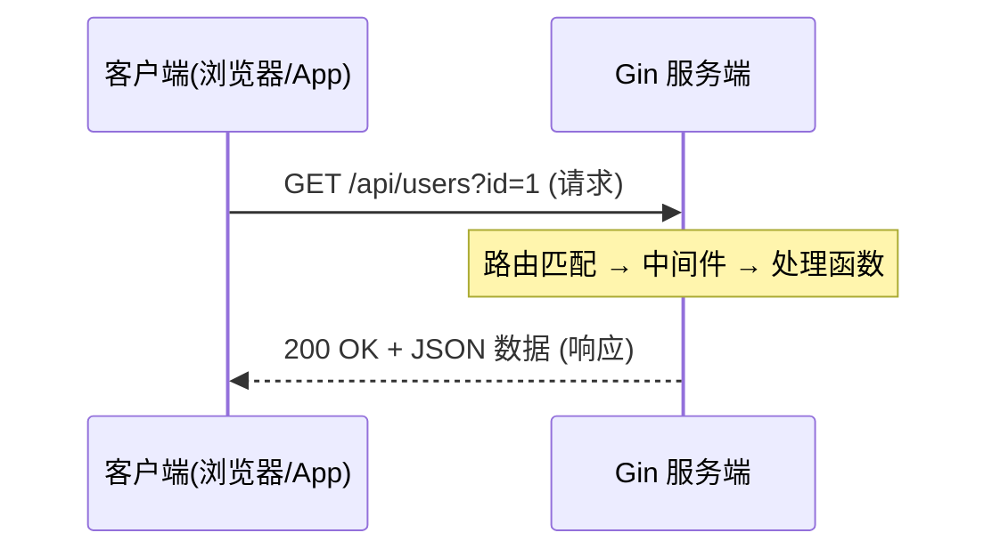
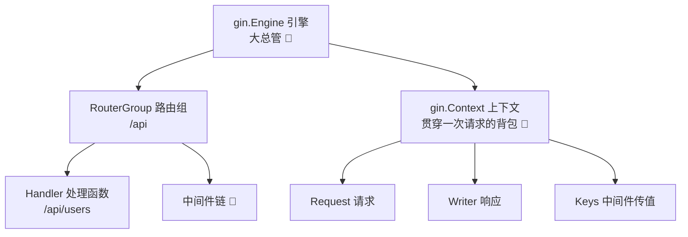
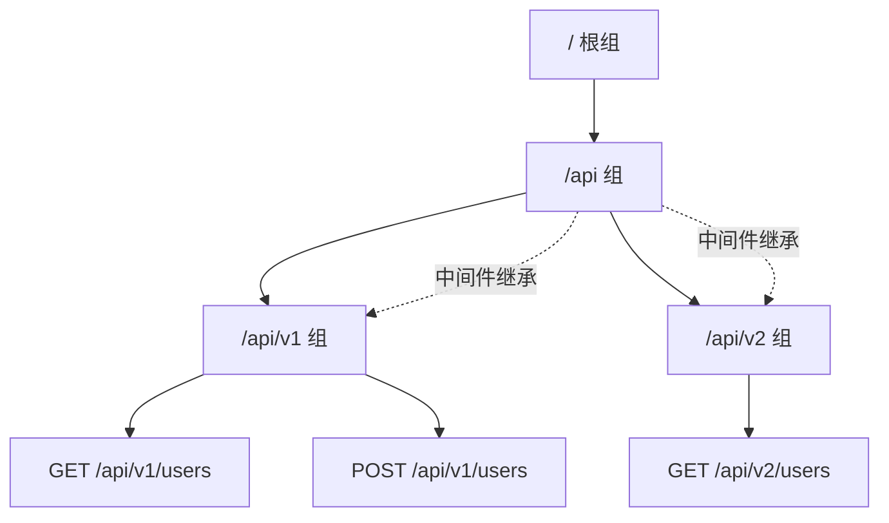
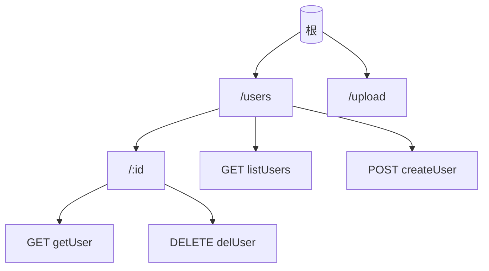
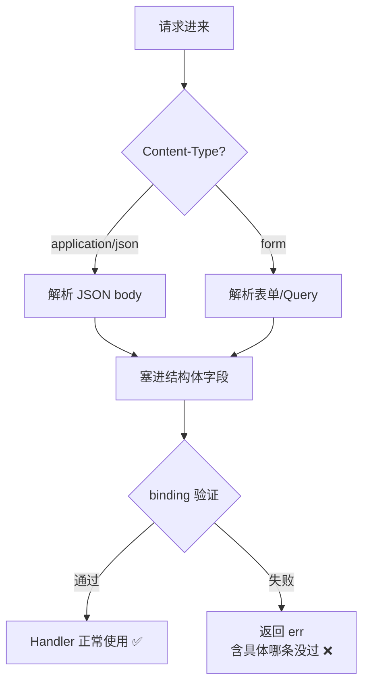
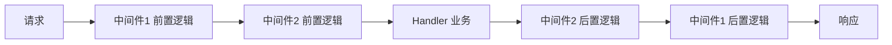
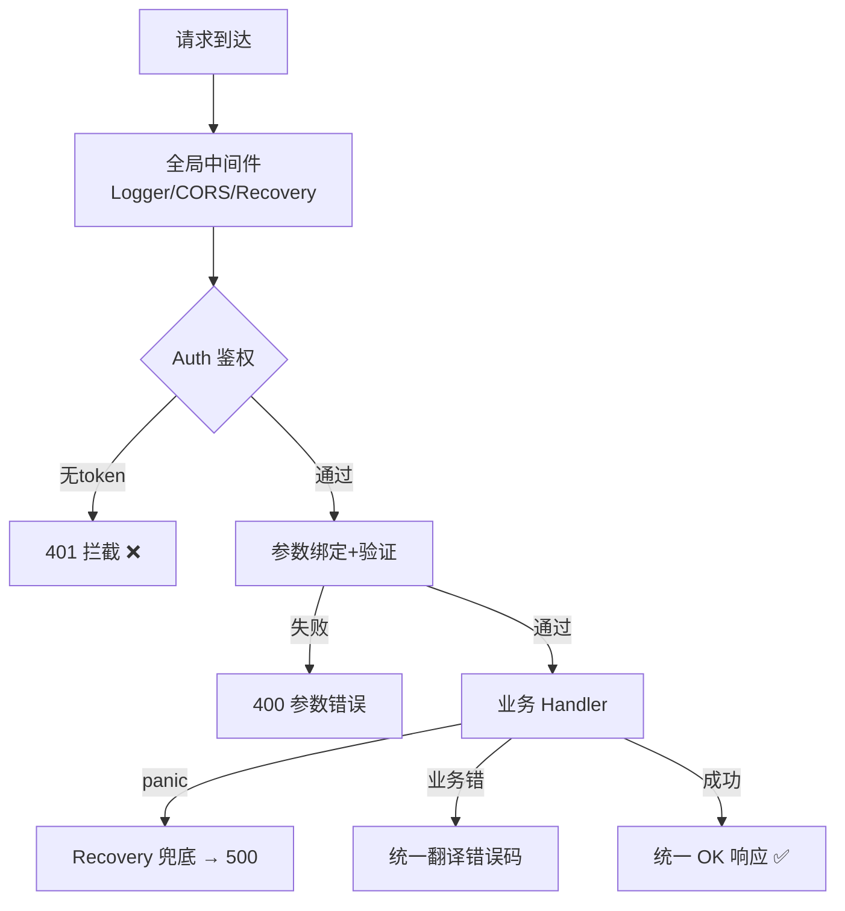
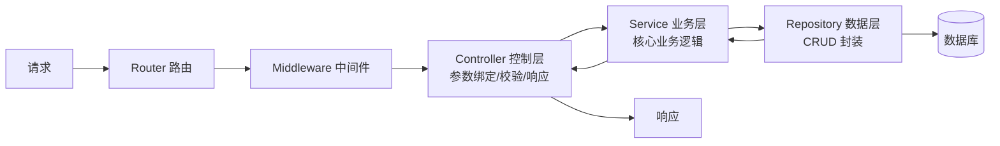
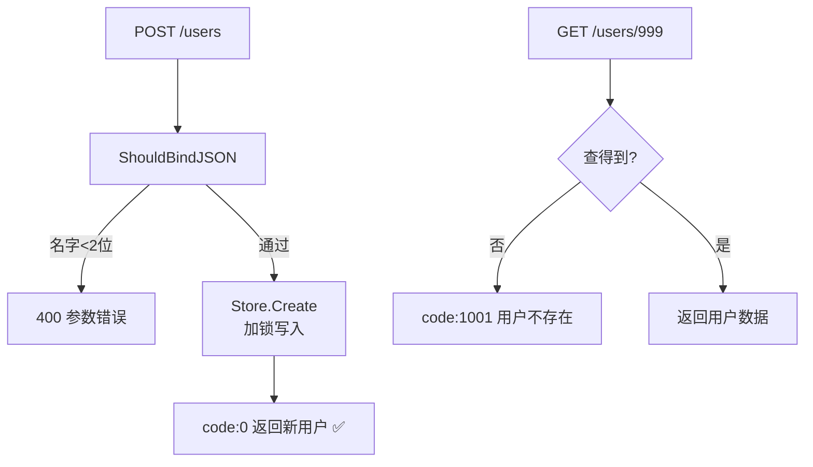
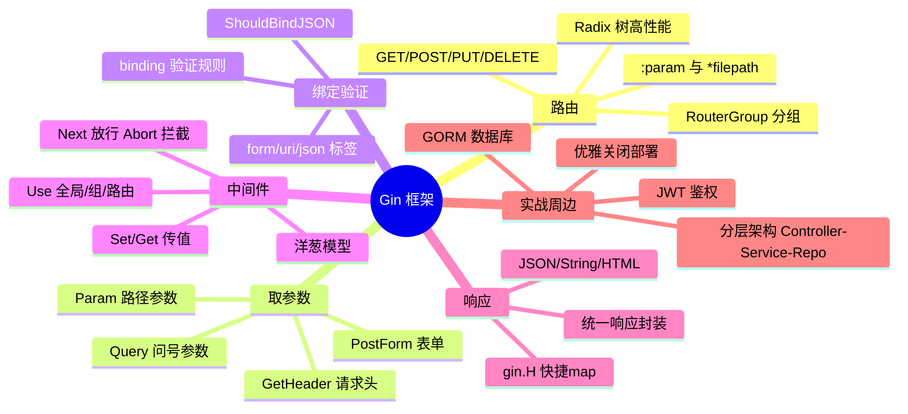

# 🍋 Gin 框架超详细讲义

> 嘿嘿～Go 四件套集齐之后，终于可以写**真正的 Web 服务**啦！🎉
> Gin 是 Go 界最流行的 Web 框架（GitHub 80k+ star），基于 httprouter，**性能拉满、API 优雅**～
> 这节课从安装 → 路由 → 中间件 → 完整项目，一条龙走完，学完直接能写接口！💪

---

## 📚 目录一览

| 章节 | 主题 | 一句话理解 |
|------|------|-----------|
| 1 | Web 基础回顾 | HTTP 那点事 🌐 |
| 2 | Gin 简介与安装 | 认识主角登场 🍋 |
| 3 | 快速开始 | 3 行代码起服务 🚀 |
| 4 | 路由 | URL 的大脑映射 🗺️ |
| 5 | 获取请求数据 | 接收客户端的快递 📦 |
| 6 | 响应输出 | 给客户端回礼 🎁 |
| 7 | 数据绑定与验证 | 自动整理+质检 🤖 |
| 8 | 中间件 | 请求的安检通道 🛂 |
| 9 | 统一响应与错误处理 | 规范化输出 📐 |
| 10 | 文件上传下载 | 传文件的正确姿势 📁 |
| 11 | 模板渲染 SSR | 服务端画页面 🎨 |
| 12 | Cookie 与 Session | 记住你的魔法 🍪 |
| 13 | 项目分层架构 | 大项目的秩序 🏗️ |
| 14 | 实战：RESTful CRUD | 完整小项目 💯 |
| 15 | 常用生态 | 好用的周边全家桶 🧩 |
| 16 | 优雅关闭与部署 | 上线前的最后一课 🚢 |

---

## 1️⃣ Web 基础回顾 🌐

写 Gin 前先 30 秒复习 HTTP：



**HTTP 请求的三大件：**

| 部件 | 说明 | 示例 |
|------|------|------|
| 请求行 | 方法 + 路径 + 协议 | `GET /users?id=1 HTTP/1.1` |
| 请求头 | 元信息 | `Content-Type: application/json` |
| 请求体 | 携带的数据 | `{"name":"小樱"}` |

**常用 HTTP 方法与 RESTful 惯例：**

| 方法 | 语义 | RESTful 示例 |
|------|------|-------------|
| GET | 查询 | `GET /users`（列表）/ `GET /users/1`（详情） |
| POST | 新增 | `POST /users` |
| PUT | 全量更新 | `PUT /users/1` |
| PATCH | 部分更新 | `PATCH /users/1` |
| DELETE | 删除 | `DELETE /users/1` |

---

## 2️⃣ Gin 简介与安装 🍋

### 2.1 为什么是 Gin？

| 特性 | 说明 |
|------|------|
| ⚡ 快 | 基于 Radix 树路由，性能第一梯队 |
| 🧩 中间件 | 类似洋葱模型，拦截器随便串 |
| 🎯 路由强大 | 参数、通配符、路由组一应俱全 |
| 🤖 数据绑定 | JSON/Form 自动绑定+验证 |
| 📚 生态无敌 | 文档教程最多，招人最好招 |

### 2.2 安装三步走

```bash
# ① 初始化项目（还没有 go.mod 的话）
mkdir myapp && cd myapp
go mod init myapp

# ② 安装 Gin
go get -u github.com/gin-gonic/gin

# ③ 跑起来验证
go run main.go
```

> 💡 墙内小伙伴如果下载慢：`go env -w GOPROXY=https://goproxy.cn,direct` 一键起飞～

---

## 3️⃣ 快速开始：3 行核心代码 🚀

```go
package main

import "github.com/gin-gonic/gin"

func main() {
    r := gin.Default()      // ① 引擎：带 Logger + Recovery 中间件
    r.GET("/ping", func(c *gin.Context) {
        c.JSON(200, gin.H{"message": "pong"}) // ② 返回 JSON
    })
    r.Run(":8080")          // ③ 监听端口（默认 :8080）
}
```

**测试：**

```bash
curl http://localhost:8080/ping
# {"message":"pong"}
```

### 3.1 核心对象关系图



### 3.2 Default() vs New()

```go
r := gin.Default() // = New() + Logger(日志) + Recovery(崩溃恢复)
r := gin.New()     // 干净的引擎，中间件自己配（性能极致时用）

gin.New()
gin.LoggerWithConfig(gin.LoggerConfig{...}) // 定制日志
gin.Recovery()                              // panic → 500，服务不死
```

---

## 4️⃣ 路由：URL 的大脑映射 🗺️

### 4.1 基本路由与各种参数

```go
r := gin.Default()

// ① 最普通的路由
r.GET("/hello", func(c *gin.Context) { c.String(200, "hi") })
r.POST("/create", handler)
r.PUT("/update", handler)
r.DELETE("/del", handler)
r.Any("/any", handler)             // 匹配所有方法

// ② 路径参数 :param（一段）
r.GET("/users/:id", func(c *gin.Context) {
    id := c.Param("id") // 拿到 "1"
    c.String(200, "用户ID: %s", id)
})
// GET /users/123   → id = "123"

// ③ 不匹配的参数 *action（贪婪匹配，含斜杠）
r.GET("/files/*filepath", func(c *gin.Context) {
    fp := c.Param("filepath") // "/docs/a.txt"（带斜杠！）
    c.String(200, "文件: %s", fp)
})
// GET /files/docs/a.txt → filepath = "/docs/a.txt"
```

### 4.2 路由参数对比表

| 写法 | 匹配 | 示例请求 | 取值 |
|------|------|---------|------|
| `/users/:id` | 单段 | `/users/42` | `c.Param("id")` = `"42"` |
| `/files/*path` | 多段（贪婪） | `/files/a/b/c` | `c.Param("path")` = `"/a/b/c"` |
| `/users/bind` | 精确优先 | `/users/bind` | 精确路由**优先**于 `:id` |

> ⚠️ **路由冲突**：同一个位置 `:id` 和 `:name` 会 panic（`/user/:id` 和 `/user/:name` 二选一）！

### 4.3 路由分组 RouterGroup（项目必备 ⭐）

```go
api := r.Group("/api") // 统一前缀
{
    v1 := api.Group("/v1") // /api/v1
    {
        v1.GET("/users", listUsers)        // GET /api/v1/users
        v1.GET("/users/:id", getUser)      // GET /api/v1/users/1
        v1.POST("/users", createUser)      // POST /api/v1/users
    }
    v2 := api.Group("/v2") // 版本升级就这么优雅～
    {
        v2.GET("/users", listUsersV2)
    }
}
```



> 💡 组的中间件会**被继承**：给 `/api` 挂个鉴权中间件，v1、v2 全生效！

### 4.4 底层原理：Radix 树 🌳

Gin 路由不是 map 硬查，而是**前缀树（Radix Tree）**：



公共前缀只存一份，10 万条路由查找依然是 O(路径长度)～这就是 Gin 快的原因之一 ⚡

---

## 5️⃣ 获取请求数据：接收客户端的快递 📦

### 5.1 四大取数姿势全景

```go
// ① Query 参数（?key=value，URL 问号后面）
r.GET("/search", func(c *gin.Context) {
    kw := c.Query("keyword")             // 没有返回 ""
    page := c.DefaultQuery("page", "1")  // 没有返回默认值 "1"
    c.String(200, "搜索:%s 第%s页", kw, page)
})
// GET /search?keyword=gin&page=2

// ② 表单参数（application/x-www-form-urlencoded 或 multipart）
r.POST("/login", func(c *gin.Context) {
    user := c.PostForm("username")
    pwd := c.DefaultPostForm("password", "123456")
    c.String(200, "%s / %s", user, pwd)
})

// ③ 路径参数（复习一下）
id := c.Param("id")

// ④ 请求头
token := c.GetHeader("Authorization") // 读 token 常用！
ua := c.Request.Header.Get("User-Agent")
```

### 5.2 参数位置速查表 📇

| 位置 | 代码 | 典型场景 |
|------|------|---------|
| URL `?a=1` | `c.Query("a")` | 搜索、分页 |
| 路径 `/users/1` | `c.Param("id")` | RESTful 资源定位 |
| 表单 body | `c.PostForm("k")` | 登录表单 |
| JSON body | 绑定到 struct（第 7 章） | 前后端分离 API |
| 请求头 | `c.GetHeader("k")` | Token、TraceID |

### 5.3 原始 body / 数组参数

```go
// 原始 body
r.POST("/raw", func(c *gin.Context) {
    body, _ := io.ReadAll(c.Request.Body)
    c.String(200, string(body))
})

// Query 数组：?tags=a&tags=b
r.GET("/filter", func(c *gin.Context) {
    tags := c.QueryArray("tags") // ["a", "b"]
    c.JSON(200, tags)
})

// Query map：?ids[a]=1&ids[b]=2
m := c.QueryMap("ids") // map[a:1 b:2]
```

---

## 6️⃣ 响应输出：给客户端回礼 🎁

```go
// ① JSON（前后端分离标配）
c.JSON(200, gin.H{"code": 0, "msg": "ok"})
c.JSON(200, User{Name: "小樱", Age: 14}) // 结构体直接来

// ② JSONP / XML / YAML
c.JSONP(200, gin.H{"msg": "hi"}) // 自动包 callback()
c.XML(200, gin.H{"msg": "hi"})
c.YAML(200, gin.H{"msg": "hi"})

// ③ 纯文本 / HTML
c.String(200, "你好 %s", "小樱")
c.HTML(200, "index.html", gin.H{"title": "首页"}) // 需配模板

// ④ 状态码常量（推荐，别写魔法数字！）
c.JSON(http.StatusOK, data)   // 200
c.JSON(http.StatusCreated, d) // 201
c.JSON(http.StatusNotFound, gin.H{"msg": "没找到"}) // 404

// ⑤ 重定向
c.Redirect(http.StatusFound, "/login") // 302 跳转

// ⑥ 设置响应头 / Cookie
c.Header("X-Request-Id", "abc123")
c.SetCookie("token", "xyz", 3600, "/", "localhost", false, true)
```

**gin.H 是什么？**

```go
// 其实就是 map[string]any 的别名，省得每次写一长串～
type H map[string]any
```

---

## 7️⃣ 数据绑定与验证：自动整理+质检 🤖（重点⭐）

手动 `c.Query` 一个个取太累！绑定就是**把请求数据自动塞进结构体**～

### 7.1 Bind 家族

```go
type LoginReq struct {
    Username string `json:"username" form:"username" binding:"required"`
    Password string `json:"password" form:"password" binding:"required,min=6"`
}

// ① ShouldBindJSON：明确是 JSON body（推荐 ✅）
r.POST("/login", func(c *gin.Context) {
    var req LoginReq
    if err := c.ShouldBindJSON(&req); err != nil {
        c.JSON(400, gin.H{"error": err.Error()})
        return // 出错立刻返回！
    }
    c.JSON(200, gin.H{"msg": "登录成功", "user": req.Username})
})

// ② ShouldBind：自动根据 Content-Type 选（JSON/表单都行）
if err := c.ShouldBind(&req); err != nil { ... }

// ③ ShouldBindQuery：只绑定 URL 参数
// GET /login?username=xx&password=123456
if err := c.ShouldBindQuery(&req); err != nil { ... }

// ④ ShouldBindUri：绑定路径参数
type UriReq struct {
    ID int `uri:"id" binding:"required,gt=0"`
}
r.GET("/users/:id", func(c *gin.Context) {
    var req UriReq
    if err := c.ShouldBindUri(&req); err != nil { ... }
    // req.ID 是 int！自动转换好啦～
})
```

### 7.2 Bind vs ShouldBind 的区别 ⚠️

| 函数 | 绑定失败时 |
|------|-----------|
| `c.BindJSON` 等 | **自动**返回 400，还会写日志（省事但失控） |
| `c.ShouldBindJSON` 等 | **只返回 error**，响应自己控制（生产推荐 ✅） |

### 7.3 标签三兄弟

```go
type User struct {
    Name string `json:"name" form:"name" uri:"name" binding:"required"`
    //       ↑JSON用    ↑表单用   ↑路径用      ↑验证规则
}
```

| 标签 | 什么时候用 |
|------|-----------|
| `json:"xx"` | JSON body / JSON 响应 |
| `form:"xx"` | Query 参数 / 表单 |
| `uri:"xx"` | 路径参数 |
| `binding:"..."` | 验证规则（validator 库） |

### 7.4 常用验证规则速查 📖

```go
type RegisterReq struct {
    Username string `json:"username" binding:"required,min=3,max=20"`      // 必填+长度
    Password string `json:"password" binding:"required,min=6"`
    Email    string `json:"email" binding:"required,email"`                // 邮箱格式
    Phone    string `json:"phone" binding:"required,len=11"`               // 11位
    Age      int    `json:"age" binding:"required,gte=1,lte=150"`          // 1~150
    Status   int    `json:"status" binding:"oneof=0 1 2"`                  // 枚举
    HomePage string `json:"home_page" binding:"omitempty,url"`             // 可空+URL格式
    RePassword string `json:"re_password" binding:"required,eqfield=Password"` // 等于另一字段
}
```

| 规则 | 含义 |
|------|------|
| `required` | 必填 |
| `min` / `max` | 最小/最大（字符串=长度，数字=值） |
| `gte` / `lte` | ≥ / ≤ |
| `email` / `url` | 格式校验 |
| `oneof=a b c` | 枚举之一 |
| `eqfield=Xxx` | 等于另一个字段（确认密码） |
| `omitempty` | 空值跳过验证 |

### 7.5 绑定流程图



---

## 8️⃣ 中间件：请求的安检通道 🛂（重点⭐）

### 8.1 洋葱模型



```go
func Logger() gin.HandlerFunc {
    return func(c *gin.Context) {
        start := time.Now()

        c.Next() // 🔑 调用后续处理（穿过洋葱）

        cost := time.Since(start)
        fmt.Printf("%s %s %v\n", c.Request.Method, c.Request.URL.Path, cost)
        // c.Next() 之后 = 响应阶段，能拿到状态码
        fmt.Println("状态码:", c.Writer.Status())
    }
}

// 拦截型中间件：不调 c.Next()，直接终结
func Auth() gin.HandlerFunc {
    return func(c *gin.Context) {
        token := c.GetHeader("Authorization")
        if token == "" {
            c.AbortWithStatusJSON(401, gin.H{"msg": "未登录"}) // 拦下！
            return // ⚠️ 必须 return，别继续往下走
        }
        c.Next() // 放行
    }
}
```

> 🌟 **核心口诀**：`c.Next()` = 放行去下一站；`c.Abort()` = 就地拦截 + 后续中间件全跳过！

### 8.2 中间件的三种挂载方式

```go
r := gin.Default()

// ① 全局：所有请求都过
r.Use(Logger())

// ② 路由组：组内才过（鉴权常用！）
admin := r.Group("/admin", Auth())
admin.GET("/dashboard", handler) // 要过 Auth

// ③ 单个路由
r.GET("/pay", PayHandler, RateLimit) // 可以挂多个
```

| 挂载方式 | 写法 | 影响范围 |
|---------|------|---------|
| 全局 | `r.Use(mw)` | 所有路由 |
| 组级 | `r.Group("/x", mw)` 或 `grp.Use(mw)` | 组内所有路由 |
| 路由级 | `r.GET("/x", mw, handler)` | 仅该路由 |

### 8.3 中间件传值：Set / Get

```go
// 认证中间件里存用户信息
func Auth() gin.HandlerFunc {
    return func(c *gin.Context) {
        userID := parseToken(c.GetHeader("Authorization"))
        c.Set("userID", userID) // 存进 Context 的 Keys 🎒
        c.Next()
    }
}

// Handler 里取出来
r.GET("/me", Auth(), func(c *gin.Context) {
    uid, exists := c.Get("userID")
    if !exists {
        c.JSON(401, gin.H{"msg": "没登录"})
        return
    }
    c.JSON(200, gin.H{"userID": uid})
})

// 偷懒版（类型不对会 panic，谨慎用）
uid := c.MustGet("userID").(int64)
```

### 8.4 实用中间件模板合集 📋

```go
// ① 耗时统计
func Timing() gin.HandlerFunc {
    return func(c *gin.Context) {
        start := time.Now()
        c.Next()
        log.Printf("%s %s 耗时 %v", c.Request.Method, c.Request.URL.Path, time.Since(start))
    }
}

// ② 简易限流（每秒 N 个）
func RateLimit(n int) gin.HandlerFunc {
    limiter := rate.NewLimiter(rate.Limit(n), n)
    return func(c *gin.Context) {
        if !limiter.Allow() {
            c.AbortWithStatusJSON(429, gin.H{"msg": "请求太频繁啦～"})
            return
        }
        c.Next()
    }
}

// ③ CORS 跨域
func CORS() gin.HandlerFunc {
    return func(c *gin.Context) {
        c.Header("Access-Control-Allow-Origin", "*")
        c.Header("Access-Control-Allow-Methods", "GET,POST,PUT,DELETE,OPTIONS")
        c.Header("Access-Control-Allow-Headers", "Content-Type,Authorization")
        if c.Request.Method == "OPTIONS" {
            c.AbortWithStatus(204) // 预检请求直接放行
            return
        }
        c.Next()
    }
}

// ④ recover 增强版（panic 记日志 + 返回 500）
func Recovery() gin.HandlerFunc {
    return func(c *gin.Context) {
        defer func() {
            if err := recover(); err != nil {
                log.Printf("panic: %v\n%s", err, debug.Stack())
                c.AbortWithStatusJSON(500, gin.H{"msg": "服务器开小差了 >_<"})
            }
        }()
        c.Next()
    }
}
```

### 8.5 gin 内置中间件

| 中间件 | 作用 |
|--------|------|
| `gin.Logger()` | 打印访问日志 |
| `gin.Recovery()` | panic 恢复 → 500 |
| `gin.BasicAuth()` | HTTP 基础认证 |
| `gin.Timeout()` | 请求超时（1.9+） |

```go
authorized := r.Group("/", gin.BasicAuth(gin.Accounts{
    "admin": "secret123", // 用户名: 密码
}))
```

---

## 9️⃣ 统一响应与错误处理：规范化输出 📐

### 9.1 统一响应结构（业界惯例）

```go
// response/response.go
package response

type Response struct {
    Code int    `json:"code"`           // 业务码：0=成功
    Msg  string `json:"msg"`            // 提示信息
    Data any    `json:"data,omitempty"` // 数据体
}

func OK(c *gin.Context, data any) {
    c.JSON(http.StatusOK, Response{Code: 0, Msg: "success", Data: data})
}

func Fail(c *gin.Context, code int, msg string) {
    c.JSON(http.StatusOK, Response{Code: code, Msg: msg})
}
```

### 9.2 业务错误码 + 翻译

```go
// 定义业务错误
type BizError struct {
    Code int
    Msg  string
}

func (e *BizError) Error() string { return e.Msg }

var (
    ErrUserNotFound = &BizError{1001, "用户不存在"}
    ErrPwdWrong     = &BizError{1002, "密码错误"}
)

// Handler 里只管返回错误，翻译交给中间件！
r.POST("/login", func(c *gin.Context) {
    user, err := doLogin(c)
    if err != nil {
        response.Fail(c, 500, err.Error()) // 或用下面的统一处理
        return
    }
    response.OK(c, user)
})
```

### 9.3 统一错误翻译中间件（进阶优雅 ✨）

```go
func ErrorHandler() gin.HandlerFunc {
    return func(c *gin.Context) {
        c.Next() // 先跑业务
        // 业务里 c.Error(err) 收集的错误，这里统一翻译
        for _, e := range c.Errors {
            var bizErr *BizError
            if errors.As(e.Err, &bizErr) {
                response.Fail(c, bizErr.Code, bizErr.Msg)
                return
            }
        }
    }
}

// Handler 里改成：
if err != nil {
    _ = c.Error(err) // 只上报，不直接响应
    return
}
```

### 9.4 请求处理全景流程



---

## 🔟 文件上传下载 📁

### 10.1 单文件上传

```go
r.POST("/upload", func(c *gin.Context) {
    file, err := c.FormFile("file") // 表单字段名
    if err != nil {
        c.JSON(400, gin.H{"msg": "没有文件"})
        return
    }

    // 保存到本地
    dst := "./uploads/" + file.Filename
    if err := c.SaveUploadedFile(file, dst); err != nil {
        c.JSON(500, gin.H{"msg": "保存失败"})
        return
    }
    c.JSON(200, gin.H{"msg": "上传成功", "filename": file.Filename})
})

// curl 测试：
// curl -F "file=@photo.jpg" http://localhost:8080/upload
```

### 10.2 多文件 + 流式处理（大文件友好）

```go
r.POST("/uploads", func(c *gin.Context) {
    form, _ := c.MultipartForm()
    files := form.File["files"] // 字段名复数
    for _, file := range files {
        // 方式一：SaveUploadedFile 简单粗暴
        c.SaveUploadedFile(file, "./uploads/"+file.Filename)

        // 方式二：打开流自己处理（可以边读边算 hash/上传 OSS）
        // f, _ := file.Open()
        // io.Copy(dst, f)
    }
    c.JSON(200, gin.H{"count": len(files)})
})
```

### 10.3 文件下载

```go
r.GET("/download/:name", func(c *gin.Context) {
    name := c.Param("name")
    c.Header("Content-Disposition", `attachment; filename="`+name+`"`)
    c.File("./uploads/" + name) // 自动处理 http.ServeFile
})

// 直接在浏览器显示（不弹下载框）：c.FileAttachment(path, name)
```

### 10.4 限制上传大小

```go
r := gin.Default()
r.MaxMultipartMemory = 8 << 20 // 8MB（默认32MB）
```

---

## 1️⃣1️⃣ 静态文件与模板渲染 SSR 🎨

### 11.1 静态文件服务

```go
// 目录映射：URL /static/xxx → 本地 ./assets/xxx
r.Static("/static", "./assets")

// 单文件映射
r.StaticFile("/favicon.ico", "./favicon.ico")

// 更可控的版本
r.StaticFS("/more", http.Dir("./public"))
```

### 11.2 模板渲染（服务端画页面）

**目录结构：**

```text
templates/
├── index.html
└── user.html
```

**index.html：**

```html
<!DOCTYPE html>
<html>
<body>
    <h1>{{ .title }}</h1>
    <ul>
        {{ range .users }}
        <li>{{ .Name }} - {{ .Age }}岁</li>
        {{ end }}
    </ul>
</body>
</html>
```

**Go 代码：**

```go
func main() {
    r := gin.Default()
    r.LoadHTMLGlob("templates/*") // 加载模板
    // r.LoadHTMLFiles("templates/index.html") // 或指定文件

    r.GET("/", func(c *gin.Context) {
        c.HTML(200, "index.html", gin.H{
            "title": "用户列表",
            "users": []User{{"小樱", 14}, {"知世", 14}},
        })
    })
    r.Run()
}
```

**模板语法速查：**

| 语法 | 作用 |
|------|------|
| `{{ .name }}` | 输出变量 |
| `{{ range .list }}...{{ end }}` | 循环 |
| `{{ if .ok }}...{{ end }}` | 判断 |
| `{{ define "head" }}...{{ end }}` | 定义子模板 |
| `{{ template "head" . }}` | 引入子模板 |
| `{{ .Name \| upper }}` | 管道函数 |

---

## 1️⃣2️⃣ Cookie 与 Session：记住你的魔法 🍪

### 12.1 Cookie 基本操作

```go
r.GET("/set", func(c *gin.Context) {
    c.SetCookie(
        "token",      // 名字
        "abc123",     // 值
        3600,         // 有效期（秒）
        "/",          // 路径
        "localhost",  // 域
        false,        // secure（https only）
        true,         // httpOnly（JS 读不到，防 XSS）
    )
    c.String(200, "Cookie 已种下～")
})

r.GET("/get", func(c *gin.Context) {
    token, err := c.Cookie("token")
    if err != nil {
        c.String(200, "没有 Cookie")
        return
    }
    c.String(200, "token=%s", token)
})
```

### 12.2 Session（用第三方库 gorilla/sessions 或 gin-contrib/sessions）

```go
import "github.com/gin-contrib/sessions"

func main() {
    r := gin.Default()
    store := cookie.NewStore([]byte("secret-密钥-随便写但要保密"))
    r.Use(sessions.Sessions("mysession", store))

    r.GET("/login", func(c *gin.Context) {
        session := sessions.Default(c)
        session.Set("userID", 10086)
        session.Save() // 一定要 Save！
        c.String(200, "已登录")
    })

    r.GET("/me", func(c *gin.Context) {
        session := sessions.Default(c)
        uid := session.Get("userID")
        if uid == nil {
            c.JSON(401, gin.H{"msg": "请先登录"})
            return
        }
        c.JSON(200, gin.H{"userID": uid})
    })
}
```

### 12.3 Cookie vs Session vs JWT 对比

| 方案 | 数据存哪 | 优缺点 |
|------|---------|--------|
| Cookie | 客户端 | 简单；容量小(4KB)、可被篡改 |
| Session | 服务端 | 安全；集群要共享存储（redis） |
| JWT | 客户端（签名防篡改） | 无状态天然分布式；无法主动失效 |

> 💡 前后端分离项目主流是 **JWT**：登录发 token → 客户端放 Header → 中间件验证～（第 15 章生态里有库）

---

## 1️⃣3️⃣ 项目分层架构：大项目的秩序 🏗️

demo 级代码全写 main 里没问题，**真项目必须分层**！

### 13.1 推荐目录结构

```text
myapp/
├── main.go              # 入口：装配各组件
├── config/              # 配置读取（viper）
│   └── config.go
├── router/              # 路由注册
│   └── router.go
├── middleware/          # 中间件
│   ├── auth.go
│   └── cors.go
├── controller/          # 控制层：参数处理，调 service
│   └── user_controller.go
├── service/             # 业务层：核心逻辑
│   └── user_service.go
├── repository/          # 数据层：DB 操作
│   └── user_repo.go
├── model/               # 数据模型
│   └── user.go
├── dto/                 # 请求/响应结构体
│   └── user_dto.go
└── response/            # 统一响应
    └── response.go
```

### 13.2 请求流转图



### 13.3 各层示例代码

```go
// controller/user_controller.go —— 只管参数和响应
type UserController struct{ svc *service.UserService }

func (uc *UserController) Create(c *gin.Context) {
    var req dto.CreateUserReq
    if err := c.ShouldBindJSON(&req); err != nil {
        response.Fail(c, 400, err.Error())
        return
    }
    user, err := uc.svc.Create(req)
    if err != nil {
        response.Fail(c, 500, err.Error())
        return
    }
    response.OK(c, user)
}

// service/user_service.go —— 只管业务
type UserService struct{ repo *repository.UserRepo }

func (s *UserService) Create(req dto.CreateUserReq) (*model.User, error) {
    // 业务规则：比如检查重名
    if s.repo.ExistsByName(req.Username) {
        return nil, errors.New("用户名已存在")
    }
    return s.repo.Create(&model.User{Name: req.Username})
}

// router/router.go —— 组装
func Setup(r *gin.Engine) {
    uc := &controller.UserController{Svc: service.NewUserService()}
    api := r.Group("/api/v1")
    users := api.Group("/users")
    {
        users.POST("", uc.Create)
        users.GET("/:id", uc.Get)
    }
}
```

> 🌟 **分层心法**：Controller 不写业务，Service 不碰 gin.Context，Repository 不写逻辑只管存取～

---

## 1️⃣4️⃣ 实战：完整 RESTful CRUD 💯

用户管理小项目（内存版存储，专注流程）：

```go
package main

import (
    "net/http"
    "strconv"
    "sync"

    "github.com/gin-gonic/gin"
)

// ────────── 模型层 ──────────
type User struct {
    ID   int    `json:"id"`
    Name string `json:"name" binding:"required,min=2"`
    Age  int    `json:"age" binding:"required,gte=1,lte=150"`
}

// ────────── 数据层（内存版） ──────────
type UserStore struct {
    mu     sync.RWMutex // 并发保护（并发课学的用上啦！）
    users  map[int]*User
    nextID int
}

func NewUserStore() *UserStore {
    return &UserStore{users: make(map[int]*User), nextID: 1}
}

func (s *UserStore) List() []*User {
    s.mu.RLock()
    defer s.mu.RUnlock()
    list := make([]*User, 0, len(s.users))
    for _, u := range s.users {
        list = append(list, u)
    }
    return list
}

func (s *UserStore) Get(id int) (*User, bool) {
    s.mu.RLock()
    defer s.mu.RUnlock()
    u, ok := s.users[id]
    return u, ok
}

func (s *UserStore) Create(u *User) *User {
    s.mu.Lock()
    defer s.mu.Unlock()
    u.ID = s.nextID
    s.nextID++
    s.users[u.ID] = u
    return u
}

func (s *UserStore) Update(id int, u *User) (*User, bool) {
    s.mu.Lock()
    defer s.mu.Unlock()
    old, ok := s.users[id]
    if !ok {
        return nil, false
    }
    u.ID = id
    s.users[id] = u
    return old, true
}

func (s *UserStore) Delete(id int) bool {
    s.mu.Lock()
    defer s.mu.Unlock()
    if _, ok := s.users[id]; !ok {
        return false
    }
    delete(s.users, id)
    return true
}

// ────────── 统一响应 ──────────
func ok(c *gin.Context, data any) {
    c.JSON(http.StatusOK, gin.H{"code": 0, "msg": "success", "data": data})
}
func fail(c *gin.Context, code int, msg string) {
    c.JSON(http.StatusOK, gin.H{"code": code, "msg": msg})
}

// ────────── 中间件 ──────────
func Timing() gin.HandlerFunc {
    return func(c *gin.Context) {
        start := time.Now()
        c.Next()
        log.Printf("%s %s %v", c.Request.Method, c.Request.URL.Path, time.Since(start))
    }
}

// ────────── 主程序 ──────────
func main() {
    r := gin.Default()
    store := NewUserStore()

    r.Use(Timing())

    api := r.Group("/api/v1/users")

    // 列表 GET /api/v1/users?page=1&size=10
    api.GET("", func(c *gin.Context) {
        page, _ := strconv.Atoi(c.DefaultQuery("page", "1"))
        size, _ := strconv.Atoi(c.DefaultQuery("size", "10"))
        list := store.List()
        start := (page - 1) * size
        if start > len(list) {
            start = len(list)
        }
        end := start + size
        if end > len(list) {
            end = len(list)
        }
        ok(c, gin.H{"list": list[start:end], "total": len(list)})
    })

    // 详情 GET /api/v1/users/1
    api.GET("/:id", func(c *gin.Context) {
        id, _ := strconv.Atoi(c.Param("id"))
        u, found := store.Get(id)
        if !found {
            fail(c, 1001, "用户不存在")
            return
        }
        ok(c, u)
    })

    // 新增 POST /api/v1/users
    api.POST("", func(c *gin.Context) {
        var u User
        if err := c.ShouldBindJSON(&u); err != nil {
            fail(c, 400, "参数错误: "+err.Error())
            return
        }
        ok(c, store.Create(&u))
    })

    // 更新 PUT /api/v1/users/1
    api.PUT("/:id", func(c *gin.Context) {
        id, _ := strconv.Atoi(c.Param("id"))
        var u User
        if err := c.ShouldBindJSON(&u); err != nil {
            fail(c, 400, err.Error())
            return
        }
        updated, ok2 := store.Update(id, &u)
        if !ok2 {
            fail(c, 1001, "用户不存在")
            return
        }
        ok(c, updated)
    })

    // 删除 DELETE /api/v1/users/1
    api.DELETE("/:id", func(c *gin.Context) {
        id, _ := strconv.Atoi(c.Param("id"))
        if !store.Delete(id) {
            fail(c, 1001, "用户不存在")
            return
        }
        ok(c, nil)
    })

    r.Run(":8080")
}
```

**curl 全流程测试：**

```bash
# 新增
curl -X POST http://localhost:8080/api/v1/users \
  -H "Content-Type: application/json" \
  -d '{"name":"小樱","age":14}'

# 列表
curl http://localhost:8080/api/v1/users

# 详情
curl http://localhost:8080/api/v1/users/1

# 更新
curl -X PUT http://localhost:8080/api/v1/users/1 \
  -H "Content-Type: application/json" \
  -d '{"name":"小樱酱","age":15}'

# 删除
curl -X DELETE http://localhost:8080/api/v1/users/1
```



---

## 1️⃣5️⃣ 常用生态：好用的周边全家桶 🧩

| 需求 | 库 | 安装 |
|------|-----|------|
| ORM 数据库 | `gorm.io/gorm` | `go get gorm.io/gorm` |
| MySQL 驱动 | `gorm.io/driver/mysql` | 配合 gorm |
| 配置管理 | `github.com/spf13/viper` | 支持 yaml/env |
| 日志 | `go.uber.org/zap` | 高性能结构化日志 |
| JWT 认证 | `github.com/golang-jwt/jwt/v5` | 登录态 |
| 校验增强 | `github.com/go-playground/validator/v10` | Gin 内置同款 |
| Swagger 文档 | `github.com/swaggo/gin-swagger` | 注释生成 API 文档 |
| 热重载 | `github.com/cosmtrek/air` | 开发时改码自动重启 |

### 15.1 Gin + GORM 快速接线

```go
import (
    "gorm.io/driver/mysql"
    "gorm.io/gorm"
)

dsn := "user:pass@tcp(127.0.0.1:3306)/mydb?charset=utf8mb4&parseTime=True"
db, err := gorm.Open(mysql.Open(dsn), &gorm.Config{})

// 之后在 Repository 层用 db 操作：
// db.First(&user, id)
// db.Create(&user)
// db.Model(&user).Updates(updates)
// db.Delete(&user)
```

### 15.2 JWT 中间件示意

```go
func JWTAuth() gin.HandlerFunc {
    return func(c *gin.Context) {
        tokenStr := c.GetHeader("Authorization")
        token, err := jwt.Parse(tokenStr, func(t *jwt.Token) (any, error) {
            return []byte("我的密钥"), nil
        })
        if err != nil || !token.Valid {
            c.AbortWithStatusJSON(401, gin.H{"msg": "token 无效"})
            return
        }
        claims := token.Claims.(jwt.MapClaims)
        c.Set("userID", claims["sub"])
        c.Next()
    }
}
```

---

## 1️⃣6️⃣ 优雅关闭与部署 🚢

### 16.1 优雅关闭（并发课的知识点回收 ⭐）

```go
func main() {
    r := gin.Default()
    r.GET("/ping", func(c *gin.Context) { c.JSON(200, gin.H{"msg": "pong"}) })

    srv := &http.Server{
        Addr:    ":8080",
        Handler: r,
    }

    go func() {
        if err := srv.ListenAndServe(); err != nil && err != http.ErrServerClosed {
            log.Fatalf("listen: %v", err)
        }
    }()

    quit := make(chan os.Signal, 1)
    signal.Notify(quit, syscall.SIGINT, syscall.SIGTERM)
    <-quit // 等待 Ctrl+C / kill
    log.Println("正在优雅关闭……")

    ctx, cancel := context.WithTimeout(context.Background(), 5*time.Second)
    defer cancel()
    if err := srv.Shutdown(ctx); err != nil {
        log.Fatal("强制关闭:", err)
    }
    log.Println("再见～ 👋")
}
```

### 16.2 发布模式 & 交叉编译

```go
// 切换到发布模式（关掉调试路由信息）
gin.SetMode(gin.ReleaseMode)
r := gin.New()
r.Use(gin.LoggerWithWriter(log.Writer()), gin.Recovery())
```

```bash
# 交叉编译：Windows 上编译 Linux 服务器可执行文件
$env:GOOS="linux"; $env:GOARCH="amd64"; go build -o myapp .
# （Linux/macOS 用 GOOS=linux GOARCH=amd64 go build）

# Docker 部署（多阶段构建）
# FROM golang:1.22 AS builder
# WORKDIR /app
# COPY . .
# RUN go build -o myapp .
# FROM alpine:latest
# COPY --from=builder /app/myapp /
# EXPOSE 8080
# CMD ["./myapp"]
```

### 16.3 上线检查清单 ✅

- [ ] `gin.ReleaseMode` 已开启
- [ ] 优雅关闭（Shutdown）已配置
- [ ] 统一响应 + 错误码规范
- [ ] 日志用 zap 替代默认 Logger
- [ ] 超时中间件 / 限流按需挂载
- [ ] 配置不硬编码（viper / 环境变量）
- [ ] panic 有 recover 兜底
- [ ] 敏感信息（密钥/密码）不进代码仓库

---

## 🎁 总结：一张图吃透 Gin



## 📝 课后小测验（动动小脑瓜 🧠）

1. `gin.Default()` 和 `gin.New()` 的区别？
2. `/users/:id` 和 `/users/*path` 有什么不同？
3. `c.BindJSON` 和 `c.ShouldBindJSON` 失败时行为差异？
4. 中间件里 `c.Next()` 和 `c.Abort()` 分别干嘛？
5. `binding:"required,min=6"` 放在结构体哪个标签里？
6. 中间件 A 用 `c.Set("uid", 1)`，Handler 里怎么取？
7. 为什么生产环境推荐 `gin.ReleaseMode`？

<details>
<summary>👉 点开看答案</summary>

1. `Default()` 自带 **Logger + Recovery** 两个中间件；`New()` 是裸引擎，中间件自己配。
2. `:id` 只匹配**单段**（不含 `/`）；`*path` 贪婪匹配**多段**（含斜杠，值带前导 `/`）。
3. `BindJSON` 失败**自动响应 400**（还写日志，不好控）；`ShouldBindJSON` 只返回 error，响应自己控制（生产推荐）。
4. `Next()` 放行继续执行后续中间件/Handler（后置逻辑写在它后面）；`Abort()` 就地拦截，后续全跳过（通常配 `AbortWithStatusJSON` + `return`）。
5. `binding` 标签：`Password string \`binding:"required,min=6"\``。
6. `uid, ok := c.Get("uid")`（返回 any + bool）；确信存在可 `c.MustGet("uid").(int)`。
7. Release 模式关闭 debug 路由打印（如 `/debug/pprof` 提示）和调试日志，**性能更好、信息更安全**。

</details>

---

> 🌸 恭喜解锁 Gin 框架！现在你已经能独立写出规范的 Web API 服务啦～
> 建议马上动手把第 14 章的 CRUD 跑一遍，再接上 GORM 变成真数据库版！
> 下一站推荐：**GORM 数据库操作** / **Go 微服务（gRPC）** / **Go 工程化测试**，
> 随时召唤本讲师，比心 💖
