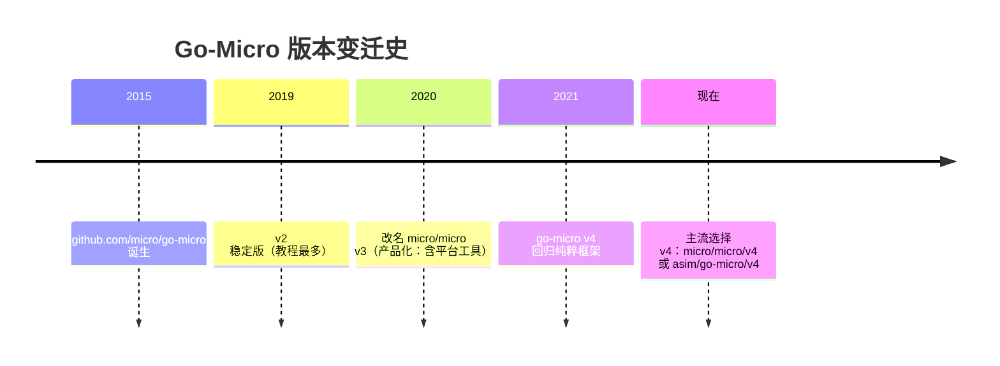
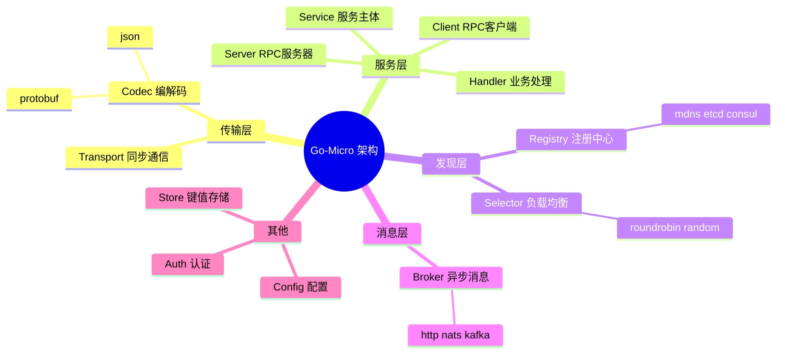
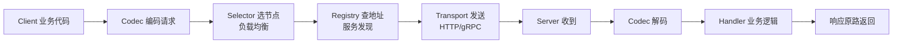
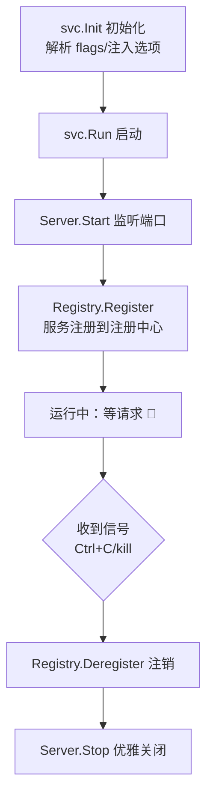
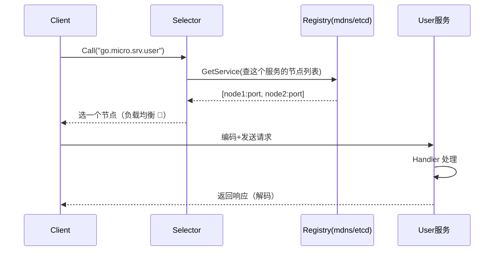
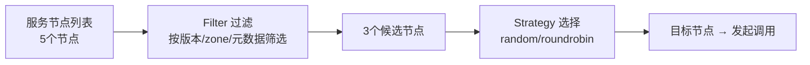
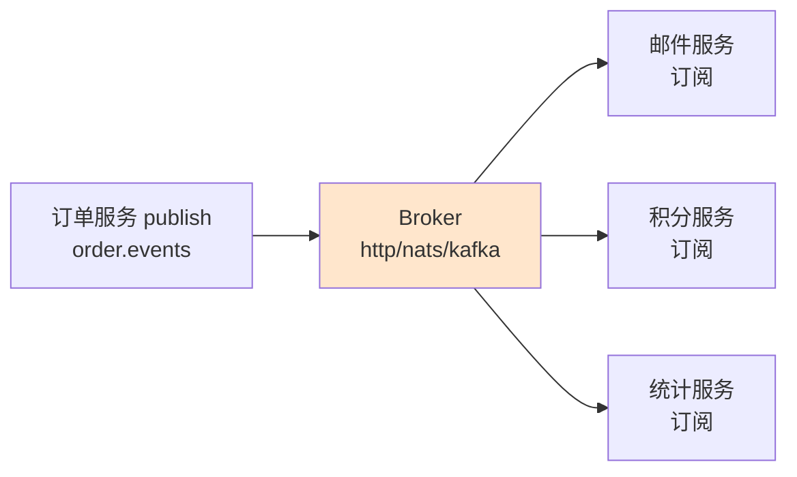
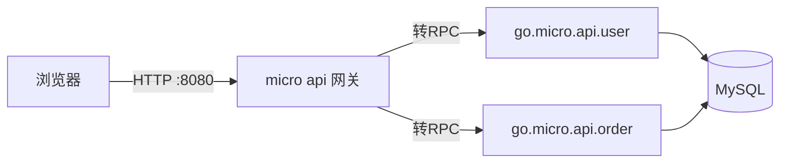
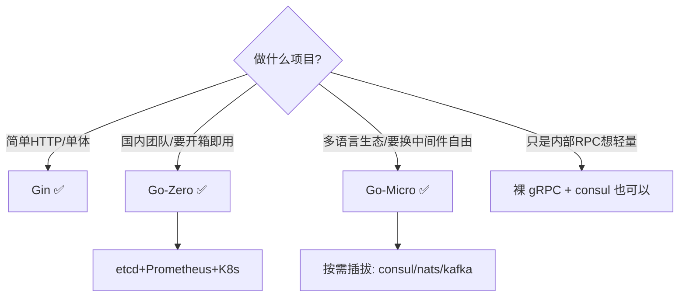
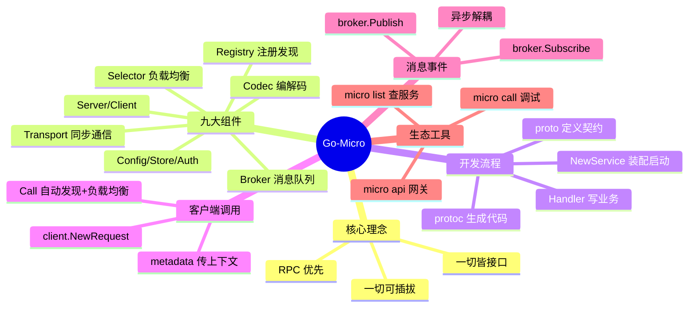

# 🎬 Go-Micro 微服务框架超详细讲义

> 嘿嘿～刚学完 Go-Zero 这个"全家桶管家"，这节课来认识微服务界的**元老**——Go-Micro！🏆
> 它是 Go 最早期的微服务框架之一（2015 年诞生），最大的特色是**插件化架构**：
> 注册中心、消息队列、编解码器……统统像积木一样**可插拔替换**！🔌
> 上节课是"套餐"，这节课是"自助餐"，两节课对照着学，微服务的理解直接起飞！✈️

---

## 📚 目录一览

| 章节 | 主题 | 一句话理解 |
|------|------|-----------|
| 1 | Go-Micro 是什么 | 元老框架的前世今生 📜 |
| 2 | 核心架构 | 九大组件积木盒 🧱 |
| 3 | 安装准备 | 工具链装起来 🔧 |
| 4 | 快速开始 | 第一个服务 🚀 |
| 5 | Protobuf 定义服务 | 接口契约 📜 |
| 6 | 编写服务端 | Handler 的家 🏠 |
| 7 | 客户端调用 | 远程像本地 ☎️ |
| 8 | 注册中心 Registry | 服务的通讯录 📇 |
| 9 | Selector 负载均衡 | 挑服务器的智慧 🎯 |
| 10 | Broker 消息队列 | 异步传声筒 📣 |
| 11 | 元数据与上下文 | 请求的隐形背包 🎒 |
| 12 | API 网关 | 流量大总管 🚪 |
| 13 | 生态工具 Micro CLI | 命令行瑞士军刀 🇨🇭 |
| 14 | 实战：完整微服务 | 用户+订单全链路 💯 |
| 15 | 三框架对比 | Gin vs Go-Zero vs Go-Micro ⚖️ |
| 16 | 踩坑大全 | 前人翻车后人乘凉 ⚠️ |

---

## 1️⃣ Go-Micro 是什么：元老框架的前世今生 📜

### 1.1 版本演进（重要！先搞清楚学哪版）



| 版本 | 导入路径 | 特点 |
|------|---------|------|
| **v2** | `github.com/micro/go-micro/v2` | 经典版，老教程/老项目多 |
| **v3** | `github.com/micro/micro/v3` | 平台化尝试（API+UI+Runtime） |
| **v4** ⭐ | `go-micro.dev/v4` | 当前推荐，纯框架+插件化 |

> ⚠️ **避坑提示**：网上教程 v2/v4 混杂，导入路径不同 API 略有差异！本讲义统一用 **v4**（`go-micro.dev/v4`）～

### 1.2 Go-Micro 的设计哲学

| 理念 | 说明 |
|------|------|
| 🔌 插件化 | 九大核心接口全部可替换实现 |
| 📦 RPC 优先 | 服务间通信走 RPC（默认 protobuf） |
| 🧘 无侵入 | 业务代码不绑定具体中间件 |
| 🛠 分层清晰 | 接口抽象 + 默认实现 + 插件实现 |

### 1.3 和 Go-Zero 的气质差异

| 维度 | Go-Zero | Go-Micro |
|------|---------|----------|
| 风格 | 全家桶（约定大于配置） | 积木盒（自由拼装） |
| 代码生成 | goctl 核心卖点 | 只生成 proto 部分 |
| 治理能力 | 内置自适应 | 接口+插件自选 |
| 上手 | 快（命令生成） | 需理解组件抽象 |
| 灵活度 | 框架说了算 😅 | 你说了算 😎 |

---

## 2️⃣ 核心架构：九大组件积木盒 🧱

Go-Micro 的一切都围绕这些**接口**展开：



### 2.1 组件职责速查

| 组件 | 职责 | 默认实现 | 常见替换 |
|------|------|---------|---------|
| **Registry** | 服务注册发现 | mdns（本地） | etcd / consul / k8s |
| **Selector** | 客户端负载均衡 | random | roundrobin / leastconn |
| **Broker** | 异步消息 pub/sub | http | nats / kafka / rabbitmq |
| **Transport** | 同步请求响应 | http | grpc |
| **Codec** | 消息编码 | proto | json / msgpack |
| **Server** | 服务端 RPC | rpc（内建） | grpc |
| **Client** | 客户端 RPC | rpc | grpc |
| **Config** | 动态配置 | 内存 | file / env |
| **Store** | KV 存储 | memory | redis / etcd |

### 2.2 一次 RPC 调用的旅程



> 💡 看懂这张图 = 看懂 Go-Micro 的灵魂：**每个环节都是接口，都能换插件！**

---

## 3️⃣ 安装准备：工具链装起来 🔧

### 3.1 安装依赖

```bash
# ① 初始化项目
mkdir hello && cd hello
go mod init hello

# ② 引入 go-micro v4
go get go-micro.dev/v4

# ③ 安装 protoc（protoc 编译器 + go 插件）
# Windows：从 https://github.com/protocolbuffers/protobuf/releases 下载 protoc-xx-win64.zip
# 解压后把 bin 目录加进 PATH
protoc --version # 验证：libprotoc 25.x

go install google.golang.org/protobuf/cmd/protoc-gen-go@latest
go install google.golang.org/grpc/cmd/protoc-gen-go-grpc@latest

# ④ （可选）micro CLI 生态工具
go install micro.dev/v4/v4@latest
```

### 3.2 基础设施（按需）

```bash
# 本地开发：默认 mdns 零依赖，直接跑！🎉
# 生产环境：装 etcd 或 consul
docker run -d --name etcd -p 2379:2379 quay.io/coreos/etcd:latest
# consul 党：
docker run -d --name consul -p 8500:8500 hashicorp/consul
```

> 💡 Go-Micro 默认用 **mdns**（组播 DNS），本地开发**啥都不用装**就能服务发现，对新手超友好～

---

## 4️⃣ 快速开始：第一个服务 🚀

### 4.1 最小可运行示例（不用 proto）

```go
package main

import (
    "context"

    "go-micro.dev/v4"
    log "go-micro.dev/v4/logger"
)

// 定义请求/响应结构
type Request struct {
    Name string
}

type Response struct {
    Greeting string
}

// Handler：像写 HTTP 一样写 RPC
func SayHello(ctx context.Context, req *Request, rsp *Response) error {
    log.Infof("收到请求: %v", req.Name)
    rsp.Greeting = "你好呀, " + req.Name + "!"
    return nil
}

func main() {
    // ① 创建服务
    svc := micro.NewService(
        micro.Name("go.micro.srv.hello"), // 服务名（唯一标识）
    )
    svc.Init()

    // ② 注册 Handler
    micro.RegisterHandler(svc.Server(), new(SayHello))

    // ③ 启动！
    if err := svc.Run(); err != nil {
        log.Fatal(err)
    }
}
```

```bash
go run main.go
# 输出：[hello] 服务注册到 mdns，监听随机端口 ✅
```

### 4.2 Service 的生命周期



> 💡 注册和注销全自动：服务挂了，注册中心通过**心跳/TTL**自动摘除，客户端无感～

---

## 5️⃣ Protobuf 定义服务：接口契约 📜

正经项目用 proto 定义接口（强类型 + 跨语言）：

### 5.1 编写 proto

```protobuf
// proto/user.proto
syntax = "proto3";

package user;                          // 包名
option go_package = "./proto;user";    // 生成路径;包名

// 消息结构（请求/响应）
message InfoRequest {
  int64 id = 1;
}

message InfoResponse {
  int64 id = 1;
  string username = 2;
  string email = 3;
}

message LoginRequest {
  string username = 1;
  string password = 2;
}

message LoginResponse {
  int64 userId = 1;
  string token = 2;
}

// 服务定义
service User {
  rpc Info(InfoRequest) returns (InfoResponse);
  rpc Login(LoginRequest) returns (LoginResponse);
}
```

### 5.2 生成代码

```bash
protoc --go_out=. --go_opt=paths=source_relative \
       --go-grpc_out=. --go-grpc_opt=paths=source_relative \
       proto/user.proto

# 生成：
# proto/user.pb.go      —— 消息结构体（带序列化）
# proto/user_grpc.pb.go —— gRPC 接口定义
```

> 💡 Go-Micro v4 的服务端可以直接注册**普通函数 Handler**，不强依赖生成的 gRPC 接口；用 `micro.RegisterHandler` 或 API 映射（见第 6 章）都可以～

---

## 6️⃣ 编写服务端：Handler 的家 🏠

### 6.1 完整服务端示例

```go
package main

import (
    "context"
    "fmt"

    "go-micro.dev/v4"
    "go-micro.dev/v4/logger"
    "go-micro.dev/v4/server"

    pb "hello/proto" // 生成的 proto 包
)

type User struct{}

// Info 方法的 Handler（签名：ctx + req + rsp）
func (u *User) Info(ctx context.Context, req *pb.InfoRequest, rsp *pb.InfoResponse) error {
    logger.Infof("查询用户: %d", req.Id)
    if req.Id <= 0 {
        return fmt.Errorf("非法的用户ID: %d", req.Id) // 返回 error = 调用方收到错误
    }
    // 实际项目：查数据库
    rsp.Id = req.Id
    rsp.Username = "小樱"
    rsp.Email = "sakura@example.com"
    return nil
}

func (u *User) Login(ctx context.Context, req *pb.LoginRequest, rsp *pb.LoginResponse) error {
    if req.Username == "小樱" && req.Password == "123456" {
        rsp.UserId = 1
        rsp.Token = "jwt-token-xxx"
        return nil
    }
    return fmt.Errorf("用户名或密码错误")
}

func main() {
    svc := micro.NewService(
        micro.Name("go.micro.srv.user"),
        micro.Version("1.0.0"),
        // 换注册中心（默认mdns，生产换etcd）：
        // micro.Registry(etcd.NewRegistry(registry.Addrs("127.0.0.1:2379"))),
    )
    svc.Init()

    // 注册 Handler：方法名映射 RPC 路径
    // 调用路径：go.micro.srv.user / User.Info
    if err := server.RegisterHandler(svc.Server(), new(User)); err != nil {
        logger.Fatal(err)
    }

    if err := svc.Run(); err != nil {
        logger.Fatal(err)
    }
}
```

### 6.2 Handler 映射规则

| 注册方式 | 调用端点格式 |
|---------|-------------|
| `server.RegisterHandler(srv, h)` + `Handle(x, method)` | `go.micro.srv.user/Service.Method` |
| `micro.RegisterHandler(srv, new(User))` | `go.micro.srv.user/User.Login` |
| `srv.Handle(srv.NewHandler(h, handler.WithName("custom")))` | 自定义名字 |

### 6.3 常用服务选项

```go
svc := micro.NewService(
    micro.Name("go.micro.srv.user"),       // 服务名（必配！）
    micro.Version("1.0.0"),                // 版本（灰度发布用）
    micro.Metadata(map[string]string{      // 元数据
        "zone": "shanghai",
    }),
    micro.RegisterTTL(time.Second*30),     // 注册TTL：多久没续期算死了
    micro.RegisterInterval(time.Second*10),// 续期间隔
    micro.WrapHandler(LoggingMiddleware),  // Handler 包装器（中间件！）
    micro.WrapClient(RetryWrapper),        // Client 包装器
)
```

### 6.4 中间件：WrapHandler（洋葱模型又来啦 🧅）

```go
// Handler 包装器 = 服务端中间件
func LoggingMiddleware(fn server.HandlerFunc) server.HandlerFunc {
    return func(ctx context.Context, req server.Request, rsp interface{}) error {
        start := time.Now()
        err := fn(ctx, req, rsp) // 调用真正的 Handler
        logger.Infof("[中间件] %s 耗时 %v err=%v",
            req.Endpoint(), time.Since(start), err)
        return err
    }
}

// 使用：
micro.WrapHandler(LoggingMiddleware)
```

---

## 7️⃣ 客户端调用：远程像本地 ☎️

### 7.1 基本调用

```go
package main

import (
    "context"
    "fmt"

    "go-micro.dev/v4"
    "go-micro.dev/v4/client"

    pb "hello/proto"
)

func main() {
    svc := micro.NewService(micro.Name("go.micro.cli.demo"))
    svc.Init()

    // 指定调用哪个服务
    req := client.NewRequest("go.micro.srv.user", "User.Info", &pb.InfoRequest{Id: 1})

    var rsp pb.InfoResponse
    // Call：同步调用（自动服务发现+负载均衡）
    if err := svc.Client().Call(context.Background(), req, &rsp); err != nil {
        panic(err)
    }
    fmt.Printf("用户: %s <%s>\n", rsp.Username, rsp.Email)
    // 用户: 小樱 <sakura@example.com>
}
```

### 7.2 调用选项

```go
// 带超时调用
err := svc.Client().Call(
    ctx,
    req,
    &rsp,
    client.WithRequestTimeout(3*time.Second), // 超时
)

// 带元数据（传递 traceID/token 之类）
ctx := metadata.Set(context.Background(), "X-Trace-Id", "abc-123")
svc.Client().Call(ctx, req, &rsp)

// 指定固定版本/节点
client.WithSelectOption(selector.WithVersion("2.0.0")) // 只调 v2
```

### 7.3 调用流程详解



> 💡 **每秒都缓存**：客户端会缓存服务列表，通过 watch 机制感知变化，不是每次调用都查注册中心～

---

## 8️⃣ 注册中心 Registry：服务的通讯录 📇

### 8.1 默认 mdns vs 生产方案

```go
import (
    "go-micro.dev/v4/registry"
    "github.com/go-micro/plugins/v4/registry/etcd"
    "github.com/go-micro/plugins/v4/registry/consul"
)

// 方案一：默认 mdns（本地开发，零配置）
svc := micro.NewService(micro.Name("xx"))

// 方案二：etcd（生产推荐）
svc := micro.NewService(
    micro.Name("xx"),
    micro.Registry(etcd.NewRegistry(registry.Addrs("127.0.0.1:2379"))),
)

// 方案三：consul
svc := micro.NewService(
    micro.Name("xx"),
    micro.Registry(consul.NewRegistry(registry.Addrs("127.0.0.1:8500"))),
)
```

> ⚠️ v4 开始插件**独立仓库**维护：`github.com/go-micro/plugins/v4/registry/xxx`，要单独 `go get`～

### 8.2 三种注册中心对比

| 特性 | mdns | etcd | consul |
|------|------|------|--------|
| 依赖 | 无 ✅ | 单独部署 | 单独部署 |
| 适用 | 本地开发 | 生产 K8s 生态 | 传统运维生态 |
| 健康检查 | TTL | TTL/lease | TTL/TCP/HTTP 检查 |
| K8s 集成 | ❌ | ✅（K8s 用它存状态） | 一般 |
| 多数据中心 | ❌ | ❌ | ✅ |

### 8.3 手动玩一下 Registry API

```go
// 列出所有已注册服务
services, _ := registry.GetService("go.micro.srv.user")
for _, node := range services.Nodes {
    fmt.Println("节点:", node.Id, node.Address)
}

// 也可以自定义注册（学习原理用）
node := &registry.Node{Id: "user-1", Address: "10.0.0.1:8080"}
service := &registry.Service{Name: "go.micro.srv.user", Nodes: []*registry.Node{node}}
registry.Register(service)
```

---

## 9️⃣ Selector 负载均衡：挑服务器的智慧 🎯

```go
import (
    "go-micro.dev/v4/client"
    "go-micro.dev/v4/selector"
    "github.com/go-micro/plugins/v4/selector/roundrobin"
)

// 默认：random（随机）
svc := micro.NewService(
    micro.Name("xx"),
    micro.Client(client.NewClient()),
)

// 换成轮询
sel := roundrobin.NewSelector()
svc := micro.NewService(
    micro.Name("xx"),
    micro.Selector(sel),
)
```

| 策略 | 分配方式 | 适用 |
|------|---------|------|
| random（默认） | 随机挑一个 | 通用 |
| roundrobin | 一人一次排队 | 节点性能相近 |
| leastconn | 选连接最少的 | 长连接场景 |
| blacklist | 失败节点拉黑 + random | 带容错（v4 默认含此能力） |

**过滤 + 选择两阶段：**



---

## 🔟 Broker 消息队列：异步传声筒 📣

Go-Micro 内置**发布订阅**，服务间异步解耦全靠它！

### 10.1 基本用法（默认 http broker）

```go
import "go-micro.dev/v4/broker"

// ────────── 发布方 ──────────
func publish() error {
    msg := &broker.Message{
        Header: map[string]string{"type": "order.created"},
        Body:   []byte(`{"orderId": 1001, "amount": 99.9}`),
    }
    return broker.Publish("order.events", msg) // 主题：order.events
}

// ────────── 订阅方 ──────────
func subscribe() error {
    _, err := broker.Subscribe("order.events", func(p broker.Event) error {
        fmt.Printf("收到消息: %s\n", string(p.Message().Body))
        p.Ack() // 确认（nats/kafka 等支持）
        return nil
    })
    return err
}
```

### 10.2 服务化订阅（服务启动时挂上）

```go
func main() {
    svc := micro.NewService(micro.Name("go.micro.srv.notify"))
    svc.Init()

    // 服务启动时订阅
    if err := broker.Subscribe("user.registered", handleUserRegistered); err != nil {
        logger.Fatal(err)
    }

    svc.Run()
}

func handleUserRegistered(p broker.Event) error {
    fmt.Println("新用户注册啦，发欢迎邮件～:", string(p.Message().Body))
    return nil // 返回 nil = 处理成功；返回 error = 视实现重试
}
```

### 10.3 换成 nats/kafka（生产）

```go
import (
    natsBroker "github.com/go-micro/plugins/v4/broker/nats"
    "github.com/go-micro/plugins/v4/broker/kafka"
)

// nats
svc := micro.NewService(
    micro.Name("xx"),
    micro.Broker(natsBroker.NewBroker(broker.Addrs("nats:4222"))),
)

// kafka
svc := micro.NewService(
    micro.Name("xx"),
    micro.Broker(kafka.NewBroker(broker.Addrs("kafka:9092"))),
)
```

### 10.4 消息流转图



> 💡 发布方完全不知道谁在听——这就是**解耦**！加新订阅方零改造发布方～

---

## 1️⃣1️⃣ 元数据与上下文：请求的隐形背包 🎒

```go
import (
    "go-micro.dev/v4/metadata"
    "go-micro.dev/v4/server"
)

// ────────── 客户端：塞数据 ──────────
ctx := metadata.Set(context.Background(), "X-User-Id", "10086")
ctx = metadata.Set(ctx, "X-Trace-Id", "trace-abc-123")
svc.Client().Call(ctx, req, &rsp)

// ────────── 服务端：取数据 ──────────
func (u *User) Info(ctx context.Context, req *pb.InfoRequest, rsp *pb.InfoResponse) error {
    md, _ := metadata.FromContext(ctx)

    userId := md["X-User-Id"]      // "10086"
    traceId := md["X-Trace-Id"]    // "trace-abc-123"

    logger.Infof("[%s] 用户 %s 查询", traceId, userId)
    // ...
}
```

**和 Gin 的 Set/Get、Go-Zero 的 ctx.Value 对比：**

| 框架 | 传递方式 | 底层 |
|------|---------|------|
| Gin | `c.Set/c.Get` | 请求级 map |
| Go-Zero | `ctx.Value()` | context.Value |
| Go-Micro | `metadata.Set/FromContext` | map 塞进 ctx |

> 💡 三家殊途同归：**跨层传"请求级"数据，别往函数参数里塞**～

---

## 1️⃣2️⃣ API 网关：流量大总管 🚪

### 12.1 micro API 网关（生态工具）

微服务内部走 RPC，浏览器进不来怎么办？**网关**负责 HTTP→RPC 转换！

```bash
# 安装 micro CLI
go install micro.dev/v4/v4@latest

# 启动 API 网关（默认 :8080）
micro api
```

### 12.2 路由映射规则

```go
// 服务端：实现 api.Endpoint 声明 HTTP 路由
type Greeter struct{}

func (g *Greeter) Call(ctx context.Context, req *pb.Request, rsp *pb.Response) error {
    // ...
}

// 声明端点：HTTP POST /greeter/call → Greeter.Call
// （v4 中通过 handler.WithEndpoint 或 API 服务约定实现）
```

| HTTP 请求 | 转发到的服务 |
|-----------|-------------|
| `POST /user/call` | `go.micro.api.user` / `User.Call` |
| `POST /rpc` | 通用 RPC 代理端点 |
| 静态资源 | 静态目录（--handler=web 时） |



> 💡 网关也是插件化的：handler 模式可选 `rpc`（默认）`api` `web` `event`～

---

## 1️⃣3️⃣ 生态工具 Micro CLI：命令行瑞士军刀 🇨🇭

```bash
# 查看当前注册的所有服务
micro list services
# go.micro.srv.user
# go.micro.srv.order

# 查看某服务的节点详情
micro get service go.micro.srv.user

# 直接调用服务（不用写客户端代码！调试神器 ⭐）
micro call go.micro.srv.user User.Info '{"id": 1}'

# 健康检查
micro health go.micro.srv.user

# 发布/订阅测试
micro publish order.events '{"orderId": 1}'

# 启动 API 网关 / 代理
micro api
micro proxy
```

| 命令 | 用途 | 使用频率 |
|------|------|---------|
| `micro call` | 命令行直调服务 | ⭐⭐⭐ 调试必备 |
| `micro list` | 列出服务 | ⭐⭐⭐ 排查注册问题 |
| `micro health` | 健康检查 | ⭐⭐ |
| `micro publish` | 发消息 | ⭐⭐ |
| `micro api` | 起网关 | ⭐⭐ 对外服务时 |

---

## 1️⃣4️⃣ 实战：完整微服务 💯

**场景**：用户服务（RPC）+ 订单服务（调用户服务）+ 事件通知

### 14.1 项目结构

```text
shop/
├── proto/
│   └── user/user.proto      # 用户服务契约
├── user-svc/
│   └── main.go              # 用户 RPC 服务
├── order-svc/
│   └── main.go              # 订单服务（调用用户服务+发事件）
└── notify-svc/
    └── main.go              # 通知服务（订阅事件）
```

### 14.2 用户服务（被调用方）

```go
// user-svc/main.go
package main

import (
    "context"
    "fmt"

    "go-micro.dev/v4"
    "go-micro.dev/v4/logger"
    "go-micro.dev/v4/server"

    pb "shop/proto/user"
)

type User struct{}

func (u *User) Info(ctx context.Context, req *pb.InfoRequest, rsp *pb.InfoResponse) error {
    if req.Id <= 0 {
        return fmt.Errorf("非法ID")
    }
    rsp.Id = req.Id
    rsp.Username = "小樱"
    return nil
}

func main() {
    svc := micro.NewService(
        micro.Name("go.micro.srv.user"),
        micro.Version("1.0.0"),
    )
    svc.Init()

    server.RegisterHandler(svc.Server(), new(User))

    if err := svc.Run(); err != nil {
        logger.Fatal(err)
    }
}
```

### 14.3 订单服务（调用方 + 发布方）

```go
// order-svc/main.go
package main

import (
    "context"
    "encoding/json"
    "time"

    "go-micro.dev/v4"
    "go-micro.dev/v4/broker"
    "go-micro.dev/v4/client"
    "go-micro.dev/v4/logger"

    pb "shop/proto/user"
)

type CreateOrderRequest struct{ UserID int64; Amount float64 }
type CreateOrderResponse struct{ OrderID int64 }

func CreateOrder(ctx context.Context, req *CreateOrderRequest, rsp *CreateOrderResponse) error {
    // ① 先调用户服务拿信息（RPC+自动服务发现）
    userReq := client.NewRequest("go.micro.srv.user", "User.Info", &pb.InfoRequest{Id: req.UserID})
    var userRsp pb.InfoResponse
    if err := client.Call(ctx, userReq, &userRsp, client.WithRequestTimeout(2*time.Second)); err != nil {
        return err
    }
    logger.Infof("下单用户: %s", userRsp.Username)

    // ② 创建订单（实际写库）...
    rsp.OrderID = time.Now().UnixNano()

    // ③ 发布事件（异步通知其他服务）
    payload, _ := json.Marshal(map[string]any{
        "orderId": rsp.OrderID,
        "userId":  req.UserID,
        "amount":  req.Amount,
    })
    return broker.Publish("order.created", &broker.Message{
        Header: map[string]string{"event": "order.created"},
        Body:   payload,
    })
}

func main() {
    svc := micro.NewService(micro.Name("go.micro.srv.order"))
    svc.Init()
    micro.RegisterHandler(svc.Server(), new(struct{ CreateOrder func(context.Context, *CreateOrderRequest, *CreateOrderResponse) error }))
    // 实际项目里把 CreateOrder 挂在结构体上注册，写法同用户服务
    if err := svc.Run(); err != nil {
        logger.Fatal(err)
    }
}
```

### 14.4 通知服务（订阅方）

```go
// notify-svc/main.go
package main

import (
    "fmt"

    "go-micro.dev/v4"
    "go-micro.dev/v4/broker"
    "go-micro.dev/v4/logger"
)

func main() {
    svc := micro.NewService(micro.Name("go.micro.srv.notify"))
    svc.Init()

    // 订阅订单事件
    if _, err := broker.Subscribe("order.created", func(p broker.Event) error {
        fmt.Printf("📧 收到订单事件: %s\n", string(p.Message().Body))
        return nil
    }); err != nil {
        logger.Fatal(err)
    }

    if err := svc.Run(); err != nil {
        logger.Fatal(err)
    }
}
```

### 14.5 一键测试

```bash
# 三个终端分别启动
go run notify-svc/main.go &
go run user-svc/main.go &
go run order-svc/main.go &

# micro CLI 直接调订单服务（见证 RPC 全链路！）
micro call go.micro.srv.order CreateOrder '{"UserID": 1, "Amount": 99.9}'
# 订单服务 → 调用户服务 → 发布事件 → 通知服务打印邮件 📧
```

### 14.6 全链路架构图

```mermaid
flowchart LR
    T[micro CLI / 客户端] --> O[order-svc]
    O --|1. RPC 调用 Info| U[user-svc]
    M[(mdns 注册中心<br/>本地零依赖)] -.发现.-> O
    M -.发现.-> U
    O --|2. 发布 order.created| B[Broker]
    B --|3. 投递| N[notify-svc]
    N --> OUT[发送邮件 📧]
```

---

## 1️⃣5️⃣ 三框架对比：Gin vs Go-Zero vs Go-Micro ⚖️

| 维度 | Gin | Go-Zero | Go-Micro |
|------|-----|---------|----------|
| 定位 | Web 路由框架 | 微服务全家桶 | 插件化 RPC 框架 |
| 学习曲线 | ⭐ | ⭐⭐⭐ | ⭐⭐⭐⭐ |
| 代码生成 | ❌ | ✅ goctl 全套 | 仅 proto |
| 服务发现 | ❌ | etcd（内置） | mdns默认/etcd/consul 可插拔 |
| 消息队列 | ❌ | 需自集成 | ✅ Broker 抽象内置 |
| 负载均衡 | ❌ | P2C 内置 | 可插拔策略 |
| 熔断限流 | ❌ | ✅ 自适应 | ⚙️ WrapHandler 自己写/插件 |
| 监控链路 | ❌ | ✅ 开箱即用 | 插件 + micro 生态 |
| API 网关 | ❌ | 需自建 | ✅ micro api |
| 社区趋势 | 👍 稳 | 📈 国内上升 | 📉 海外放缓但仍活跃 |
| 适合 | 单体/简单HTTP | 国内中大型微服务 | 灵活定制/多中间件环境 |

**选型决策树：**



---

## 1️⃣6️⃣ 踩坑大全：前人翻车后人乘凉 ⚠️

### 坑1：版本导入混乱

```go
// ❌ v2 和 v4 混着 import，类型不兼容，编译报错
import "github.com/micro/go-micro"
import "go-micro.dev/v4"

// ✅ 全项目统一一个版本（本讲义：v4）
import "go-micro.dev/v4"
import "go-micro.dev/v4/registry"
```

### 坑2：插件包找不到

```bash
# ❌ import "github.com/micro/go-plugins/registry/etcd" 老路径已失效！
# ✅ v4 插件在独立仓库：
go get github.com/go-micro/plugins/v4/registry/etcd
import etcd "github.com/go-micro/plugins/v4/registry/etcd"
```

### 坑3：mdns 在 Docker/云上不工作

```yaml
# mdns 用组播，很多云网络/容器网络屏蔽组播 → 服务发现失败！
# 解决：本地没问题，上 Docker/K8s 就换 etcd/consul
```

### 坑4：服务名不匹配

```go
// ❌ 注册叫 go.micro.srv.user，调用却写 user
client.NewRequest("user", ...) // 找不到服务！

// ✅ 两边名字一字不差
client.NewRequest("go.micro.srv.user", ...)
```

### 坑5：Broker 消息丢了？

```go
// 默认 http broker 只是"进程内/单机"玩具，重启就丢！
// 生产必须换：broker.Publish 前确认 broker 是 nats/kafka
micro.Broker(kafka.NewBroker(broker.Addrs("kafka:9092")))
```

### 坑6：Windows 上 mdns 报错

```bash
# Windows 防火墙可能拦 UDP 5353 端口
# 解决：放行端口，或干脆本地也用 etcd/consul
```

### 坑速查表 📇

| 症状 | 病因 | 药方 |
|------|------|------|
| 编译一堆类型错 | v2/v4 混用 | 统一 `go-micro.dev/v4` |
| import 红线 | 插件路径旧 | `go-micro/plugins/v4/...` |
| 服务发现失败 | mdns 被网络屏蔽 | 换 etcd/consul |
| 调用报 not found | 服务名不一致 | 注册名=调用名 |
| 消息丢失 | http broker 不持久 | 换 nats/kafka |
| Windows 启动失败 | 防火墙拦 mDNS | 放行/换注册中心 |

---

## 🎁 总结：一张图吃透 Go-Micro



## 📝 课后小测验（动动小脑瓜 🧠）

1. Go-Micro 九大组件中，负责"服务发现"和"异步消息"的分别是哪个？
2. v4 的默认注册中心是什么？生产环境推荐换成什么？
3. `micro.WrapHandler(...)` 的作用是什么？
4. 客户端调用时，"选哪个节点"是由哪个组件负责的？
5. 默认的 http Broker 有什么局限？生产怎么办？
6. 跨服务传递 traceID 用什么机制？
7. 命令行里不写客户端代码直接调服务，用哪个命令？

<details>
<summary>👉 点开看答案</summary>

1. **Registry**（服务发现）和 **Broker**（异步消息）。
2. 默认 **mdns**（零依赖，本地友好）；生产换 **etcd 或 consul**（容器网络兼容、可持久）。
3. 给 Handler 套**服务端中间件**（包装器/洋葱模型），可以做日志、鉴权、recover。
4. **Selector**（先 Filter 过滤，再按策略选择，默认 random）。
5. http Broker **不持久化**，进程挂了消息就丢；生产换 **nats/kafka** 插件。
6. **metadata**：`metadata.Set(ctx, "X-Trace-Id", ...)` 塞，`metadata.FromContext(ctx)` 取。
7. `micro call 服务名 方法名 '{"json参数"}'`。

</details>

---

> 🌸 恭喜解锁 Go-Micro！现在你的微服务兵器谱：
> ✅ Gin（Web 单体）→ ✅ GORM（数据层）→ ✅ Go-Zero（全家桶）→ ✅ **Go-Micro（插件化）**
> 两套微服务框架都学完了，"套餐"和"自助"随便切换，面试聊架构稳稳的～😎
> 接下来可以扩展：**gRPC 底层原理** / **Kafka 消息队列** / **分布式事务（dtm/SAGA）**，
> 随时召唤本讲师，比心 💖
