# ⚡ Go-Zero 微服务框架超详细讲义

> 嘿嘿～前面学的 Gin+GORM 是"手动挡"单体开发，这节课升级**"自动挡"微服务**！🏎️
> Go-Zero 是好未来开源的微服务框架（GitHub 30k+ star），主打一个字：**懒人友好**！
> 写好 `.api` 文件敲一行命令 → 路由/参数/文档/错误处理全生成，还自带**服务发现、熔断、限流、监控**全家桶！
> 学完这课，你就从"写接口的"进化成"搭系统的"啦！💪

---

## 📚 目录一览

| 章节 | 主题 | 一句话理解 |
|------|------|-----------|
| 1 | 微服务与 Go-Zero | 为什么要有它 🤔 |
| 2 | 安装与环境准备 | 工欲善其事 🔧 |
| 3 | 核心概念 | 全家桶成员点名 📦 |
| 4 | 快速开始 | 一条命令起服务 🚀 |
| 5 | API 文件语法 | 接口的"设计图纸" 📐 |
| 6 | Logic 逻辑层 | 业务代码的家 🏠 |
| 7 | 配置与依赖注入 | 组件的组装台 🧩 |
| 8 | 中间件 | 拦截器继续用 🛂 |
| 9 | RPC 服务 | 微服务的电话线 ☎️ |
| 10 | 服务注册与发现 | 服务的通讯录 📇 |
| 11 | 数据库 sqlx | Go-Zero 自带 ORM 🗄️ |
| 12 | Redis 与缓存 | 快上加快 ⚡ |
| 13 | JWT 认证 | 登录态标准姿势 🎫 |
| 14 | 内置治理能力 | 熔断限流负载均衡 🛡️ |
| 15 | 可观测性 | 日志/监控/链路追踪 🔭 |
| 16 | 实战：完整微服务 | API+RPC+DB 全链路 💯 |
| 17 | 部署上线 | 交付的最后一步 🚢 |
| 18 | Gin vs Go-Zero | 怎么选看这里 ⚖️ |

---

## 1️⃣ 微服务与 Go-Zero：为什么要有它 🤔

### 1.1 单体 → 微服务演进

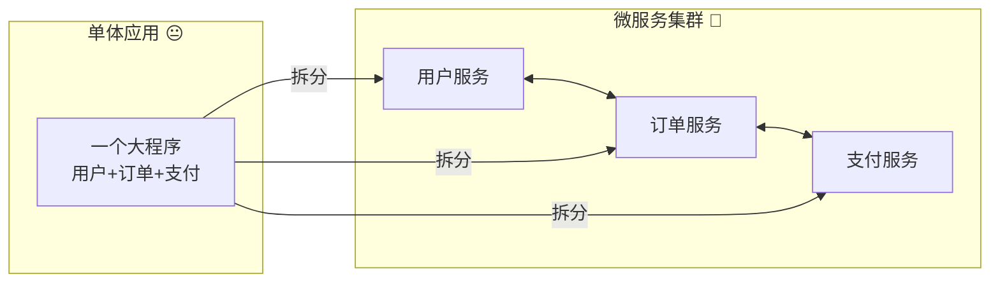

| 对比 | 单体 Gin | 微服务 Go-Zero |
|------|---------|---------------|
| 部署 | 一个大包 | 各服务独立部署 |
| 扩容 | 整体复制 😱 | 谁忙扩谁 ✅ |
| 故障 | 一崩全崩 💥 | 隔离互不影响 🛡️ |
| 团队 | 全挤一个仓库 | 各管各的服务 |
| 复杂度 | 低 | 高（但 Go-Zero 帮你扛了大半！） |

### 1.2 Go-Zero 的看家本领

| 能力 | 说明 |
|------|------|
| 🤖 goctl 代码生成 | `.api`/`.sql` 一键生成整套代码，拒绝体力活 |
| 🔎 服务发现 | 内置 etcd 支持，服务地址自动维护 |
| 🛡️ 内置治理 | 熔断、限流、负载均衡、超时控制开箱即用 |
| 🗄️ 自带 DB 层 | sqlx/sqlc 防 SQL 注入、缓存一致性 |
| 📊 可观测 | 日志、Prometheus 指标、链路追踪全内置 |
| 🎫 JWT | 声明式配置，几行搞定认证 |

---

## 2️⃣ 安装与环境准备：工欲善其事 🔧

### 2.1 安装 Go-Zero 和 goctl

```bash
# ① 安装 goctl（Go-Zero 的代码生成器，灵魂工具！）
go install github.com/zeromicro/go-zero/tools/goctl@latest

# 验证
goctl --version
# 应该输出类似：v1.7.x

# ② 项目里引入 go-zero
go get github.com/zeromicro/go-zero@latest

# ③（可选）生成 protoc 和 go 相关插件，写 RPC 用
goctl install protoc protoc-gen-go protoc-gen-go-grpc
```

### 2.2 基础设施准备

| 组件 | 用途 | 必需吗 |
|------|------|--------|
| **etcd** | 服务注册发现 | 微服务模式必需 |
| MySQL | 数据库 | 按需 |
| Redis | 缓存 | 按需 |
| Prometheus + Grafana | 监控 | 可选（生产建议） |

```bash
# 快速起一套本地环境（Docker 一把梭）
docker run -d --name etcd -p 2379:2379 quay.io/coreos/etcd:latest
docker run -d --name mysql -p 3306:3306 -e MYSQL_ROOT_PASSWORD=123456 mysql:8
docker run -d --name redis -p 6379:6379 redis:7
```

> 💡 国内下载慢的老规矩：`go env -w GOPROXY=https://goproxy.cn,direct`～

---

## 3️⃣ 核心概念：全家桶成员点名 📦

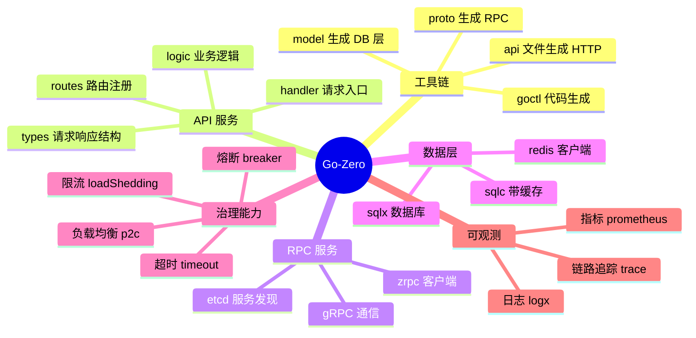

**一次请求的旅程：**

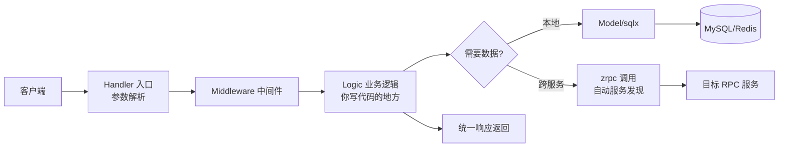

---

## 4️⃣ 快速开始：一条命令起服务 🚀

### 4.1 三步曲

```bash
# ① 写 api 文件（接口设计图纸）
mkdir greeting && cd greeting
go mod init greeting

# 创建 api 文件，内容见下面
```

**greet.api：**

```api
syntax = "v1"

info (
    title:   "问候服务"    // 文档标题
    desc:    "我的第一个 go-zero 服务"
    author:  "小樱"
)

type (
    GreetReq {
        Name string `path:"name"`              // 路径参数 /greet/小樱
    }
    GreetResp {
        Message string `json:"message"`
    }
)

@server (
    prefix: /api // 路由前缀
)
service greeter {
    @handler Greet
    get /greet/:name (GreetReq) returns (GreetResp)
}
```

```bash
# ② 一键生成！见证奇迹 ✨
goctl api go -api greet.api -dir . --style=goZero

# 生成结果：
# .
# ├── etc/greet-api.yaml   配置文件
# ├── internal/
# │   ├── config/config.go       配置定义
# │   ├── handler/greethandler.go   请求入口
# │   ├── logic/greetlogic.go    业务逻辑（写代码的地方！）
# │   ├── svc/servicecontext.go  依赖容器
# │   └── types/types.go         请求/响应结构体
# └── greet.go                   主入口
```

```bash
# ③ 跑起来
go mod tidy
go run greet.go -f etc/greet-api.yaml

# 测试
curl http://localhost:8888/api/greet/小樱
# {"message":"hello 小樱"}（默认生成的话术，去 logic 里改！）
```

### 4.2 你只需要关心一个文件

```go
// internal/logic/greetlogic.go —— 自动生成后唯一要改的地方
func (l *GreetLogic) Greet(req *types.GreetReq) (resp *types.GreetResp, err error) {
    // todo: add your logic here and delete this line
    resp = &types.GreetResp{
        Message: "你好呀, " + req.Name + "! 欢迎使用 go-zero 🎉",
    }
    return resp, nil
}
```

> 🌟 **Go-Zero 哲学**：重复的代码交给 goctl，你的时间只花在业务逻辑上！

---

## 5️⃣ API 文件语法：接口的"设计图纸" 📐

### 5.1 完整语法示例

```api
syntax = "v1"

info (
    title:   "用户服务 API"
    version: "1.0"
)

// ────────── 类型定义 ──────────
type (
    // 基础请求
    RegisterReq {
        Username string `json:"username"`                  // JSON body
        Password string `json:"password"`
        Email    string `json:"email,optional"`            // optional = 可选字段
        Age      int    `json:"age,optional,default=18"`   // 带默认值
    }
    RegisterResp {
        ID       int64  `json:"id"`
        Username string `json:"username"`
    }

    // 路径参数
    GetReq {
        ID int64 `path:"id"`                               // /user/1
    }

    // Query 参数
    ListReq {
        Page int `form:"page,default=1"`                   // ?page=1
        Size int `form:"size,default=10,range=[1:100]"`    // 范围校验！
    }
    ListResp {
        Total int64       `json:"total"`
        List  []UserItem  `json:"list"`                    // 切片也支持
    }
    UserItem {
        ID       int64  `json:"id"`
        Username string `json:"username"`
    }
)

// ────────── 分组1：公开接口 ──────────
@server (
    prefix: /api/v1
    group:  public // 按组生成文件，代码更整洁
)
service user {
    @handler Register
    post /register (RegisterReq) returns (RegisterResp)

    @handler Login
    post /login (LoginReq) returns (LoginResp)
}

// ────────── 分组2：需要 JWT 的接口 ──────────
@server (
    prefix: /api/v1
    group:  private
    jwt:    Auth // 🎫 声明式 JWT！这组接口自动要登录
)
service user {
    @handler GetUser
    get /user/:id (GetReq) returns (UserItem)

    @handler ListUsers
    get /users (ListReq) returns (ListResp)
}
```

### 5.2 参数标签速查表 📇

| 标签 | 来源 | 示例 |
|------|------|------|
| `json:"x"` | JSON body | `{"x": 1}` |
| `path:"x"` | 路径参数 | `/user/:x` |
| `form:"x"` | Query/表单 | `?x=1` |
| `header:"x"` | 请求头 | `X-Token` |
| `,optional` | 可选字段 | 缺了不报错 |
| `,default=18` | 默认值 | 缺了自动填 |
| `,range=[1:100]` | 范围校验 | 1~100 |
| `,options=a\|b` | 枚举校验 | 只能是 a 或 b |

### 5.3 常用命令

```bash
# 生成/更新 API 服务代码（改了 api 文件再跑一遍，logic 不会被覆盖！）
goctl api go -api user.api -dir . --style=goZero

# 格式化 api 文件
goctl api format --dir .

# 验证 api 文件语法
goctl api validate --api user.api

# 生成 Swagger 文档（接口文档白送！）
goctl api plugin -plugin goctl-swagger="swagger -filename user.json" -api user.api -dir .

# 生成多语言客户端调用代码（前端狂喜）
goctl api ts -api user.api -dir ./gen/ts   # TypeScript
goctl api dart -api user.api -dir ./gen    # Dart/Flutter
```

> ⚠️ **安心改**：重复执行 goctl 生成，`logic` 和 `svc` 里你写的代码**不会**被覆盖，只有模板部分会更新～

---

## 6️⃣ Logic 逻辑层：业务代码的家 🏠

### 6.1 Logic 的样子

```go
// internal/logic/getuserlogic.go
package logic

import (
    "context"

    "user/internal/svc"
    "user/internal/types"

    "github.com/zeromicro/go-zero/core/logx"
)

type GetUserLogic struct {
    logx.Logger
    ctx    context.Context
    svcCtx *svc.ServiceContext // 依赖都在这里拿
}

func NewGetUserLogic(ctx context.Context, svcCtx *svc.ServiceContext) *GetUserLogic {
    return &GetUserLogic{
        Logger: logx.WithContext(ctx),
        ctx:    ctx,
        svcCtx: svcCtx,
    }
}

func (l *GetUserLogic) GetUser(req *types.GetReq) (resp *types.UserItem, err error) {
    // ✍️ 全部的业务逻辑都写在这里
    user, err := l.svcCtx.UserModel.FindOne(l.ctx, req.ID)
    if err != nil {
        if err == model.ErrNotFound {
            return nil, errorx.NewCodeError(1001, "用户不存在")
        }
        return nil, errorx.NewCodeError(500, "查询失败")
    }

    return &types.UserItem{
        ID:       user.Id,
        Username: user.Username,
    }, nil
}
```

### 6.2 拿登录用户信息（JWT 组的接口）

```go
// jwt 组的接口，token 里的 claims 自动放进 ctx
func (l *GetUserLogic) GetUser(req *types.GetReq) (*types.UserItem, error) {
    // 取出 JWT payload 里存的字段
    userId, _ := l.ctx.Value("userId").(json.Number)
    uid, _ := userId.Int64()
    fmt.Println("当前登录用户:", uid)

    role, _ := l.ctx.Value("role").(string)
    // ...
}
```

### 6.3 请求 → 响应流转图

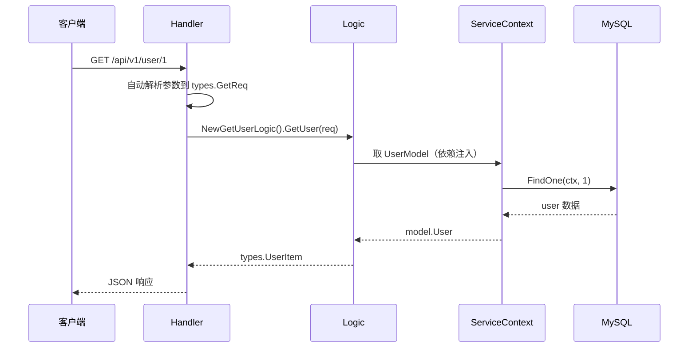

---

## 7️⃣ 配置与依赖注入：组件的组装台 🧩

### 7.1 配置文件（etc/*.yaml）

```yaml
# etc/user-api.yaml
Name: user-api
Host: 0.0.0.0
Port: 8888

# JWT 配置（api 文件里声明了 jwt: Auth 就要配）
Auth:
  AccessSecret: "我的超长密钥不可以告诉别人哦123456"
  AccessExpire: 3600 # token 有效期（秒）

# MySQL
Mysql:
  DataSource: root:123456@tcp(127.0.0.1:3306)/userdb?charset=utf8mb4&parseTime=true

# Redis
CacheRedis:
  - Host: 127.0.0.1:6379
    Type: node

# etcd（调用 RPC 时）
UserRpc:
  Etcd:
    Hosts:
      - 127.0.0.1:2379
    Key: user.rpc

# 电商项目常见中间件
Telemetry:
  Name: user-api
  Endpoint: http://jaeger:14268/api/traces
  Sampler: 0.1
```

### 7.2 配置结构体（自动生成，加配置要同步改）

```go
// internal/config/config.go
type Config struct {
    rest.RestConf // 内嵌 HTTP 服务基础配置（Name/Host/Port...）

    Auth struct {
        AccessSecret string
        AccessExpire int64
    }

    Mysql struct {
        DataSource string
    }

    CacheRedis cache.CacheConf

    UserRpc zrpc.RpcClientConf
}
```

### 7.3 ServiceContext：依赖集中营

```go
// internal/svc/servicecontext.go —— 所有依赖在启动时装配好
type ServiceContext struct {
    Config     config.Config
    UserModel  model.UserModel
    UserRpc    user.User // RPC 客户端
}

func NewServiceContext(c config.Config) *ServiceContext {
    // 连接 MySQL + 自动带 Redis 缓存
    conn := sqlx.NewMysql(c.Mysql.DataSource)
    userModel := model.NewUserModel(conn, c.CacheRedis)

    // 连接 RPC（etcd 自动服务发现）
    userRpc := user.NewUser(zrpc.MustNewClient(c.UserRpc))

    return &ServiceContext{
        Config:    c,
        UserModel: userModel,
        UserRpc:   userRpc,
    }
}
```

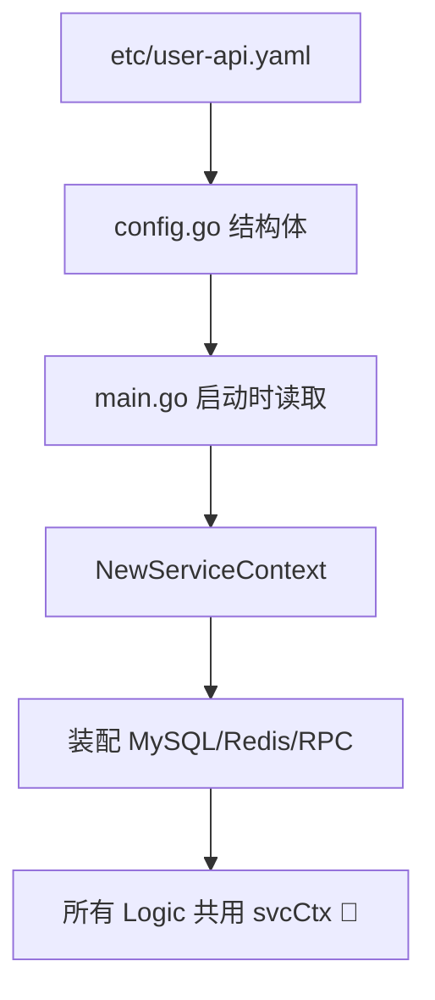

---

## 8️⃣ 中间件：拦截器继续用 🛂

### 8.1 自定义中间件（goctl 生成骨架）

```bash
# 生成中间件模板
goctl api go -api user.api -dir . --style=goZero
# 在 api 文件里声明：
```

```api
@server (
    middleware: LoginLimit // 声明中间件（这组全生效）
)
service user {
    @handler Login
    post /login (LoginReq) returns (LoginResp)
}
```

```go
// internal/middleware/loginlimitmiddleware.go（自动生成骨架）
type LoginLimitMiddleware struct{}

func NewLoginLimitMiddleware() *LoginLimitMiddleware {
    return &LoginLimitMiddleware{}
}

// Gin 课学的洋葱模型，这里是 go-zero 版（http.HandlerFunc 链）
func (m *LoginLimitMiddleware) Handle(next http.HandlerFunc) http.HandlerFunc {
    return func(w http.ResponseWriter, r *http.Request) {
        // TODO：前置逻辑（限流/鉴权/日志）
        logx.Infof("进入中间件: %s %s", r.Method, r.URL.Path)

        ip := r.RemoteAddr
        if banned(ip) {
            http.Error(w, "你被封禁啦", http.StatusForbidden)
            return // 拦截！不调 next
        }

        next(w, r) // 放行 🚦
        // 后置逻辑（统计耗时等）
    }
}
```

### 8.2 全局中间件（main.go 里加）

```go
// main.go
server := rest.MustNewServer(c.RestConf)
defer server.Stop()

// 全局：所有路由都过
server.Use(func(next http.HandlerFunc) http.HandlerFunc {
    return func(w http.ResponseWriter, r *http.Request) {
        // 跨域头、traceID 之类
        w.Header().Set("Access-Control-Allow-Origin", "*")
        next(w, r)
    }
})

handler.RegisterHandlers(server, ctx)
server.Start()
```

---

## 9️⃣ RPC 服务：微服务的电话线 ☎️

### 9.1 写 proto 文件

```protobuf
// user.proto —— 注意 goctl 增强版语法
syntax = "proto3";

package user;

option go_package = "./user";

// 请求/响应
message GetUserReq {
  int64 id = 1;
}
message GetUserResp {
  int64 id = 1;
  string username = 2;
}

message LoginReq {
  string username = 1;
  string password = 2;
}
message LoginResp {
  int64 userId = 1;
}

// 服务定义
service User {
  rpc GetUser(GetUserReq) returns (GetUserResp);
  rpc Login(LoginReq) returns (LoginResp);
}
```

### 9.2 一键生成 RPC 服务

```bash
goctl rpc protoc user.proto --go_out=. --go-grpc_out=. --zrpc_out=. --style=goZero

# 生成：
# .
# ├── etc/user.yaml        RPC 配置
# ├── internal/
# │   ├── logic/           各方法逻辑（同 API！）
# │   ├── server/          gRPC server
# │   └── svc/             依赖容器
# ├── user/                客户端包（给 API 服务 import 用！）
# ├── userclient/          便捷客户端
# └── user.go              主入口
```

```go
// internal/logic/getuserlogic.go —— RPC 的 logic，写法一模一样！
func (l *GetUserLogic) GetUser(in *user.GetUserReq) (*user.GetUserResp, error) {
    // 查数据库
    u, err := l.svcCtx.UserModel.FindOne(l.ctx, in.Id)
    if err != nil {
        return nil, status.Error(codes.NotFound, "用户不存在")
    }
    return &user.GetUserResp{
        Id:       u.Id,
        Username: u.Username,
    }, nil
}
```

### 9.3 API 服务调用 RPC

```bash
# API 项目里引入生成的客户端包
cd ../user-api
go mod edit -replace user/rpc=../user-rpc  # 本地开发用 replace
go get user/rpc
```

```go
// logic 里调用（像调本地函数一样调远程！）
func (l *GetUserLogic) GetUser(req *types.GetReq) (*types.UserItem, error) {
    resp, err := l.svcCtx.UserRpc.GetUser(l.ctx, &user.GetUserReq{
        Id: req.ID,
    })
    if err != nil {
        return nil, err // 错误透传
    }
    return &types.UserItem{
        ID:       resp.Id,
        Username: resp.Username,
    }, nil
}
```

### 9.4 RPC 通信全景

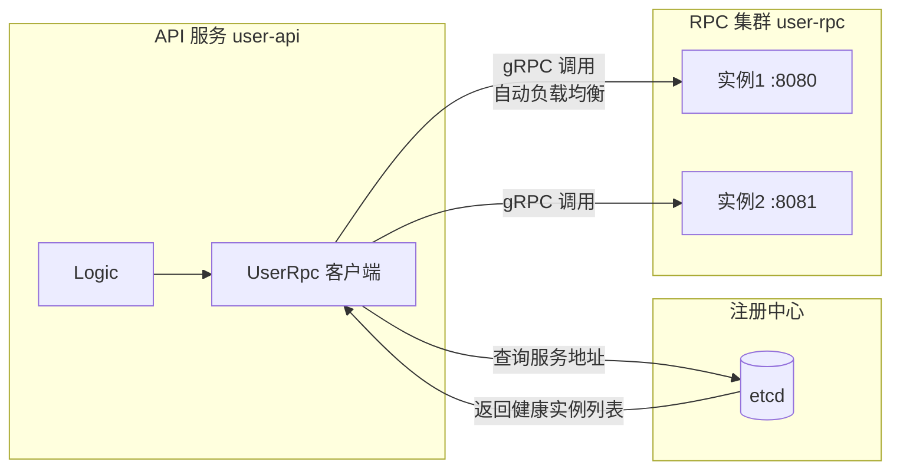

> 💡 新增一个 RPC 实例？直接启动，自动注册进 etcd，API 服务**无感扩容**～这就是服务发现的魔力！

---

## 🔟 服务注册与发现：服务的通讯录 📇

### 10.1 原理：etcd 当电话簿

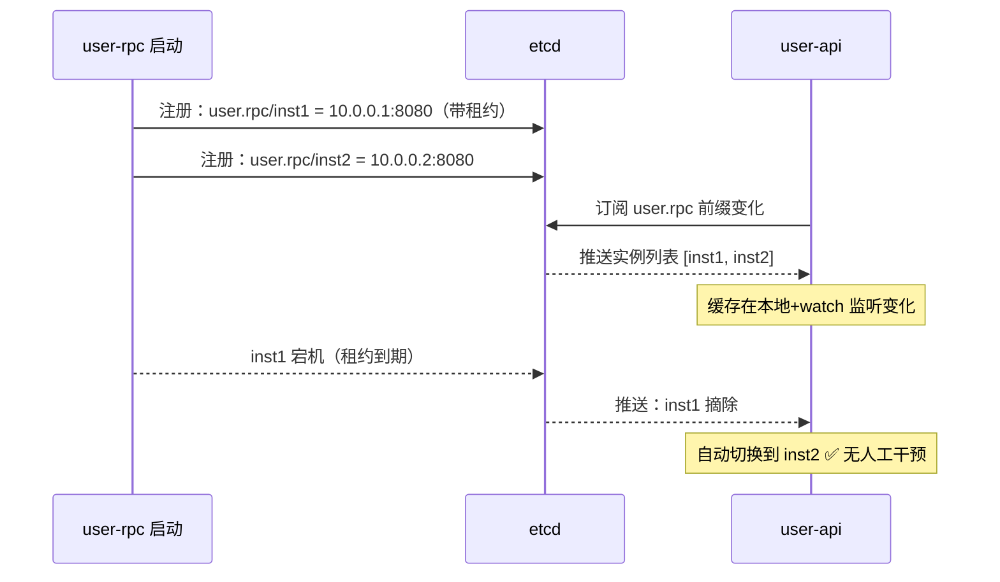

### 10.2 配置就两处

```yaml
# RPC 服务端：声明自己注册到哪
Name: user-rpc
ListenOn: 0.0.0.0:8080

Etcd:
  Hosts:
    - 127.0.0.1:2379
  Key: user.rpc # 服务名（电话簿里的名字）
```

```yaml
# API 客户端：声明去哪找
UserRpc:
  Etcd:
    Hosts:
      - 127.0.0.1:2379
    Key: user.rpc # 按名字找
```

### 10.3 直连模式（开发调试用）

```yaml
# 不走 etcd，直接指定地址（联调某台机器时超方便）
UserRpc:
  Endpoints:
    - 127.0.0.1:8080
  NonBlock: true # 异步连接，别卡启动
```

---

## 1️⃣1️⃣ 数据库 sqlx：Go-Zero 自带数据层 🗄️

### 11.1 goctl model：从建表语句生成 Model

```sql
-- user.sql 先建表
CREATE TABLE `user` (
  `id`         bigint NOT NULL AUTO_INCREMENT,
  `username`   varchar(64) NOT NULL,
  `password`   varchar(64) NOT NULL,
  `mobile`     varchar(32) DEFAULT '',
  `create_time` timestamp DEFAULT CURRENT_TIMESTAMP,
  `update_time` timestamp DEFAULT CURRENT_TIMESTAMP ON UPDATE CURRENT_TIMESTAMP,
  PRIMARY KEY (`id`),
  UNIQUE KEY `idx_username` (`username`)
) ENGINE=InnoDB DEFAULT CHARSET=utf8mb4;
```

```bash
# 一条命令生成 Model（CRUD 全有！）
goctl model mysql ddl -src user.sql -dir internal/model -c

# -c = cache，自动生成带 Redis 缓存的版本（推荐 ✅）
```

### 11.2 生成的 Model 自带方法

```go
// internal/model/usermodel.go —— 生成的接口
type UserModel interface {
    Insert(ctx context.Context, data *User) (sql.Result, error)
    FindOne(ctx context.Context, id int64) (*User, error)
    FindOneByUsername(ctx context.Context, username string) (*User, error) // 唯一索引自动生成！
    Update(ctx context.Context, data *User) error
    Delete(ctx context.Context, id int64) error
}

// 使用：logic 里
user, err := l.svcCtx.UserModel.FindOne(l.ctx, req.ID)
_, err = l.svcCtx.UserModel.Insert(l.ctx, &model.User{
    Username: req.Username,
    Password: passwordHash,
})
```

### 11.3 自定义复杂查询（加方法）

```go
// usermodel.go 加接口方法
type UserModel interface {
    // ...生成的
    ListByAge(ctx context.Context, age int64) ([]*User, error) // 新加
}

// usermodelgen.go 同级写实现（别改 gen 文件！会被覆盖）
// 推荐另建 usermodelcustom.go 或直接写在 usermodel.go
func (m *customUserModel) ListByAge(ctx context.Context, age int64) ([]*User, error) {
    query := "SELECT id, username, mobile FROM " + m.table + " WHERE create_time > ?"
    var resp []*User
    err := m.conn.QueryRowsCtx(ctx, &resp, query, time.Now().AddDate(0, -1, 0))
    // ✅ QueryRowsCtx：自动防 SQL 注入（参数化）+ 传 ctx
    return resp, err
}
```

### 11.4 缓存版 Model 的工作机制 ⭐

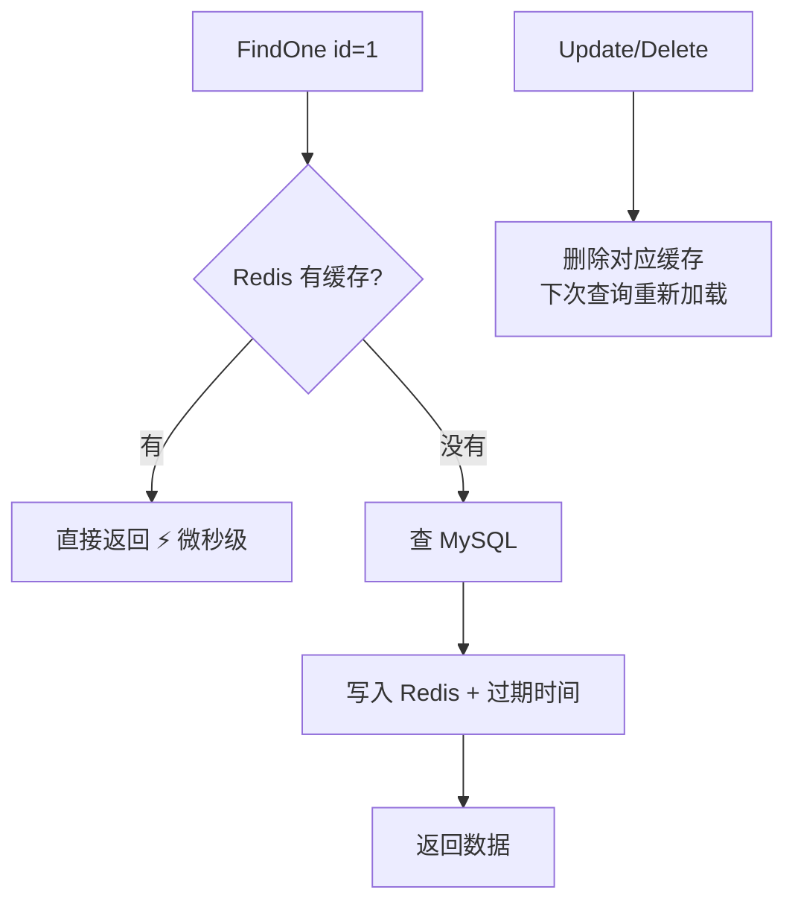

> 💡 Go-Zero 用 **Cache-Aside 模式**：更新时删缓存（不是改缓存），简单可靠不脑裂～缓存 key 规则：`表名:主键值`、`表名:索引名:索引值`

### 11.5 sqlx vs GORM 对比

| 维度 | goctl model (sqlx) | GORM |
|------|--------------------|------|
| 代码生成 | ✅ 建表 SQL 直接生成 | ❌ 手写模型 |
| SQL 可见性 | ✅ 明确写 SQL（可控） | 链式魔法（调试看日志） |
| 内置缓存 | ✅ 一键带缓存 | ❌ 自己写 |
| 关联查询 | 手写 JOIN | ✅ Preload 优雅 |
| 性能 | 更轻更快 | 反射有开销 |
| 学习成本 | 简单直接 | 要记一堆规则 |

> 🌟 在 Go-Zero 项目里**推荐用 sqlx**（生态一致）；老项目迁移或复杂关联多用 GORM 也没问题～

---

## 1️⃣2️⃣ Redis 与缓存：快上加快 ⚡

### 12.1 直接用 redis 客户端

```go
// svc 里装配
type ServiceContext struct {
    Config config.Config
    Redis  *redis.Redis
}

func NewServiceContext(c config.Config) *ServiceContext {
    r := redis.MustNewRedis(redis.RedisConf{
        Host: "127.0.0.1:6379",
        Type: "node",
        Pass: "", // 有密码写这
    })
    return &ServiceContext{Config: c, Redis: r}
}
```

```go
// logic 里使用
// String 类型
err := l.svcCtx.Redis.SetexCtx(l.ctx, "sms:code:13800001111", "8888", 300) // 5分钟过期
code, err := l.svcCtx.Redis.GetCtx(l.ctx, "sms:code:13800001111")

// 计数器（接口限流也能这么玩）
n, _ := l.svcCtx.Redis.IncrCtx(l.ctx, "pv:user:1001")

// 删除
l.svcCtx.Redis.DelCtx(l.ctx, "sms:code:13800001111")
```

### 12.2 内置缓存 cache.CacheConf

```go
// 集群配置写法（etc yaml）
CacheRedis:
  - Host: 127.0.0.1:6379
    Type: node
#  - Host: 10.0.0.2:6379   # 可以配多个（集群）
#    Type: cluster

// Go-Zero 还内置了防击穿 singleflight、防雪崩的过期抖动
// 用 model 生成的 -c 版本，这些全都自动拥有 ✅
```

### 12.3 缓存三大问题与 Go-Zero 的解法

| 问题 | 现象 | Go-Zero 解法 |
|------|------|-------------|
| 缓存穿透 | 查不存在的 key 打穿到 DB | singleflight 合并请求 + 空值缓存 |
| 缓存击穿 | 热点 key 过期瞬间大量打 DB | singleflight 单飞 🦅 |
| 缓存雪崩 | 大量 key 同时过期 | 过期时间加随机抖动 |

---

## 1️⃣3️⃣ JWT 认证：登录态标准姿势 🎫

### 13.1 完整流程（api 声明 + yaml 配置就完事）

```api
// 登录接口放公开组
@server (
    prefix: /api/v1
    group: public
)
service user {
    @handler Login
    post /login (LoginReq) returns (LoginResp)
}

// 需要登录的接口放 JWT 组
@server (
    prefix: /api/v1
    group:  private
    jwt:    Auth // 就这一行！
)
service user {
    @handler Profile
    get /profile (ProfileReq) returns (ProfileResp)
}
```

```yaml
# yaml 配置密钥
Auth:
  AccessSecret: "super-secret-key-至少32位字符串更安全哦"
  AccessExpire: 3600
```

### 13.2 登录时签发 token

```go
// internal/logic/loginlogic.go
func (l *LoginLogic) Login(req *types.LoginReq) (*types.LoginResp, error) {
    // 1. 查用户验密码
    u, err := l.svcCtx.UserModel.FindOneByUsername(l.ctx, req.Username)
    if err != nil || !checkPassword(req.Password, u.Password) {
        return nil, errorx.NewCodeError(1002, "用户名或密码错误")
    }

    // 2. 签发 JWT
    now := time.Now().Unix()
    expire := l.svcCtx.Config.Auth.AccessExpire
    token, err := l.getJwtToken(l.svcCtx.Config.Auth.AccessSecret, now, expire, u.Id)
    if err != nil {
        return nil, err
    }

    return &types.LoginResp{
        AccessToken:  token,
        ExpireIn:     expire,
    }, nil
}

// 签发函数（官方模板自带）
func (l *LoginLogic) getJwtToken(secretKey string, iat, seconds, userId int64) (string, error) {
    claims := make(jwt.MapClaims)
    claims["iat"] = iat        // 签发时间
    claims["exp"] = iat + seconds // 过期时间
    claims["userId"] = userId  // 自定义字段：后续 ctx 里取！
    token := jwt.New(jwt.SigningMethodHS256)
    token.Claims = claims
    return token.SignedString([]byte(secretKey))
}
```

### 13.3 受保护接口取用户

```go
// profile 接口：不用管 token 校验（框架干了），直接拿用户ID
func (l *ProfileLogic) Profile(req *types.ProfileReq) (*types.ProfileResp, error) {
    userId, _ := l.ctx.Value("userId").(json.Number)
    uid, _ := userId.Int64() // 登录时塞的 userId 出现啦 ✅
    // ...
}
```

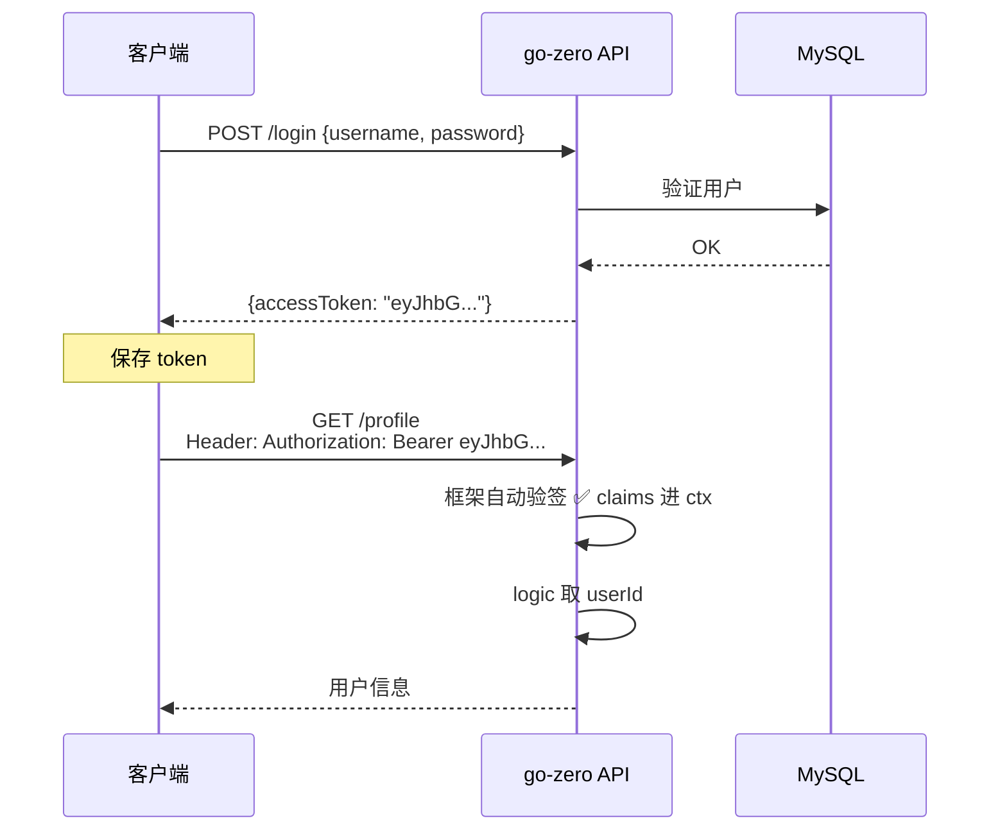

---

## 1️⃣4️⃣ 内置治理能力：熔断限流负载均衡 🛡️

Go-Zero 最香的一点：**这些微服务"保命技能"全部内置零配置**！

### 14.1 三大保命技能

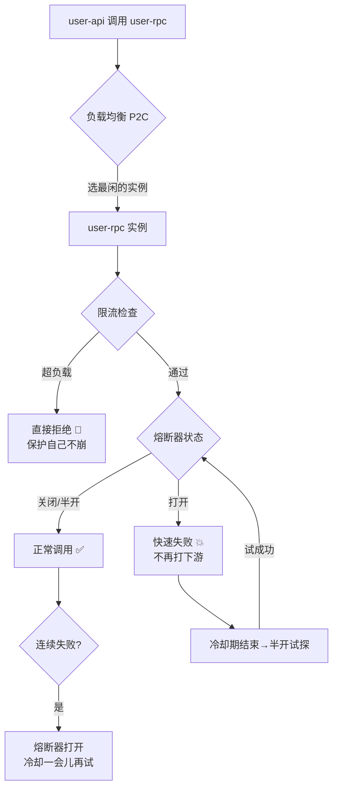

### 14.2 能力速查表

| 能力 | 触发场景 | Go-Zero 默认 |
|------|---------|-------------|
| **P2C 负载均衡** | 多实例调用 | ✅ 自动（pick 2 比较，选负载低的） |
| **自适应熔断** | 下游错误率飙升 | ✅ 自动（google sre 算法） |
| **并发限流** | CPU/负载超阈值 | ✅ 自动（保护自身） |
| **超时控制** | 调用时间过长 | ✅ 默认 2000ms，可配 |
| **重试** | 瞬时失败 | ⚙️ 按需开启 |

### 14.3 自定义超时与重试

```go
// 调用 RPC 时自定义超时重试
conn := zrpc.MustNewClient(zrpc.RpcClientConf{...},
    zrpc.WithTimeout(3000*time.Millisecond), // 超时 3 秒
)
```

```go
// API 层面超时：rest.RestConf
Timeout: 3000 # yaml 里配全接口超时

// 接口级限流：用中间件+redis 实现令牌桶
import "github.com/zeromicro/go-zero/core/limit"

limiter := limit.NewPeriodLimit(1, 100, redisClient, "login:limit:")
code, err := limiter.TakeCtx(ctx, userIP) // 1秒100次
if code == limit.OverQuota {
    return nil, errorx.NewCodeError(429, "请求太频繁啦")
}
```

---

## 1️⃣5️⃣ 可观测性：日志/监控/链路追踪 🔭

### 15.1 logx：自带日志库

```go
import "github.com/zeromicro/go-zero/core/logx"

// 基本用法
logx.Info("普通信息")
logx.Errorf("出错啦: %v", err)
logx.Severef("严重错误：必须处理！")
logx.Debugv(debugData) // 开发调试

// 带上下文（Logic 里直接用，自动带 traceID！）
l.Infof("查询用户 %d", req.ID) // Logger 内嵌的，自动关联链路

// 结构化字段（推荐）
logx.WithContext(ctx).Infow("订单创建",
    logx.Field("orderId", 12345),
    logx.Field("userId", 678),
)

// 慢查询日志（sqlx 自动打，超时 SQL 现形！）
// [SQL] slowsql: SELECT ... cost: 523ms
```

```yaml
# yaml 配置日志输出
Log:
  ServiceName: user-api
  Level: info       # info/error/severe
  Encoding: json    # 生产用 json（好采集）
  Path: logs        # 写文件
  RotationSize: 100 # MB 轮转
```

### 15.2 Prometheus 指标（默认开启！）

```yaml
# yaml 加一行就开启
Prometheus:
  Host: 0.0.0.0
  Port: 9091
  Path: /metrics
```

```bash
# 指标就有了：QPS、耗时分布、CPU、内存...
curl http://localhost:9091/metrics
```

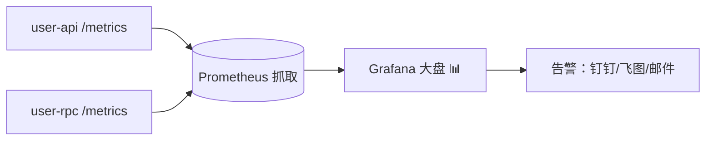

### 15.3 链路追踪（接 OpenTelemetry/Jaeger）

```yaml
# yaml 配置（一行不落）
Telemetry:
  Name: user-api
  Endpoint: http://jaeger:14268/api/traces
  Sampler: 1.0 # 采样率 1=全采，生产 0.1
  Batcher: jaeger
```

> 🌟 效果：一个请求穿过 API→RPC→DB 的**完整调用链**在 Jaeger 界面可视化，哪里慢了一眼看穿！

### 15.4 pprof 性能分析

```go
// main.go 开启（本地调试用）
import _ "net/http/pprof"
// 或 go-zero 内置：
// 访问 http://localhost:6060/debug/pprof
```

---

## 1️⃣6️⃣ 实战：完整微服务 💯

**场景**：用户微服务（user-rpc）+ 订单 API（order-api 调用用户 RPC）

### 16.1 项目结构（微服务单仓）

```text
mall/
├── app/
│   ├── user/
│   │   ├── cmd/api/        # 用户 HTTP API
│   │   │   ├── etc/user-api.yaml
│   │   │   ├── user.api
│   │   │   └── internal/...
│   │   └── cmd/rpc/        # 用户 RPC
│   │       ├── etc/user.yaml
│   │       ├── user.proto
│   │       └── internal/...
│   └── order/
│       └── cmd/api/        # 订单 HTTP API（调 user-rpc）
├── common/                 # 共享错误码/工具
└── go.work                 # go work 管理多模块（1.18+）
```

### 16.2 完整开发流程（背下来！⭐）

```bash
# ① user-rpc：proto → 代码
cd app/user/cmd/rpc
goctl rpc protoc user.proto --go_out=. --go-grpc_out=. --zrpc_out=. --style=goZero
# 写 logic → 配 etc/user.yaml（etcd 注册）

# ② user-api：api → 代码
cd ../api
goctl api go -api user.api -dir . --style=goZero
# 写 logic → 配 etc（JWT + UserRpc etcd）

# ③ order-api 调 user-rpc：import 生成的客户端包
cd ../../order/cmd/api
goctl api go -api order.api -dir . --style=goZero
# svc 装配 UserRpc，logic 里调用
```

### 16.3 order 里的关键代码

```yaml
# app/order/cmd/api/etc/order-api.yaml
Name: order-api
Host: 0.0.0.0
Port: 8889

Auth:
  AccessSecret: "super-secret-key-和user-api一致才能互通"
  AccessExpire: 3600

UserRpc:
  Etcd:
    Hosts:
      - 127.0.0.1:2379
    Key: user.rpc
```

```go
// internal/logic/createorderlogic.go
func (l *CreateOrderLogic) CreateOrder(req *types.CreateOrderReq) (*types.CreateOrderResp, error) {
    // ① 从 ctx 拿登录用户（JWT 自动完成校验）
    userId, _ := l.ctx.Value("userId").(json.Number)
    uid, _ := userId.Int64()

    // ② 跨服务查用户（RPC + etcd 服务发现 + 负载均衡，全自动）
    userResp, err := l.svcCtx.UserRpc.GetUser(l.ctx, &user.GetUserReq{Id: uid})
    if err != nil {
        return nil, errorx.NewCodeError(5001, "获取用户信息失败")
    }

    // ③ 业务校验+落库
    order, err := l.svcCtx.OrderModel.Insert(l.ctx, &model.Order{
        UserId:  uid,
        Amount:  req.Amount,
        Remark:  "下单人: " + userResp.Username,
    })
    if err != nil {
        return nil, err
    }

    return &types.CreateOrderResp{OrderId: order.Id}, nil
}
```

### 16.4 启动全家桶

```bash
# 依次启动（或写个 Makefile）
cd app/user/cmd/rpc && go run user.go -f etc/user.yaml &
cd app/user/cmd/api && go run user.go -f etc/user-api.yaml &
cd app/order/cmd/api && go run order.go -f etc/order-api.yaml &

# 完整链路测试
curl -X POST http://localhost:8888/api/v1/login \
  -H "Content-Type: application/json" \
  -d '{"username":"小樱","password":"123456"}'
# → {"accessToken":"eyJ..."}

curl -X POST http://localhost:8889/api/v1/order \
  -H "Authorization: Bearer eyJ..." \
  -H "Content-Type: application/json" \
  -d '{"amount":99.9}'
# → {"orderId":1} ✅ 跨服务调用成功！
```

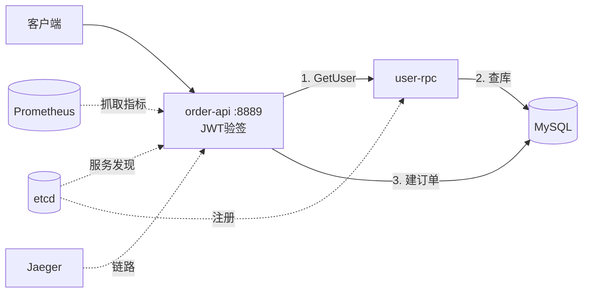

---

## 1️⃣7️⃣ 部署上线：交付的最后一步 🚢

### 17.1 Dockerfile（goctl 直接生成！）

```bash
# 在服务目录下执行
goctl docker -go user.go -port 8888 -version 1.0.0
# 自动生成 Dockerfile ✨
```

```dockerfile
# 生成的 Dockerfile（多阶段构建）
FROM golang:1.22-alpine AS builder
WORKDIR /app
COPY . .
RUN go build -ldflags="-s -w" -o /app/user .

FROM alpine:latest
COPY --from=builder /app/user /usr/local/bin/user
EXPOSE 8888
ENTRYPOINT ["user", "-f", "etc/user-api.yaml"]
```

### 17.2 K8s 部署（goctl 也能生成！）

```bash
# 生成 K8s 部署清单
goctl kube deploy -name user-api -namespace mall \
  -image registry.cn-hangzhou.aliyuncs.com/mall/user-api:1.0 \
  -port 8888 -replicas 2 -o user-deploy.yaml
```

```yaml
# 生成的 deployment 要点
spec:
  replicas: 2            # 两个副本
  template:
    spec:
      containers:
        - name: user-api
          ports:
            - containerPort: 8888
          readinessProbe:   # 存活检查自动配好
            tcpSocket:
              port: 8888
```

### 17.3 上线检查清单 ✅

- [ ] etcd/MySQL/Redis 地址用**环境变量或配置中心**（别硬编码）
- [ ] JWT 密钥各服务一致且不进仓库
- [ ] `Prometheus`/`Telemetry` 已配置
- [ ] 日志输出 json 格式接采集
- [ ] 镜像用多阶段构建（体积从 800MB → 20MB）
- [ ] K8s 副本数 ≥ 2（高可用）
- [ ] 敏感配置用 Secret 管理

---

## 1️⃣8️⃣ Gin vs Go-Zero：怎么选看这里 ⚖️

| 维度 | Gin | Go-Zero |
|------|-----|---------|
| 定位 | Web 框架（路由+中间件） | 微服务全家桶 |
| 代码生成 | ❌ 手写 | ✅ goctl 全自动 |
| 服务发现 | ❌ 自己集成 | ✅ 内置 etcd |
| 熔断/限流 | ❌ 自己集成 | ✅ 内置自适应 |
| 监控/链路 | ❌ 自己集成 | ✅ 内置开箱即用 |
| 学习成本 | ⭐ 极低 | ⭐⭐⭐ 中等 |
| 灵活性 | ⭐⭐⭐⭐⭐ 想咋写咋写 | 约定优先（被管着） |
| 适合 | 小服务/中间层/快速原型 | **中大型微服务集群** |

**选择建议：**

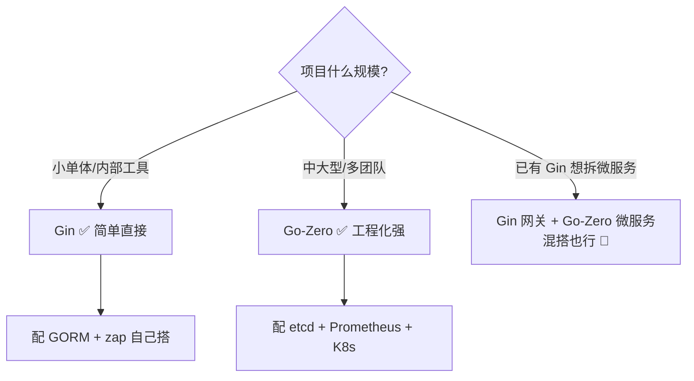

---

## 🎁 总结：一张图吃透 Go-Zero

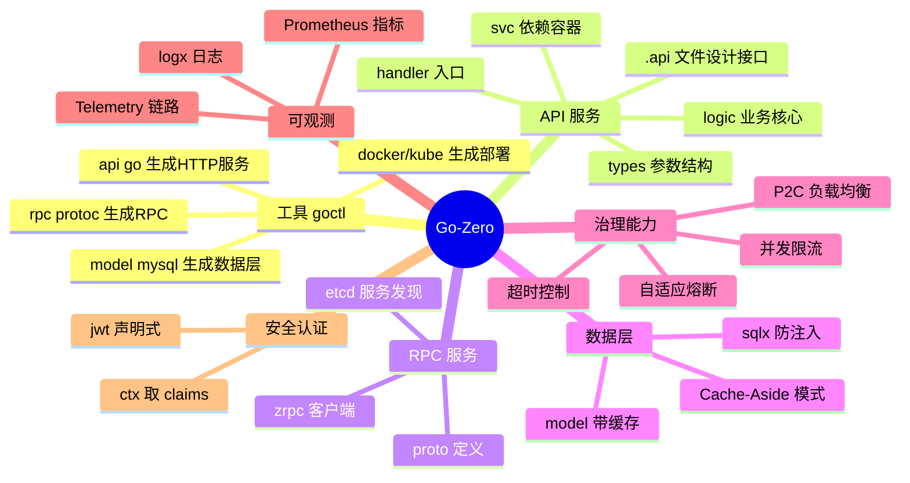

## 📝 课后小测验（动动小脑瓜 🧠）

1. Go-Zero 中生成 HTTP 服务、RPC 服务、Model 的 goctl 命令分别是什么？
2. `.api` 文件中 `@server (jwt: Auth)` 意味着什么？
3. 重复执行 goctl 生成代码，logic 目录里你写的代码会被覆盖吗？
4. JWT 组的接口里，怎么拿到 token 中存的 userId？
5. ServiceContext 的作用是什么？
6. `goctl model` 加 `-c` 参数生成的东西多了什么能力？
7. API 服务调用 RPC 时，etcd 里存的是什么信息？

<details>
<summary>👉 点开看答案</summary>

1. `goctl api go -api xx.api -dir .`；`goctl rpc protoc xx.proto --go_out=. --go-grpc_out=. --zrpc_out=.`；`goctl model mysql ddl -src xx.sql -dir . -c`。
2. 这组路由**自动启用 JWT 认证**，请求要带合法 token 才能进，payload 会解析进 context。
3. **不会**！goctl 只更新模板代码（handler/types/routes），logic 和 svc 里已有代码保留，新增方法会生成新文件。
4. `l.ctx.Value("userId").(json.Number)` 再 `.Int64()`（登录签发时塞的字段）。
5. **依赖注入容器**：启动时装配好 Config/Model/RPC 客户端等，所有 Logic 通过 `l.svcCtx` 共用。
6. **Redis 缓存**（Cache-Aside）：FindOne 先查缓存，Update/Delete 自动删缓存。
7. **服务实例的地址列表**（key 是服务名如 `user.rpc`，value 是 `ip:port`），客户端 watch 变化自动更新。

</details>

---

> 🌸 恭喜通关 Go-Zero！Go 系列课程到此全部完结：
> ✅ 基础语法 → ✅ 常用包 → ✅ 进阶特性 → ✅ 并发编程 → ✅ Gin → ✅ GORM → ✅ **Go-Zero 微服务** 🏆
> 现在你已经具备从零搭建生产级微服务系统的全部知识！
> 建议把第 16 章的实战完整跑一遍，再往外扩展：**分布式事务（dtm）**、**消息队列（Kafka/RocketMQ）**、**服务网格（Istio）**～
> 随时召唤本讲师，比心 💖
