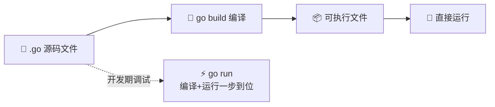
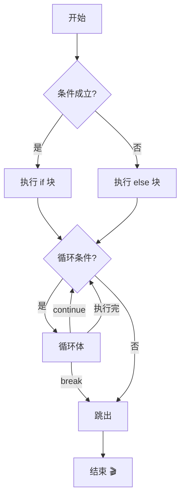
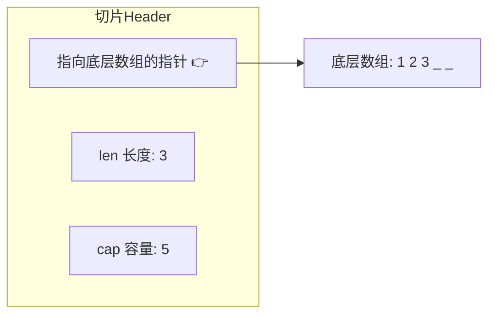
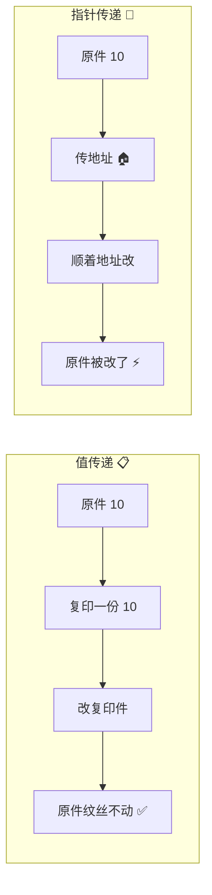
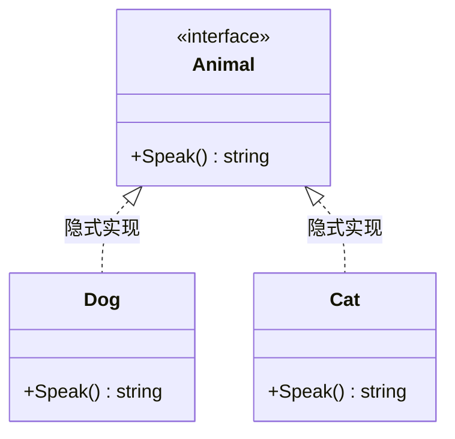
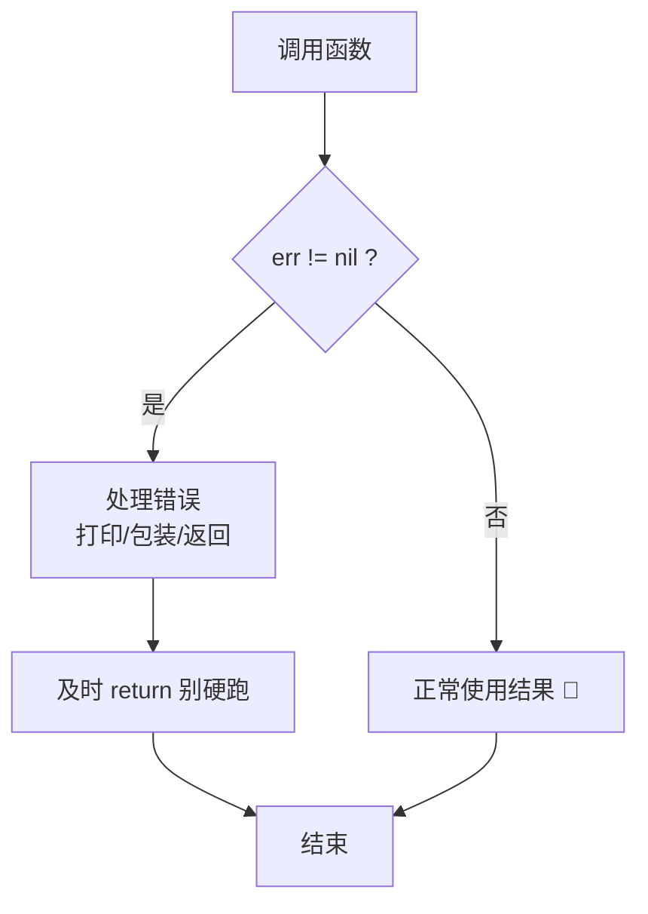
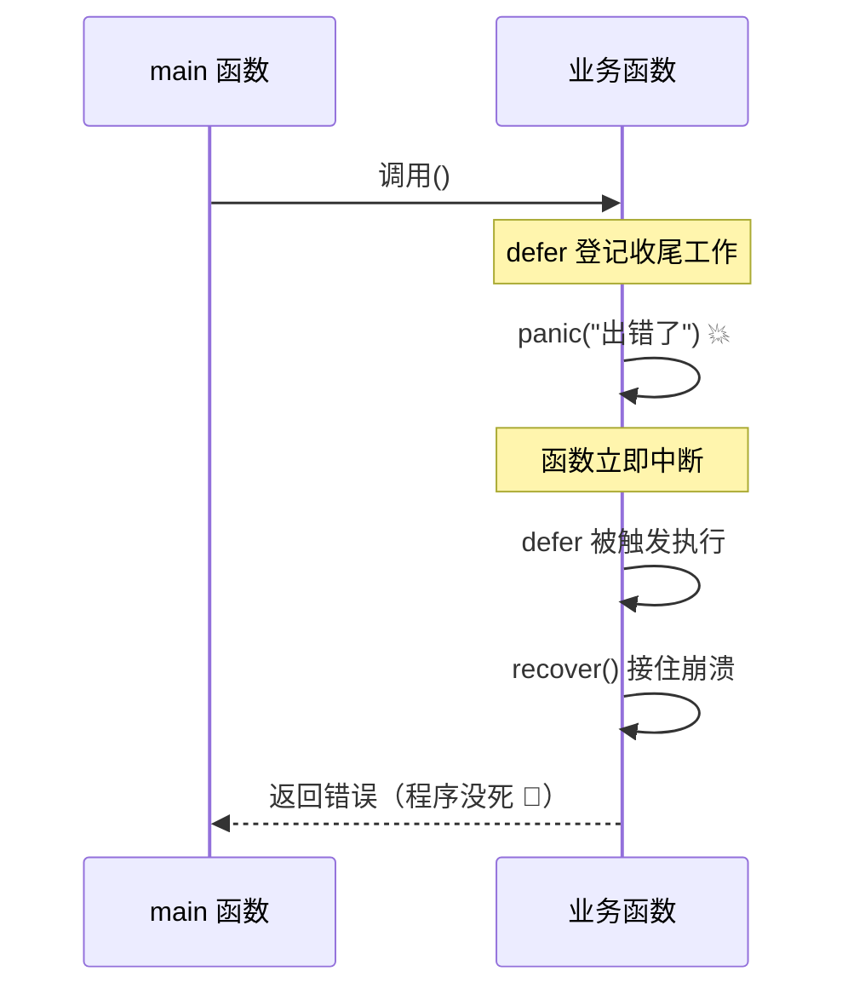
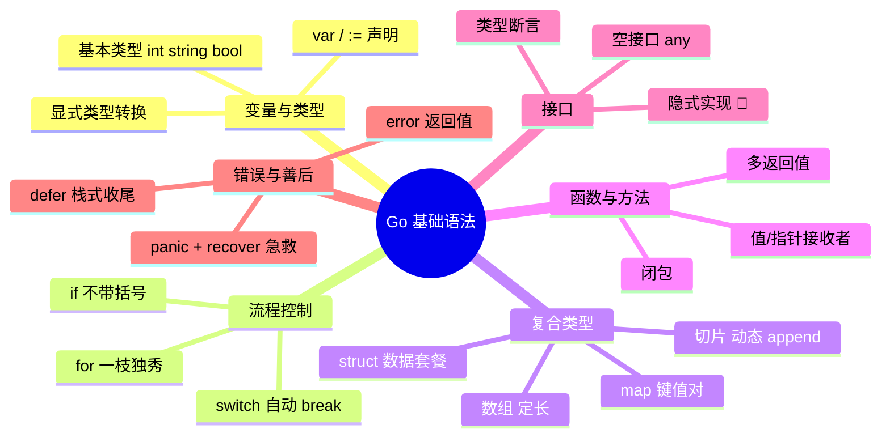

# 🌟 Go 语言基础语法超详细讲义

> 嘿嘿～欢迎来到 Go 语言小课堂！🎀
> Go 是谷歌爸爸 2009 年推出的语言，主打一个 **简单、高效、天生擅长并发**。
> 云原生界的顶流 Docker、Kubernetes、etcd 都是 Go 写的哦～快跟我一起冲鸭！🚀

---

## 📚 目录一览

| 章节 | 内容 | 一句话理解 |
|------|------|-----------|
| 1 | Go 简介 | 这语言是干嘛的？ |
| 2 | Hello World | 出生第一声啼哭 👶 |
| 3 | 变量与常量 | 数据的小盒子 📦 |
| 4 | 基本数据类型 | 盒子里能装啥 |
| 5 | 运算符 | 加减乘除那些事 ➕ |
| 6 | 流程控制 | 代码的分岔路口 🚦 |
| 7 | 数组与切片 | 一串数据的收纳盒 |
| 8 | Map | 键值对字典 📖 |
| 9 | 函数 | 代码的乐高积木 🧩 |
| 10 | 指针 | 数据家的地址牌 🏠 |
| 11 | 结构体 | 自定义数据套餐 |
| 12 | 方法 | 给类型装技能 💫 |
| 13 | 接口 | 万物插头标准 🔌 |
| 14 | 错误处理 | 出错了别慌 😤 |
| 15 | defer / panic / recover | 善后三兄弟 🧹 |

---

## 1️⃣ Go 简介

### 1.1 Go 的三大法宝 ✨

1. **语法简单**：关键字只有 25 个，比 Java/C++ 少一大截，学起来不头秃～
2. **编译超快**：点一下就跑，告别漫长等待 ☕
3. **并发强悍**：自带 `goroutine`（轻量级线程），写并发像喝水一样简单！

### 1.2 Go 程序的一生 🎬



### 1.3 程序结构小地图 🗺️

一个 Go 文件的骨架长这样：

```go
package main // ① 声明属于哪个包，main 包是程序的入口

import "fmt" // ② 导入要用的工具包

func main() { // ③ main 函数：程序从这里开始跑！
    fmt.Println("你好呀～") // ④ 干活儿的代码
}
```

> 💡 **小贴士**：`{` 必须和函数名写在同一行！Go 是出了名的"格式洁癖"，不过有 `go fmt` 命令帮你自动排版，超贴心哒～

---

## 2️⃣ Hello World 👶

每个程序员的仪式感，从 Hello World 开始！

```go
package main

import "fmt"

func main() {
    fmt.Println("Hello, World! 🎉")
}
```

**运行方式：**

```bash
go run main.go    # 直接跑（开发时用）
go build main.go  # 编译成 exe（发布时用）
```

**逐行拆解** 🔍：

| 代码 | 作用 |
|------|------|
| `package main` | 声明这是主程序包 |
| `import "fmt"` | 导入格式化输出包（fmt = format） |
| `func main()` | 程序入口，必须有且只有一个 |
| `fmt.Println(...)` | 打印一行并换行 |

---

## 3️⃣ 变量与常量 📦

### 3.1 变量的三种声明姿势

变量就是**贴了标签的盒子**，往里面装数据～

```go
// 姿势一：标准写法（var 关键字 + 名字 + 类型）
var name string = "小樱"

// 姿势二：类型省略（Go 自己看值猜类型）
var age = 18

// 姿势三：短变量声明（只能在函数里面用！:= 是 Go 的招牌动作）
score := 99.5
```

| 写法 | 适用场景 | 备注 |
|------|---------|------|
| `var x T = v` | 全局/局部都行 | 最正式 |
| `var x = v` | 全局/局部都行 | 自动类型推断 |
| `x := v` | **只能函数内** | 最常用，手写最快 ✍️ |

### 3.2 变量的默认值（零值）

声明了没赋值？Go 不会让你拿到垃圾值，它会悄悄给个"零值"：

| 类型 | 零值 |
|------|------|
| 数字（int/float…） | `0` |
| 布尔 bool | `false` |
| 字符串 string | `""`（空串） |
| 指针/切片/map | `nil`（就是空啦） |

### 3.3 常量 const 与 iota 🧊

常量 = 装了锁的盒子，**装进去就不能改**！

```go
const Pi = 3.14159
const (
    StatusOK  = 200
    StatusErr = 500
)

// iota：自动递增计数器，从 0 开始，一行 +1
const (
    Sunday    = iota // 0
    Monday           // 1
    Tuesday          // 2
    Wednesday        // 3
)
```

> 💡 `iota` 读作"艾欧塔"，常用来自动生成枚举值，妈妈再也不用担心我手滑写错数字啦～

---

## 4️⃣ 基本数据类型 🔢

### 4.1 类型全家福

| 分类 | 类型 | 说明 | 示例 |
|------|------|------|------|
| 整数 | `int`, `int8/16/32/64` | 有符号整数 | `42` |
| 无符号 | `uint`, `uint8…` | 只能是 0 和正数 | `42` |
| 浮点 | `float32`, `float64` | 小数 | `3.14` |
| 布尔 | `bool` | 真/假 | `true` |
| 字符串 | `string` | 文本，不可变 | `"hi"` |
| 字符 | `byte`(=uint8), `rune`(=int32) | byte 装 ASCII，rune 装中文 | `'中'` |
| 复数 | `complex64/128` | 数学课老朋友 | `1+2i` |

### 4.2 string 的两个小秘密 🤫

```go
s := "hello 樱"
fmt.Println(len(s))            // 12（字节数！中文 UTF-8 占 3 字节）
fmt.Println(utf8.RuneCountInString(s)) // 7（真正的字符数）

// 遍历字符串：range 按字符走，普通下标按字节走
for i, r := range s {
    fmt.Printf("%d: %c\n", i, r) // %c 打印字符
}
```

### 4.3 类型转换：必须显式！

Go **不搞偷偷转换**那一套，类型不同想换必须明说：

```go
a := 10
b := 3.14

c := float64(a)  // int → float64 ✅
d := int(b)      // float64 → int，小数直接砍掉 → 3（不是四舍五入哦！）

// 字符串和数字互转要用 strconv 包
s := strconv.Itoa(42)          // int → string "42"
n, _ := strconv.Atoi("42")     // string → int 42（返回两个值，后面讲！）
```

```mermaid
flowchart LR
    A[int 10] -- float64<br/>显式转换 --> B[float64 10.0]
    B -- int<br/>砍掉小数 --> C[int 10]
    A -- strconv.Itoa --> D[string "10"]
    D -- strconv.Atoi --> A
```

---

## 5️⃣ 运算符 ➕

大部分和 C/Java 一样，挑重点说～

| 类别 | 运算符 | 备注 |
|------|--------|------|
| 算术 | `+ - * / % ++ --` | `++/--` 只能当**语句**用，不能写 `a = b++` ❌ |
| 比较 | `== != < > <= >=` | |
| 逻辑 | `&& \|\| !` | 短路求值 |
| 位运算 | `& \| ^ << >> &^` | |
| 赋值 | `= += -= *= /= …` | |

**最容易踩的坑** ⚠️：

```go
// 整数除法：结果还是整数！
fmt.Println(7 / 2)  // 3（不是 3.5！）
fmt.Println(7 % 2)  // 1（取余）

// 想要 3.5？先转类型！
fmt.Println(float64(7) / 2) // 3.5 ✅
```

---

## 6️⃣ 流程控制 🚦

### 6.1 if：条件判断

Go 的 if 有个萌点：**条件不用加小括号，但大括号必须有**！

```go
score := 85

if score >= 90 {
    fmt.Println("优秀！奖励小蛋糕 🍰")
} else if score >= 60 {
    fmt.Println("及格啦～")
} else {
    fmt.Println("要加油哦 💪")
}

// 特殊技能：if 里可以先执行一句语句，用分号隔开（作用域仅限 if 内）
if n := score * 2; n > 100 {
    fmt.Println("翻倍超过100啦")
}
```

### 6.2 for：唯一的循环担当

Go **没有 while**，一个 `for` 打天下！♻️

```go
// 写法一：经典三段式
for i := 0; i < 5; i++ {
    fmt.Println(i)
}

// 写法二：类似 while
n := 0
for n < 3 {
    n++
}

// 写法三：死循环（配合 break 跳出）
for {
    fmt.Println("转圈圈～")
    break
}

// 写法四：range 遍历（超好用！）
nums := []int{10, 20, 30}
for i, v := range nums {
    fmt.Printf("下标%d 值%d\n", i, v)
}
// 不想要下标？用 _ 丢掉它
for _, v := range nums {
    fmt.Println(v)
}
```

**break / continue 对比**：

| 关键字 | 作用 |
|--------|------|
| `break` | 直接跳出整个循环 🏃💨 |
| `continue` | 跳过本轮，继续下一圈 🔄 |

### 6.3 switch：比 C 更聪明

Go 的 switch **默认自动 break**，不用每个 case 都写一遍，还会自动换行对齐强迫症舒适～

```go
day := "周六"

switch day {
case "周六", "周日": // 多值一锅端
    fmt.Println("周末啦！睡懒觉 😴")
case "周一":
    fmt.Println("起床气……")
default:
    fmt.Println("平凡的一天")
}

// 无表达式 switch：代替长长的 if-else 链
score := 85
switch {
case score >= 90:
    fmt.Println("优")
case score >= 60:
    fmt.Println("良")
default:
    fmt.Println("再接再厉")
}

// fallthrough：想强制穿透到下一个 case（很少用）
switch x := 1; x {
case 1:
    fmt.Println("一")
    fallthrough // 不写就自动停
case 2:
    fmt.Println("二")
}
```

### 6.4 流程控制全家福 🖼️



---

## 7️⃣ 数组与切片 🍢

### 7.1 数组：定长的收纳盒

数组长度**写死后不能变**，而且长度是类型的一部分（`[3]int` 和 `[5]int` 是不同类型！）：

```go
var arr [3]int              // [0 0 0]，自动零值
arr[0] = 10                 // 下标从 0 开始
nums := [5]int{1, 2, 3, 4, 5}
names := [...]string{"樱", "知世"} // ... 让编译器自己数
fmt.Println(len(arr))       // 3
```

> ⚠️ 数组是**值类型**！传参是整个复制一份，改副本不影响原件。实际开发中更常用下面这位👇

### 7.2 切片 Slice：弹性收纳盒（重点！⭐）

切片 = **数组的"窗口"**，可以伸缩，是 Go 里最常用的数据结构！

```go
// 创建切片的几种方式
s1 := []int{1, 2, 3}            // 字面量
s2 := make([]int, 3)            // make(类型, 长度) → [0 0 0]
s3 := make([]int, 3, 10)        // make(类型, 长度, 容量) → 长度3 容量10
s4 := nums[1:4]                 // 从数组切片：取下标 1~3（左闭右开！）

fmt.Println(len(s1), cap(s1))   // 长度 3，容量 3
```

**底层结构揭秘** 🔬：



### 7.3 切片的增删改查 🛠️

```go
s := []int{1, 2, 3}

// 增：append 追加（返回新切片，一定要接住！）
s = append(s, 4)          // [1 2 3 4]
s = append(s, 5, 6)       // [1 2 3 4 5 6]
s = append(s, []int{7, 8}...) // 追加另一个切片

// 删：没有 delete，用切片拼接法（删下标 2）
i := 2
s = append(s[:i], s[i+1:]...) // [1 2 4 5 6 7 8]

// 查：遍历
for idx, v := range s {
    fmt.Println(idx, v)
}

// 复制：copy 函数
dst := make([]int, len(s))
copy(dst, s)
```

### 7.4 数组 vs 切片对比表

| 特性 | 数组 | 切片 |
|------|------|------|
| 长度 | 固定 | 可动态增长 |
| 类型 | `[3]int` 含长度 | `[]int` 不含长度 |
| 传参 | 值拷贝 📋 | 传引用（头部结构）🔗 |
| 零值 | 各元素为零值 | `nil` |
| 创建 | `{1,2}` / `[...]int{}` | `make` / `[]int{}` |
| 实战频率 | 低 | 超高 ⭐⭐⭐ |

---

## 8️⃣ Map：键值对字典 📖

Map 就是"查字典"：给个键（key），取出值（value）。

```go
// 创建方式
m1 := map[string]int{"苹果": 5, "香蕉": 3} // 字面量
m2 := make(map[string]int)                 // make 创建

// 增 & 改
m2["樱桃"] = 10
m2["樱桃"] = 99 // 同名键直接覆盖

// 查（重点：逗号 ok 写法！）
price, ok := m1["苹果"]
if ok {
    fmt.Println("苹果价格:", price) // 存在
} else {
    fmt.Println("没这个水果～")     // 不存在时 price 是零值
}

// 删
delete(m1, "香蕉")

// 遍历（顺序是随机的！每次跑可能不一样哦）
for k, v := range m1 {
    fmt.Println(k, v)
}

// 长度
fmt.Println(len(m1))
```

> ⚠️ **大坑预警**：直接 `m1["不存在的键"]` 不会报错，只会返回零值！想知道键到底存不存在，一定用 `v, ok := m[key]` 这个"逗号 ok"魔法～✨

**Map 存取流程图：**

```mermaid
flowchart TD
    A[读取 m&#91;key&#93;] --> B{key 存在?}
    B -- 存在 --> C[返回对应值, ok=true]
    B -- 不存在 --> D[返回零值, ok=false]
    E[写入 m&#91;key&#93;=v] --> F{key 存在?}
    F -- 存在 --> G[覆盖旧值]
    F -- 不存在 --> H[新增键值对]
```



---

## 9️⃣ 函数 🧩

### 9.1 基本用法

```go
// 基本结构：func 名字(参数 类型) 返回类型
func add(a int, b int) int {
    return a + b
}

// 参数类型相同可以合并简写
func add2(a, b int) int {
    return a + b
}

// 多返回值（Go 的招牌特性！）
func divide(a, b int) (int, error) {
    if b == 0 {
        return 0, fmt.Errorf("除数不能为 0 啦～")
    }
    return a / b, nil
}

// 命名返回值（返回值先起好名字，return 自动带它们走）
func split(sum int) (x, y int) {
    x = sum * 4 / 9
    y = sum - x
    return // 裸 return，自动返回 x、y
}
```

### 9.2 可变参数

```go
// nums 本质是个切片
func sum(nums ...int) int {
    total := 0
    for _, n := range nums {
        total += n
    }
    return total
}

sum(1, 2, 3)         // 6
sum([]int{4, 5}...)  // 切片直接展开传进去
```

### 9.3 函数是一等公民 👑

函数能当**值**传来传去，还能当场匿名手搓一个：

```go
// 匿名函数 + 立即执行
func(x, y int) {
    fmt.Println(x + y)
}(1, 2) // 输出 3

// 函数当变量
f := func(a int) int { return a * a }
fmt.Println(f(5)) // 25

// 函数当参数（回调）
func apply(nums []int, op func(int) int) []int {
    result := make([]int, len(nums))
    for i, v := range nums {
        result[i] = op(v)
    }
    return result
}
```

### 9.4 闭包：会记仇的小背包 🎒

闭包 = 函数 + 它"记住"的外部变量：

```go
func counter() func() int {
    count := 0            // 被闭包捕获，一直活着
    return func() int {
        count++           // 每次调用都操作同一个 count
        return count
    }
}

c := counter()
fmt.Println(c()) // 1
fmt.Println(c()) // 2（还记得上次是 1 哦～）
fmt.Println(c()) // 3
```

---

## 🔟 指针 🏠

指针就是**数据的家庭住址**。Go 的指针被"阉割"过了：只能存地址、取值，**不能做加减运算**，所以比 C 安全多啦～

```go
a := 10
p := &a         // & 取地址：p 里装的是 a 的住址
fmt.Println(p)  // 0xc0000140a8（类似这种地址）
fmt.Println(*p) // * 取值（解引用）：10

*p = 20         // 通过地址改值
fmt.Println(a)  // 20（a 被改了！）

var ptr *int    // 声明指针类型，零值是 nil
```

**值传递 vs 指针传递：**



```go
// 值传递：函数内改动不影响外面
func addOne(n int) { n++ }

// 指针传递：影响外面
func addOnePtr(n *int) { *n++ }

x := 10
addOne(x)
fmt.Println(x) // 10，没变
addOnePtr(&x)
fmt.Println(x) // 11，变了！
```

---

## 1️⃣1️⃣ 结构体 struct 🏗️

结构体 = 把不同类型的数据**打包成一个套餐**。

```go
// 定义：type 名字 struct { 字段列表 }
type Student struct {
    Name  string
    Age   int
    Score float64
}

// 创建的几种姿势
s1 := Student{"小樱", 14, 95.5}       // 按顺序（不推荐，容易错）
s2 := Student{Name: "知世", Age: 14}  // 指名道姓 ✅（没赋值的就是零值）
s3 := new(Student)                    // 返回指针 *Student，字段全是零值
s4 := &Student{Name: "小狼"}           // 取地址创建，常用！

// 使用
fmt.Println(s2.Name) // 点号访问
s2.Age++             // 修改
```

### 结构体嵌套（组合代替继承）

Go 没有 class、没有继承，用**组合**来搭积木：

```go
type Address struct {
    City string
}

type Person struct {
    Name    string
    Address Address        // 方式一：具名字段嵌套
}

type Employee struct {
    Person                // 方式二：匿名嵌入（"继承"的味道）
    Salary float64
}

e := Employee{Person{"小明", Address{"东京"}}, 8000}
fmt.Println(e.Name)      // 可以直接点出来，像继承！
fmt.Println(e.City)      // 嵌套也能一路点到
fmt.Println(e.Address.City) // 完整写法也行
```

---

## 1️⃣2️⃣ 方法 💫

方法 = **绑定在特定类型上的函数**，语法只多一个"接收者"：

```go
type Rect struct {
    W, H float64
}

// (r Rect) 就是接收者：这个方法属于 Rect
func (r Rect) Area() float64 {
    return r.W * r.H
}

// 值接收者 vs 指针接收者
func (r Rect) Scale1(f float64) { // 值接收者：改的是复印件 ❌
    r.W *= f
    r.H *= f
}

func (r *Rect) Scale2(f float64) { // 指针接收者：改的是本体 ✅
    r.W *= f
    r.H *= f
}

r := Rect{3, 4}
fmt.Println(r.Area()) // 12
r.Scale1(10)
fmt.Println(r)        // {3 4} 没变～
r.Scale2(10)
fmt.Println(r)        // {30 40} 变了！
```

**两种接收者怎么选？**

| 场景 | 用哪个 |
|------|--------|
| 要修改本体 | 指针接收者 `(r *Rect)` ✏️ |
| 结构体很大，复制浪费 | 指针接收者 |
| 只读小结构体 | 值接收者 `(r Rect)` 👀 |
| 保持一致性 | 全队统一用一种 |

---

## 1️⃣3️⃣ 接口 interface 🔌

接口 = **只规定"能干什么"，不管"是谁干的"**。像 USB 接口标准：插鼠标还是 U 盘随你，反正都能插 💻

```go
// 定义接口：一组方法签名的集合
type Animal interface {
    Speak() string
}

// 不同类型各自实现
type Dog struct{}
func (d Dog) Speak() string { return "汪汪！🐶" }

type Cat struct{}
func (c Cat) Speak() string { return "喵～🐱" }

// 接口上场：管你是狗是猫，会 Speak 就行
func MakeSound(a Animal) {
    fmt.Println(a.Speak())
}

func main() {
    MakeSound(Dog{}) // 汪汪！🐶
    MakeSound(Cat{}) // 喵～🐱
}
```

> 💡 注意哦！Go 的接口是**隐式实现**的——不用写 `implements`，只要把接口的方法都实现了，自动就算实现了接口！这叫"鸭子类型"：走起来像鸭子、叫起来像鸭子，那它就是鸭子 🦆

### 类型断言与类型选择

```go
var a Animal = Dog{}

// 类型断言：判断接口里装的是谁
d, ok := a.(Dog)
if ok {
    fmt.Println("是狗狗！", d)
}

// 类型选择 switch
switch v := a.(type) {
case Dog:
    fmt.Println("狗:", v)
case Cat:
    fmt.Println("猫:", v)
default:
    fmt.Println("未知生物 👽")
}
```

### 空接口 interface{}：啥都能装 🎁

```go
// Go 1.18+ 可以简写成 any
func Print(v any) {
    fmt.Println(v)
}
Print(1)
Print("hello")
Print([]int{1, 2, 3}) // 全都行！
```

**接口实现关系图：**



---

## 1️⃣4️⃣ 错误处理 😤

Go 没有 try/catch！错误就是一个普通的**返回值**，老老实实一层层检查～

### 14.1 error 基本用法

```go
// error 是个接口：只要实现 Error() string 就算错误
func Divide(a, b float64) (float64, error) {
    if b == 0 {
        return 0, fmt.Errorf("除数不能为 0")
    }
    return a / b, nil // nil = 没有错误
}

result, err := Divide(10, 0)
if err != nil {
    fmt.Println("出错啦:", err)
    return
}
fmt.Println("结果:", result)
```

### 14.2 自定义错误

```go
type MyError struct {
    Code int
    Msg  string
}

func (e *MyError) Error() string {
    return fmt.Sprintf("[错误码%d] %s", e.Code, e.Msg)
}

func Check(age int) error {
    if age < 0 {
        return &MyError{Code: 400, Msg: "年龄不能是负数啦"}
    }
    return nil
}
```

### 14.3 错误包装 errors.Is / As（Go 1.13+）

```go
// 用 %w 包装底层错误，保留错误链
if err := process(); err != nil {
    return fmt.Errorf("处理订单失败: %w", err)
}

// 判断错误链里有没有指定错误
var me *MyError
if errors.As(err, &me) {
    fmt.Println("错误码:", me.Code)
}
```

**Go 错误处理心法**：



> 🌸 **口诀**：**err != nil，先查再走；查完就 return，别硬闯！**

---

## 1️⃣5️⃣ defer / panic / recover 🧹

善后三兄弟登场！处理"意外"和"收尾"～

### 15.1 defer：最后一定执行

`defer` 修饰的语句会在函数**返回前**执行，适合收尾工作（关文件、解锁……）：

```go
func readFile() {
    f, err := os.Open("data.txt")
    if err != nil {
        return
    }
    defer f.Close() // 登记一下：函数结束时自动关文件～

    // 中间随便怎么 return，Close 都会被执行！
}
```

**三个小特性**：

```go
// ① 多个 defer 是"栈"：后进先出，像叠盘子 🍽️
defer fmt.Println(1)
defer fmt.Println(2)
defer fmt.Println(3)
// 输出：3 2 1

// ② 参数立刻求值：defer 那一刻 i 就定死了
i := 0
defer fmt.Println(i) // 打印 0，不是 1！
i = 1

// ③ defer 可以修改命名返回值
func f() (x int) {
    defer func() { x++ }()
    return 5 // 先 x=5，defer 再 x++ → 最终返回 6
}
```

### 15.2 panic / recover：崩溃与急救 💥

```go
// panic：程序崩溃（数组越界、空指针等会自动触发，也能手动触发）
func mayCrash() {
    defer func() {
        // recover：在 defer 里接住 panic，救回程序
        if r := recover(); r != nil {
            fmt.Println("接住了:", r) // 程序继续活着 ✅
        }
    }()
    panic("出大事了！")
}

// 经典安全函数写法
func SafeCall(fn func()) (err error) {
    defer func() {
        if r := recover(); r != nil {
            err = fmt.Errorf("内部崩溃: %v", r)
        }
    }()
    fn()
    return nil
}
```

**三兄弟协作时序图：**



> ⚠️ **小提醒**：panic 是大招别乱放！日常错误处理还是乖乖用 `error` 返回值，panic 只留给"真·灾难性"的错误哦～

---

## 🎁 总结：一张图看懂 Go 基础



## 📝 课后小测验（动动小脑瓜 🧠）

1. `x := 10` 和 `var x = 10` 有什么区别？`:=` 能用在函数外吗？
2. `7 / 2` 等于几？怎么得到 `3.5`？
3. 切片的 `len` 和 `cap` 分别是什么意思？
4. 为什么判断 map 里键存在要用 `v, ok := m[key]`？
5. 值接收者和指针接收者，哪个能修改结构体本体？
6. 多个 defer 的执行顺序是什么？

<details>
<summary>👉 点开看答案</summary>

1. 功能类似，但 `:=` **只能在函数内部**使用；函数外只能用 `var`。
2. `7 / 2 = 3`（整数除法砍小数）；`float64(7) / 2 = 3.5`。
3. `len` 是当前元素个数，`cap` 是底层数组容量（不重新分配内存前最多能装多少）。
4. 直接取不存在的键只返回零值不报错，`ok` 才能区分"值是 0"还是"根本不存在"。
5. **指针接收者**能改本体，值接收者只是操作副本。
6. **后进先出**（栈），最后一个 defer 最先执行。

</details>

---

> 🌸 恭喜你啃完 Go 基础语法！接下来可以进攻 **goroutine 并发**、**channel 通道** 这些 Go 的看家本领啦～
> 有不懂的随时来问本讲师，比心 💖
