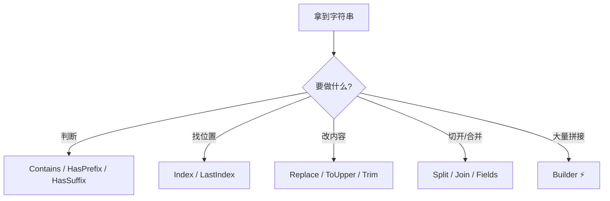
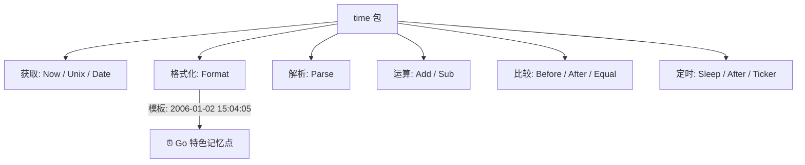
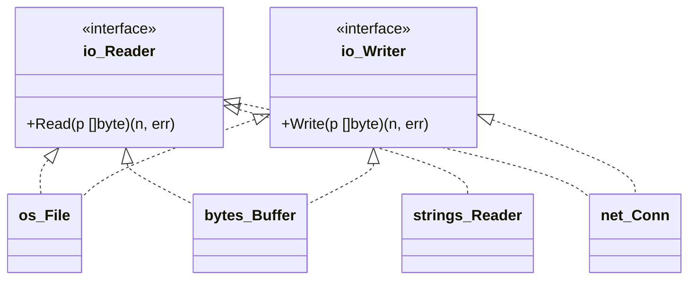
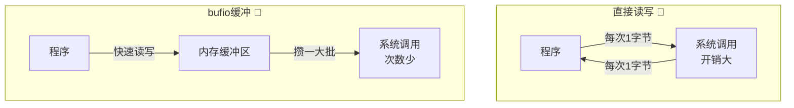
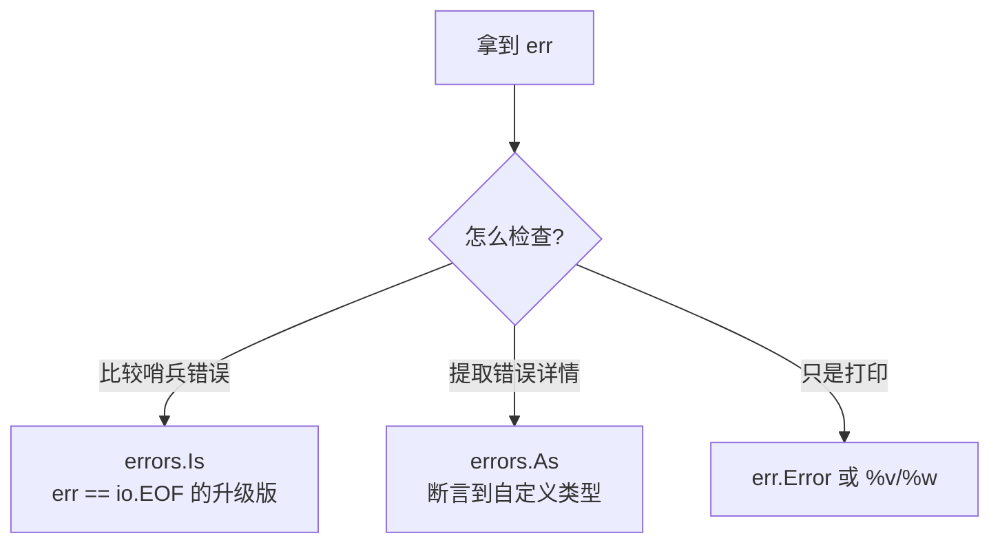
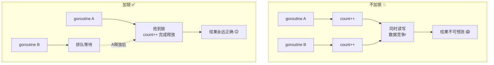
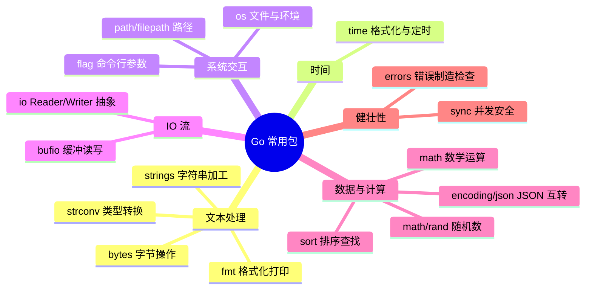

# 🎒 Go 常用标准库超详细讲义

> 嘿嘿～上一课打完了语法地基，这节课来开**标准库百宝箱**！🎁
> Go 自带 150+ 个标准库，不用下载、不用配置，`import` 一下就能用，简直白嫖天堂～
> 今天挑出**实战出场率最高**的一批，逐个拆解给你看！💪

---

## 📚 目录一览

| 章节 | 包名 | 一句话理解 |
|------|------|-----------|
| 1 | fmt | 打印与格式化老朋友 🖨️ |
| 2 | strings | 字符串加工厂 ✂️ |
| 3 | strconv | 字符串 ↔ 数字转换器 🔁 |
| 4 | time | 时间管理大师 ⏰ |
| 5 | os | 和操作系统打交道 💻 |
| 6 | io / bufio | 数据流与缓冲区 🚰 |
| 7 | bytes | 字节切片工具箱 🔧 |
| 8 | errors | 错误制造与检查 🧐 |
| 9 | math / math/rand | 数学与随机数 🎲 |
| 10 | sort | 排序小能手 📊 |
| 11 | encoding/json | JSON 翻译官 🗂️ |
| 12 | path/filepath | 路径管家 🛤️ |
| 13 | flag | 命令行参数解析 🚩 |
| 14 | sync | 并发安全小卫士 🛡️ |

---

## 1️⃣ fmt：打印与格式化 🖨️

出场率之王！从 Hello World 用到退休～

### 1.1 三大打印函数

| 函数 | 换行 | 支持格式化 | 返回值 |
|------|------|-----------|--------|
| `fmt.Print` | ❌ 不换行 | ❌ | 无 |
| `fmt.Println` | ✅ 自动换行 | ❌ | 无 |
| `fmt.Printf` | ❌ | ✅ `%`占位符 | 无 |
| `fmt.Sprintf` | ❌ | ✅ | **返回字符串**（不打印！） |
| `fmt.Fprintf` | ❌ | ✅ | 写入指定 writer |

```go
fmt.Print("你好", "世界")     // 你好世界（参数间不加空格）
fmt.Println("你好", "世界")   // 你好 世界（参数间自动加空格+换行）
fmt.Printf("姓名:%s 年龄:%d\n", "小樱", 14)
s := fmt.Sprintf("%.2f", 3.14159) // "3.14"，拼字符串神器！
fmt.Println(s)
```

### 1.2 占位符速查表 📇

| 占位符 | 用途 | 示例 → 结果 |
|--------|------|------------|
| `%v` | 万能默认格式 | `fmt.Printf("%v", 3.14)` → `3.14` |
| `%+v` | 结构体带字段名 | `{Name:小樱}` |
| `%#v` | Go 语法格式 | `"小樱"` 带引号 |
| `%T` | 打印类型 | `int`、`[]string` |
| `%d` | 十进制整数 | `42` |
| `%b` | 二进制 | `101010` |
| `%o` / `%x` | 八进制 / 十六进制 | `52` / `2a` |
| `%f` | 小数（默认6位） | `3.141593` |
| `%.2f` | 保留2位小数 | `3.14` |
| `%e` | 科学计数法 | `3.14e+00` |
| `%s` | 字符串 | `hello` |
| `%q` | 带引号的字符串 | `"hello"` |
| `%c` | 字符（rune） | `中` |
| `%t` | 布尔 | `true` |
| `%p` | 指针地址 | `0xc000010030` |

```go
type Stu struct{ Name string; Age int }
s := Stu{"小樱", 14}
fmt.Printf("%v\n", s)   // {小樱 14}
fmt.Printf("%+v\n", s)  // {Name:小樱 Age:14}
fmt.Printf("%T\n", s)   // main.Stu
```

### 1.3 输入：Scan 家族 ⌨️

```go
var name string
var age int

fmt.Print("请输入姓名和年龄：")
fmt.Scan(&name, &age) // 空格分隔输入，取地址别忘了 &！
fmt.Println("你好呀,", name, age)

// Scanln：遇到换行停止
fmt.Scanln(&name, &age)

// Scanf：按格式读取
fmt.Scanf("%s %d", &name, &age)
```

> 💡 实战提示：`fmt.Scan` 比较简陋，做命令行工具推荐用 `bufio` 读整行（第 6 章讲！）

---

## 2️⃣ strings：字符串加工厂 ✂️

字符串不可变怎么办？用 strings 包**造新字符串**呀～

### 2.1 高频函数大全

```go
import "strings"

s := "Hello, Go!"

// 🔍 判断类（返回 bool）
strings.Contains(s, "Go")        // true：包含吗？
strings.HasPrefix(s, "Hello")    // true：开头是？
strings.HasSuffix(s, "!")        // true：结尾是？
strings.EqualFold("abc", "ABC")  // true：忽略大小写相等？

// 🔎 查找类（返回下标，找不到返回 -1）
strings.Index(s, "Go")           // 7：首次出现位置
strings.LastIndex(s, "l")        // 3：最后出现位置
strings.Count(s, "l")            // 2：出现次数

// ✂️ 修改类（返回新字符串，原串不变！）
strings.ToUpper(s)               // "HELLO, GO!"
strings.ToLower(s)               // "hello, go!"
strings.Replace(s, "l", "L", 1)  // "HeLlo, Go!" 只换1个
strings.ReplaceAll(s, "l", "L")  // "HeLLo, Go!" 全换
strings.TrimSpace("  hi  \n")    // "hi" 去首尾空白
strings.Trim(s, "!")             // "Hello, Go" 去首尾指定字符
strings.TrimLeft(s, "H")         // "ello, Go!"
strings.TrimRight(s, "!")        // "Hello, Go"

// 🍰 切割与拼接
strings.Split("a,b,c", ",")      // ["a" "b" "c"]
strings.Join([]string{"a","b"}, "-") // "a-b"
strings.Repeat("go", 3)          // "gogogo"

// 📏 其他
strings.Len("hello")             // 5（其实这是内建 len，不是 strings 的～）
strings.Fields("  a b  c ")      // ["a" "b" "c"] 按空白切割，超好用！
```

### 2.2 Builder：高效拼接 ⚡

循环里用 `+=` 拼字符串会疯狂分配内存，`strings.Builder` 才是正解：

```go
var b strings.Builder
for i := 0; i < 5; i++ {
    b.WriteString("hello ")
}
fmt.Println(b.String()) // hello hello hello hello hello
```

**拼接方式性能对比**：

| 方式 | 性能 | 适用场景 |
|------|------|---------|
| `+` 拼接 | 少量时 OK，循环中很慢 🐢 | 一两次拼接 |
| `fmt.Sprintf` | 慢 | 需要格式化时 |
| `strings.Builder` | 快 🚀 | 循环/大量拼接 |
| `strings.Join` | 快 | 已有切片要拼接 |

### 2.3 字符串处理流程图



---

## 3️⃣ strconv：字符串 ↔ 数字转换器 🔁

注意哦：`"10"` 和 `10` 是完全不同的两个物种！转换就靠 strconv～

```go
import "strconv"

// ⬇️ 字符串 → 数字（都返回两个值：结果 + error）
n, err := strconv.Atoi("42")        // "42" → 42
f, err := strconv.ParseFloat("3.14", 64) // "3.14" → 3.14
b, err := strconv.ParseBool("true") // "true" → true
i, err := strconv.ParseInt("ff", 16, 64) // 按16进制解析 "ff" → 255

if err != nil {
    fmt.Println("转换失败:", err) // 比如把 "abc" 转 int 就会报错！
}

// ⬆️ 数字 → 字符串
s1 := strconv.Itoa(42)              // 42 → "42"
s2 := strconv.FormatFloat(3.14, 'f', 2, 64) // → "3.14"
s3 := strconv.FormatBool(true)      // → "true"
```

**易混淆点澄清** 🤓：

| 函数 | 干嘛的 | 记忆点 |
|------|--------|--------|
| `Atoi` | string → int | **A**SCII **to i**nt |
| `Itoa` | int → string | **i**nt **to A**SCII |
| `ParseXxx` | string → 各种数字 | 解析（带 error） |
| `FormatXxx` | 各种数字 → string | 格式化 |

```mermaid
flowchart LR
    A["\"42\" (字符串)"] -- Atoi / ParseInt --> B["42 (int)"]
    B -- Itoa / FormatInt --> A
    A -- ParseFloat --> C["3.14 (float64)"]
    C -- FormatFloat --> A
```

---

## 4️⃣ time：时间管理大师 ⏰

### 4.1 获取时间

```go
import "time"

now := time.Now() // 当前时间（time.Time 结构体）
fmt.Println(now)              // 2026-08-19 15:04:05.999999 +0800 CST m=+0.0...
fmt.Println(now.Year())       // 2026
fmt.Println(now.Month())      // August
fmt.Println(now.Day())        // 19
fmt.Println(now.Hour())       // 15
fmt.Println(now.Minute())     // 4
fmt.Println(now.Second())     // 5
fmt.Println(now.Weekday())    // Wednesday
fmt.Println(now.Unix())       // 秒级时间戳
fmt.Println(now.UnixMilli())  // 毫秒级时间戳（Go 1.17+）
```

### 4.2 格式化：Go 的"叛逆"设计 😎

别的语言用 `YYYY-MM-DD`，Go 偏要用**固定参考时间**当模板：

> 📌 **魔法口诀**：`1月2日下午3点4分5秒2006年`（美式 1/2 15:04:05 2006）

```go
now := time.Now()

// 格式化：时间 → 字符串
s := now.Format("2006-01-02 15:04:05") // "2026-08-19 15:04:05"
s2 := now.Format("2006/01/02")         // "2026/08/19"
s3 := now.Format("2006年01月02日 15时04分") // 中文也行～

// 解析：字符串 → 时间
t, err := time.Parse("2006-01-02", "2026-08-19")
if err != nil {
    fmt.Println("解析失败:", err)
}
```

| 模板占位 | 含义 | 示例输出 |
|---------|------|---------|
| `2006` | 年 | 2026 |
| `01` / `1` | 月（补零/不补） | 08 / 8 |
| `02` / `2` | 日 | 19 |
| `15` | 24小时制 | 15 |
| `03` | 12小时制 | 03 |
| `04` | 分钟 | 04 |
| `05` | 秒 | 05 |
| `PM` | 上下午 | PM |

### 4.3 时间运算

```go
t1 := time.Now()

// 加减时间
future := t1.Add(24 * time.Hour)          // 24小时后
dur := t1.Sub(future)                     // 相差 -24h（time.Duration）
fmt.Println(dur.Hours())                  // -24

// 比较（不能直接用 > < 哦！）
t2 := t1.Add(time.Hour)
fmt.Println(t1.Before(t2))  // true：t1 在 t2 前？
fmt.Println(t2.After(t1))   // true：t2 在 t1 后？
fmt.Println(t1.Equal(t1))   // true：相等？

// Duration 常量（时间长度）
time.Second  // 1秒
time.Minute  // 1分钟
time.Hour    // 1小时
time.Millisecond // 1毫秒
```

### 4.4 定时器与休眠 😴

```go
// 睡 2 秒
time.Sleep(2 * time.Second)

// 方式一：time.After 配合 select（一次性）
select {
case <-time.After(3 * time.Second):
    fmt.Println("3秒到啦！")
}

// 方式二：Ticker 周期性触发
ticker := time.NewTicker(1 * time.Second)
defer ticker.Stop()
for i := 0; i < 3; i++ {
    <-ticker.C // 每秒收到一次信号
    fmt.Println("滴答～", i)
}

// 方式三：经典 for + Sleep（简单粗暴）
for {
    doSomething()
    time.Sleep(time.Second)
}
```

**时间操作全景图：**



---

## 5️⃣ os：和操作系统打交道 💻

读文件、写文件、环境变量、命令行参数……都归它管～

### 5.1 文件操作

```go
import "os"

// 📖 读文件（一口全读进内存，小文件用）
data, err := os.ReadFile("data.txt") // Go 1.16+
if err != nil {
    fmt.Println("读文件失败:", err)
    return
}
fmt.Println(string(data))

// ✍️ 写文件（0644 是权限，文件不存在会自动创建）
err = os.WriteFile("out.txt", []byte("你好呀～"), 0644)

// 📂 打开文件（精细操作用这套）
f, err := os.Open("data.txt")         // 只读打开
f, err := os.Create("new.txt")        // 创建（存在则清空）
f, err := os.OpenFile("a.txt", os.O_APPEND|os.O_WRONLY, 0644) // 追加模式
defer f.Close()                        // 老规矩：defer 关文件！

// 读一点
buf := make([]byte, 1024)
n, err := f.Read(buf)  // 读到 buf 里，n 是实际读取字节数

// 写一点
n, err := f.Write([]byte("hello"))

// 🗑️ 删文件 / 建目录
os.Remove("temp.txt")
os.MkdirAll("a/b/c", 0755) // 递归建目录，超方便
```

### 5.2 文件打开模式速查

| 模式 | 含义 |
|------|------|
| `os.O_RDONLY` | 只读 |
| `os.O_WRONLY` | 只写 |
| `os.O_RDWR` | 读写 |
| `os.O_CREATE` | 不存在就创建 |
| `os.O_APPEND` | 追加写 |
| `os.O_TRUNC` | 打开时清空文件 |

> ⚠️ 模式用 `|` 组合：`os.O_CREATE|os.O_WRONLY|os.O_APPEND` = 不存在就建+只写+追加

### 5.3 环境变量与命令行参数

```go
// 🌍 环境变量
home := os.Getenv("HOME")           // 读取（不存在返回空串）
full := os.LookupEnv("HOME")        // 读取（能区分存不存在）
os.Setenv("MY_APP", "hello")        // 设置
fmt.Println(home, full)

// 🚀 命令行参数（os.Args 是原始版，第13章 flag 是进阶版）
fmt.Println(os.Args)     // [程序路径 参数1 参数2...]
fmt.Println(len(os.Args))

// 退出码
os.Exit(1) // 立即退出，defer 不会执行！⚠️

// 标准输入输出
os.Stdout // 标准输出
os.Stderr // 标准错误
fmt.Fprintln(os.Stderr, "这条去错误流～")
```

---

## 6️⃣ io / bufio：数据流与缓冲区 🚰

### 6.1 io：流的基本抽象

Go 把"读"和"写"抽象成两个接口，**万物皆可流**：

```go
// io.Reader：能读的都实现它
type Reader interface {
    Read(p []byte) (n int, err error)
}

// io.Writer：能写的都实现它
type Writer interface {
    Write(p []byte) (n int, err error)
}
```



> 💡 这就是 Go 的哲学：文件、网络连接、内存缓冲……**全都长一个样**，函数只认 `io.Reader`/`io.Writer`，啥流都能处理！

**常用工具函数：**

```go
import "io"

// Copy：把数据从 A 搬到 B（文件复制就这么简单）
src, _ := os.Open("a.txt")
dst, _ := os.Create("b.txt")
n, err := io.Copy(dst, src) // 返回拷贝的字节数
fmt.Println("拷贝了", n, "字节")

// ReadAll：把 Reader 里的东西一口气全读出来
data, err := io.ReadAll(resp.Body) // 网络响应常用
```

### 6.2 bufio：带缓冲的读写 ⚡

每次 `Read` 都直接怼到系统调用太伤了！bufio 加个"缓冲区"批量搬运，性能起飞～

```go
import "bufio"

// 📖 按行读文件（超经典写法，背下来！）
f, _ := os.Open("data.txt")
defer f.Close()

scanner := bufio.NewScanner(f)
for scanner.Scan() {            // 一行一行读，读到头返回 false
    line := scanner.Text()      // 拿到本行内容（不带换行符）
    fmt.Println("读到:", line)
}
if err := scanner.Err(); err != nil {
    fmt.Println("读取出错:", err)
}

// ✍️ 带缓冲写
out, _ := os.Create("out.txt")
defer out.Close()
w := bufio.NewWriter(out)
w.WriteString("第一行\n")
w.WriteString("第二行\n")
w.Flush() // ⚠️ 关键！把缓冲区剩余数据真正写入文件
```

**有无缓冲对比图：**



### 6.3 读一行输入的标准姿势 ⌨️

```go
reader := bufio.NewReader(os.Stdin)
fmt.Print("请输入：")
text, _ := reader.ReadString('\n') // 读到换行符为止
text = strings.TrimSpace(text)     // 顺手去掉换行符
fmt.Println("你输入了:", text)
```

---

## 7️⃣ bytes：字节切片工具箱 🔧

strings 包的"字节版双胞胎"，API 几乎一模一样，只是操作对象换成 `[]byte`：

```go
import "bytes"

b := []byte("Hello, Go!")

bytes.Contains(b, []byte("Go"))     // true
bytes.Index(b, []byte("Go"))        // 7
bytes.ToUpper(b)                    // []byte("HELLO, GO!")
bytes.Split([]byte("a,b"), []byte(",")) // [][]byte{...}
bytes.TrimSpace([]byte("  hi  "))   // []byte("hi")

// bytes.Equal：比较字节切片（== 只能比数组哦）
bytes.Equal([]byte("abc"), []byte("abc")) // true
```

**Buffer：字节缓冲区（拼接字节用它）**

```go
var buf bytes.Buffer
buf.WriteString("hello ")
buf.WriteByte('G')
buf.Write([]byte("o"))
fmt.Println(buf.String()) // "hello Go"
fmt.Println(buf.Bytes())  // 原始字节
```

**strings vs bytes 怎么选？**

| 场景 | 用哪个 |
|------|--------|
| 处理 UTF-8 文本 | `strings` ✅ |
| 处理二进制数据/图片/协议报文 | `bytes` ✅ |
| 网络流、文件流 | `bufio` + `io` ✅ |

---

## 8️⃣ errors：错误制造与检查 🧐

第 14 章错误处理的补给站，这里集中放工具～

```go
import (
    "errors"
    "fmt"
)

// 🏭 制造错误
err1 := errors.New("简单的错误")
err2 := fmt.Errorf("带格式的错误: %d", 42)

// 🎁 包装错误（保留错误链，Go 1.13+）
inner := errors.New("数据库连接失败")
wrapped := fmt.Errorf("查询用户失败: %w", inner)

// 🔍 errors.Is：错误链里是不是它？
fmt.Println(errors.Is(wrapped, inner)) // true！%w 包的都能追到

// 🎭 errors.As：错误链里有没有这种类型？
type BizError struct{ Code int }
func (e *BizError) Error() string { return fmt.Sprintf("业务错误:%d", e.Code) }

bizErr := &BizError{Code: 404}
w2 := fmt.Errorf("处理失败: %w", bizErr)

var target *BizError
if errors.As(w2, &target) {
    fmt.Println("错误码是:", target.Code) // 404
}

// ✨ Go 1.20+ 新玩具：errors.Join 合并多个错误
e1 := errors.New("错误一")
e2 := errors.New("错误二")
combined := errors.Join(e1, e2) // 同时包含两个错误
```

**错误检查三件套：**



---

## 9️⃣ math / math/rand：数学与随机数 🎲

### 9.1 math：科学计算

```go
import "math"

math.Abs(-3.14)      // 3.14 绝对值
math.Ceil(3.2)       // 4  向上取整
math.Floor(3.8)      // 3  向下取整
math.Round(3.5)      // 4  四舍五入
math.Sqrt(16)        // 4  平方根
math.Pow(2, 10)      // 1024 幂运算
math.Max(1, 2)       // 2（Go 1.21 起建议用内建 max）
math.Min(1, 2)       // 1
math.Pi              // 3.141592653589793
math.MaxFloat64      // float64 最大值
math.Inf(1)          // 正无穷
```

### 9.2 math/rand：随机数

```go
import "math/rand"

// Go 1.20+ 用法超简单（自动随机种子）
rand.Int()           // 非负随机整数
rand.Intn(100)       // 0~99 的随机数（不含100）
rand.Float64()       // 0.0~1.0 的随机小数
rand.Shuffle(n, swap) // 打乱切片

// 随机打乱切片
nums := []int{1, 2, 3, 4, 5}
rand.Shuffle(len(nums), func(i, j int) {
    nums[i], nums[j] = nums[j], nums[i]
})
fmt.Println(nums) // 顺序随机～

// Go 1.22+：rand.N 泛型版本
n := rand.N(100) // 0~99 随机数，int类型推断

// ⚠️ Go 1.20 之前的老写法（现在不用啦）：
// rand.Seed(time.Now().UnixNano())
```

> 🌰 安全提醒：`math/rand` 是**伪随机**，做密码学相关的随机必须用 `crypto/rand`！

---

## 🔟 sort：排序小能手 📊

```go
import "sort"

nums := []int{5, 2, 8, 1, 9}

// 基本类型排序（原地排序，直接改切片）
sort.Ints(nums)                        // 升序 [1 2 5 8 9]
sort.Float64s([]float64{3.1, 1.2})     // 浮点升序
sort.Strings([]string{"banana", "apple"})

// 降序：先升序再反转，或用 slices 包（Go 1.21+ 推荐）
sort.Sort(sort.Reverse(sort.IntSlice(nums)))
// 或者 Go 1.21+ 新姿势：
slices.Sort(nums)              // 泛型排序
slices.SortFunc(nums, func(a, b int) int { return b - a }) // 降序

// 自定义排序：结构体切片
type Student struct {
    Name  string
    Score int
}
stus := []Student{
    {"小樱", 95}, {"知世", 88}, {"小狼", 92},
}

// 按分数从高到低
sort.Slice(stus, func(i, j int) bool {
    return stus[i].Score > stus[j].Score
})
fmt.Println(stus) // [{小樱 95} {小狼 92} {知世 88}]

// 稳定排序（相等的保持原顺序）
sort.SliceStable(stus, func(i, j int) bool {
    return stus[i].Score > stus[j].Score
})
```

**查找（前提：已升序排序）**

```go
sorted := []int{1, 3, 5, 7, 9}
idx := sort.SearchInts(sorted, 5)  // 2（二分查找下标）
found := sort.Search(len(sorted), func(i int) bool {
    return sorted[i] >= 5
})
```

| 函数 | 用途 |
|------|------|
| `sort.Ints/Float64s/Strings` | 基本类型升序 |
| `sort.Slice` | 自定义比较器排序 ⭐ |
| `sort.SliceStable` | 稳定版自定义排序 |
| `sort.SearchInts` | 二分查找 |
| `slices.Sort`（1.21+） | 泛型排序，新项目首选 |

---

## 1️⃣1️⃣ encoding/json：JSON 翻译官 🗂️

前后端传数据的通用语，必须安排！

### 11.1 结构体 ↔ JSON 互转

```go
import "encoding/json"

type Person struct {
    Name string `json:"name"`           // 小写标签：输出成 "name"
    Age  int    `json:"age"`
    Addr string `json:"addr,omitempty"` // 空值时干脆不出现！
    Pass string `json:"-"`              // 减号：完全隐藏，安全～
}

p := Person{Name: "小樱", Age: 14, Pass: "secret123"}

// 🔄 序列化：结构体 → JSON
// 方式一：Marshal（紧凑）
data, err := json.Marshal(p)
fmt.Println(string(data)) // {"name":"小樱","age":14}

// 方式二：MarshalIndent（带缩进，好看）
data, _ = json.MarshalIndent(p, "", "  ")
fmt.Println(string(data))
/* 输出：
{
  "name": "小樱",
  "age": 14
}
*/

// 🔄 反序列化：JSON → 结构体
var p2 Person
err = json.Unmarshal([]byte(`{"name":"知世","age":14}`), &p2)
if err != nil {
    fmt.Println("解析失败:", err)
}
fmt.Println(p2.Name) // 知世
```

### 11.2 结构体标签 tag 详解

```go
`json:"名字,选项"`
```

| 标签 | 作用 |
|------|------|
| `json:"name"` | 字段在 JSON 里叫 "name" |
| `json:"-"` | 忽略此字段 |
| `json:",omitempty"` | 零值时不序列化 |
| `json:"name,omitempty"` | 组合技 |

### 11.3 处理动态 JSON（不知道结构时）

```go
var result map[string]any
json.Unmarshal([]byte(`{"id":1,"tags":["a","b"]}`), &result)
fmt.Println(result["id"])   // float64(1) ⚠️ 数字默认变 float64
fmt.Println(result["tags"]) // [a b]
```

**JSON 处理流程：**

```mermaid
flowchart LR
    A[结构体] -- Marshal --> B[&#91;]byte JSON]
    B -- Unmarshal --> A
    B --> C[string 展示]
    D[未知结构 JSON] -- Unmarshal --> E[map&#91;string]any]
    F[JSON 文件] -- json.NewDecoder --> G[流式解析<br/>大文件友好]
```

### 11.4 流式处理与文件读写

```go
// 从 Reader 解码（比如 HTTP 响应）
dec := json.NewDecoder(resp.Body)
var result Response
dec.Decode(&result)

// 编码到 Writer（直接写文件）
f, _ := os.Create("data.json")
defer f.Close()
enc := json.NewEncoder(f)
enc.SetIndent("", "  ")
enc.Encode(p) // 编码并写入
```

---

## 1️⃣2️⃣ path/filepath：路径管家 🛤️

跨平台路径处理神器（自动处理 Windows 的 `\` 和 Linux 的 `/`）：

```go
import "path/filepath"

// 🔗 拼接路径（自动处理分隔符，别手写 "/" 了！）
p := filepath.Join("home", "user", "docs") // "home/user/docs" 或 "home\user\docs"
fmt.Println(p)

// 🧩 拆解路径
dir, file := filepath.Split("/home/user/a.txt") // dir="/home/user/" file="a.txt"
ext := filepath.Ext("photo.jpg")                // ".jpg"
base := filepath.Base("/home/user/a.txt")       // "a.txt"
d := filepath.Dir("/home/user/a.txt")           // "/home/user"

// 🔍 检查
exist := filepathExists("data.txt") // 见下方封装
abs, _ := filepath.Abs("a.txt")     // 转绝对路径
filepath.IsAbs("/home")             // true：是绝对路径吗

// 🔁 遍历目录（超常用！）
filepath.Walk(".", func(path string, info os.FileInfo, err error) error {
    if err != nil {
        return err
    }
    if info.IsDir() {
        return nil
    }
    fmt.Println("找到文件:", path)
    return nil
})

// 通配符匹配
files, _ := filepath.Glob("*.go") // 当前目录所有 .go 文件
fmt.Println(files)
```

```go
// 判断文件是否存在的标准写法
func filepathExists(path string) bool {
    _, err := os.Stat(path)
    return !os.IsNotExist(err)
}
```

> ⚠️ 注意区分：`path` 包处理 URL 斜杠路径（永远 `/`），`filepath` 处理本机文件路径（跟随操作系统）～

---

## 1️⃣3️⃣ flag：命令行参数解析 🚩

给程序装上"开关"，像 `ls -l`、`go run -x` 那样帅气！

```go
import "flag"

func main() {
    // 定义参数：flag.类型("名字", 默认值, "说明")
    name := flag.String("name", "游客", "你的名字")
    age := flag.Int("age", 18, "你的年龄")
    vip := flag.Bool("vip", false, "是否是会员")

    // ⚠️ 必须调用 Parse！不然拿到的全是默认值
    flag.Parse()

    fmt.Printf("你好 %s！%d 岁，会员:%v\n", *name, *age, *vip)
    fmt.Println("剩下的参数:", flag.Args()) // 非 flag 参数
}
```

**运行效果：**

```bash
# go run main.go -name 小樱 -age 14 -vip
你好 小樱！14 岁，会员:true

# go run main.go --help   自动生成帮助信息（白送的！）
# -age int 你的年龄 (default 18)
# -name string 你的名字 (default "游客")
# -vip 是否是会员 (default false)
```

**两种定义姿势对比：**

```go
// 姿势一：返回指针
name := flag.String("name", "hi", "说明")
fmt.Println(*name) // 使用时要加 *

// 姿势二：绑定到已有变量（推荐，用起来顺手）
var port int
flag.IntVar(&port, "port", 8080, "端口号")
fmt.Println(port) // 直接用，不用 *
```

---

## 1️⃣4️⃣ sync：并发安全小卫士 🛡️

并发课的预习篇！先认识两个最常用的家伙～

### 14.1 WaitGroup：等大家干完活

```go
import (
    "sync"
    "time"
)

func main() {
    var wg sync.WaitGroup

    for i := 1; i <= 3; i++ {
        wg.Add(1) // ① 派活前登记：+1
        go func(id int) {
            defer wg.Done() // ③ 干完销号：-1
            time.Sleep(time.Duration(id) * time.Second)
            fmt.Println("工人", id, "干完啦～")
        }(i)
    }

    wg.Wait() // ② 主线程在这里等，计数归零才放行
    fmt.Println("全部完工！🎉")
}
```

### 14.2 Mutex：互斥锁（一次只进一个人 🚪）

```go
var (
    count int
    mu    sync.Mutex
)

func add() {
    mu.Lock()         // 🔒 上锁
    defer mu.Unlock() // 🔓 解锁（defer 保平安）
    count++
}
```

**不加锁 vs 加锁：**



> 💡 并发全家桶（channel、context、sync.Once 等）将在「Go 并发编程」专场细讲，敬请期待～🎬

---

## 🎁 总结：一张图记住所有包



## 📦 包选用速查表（实战向）

| 需求 | 直接用 |
|------|--------|
| 打印/格式化字符串 | `fmt` |
| 判断/切割/拼接字符串 | `strings` |
| "42" ↔ 42 转换 | `strconv` |
| 当前时间/时间戳/定时 | `time` |
| 读写文件 | `os`（小文件）/ `bufio`（大文件按行） |
| 复制流/读全部 | `io.Copy` / `io.ReadAll` |
| 处理 JSON | `encoding/json` |
| 排序切片 | `sort` / `slices`(1.21+) |
| 命令行参数 | `flag` |
| 等待 goroutine | `sync.WaitGroup` |
| 保护共享变量 | `sync.Mutex` |

## 📝 课后小测验（动动小脑瓜 🧠）

1. `fmt.Printf("%+v", s)` 和 `%v` 输出结构体有啥区别？
2. 把字符串 `"3.14"` 转成 float64，用哪个函数？返回几个值？
3. Go 格式化时间的魔法参考时间是哪年哪月哪日？
4. `io.Copy` 的两个参数分别是什么类型？
5. `json:"addr,omitempty"` 标签里 `omitempty` 是干嘛的？
6. `wg.Add(1)` 和 `wg.Done()` 分别在什么时候调用？

<details>
<summary>👉 点开看答案</summary>

1. `%+v` 会**带上字段名**（`{Name:小樱}`），`%v` 只输出值（`{小樱}`）。
2. `strconv.ParseFloat("3.14", 64)`，返回**两个值**：结果 + error。
3. `2006-01-02 15:04:05`（1月2日下午3点4分5秒2006年）～
4. 都是**接口**：`io.Writer`（目的地）和 `io.Reader`（来源）。
5. 字段为**零值时跳过序列化**，JSON 里不出现这个字段。
6. `Add(1)` 在**启动 goroutine 前**调用登记；`Done()` 在 goroutine **结束时**（通常 defer）调用销号。

</details>

---

> 🌸 标准库百宝箱清点完毕！接下来强烈推荐学 **goroutine 并发编程**（WaitGroup 已经预热过啦），
> 或者 **net/http 写 Web 服务** 也很带感哦～随时召唤本讲师，比心 💖
