# 🌪️ Go 并发编程超详细讲义

> 嘿嘿～欢迎来到 Go 的**看家本领专场**！🎪
> 都说"Go 就是靠着并发打天下"的～Docker、K8s 能扛住亿级流量全靠它！
> 这节课从**原理 → 工具 → 模式 → 踩坑**一条龙讲透，学完你写的并发代码又快又稳！💪

---

## 📚 目录一览

| 章节 | 主题 | 一句话理解 |
|------|------|-----------|
| 1 | 并发 vs 并行 | 概念先行别搞混 🤔 |
| 2 | goroutine 深入 | 轻量级并发原语 🏃 |
| 3 | GMP 调度原理 | Go 运行时的智慧 🧠 |
| 4 | channel 深入 | 传话筒的内部构造 📢 |
| 5 | select 深入 | 多路复用艺术家 🚦 |
| 6 | 数据竞争与 -race | 抓 bug 神器 🔍 |
| 7 | 锁家族 | Mutex/RWMutex/Cond 🔒 |
| 8 | atomic 原子操作 | CPU 指令级速度 ⚡ |
| 9 | sync 工具箱 | WaitGroup/Once/Pool/Map 🧰 |
| 10 | context 实战 | 取消传播指挥家 🎛️ |
| 11 | 死锁诊断 | 僵局破解手册 💀 |
| 12 | 并发模式大全 | 实战模板复制粘贴 📋 |
| 13 | 踩坑大全 | 前人翻车后人乘凉 ⚠️ |

---

## 1️⃣ 并发 vs 并行：别搞混啦 🤔

```go
// 一句话区分：
// 并发（Concurrency）：一个人同时应付多件事（交替处理）🤹
// 并行（Parallelism）：多个人同时各干一件事（真同时）👯
```

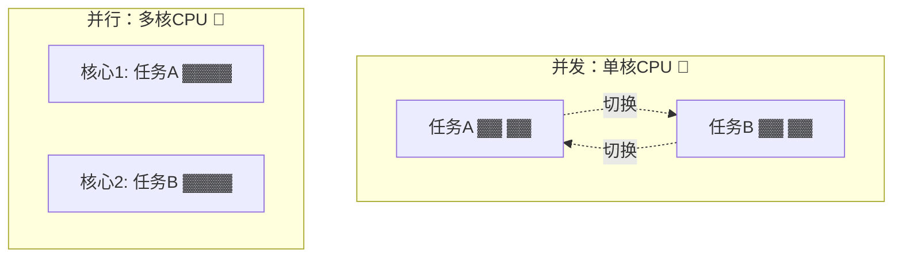

| 对比 | 并发 Concurrency | 并行 Parallelism |
|------|-----------------|------------------|
| 本质 | **任务调度**能力（结构） | **同时执行**（执行） |
| 硬件要求 | 单核也行 | 必须多核 |
| 比喻 | 一边泡面一边刷手机 🍜 | 两个人帮你同时泡面 |
| Go 关键词 | goroutine + channel | GOMAXPROCS 利用多核 |

> 💡 Rob Pike（Go 之父）名言：**"并发不是并行"**。并发是把代码**结构化**成可独立运行的部分；并行是运行时真的同时跑～

**查看/设置并行度：**

```go
import "runtime"

runtime.NumCPU()        // CPU 核心数，比如 8
runtime.GOMAXPROCS(0)   // 当前可同时执行的 P 数量（默认=核数）
runtime.NumGoroutine()  // 当前存在的 goroutine 数量（排查泄漏神器！）
```

---

## 2️⃣ goroutine 深入 🏃

### 2.1 启动的 N 种姿势

```go
// 姿势一：go + 函数调用
go doWork("任务A")

// 姿势二：go + 匿名函数（要传参，别用闭包共享循环变量！）
for i := 0; i < 3; i++ {
    go func(id int) {
        fmt.Println("工人", id)
    }(i) // ✅ 把 i 复制进去，安全！
}

// Go 1.22+ 循环变量每次迭代都是新的，可以放心写：
for i := 0; i < 3; i++ {
    go func() {
        fmt.Println("工人", i) // 1.22+ 没问题啦～
    }()
}

// 姿势三：go + 方法
go obj.Process()
```

### 2.2 goroutine 的生死簿 📖

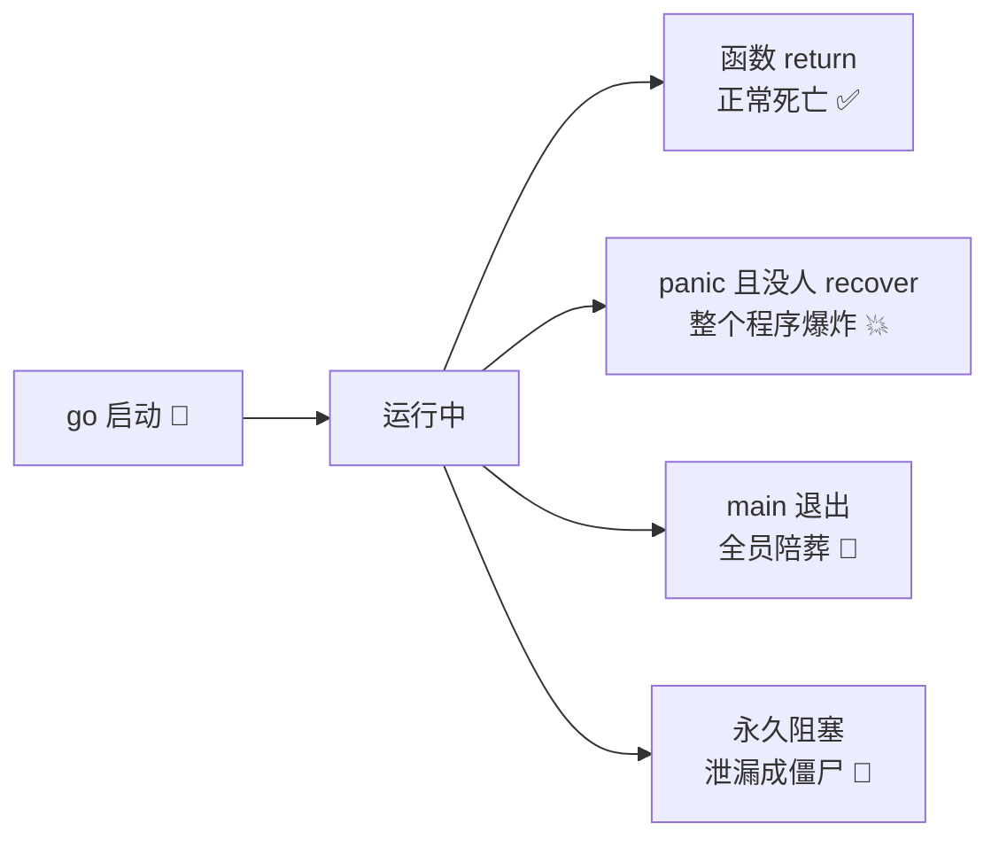

**goroutine 泄漏自查：**

```go
// ❌ 泄漏代码：没人收 result，goroutine 永远卡在发送
func leak() {
    result := make(chan int)
    go func() {
        result <- 42 // 没人接收 → 永久阻塞 → 泄漏！
    }()
    // 函数直接返回，result 通道没人管了……
}

// ✅ 修复：带缓冲，让发送方可以全身而退
func noLeak() {
    result := make(chan int, 1) // 缓冲1：发送完就能走
    go func() {
        result <- 42
    }()
    // 就算不接收，goroutine 也不会卡死～
}

// 排查工具：
fmt.Println(runtime.NumGoroutine()) // 数字只增不减？有泄漏！
```

### 2.3 退出 goroutine 的正确姿势

goroutine 没有原生"kill"操作（设计如此，强杀会留下烂摊子），要**通知它自己退出**：

```go
func worker(done <-chan struct{}) {
    for {
        select {
        case <-done: // 收到退出信号
            fmt.Println("收到，下班～👋")
            return
        default:
            fmt.Println("干活中……")
            time.Sleep(300 * time.Millisecond)
        }
    }
}

done := make(chan struct{})
go worker(done)
time.Sleep(time.Second)
close(done) // 广播退出信号
```

---

## 3️⃣ GMP 调度原理 🧠

### 3.1 三大角色

| 角色 | 全称 | 白话理解 |
|------|------|---------|
| **G** | Goroutine | 任务单：一个个待执行的任务 📋 |
| **M** | Machine（线程） | 工人：真正占 CPU 干活的 💪 |
| **P** | Processor（处理器） | 工头+工具箱：持有运行队列，M 必须 P 才能干活 🎩 |

### 3.2 完整调度图

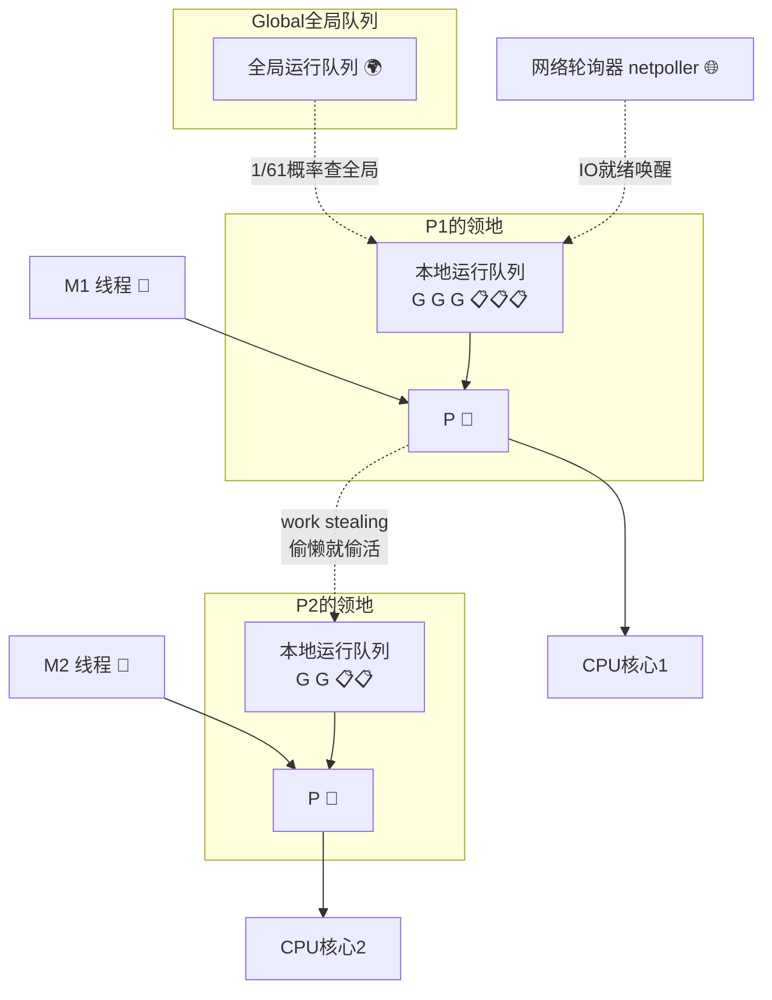

### 3.3 调度核心机制

1. **Work Stealing（工作窃取）**：P2 手头没活了，就去偷 P1 队列里的一半任务，人人有活干～🦝
2. **Hand Off（交接）**：M 被系统调用卡住时，P 会"解绑"去找别的 M 继续干活，绝不陪葬！
3. **抢占调度**：Go 1.14+ 基于信号的异步抢占——某个 G 跑超过 10ms 就会被强制让出 CPU，告别死循环霸屏 ⏱️

### 3.4 阻塞时调度器怎么办？

| 阻塞场景 | 调度器行为 |
|---------|-----------|
| channel 阻塞 / 锁阻塞 | G 挂起，M 去跑别的 G（用户态切换，超快）⚡ |
| 系统调用（文件IO等） | M 陷入内核，P 解绑给新 M（或创建新 M） |
| 网络IO | 注册到 netpoller，G 挂起，就绪后重新入队 🌐 |

> 💡 这就是 Go 网络IO强悍的秘密：**海量连接只占用少量线程**，goroutine 挂起几乎零成本～

---

## 4️⃣ channel 深入 📢

### 4.1 hchan 内部结构（简化版）

```go
// channel 底层其实是这么个结构体（简化示意）：
type hchan struct {
    qcount   uint           // 当前队列里元素个数
    dataqsiz uint           // 环形缓冲区容量（make 时指定的 n）
    buf      unsafe.Pointer // 指向环形缓冲区
    sendx    uint           // 发送索引（写到哪了）
    recvx    uint           // 接收索引（读到哪了）
    recvq    waitq          // 等待接收的 goroutine 队列 🧍🧍
    sendq    waitq          // 等待发送的 goroutine 队列 🧍🧍
    lock     mutex          // 保护整个结构体的锁 🔒
}
```

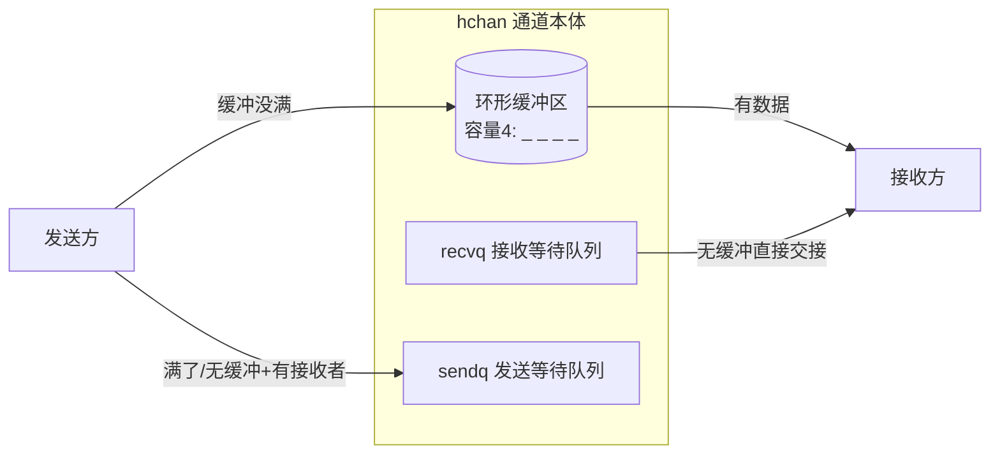

> 💡 **彩蛋知识**：无缓冲通道发送时如果 recvq 里正好有人在等，数据**直接从发送方栈拷贝到接收方栈**（不经过缓冲区）！这叫"直达快车"🚄

### 4.2 全状态操作结果表（必背！📖）

| 操作 | nil 通道 | 空通道（未关闭） | 有数据 | 已关闭 | 缓冲满 |
|------|---------|----------------|--------|--------|--------|
| 发送 `ch<-v` | 永久阻塞 💤 | 阻塞 | 直接入队 💨 | **panic** 💥 | 阻塞 |
| 接收 `<-ch` | 永久阻塞 💤 | 阻塞 | 取到数据 💨 | 零值+false | 正常取 |
| 关闭 `close` | **panic** 💥 | ✅ 成功 | ✅ 成功 | **panic** 💥 | ✅ 成功 |

### 4.3 len / cap 也能用！

```go
ch := make(chan int, 10)
ch <- 1
ch <- 2
fmt.Println(len(ch)) // 2：当前排队元素数
fmt.Println(cap(ch)) // 10：容量
// ⚠️ 只能"看一眼"，别拿来做逻辑判断（并发下数字随时会变）！
```

### 4.4 nil 通道的妙用：禁用 case

```go
// 把通道设为 nil，select 里对应 case 就"失效"（永久阻塞=永远不选中）
var ch1 chan int // nil 通道

for {
    select {
    case v := <-ch1: // ch1 是 nil，这个 case 相当于被禁用
        fmt.Println(v)
    case v := <-ch2:
        fmt.Println(v)
        ch2 = nil // ch2 处理完了？置 nil，下轮只盯 ch1！
    }
}
```

> 💡 这是 select 的经典技巧：**动态启停监听某条通道**～

### 4.5 定向使用守则

```go
// 守则一：谁生产谁关闭（只有发送方知道啥时候发完）
// 守则二：多发送者时，用额外的 done 通道协调，别互相 close
// 守则三：关闭是广播，接收方全都能感知（range 退出、ok=false）

// 多生产者安全关闭模板：
func merger(done <-chan struct{}, cs ...<-chan int) <-chan int {
    var wg sync.WaitGroup
    out := make(chan int)

    output := func(c <-chan int) {
        defer wg.Done()
        for n := range c {
            select {
            case out <- n:
            case <-done: // 被取消就撤
                return
            }
        }
    }
    wg.Add(len(cs))
    for _, c := range cs {
        go output(c)
    }

    go func() {
        wg.Wait()      // 等所有生产者完工
        close(out)     // 只有关闭方在这里 close，绝不冲突 ✅
    }()
    return out
}
```

---

## 5️⃣ select 深入 🚦

### 5.1 执行流程全景

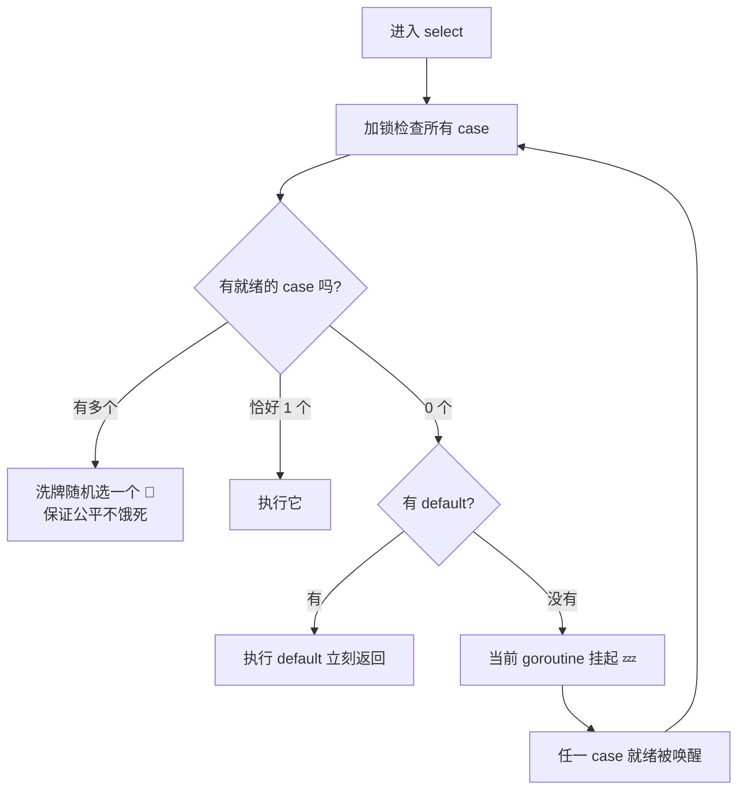

### 5.2 超时三件套对比

```go
// ① time.After：最常用，但要小心循环里反复创建（旧版本有内存滞留问题）
select {
case v := <-ch:
    fmt.Println(v)
case <-time.After(2 * time.Second):
    fmt.Println("超时！⏰")
}

// ② time.NewTimer：可以 Stop，长循环推荐
timer := time.NewTimer(2 * time.Second)
defer timer.Stop()
select {
case v := <-ch:
    fmt.Println(v)
case <-timer.C:
    fmt.Println("超时！⏰")
}

// ③ context.WithTimeout：整条调用链统一管控（最优雅 ⭐）
ctx, cancel := context.WithTimeout(context.Background(), 2*time.Second)
defer cancel()
select {
case v := <-ch:
    fmt.Println(v)
case <-ctx.Done():
    fmt.Println("被取消：", ctx.Err())
}
```

| 方式 | 适用场景 |
|------|---------|
| `time.After` | 一次性的简单超时 |
| `NewTimer` | 循环里频繁超时（可复用/可停止） |
| `context` | **多级调用链统一取消**（生产首选 ⭐） |

### 5.3 非阻塞收发

```go
// 加了 default = "试一下，不行拉倒"
select {
case v := <-ch:
    fmt.Println("拿到:", v)
default:
    fmt.Println("没数据，先去干别的～") // 绝不阻塞
}

// 非阻塞发送：缓冲满了就放弃（限流常用！）
select {
case ch <- task:
    fmt.Println("任务已提交")
default:
    fmt.Println("队列满了，任务丢弃/降级 ⚠️")
}
```

---

## 6️⃣ 数据竞争与 -race 检测器 🔍

### 6.1 什么是数据竞争

**两个及以上 goroutine 同时访问同一变量，且至少一个是写** → 结果不可预测！

```go
// ❌ 经典竞争代码
var count int
var wg sync.WaitGroup

for i := 0; i < 1000; i++ {
    wg.Add(1)
    go func() {
        defer wg.Done()
        count++ // 1000 个 goroutine 同时 count++ 💥
    }()
}
wg.Wait()
fmt.Println(count) // 937？872？每次都不一样！🎲
```

**为什么 `count++` 不安全？** 它其实是三步：

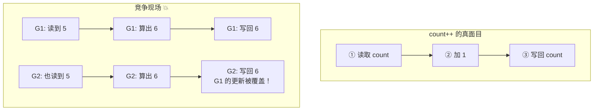

### 6.2 race 检测器：官方抓 bug 神器

```bash
# 跑测试时加 -race，运行时自动监听内存访问
go run -race main.go
go test -race ./...
go build -race
```

**检测到竞争会输出这种报告：**

```bash
WARNING: DATA RACE
Read at 0x00c0000140a8 by goroutine 8:
  main.main.func1()   ← 谁在读
Previous write at 0x00c0000140a8 by goroutine 7:
  main.main.func1()   ← 谁在写
```

> 💡 检测器基于 Vector Clock 算法，只报告**真实发生过的**竞争路径。上线前 `go test -race` 跑一遍是基本修养～

### 6.3 三种修复方案

```go
// 方案一：Mutex 锁住临界区 🔒
var mu sync.Mutex
mu.Lock()
count++
mu.Unlock()

// 方案二：atomic 原子操作（简单变量更快）⚡
var count atomic.Int64
count.Add(1)

// 方案三：channel 串行化（同一时间只有一个 goroutine 碰数据）📢
// 把数据"所有权"通过通道传递，谁持有谁能改
type Counter struct{ ch chan func() }
```

| 方案 | 适用 |
|------|------|
| `Mutex` | 复杂临界区（多变量、多步骤） |
| `atomic` | 单个数值/布尔/指针 |
| `channel` | 数据流动、所有权转移（Go 风格 ✨） |

---

## 7️⃣ 锁家族：Mutex / RWMutex / Cond 🔒

### 7.1 Mutex：互斥锁

```go
type SafeCounter struct {
    mu sync.Mutex
    m  map[string]int
}

func (c *SafeCounter) Inc(key string) {
    c.mu.Lock()         // 进门上锁 🚪
    defer c.mu.Unlock() // defer 保平安，panic 也能解锁！
    c.m[key]++
}

func (c *SafeCounter) Get(key string) int {
    c.mu.Lock()
    defer c.mu.Unlock()
    return c.m[key]
}
```

**注意事项：**

```go
// ❌ 死锁：同一个 goroutine 重复 Lock（不可重入锁！）
mu.Lock()
mu.Lock() // 卡死！Go 的 Mutex 不是可重入的 💀

// ❌ 值拷贝锁失效
type Bad struct{ mu sync.Mutex }
func (b Bad) Do() { b.mu.Lock() } // 锁被复制了，锁了个寂寞
// ✅ 永远用指针接收者 *Bad
```

### 7.2 RWMutex：读写锁

**读多写少**场景的性能利器：

```go
type Config struct {
    mu   sync.RWMutex
    data map[string]string
}

// 写：独占（写的时候谁都别进来）
func (c *Config) Set(key, val string) {
    c.mu.Lock()
    defer c.mu.Unlock()
    c.data[key] = val
}

// 读：共享（大家一起看没问题 👀）
func (c *Config) Get(key string) string {
    c.mu.RLock()
    defer c.mu.RUnlock()
    return c.data[key]
}
```

```mermaid
flowchart TB
    subgraph rwRule["RWMutex 规则 📚"]
        A[读锁 RLock] --> B{有写锁吗?}
        B -- 没有 --> C[放行！多个读者并存 ✅]
        B -- 有 --> D[排队等待 💤]
        E[写锁 Lock] --> F{有任何人吗?}
        F -- 读写都没有 --> G[独占！]()
        F -- 有 --> H[全部排队 💤]
    end
```

> ⚠️ 小心**写饥饿**：读者源源不断时，写者可能一直排队（Go 的 RWMutex 写优先级较高，会阻塞新读者）～读极多写极少可考虑 `sync.Map` 或原子指针替换

### 7.3 Cond：条件变量（等待特定条件）

生产者队列"空了等、有了醒"的场景：

```go
type Queue struct {
    mu   sync.Mutex
    cond *sync.Cond
    data []int
}

func NewQueue() *Queue {
    q := &Queue{}
    q.cond = sync.NewCond(&q.mu) // 绑定一把锁
    return q
}

// 消费者：队列空就睡
func (q *Queue) Pop() int {
    q.mu.Lock()
    defer q.mu.Unlock()
    for len(q.data) == 0 {
        q.cond.Wait() // ① 释放锁并睡觉 💤 ② 醒来重新抢锁
    }
    v := q.data[0]
    q.data = q.data[1:]
    return v
}

// 生产者：放完数据叫醒大家
func (q *Queue) Push(v int) {
    q.mu.Lock()
    defer q.mu.Unlock()
    q.data = append(q.data, v)
    q.cond.Signal()   // 叫醒一个等待者 👏
    // q.cond.Broadcast() // 叫醒所有等待者 📣
}
```

> ⚠️ `Wait` 必须写在 **for 循环**里（不是 if）！被唤醒后条件可能又变了（虚假唤醒），要再检查一遍～

### 7.4 锁选用决策树

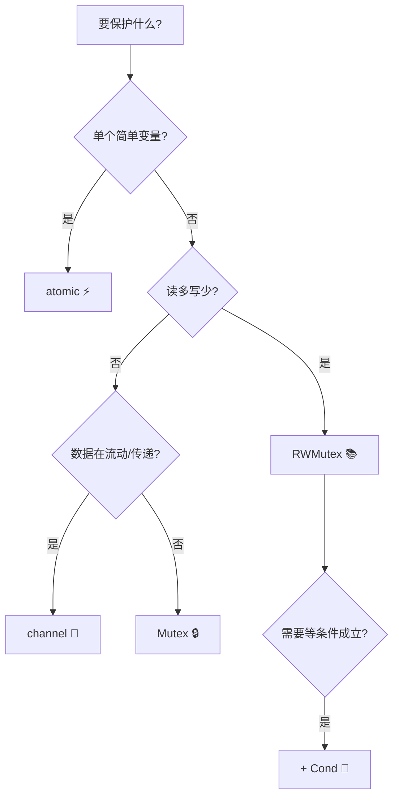

---

## 8️⃣ atomic：CPU 指令级速度 ⚡

### 8.1 六大原子操作

```go
import "sync/atomic"

var (
    n    atomic.Int64
    flag atomic.Bool
    ptr  atomic.Pointer[string]
)

// 加减
n.Add(5)          // +5
n.Sub(2)          // -2（Go 1.19+）

// 读写
n.Store(100)      // 原子写
v := n.Load()     // 原子读
old := n.Swap(50) // 换成50，返回旧值

// CAS：比较并交换（无锁数据结构的灵魂！）
if n.CompareAndSwap(50, 60) {
    fmt.Println("还是50，换成60啦") // 期望是50才换
}

// 布尔开关
flag.Store(true)
if flag.Load() { /* ... */ }

// Swap/CompareAndSwap 也可用旧式函数（了解即可）
var x int64
atomic.AddInt64(&x, 1)
atomic.LoadInt64(&x)
```

### 8.2 用 atomic 实现自旋锁（CAS 实战）

```go
type SpinLock struct {
    locked atomic.Bool
}

func (s *SpinLock) Lock() {
    for !s.locked.CompareAndSwap(false, true) {
        // 抢不到就原地转圈（自旋）🔄
        // 短期持锁很高效，长期持锁烧 CPU！
    }
}

func (s *SpinLock) Unlock() {
    s.locked.Store(false)
}
```

### 8.3 atomic.Value：原子存任意值（配置热更新神器）

```go
var configValue atomic.Value

type Config struct {
    Timeout time.Duration
    Level   string
}

// 启动时加载
configValue.Store(Config{Timeout: 3 * time.Second, Level: "info"})

// 后台热更新
go func() {
    for {
        time.Sleep(30 * time.Second)
        configValue.Store(Config{Timeout: 5 * time.Second, Level: "debug"})
    }
}()

// 任意时刻读：读到的一定是完整的 Config，不会读到"一半" ✅
cfg := configValue.Load().(Config)
fmt.Println(cfg.Level)
```

> 💡 原理：存的是**指针**，读写指针是原子的，所以读者要么看到旧配置、要么看到新配置，永远不会看到混合体～

---

## 9️⃣ sync 工具箱：WaitGroup / Once / Pool / Map 🧰

### 9.1 WaitGroup 计数器语义

```go
var wg sync.WaitGroup

// ✅ 标准三步曲
wg.Add(1)      // ① 派活前 +1（必须在 go 语句之前！）
go func() {
    defer wg.Done() // ② 干完 -1（defer 保证 panic 也销号）
    work()
}()
wg.Wait()      // ③ 阻塞到计数归零

// ✅ 批量写法
wg.Add(10) // 一次加 10
for i := 0; i < 10; i++ {
    go func() { defer wg.Done(); work() }()
}
wg.Wait()

// ⚠️ Add 负数会 panic；Wait 后再 Wait 没问题；计数 <0 会 panic
```

### 9.2 Once：一次性初始化

```go
var (
    once     sync.Once
    instance *Singleton
)

func GetInstance() *Singleton {
    once.Do(func() {
        instance = &Singleton{} // 无论多少 goroutine 同时来，只执行一次
    })
    return instance
}

// 冷知识：Do 传入的函数 panic 了，Once 也会标记"已执行"
// 后续调用直接跳过（不会重试），panic 会向外传播～
```

### 9.3 Pool：对象池（减少 GC 压力）

```go
var bufPool = sync.Pool{
    New: func() any { return bytes.NewBuffer(make([]byte, 0, 1024)) },
}

func HandleRequest(w io.Writer, data []byte) {
    buf := bufPool.Get().(*bytes.Buffer) // 借 🤲
    defer func() {
        buf.Reset()      // 还之前洗干净！
        bufPool.Put(buf) // 还 ♻️
    }()
    buf.Write(data)
    // ... 用 buf 处理
}
```

> ⚠️ Pool 的两个特性：① GC 时会被清空（不保证存活）② 取出的对象状态未知，必须重置。适合**又大又频繁创建**的临时对象～

### 9.4 sync.Map：并发安全 map

```go
var m sync.Map

m.Store("key", 42)              // 写
v, ok := m.Load("key")          // 读
old, loaded := m.LoadOrStore("k", 1) // 没有就存，返回实际值
m.Delete("key")                 // 删

// 遍历（Range 回调返回 false 提前停止）
m.Range(func(k, v any) bool {
    fmt.Println(k, v)
    return true
})
```

**sync.Map vs Mutex+map 对比：**

| 维度 | `sync.Map` | `Mutex + map` |
|------|-----------|---------------|
| 适用 | **读多写少**、key 稳定 | 通用，写多也行 |
| 类型安全 | ❌ any 装箱，取值要断言 | ✅ 强类型 |
| 性能（读多） | 更好（读几乎无锁）⚡ | 一般 |
| 灵活性 | 只有固定几个方法 | 随便操作 |

> 💡 大部分场景用 `Mutex + map` 更清爽；只有热点读缓存才上 `sync.Map`～

---

## 🔟 context 实战：取消传播指挥家 🎛️

### 10.1 四大能力地图

```go
// 取消（手动）：
ctx, cancel := context.WithCancel(parent)

// 超时（从现在起 3 秒）：
ctx, cancel := context.WithTimeout(parent, 3*time.Second)

// 截止（到某个时刻）：
ctx, cancel := context.WithDeadline(parent, time.Now().Add(time.Hour))

// 传值（请求级元数据）：
ctx = context.WithValue(parent, requestIDKey, "abc-123")
```

### 10.2 全链路取消传播实战

```go
type ctxKey string
const traceIDKey ctxKey = "traceID"

// 模拟业务：订单处理（内部还有 DB 查询和 RPC 调用）
func HandleOrder(ctx context.Context) error {
    ctx, cancel := context.WithTimeout(ctx, 2*time.Second) // 本环节总预算 2 秒
    defer cancel()

    // 并行查用户+查库存，任一失败全员取消
    g, gctx := errgroup.WithContext(ctx)

    var user, stock string
    g.Go(func() error {
        u, err := fetchUser(gctx)
        if err != nil {
            return fmt.Errorf("查用户: %w", err)
        }
        user = u
        return nil
    })
    g.Go(func() error {
        s, err := fetchStock(gctx)
        if err != nil {
            return fmt.Errorf("查库存: %w", err)
        }
        stock = s
        return nil
    })

    if err := g.Wait(); err != nil {
        return err // 一个出错，另一个已被 ctx 取消 ✅
    }
    fmt.Println(user, stock)
    return nil
}

func fetchUser(ctx context.Context) (string, error) {
    select {
    case <-time.After(3 * time.Second): // 模拟慢查询
        return "小樱", nil
    case <-ctx.Done():                   // 上游取消/超时立刻响应！
        return "", ctx.Err()
    }
}

func fetchStock(ctx context.Context) (string, error) {
    select {
    case <-time.After(500 * time.Millisecond):
        return "有货", nil
    case <-ctx.Done():
        return "", ctx.Err()
    }
}
```

**传播时序图：**

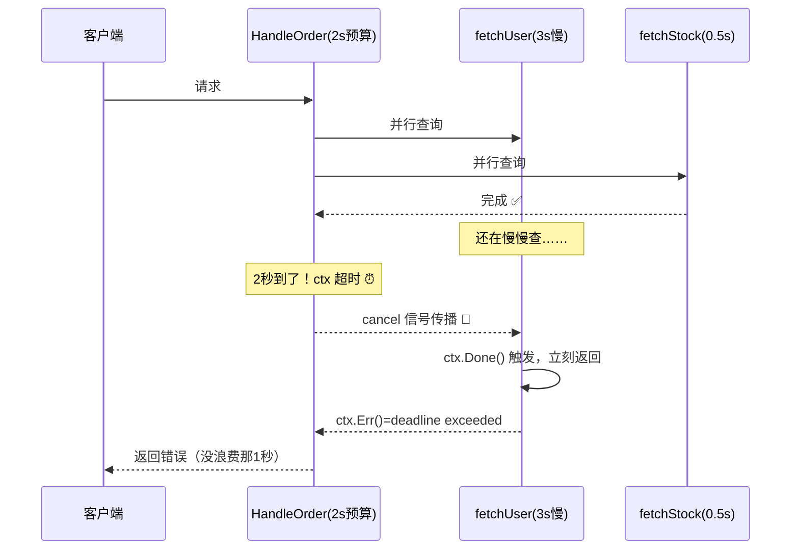

### 10.3 HTTP 服务里的 context（真实场景）

```go
// net/http 会自动把 request 的 ctx 传进来：
// 客户端断开连接 → req.Context() 被取消 → 数据库查询自动中止！
func handler(w http.ResponseWriter, r *http.Request) {
    ctx := r.Context()

    rows, err := db.QueryContext(ctx, "SELECT ...") // 感知取消 ✅
    if err != nil {
        if errors.Is(err, context.Canceled) {
            log.Println("客户端跑路了，不查啦～")
            return
        }
    }
    defer rows.Close()
    // ...
}
```

### 10.4 使用铁律 📏

| 铁律 | 原因 |
|------|------|
| ctx 放**第一个参数** | 全 Go 社区公约 |
| **不要存进 struct** | 生命周期跟随请求，struct 可能活得比请求久 |
| WithCancel/Timeout 的 cancel **必须调**（defer） | 不调会泄漏 timer 和 goroutine |
| Value 只放**请求元数据** | 别当全局变量传业务参数 |
| 链式传递**不要断** | 断了就收不到取消信号 |

---

## 1️⃣1️⃣ 死锁诊断 💀

### 11.1 死锁四大条件（缺一不可）

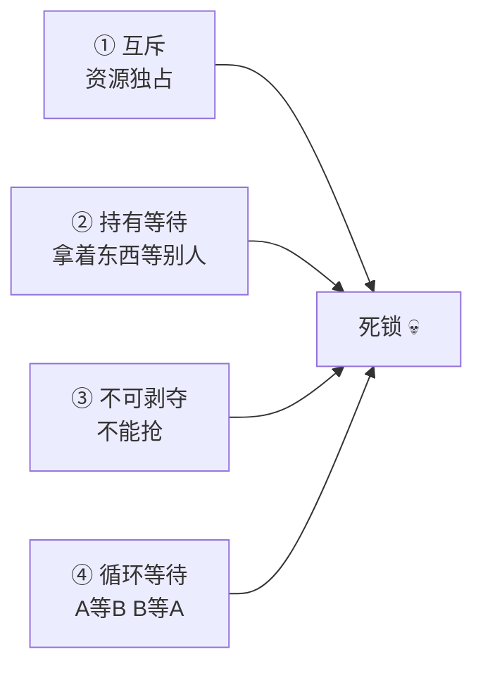

### 11.2 经典死锁现场

```go
// 现场1：无缓冲通道自己堵自己
func main() {
    ch := make(chan int)
    ch <- 1 // 没人接收，main 卡死 💀
    // fatal error: all goroutines are asleep - deadlock!
}

// 现场2：交叉加锁
func transfer(a, b *Account) {
    a.mu.Lock()
    defer a.mu.Unlock()
    b.mu.Lock()     // 若另一个 goroutine 反向 transfer(b,a) → 互等 💀
    defer b.mu.Unlock()
    // ...
}

// 现场3：Wait 的 Add 忘了调（计数永远>0）
var wg sync.WaitGroup
go func() { work() }() // 忘了 wg.Add(1)，但这里没 Done 就没事故……
// 反过来：Add 了但 goroutine 提前 return 没 Done → Wait 卡死
```

### 11.3 破解之道

```go
// 破解1：加锁统一顺序（按地址排序，天下太平）
func transfer(a, b *Account) {
    // 永远先锁地址小的 → 不存在循环等待 ✅
    first, second := a, b
    if &a.mu > &b.mu {
        first, second = b, a
    }
    first.mu.Lock()
    defer first.mu.Unlock()
    second.mu.Lock()
    defer second.mu.Unlock()
}

// 破解2：TryLock 超时放弃（Go 1.18+）
if a.mu.TryLock() {
    defer a.mu.Unlock()
    // 干活
} else {
    // 拿不到就算了/稍后重试，别死等
}

// 破解3：无缓冲→有缓冲（看业务语义）
ch := make(chan int, 1)

// 破解4：select + 超时兜底
select {
case ch <- data:
case <-time.After(time.Second):
    fmt.Println("发不进去，算了 🏃")
}
```

### 11.4 排查工具

```bash
# Go 运行时自带的死锁检测（全部 goroutine 睡死时触发）
# fatal error: all goroutines are asleep - deadlock!

# 查看所有 goroutine 堆栈（卡住时按 Ctrl+\ 发信号，或代码里调用）
kill -QUIT <pid>

# 代码里打印 goroutine 堆栈
import "runtime/pprof"
pprof.Lookup("goroutine").WriteTo(os.Stdout, 1)

# go tool pprof / delve 调试器深挖
```

---

## 1️⃣2️⃣ 并发模式大全 📋

### 12.1 模式总览图

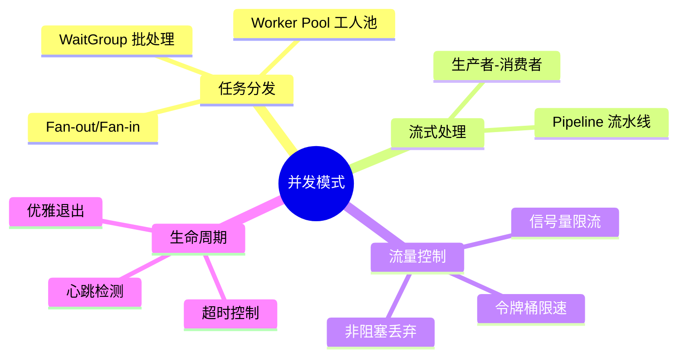

### 12.2 Worker Pool（打工人池）⭐⭐⭐

```go
type Job struct{ ID int; Payload string }
type Result struct{ JobID int; Output string }

func workerPool(jobs <-chan Job, results chan<- Result, workers int, wg *sync.WaitGroup) {
    for i := 1; i <= workers; i++ {
        wg.Add(1)
        go func(id int) {
            defer wg.Done()
            for job := range jobs { // 关闭通道=收工信号
                time.Sleep(100 * time.Millisecond) // 模拟处理
                results <- Result{job.ID, fmt.Sprintf("工人%d处理了%s", id, job.Payload)}
            }
        }(i)
    }
}

func main() {
    jobs := make(chan Job, 100)
    results := make(chan Result, 100)
    var wg sync.WaitGroup

    workerPool(jobs, results, 5, &wg) // 5 个固定工人

    // 派活
    go func() {
        for i := 1; i <= 20; i++ {
            jobs <- Job{i, fmt.Sprintf("任务%d", i)}
        }
        close(jobs) // 活派完
    }()

    // 关结果通道（工人全收工后）
    go func() {
        wg.Wait()
        close(results)
    }()

    // 收结果
    for r := range results {
        fmt.Println(r.Output)
    }
}
```

### 12.3 Semaphore：信号量限流 ⭐⭐

```go
// 方式一：带缓冲通道（经典）
type Semaphore chan struct{}

func NewSem(n int) Semaphore { return make(Semaphore, n) }

func (s Semaphore) Acquire() { s <- struct{}{} } // 抢名额
func (s Semaphore) Release() { <-s }             // 还名额

// 使用：限制最多 3 个并发爬网页
sem := NewSem(3)
var wg sync.WaitGroup
urls := []string{"a.com", "b.com", "c.com", "d.com", "e.com"}

for _, url := range urls {
    wg.Add(1)
    go func(u string) {
        defer wg.Done()
        sem.Acquire()         // 没名额就排队 💤
        defer sem.Release()
        fmt.Println("正在爬:", u)
        time.Sleep(time.Second)
    }(url)
}
wg.Wait()

// 方式二：官方信号量（golang.org/x/sync/semaphore，支持权重）
import "golang.org/x/sync/semaphore"
sem2 := semaphore.NewWeighted(10)
sem2.Acquire(context.Background(), 3) // 占 3 个权重
sem2.Release(3)
```

### 12.4 Rate Limiter：令牌桶限速 ⭐

```go
import "golang.org/x/time/rate"

// 每秒 2 个令牌，桶容量 5（允许小突发）
limiter := rate.NewLimiter(2, 5)

for i := 1; i <= 10; i++ {
    // 方式一：阻塞等待令牌
    if err := limiter.Wait(context.Background()); err == nil {
        fmt.Println("请求", i, time.Now().Format("15:04:05.000"))
    }

    // 方式二：非阻塞尝试（拿不到立刻false）
    // if limiter.Allow() { ... } else { 限流拒绝 }
}
```

### 12.5 Pipeline：多级流水线 ⭐

```go
// 三个阶段：生成 → 平方 → 过滤偶数
func generate(ctx context.Context, nums ...int) <-chan int {
    out := make(chan int)
    go func() {
        defer close(out)
        for _, n := range nums {
            select {
            case out <- n:
            case <-ctx.Done(): // 感知取消，随时收工
                return
            }
        }
    }()
    return out
}

func square(ctx context.Context, in <-chan int) <-chan int {
    out := make(chan int)
    go func() {
        defer close(out)
        for n := range in {
            select {
            case out <- n * n:
            case <-ctx.Done():
                return
            }
        }
    }()
    return out
}

func filterEven(ctx context.Context, in <-chan int) <-chan int {
    out := make(chan int)
    go func() {
        defer close(out)
        for n := range in {
            if n%2 == 0 {
                select {
                case out <- n:
                case <-ctx.Done():
                    return
                }
            }
        }
    }()
    return out
}

// 组装：1~10 → 平方 → 只要偶数
ctx, cancel := context.WithCancel(context.Background())
defer cancel()

ch := generate(ctx, 1, 2, 3, 4, 5, 6, 7, 8, 9, 10)
sq := square(ctx, ch)
ev := filterEven(ctx, sq)

for v := range ev {
    fmt.Println(v) // 4 16 36 64 100
}
```

### 12.6 Or-Done：多路完成信号

```go
// 只要任意一个 done 通道关闭，orDone 就关闭
func orDone(channels ...<-chan struct{}) <-chan struct{} {
    switch len(channels) {
    case 0:
        return nil
    case 1:
        return channels[0]
    }

    orDone := make(chan struct{})
    go func() {
        defer close(orDone)
        switch len(channels) {
        case 2:
            select {
            case <-channels[0]:
            case <-channels[1]:
            }
        default: // 递归分治
            select {
            case <-channels[0]:
            case <-channels[1]:
            case <-orDone(append(channels[2:], orDone)...):
            }
        }
    }()
    return orDone
}
```

### 12.7 优雅退出（服务关闭标准姿势）⭐⭐⭐

```go
func main() {
    // 监听 Ctrl+C 和 kill 信号
    ctx, stop := signal.NotifyContext(context.Background(),
        syscall.SIGINT, syscall.SIGTERM)
    defer stop()

    srv := &http.Server{Addr: ":8080", Handler: routes()}

    go func() {
        if err := srv.ListenAndServe(); err != http.ErrServerClosed {
            log.Fatalf("服务异常: %v", err)
        }
    }()
    log.Println("服务启动 :8080")

    // 阻塞等信号
    <-ctx.Done()
    log.Println("收到退出信号，开始优雅关闭……")

    // 给在途请求 10 秒处理时间
    shutdownCtx, cancel := context.WithTimeout(context.Background(), 10*time.Second)
    defer cancel()
    if err := srv.Shutdown(shutdownCtx); err != nil {
        log.Printf("强制关闭: %v", err)
    }
    log.Println("再见啦～ 👋")
}
```

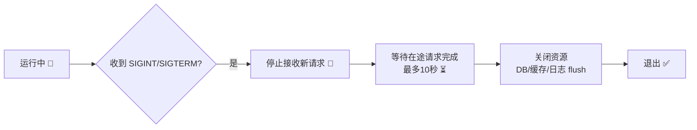

### 12.8 模式选用速查表

| 需求 | 模式 | 核心工具 |
|------|------|---------|
| 并行批量任务等完成 | 批处理 | WaitGroup |
| 一错全停 | errgroup | errgroup + context |
| 固定并发上限 | Worker Pool / 信号量 | channel / x/sync/semaphore |
| 速率限制（QPS） | 令牌桶 | x/time/rate |
| 多阶段变换 | Pipeline | 链式 channel |
| 分摊计算+汇总 | Fan-out/Fan-in | 多 channel + WaitGroup |
| 限时等待 | 超时 | select + context |
| 服务停机 | 优雅退出 | signal + Shutdown |
| 动态监控多通道 | for-select | select + nil 技巧 |

---

## 1️⃣3️⃣ 踩坑大全：前人翻车后人乘凉 ⚠️

### 坑1：闭包捕获循环变量（Go <1.22）

```go
// ❌ 老版本打印全是 3（共享同一个 i）
for i := 0; i < 3; i++ {
    go func() { fmt.Println(i) }()
}

// ✅ 修复：传参或局部拷贝
for i := 0; i < 3; i++ {
    go func(id int) { fmt.Println(id) }(i)
}
// Go 1.22+ 已修复循环变量语义，但团队老代码要注意！
```

### 坑2：WaitGroup 的 Add 位置

```go
// ❌ Add 在 goroutine 里：Wait 可能先跑，直接放行
go func() { wg.Add(1); defer wg.Done(); work() }()
wg.Wait()

// ✅ Add 必须在 go 之前
wg.Add(1)
go func() { defer wg.Done(); work() }()
wg.Wait()
```

### 坑3：往已关闭的 channel 发送

```go
ch := make(chan int, 1)
close(ch)
ch <- 1 // panic: send on closed channel 💥
// 铁律：谁生产谁关闭；多生产者用一个协调者统一 close
```

### 坑4：复制了锁

```go
type S struct{ mu sync.Mutex; data int }

// ❌ 值接收者：锁被复制，两把锁各锁各的
func (s S) Set(v int) { s.mu.Lock(); s.data = v; s.mu.Unlock() }

// ✅ 指针接收者
func (s *S) Set(v int) { s.mu.Lock(); s.data = v; s.mu.Unlock() }
```

### 坑5：map 并发读写

```go
// ❌ 直接 panic：fatal error: concurrent map writes
m := map[string]int{}
go func() { m["a"] = 1 }()
go func() { m["b"] = 2 }()

// ✅ 加锁或用 sync.Map
var mu sync.Mutex
go func() { mu.Lock(); m["a"] = 1; mu.Unlock() }()
```

### 坑6：time.After 在循环里堆积

```go
// ❌ 每轮都 New 一个 Timer，旧的要等触发才能回收（旧版本内存堆积）
for {
    select {
    case <-ch:
    case <-time.After(time.Minute): // 反复创建 ⚠️
    }
}

// ✅ 循环外创建一次复用
timer := time.NewTimer(time.Minute)
defer timer.Stop()
for {
    select {
    case <-ch:
    case <-timer.C:
        return
    }
}
```

### 坑7：goroutine 泄漏（发了没人收）

```go
// ❌ 一旦 timeout 先到，内部 goroutine 永久卡在发送 💤
func bad() (string, error) {
    ch := make(chan string) // 无缓冲！
    go func() { ch <- slowOp() }()
    select {
    case v := <-ch:
        return v, nil
    case <-time.After(time.Second):
        return "", errors.New("timeout") // slowOp 的结果没人要了
    }
}

// ✅ 修复：缓冲1，让发送方随时能全身而退
ch := make(chan string, 1)
```

### 坑8：errgroup 里忘传 i（旧版本闭包）

```go
g, ctx := errgroup.WithContext(ctx)
for i, item := range items {
    i, item := i, item // ✅ Go 1.22 前必须这样拷贝一份
    g.Go(func() error { return process(ctx, i, item) })
}
```

### 坑速查表 📇

| 症状 | 病因 | 药方 |
|------|------|------|
| 输出全是最后一个值 | 闭包共享循环变量 | 传参拷贝 |
| Wait 提前返回 | Add 写晚了 | Add 放 go 之前 |
| panic: send on closed | 重复关/关后又发 | 谁生产谁关闭 |
| concurrent map writes | map 裸奔并发写 | Mutex / sync.Map |
| all goroutines asleep | 死锁（互等/自堵） | 有缓冲/超时/统一锁序 |
| NumGoroutine 只增不减 | goroutine 泄漏 | 缓冲通道/退出信号 |
| 内存慢慢涨 | time.After 循环堆积 | NewTimer 复用 |

---

## 🎁 总结：一张图吃透 Go 并发

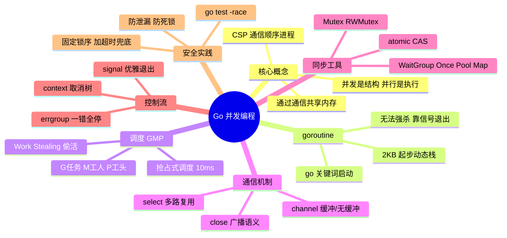

## 📝 课后小测验（动动小脑瓜 🧠）

1. 单核 CPU 上开 100 个 goroutine，是并发还是并行？
2. `runtime.NumGoroutine()` 持续增长说明什么问题？一般什么原因？
3. 无缓冲通道发送时，接收方恰好正在等待，数据走缓冲区吗？
4. Go 的 Mutex 是可重入锁吗？同一个 goroutine 连续 Lock 两次会怎样？
5. Cond 的 `Wait()` 为什么要写在 `for` 循环而不是 `if` 里？
6. 信号量限流 `make(chan struct{}, 5)` 中，为什么用空结构体？
7. 客户端提前断开 HTTP 连接，`db.QueryContext(ctx, ...)` 会怎样？

<details>
<summary>👉 点开看答案</summary>

1. **并发**（单核交替执行）；并行必须多核同时执行。
2. **goroutine 泄漏**！常见原因：无缓冲通道发送后没人接收、忘记退出信号、select 没监听 ctx.Done。
3. **不走**！直接从发送方栈**拷贝到接收方栈**（直达快车 🚄）。
4. **不是**可重入锁；连续 Lock 两次会**死锁**（自己等自己）。
5. 被唤醒后条件可能已经又不满足了（**虚假唤醒**），必须重新检查条件。
6. `struct{}` 是**零字节类型**，只需要"占坑"信号不需要数据，最省内存。
7. `req.Context()` 被取消 → 传给 `QueryContext` 的 ctx 超时/取消 → **查询被中止**并返回 `context.Canceled` 错误。

</details>

---

> 🌸 恭喜通关 Go 并发编程！这可是 Go 最值钱的技能，面试高频、实战刚需～
> 到这里 Go 系列（基础语法 ✅ 常用包 ✅ 进阶特性 ✅ 并发编程 ✅）全部集齐！🏆
> 下一站推荐：**Go Web 开发（net/http + Gin）** 或 **Go 工程化（go mod / 单元测试 / pprof 调优）**，
> 随时召唤本讲师，比心 💖
