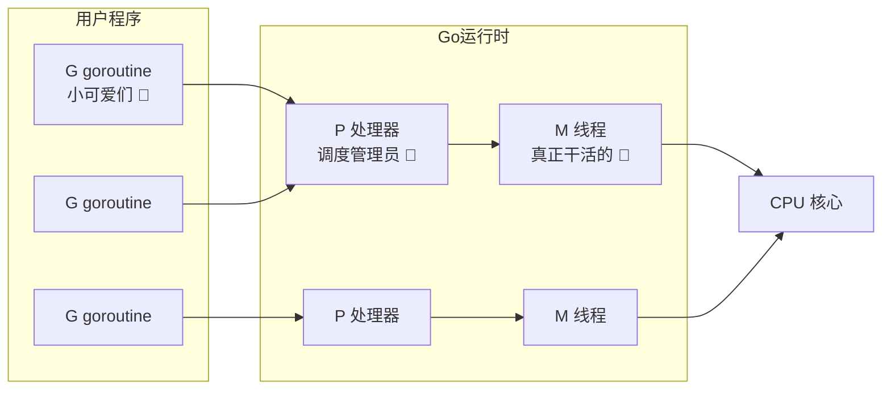
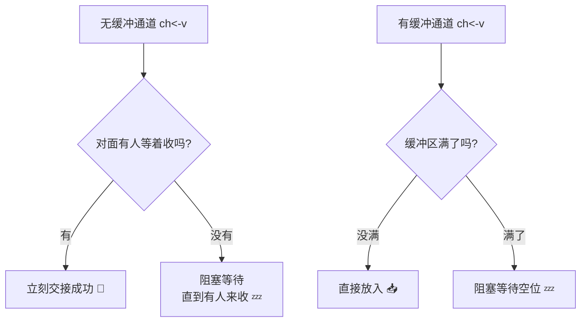
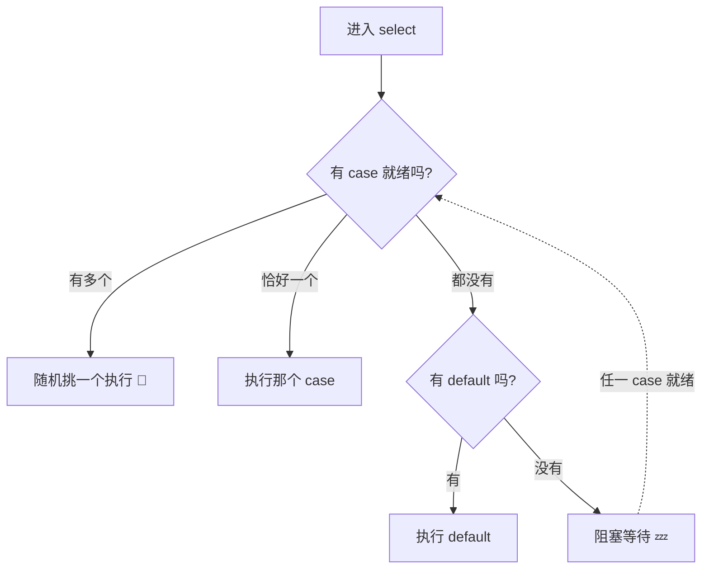
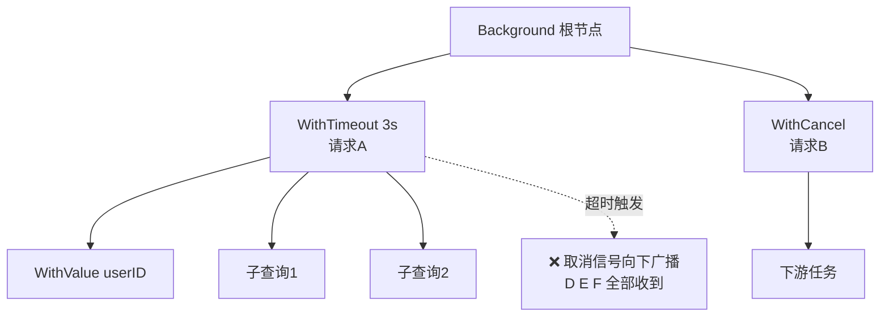
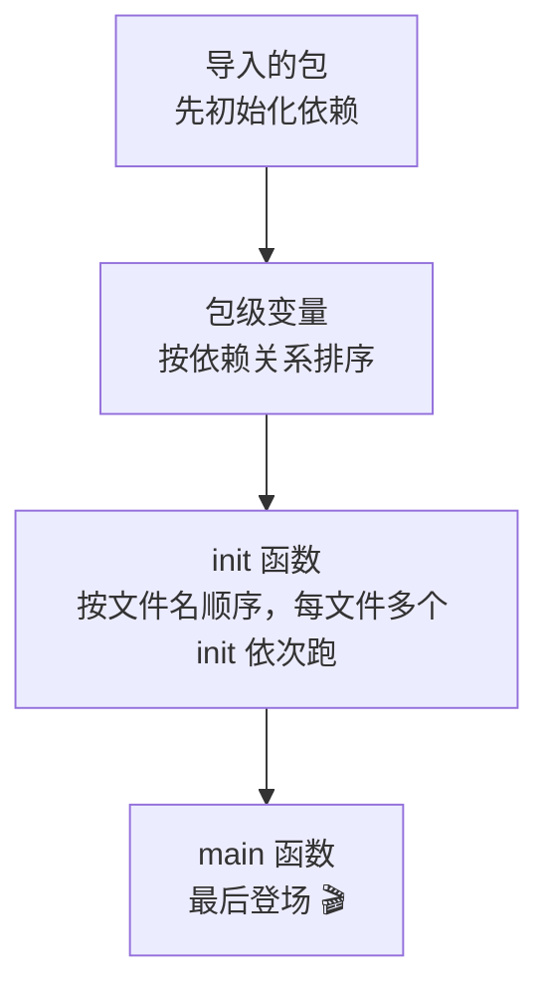
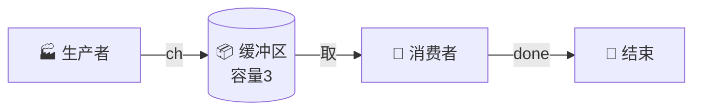
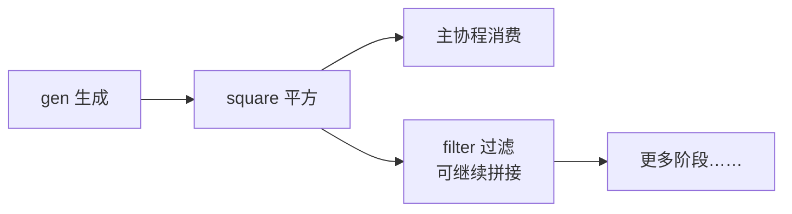
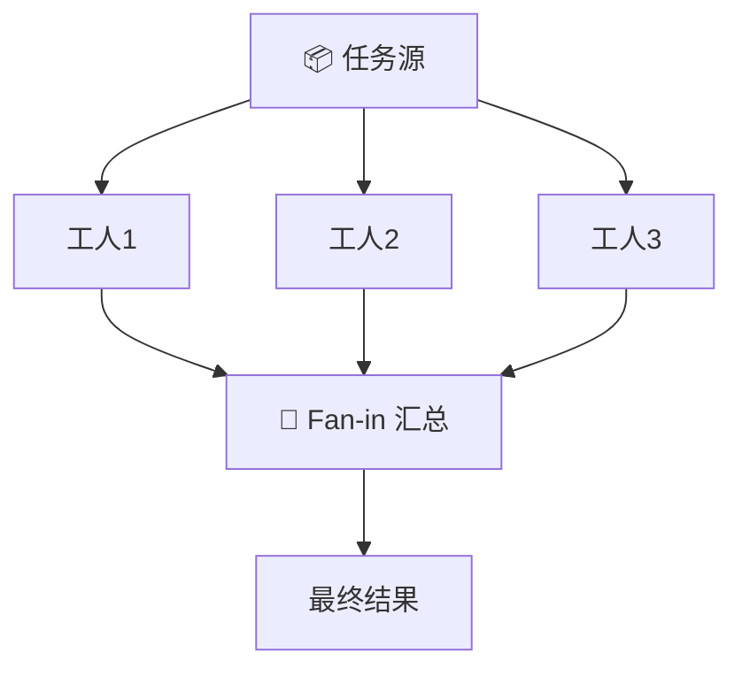
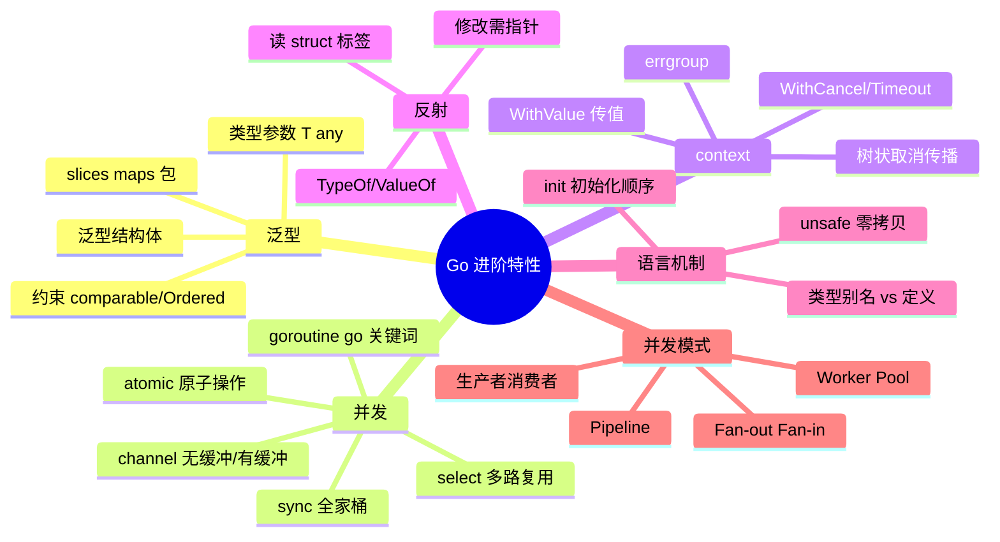

# 🚀 Go 进阶特性超详细讲义

> 嘿嘿～基础语法和常用包都拿下啦，现在解锁**高手进阶技能**！🎯
> 这节课包括：泛型、goroutine、channel、context、反射……全是 Go 的招牌绝活～
> 学完这课，你就能看懂大部分 Go 开源项目了哦！冲鸭！💪

---

## 📚 目录一览

| 章节 | 主题 | 一句话理解 |
|------|------|-----------|
| 1 | 泛型 Generics | 一套代码适配所有类型 🧬 |
| 2 | goroutine | 超轻量并发小能手 🏃 |
| 3 | channel 通道 | goroutine 之间的传话筒 📢 |
| 4 | select | 多路监听指挥官 🚦 |
| 5 | sync 深入 | 并发工具箱全家福 🧰 |
| 6 | atomic | 原子操作闪电手 ⚡ |
| 7 | context | 上下文总管家 🎛️ |
| 8 | 反射 Reflection | 运行时照妖镜 🔮 |
| 9 | init 与包初始化 | 程序启动的秘密仪式 🎬 |
| 10 | 类型别名与类型定义 | 双胞胎但不同命 👯 |
| 11 | unsafe 零拷贝 | 危险但迷人的黑魔法 🖤 |
| 12 | 经典并发模式 | 实战模板直接抄 📋 |

---

## 1️⃣ 泛型 Generics 🧬（Go 1.18+）

### 1.1 没有泛型的痛 😢

以前想写个"求最大值"，每种类型都得复制一份：

```go
func maxInt(a, b int) int { if a > b { return a }; return b }
func maxFloat(a, b float64) float64 { if a > b { return a }; return b }
func maxString(a, b string) string { if a > b { return a }; return b }
// 复制粘贴到手抽筋……
```

### 1.2 泛型函数：一劳永逸 ✨

```go
import "cmp" // Go 1.21+ 自带比较工具包

// [T cmp.Ordered] 是类型参数：T 是占位符，cmp.Ordered 是约束（能比较的类型）
func Max[T cmp.Ordered](a, b T) T {
    if a > b {
        return a
    }
    return b
}

// 使用：类型自动推断，不用写方括号也行
fmt.Println(Max(3, 5))          // 5（int）
fmt.Println(Max(3.14, 2.71))    // 3.14（float64）
fmt.Println(Max("苹果", "香蕉"))  // 香蕉（字典序）
fmt.Println(Max[int](3, 5))     // 也可以显式指定类型
```

### 1.3 常用约束类型

| 约束 | 允许的类型 |
|------|-----------|
| `any` | 万物皆可（= `interface{}`） |
| `comparable` | 能用 `==` 比较的（可做 map 键） |
| `cmp.Ordered` | 能用 `<` `>` 排序的（整数/浮点/字符串） |

### 1.4 自定义约束

```go
// 约束本质是接口，可以用 | 列出多个类型
type Number interface {
    int | int64 | float64
}

func Sum[T Number](nums []T) T {
    var total T
    for _, n := range nums {
        total += n
    }
    return total
}

// ~ 波浪号：包括"底层类型是它"的所有类型！
type MyInt int // 底层类型是 int

type Number2 interface {
    ~int | ~float64 // ~int 让 MyInt 也能进来！
}
```

> 💡 记忆：`int` 只认亲生的 int；`~int` 连"底层数据是 int"的养子（自定义类型）也认～

### 1.5 泛型结构体

```go
// 泛型栈：什么类型都能装
type Stack[T any] struct {
    items []T
}

func (s *Stack[T]) Push(v T) {
    s.items = append(s.items, v)
}

func (s *Stack[T]) Pop() (T, bool) {
    var zero T // 零值兜底
    if len(s.items) == 0 {
        return zero, false
    }
    v := s.items[len(s.items)-1]
    s.items = s.items[:len(s.items)-1]
    return v, true
}

// 使用
s := &Stack[string]{}
s.Push("hello")
v, ok := s.Pop() // "hello", true
```

### 1.6 标准库里的泛型宝贝（Go 1.21+）

```go
import (
    "cmp"
    "slices"
    "maps"
)

nums := []int{3, 1, 2}
slices.Sort(nums)                    // 泛型排序，告别 sort.Slice！
slices.Contains(nums, 1)             // true，告别手写循环！
slices.Index(nums, 2)                // 1
slices.Max(nums)                     // 3
cmp.Or("", "默认值")                  // 返回第一个非零值 "默认值"

m := map[string]int{"a": 1}
keys := slices.Collect(maps.Keys(m)) // 直接拿到 key 切片 ["a"]
```

---

## 2️⃣ goroutine：超轻量并发 🏃

### 2.1 一个 `go` 关键词就起飞

```go
import (
    "fmt"
    "time"
)

func main() {
    // go + 函数调用 = 开一个新协程，立刻并发执行！
    go sayHello("小樱")
    go sayHello("知世")
    go func() { // 匿名函数也行
        fmt.Println("匿名协程跑起来～")
    }()

    time.Sleep(time.Second) // 等 1 秒让协程跑完（偷懒写法，后面学正确姿势）
}

func sayHello(name string) {
    fmt.Println("你好呀，我是", name)
}
```

### 2.2 goroutine vs 线程

| 特性 | goroutine | 系统线程 |
|------|-----------|---------|
| 初始栈大小 | **2KB**（能动态伸缩） | 1~8MB |
| 创建成本 | 极便宜，轻松开 10 万个 💰 | 昂贵，几千个就吃力 |
| 调度 | Go 运行时用户态调度 | 操作系统内核调度 |
| 切换开销 | 纳秒级 ⚡ | 微秒级 |
| 通信方式 | channel（推荐） | 共享内存+锁 |

### 2.3 GMP 调度模型速览 🔬



> 💡 白话版：**G** 是任务（goroutine），**M** 是工人（线程），**P** 是工头（处理器）。Go 运行时自动安排任务给工人，一个工人被卡住，任务会被偷给别的工人（work stealing），保证 CPU 不闲着～

### 2.4 ⚠️ 经典大坑：主协程不等小弟

```go
func main() {
    go fmt.Println("我可能还没来得及说……")
    // main 跑完直接退出，所有 goroutine 陪葬！👻
}
```

**正确姿势**：用 `sync.WaitGroup` 等大家干完活：

```go
func main() {
    var wg sync.WaitGroup
    for i := 1; i <= 3; i++ {
        wg.Add(1) // ① 派活前登记（一定在 go 之前！）
        go func(id int) {
            defer wg.Done() // ③ 干完销号
            fmt.Println("工人", id, "完工")
        }(i)
    }
    wg.Wait() // ② 等到计数归零
    fmt.Println("全员收工 🎉")
}
```

> ⚠️ **闭包陷阱**：Go 1.22 之前，`go func() { fmt.Println(i) }()` 里的 `i` 是循环变量共享的！老版本要把 `i` 当参数传进去（像上面那样 `}(i)`）才安全～

---

## 3️⃣ channel：goroutine 的传话筒 📢

Go 的哲学：**不要用共享内存来通信，要用通信来共享内存！**

### 3.1 基本用法

```go
// 创建
ch := make(chan int)        // 无缓冲通道
ch2 := make(chan int, 10)   // 有缓冲通道（容量10）

// 发送 & 接收
ch <- 10        // 发送：把 10 塞进通道
v := <-ch       // 接收：从通道取出来
<-ch            // 接收了但丢弃（比如只要信号）

// 关闭
close(ch)

// 遍历（通道关闭后自动结束循环）
for v := range ch {
    fmt.Println(v)
}
```

### 3.2 通道阻塞规则（核心！背下来 📖）

| 操作 | 无缓冲通道 | 有缓冲通道（没满） | 已关闭通道 | nil 通道 |
|------|-----------|------------------|-----------|---------|
| 发送 `ch<-` | 阻塞等人收 🧍 | 直接放入 ✅ | **panic!** 💥 | 永久阻塞 |
| 接收 `<-ch` | 阻塞等人发 🧍 | 直接取出 ✅ | 立刻返回零值 | 永久阻塞 |
| 关闭 `close` | 可以 | 可以 | **panic!** 💥 | **panic!** 💥 |



### 3.3 判断通道关闭：comma-ok

```go
v, ok := <-ch
if !ok {
    fmt.Println("通道关啦，别等了～")
}

// 关闭后再收：先取完剩余数据，然后返回零值+false
ch := make(chan int, 2)
ch <- 1
ch <- 2
close(ch)
fmt.Println(<-ch) // 1（还有存货）
fmt.Println(<-ch) // 2
v, ok := <-ch     // 0, false（空了+已关闭）
```

### 3.4 单向通道：方向限制 🚸

```go
// 生产者：只能发
func producer(out chan<- int) { // chan<- 只写
    for i := 0; i < 3; i++ {
        out <- i
    }
    close(out) // 谁生产谁关闭！黄金法则 ✨
}

// 消费者：只能收
func consumer(in <-chan int) { // <-chan 只读
    for v := range in {
        fmt.Println("收到:", v)
    }
}

func main() {
    ch := make(chan int) // 双向通道
    go producer(ch)      // 传参时自动"收缩"成单向
    consumer(ch)
}
```

> 🌟 **三条黄金法则**：
> 1. 谁发送谁关闭，别让接收方关！
> 2. 关闭通道是为了告诉接收方"没数据了"，不是释放资源！
> 3. 关闭已关闭的通道会 panic，重复 close 要小心！

### 3.5 有缓冲 vs 无缓冲对比

| 特性 | 无缓冲 `make(chan T)` | 有缓冲 `make(chan T, n)` |
|------|----------------------|--------------------------|
| 语义 | 同步交接（手递手 🤝） | 异步队列（快递柜 📦） |
| 发送方 | 必须等接收方就位 | 缓冲没满就能走 |
| 适用 | 严格同步、信号通知 | 削峰填谷、生产消费速率不均 |

```go
// 无缓冲：像接力赛交接棒
ch := make(chan string)
go func() {
    ch <- "棒" // 卡住，直到 main 来接
}()
fmt.Println(<-ch) // 接棒！

// 有缓冲：像快递柜
box := make(chan string, 2)
box <- "包裹1" // 直接放进柜子，不用等人取
box <- "包裹2"
fmt.Println(<-box) // 包裹1（先进先出）
```

---

## 4️⃣ select：多路监听指挥官 🚦

同时盯多个通道，谁先来响应谁！

```go
select {
case v := <-ch1:
    fmt.Println("ch1 来消息了:", v)
case ch2 <- "hello":
    fmt.Println("ch2 发送成功")
case <-time.After(2 * time.Second):
    fmt.Println("超时啦！⏰")
}
```

### 4.1 select 四大特性

| 特性 | 说明 |
|------|------|
| 随机性 | 多个 case 同时就绪时**随机挑一个**（防止饿死）🎲 |
| 阻塞性 | 所有 case 都不就绪 → 整个 select 阻塞 |
| default | 加了 default：都不就绪就走 default，**不阻塞** |
| for 组合 | `for { select {...} }` = 常驻监听循环 ♻️ |

### 4.2 超时控制（超经典用法 ⭐）

```go
func doWithTimeout() {
    ch := make(chan string, 1)
    go func() {
        time.Sleep(3 * time.Second) // 模拟慢操作
        ch <- "结果"
    }()

    select {
    case res := <-ch:
        fmt.Println("拿到结果:", res)
    case <-time.After(1 * time.Second):
        fmt.Println("等 1 秒了还没好，撤！🏃")
    }
}
```

### 4.3 常驻监听 + 退出信号

```go
func worker(id int, quit <-chan struct{}) {
    for {
        select {
        case <-quit:
            fmt.Println("工人", id, "收到下班通知，拜拜～👋")
            return
        default:
            fmt.Println("工人", id, "干活中……")
            time.Sleep(500 * time.Millisecond)
        }
    }
}

quit := make(chan struct{}) // 空结构体通道：只用信号不带数据，0 内存！
go worker(1, quit)
time.Sleep(2 * time.Second)
close(quit) // close 广播：所有监听者都能收到！
time.Sleep(time.Second)
```

> 💡 `struct{}` 空结构体**不占内存**，专门用来做信号通道，业界标配～

**select 心跳流程图：**



---

## 5️⃣ sync 深入：并发工具箱全家福 🧰

### 5.1 RWMutex：读写锁 📚

普通 Mutex 一个读的也挡外面。读写锁：**多人同读没问题，一写全退散！**

```go
var (
    mu   sync.RWMutex
    data map[string]int
)

// 写操作：独占 🔒
func set(key string, v int) {
    mu.Lock()
    defer mu.Unlock()
    data[key] = v
}

// 读操作：共享（读多写少场景性能起飞 🚀）
func get(key string) int {
    mu.RLock()
    defer mu.RUnlock()
    return data[key]
}
```

| 锁类型 | 场景 | 特点 |
|--------|------|------|
| `Mutex` | 写多读少 | 一次一个，简单粗暴 |
| `RWMutex` | **读多写少** | 并发读 ✅，写独占 |

### 5.2 Once：只执行一次 🔂

```go
var once sync.Once
var instance *DB

func GetDB() *DB {
    once.Do(func() {
        fmt.Println("初始化数据库（只会打印一次！）")
        instance = connectDB()
    })
    return instance
}

// 100 个 goroutine 同时调 GetDB，connectDB 只跑一次！
```

> 💡 这就是懒汉式单例模式的 Go 标准写法，比 Java 的双重检查锁优雅多啦～

### 5.3 Pool：对象池 ♻️

频繁创建销毁大对象太浪费，Pool 帮你"回收再利用"：

```go
var bufPool = sync.Pool{
    New: func() any {
        return new(bytes.Buffer) // 池子空了就造新的
    },
}

func process() {
    buf := bufPool.Get().(*bytes.Buffer) // 借
    defer func() {
        buf.Reset()                // 用完清理干净
        bufPool.Put(buf)           // 还
    }()
    buf.WriteString("处理数据……")
    fmt.Println(buf.String())
}
```

### 5.4 WaitGroup 常见翻车点 ⚠️

```go
// ❌ 错误一：Add 写在 goroutine 里面（可能 Wait 先跑，计数是 0 直接放行！）
for i := 0; i < 3; i++ {
    go func() {
        wg.Add(1) // 迟到的登记！
        defer wg.Done()
    }()
}
wg.Wait() // 可能一个都没等到！

// ✅ 正确：Add 在 go 之前
for i := 0; i < 3; i++ {
    wg.Add(1)
    go func() { defer wg.Done() }()
}

// ❌ 错误二：WaitGroup 被值拷贝（计数器分家了）
func worker(wg sync.WaitGroup) { ... } // 错！
func worker(wg *sync.WaitGroup) { ... } // 对！用指针
```

### 5.5 sync 工具速查表

| 工具 | 用途 | 一句话 |
|------|------|--------|
| `WaitGroup` | 等一组协程干完 | 派活登记销号 📝 |
| `Mutex` | 互斥锁 | 一次进一个 🚪 |
| `RWMutex` | 读写锁 | 并发读+独占写 📚 |
| `Once` | 只执行一次 | 单例神器 🔂 |
| `Pool` | 对象池 | 借了要还 ♻️ |
| `Map` | 并发安全 map | 锁粒度细，读多写少用 🗺️ |

---

## 6️⃣ atomic：原子操作闪电手 ⚡

一个 `count++` 看似一步，其实是"读-改-写"三步，并发下会互相踩脚！原子操作把三步打包成"一步到位"：

```go
import "sync/atomic"

// Go 1.19+ 推荐类型化写法
var counter atomic.Int64

func add() {
    counter.Add(1)       // 原子加
    v := counter.Load()  // 原子读
    fmt.Println(v)
}

// CAS：CompareAndSwap，乐观锁的魂！
if counter.CompareAndSwap(10, 20) {
    fmt.Println("期望是10，成功了，改成20")
}

// 原子布尔：一次性开关
var done atomic.Bool
go func() {
    time.Sleep(time.Second)
    done.Store(true) // 完成标记
}()
for !done.Load() { // 自旋等待
    time.Sleep(100 * time.Millisecond)
}
```

**atomic vs Mutex 怎么选？**

| 维度 | atomic | Mutex |
|------|--------|-------|
| 适用 | 单个变量的简单读写 | 保护一段代码/多个变量 |
| 性能 | 更快（CPU 指令级）⚡ | 稍慢（涉及调度） |
| 能力 | 只能加减/交换/比较 | 任意临界区 |

> 💡 一个计数器用 `atomic.Int64`，一段业务逻辑用 `Mutex`～

---

## 7️⃣ context：上下文总管家 🎛️

Go 并发的"指挥中枢"：**取消信号、超时控制、传值**一站搞定！

### 7.1 四大构造函数

```go
import (
    "context"
    "time"
)

ctx := context.Background() // 根上下文（main 里用）
ctx2 := context.TODO()      // 还没想好放哪个（占位用）

// 派生子上下文：
ctx3, cancel := context.WithCancel(ctx)              // 手动取消
ctx4, cancel2 := context.WithTimeout(ctx, 3*time.Second) // 3秒超时
ctx5, _ := context.WithDeadline(ctx, deadlineTime)   // 指定到期时间
ctx6 := context.WithValue(ctx, "userID", 42)         // 携带值

defer cancel()  // 用完释放资源，好习惯！
defer cancel2()
```

### 7.2 树状传播结构 🌳



> 💡 context 是**树状**的：父节点取消，所有子孙节点跟着取消！超时/取消像多米诺骨牌一样传导～

### 7.3 实战：可取消的工作协程

```go
func worker(ctx context.Context, id int) {
    for {
        select {
        case <-ctx.Done(): // 监听取消/超时信号
            fmt.Printf("工人%d下班：%v\n", id, ctx.Err())
            return
        default:
            fmt.Printf("工人%d干活中……\n", id)
            time.Sleep(500 * time.Millisecond)
        }
    }
}

func main() {
    ctx, cancel := context.WithTimeout(context.Background(), 2*time.Second)
    defer cancel()

    go worker(ctx, 1)
    go worker(ctx, 2)

    <-ctx.Done() // main 也等信号
    fmt.Println("全部结束:", ctx.Err()) // context deadline exceeded
}
```

### 7.4 WithValue：请求级传值

```go
// 传递
ctx = context.WithValue(ctx, "userID", 10086)

// 取出（注意：key 建议用自定义类型，避免撞车！）
type ctxKey string
const userIDKey ctxKey = "userID"
ctx = context.WithValue(ctx, userIDKey, 10086)

if v, ok := ctx.Value(userIDKey).(int); ok {
    fmt.Println("用户ID:", v) // 10086
}
```

### 7.5 惯例铁律 📏

1. **ctx 永远是函数第一个参数**，名字就叫 `ctx`：
   ```go
   func DoSomething(ctx context.Context, arg string) error
   ```
2. 不要把 ctx 存进结构体（少数框架除外）
3.WithValue 只放**请求范围**的数据（traceID、用户信息），别当全局变量使！

### 7.6 errgroup：带错误传播的 WaitGroup ⭐（golang.org/x/sync）

```go
import "golang.org/x/sync/errgroup"

func main() {
    g, ctx := errgroup.WithContext(context.Background())

    for i := 1; i <= 3; i++ {
        i := i
        g.Go(func() error { // 注意：g.Go 自带 go 关键词！
            select {
            case <-time.After(time.Duration(i) * time.Second):
                if i == 2 {
                    return fmt.Errorf("工人%d出错啦", i) // 一个错，全员取消！
                }
                fmt.Println("工人", i, "完成")
            case <-ctx.Done():
                fmt.Println("工人", i, "被取消")
            }
            return nil
        })
    }

    if err := g.Wait(); err != nil { // 等待+收错
        fmt.Println("出错了:", err)
    }
}
```

---

## 8️⃣ 反射 Reflection：运行时照妖镜 🔮

反射 = 程序在**运行时**检查和操作自己的类型/值。encoding/json 就是靠它实现的！

### 8.1 基本三件套

```go
import "reflect"

var x float64 = 3.14

t := reflect.TypeOf(x)   // 类型信息：float64
v := reflect.ValueOf(x)  // 值信息：3.14

fmt.Println(t.Kind())    // kind：底层种类 float64
fmt.Println(v.Float())   // 取出值：3.14
fmt.Println(v.Type())    // float64
```

**Type vs Kind：**

```go
type MyInt int
t := reflect.TypeOf(MyInt(1))
fmt.Println(t)        // main.MyInt（Type：具体类型）
fmt.Println(t.Kind()) // int（Kind：底层种类）
```

### 8.2 读结构体标签（json 包就是这么干的！）

```go
type User struct {
    Name string `json:"name" validate:"required"`
    Age  int    `json:"age"`
}

u := User{"小樱", 14}
t = reflect.TypeOf(u)

for i := 0; i < t.NumField(); i++ { // 遍历字段
    field := t.Field(i)
    fmt.Printf("字段:%v 类型:%v 标签:%v\n",
        field.Name, field.Type, field.Tag.Get("json"))
    // 字段:Name 类型:string 标签:name
    // 字段:Age  类型:int    标签:age
}
```

### 8.3 修改值：必须传指针

```go
var num int = 10

// ❌ 直接反射值是"复印件"，改不了原件
// v := reflect.ValueOf(num)
// v.SetInt(20) // panic！

// ✅ 传地址，再 Elem() 找到指向的值
v := reflect.ValueOf(&num).Elem()
v.SetInt(20)
fmt.Println(num) // 20
```

### 8.4 使用心法 ⚠️

| 优点 | 缺点 |
|------|------|
| 灵活：运行时动态处理未知类型 | 慢：比直接调用慢几倍 🐢 |
| 框架必备：json/orm/依赖注入 | 绕过类型检查：编译期查不出错 💣 |
| | 代码难读难维护 |

> 🌟 **口诀**：能不用就不用，框架开发才掏出来～

---

## 9️⃣ init 与包初始化：启动的秘密仪式 🎬

### 9.1 变量初始化顺序

```go
var a = compute() // ① 包级变量先初始化

func compute() int { return 42 }

func init() {       // ② init 函数：自动执行，不能调用、不能有参数返回值
    fmt.Println("init 执行啦") // ③ 每个文件的 init 只跑一次
}

func main() {       // ④ 最后才轮到 main
    fmt.Println("main 执行")
}
```

**初始化完整顺序：**



### 9.2 init 的两个冷知识

```go
// ① 一个文件能有多个 init（少见但合法）
func init() { fmt.Println("第1个") }
func init() { fmt.Println("第2个") } // 依次执行

// ② 匿名导入：只为了触发包的 init（注册模式！）
import _ "github.com/go-sql-driver/mysql"
// mysql 驱动的 init 里把自己注册进 database/sql，
// 我们只要"踹一脚"让它跑 init 就够了～
```

> 💡 数据库驱动、配置文件加载这种"启动前准备工作"就放 init 里～

---

## 🔟 类型别名与类型定义：双胞胎但不同命 👯

```go
// 类型定义（新类型！）
type MyInt int     // MyInt 和 int 是不同类型，要显式转换

// 类型别名（同一个类型，多个名字！）
type YourInt = int // YourInt 就是 int 本尊，完全等价
```

```go
var a MyInt = 10
var b int = 20
// b = a        // ❌ 编译错误：类型不同！
b = int(a)      // ✅ 显式转换

var c YourInt = 30
b = c           // ✅ 完全 OK：YourInt 就是 int！

// 标准库的著名别名：
// byte = uint8
// rune = int32
// any  = interface{}
```

| 对比 | `type A B`（定义） | `type A = B`（别名） |
|------|-------------------|---------------------|
| 本质 | 全新类型 | 同一类型多个名字 |
| 和原类型赋值 | 要转换 | 直接来 |
| 能加方法吗 | ✅ 可以 | ❌ 不行（等于改原类型，乱套） |
| 用途 | 业务语义化（UserID、OrderID） | 兼容迁移、简化长类型名 |

---

## 1️⃣1️⃣ unsafe：零拷贝黑魔法 🖤

> ⚠️ 前方高能：`unsafe` 包操作裸内存，用错了直接崩！只在极致性能优化时使用～

```go
import "unsafe"

// 看看类型占了多少字节
fmt.Println(unsafe.Sizeof(int64(0)))          // 8
fmt.Println(unsafe.Sizeof("hello"))           // 16（string header：指针+长度）

// 经典应用：string 和 []byte 零拷贝互转！
func bytesToString(b []byte) string {
    return *(*string)(unsafe.Pointer(&b)) // 共享底层数组，不复制！
}

// 注意：转换后共享内存，改 b 会影响 s！（普通转换是复制，安全但慢）
```

**为什么需要它？** 普通 `string(b)` 要复制整个数据；大数据量高频转换时，零拷贝能省一大笔内存和 CPU～（`strings.Builder` 内部就用了类似技巧）

| 场景 | 用不用 unsafe |
|------|--------------|
| 日常业务 | ❌ 别碰 |
| 底层库/序列化优化 | ✅ 谨慎用 |
| 面试吹牛 | ✅ 讲原理加分 😎 |

---

## 1️⃣2️⃣ 经典并发模式：实战模板直接抄 📋

### 12.1 生产者-消费者

```go
func producer(ch chan<- int) {
    for i := 1; i <= 5; i++ {
        ch <- i
        fmt.Println("生产:", i)
    }
    close(ch)
}

func consumer(ch <-chan int, done chan<- bool) {
    for v := range ch {
        fmt.Println("消费:", v)
        time.Sleep(300 * time.Millisecond) // 消费慢一点
    }
    done <- true
}

ch := make(chan int, 3) // 缓冲区削峰填谷
done := make(chan bool)
go producer(ch)
go consumer(ch, done)
<-done
```



### 12.2 Worker Pool：固定工人池

```go
func workerPool(jobs <-chan int, results chan<- int, workers int) {
    var wg sync.WaitGroup
    for i := 1; i <= workers; i++ {
        wg.Add(1)
        go func(id int) {
            defer wg.Done()
            for job := range jobs { // 通道关闭=收工
                time.Sleep(200 * time.Millisecond) // 模拟干活
                results <- job * job
                fmt.Printf("工人%d 完成 %d\n", id, job)
            }
        }(i)
    }
    wg.Wait()
    close(results) // 工人全收工，关结果通道
}

jobs := make(chan int, 100)
results := make(chan int, 100)

for i := 1; i <= 9; i++ {
    jobs <- i // 派活
}
close(jobs) // 活派完了

go workerPool(jobs, results, 3) // 3个工人

for r := range results { // 收结果
    fmt.Println("结果:", r)
}
```

> 💡 优点：控制并发数量（比如数据库连接就 10 个），防止 goroutine 泛滥打爆系统～

### 12.3 Pipeline 流水线

```go
// 阶段一：生成数字
func gen(nums ...int) <-chan int {
    out := make(chan int)
    go func() {
        defer close(out)
        for _, n := range nums {
            out <- n
        }
    }()
    return out
}

// 阶段二：平方
func square(in <-chan int) <-chan int {
    out := make(chan int)
    go func() {
        defer close(out)
        for n := range in {
            out <- n * n
        }
    }()
    return out
}

// 组装流水线：2 → 4，3 → 9
ch := gen(2, 3)
sq := square(ch)
for v := range sq {
    fmt.Println(v) // 4 9
}
```



### 12.4 Fan-out / Fan-in：扇出扇入

```go
// Fan-out：一个源头分给多个处理器
func fanOut(in <-chan int, n int, process func(int) int) []<-chan int {
    outs := make([]<-chan int, n)
    for i := 0; i < n; i++ {
        out := make(chan int)
        go func() {
            defer close(out)
            for v := range in {
                out <- process(v)
            }
        }()
        outs[i] = out
    }
    return outs
}

// Fan-in：多路结果汇成一路
func fanIn(chans ...<-chan int) <-chan int {
    out := make(chan int)
    var wg sync.WaitGroup
    for _, c := range chans {
        wg.Add(1)
        go func(c <-chan int) {
            defer wg.Done()
            for v := range c {
                out <- v
            }
        }(c)
    }
    go func() {
        wg.Wait()
        close(out) // 全收完才关
    }()
    return out
}
```



### 12.5 信号量：限制并发数

```go
// 用带缓冲通道当"名额池"
sem := make(chan struct{}, 5) // 最多同时 5 个

var wg sync.WaitGroup
for i := 1; i <= 10; i++ {
    wg.Add(1)
    go func(id int) {
        defer wg.Done()
        sem <- struct{}{}        // 抢名额（满了就排队）
        defer func() { <-sem }() // 干完释放名额
        fmt.Println("任务", id, "执行中")
        time.Sleep(time.Second)
    }(i)
}
wg.Wait()
```

### 12.6 模式选用速查

| 场景 | 用哪个模式 |
|------|-----------|
| 等一批协程全部完成 | WaitGroup |
| 一个出错全员取消 | errgroup |
| 生产消费速率不匹配 | 有缓冲 channel |
| 固定并发数量（限流） | Worker Pool / 信号量 |
| 多阶段数据处理 | Pipeline |
| 任务分摊+汇总 | Fan-out/Fan-in |
| 超时/取消控制 | context + select |

---

## 🎁 总结：一张图记住进阶特性



## 📝 课后小测验（动动小脑瓜 🧠）

1. `make(chan int)` 和 `make(chan int, 1)` 有什么本质区别？
2. 向已关闭的 channel 发送数据、再次 close 会发生什么？
3. select 有 3 个 case 同时就绪，会执行哪个？
4. `sync.Once.Do` 里的函数执行时 panic 了，再调用 Once 会执行吗？
5. context 的父节点取消后，子节点会怎样？
6. `type MyInt int` 和 `type MyInt = int`，哪个能直接赋值给 int 变量？

<details>
<summary>👉 点开看答案</summary>

1. 无缓冲是**同步交接**（发送必须等接收方就位）；有缓冲容量 1 是**异步队列**（放 1 个不用等）。
2. 都是 **panic**！发送报 `send on closed channel`，重复关闭报 `close of closed channel`。
3. **随机**挑一个执行（源码里专门洗牌，防止某个 case 饿死）。
4. **不会**再执行。Once 会把 panic 也记成"执行过"，后续调用直接跳过（Go 1.16+ 行为）。
5. 子节点**跟着取消**，`ctx.Done()` 通道关闭、`ctx.Err()` 返回 `context.Canceled`。
6. `type MyInt = int`（**类型别名**，它俩就是同一个类型）。

</details>

---

> 🌸 通关进阶特性！现在的你已经掌握泛型、并发、反射这些硬核技能啦～
> 下一站推荐：**Go Web 开发（net/http + Gin 框架）** 或者 **Go 项目工程化（go mod / 测试 / 交叉编译）**，
> 随时召唤本讲师，比心 💖
