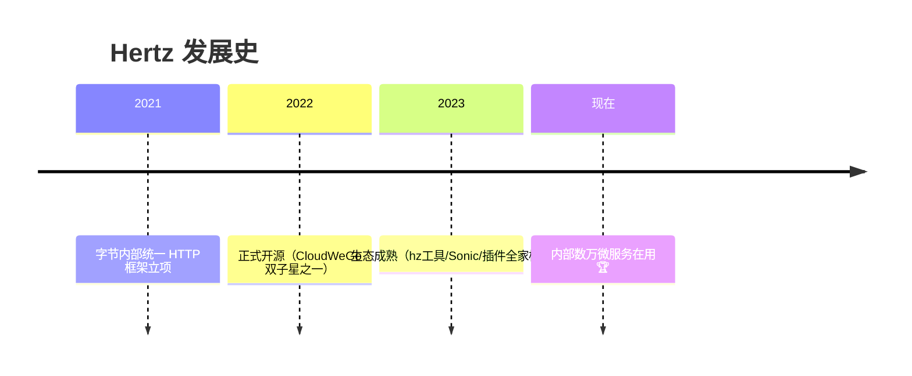
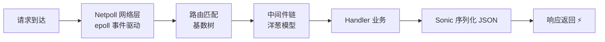
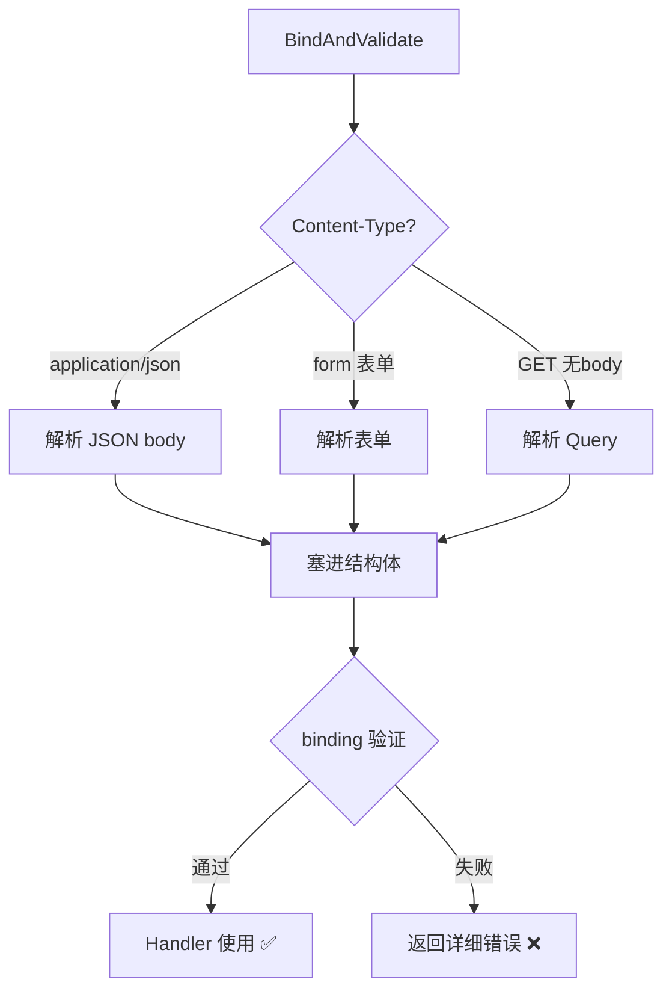
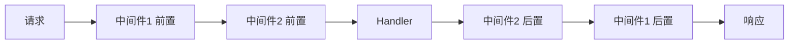
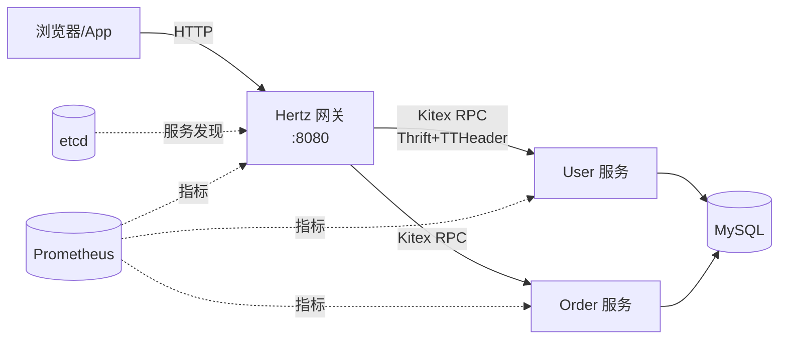
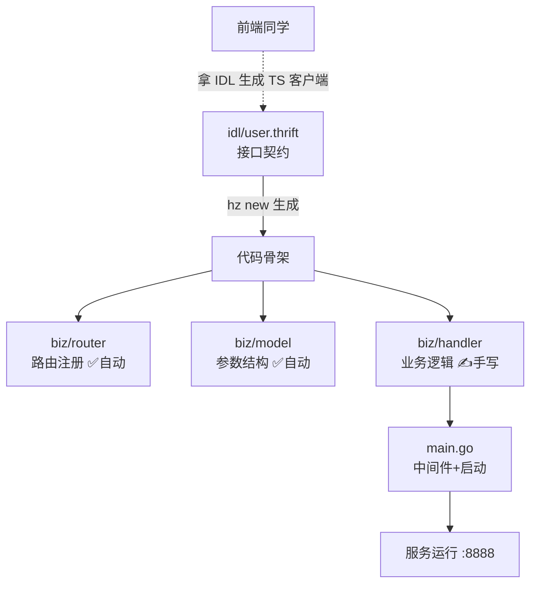
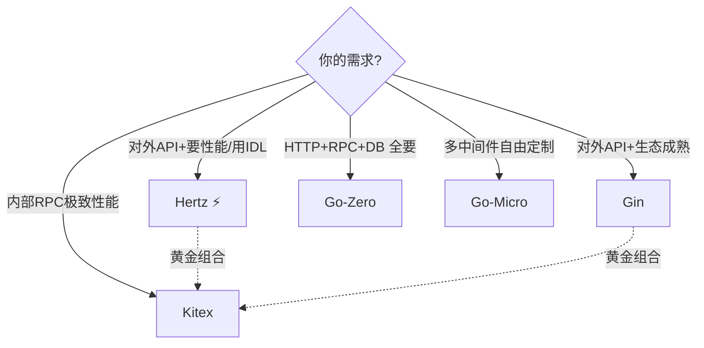
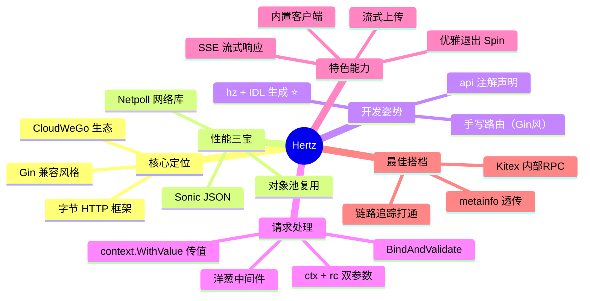

# 🚀 Hertz 高性能 HTTP 框架超详细讲义

> 嘿嘿～上节课 Kitex 预告的黄金搭档来啦！💕
> **Hertz** 是字节跳动开源的高性能 HTTP 框架（CloudWeGo 家族），抖音同款！
> 对标 Gin 但**更快**（自研 Netpoll 网络库 + Sonic JSON），还自带 **hz 命令行工具**：
> 写个 IDL 敲条命令 → 路由/参数/客户端全生成，和 Kitex 无缝联动！
> 学完这课，字节系全家桶（Hertz + Kitex）就集齐啦！🎉

---

## 📚 目录一览

| 章节 | 主题 | 一句话理解 |
|------|------|-----------|
| 1 | Hertz 是什么 | 字节的 HTTP 之光 🌟 |
| 2 | 安装准备 | hz 工具装起来 🔧 |
| 3 | 快速开始 | 5 行代码起服务 🚀 |
| 4 | 路由 | 经典+参数化路由 🗺️ |
| 5 | 参数获取与绑定 | 收快递+自动拆箱 📦 |
| 6 | 响应输出 | 花式回礼 🎁 |
| 7 | 中间件 | 洋葱模型+优雅退出 🧅 |
| 8 | hz 代码生成 | IDL 驱动开发 🤖 |
| 9 | HTTP 客户端 | 自带高性能客户端 📡 |
| 10 | 流式处理 | 大文件也不怕 🌊 |
| 11 | 性能秘诀 | 快是有道理的 ⚡ |
| 12 | Hertz + Kitex 联动 | 字节全家桶合体 💑 |
| 13 | 实战：完整项目 | 从 IDL 到上线 💯 |
| 14 | 框架全家福对比 | 五框架终极合影 📸 |
| 15 | 踩坑大全 | 前人翻车后人乘凉 ⚠️ |

---

## 1️⃣ Hertz 是什么：字节的 HTTP 之光 🌟

### 1.1 出身与定位



| 关键词 | 说明 |
|--------|------|
| 👶 出身 | 字节跳动内部框架，超大规模生产验证 |
| 🚄 性能 | Netpoll 网络库 + Sonic JSON，吞吐业界第一梯队 |
| 🎨 API | 高度兼容 Gin/echo 风格，**会 Gin 就会 Hertz** |
| 🤖 工具链 | hz 命令：IDL 生成路由/参数/代码 |
| 🧩 生态 | CloudWeGo：Kitex(RPC) + Hertz(HTTP) + Netpoll(网络) |

### 1.2 Hertz vs Gin：像但更强

| 维度 | Gin | Hertz |
|------|-----|-------|
| API 风格 | 经典 | **几乎一致**（迁移成本低） |
| 上下文 | `*gin.Context` | `*app.RequestContext` |
| 网络层 | 标准库 net | **Netpoll**（可切换） |
| JSON | 标准库 encoding/json | **Sonic**（快数倍） |
| 代码生成 | ❌ | ✅ hz + IDL |
| 流式处理 | 一般 | ✅ 完善 |
| 中间件生态 | 🌟 最丰富 | 快速追赶中 |
| 适合 | 生态优先/老项目 | 新项目/追求性能/字节系 |

> 💡 **一句话**：会 Gin = 免费赠送 Hertz 八成技能，剩下两成是 hz 工具链和字节生态～

---

## 2️⃣ 安装准备：hz 工具装起来 🔧

```bash
# ① 安装 hz 命令行工具（代码生成器，灵魂！）
go install github.com/cloudwego/hertz/cmd/hz@latest

# 验证
hz --version
# 应输出：hz version v0.x.x

# ② 创建项目
mkdir demo && cd demo
go mod init demo

# ③ 引入 Hertz 框架
go get github.com/cloudwego/hertz/pkg/app
go get github.com/cloudwego/hertz/pkg/app/server
```

| 工具/库 | 职责 |
|---------|------|
| `hz` 命令 | IDL → 生成路由/handler/参数代码 |
| `hertz/pkg/app/server` | HTTP 服务端 |
| `hertz/pkg/app/client` | HTTP 客户端 |

> ⚠️ Windows 记得把 `GOPATH/bin` 加入 PATH；国内加速：`go env -w GOPROXY=https://goproxy.cn,direct`～

---

## 3️⃣ 快速开始：5 行代码起服务 🚀

```go
package main

import (
    "context"

    "github.com/cloudwego/hertz/pkg/app"
    "github.com/cloudwego/hertz/pkg/app/server"
    "github.com/cloudwego/hertz/pkg/common/utils"
)

func main() {
    h := server.New(server.WithHostPorts(":8080")) // 引擎（对比：gin.Default()）

    h.GET("/hello", func(ctx context.Context, rc *app.RequestContext) { // ⚠️ 双参数！
        rc.JSON(200, utils.H{"message": "hello hertz"}) // 对比：gin.H
    })

    h.Spin() // 对比：r.Run()（支持优雅退出！）
}
```

**与 Gin 的逐行对照（Gin 党狂喜 😍）：**

| Gin 写法 | Hertz 写法 |
|---------|-----------|
| `r := gin.Default()` | `h := server.New(...)` 或 `server.Default()` |
| `func(c *gin.Context)` | `func(ctx context.Context, rc *app.RequestContext)` |
| `c.JSON(200, gin.H{...})` | `rc.JSON(200, utils.H{...})` |
| `c.Query("x")` | `rc.Query("x")` |
| `c.Param("id")` | `rc.Param("id")` |
| `r.Run(":8080")` | `h.Spin()` |

> 🌟 **最大区别**：Hertz 把 `context.Context` 和 `RequestContext` **分开传**！
> ctx 管生命周期（超时/取消），rc 管请求本身——职责更清晰，不像 Gin 揉在一起～

### 3.1 一次请求的旅程



---

## 4️⃣ 路由：经典+参数化路由 🗺️

### 4.1 基本路由

```go
h := server.Default()

// 标准 RESTful
h.GET("/users", listHandler)
h.POST("/users", createHandler)
h.PUT("/users/:id", updateHandler)
h.DELETE("/users/:id", deleteHandler)
h.Any("/ping", pingHandler) // 所有方法

// 参数路由
h.GET("/users/:id", func(ctx context.Context, rc *app.RequestContext) {
    id := rc.Param("id") // "42"
    rc.String(200, "用户: %s", id)
})

// 通配符（对比 Gin 的 *filepath）
h.GET("/files/*path", func(ctx context.Context, rc *app.RequestContext) {
    p := rc.Param("path") // "/docs/a.txt"
    rc.String(200, "文件: %s", p)
})
```

### 4.2 路由组

```go
api := h.Group("/api")
{
    v1 := api.Group("/v1")
    v1.GET("/users", listV1)      // GET /api/v1/users

    // 组级中间件（对比 Gin 一模一样！）
    auth := api.Group("/admin", AuthMiddleware())
    auth.GET("/stats", statsHandler) // 要过鉴权
}
```

### 4.3 Static 静态文件

```go
h.Static("/static", "./public")       // 目录映射
h.StaticFile("/", "./index.html")     // 单文件
```

### 4.4 路由特性对照表

| 特性 | Gin | Hertz |
|------|-----|-------|
| `:param` 单段参数 | ✅ | ✅ |
| `*path` 通配符 | ✅ | ✅ |
| 路由组 Group | ✅ | ✅ |
| 路由优先级 | 精确 > 参数 > 通配 | 同样 |
| 冲突检测 | panic | panic |

---

## 5️⃣ 参数获取与绑定：收快递+自动拆箱 📦

### 5.1 手动获取（和 Gin 几乎一致）

```go
// ① Query 参数：GET /search?kw=go&page=2
kw := rc.Query("kw")                    // 没有返回 ""
page := rc.DefaultQuery("page", "1")    // 默认值
tags := rc.QueryArray("tags")           // ?tags=a&tags=b → ["a","b"]

// ② 路径参数
id := rc.Param("id")

// ③ 表单参数
name := rc.PostForm("username")
pwd := rc.DefaultPostForm("pwd", "123")

// ④ 请求头
token := rc.GetHeader("Authorization")

// ⑤ 原始 body
body := rc.Request.Body() // []byte
```

### 5.2 结构体绑定（推荐 ⭐）

```go
type LoginReq struct {
    Username string `form:"username" json:"username" binding:"required,min=2"`
    Password string `form:"password" json:"password" binding:"required,min=6"`
    Remember bool   `form:"remember" json:"remember"`
}

h.POST("/login", func(ctx context.Context, rc *app.RequestContext) {
    var req LoginReq

    // 自动识别：JSON body / form / query 全支持！
    if err := rc.BindAndValidate(&req); err != nil {
        rc.JSON(400, utils.H{"msg": "参数错误: " + err.Error()})
        return
    }
    rc.JSON(200, utils.H{"user": req.Username})
})
```

**BindAndValidate 的聪明之处：**



### 5.3 绑定标签速查 📇

| 标签 | 场景 |
|------|------|
| `json:"xx"` | JSON body |
| `form:"xx"` | 表单/Query |
| `path:"xx"` | 路径参数（hz 生成常用） |
| `query:"xx"` | 强制只绑 Query |
| `header:"xx"` | 请求头 |
| `binding:"required,..."` | 验证规则（同 validator） |

---

## 6️⃣ 响应输出：花式回礼 🎁

```go
// ① JSON（Sonic 加速，飞快！）
rc.JSON(200, utils.H{"code": 0, "data": list})
rc.JSON(200, &user)

// ② 字符串 / HTML
rc.String(200, "hello %s", "小樱")
rc.Data(200, "text/html; charset=utf-8", []byte(htmlStr))

// ③ 文件下载
rc.File("./files/report.pdf")

// ④ 重定向
rc.Redirect(302, []byte("/login"))

// ⑤ 设置 Cookie / Header
rc.SetCookie("token", "abc", 3600, "/", "localhost", 0, false)
rc.Header("X-Request-Id", "trace-123")

// ⑥ 状态码
rc.JSON(404, utils.H{"msg": "没找到"})
rc.AbortWithStatus(500) // 中断+状态码

// ⑦ SSE 流式响应（ChatGPT 同款！）
rc.SetStatusCode(200)
rc.Response.Header.Set("Content-Type", "text/event-stream")
rc.Write([]byte("data: hello\n\n"))
rc.Flush() // 立刻推给客户端
```

---

## 7️⃣ 中间件：洋葱模型+优雅退出 🧅

### 7.1 经典洋葱模型



### 7.2 写一个中间件

```go
func MyMiddleware() app.HandlerFunc {
    return func(ctx context.Context, rc *app.RequestContext) {
        start := time.Now()

        // 前置逻辑：鉴权/日志/限流
        token := string(rc.GetHeader("Authorization"))
        if token == "" {
            rc.AbortWithStatusJSON(401, utils.H{"msg": "未登录"})
            return // 拦截！
        }
        userId := parseToken(token)
        ctx = context.WithValue(ctx, "userId", userId) // 塞进 ctx（对比 Gin 的 c.Set）

        rc.Next(ctx) // 放行 🚦

        // 后置逻辑：统计耗时
        cost := time.Since(start)
        log.Printf("%s %s %v", rc.Method(), rc.URI().Path(), cost)
    }
}

// 三种挂载（和 Gin 一样！）
h.Use(MyMiddleware())                    // 全局
admin := h.Group("/admin", MyMiddleware()) // 组级
h.GET("/pay", payHandler, MyMiddleware()) // 路由级
```

> 🌟 **注意差异**：Gin 用 `c.Set/Get` 传值，Hertz 推荐**标准 `context.WithValue`**（更 Go 味）：
> ```go
> // 写
> ctx = context.WithValue(ctx, "userId", 10086)
> // 读（Handler 里）
> uid := ctx.Value("userId").(int)
> ```

### 7.3 服务端选项

```go
h := server.Default(
    server.WithHostPorts(":8080"),           // 监听地址
    server.WithMaxRequestBodySize(20<<20),   // body 上限 20MB
    server.WithReadTimeout(30*time.Second),  // 读超时
    server.WithH2C(true),                    // HTTP2 明文升级
)
```

### 7.4 内置/常用中间件

| 中间件 | 用途 |
|--------|------|
| `server.Default()` 自带 | Recovery + 日志 |
| `cors.New()` | 跨域（hertz-contrib/cors） |
| `pprof.NewMiddleware()` | 性能分析 |
| `session.New()` | 会话（hertz-contrib/session） |
| `swagger.*` | API 文档 |
| `opentelemetry` | 链路追踪 |

```bash
go get github.com/hertz-contrib/cors
```

```go
import "github.com/hertz-contrib/cors"

h.Use(cors.New(cors.Config{
    AllowOrigins:     []string{"https://example.com"},
    AllowMethods:     []string{"GET", "POST", "PUT"},
    AllowHeaders:     []string{"Authorization", "Content-Type"},
    AllowCredentials: true,
}))
```

---

## 8️⃣ hz 代码生成：IDL 驱动开发 🤖（重点⭐⭐）

这是 Hertz 最有特色的工作流：**先写 IDL（接口定义），命令生成代码**！

### 8.1 编写 IDL

```thrift
// idl/hello.thrift
namespace go hello

struct HelloReq {
    1: string name (api.query="name");           // 声明：Query 参数
}

struct HelloResp {
    1: string message;
}

service HelloService {
    HelloResp Hello(1: HelloReq req) (api.get="/hello");  // 声明：GET 路由
}
```

### 8.2 一键生成

```bash
# 新项目：生成完整骨架
hz new -idl idl/hello.thrift -module demo

# 生成结果：
# .
# ├── biz/
# │   ├── handler/           # ⭐ Handler（写业务）
# │   │   └── hello/hello.go
# │   ├── router/            # 路由注册（自动生成）
# │   │   └── hello/
# │   ├── model/             # 参数结构体（自动生成）
# │   └── dal/               # 数据层（预留目录）
# ├── idl/
# ├── main.go
# ├── go.mod
# └── .hz

# 已有项目：更新代码（改 IDL 后）
hz update -idl idl/hello.thrift
```

### 8.3 生成的代码长什么样

```go
// biz/router/hello/hello.go（自动生成，别手改！）
func RegisterRoutes(r *server.Hertz) {
    _hello := r.Group("/hello", ...)
    {
        _hello.GET("/hello", append(_helloMw, handler.Hello)...) // 路由自动注册
    }
}

// biz/handler/hello/hello.go（生成骨架，填业务 ✍️）
func Hello(ctx context.Context, rc *app.RequestContext) {
    var err error
    var req hello.HelloReq
    err = rc.BindAndValidate(&req) // 绑定已生成！
    if err != nil {
        rc.String(400, err.Error())
        return
    }

    resp := new(hello.HelloResp)
    resp.Message = "你好, " + req.Name + "!" // ← 你的业务

    rc.JSON(200, resp)
}
```

### 8.4 api 注解速查 📇

| 注解 | 含义 | 生成效果 |
|------|------|---------|
| `api.get="/path"` | GET 路由 | `GET /path` |
| `api.post="/path"` | POST 路由 | `POST /path` |
| `api.put` / `api.delete` | 其他方法 | 对应路由 |
| `api.query="xx"` | Query 参数 | form:"xx" 绑定 |
| `api.body="xx"` | 请求体 | json 绑定 |
| `api.header="xx"` | 请求头 | header 绑定 |
| `api.path="xx"` | 路径参数 | path 绑定 |
| `api.base_url="/api"` | 路由前缀 | Group 前缀 |

### 8.5 IDL 驱动 vs 手写路由

| 维度 | 手写路由（Gin 风） | IDL 驱动（hz） |
|------|------------------|---------------|
| 前置工作 | 直接写 | 先写 IDL |
| 参数绑定 | 手写 struct+tag | **自动生成** |
| 前后端协作 | 口头/文档约定 | **IDL 即契约**（可给前端生成 TS） |
| 改接口 | 手改多处 | 改 IDL 重新生成 |
| 适合 | 小项目/快速原型 | 团队协作/中大型项目 |

---

## 9️⃣ HTTP 客户端：自带高性能客户端 📡

```go
import (
    "github.com/cloudwego/hertz/pkg/app/client"
    "github.com/cloudwego/hertz/pkg/protocol"
)

func main() {
    c, _ := client.NewClient()

    // ① GET
    req, reset := protocol.AcquireRequest()
    resp := protocol.AcquireResponse()
    defer func() {
        protocol.ReleaseRequest(req)    // 对象池复用（性能细节！）
        protocol.ReleaseResponse(resp)
        reset()
    }()
    req.SetMethod("GET")
    req.SetRequestURI("https://api.example.com/users?page=1")
    if err := c.Do(context.Background(), req, resp); err != nil {
        panic(err)
    }
    println(string(resp.Body()))

    // ② 便捷 API（简单场景）
    status, body, err := c.Get(context.Background(), nil,
        "https://api.example.com/ping")
    println(status, string(body), err)

    // ③ POST JSON
    c.Post(context.Background(), nil,
        "https://api.example.com/users",
        &protocol.Args{},               // 更多选项用 config
    )
}
```

**客户端特色：**

| 能力 | 说明 |
|------|------|
| 连接池复用 | 内置，高频调用快 |
| 对象池 | Acquire/Release 减少分配 |
| 中间件 | 客户端也有洋葱模型 |
| 超时重试 | `client.WithDialTimeout` 等配置 |

---

## 🔟 流式处理：大文件也不怕 🌊

### 10.1 流式读请求（大上传）

```go
h.POST("/upload", func(ctx context.Context, rc *app.RequestContext) {
    // 边读边处理，不在内存里堆完整文件！
    err := rc.Request.BodyStream(func(p []byte) (int, error) {
        // 分块处理：写磁盘/算hash/转存OSS
        return len(p), nil
    })
    // 简单上传直接用：
    // form, _ := rc.MultipartForm()
    // file := form.File["file"][0]
})
```

### 10.2 SSE 服务端推送（AI 打字机效果 ✨）

```go
h.GET("/chat/stream", func(ctx context.Context, rc *app.RequestContext) {
    rc.SetStatusCode(200)
    rc.Response.Header.Set("Content-Type", "text/event-stream")
    rc.Response.Header.Set("Cache-Control", "no-cache")

    // 模拟 AI 逐字输出
    words := []string{"你", "好", "呀", "，", "世", "界", "！"}
    for _, w := range words {
        rc.Write([]byte("data: " + w + "\n\n"))
        rc.Flush() // 关键：立刻推给浏览器！
        time.Sleep(100 * time.Millisecond)
    }
})
```

---

## 1️⃣1️⃣ 性能秘诀：快是有道理的 ⚡

```mermaid
flowchart TD
    A[Hertz 为什么快?] --> B[Netpoll 网络库<br/>epoll+零拷贝]
    A --> C[Sonic JSON<br/>SIMD加速序列化]
    A --> D[对象池<br/>Request/Response 复用]
    A --> E[路由基数树<br/>O(路径长度)匹配]
    B & C & D & E --> F[吞吐量业界第一梯队 🏆]
```

### 11.1 性能开关

```go
// 网络库切换（默认按平台自动选最优）
server.WithTransport(standard.NewTransporter)  // 标准库（兼容性好）
server.WithTransport(netpoll.NewTransporter)   // Netpoll（性能优先）

// JSON 引擎（默认自动用 Sonic）
// 验证 Sonic 生效：build tag 需 amd64 环境
```

### 11.2 调优清单

| 手段 | 效果 |
|------|------|
| `h.Spin()` 自带优雅退出 | 平滑重启不丢请求 |
| `AcquireRequest/ReleaseRequest` | 客户端对象复用 |
| 限制 `MaxRequestBodySize` | 防大包打爆内存 |
| `pprof` 中间件 | 线上定位热点 |
| 连接池配置 | 高频外呼提速 |

---

## 1️⃣2️⃣ Hertz + Kitex 联动：字节全家桶合体 💑

经典架构：**Hertz 当网关（HTTP）→ Kitex 做内部服务（RPC）**

```go
// hertz 网关里调 Kitex 服务
package main

import (
    "context"

    "github.com/cloudwego/hertz/pkg/app"
    "github.com/cloudwego/hertz/pkg/app/server"
    "github.com/cloudwego/hertz/pkg/common/utils"

    userCli "demo/kitex_gen/user/userservice"
    user "demo/kitex_gen/user"
)

func main() {
    // Kitex 客户端（上节课学的！）
    uc, _ := userCli.NewClient("user")

    h := server.Default()

    h.POST("/api/register", func(ctx context.Context, rc *app.RequestContext) {
        var req user.RegisterRequest
        if err := rc.BindAndValidate(&req); err != nil { // Hertz 绑定
            rc.JSON(400, utils.H{"msg": err.Error()})
            return
        }

        // 调 Kitex RPC（metainfo 透传 trace）
        resp, err := uc.Register(ctx, &req)
        if err != nil {
            rc.JSON(500, utils.H{"msg": "服务繁忙"})
            return
        }
        rc.JSON(200, utils.H{"userId": resp.UserId})
    })

    h.Spin()
}
```



> 💡 两个框架共享 CloudWeGo 生态：**metainfo 透传、OpenTelemetry 链路追踪、监控**全打通～

---

## 1️⃣3️⃣ 实战：完整项目 💯

**场景**：用户管理 API（IDL 驱动 + 中间件 + 优雅退出）

### 13.1 IDL 定义

```thrift
// idl/user.thrift
namespace go user

struct RegisterReq {
    1: string username (api.body="username", api.vd="len($)>1")
    2: string password (api.body="password", api.vd="len($)>=6")
}

struct RegisterResp {
    1: i64 user_id;
}

struct GetReq {
    1: i64 id (api.path="id");
}

struct UserItem {
    1: i64 id;
    2: string username;
}

struct GetResp {
    1: UserItem user;
}

service UserService {
    RegisterResp Register(1: RegisterReq req) (api.post="/api/v1/users");
    GetResp GetUser(1: GetReq req) (api.get="/api/v1/users/:id");
}
```

### 13.2 生成 + 填业务

```bash
hz new -idl idl/user.thrift -module userapi
cd userapi && go mod tidy
```

```go
// biz/handler/user/userservice.go —— 填业务
var (
    mu    sync.Mutex
    users = map[int64]*UserItem{}
    nextID int64 = 1
)

func Register(ctx context.Context, rc *app.RequestContext) {
    var err error
    var req user.RegisterReq
    if err = rc.BindAndValidate(&req); err != nil {
        rc.JSON(400, utils.H{"code": 400, "msg": err.Error()})
        return
    }

    // 写"库"（内存版）
    mu.Lock()
    id := nextID
    nextID++
    users[id] = &UserItem{Id: id, Username: req.Username}
    mu.Unlock()

    rc.JSON(200, utils.H{"code": 0, "data": utils.H{"userId": id}})
}

func GetUser(ctx context.Context, rc *app.RequestContext) {
    var req user.GetReq
    if err := rc.BindAndValidate(&req); err != nil {
        rc.JSON(400, utils.H{"code": 400, "msg": err.Error()})
        return
    }

    mu.Lock()
    u, ok := users[req.Id]
    mu.Unlock()

    if !ok {
        rc.JSON(200, utils.H{"code": 1001, "msg": "用户不存在"})
        return
    }
    rc.JSON(200, utils.H{"code": 0, "data": u})
}
```

### 13.3 加中间件 + 启动

```go
// main.go（hz 生成后微调）
func main() {
    h := server.Default()

    // 全局：耗时日志
    h.Use(func(ctx context.Context, rc *app.RequestContext) {
        start := time.Now()
        rc.Next(ctx)
        log.Printf("%v %v %v", rc.Method(), rc.URI().Path(), time.Since(start))
    })

    register(&h)
    h.Spin() // 优雅退出内置！
}
```

### 13.4 测试全流程

```bash
go run .

# 注册
curl -X POST http://localhost:8888/api/v1/users \
  -H "Content-Type: application/json" \
  -d '{"username":"小樱","password":"123456"}'
# {"code":0,"data":{"userId":1}}

# 查询
curl http://localhost:8888/api/v1/users/1
# {"code":0,"data":{"id":1,"username":"小樱"}}
```

### 13.5 项目全景图



---

## 1️⃣4️⃣ 框架全家福对比：五框架终极合影 📸

| 维度 | Gin | Hertz | Go-Zero | Go-Micro | Kitex |
|------|-----|-------|---------|----------|-------|
| 类型 | HTTP | **HTTP** | 全家桶 | RPC插件化 | RPC高性能 |
| 出品 | 社区 | **字节** | 好未来 | 社区 | 字节 |
| 性能 | 好 | **顶级** | 优 | 良 | 顶级 |
| 代码生成 | ❌ | ✅ hz | ✅ goctl | 仅proto | ✅ kitex |
| IDL | 无 | Thrift(可选) | api/proto | proto | Thrift |
| 学习成本 | ⭐ | ⭐⭐ | ⭐⭐⭐ | ⭐⭐⭐⭐ | ⭐⭐⭐ |
| 生态 | 🌟最全 | 快速成长 | 国内活跃 | 海外放缓 | 字节系 |
| 一句话 | 老牌王者 | **性能新贵** | 全家桶 | 自由派 | RPC之王 |

**终极选型口诀：**



---

## 1️⃣5️⃣ 踩坑大全：前人翻车后人乘凉 ⚠️

### 坑1：把 rc 当 ctx 用

```go
// ❌ rc 不能传给需要 context.Context 的函数
db.WithContext(rc) // 编译报错！
// ✅ 双参数各司其职
db.WithContext(ctx) // ctx 传下游（超时/取消）
rc.Query("x")       // rc 管请求本身
```

### 坑2：hz update 覆盖了业务代码

```bash
# handler 目录默认不会被覆盖，但 router/model 会更新
# ⚠️ 手改过 router 的话，更新前先 git commit！
hz update -idl idl/user.thrift
```

### 坑3：SSE 不加 Flush

```go
rc.Write([]byte("data: hi\n\n"))
// ❌ 忘记 Flush → 浏览器半天收不到，攒一块才出
rc.Flush() // ✅ 每次写完立刻推
```

### 坑4：Windows 下 Sonic 不生效

```text
Sonic 只支持 Linux/macOS（amd64/arm64）
Windows 上会自动回退标准库——功能正常，性能打折
生产环境部署 Linux 容器即可满血 ⚡
```

### 坑5：路由参数和 Query 混淆

```go
// /users/:id 是路径参数；?id=1 是 Query
rc.Param("id")  // 路径 /users/1 → "1"
rc.Query("id")  // ?id=1 → "1"
// IDL 里对应：api.path="id" vs api.query="id"，别写错！
```

### 坑速查表 📇

| 症状 | 病因 | 药方 |
|------|------|------|
| 类型不匹配编译错 | rc 当 ctx 传 | ctx 管生命周期，rc 管请求 |
| 生成代码覆盖 | 手改了生成文件 | 只改 handler，改前 commit |
| SSE 卡住不流式 | 忘了 Flush | 每次 Write 后 Flush |
| 性能没提升 | Windows 无 Sonic | 部署 Linux |
| 参数取不到 | path/query 注解写错 | 对照 api 注解表 |
| hz 命令找不到 | PATH 没配 | GOPATH/bin 入 PATH |

---

## 🎁 总结：一张图吃透 Hertz



## 📝 课后小测验（动动小脑瓜 🧠）

1. Hertz Handler 函数的两个参数分别是什么？各管什么？
2. Hertz 中间件里怎么把 userId 传给 Handler？（对比 Gin 的做法）
3. hz 工具从 IDL 生成代码，路由是用什么注解声明的？
4. Query 参数和路径参数在 IDL 里分别怎么声明？
5. SSE 流式响应中哪个方法让数据立刻到达浏览器？
6. Hertz 性能快的三大功臣是？
7. 字节推荐的 HTTP+RPC 组合是什么？

<details>
<summary>👉 点开看答案</summary>

1. `ctx context.Context`（生命周期：超时/取消/传值）和 `rc *app.RequestContext`（请求本身：参数/响应）。
2. `ctx = context.WithValue(ctx, "userId", uid)`；Handler 里 `ctx.Value("userId")` 取。（Gin 是 `c.Set/Get`）。
3. `api.get="/path"` / `api.post="/path"` 等路由注解。
4. Query：`api.query="xx"`；路径：`api.path="xx"`。
5. `rc.Flush()`（不 Flush 会缓冲在服务端）。
6. **Netpoll**（网络层）、**Sonic**（JSON 序列化）、**对象池**（Request/Response 复用）。
7. **Hertz（HTTP 网关）+ Kitex（内部 RPC）**。

</details>

---

> 🌸 恭喜解锁 Hertz！字节全家桶（Hertz + Kitex）正式集齐～💑
> 🏆 **Go 系列十篇达成**：✅ 基础语法 → ✅ 常用包 → ✅ 进阶特性 → ✅ 并发编程
> → ✅ Gin → ✅ GORM → ✅ Go-Zero → ✅ Go-Micro → ✅ Kitex → ✅ **Hertz**
> HTTP（Gin/Hertz）、ORM（GORM）、微服务（三框架）全谱系达成，Go 后端之路圆满！🎓
> 想继续的话：**eino（字节 AI 框架）** / **Redis 实战** / **K8s 部署** 都是好方向～
> 随时召唤本讲师，比心 💖
