# ⚡ Kitex 高性能 RPC 框架超详细讲义

> 嘱嘿～微服务框架三连击最后一课——**Kitex**！🐉
> 它是**字节跳动开源**的高性能 Go RPC 框架（抖音/头条同款），主打一个字：**快**！
> 每天承载**亿级请求**的身板，性能在 Go RPC 框架里名列前茅～
> 前面学了"全家桶"Go-Zero 和"积木盒"Go-Micro，这节课是"性能王"Kitex，
> 三套微服务思路集齐，架构世界观直接圆满！✨

---

## 📚 目录一览

| 章节 | 主题 | 一句话理解 |
|------|------|-----------|
| 1 | Kitex 是什么 | 字节出品必属快品 🐉 |
| 2 | 核心特性 | 快在哪、强在哪 💪 |
| 3 | 安装准备 | 工具链三件套 🔧 |
| 4 | Thrift IDL | 接口契约的书写 📜 |
| 5 | 代码生成 | 一键生成全家桶 🤖 |
| 6 | 编写服务端 | Handler 的家 🏠 |
| 7 | 客户端调用 | 高性能拨号 ☎️ |
| 8 | 中间件 | 洋葱模型再现 🧅 |
| 9 | 服务治理 | 熔断限流超时全家桶 🛡️ |
| 10 | 注册与发现 | 通讯录三件套 📇 |
| 11 | 传输协议 | TTHeader 大揭秘 📡 |
| 12 | 泛化调用 | 不写代码也能调 🎭 |
| 13 | 流式调用 | gRPC 风格 Stream 🌊 |
| 14 | Kitex 生态 | Hertz/工具链周边 🧩 |
| 15 | 实战：完整服务 | 下单全链路 💯 |
| 16 | 四框架大对比 | 全家福合影 📸 |
| 17 | 踩坑大全 | 前人翻车后人乘凉 ⚠️ |

---

## 1️⃣ Kitex 是什么：字节出品必属快品 🐉

### 1.1 出身名门

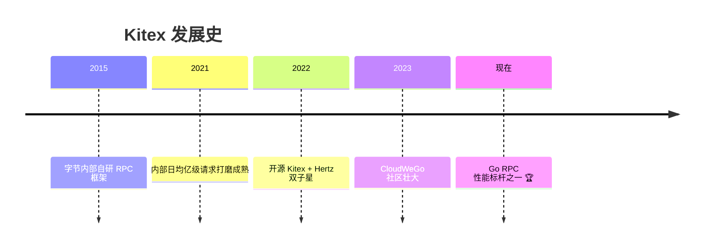

| 关键词 | 说明 |
|--------|------|
| 👶 出身 | 字节跳动内部框架，经过超大规模生产验证 |
| 🚄 性能 | 自研 Netpoll 网络库 + 高性能序列化 |
| 📜 IDL | 支持 Thrift（主推）和 Protobuf 双协议 |
| 🧩 生态 | CloudWeGo 社区（Hertz HTTP 框架是好搭档） |
| 🏭 字节实践 | 抖音/头条/番茄小说……都是它扛的 |

### 1.2 在微服务家族中的位置

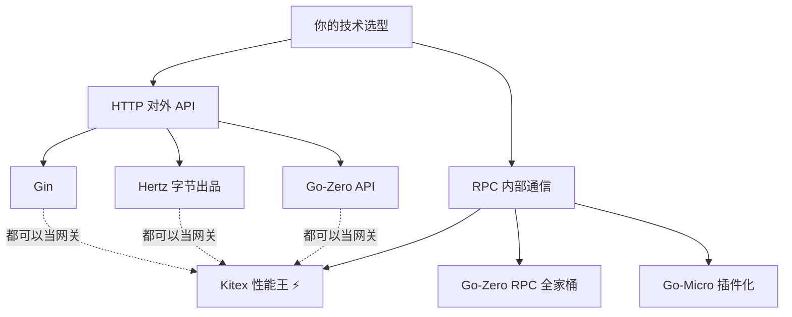

> 💡 常见黄金组合：**Hertz（对外 HTTP）+ Kitex（内部 RPC）**，字节同款架构～单用 Kitex 也完全可以！

---

## 2️⃣ 核心特性：快在哪、强在哪 💪

### 2.1 性能三板斧

| 武器 | 说明 |
|------|------|
| ⚡ **Netpoll** | 自研高性能网络库（epoll 优化、buffer 池化），甩默认 net 一条街 |
| 🚀 **Thrift 序列化** | 二进制编码，比 JSON 快数倍、体积小数倍 |
| 🏊 **协程池** | goroutine 复用，减少调度开销 |

### 2.2 功能全家桶

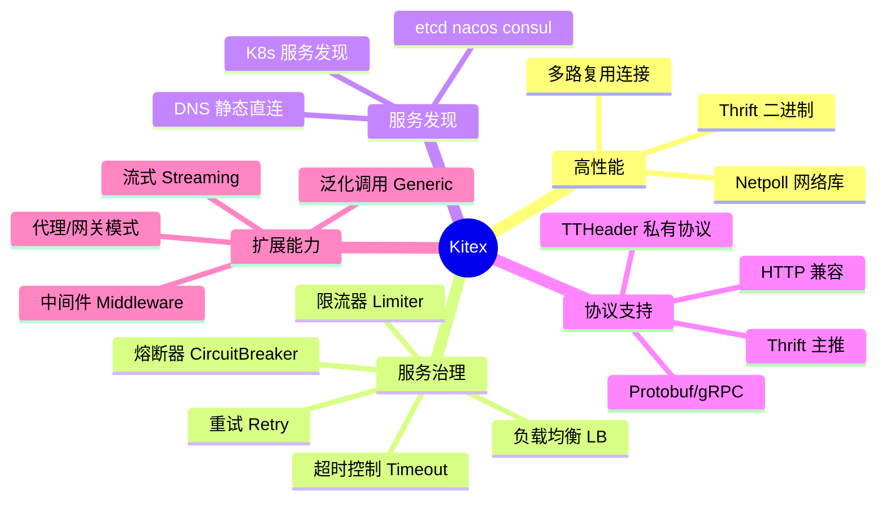

### 2.3 多路复用 vs 短连接

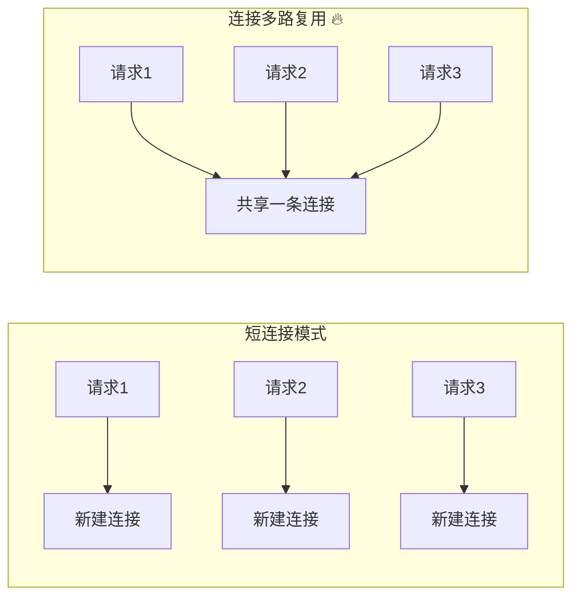

> 💡 Kitex 默认支持**连接多路复用**（一个连接并发跑多个请求），海量请求下连接数狂降，性能起飞～

---

## 3️⃣ 安装准备：工具链三件套 🔧

### 3.1 安装 kitex 工具和 thriftgo

```bash
# ① kitex：代码生成器 CLI
go install github.com/cloudwego/kitex/tool/cmd/kitex@latest

# ② thriftgo：Thrift IDL 编译器（Kitex 的最佳拍档）
go install github.com/cloudwego/thriftgo@latest

# 验证
kitex --version    # v0.x.x
thriftgo --version # v0.x.x

# ③ 项目引入 Kitex 框架
mkdir demo && cd demo
go mod init demo
go get github.com/cloudwego/kitex
```

### 3.2 工具职责分工

| 工具 | 职责 |
|------|------|
| `kitex` 命令 | 读 IDL → 生成服务骨架代码 |
| `thriftgo` 命令 | 编译 Thrift IDL → 生成消息结构体 |
| `github.com/cloudwego/kitex` | 运行时框架库 |

> ⚠️ Windows 记得把 `GOPATH/bin` 加入 PATH，不然命令找不到哦～

---

## 4️⃣ Thrift IDL：接口契约的书写 📜

### 4.1 编写第一个 IDL

```thrift
// idl/echo.thrift
namespace go echo            // 生成的 Go 包名

// 方法请求体
struct EchoRequest {
    1: required string message;   // required：必须传
}

// 方法响应体
struct EchoResponse {
    1: required string message;
}

// 服务定义（一个服务 = 一堆方法）
service EchoService {
    EchoResponse Echo(1: EchoRequest req);   // 方法名(参数) 返回值
}
```

### 4.2 Thrift 类型速查表 📇

| Thrift 类型 | Go 类型 | 说明 |
|------------|---------|------|
| `string` | `string` | 字符串 |
| `i32` / `i64` | `int32` / `int64` | 整数（没有 int！） |
| `bool` | `bool` | 布尔 |
| `double` | `float64` | 浮点 |
| `binary` | `[]byte` | 字节 |
| `list<T>` | `[]T` | 列表 |
| `map<K,V>` | `map[K]V` | 字典 |
| `set<T>` | `[]T` | 集合 |
| `optional` | 指针 `*T` | 可选字段（配合） |

### 4.3 字段修饰符：required / optional / 默认

```thrift
struct User {
    1: required i64 id;         // 必须传（缺失会报错！）
    2: string name;             // 默认：可传可不传，Go 侧非指针
    3: optional string email;   // 可选：Go 侧生成 *string 指针！
    4: optional i64 age = 18;   // 可选 + 默认值
}
```

| 修饰符 | 行为 | Go 生成类型 |
|--------|------|------------|
| `required` | 缺失 = 序列化报错 | 普通类型 |
| 无修饰 | 宽松（零值兜底） | 普通类型 |
| `optional` | 可空 | **指针** `*string` |

> ⚠️ **血泪教训**：字段要区分"没传"和"零值"就用 `optional`（指针）；`required` 字段一旦加上了就**永远不能删**（老客户端会报错）！

### 4.4 完整业务 IDL 示例

```thrift
// idl/user.thrift
namespace go user

// 公共结构
struct BaseResp {
    1: required i64 code;
    2: required string msg;
}

// ─── 用户信息 ───
struct User {
    1: required i64 id;
    2: required string username;
    3: optional string avatar;
    4: required i64 follow_count;
    5: required i64 follower_count;
}

// ─── 请求/响应 ───
struct RegisterRequest {
    1: required string username;
    2: required string password;
}

struct RegisterResponse {
    1: required BaseResp base_resp;
    2: required i64 user_id;
}

struct GetUserInfoRequest {
    1: required i64 user_id;
}

struct GetUserInfoResponse {
    1: required BaseResp base_resp;
    2: required User user;
}

// ─── 服务 ───
service UserService {
    RegisterResponse Register(1: RegisterRequest req);
    GetUserInfoResponse GetUserInfo(1: GetUserInfoRequest req);
}
```

### 4.5 IDL 引用与常量

```thrift
// base.thrift —— 公共定义
namespace go base
struct Page {
    1: required i32 page_num;
    2: required i32 page_size;
}

// user.thrift —— 引用公共文件
include "base.thrift"
namespace go user

struct ListRequest {
    1: required base.Page page;   // 用 include 的类型
}

// 常量定义
const i32 MAX_PAGE_SIZE = 100;

service UserService {
    list<User> ListUsers(1: ListRequest req);
}
```

---

## 5️⃣ 代码生成：一键生成全家桶 🤖

### 5.1 生成服务端骨架

```bash
# 在项目根目录执行
kitex -module demo -service user idl/user.thrift

# 参数解读：
# -module demo      go module 名
# -service user     生成服务端骨架（服务名叫 user）
# idl/user.thrift   IDL 文件路径
```

### 5.2 生成结果一览

```text
demo/
├── build.sh                     # 编译脚本
├── kitex_gen/                   # 生成的代码（别手改！）
│   └── user/
│       ├── user.go              # 结构体 + 序列化
│       ├── userservice/         # 客户端&服务端接口
│       │   ├── userservice.go
│       │   ├── client.go        # 客户端实现
│       │   └── server.go        # 服务端实现
│       └── k-user.go            # Kitex 专用编解码
├── handler.go                   # ⭐ Handler（写业务的地方！）
├── kitex_info.yaml              # 生成信息
├── main.go                      # 服务入口
└── script/                      # 环境脚本
    └── bootstrap.sh
```

| 文件 | 角色 | 能改吗 |
|------|------|--------|
| `kitex_gen/` | 结构体+编解码+接口 | ❌ 重新生成会覆盖 |
| `handler.go` | 业务逻辑实现 | ✅ 随便写（新增方法会追加） |
| `main.go` | 启动装配 | ✅ 可以定制 |

### 5.3 重新生成（改了 IDL 之后）

```bash
# 改完 IDL 再跑一遍，handler 里已有代码不覆盖，新方法会追加！
kitex -module demo -service user idl/user.thrift

# 只要客户端（不生成服务骨架）
kitex -module demo idl/user.thrift
```

---

## 6️⃣ 编写服务端：Handler 的家 🏠

### 6.1 handler.go（业务核心）

```go
// handler.go —— 自动生成的骨架 + 填业务
package main

import (
    "context"

    user "demo/kitex_gen/user"
)

// Register implements the UserServiceImpl interface.
func (s *UserServiceImpl) Register(ctx context.Context, req *user.RegisterRequest) (*user.RegisterResponse, error) {
    // 参数校验
    if len(req.Username) < 2 {
        return nil, kerrors.NewBizStatusError(400, "用户名太短啦")
    }

    // 业务逻辑：写库（GORM 课学的用上！）
    u := &model.User{Name: req.Username, Password: hashPwd(req.Password)}
    if err := db.Create(u).Error; err != nil {
        return nil, err
    }

    // 组装响应
    return &user.RegisterResponse{
        BaseResp: &user.BaseResp{Code: 0, Msg: "success"},
        UserId:   u.ID,
    }, nil
}

// GetUserInfo implements the UserServiceImpl interface.
func (s *UserServiceImpl) GetUserInfo(ctx context.Context, req *user.GetUserInfoRequest) (*user.GetUserInfoResponse, error) {
    u, err := db.GetUser(req.UserId)
    if err != nil {
        return nil, err
    }
    return &user.GetUserInfoResponse{
        BaseResp: &user.BaseResp{Code: 0},
        User: &user.User{
            Id:       u.ID,
            Username: u.Name,
        },
    }, nil
}
```

### 6.2 main.go（启动装配）

```go
// main.go —— 生成版 + 常用定制点
package main

import (
    "net"
    "github.com/cloudwego/kitex/pkg/rpcinfo"
    "github.com/cloudwego/kitex/server"
    user "demo/kitex_gen/user/userservice"
)

func main() {
    addr, _ := net.ResolveTCPAddr("tcp", "127.0.0.1:8888")

    svr := user.NewServer(new(UserServiceImpl),
        server.WithServerBasicInfo(&rpcinfo.EndpointBasicInfo{ServiceName: "user"}),
        server.WithServiceAddr(addr),                    // 监听地址
        // ↓↓↓ 按需添加 ↓↓↓
        // server.WithRegistry(etcdRegistry),             // 注册中心（第10章）
        // server.WithLimit(&limiter.ConcurrencyOption{..}),// 限流（第9章）
        // server.WithMiddleware(myMiddleware),            // 中间件（第8章）
    )

    svr.Run()
}
```

### 6.3 服务启动流程

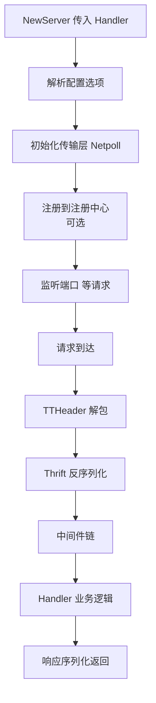

---

## 7️⃣ 客户端调用：高性能拨号 ☎️

### 7.1 基本调用

```go
package main

import (
    "context"
    "time"

    "github.com/cloudwego/kitex/client"
    user "demo/kitex_gen/user/userservice"
)

func main() {
    // 创建客户端（直连模式：指定地址）
    cli, err := user.NewClient("user",
        client.WithHostPorts("127.0.0.1:8888"),
    )
    if err != nil {
        panic(err)
    }

    // 调用（像本地方法一样！）
    ctx, cancel := context.WithTimeout(context.Background(), 3*time.Second)
    defer cancel()

    resp, err := cli.Register(ctx, &user.RegisterRequest{
        Username: "小樱",
        Password: "123456",
    })
    if err != nil {
        panic(err)
    }
    println(resp.UserId, resp.BaseResp.Msg)
}
```

### 7.2 常用客户端选项

```go
cli, err := user.NewClient("user",
    // 直连地址
    client.WithHostPorts("10.0.0.1:8888"),

    // 超时控制
    client.WithRPCTimeout(3*time.Second),      // 整体 RPC 超时
    client.WithConnectTimeout(500*time.Millisecond), // 连接超时

    // 中间件
    client.WithMiddleware(myMiddleware),

    // 负载均衡（配合 resolver）
    client.WithLoadBalancer(loadbalance.NewWeightedRoundRobinBalancer()),

    // 重试策略
    client.WithRetryPolicy(
        retry.NewFailurePolicy(retry.NewFailureRetryPolicy(2)), // 失败重试2次
    ),

    // 服务发现（第10章）
    client.WithResolver(etcdResolver),
)
```

### 7.3 调用全景图

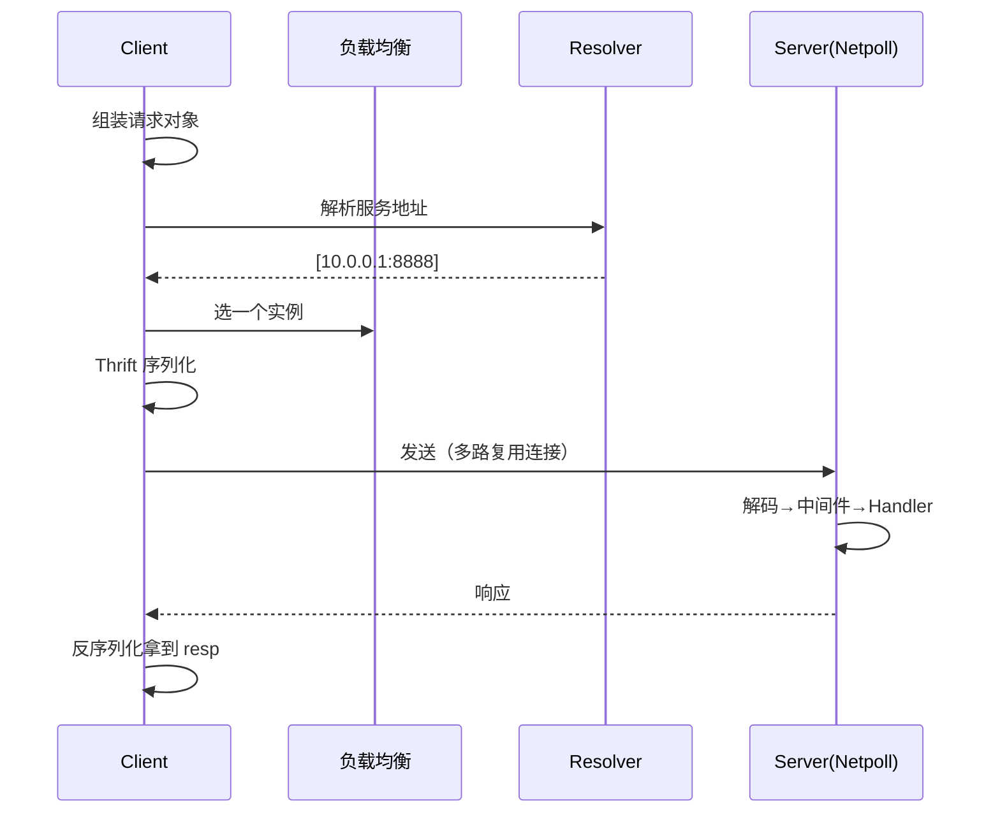

---

## 8️⃣ 中间件：洋葱模型再现 🧅

### 8.1 服务端中间件

```go
import "github.com/cloudwego/kitex/pkg/endpoint"

// Kitex 中间件 = endpoint.Middleware（经典洋葱）
func ServerMiddleware(next endpoint.Endpoint) endpoint.Endpoint {
    return func(ctx context.Context, req, resp interface{}) (err error) {
        // ───── 前置逻辑 ─────
        start := time.Now()
        method := rpcinfo.GetRPCInfo(ctx).Invocation().MethodName()

        // recover 兜底（防 panic 打崩服务）
        defer func() {
            if r := recover(); r != nil {
                err = fmt.Errorf("panic: %v", r)
                klog.Error("handler panic:", r)
            }
        }()

        err = next(ctx, req, resp) // 调用下一层（真正的 Handler）

        // ───── 后置逻辑 ─────
        klog.Infof("method=%s cost=%v err=%v", method, time.Since(start), err)
        return err
    }
}

// 挂载
svr := user.NewServer(new(UserServiceImpl),
    server.WithMiddleware(ServerMiddleware),
)
```

### 8.2 客户端中间件

```go
func ClientMiddleware(next endpoint.Endpoint) endpoint.Endpoint {
    return func(ctx context.Context, req, resp interface{}) error {
        // 调用前：注入元数据（传 traceID/userID）
        ctx = metainfo.WithValue(ctx, "X-Trace-Id", genTraceID())

        err := next(ctx, req, resp)

        // 调用后：记录耗时/错误上报
        return err
    }
}

cli, _ := user.NewClient("user",
    client.WithMiddleware(ClientMiddleware),
)
```

### 8.3 元数据传递 metainfo

```go
// ───── 客户端塞数据 ─────
ctx = metainfo.WithValue(ctx, "X-User-Id", "10086")
ctx = metainfo.WithPersistentValue(ctx, "X-Token", "abc") // 持久：会向后透传
cli.Register(ctx, req)

// ───── 服务端取数据 ─────
func (s *UserServiceImpl) Register(ctx context.Context, req *user.RegisterRequest) (...) {
    vals, _ := metainfo.GetAllValues(ctx)
    uid := vals["X-User-Id"] // "10086"
}
```

| 对比 | Gin | Go-Micro | Kitex |
|------|-----|----------|-------|
| 传数据 | `c.Set/Get` | `metadata.Set` | `metainfo.WithValue` |
| 特点 | 请求级 map | map 进 ctx | 支持向后**链式透传** |

---

## 9️⃣ 服务治理：熔断限流超时全家桶 🛡️

Kitex 的治理能力**默认内置**，开箱即用！

### 9.1 熔断器（自动防雪崩）

```go
import (
    "github.com/cloudwego/kitex/pkg/circuitbreak"
)

// 默认已开启！自定义错误率阈值：
cb := circuitbreak.NewCBSlushBuilder(fallback)  // 自定义版本
// fallback：熔断时的降级函数
func fallback(ctx context.Context, req, resp interface{}) error {
    return kerrors.NewBizStatusError(503, "服务繁忙，稍后再试～")
}

cli, _ := user.NewClient("user",
    client.WithCircuitBreaker(cb),
)
```

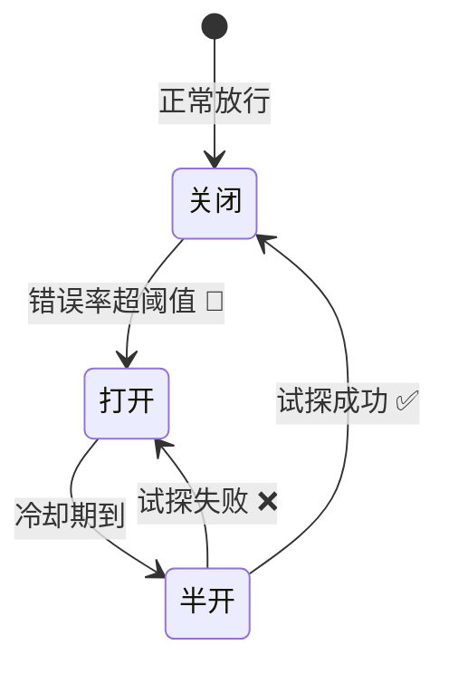

### 9.2 限流器（保护自身）

```go
import "github.com/cloudwego/kitex/pkg/limiter"

svr := user.NewServer(new(UserServiceImpl),
    // QPS 限流：每秒最多 1000 请求
    server.WithLimit(&limiter.QPSLimiterOption{
        Limits: 1000,
    }),
    // 并发限流：同时最多 100 个在处理
    server.WithLimit(&limiter.ConcurrencyLimiterOption{
        MaxConcurrency: 100,
    }),
)
```

### 9.3 超时控制

```go
// 客户端粒度
client.WithRPCTimeout(3*time.Second)       // 整个 RPC
client.WithConnectTimeout(500*time.Millisecond)

// 方法粒度（更精细！）
client.WithTimeoutProvider(&rpcinfo.TimeoutProviderFunc(
    func(ctx context.Context) rpcinfo.Timeouts {
        info := rpcinfo.GetRPCInfo(ctx)
        method := info.Invocation().MethodName()
        switch method {
        case "Register":
            return rpcinfo.NewTimeouts(500*time.Millisecond, 2*time.Second)
        default:
            return rpcinfo.NewTimeouts(500*time.Millisecond, 3*time.Second)
        }
    },
))
```

### 9.4 重试策略

```go
import "github.com/cloudwego/kitex/pkg/retry"

// 失败重试（最多2次，只重试超时）
retryPolicy := retry.NewFailurePolicy(
    retry.NewFailureRetryPolicy(2),  // 重试次数
    retry.WithRetryTimeout(500*time.Millisecond), // 重试总预算
)

cli, _ := user.NewClient("user",
    client.WithRetryPolicy(retryPolicy),
)
```

> ⚠️ **重试警告**：只有**幂等**接口才能开重试！写操作乱重试 = 重复下单惨案 💥

### 9.5 负载均衡器

```go
import "github.com/cloudwego/kitex/pkg/loadbalance"

cli, _ := user.NewClient("user",
    client.WithResolver(etcdResolver), // 配合服务发现
    // 内置策略任选：
    client.WithLoadBalancer(loadbalance.NewWeightedRoundRobinBalancer()), // 加权轮询（默认）
    // loadbalance.NewRoundRobinBalancer()      // 纯轮询
    // loadbalance.NewConsistentHashBalancer()  // 一致性哈希
    // loadbalance.NewRandomBalancer()          // 随机
)
```

### 9.6 治理能力速查

| 能力 | 默认状态 | 配置项 |
|------|---------|--------|
| 熔断 | ✅ 默认开启（错误率>50%触发） | `WithCircuitBreaker` |
| 限流 | ❌ 需配置 | `server.WithLimit` |
| 超时 | ✅ 有默认值 | `WithRPCTimeout` |
| 重试 | ❌ 需配置 | `WithRetryPolicy` |
| 负载均衡 | ✅ 加权轮询 | `WithLoadBalancer` |

---

## 🔟 注册与发现：通讯录三件套 📇

### 10.1 etcd 注册发现（最常用）

```bash
go get github.com/kitex-contrib/registry-etcd
```

```go
import (
    etcd "github.com/kitex-contrib/registry-etcd"
)

// ────────── 服务端：注册 ──────────
r, err := etcd.NewEtcdRegistry([]string{"127.0.0.1:2379"}) // 注册器
svr := user.NewServer(new(UserServiceImpl),
    server.WithRegistry(r),           // 挂上注册中心
    server.WithServiceAddr(addr),
    rpcinfo.WithServiceName etcd.WithServiceName 之类按版本
)

// ────────── 客户端：发现 ──────────
resolver, err := etcd.NewEtcdResolver([]string{"127.0.0.1:2379"})
cli, err := user.NewClient("user",
    client.WithResolver(resolver),    // 自动发现+负载均衡
)
```

### 10.2 其他注册中心

| 注册中心 | 依赖包 | 说明 |
|---------|--------|------|
| etcd ⭐ | `kitex-contrib/registry-etcd` | K8s 生态标配 |
| nacos | `kitex-contrib/registry-nacos` | 阿里系，国内多 |
| consul | `kitex-contrib/registry-consul` | 传统运维友好 |
| DNS | 内置 | 简单场景 |
| 静态直连 | 内置 | `WithHostPorts` |

### 10.3 服务发现工作流

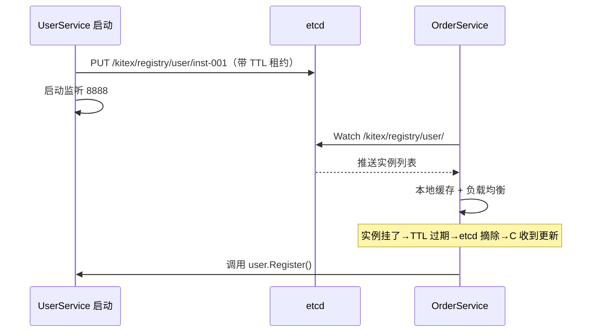

---

## 1️⃣1️⃣ 传输协议：TTHeader 大揭秘 📡

### 11.1 Kitex 的协议选择

| 协议 | 特点 | 场景 |
|------|------|------|
| **TTHeader** ⭐ | 字节自研，带元信息头部 | Kitex 间调用（默认推荐） |
| **Thrift** (pure) | 标准 Thrift 编码 | 兼容其他 Thrift 实现 |
| **Kitex Protobuf** | protobuf 编码 | gRPC 兼容 |
| **gRPC** | 标准 gRPC 协议 | 跨语言 gRPC 客户端 |
| **HTTP** | 走 HTTP | 特殊网关场景 |

### 11.2 为什么要 TTHeader？

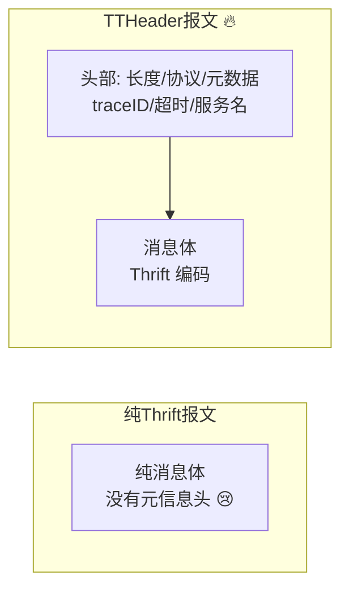

**TTHeader 的好处：**

| 好处 | 说明 |
|------|------|
| 🧾 自带元信息 | 超时/trace 透明传输，跨服务传递不丢 |
| ⚡ 快速解析 | 定长头，解包不用先反序列化 |
| 🔀 多协议识别 | 同一端口可识别不同协议（代理友好） |
| 🌐 生态互通 | 支持转出标准 HTTP/gRPC |

```go
// 指定传输协议
cli, _ := user.NewClient("user",
    client.WithTransportProtocol(transport.TTHeader),      // 纯 TTHeader
    client.WithTransportProtocol(transport.TTHeaderFramed), // 帧模式
)
```

---

## 1️⃣2️⃣ 泛化调用：不写代码也能调 🎭

### 12.1 什么是泛化调用？

> 正常调用要先生成客户端代码；**泛化调用 = 运行时直接用 IDL/Map 调**！
> 网关/BFF/测试平台的最爱 💕

```go
import (
    "github.com/cloudwego/kitex/pkg/generic"
    "github.com/cloudwego/kitex/client"
)

// ───── 方式一：Map 泛化（用 IDL 文件）─────
p, err := generic.NewThriftFileProvider("./idl/user.thrift")
g, err := generic.JSONThriftGeneric(p) // JSON 泛化

cli, err := genericclient.NewClient("user", g,
    client.WithHostPorts("127.0.0.1:8888"),
)

// 直接发 JSON 字符串！不用生成任何代码
resp, err := cli.GenericCall(ctx, "Register",
    `{"Username":"小樱","Password":"123456"}`)
println(resp.(string))
```

### 12.2 泛化 vs 普通调用

| 维度 | 普通调用 | 泛化调用 |
|------|---------|---------|
| 前置工作 | 生成客户端代码 | 只要 IDL 或描述文件 |
| 类型安全 | ✅ 编译期检查 | ❌ 运行时才知道 |
| 性能 | ⚡ 高（结构体直传） | 略低（序列化转换） |
| 适用 | 业务服务间调用 | 网关/测试/跨语言桥 |

> 💡 典型场景：API 网关收到 HTTP 请求 → 泛化调用各后端 Kitex 服务 → 网关**零代码更新**接新接口！

---

## 1️⃣3️⃣ 流式调用：gRPC 风格 Stream 🌊

```thrift
// IDL 定义流式接口（用 stream 关键字）
service ChatService {
    // 单向流：客户端流式上传
    UploadResp Upload(1: stream UploadReq req);
    // 服务端流式下发
    stream DownloadResp Download(1: DownloadReq req);
    // 双向流
    stream ChatResp Chat(1: stream ChatReq req);
}
```

```go
// 双向流实现（Handler 拿到 stream 对象）
func (s *ChatServiceImpl) Chat(stream chatservice.ChatService_ChatServer) (err error) {
    // 开个 goroutine 收消息
    go func() {
        for {
            req, err := stream.Recv() // 收客户端消息
            if err != nil {
                return
            }
            println("收到:", req.Msg)
        }
    }()

    // 持续发消息
    for i := 0; i < 10; i++ {
        if err := stream.Send(&chat.ChatResp{Msg: fmt.Sprintf("第%d条", i)}); err != nil {
            return err
        }
    }
    return nil
}
```

| 流类型 | 场景 |
|--------|------|
| 单向流（客户端→服务端） | 批量上传、日志收集 |
| 服务端流 | 订阅推送、大文件下发 |
| 双向流 | 聊天、实时协作 |

---

## 1️⃣4️⃣ Kitex 生态：CloudWeGo 全家福 🧩

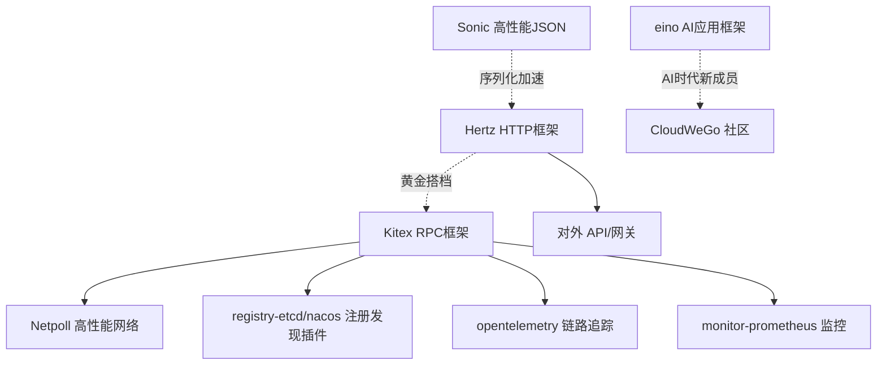

| 组件 | 用途 |
|------|------|
| **Hertz** | 字节 HTTP 框架（对标 Gin，更快） |
| **Netpoll** | 高性能网络库（Kitex 地基） |
| **Sonic** | 高性能 JSON 库（字节出品） |
| **eino** | AI 应用开发框架（新宠） |
| kitex-contrib/* | 官方插件仓库（注册中心/监控/追踪） |

### Hertz + Kitex 组合示例

```go
// Hertz 网关转发到 Kitex 服务
h := server.New()
h.POST("/api/register", func(ctx *app.RequestContext) {
    var req user.RegisterRequest
    ctx.BindAndValidate(&req)
    resp, err := userCli.Register(ctx, &req) // 调 Kitex
    if err != nil {
        ctx.JSON(500, map[string]string{"msg": err.Error()})
        return
    }
    ctx.JSON(200, resp)
})
h.Spin()
```

---

## 1️⃣5️⃣ 实战：完整服务 💯

**场景**：订单服务调用用户服务（注册发现 + 治理全开）

### 15.1 项目结构

```text
mall/
├── idl/
│   ├── user.thrift        # 用户服务 IDL
│   └── order.thrift       # 订单服务 IDL
├── user-svc/
│   ├── main.go
│   └── handler.go
└── order-svc/
    ├── main.go
    └── handler.go
```

### 15.2 用户服务（服务端）

```bash
mkdir user-svc && cd user-svc
kitex -module mall/user-svc -service user ../idl/user.thrift
```

```go
// user-svc/main.go
package main

import (
    "net"

    etcd "github.com/kitex-contrib/registry-etcd"
    "github.com/cloudwego/kitex/pkg/rpcinfo"
    "github.com/cloudwego/kitex/server"
    user "mall/user-svc/kitex_gen/user/userservice"
)

func main() {
    // 注册中心
    r, err := etcd.NewEtcdRegistry([]string{"127.0.0.1:2379"})
    if err != nil {
        panic(err)
    }
    addr, _ := net.ResolveTCPAddr("tcp", "127.0.0.1:8888")

    svr := user.NewServer(new(UserServiceImpl),
        server.WithRegistry(r),
        server.WithServiceAddr(addr),
        server.WithServerBasicInfo(&rpcinfo.EndpointBasicInfo{ServiceName: "user"}),
        server.WithMiddleware(ServerMiddleware), // 日志+recover
    )
    svr.Run()
}
```

### 15.3 订单服务（客户端）

```go
// order-svc/main.go
package main

import (
    "context"
    "time"

    etcd "github.com/kitex-contrib/registry-etcd"
    "github.com/cloudwego/kitex/client"
    "github.com/cloudwego/kitex/pkg/circuitbreak"
    "github.com/cloudwego/kitex/pkg/loadbalance"
    userCli "mall/order-svc/kitex_gen/user/userservice" // 引用户服务的生成代码
)

type OrderSvc struct {
    User userCli.Client // 依赖注入用户服务客户端
}

func main() {
    resolver, _ := etcd.NewEtcdResolver([]string{"127.0.0.1:2379"})

    uc, err := userCli.NewClient("user",
        client.WithResolver(resolver),                            // 服务发现
        client.WithLoadBalancer(loadbalance.NewWeightedRoundRobinBalancer()),
        client.WithRPCTimeout(2*time.Second),                     // 超时
        client.WithCircuitBreaker(circuitbreak.NewCBSlush(nil)),  // 熔断
    )
    if err != nil {
        panic(err)
    }

    svc := &OrderSvc{User: uc}
    _ = svc
    // ... 启动 order 服务（同 user-svc 套路）
}

// 下单逻辑：跨服务调用
func (o *OrderSvc) CreateOrder(ctx context.Context, userId int64, amount float64) (int64, error) {
    // ① 查用户（RPC + 服务发现 + 负载均衡 + 熔断 全自动）
    uResp, err := o.User.GetUserInfo(ctx, &user.GetUserInfoRequest{UserId: userId})
    if err != nil {
        return 0, err // 熔断/超时会在这里返回错误
    }
    klog.Infof("下单用户: %s", uResp.User.Username)

    // ② 创建订单（写库）...
    return 10001, nil
}
```

### 15.4 全链路架构

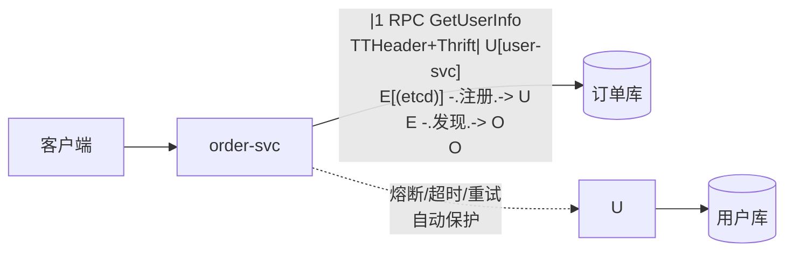

### 15.5 运行验证

```bash
# 启动 etcd + 两个服务
docker run -d -p 2379:2379 quay.io/coreos/etcd:latest
cd user-svc && go run .
cd order-svc && go run .

# etcd 里看注册信息
docker exec etcd etcdctl get --prefix /kitex
```

---

## 1️⃣6️⃣ 四框架大对比：全家福合影 📸

| 维度 | Gin | Go-Zero | Go-Micro | Kitex |
|------|-----|---------|----------|-------|
| 定位 | HTTP Web 框架 | 微服务全家桶 | 插件化 RPC | 高性能 RPC |
| 出品 | 社区 | 好未来 | 社区(Asim) | **字节跳动** |
| 通信协议 | HTTP/1.1 | 自有+gRPC | 可插拔 | **Thrift/gRPC/TTHeader** |
| 性能 | 好 | 优 | 良 | **顶级 🏆** |
| 代码生成 | ❌ | ✅ goctl 全套 | 仅 proto | ✅ kitex 命令 |
| IDL | 无 | api/proto | proto | **Thrift(主)/proto** |
| 服务发现 | ❌ | etcd 内置 | 默认mdns可插拔 | 插件(etcd/nacos) |
| 治理能力 | ❌ | 自适应内置 | 自己写 | 熔断限流重试内置 |
| 泛化调用 | ❌ | ❌ | ❌ | ✅ |
| 流式支持 | ❌ | gRPC 流 | ❌ | ✅ 双向流 |
| HTTP API | ✅ 本职 | ✅ api 服务 | micro api 网关 | ❌ 配 Hertz |
| 适合场景 | 单体/简单服务 | 国内全栈微服务 | 灵活定制 | **高性能核心链路** |

**选型口诀：**

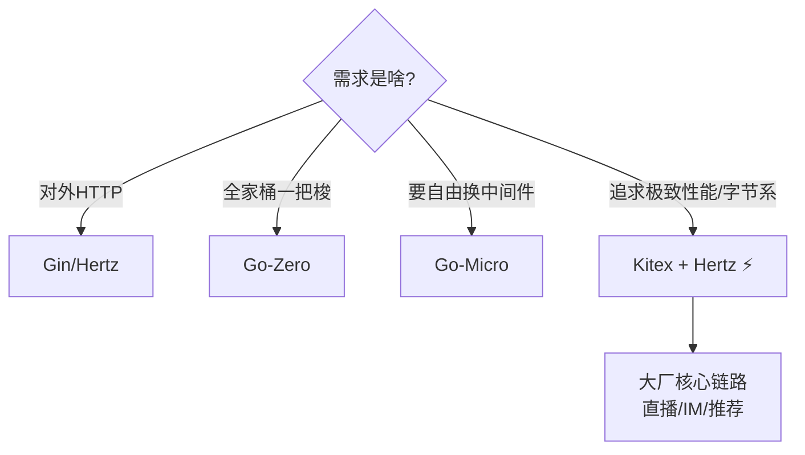

---

## 1️⃣7️⃣ 踩坑大全：前人翻车后人乘凉 ⚠️

### 坑1：required 字段随意删

```thrift
// v1: struct User { 1: required string name; }
// v2: 删了 name → 老版本客户端还在传 name → 直接报错！
// ✅ 正确姿势：废弃字段保留序号注释掉
struct User {
    // 1: required string name; (deprecated)
}
```

### 坑2：Windows 生成报 thriftgo 找不到

```bash
# kitex 依赖 thriftgo，PATH 里必须有
go install github.com/cloudwego/thriftgo@latest
# 确认 GOPATH/bin 在系统 PATH
```

### 坑3：改了 IDL 但代码没更新

```bash
# kitex_gen 是生成物，改 IDL 后必须重新生成！
kitex -module demo -service user idl/user.thrift
# handler.go 不会覆盖你的业务代码，放心跑
```

### 坑4：optional 字段当普通字段用

```go
// optional 生成的是指针！
req.Avatar = "http://..."      // ❌ 编译错误：不能 string 赋给 *string
req.Avatar = &avatarStr         // ✅ 取地址
// 或者用工具函数
req.Avatar = thrift.StringPtr("http://...") // ✅ 生成代码自带
```

### 坑5：非幂等接口开重试

```go
// ❌ 支付/下单接口开重试 = 可能重复扣款！
client.WithRetryPolicy(retry.NewFailurePolicy(...))
// ✅ 只有查询类（Get/List）才开重试
```

### 坑6：直连模式忘了配地址

```go
// ❌ NewClient 不给 WithHostPorts 也不给 Resolver → 启动不报错，调用时找不到目标
cli, _ := user.NewClient("user")
// ✅ 二选一必须给
cli, _ := user.NewClient("user", client.WithHostPorts("127.0.0.1:8888"))
```

### 坑速查表 📇

| 症状 | 病因 | 药方 |
|------|------|------|
| 老客户端报错 | required 字段删了 | 保留废弃字段 |
| thriftgo not found | PATH 没配 | 重装+配 PATH |
| 新字段不生效 | 忘了重新生成 | 重跑 kitex 命令 |
| 指针赋值编译错 | optional 生成指针 | `thrift.StringPtr()` |
| 重复扣款 | 非幂等+重试 | 只对查询开重试 |
| 调用 no resolver | 没配地址/发现 | `WithHostPorts`/`WithResolver` |

---

## 🎁 总结：一张图吃透 Kitex

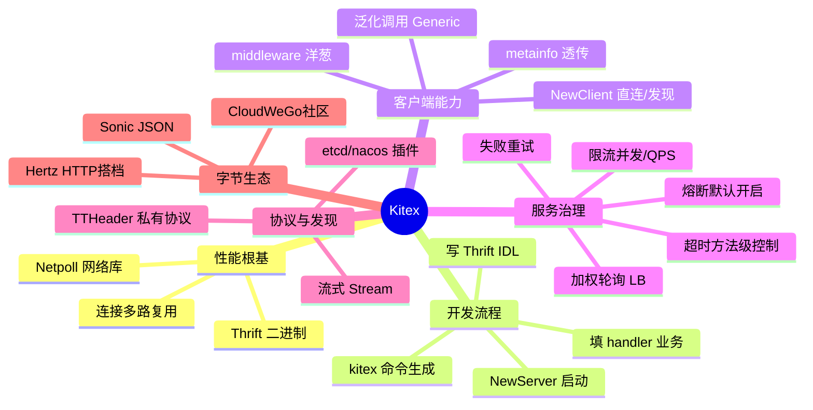

## 📝 课后小测验（动动小脑瓜 🧠）

1. Kitex 主推的 IDL 语言是什么？用什么命令生成代码？
2. Thrift 里 `optional` 修饰的字段在 Go 里生成什么类型？
3. TTHeader 相比纯 Thrift 协议多了什么能力？
4. Kitex 默认开启的服务治理能力是哪个？
5. 泛化调用适合什么场景？
6. 为什么非幂等接口不能开失败重试？
7. 字节推荐的 HTTP + RPC 组合是哪两个框架？

<details>
<summary>👉 点开看答案</summary>

1. **Thrift**（也支持 Protobuf）；用 `kitex -module xxx -service 名字 idl/xx.thrift` 生成。
2. **指针类型**（如 `*string`），用来区分"没传"和"零值"。
3. **自带头部元信息**（超时/trace/服务名可透传）、快速解析、多协议识别。
4. **熔断器**（错误率超阈值自动熔断，默认开启）。
5. **网关/BFF/测试平台**——运行时用 IDL 直接调用，不用预生成客户端代码。
6. 重试可能导致**重复执行**（重复下单/扣款）；只有 Get/List 等幂等操作才安全。
7. **Hertz（HTTP）+ Kitex（RPC）**。

</details>

---

> 🌸 恭喜解锁 Kitex！微服务框架三部曲圆满收官：
> ✅ Go-Zero（全家桶套餐）→ ✅ Go-Micro（插件化自助）→ ✅ **Kitex（性能王炸）** 🏆
> 你的 Go 军火库已完全体：基础语法/常用包/进阶/并发/Gin/GORM/三大微服务框架！
> 接下来可选方向：**Hertz HTTP 框架** / **Netpoll 网络编程** / **字节 eino AI 框架**～
> 随时召唤本讲师，比心 💖
