# 🎮 Kratos 微服务框架超详细讲义

> 嘿嘿～Go 框架课的最后一站——**Kratos**！🐉
> 它是 **Bilibili（B 站）开源**的 Go 微服务框架，风格和前面的都不同：
> 主打 **DDD 分层架构** + **wire 依赖注入** + **双协议**（一份 proto 同时生成 gRPC 和 HTTP 接口）！
> 代码组织极度工整，大项目越写越舒服，是"架构控"的心头好～💕
> 学完这课，Go 框架全家福就凑齐两大视频网站同款啦（抖音 Kitex + B 站 Kratos）！

---

## 📚 目录一览

| 章节 | 主题 | 一句话理解 |
|------|------|-----------|
| 1 | Kratos 是什么 | B 站的架构美学 🎮 |
| 2 | 安装准备 | kratos CLI 装起来 🔧 |
| 3 | 快速开始 | 一条命令生成项目 🚀 |
| 4 | 项目结构 | DDD 四层精讲 🏗️ |
| 5 | Proto 双协议 | 一份 IDL 两个接口 📜 |
| 6 | Service 层 | 接口的门面 🚪 |
| 7 | Biz 层 | 业务逻辑的核心 💼 |
| 8 | Data 层 | 数据库操作的家 🗄️ |
| 9 | Wire 依赖注入 | 自动装配流水线 🤖 |
| 10 | 配置与热更新 | config 玩法 ⚙️ |
| 11 | 中间件 | 洋葱+匹配器 🧅 |
| 12 | 错误处理 | 规范化错误码 ❌ |
| 13 | 服务注册发现 | 通讯录接入 📇 |
| 14 | 可观测性 | 日志/链路/指标 🔭 |
| 15 | 实战：完整服务 | 用户 CRUD 全链路 💯 |
| 16 | 六框架终极对比 | 全家福合影 📸 |
| 17 | 踩坑大全 | 前人翻车后人乘凉 ⚠️ |

---

## 1️⃣ Kratos 是什么：B 站的架构美学 🎮

### 1.1 出身与理念

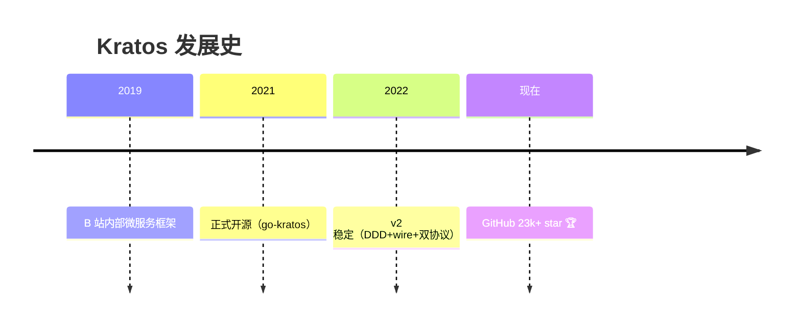

| 理念 | 说明 |
|------|------|
| 🧱 协议优先 | proto 定义一切，gRPC+HTTP 双协议自动生成 |
| 🏛️ DDD 分层 | service/biz/data 三层清晰，业务与技术解耦 |
| 🤖 wire 注入 | google/wire 编译期依赖注入，零反射开销 |
| 🔌 插件化 | 注册中心/日志/配置全部接口化可替换 |
| 🎯 约定优于配置 | 脚手架统一项目结构，团队协作顺畅 |

### 1.2 Kratos 的独门绝活

| 绝活 | 对比其他框架 |
|------|-------------|
| **一份 proto 双协议** | Go-Zero 要分 api/proto 两个文件，Kratos 一个搞定！ |
| **wire 依赖注入** | 其他框架手动 New 或 ServiceContext，Kratos 编译期生成装配代码 |
| **DDD 工程结构** | biz 层不依赖任何框架 API，业务可移植 |
| **errors 错误模型** | code + reason + metadata 的国际化错误规范 |

### 1.3 一图看懂 Kratos 定位

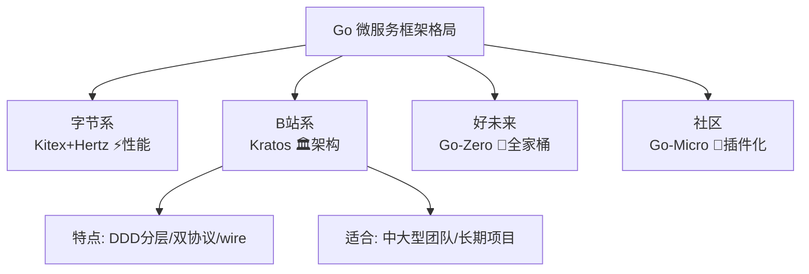

---

## 2️⃣ 安装准备：kratos CLI 装起来 🔧

```bash
# ① 安装 kratos 命令行工具
go install github.com/go-kratos/kratos/cmd/kratos/v2@latest

# 验证
kratos -v
# 应输出：kratos version v2.x.x

# ② 安装 protoc 相关插件（生成代码用）
go install google.golang.org/protobuf/cmd/protoc-gen-go@latest
go install google.golang.org/grpc/cmd/protoc-gen-go-grpc@latest
go install github.com/go-kratos/kratos/cmd/protoc-gen-go-http/v2@latest  # HTTP 生成
go install github.com/google/wire/cmd/wire@latest                        # wire 注入

# ③ 环境要求
protoc --version # 需要 protoc 编译器本体
```

| 工具 | 职责 |
|------|------|
| `kratos` | 脚手架：创建项目/新增 proto 模板 |
| `protoc-gen-go-http` | **Kratos 特色**：从 proto 生成 HTTP handler |
| `wire` | 生成依赖注入代码（编译期） |

> ⚠️ 老规矩：Windows 把 `GOPATH/bin` 加入 PATH；国内加速 `go env -w GOPROXY=https://goproxy.cn,direct`～

---

## 3️⃣ 快速开始：一条命令生成项目 🚀

```bash
# ① 创建项目（helloworld 模板）
kratos new hello

# 带注册中心的版本（如 consul）
kratos new hello -r consul

# 国内加速版
kratos new hello -r none --rd=https://gitee.com/go-kratos/kratos-layout.git

# ② 进入目录跑起来
cd hello
go mod tidy
kratos run
# 或者：go run ./cmd/hello/

# ③ 测试双协议（惊喜时刻！✨）
# gRPC（默认 :9000）
grpcurl -d '{"name":"小樱"}' -plaintext 127.0.0.1:9000 helloworld.v1.Greeter/SayHello
# HTTP（默认 :8000）
curl "http://127.0.0.1:8000/v1/helloworld/小樱"
# 两个都返回：{"message":"Hello 小樱"}
```

> 🌟 **震惊点**：只写了一个 proto、一份实现，**gRPC 和 HTTP 同时能用**！这就是 Kratos 双协议的魔力～

---

## 4️⃣ 项目结构：DDD 四层精讲 🏗️

### 4.1 脚手架生成的结构

```text
hello/
├── api/                        # ⭐ 所有 proto 文件（接口契约）
│   └── hello/v1/
│       ├── greeter.proto       # 服务定义
│       └── greeter_http.pb.go  # 生成的 HTTP 代码
├── cmd/                        # 程序入口
│   └── hello/
│       ├── main.go             # 启动
│       ├── wire.go             # wire 注入声明
│       └── wire_gen.go         # wire 生成的装配代码
├── internal/                   # ⭐ 内部实现（DDD 核心）
│   ├── biz/                    # 业务逻辑层（纯业务，不碰框架）
│   │   └── greeter.go
│   ├── data/                   # 数据层（DB/Redis 操作）
│   │   ├── data.go
│   │   └── greeter.go
│   ├── server/                 # 服务器装配（HTTP/gRPC）
│   │   ├── http.go
│   │   └── grpc.go
│   └── service/                # 服务层（proto ↔ biz 翻译）
│       └── greeter.go
├── configs/                    # 配置文件
│   └── config.yaml
├── third_party/                # 第三方 proto 依赖
└── Makefile                    # 一键命令
```

### 4.2 DDD 分层架构图（灵魂！⭐）

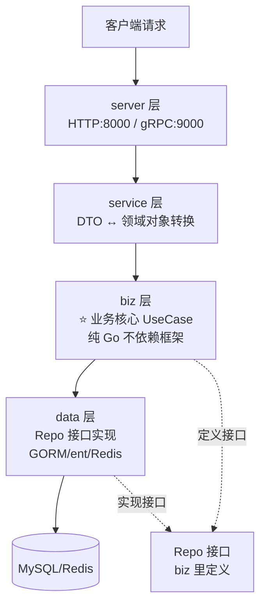

| 层 | 目录 | 职责 | 依赖谁 |
|----|------|------|--------|
| service | `internal/service` | 参数转换、调 biz | biz |
| **biz** ⭐ | `internal/biz` | **业务核心逻辑**（UseCase+实体） | 只依赖自己定义的接口 |
| data | `internal/data` | 实现 biz 定义的接口，管 DB | biz 的接口（反向） |
| server | `internal/server` | 装配 HTTP/gRPC 服务器 | service |

> 🌟 **DDD 精髓**：**biz 定义接口（要什么数据），data 实现接口（怎么拿数据）**——
> 业务层永远不知道底下是 MySQL 还是 Redis，换存储零改动业务！

### 4.3 和 MVC 分层的对比

| 对比 | 传统 MVC | Kratos DDD |
|------|---------|-----------|
| 分层 | Controller→Service→Dao | service→biz→data |
| 业务位置 | Service（常和框架耦合） | **biz（纯 Go）** |
| 依赖方向 | 上层依赖下层 | data 依赖 biz 的接口（**依赖倒置**） |
| 换 DB | 改 Service | 只改 data 层 |
| 可测试性 | 要 mock 框架 | biz 直接 mock 接口即可 ✅ |

---

## 5️⃣ Proto 双协议：一份 IDL 两个接口 📜

### 5.1 编写 proto

```protobuf
// api/hello/v1/greeter.proto
syntax = "proto3";

package hello.v1;                      // 包名（生成路径）

option go_package = "hello/api/hello/v1;v1";

// HTTP 注解：同一份 proto 声明 HTTP 路由！
import "google/api/annotations.proto";

service Greeter {
  rpc CreateGreeter (CreateGreeterRequest) returns (CreateGreeterReply) {
    option (google.api.http) = {       // ← 这就是 HTTP 路由声明
      post: "/v1/greeters",
      body: "*"
    };
  }
  rpc GetGreeter (GetGreeterRequest) returns (GetGreeterReply) {
    option (google.api.http) = {
      get: "/v1/greeters/{id}"         // 路径参数直接映射！
    };
  }
}

message CreateGreeterRequest {
  string name = 1;
  string email = 2;
}
message CreateGreeterReply {
  int64 id = 1;
  string name = 2;
}
message GetGreeterRequest { int64 id = 1; }
message GetGreeterReply { int64 id = 1; string name = 2; }
```

### 5.2 生成命令（Makefile 已内置）

```bash
# 一键生成（推荐，项目自带 Makefile）
make api

# 实际执行的完整命令（了解即可）
protoc --proto_path=./api \
  --proto_path=./third_party \
  --go_out=paths=source_relative:./api \
  --go-http_out=paths=source_relative:./api \
  --go-grpc_out=paths=source_relative:./api \
  api/hello/v1/greeter.proto
```

### 5.3 双协议工作原理

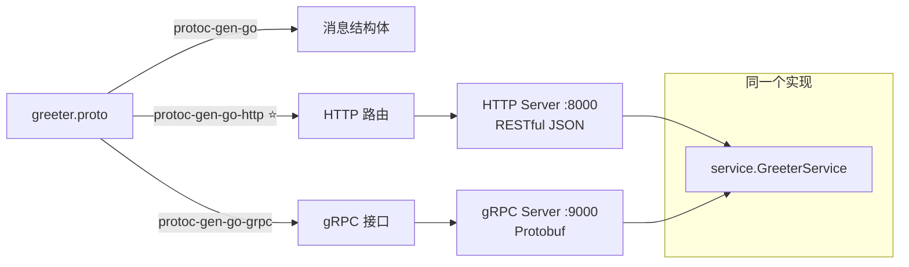

| 好处 | 说明 |
|------|------|
| 一份实现 | 写一次逻辑，gRPC/HTTP 都能调 |
| 前后端友好 | 浏览器/移动端走 HTTP，内部服务走 gRPC |
| 无网关转换 | 不用 gRPC-Gateway 单独部署 |

### 5.4 快速新增接口流程

```bash
# kratos 还能生成 proto 模板！
kratos proto add api/hello/v1/order.proto    # 生成 proto 骨架
make api                                      # 生成代码
# 然后去 service/biz/data 三层填实现
```

---

## 6️⃣ Service 层：接口的门面 🚪

```go
// internal/service/greeter.go
package service

import (
    "context"

    v1 "hello/api/hello/v1"
    "hello/internal/biz"
)

// GreeterService 实现 proto 生成的接口（gRPC 和 HTTP 共用！）
type GreeterService struct {
    v1.UnimplementedGreeterServer   // 嵌入 proto 接口
    uc *biz.GreeterUsecase          // 依赖 biz（接口注入）
}

// 构造函数（wire 会用）
func NewGreeterService(uc *biz.GreeterUsecase) *GreeterService {
    return &GreeterService{uc: uc}
}

// 实现接口：只做"翻译"，不写业务！
func (s *GreeterService) CreateGreeter(ctx context.Context, req *v1.CreateGreeterRequest) (*v1.CreateGreeterReply, error) {
    // ① DTO → 领域对象
    g, err := s.uc.CreateGreeter(ctx, &biz.Greeter{
        Name:  req.Name,
        Email: req.Email,
    })
    if err != nil {
        return nil, err // biz 的错误直接透传
    }
    // ② 领域对象 → DTO
    return &v1.CreateGreeterReply{
        Id:   g.ID,
        Name: g.Name,
    }, nil
}

func (s *GreeterService) GetGreeter(ctx context.Context, req *v1.GetGreeterRequest) (*v1.GetGreeterReply, error) {
    g, err := s.uc.GetGreeter(ctx, req.Id)
    if err != nil {
        return nil, err
    }
    return &v1.GetGreeterReply{Id: g.ID, Name: g.Name}, nil
}
```

> 🌟 **Service 层纪律**：只做**参数转换和调用 biz**，业务逻辑一行都不写！
> 这样 proto 怎么变，业务都稳如老狗 🐶

---

## 7️⃣ Biz 层：业务逻辑的核心 💼

```go
// internal/biz/greeter.go
package biz

import (
    "context"
    "github.com/go-kratos/kratos/v2/log"
)

// Greeter 领域实体（业务对象的定义！）
type Greeter struct {
    ID    int64
    Name  string
    Email string
}

// ⭐ Repo 接口：biz 自己定义"我需要什么数据能力"
// （不关心实现是 MySQL 还是 Redis！）
type GreeterRepo interface {
    SaveGreeter(ctx context.Context, g *Greeter) (*Greeter, error)
    GetGreeter(ctx context.Context, id int64) (*Greeter, error)
    UpdateGreeter(ctx context.Context, g *Greeter) (*Greeter, error)
    DeleteGreeter(ctx context.Context, id int64) error
    ListGreeter(ctx context.Context) ([]*Greeter, error)
}

// GreeterUsecase 业务用例（核心逻辑都在这）
type GreeterUsecase struct {
    repo GreeterRepo   // 依赖接口，不依赖实现！
    log  *log.Helper   // Kratos 日志助手
}

// 依赖注入的构造函数
func NewGreeterUsecase(repo GreeterRepo, logger log.Logger) *GreeterUsecase {
    return &GreeterUsecase{
        repo: repo,
        log:  log.NewHelper(log.With(logger, "module", "usecase/greeter")),
    }
}

// CreateGreeter 业务方法：校验+规则+存储
func (uc *GreeterUsecase) CreateGreeter(ctx context.Context, g *Greeter) (*Greeter, error) {
    // 业务规则校验
    if len(g.Name) < 2 {
        return nil, v1.ErrorGreeterInvalidParams("名字太短啦：%s", g.Name)
    }
    uc.log.WithContext(ctx).Infof("创建用户: %s", g.Name)

    // 调用 repo 存储biz.Greeter)
    if err != nil {
        return nil, err
    }
    return result, nil
}

// GetGreeter 带缓存的查询逻辑也可以写在 biz
func (uc *GreeterUsecase) GetGreeter(ctx context.Context, id int64) (*Greeter, error) {
    return uc.repo.GetGreeter(ctx, id)
}
```

> 🌟 **Biz 层的含金量**：
> 1. 实体（Greeter）+ 接口（GreeterRepo）+ 用例（GreeterUsecase）三位一体
> 2. **零框架依赖**（除了 log），换框架业务照样跑
> 3. 单元测试时 mock 一个 GreeterRepo 就能测所有业务！✅

---

## 8️⃣ Data 层：数据库操作的家 🗄️

```go
// internal/data/greeter.go
package data

import (
    "context"

    "hello/internal/biz"
    "hello/internal/data/ent"   // 或 GORM 模型
)

// greeterRepo 实现 biz.GreeterRepo 接口
type greeterRepo struct {
    data *Data                    // 数据源（DB/Redis 连接）
}

// 构造函数：返回 biz.GreeterRepo 接口类型！（关键）
func NewGreeterRepo(data *Data, db *ent.Client) biz.GreeterRepo {
    return &greeterRepo{data: data}
}

func (r *greeterRepo) SaveGreeter(ctx context.Context, g *biz.Greeter) (*biz.Greeter, error) {
    // ent 写法（Kratos 官方模板默认 ent ORM）
    result, err := r.data.db.Greeter.
        Create().
        SetName(g.Name).
        SetEmail(g.Email).
        Save(ctx)
    if err != nil {
        return nil, err
    }
    return &biz.Greeter{ID: result.ID, Name: result.Name, Email: result.Email}, nil
}

func (r *greeterRepo) GetGreeter(ctx context.Context, id int64) (*biz.Greeter, error) {
    result, err := r.data.db.Greeter.Get(ctx, id)
    if err != nil {
        // ent 的 not found → 转成 biz 认识的错误
        return nil, v1.ErrorGreeterNotFound("用户 %d 不存在", id)
    }
    return &biz.Greeter{ID: result.ID, Name: result.Name}, nil
}
```

```go
// internal/data/data.go —— 数据源装配
package data

import (
    "github.com/go-kratos/kratos/v2/config"
    "github.com/go-kratos/kratos/v2/log"
    "entgo.io/ent/dialect/sql"
)

// Data 持有所有连接（DB/Redis）
type Data struct {
    db  *ent.Client
    rdb redis.Cmdable
}

// NewData 装配数据源（wire 会调用）
func NewData(c config.Config, logger log.Logger) (*Data, func(), error) {
    // 读配置
    var cfg struct {
        Database struct{ Dsn string }
        Redis    struct{ Addr string }
    }
    _ = c.Value("database").Scan(&cfg.Database)
    _ = c.Value("redis").Scan(&cfg.Redis)

    // 连 MySQL（ent）
    client, err := ent.Open("mysql", cfg.Database.Dsn)
    if err != nil {
        return nil, nil, err
    }
    // 自动迁移
    if err := client.Schema.Create(context.Background()); err != nil {
        return nil, nil, err
    }

    // 连 Redis
    rdb := redis.NewClient(&redis.Options{Addr: cfg.Redis.Addr})

    // 清理函数（优雅关闭时调用）
    cleanup := func() {
        _ = client.Close()
        _ = rdb.Close()
        log.Info("数据连接已关闭")
    }
    return &Data{db: client, rdb: rdb}, cleanup, nil
}
```

### 8.1 依赖倒置全景图

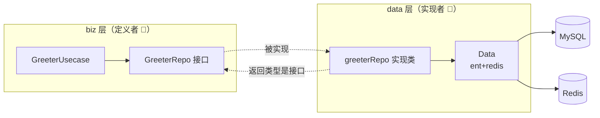

> 💡 **一句话理解**：biz 说"我要能存取用户"，data 说"我用 MySQL 帮你实现"——
> 明天换 MongoDB？写个新实现塞给 wire 就行，biz 一行不改！

---

## 9️⃣ Wire 依赖注入：自动装配流水线 🤖（重点⭐⭐）

### 9.1 为什么需要 wire？

```go
// 😫 手动装配（没有 wire 的日子）：
db := ent.Open(...)
data := data.NewData(cfg, logger)
repo := data.NewGreeterRepo(data, db)
uc := biz.NewGreeterUsecase(repo, logger)
svc := service.NewGreeterService(uc)
httpSrv := server.NewHTTPServer(cfg, svc)
grpcSrv := server.NewGRPCServer(cfg, svc)
app := kratos.New(kratos.Server(httpSrv, grpcSrv))
// 层级一深就是灾难，改一个构造函数全要改！
```

### 9.2 wire 三步走

```go
// cmd/hello/wire.go —— ① 声明（就这么多！）
//go:build wireinject
package main

import "github.com/google/wire/wire"

// wireSet 收集所有构造函数
var wireSet = wire.NewSet(
    provider.NewSet,                  // Kratos 内置 provider（config/log 等）
    data.NewData,
    data.NewGreeterRepo,              // data 层构造器
    biz.NewGreeterUsecase,            // biz 层构造器
    service.NewGreeterService,        // service 层构造器
    server.NewProviderSet,            // HTTP/gRPC server
)

// ② 告诉 wire：我要一个初始化好的 App
func initApp(*conf.Bootstrap) *kratos.App {
    wire.Build(wireSet)
    return nil // 返回值占位，wire 会替换！
}
```

```bash
# ③ 生成装配代码
wire ./cmd/hello
# 生成 wire_gen.go：完整的初始化链自动写好！✨
```

### 9.3 wire 工作原理

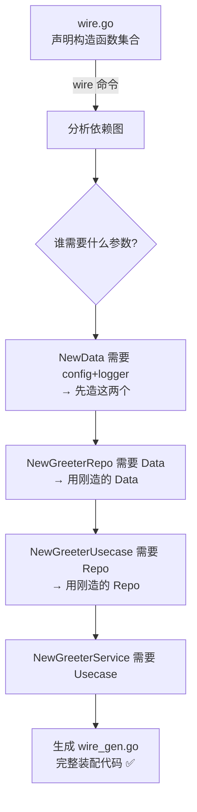

### 9.4 生成结果（wire_gen.go 节选）

```go
// cmd/hello/wire_gen.go —— 自动生成，勿手改！
func initApp(bootstrap *conf.Bootstrap) *kratos.App {
    // 按依赖顺序自动排好了！
    configProvider := config.NewProvider(...)     // 日志/配置
    dataData, cleanup, err := data.NewData(...)   // 数据层
    if err != nil { panic(err) }
    greeterRepo := data.NewGreeterRepo(dataData)  // 仓库
    greeterUsecase := biz.NewGreeterUsecase(...)  // 业务
    greeterService := service.NewGreeterService(greeterUsecase)
    httpServer := server.NewHTTPServer(..., greeterService)
    grpcServer := server.NewGRPCServer(..., greeterService)
    return kratos.New(kratos.Server(httpServer, grpcServer))
}
```

| wire vs 其他注入方式 | 反射注入（Java Spring 风） | wire（编译期） |
|--------------------|--------------------------|--------------|
| 时机 | 运行时 | **编译前生成代码** |
| 性能 | 有反射开销 | **零开销**（就是普通代码） |
| 错误发现 | 运行时才炸 | **编译期就报错** ✅ |
| 调试 | 难（魔法） | 简单（看得见代码） |

> ⚠️ **新增构造函数后记得重新跑 `wire` 命令**，不然 wire_gen.go 不更新！

---

## 🔟 配置与热更新：config 玩法 ⚙️

### 10.1 配置文件

```yaml
# configs/config.yaml
server:
  http:
    addr: 0.0.0.0:8000
    timeout: 1s
  grpc:
    addr: 0.0.0.0:9000
    timeout: 1s

data:
  database:
    driver: mysql
    source: root:123456@tcp(127.0.0.1:3306)/hello?charset=utf8mb4&parseTime=True
  redis:
    addr: 127.0.0.1:6379
    dial_timeout: 1s
```

### 10.2 配置结构体与读取

```go
// internal/conf/conf.proto —— 配置也用 proto 定义！（强类型配置）
message Bootstrap {
  message Server {
    message HTTP { string addr = 1; }
    message GRPC { string addr = 1; }
  }
  message Data {
    message Database { string driver = 1; string source = 2; }
    message Redis { string addr = 1; }
  }
}

// main.go 里加载
c := config.New(
    config.WithSource(file.NewSource("configs")),       // 文件源
    config.WithDecoder(decoder.NewDecoder()),            // proto 解码
)
if err := c.Load(); err != nil {
    panic(err)
}
var bc conf.Bootstrap
_ = c.Scan(&bc)
```

### 10.3 多配置源 & 热更新

```go
import (
    "github.com/go-kratos/kratos/v2/config"
    filesource "github.com/go-kratos/kratos/v2/config/file"
    apollosource "github.com/go-kratos-contrib/config/apollo" // Nacos/Consul/Apollo 都有
)

c := config.New(
    config.WithSource(            // 多源：按顺序取，先到先得
        filesource.NewSource("configs"),
        apollosource.NewSource(...),   // 生产环境接配置中心
    ),
)

// ⭐ 热更新：watch 配置变化
if err := c.Watch("data.database", func(key string, value config.Value) {
    log.Info("数据库配置变了：", value)
    // 这里可以做连接重建等
}); err != nil { ... }
```

| 能力 | 说明 |
|------|------|
| 多源叠加 | 文件 → 环境变量 → 配置中心，优先级可配 |
| proto 强类型 | 配置也有结构定义，拼错编译期发现 |
| Watch 热更新 | 改配置不用重启服务 ✅ |

---

## 1️⃣1️⃣ 中间件：洋葱+匹配器 🧅

### 11.1 内置中间件

| 中间件 | 用途 |
|--------|------|
| `logging.Server()` | 日志（自动记录请求） |
| `recovery.Recovery()` | panic 恢复 |
| `tracing.Server()` | 链路追踪 |
| `validation.Server()` | 参数校验（proto 规则） |
| `selector.Server(mw)` | **路由级匹配中间件**（Kratos 特色） |

```go
// internal/server/http.go
func NewHTTPServer(c *conf.Server, greeter *service.GreeterService, logger log.Logger) *http.Server {
    opts := []http.ServerOption{
        http.Middleware(
            recovery.Recovery(),
            tracing.Server(),
            logging.Server(logger),
            // ⭐ selector：只对 /v1.admin/ 开头的路径启用鉴权
            selector.Server(
                authMiddleware(),      // 自定义鉴权
            ).Path("/v1.admin/.*").Build(),
        ),
    }
    srv := http.NewServer(opts...)
    v1.RegisterGreeterHTTPServer(srv, greeter)
    return srv
}
```

### 11.2 自定义中间件

```go
import "github.com/go-kratos/kratos/v2/middleware"

// Kratos 中间件：middleware.Middleware
func authMiddleware() middleware.Middleware {
    return func(handler middleware.Handler) middleware.Handler {
        return func(ctx context.Context, req interface{}) (interface{}, error) {
            // ─── 前置 ───
            if tr, ok := transport.FromServerContext(ctx); ok {
                token := tr.RequestHeader().Get("Authorization")
                userId, err := parseToken(token)
                if err != nil {
                    return nil, errors.Unauthorized("UNAUTHORIZED", "token 无效")
                }
                // 用户信息塞进 ctx（自定义 context key）
                ctx = context.WithValue(ctx, userIdKey{}, userId)
            }

            reply, err := handler(ctx, req) // 放行 🚦

            // ─── 后置 ───
            return reply, err
        }
    }
}

// 优雅的 ctx key 定义（避免冲突）
type userIdKey struct{}

// Handler 里取
func (s *GreeterService) CreateGreeter(ctx context.Context, req *v1.CreateGreeterRequest) (...) {
    uid := middleware.GetContext(ctx) // 或 ctx.Value(userIdKey{})
}
```

### 11.3 selector 匹配器速查

```go
selector.Server(auth).Path("/v1.admin/.*").Build()   // 按路径（正则）
selector.Server(auth).Match(...)                      // 完全自定义匹配函数
selector.Client(logging).Path(...).Build()            // 客户端也有！
```

> 💡 对比 Gin：Gin 要按 Group 手动挂中间件，Kratos 用 **selector 声明式匹配**，所有路由规则集中一处，更清爽～

---

## 1️⃣2️⃣ 错误处理：规范化错误码 ❌

### 12.1 proto 定义错误（脚手架特色）

```protobuf
// api/hello/v1/error_reason.proto —— 错误也用 proto 管理！
syntax = "proto3";
package hello.v1;
option go_package = "hello/api/hello/v1;v1";

enum ErrorReason {
  GREETER_NOT_FOUND = 0;         // 用户不存在
  GREETER_INVALID_PARAMS = 1;    // 参数错误
}
```

### 12.2 使用规范

```go
import "github.com/go-kratos/kratos/v2/errors"

// 定义（Makefile 生成后会自动有）
errors.Register(uint32(len("hello")), uint32(1), "用户不存在")

// ① 业务里抛错：code + reason + message
return nil, v1.ErrorGreeterNotFound("用户 %d 不存在", id)
// 等价于 errors.New(500, "GREETER_NOT_FOUND", "用户 100 不存在")

// ② 判断错误（不能用 == ！）
if errors.IsNotFound(err) {                  // 按 code 判断
    // 404 逻辑
}
var e *errors.Error
if errors.As(err, &e) {                      // 拿到详细字段
    fmt.Println(e.Reason)   // "GREETER_NOT_FOUND"
    fmt.Println(e.Message)  // "用户 100 不存在"
}

// ③ HTTP/gRPC 自动转换
// HTTP → 404 + {"code":500,"reason":"GREETER_NOT_FOUND","message":"..."}
// gRPC → 对应 status 错误码
```

### 12.3 错误流转图

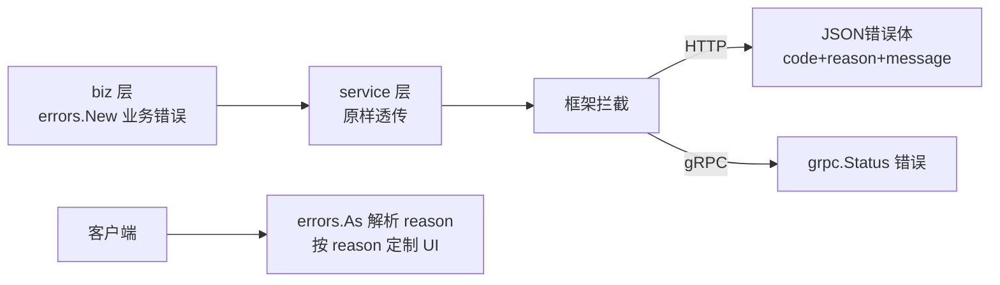

> 🌟 **为什么 reason 很重要**：code 是通用状态码（404/500），**reason 是业务语义**（GREETER_NOT_FOUND）——前端可以按 reason 精准显示不同提示！

---

## 1️⃣3️⃣ 服务注册发现：通讯录接入 📇

```bash
# 以 consul 为例
go get github.com/go-kratos-contrib/registry/consul/v2
```

```go
// cmd/hello/main.go
import (
    consulregistry "github.com/go-kratos-contrib/registry/consul/v2"
    "github.com/hashicorp/consul/api"
)

func main() {
    // consul 客户端
    cs, _ := api.NewClient(api.DefaultConfig())
    r := consulregistry.New(cs)

    app := kratos.New(
        kratos.Name("hello"),
        kratos.Server(httpSrv, grpcSrv),
        kratos.Registrar(r),          // ⭐ 一行接入注册中心
    )
    app.Run()
}
```

```go
// 客户端服务发现（调其他服务）
import "github.com/go-kratos/kratos/v2/transport/grpc"

conn, err := grpc.DialInsecure(
    ctx,
    grpc.WithEndpoint("discovery:///user-service"),  // discovery:/// 协议自动发现！
    grpc.WithDiscovery(r),
)
// 拿到的就是带负载均衡的连接
```

| 注册中心插件 | 包 |
|-------------|-----|
| Consul ⭐ | `go-kratos-contrib/registry/consul` |
| etcd | `go-kratos-contrib/registry/etcd` |
| Nacos | `go-kratos-contrib/registry/nacos` |
| Kubernetes | 内置 `kuberegistry` |

---

## 1️⃣4️⃣ 可观测性：日志/链路/指标 🔭

### 14.1 三件套一键开启

```go
// main.go
app := kratos.New(
    kratos.ID(id),
    kratos.Name("hello"),
    kratos.Version(Version),
    kratos.Metadata(map[string]string{}),
    kratos.Logger(logger),
    kratos.Registrar(r),
    kratos.Server(httpSrv, grpcSrv),
)
```

### 14.2 日志 log.Helper（结构化）

```go
// biz 层里的用法
type GreeterUsecase struct {
    log *log.Helper
}

func NewGreeterUsecase(repo GreeterRepo, logger log.Logger) *GreeterUsecase {
    return &GreeterUsecase{
        repo: repo,
        log:  log.NewHelper(log.With(logger, "module", "biz/greeter")), // 自动带 module 字段
    }
}

// 三级日志
uc.log.Infof("创建用户 %s", name)     // Info
uc.log.Warnf("查询慢 %v", cost)      // Warn
uc.log.Errorf("DB错误 %v", err)      // Error

// 带 ctx（自动注入 traceID！跨服务日志串联 🔗）
uc.log.WithContext(ctx).Infof("处理请求")
```

### 14.3 OpenTelemetry 链路追踪

```bash
go get github.com/go-kratos-contrib/traces/opentelemetry
```

```go
// HTTP/gRPC server 中间件各加一行
http.Middleware(tracing.Server(), ...)
grpc.Middleware(tracing.Server(), ...)

// main 里初始化 exporter（如 Jaeger/OTLP）
```

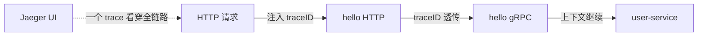

### 14.4 指标监控

```bash
go get github.com/go-kratos-contrib/metrics/prometheus/v2
```

```go
// prometheus 中间件：QPS/延迟自动采集
http.Middleware(
    metrics.Server(
        metrics.WithSeconds(prometheus.NewHistogram(...)),
    ),
)
```

---

## 1️⃣5️⃣ 实战：完整服务 💯

**场景**：用户 CRUD（完整走一遍 DDD 三层 + wire + 双协议）

### 15.1 开发流程图（背下来！⭐）

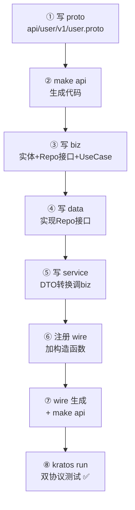

### 15.2 关键代码串联

```go
// ───── ① proto 定义（含 HTTP 注解）─────
service UserService {
  rpc CreateUser (CreateUserRequest) returns (CreateUserReply) {
    option (google.api.http) = { post: "/v1/users" body: "*" };
  }
  rpc GetUser (GetUserRequest) returns (GetUserReply) {
    option (google.api.http) = { get: "/v1/users/{id}" };
  }
}

// ───── ③ biz：接口 + 用例 ─────
type UserRepo interface {
    Save(ctx context.Context, u *User) (*User, error)
    FindByID(ctx context.Context, id int64) (*User, error)
}

type UserUsecase struct { repo UserRepo; log *log.Helper }

func (uc *UserUsecase) CreateUser(ctx context.Context, u *User) (*User, error) {
    if len(u.Name) < 2 {
        return nil, v1.ErrorUserInvalidParams("名字太短")
    }
    return uc.repo.Save(ctx, u)
}

// ───── ④ data：实现 ─────
func (r *userRepo) Save(ctx context.Context, u *biz.User) (*biz.User, error) {
    po, err := r.data.db.User.Create().SetName(u.Name).SetEmail(u.Email).Save(ctx)
    ...
}

// ───── ⑥ wire.go 注册 ─────
var wireSet = wire.NewSet(
    data.NewData, data.NewUserRepo,
    biz.NewUserUsecase,
    service.NewUserService,
)
```

### 15.3 测试双协议

```bash
kratos run

# HTTP 创建
curl -X POST http://localhost:8000/v1/users \
  -H "Content-Type: application/json" \
  -d '{"name":"小樱","email":"sakura@b.com"}'
# {"id":1}

# HTTP 查询（路径参数自动绑定！）
curl http://localhost:8000/v1/users/1
# {"id":1,"name":"小樱"}

# gRPC 同样能用
grpcurl -d '{"name":"知世"}' -plaintext 127.0.0.1:9000 user.v1.UserService/CreateUser
```

### 15.4 项目分层全景

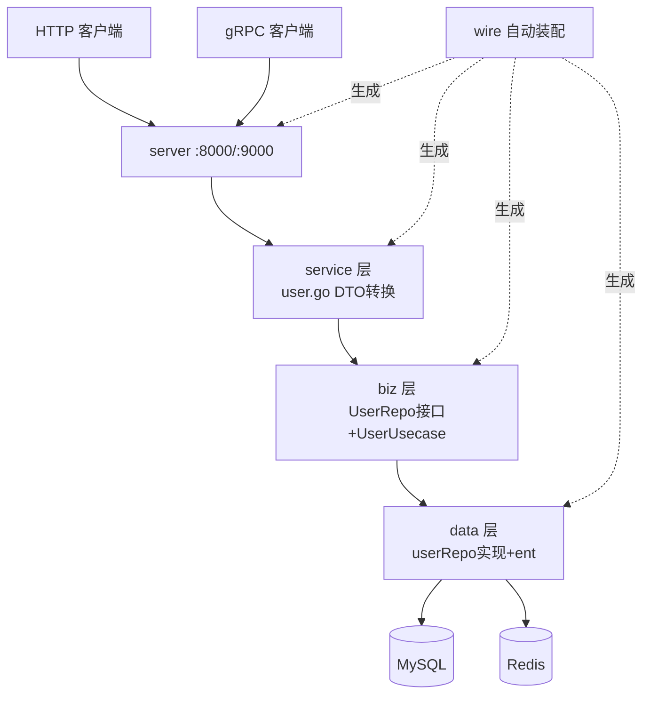

---

## 1️⃣6️⃣ 六框架终极对比：全家福合影 📸

| 维度 | Gin | Hertz | Go-Zero | Go-Micro | Kitex | **Kratos** |
|------|-----|-------|---------|----------|-------|-----------|
| 类型 | HTTP | HTTP | 全家桶 | RPC插件化 | RPC高性能 | **微服务DDD** |
| 出品 | 社区 | 字节 | 好未来 | 社区 | 字节 | **B站** |
| 架构风格 | 自由 | 自由 | 约定式 | 组件化 | 约定式 | **DDD分层** |
| 双协议 | ❌ | ❌ | api+rpc分开 | ❌ | ❌ | ✅**一份proto** |
| 依赖注入 | ❌ | ❌ | ServiceContext | ❌ | ❌ | ✅**wire** |
| 代码生成 | ❌ | hz | goctl | proto | kitex | **kratos+proto** |
| 学习曲线 | ⭐ | ⭐⭐ | ⭐⭐⭐ | ⭐⭐⭐⭐ | ⭐⭐⭐ | ⭐⭐⭐⭐ |
| 适合 | 小项目 | 高性能HTTP | 国内快开发 | 自由定制 | 核心链路 | **中大型长期项目** |

**终极选型口诀：**

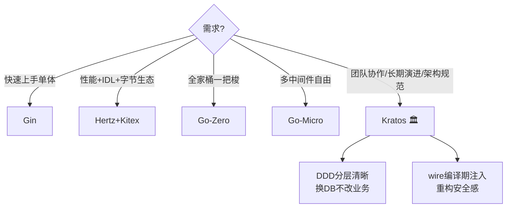

---

## 1️⃣7️⃣ 踩坑大全：前人翻车后人乘凉 ⚠️

### 坑1：改了 wire.go 忘记重新生成

```bash
# ❌ 新加构造函数，运行还是老逻辑/编译报错
# ✅ 改完 wire.go 必须重跑：
wire ./cmd/hello
# 或用 Makefile：make wire
```

### 坑2：biz 里 import 了 data 包

```go
// ❌ 依赖倒置被破坏！biz 依赖了 data = 白搞 DDD
import "hello/internal/data"

// ✅ biz 只定义接口，永远不知道 data 的存在
type UserRepo interface { ... }
```

### 坑3：service 层写业务逻辑

```go
// ❌ 校验/规则写在 service，proto 一改全乱
// ✅ service 只做转换：
func (s *UserService) CreateUser(ctx context.Context, req *v1.CreateUserRequest) (*v1.CreateUserReply, error) {
    return s.uc.CreateUser(ctx, toBizUser(req)) // 纯翻译！
}
```

### 坑4：proto 改了没重新生成

```bash
# 报错：undefined: v1.XxxRequest 之类
make api   # 重新生成 pb 文件
```

### 坑5：HTTP 注解忘了写

```protobuf
// ❌ 没写 google.api.http 注解 → HTTP 路由不存在，404！
rpc GetUser (GetUserRequest) returns (GetUserReply);
// ✅ 加上注解
rpc GetUser (GetUserRequest) returns (GetUserReply) {
  option (google.api.http) = { get: "/v1/users/{id}" };
}
```

### 坑6：第三方 proto 找不到

```bash
# google/api/annotations.proto 不存在？
# ✅ 放到 third_party/google/api/ 下（脚手架自带，别删！）
# protoc 命令要带 --proto_path=./third_party
```

### 坑速查表 📇

| 症状 | 病因 | 药方 |
|------|------|------|
| 新依赖不生效 | 忘跑 wire | `make wire` |
| 循环 import | biz 引了 data | 删除！只依赖接口 |
| 逻辑越写越乱 | 业务写在 service | 挪到 biz |
| undefined 报错 | pb 没重新生成 | `make api` |
| HTTP 404 | proto 没写注解 | 加 google.api.http |
| protoc 报找不到 | third_party 缺文件 | 恢复目录/查 proto_path |

---

## 🎁 总结：一张图吃透 Kratos

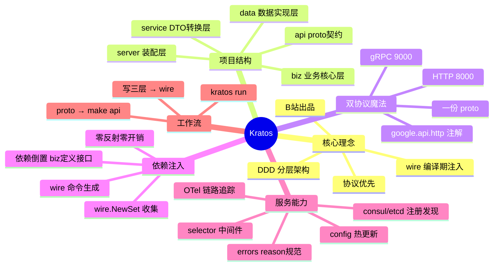

## 📝 课后小测验（动动小脑瓜 🧠）

1. Kratos 的三层 `service/biz/data` 各自职责是什么？
2. "依赖倒置"在 Kratos 里怎么体现的？
3. 一份 proto 怎么同时支持 gRPC 和 HTTP？
4. wire 和运行时反射注入相比有什么优势？
5. 新增一个接口的完整流程（从 proto 到运行）？
6. Kratos 错误模型中 reason 字段的作用？
7. `selector.Server(mw).Path(...)` 是干嘛的？

<details>
<summary>👉 点开看答案</summary>

1. service：DTO ↔ 领域对象转换，调 biz；biz：业务核心（实体+接口+用例），不依赖框架；data：实现 biz 定义的 Repo 接口，管 DB/Redis。
2. **biz 层定义 Repo 接口（我需要什么），data 层实现它（怎么实现）**——上层定义需求，下层依赖上层接口，而不是反过来。
3. proto 里加 `google.api.http` 注解声明 HTTP 路由，用 `protoc-gen-go-http` 插件生成 HTTP handler，同一个 service 实现被两个 server 复用。
4. **编译期生成代码**：零反射开销、错误编译期发现、生成代码可读可调试。
5. 写/改 proto（含注解）→ `make api` 生成 → 写 biz（接口+用例）→ 写 data（实现）→ 写 service（转换）→ wire.go 注册构造函数 → `make wire` → `kratos run` 测试。
6. reason 是**业务语义标识**（如 GREETER_NOT_FOUND），前端可按它精准定制提示，比通用 code（404/500）更有表达力。
7. **中间件匹配器**：只对匹配路径（正则）的请求启用该中间件，实现路由级的差异化中间件。

</details>

---

> 🌸 恭喜解锁 Kratos！B 站架构美学到手～🎮
> 🏆 **Go 系列十一篇全通**：✅ 基础语法 → ✅ 常用包 → ✅ 进阶特性 → ✅ 并发编程
> → ✅ Gin → ✅ GORM → ✅ Go-Zero → ✅ Go-Micro → ✅ Kitex → ✅ Hertz → ✅ **Kratos**
> 现在你的兵器库：HTTP×2（Gin/Hertz）、ORM（GORM）、微服务×4（Zero/Micro/Kitex/Kratos）！
> 两大视频网站（抖音+B站）同款技术全部拿下～😎
> 下一步推荐：**ent ORM 深入** / **gRPC 底层原理** / **K8s 微服务部署**，
> 随时召唤本讲师，比心 💖
