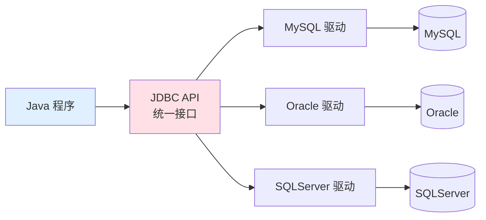
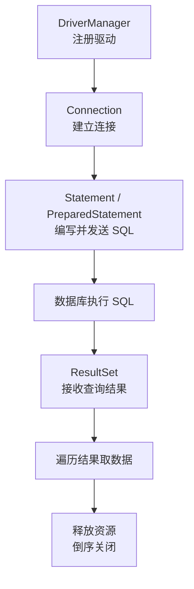
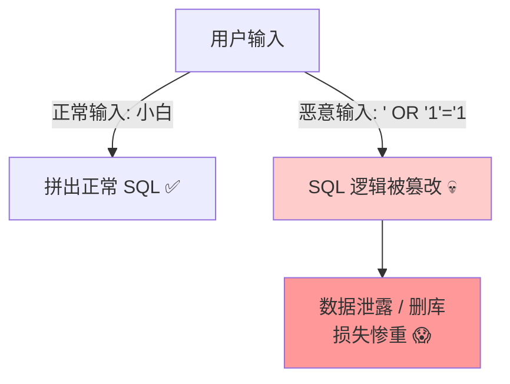
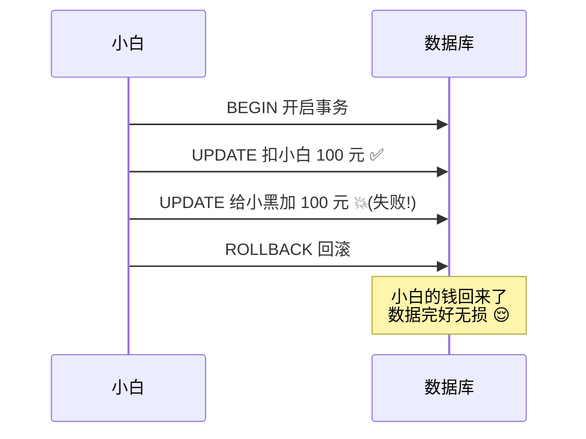
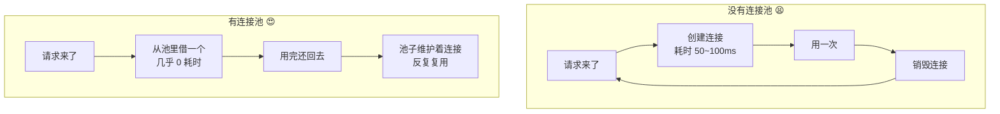
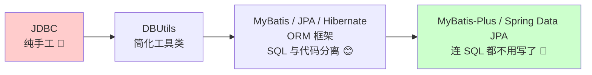

# 🔌 JDBC 数据库连接大冒险

> 嘿嘿～欢迎来到 JDBC 小课堂！🌸
> JDBC 是 Java 操作数据库的"官方标准通道"，所有框架（MyBatis、JPA、Hibernate）都是站在它肩膀上的！
> 学会它，你就懂了 Java 和数据库对话的底层原理，冲鸭～ (๑•̀ㅂ•́)و✧

---

## 📖 目录

1. [JDBC 是什么](#-jdbc-是什么)
2. [核心组件介绍](#-核心组件介绍)
3. [环境准备](#-环境准备)
4. [JDBC 使用六步曲](#-jdbc-使用六步曲)
5. [SQL 注入危机与 PreparedStatement](#-sql-注入危机与-preparedstatement)
6. [封装 JDBC 工具类](#-封装-jdbc-工具类)
7. [事务管理](#-事务管理)
8. [批量操作](#-批量操作)
9. [连接池 —— 性能救星](#-连接池--性能救星)
10. [JDBC 的痛点与框架演进](#-jdbc-的痛点与框架演进)
11. [总结与小抄](#-总结与小抄)

---

## 🤔 JDBC 是什么

**JDBC = Java Database Connectivity（Java 数据库连接）**

**一句话理解**：JDBC 是 Java 官方定的一套"和数据库对话的规则"，不管你用 MySQL、Oracle 还是 SQL Server，都按这套规则来，写法基本一致！📋

生活化类比：JDBC 就像**万能充电头**🔌 —— 手机（Java 程序）只需插上合适的转接头（驱动），就能给任何品牌的充电宝（数据库）充电！



> 💡 关键点：**JDBC 是接口规范，各数据库厂商提供具体实现（驱动包）**。这就是"面向接口编程"的经典应用！

---

## 🧩 核心组件介绍

JDBC 世界里有几位重要角色，先混个脸熟～

| 组件 | 通俗理解 | 负责什么 |
|------|---------|---------|
| 🚚 `DriverManager` | 快递调度中心 | 管理驱动、创建连接 |
| 🔗 `Connection` | 打通的电话线 | 和数据库的一条连接 |
| 📨 `Statement` / `PreparedStatement` | 信件 | 装着 SQL 发给数据库 |
| 📬 `ResultSet` | 回信 | 装着查询结果，逐行读取 |

它们的关系长这样：



---

## 🛠️ 环境准备

先导入数据库驱动包（以 MySQL 为例），Maven 项目加依赖：

```xml
<dependency>
    <groupId>com.mysql</groupId>
    <artifactId>mysql-connector-j</artifactId>
    <version>8.0.33</version>
</dependency>
```

再准备一张测试表：

```sql
CREATE TABLE student (
    id INT PRIMARY KEY AUTO_INCREMENT,
    name VARCHAR(50),
    age INT
);
INSERT INTO student (name, age) VALUES ('小白', 18), ('小黑', 20);
```

---

## 🎵 JDBC 使用六步曲

经典六步，像泡方便面一样按顺序来，一步都不能少！🍜


完整代码演示（查询所有学生）：

```java
import java.sql.*;

public class JdbcDemo {
    public static void main(String[] args) throws Exception {
        // ① 注册驱动（JDBC 4.0 后可省略，驱动包会自动加载）
        Class.forName("com.mysql.cj.jdbc.Driver");

        // ② 获取连接：协议://地址:端口/数据库名?参数
        Connection conn = DriverManager.getConnection(
                "jdbc:mysql://localhost:3306/mydb?useSSL=false&serverTimezone=Asia/Shanghai",
                "root",          // 用户名
                "123456");       // 密码

        // ③ 定义 SQL 语句
        String sql = "SELECT id, name, age FROM student";

        // ④ 执行 SQL，拿到结果集
        Statement stmt = conn.createStatement();
        ResultSet rs = stmt.executeQuery(sql);

        // ⑤ 处理结果：像游标一样一行行往下读
        while (rs.next()) {
            int id = rs.getInt("id");
            String name = rs.getString("name");
            int age = rs.getInt("age");
            System.out.println(id + " - " + name + " - " + age);
        }

        // ⑥ 释放资源：先开的后关（倒序）！
        rs.close();
        stmt.close();
        conn.close();
    }
}
```

### 📮 增删改查的执行方法怎么选

| 方法 | 返回值 | 用于 |
|------|--------|------|
| `executeQuery(sql)` | `ResultSet` | **SELECT** 查询 |
| `executeUpdate(sql)` | `int`（受影响行数） | **INSERT / UPDATE / DELETE** |
| `execute(sql)` | `boolean` | 不确定类型时（少用） |

```java
// 增删改都用 executeUpdate，看返回的影响行数
int rows = stmt.executeUpdate("DELETE FROM student WHERE id = 1");
System.out.println("删掉了 " + rows + " 行");
```

---

## 💉 SQL 注入危机与 PreparedStatement

### 什么是 SQL 注入？

**一句话理解**：用户输入的内容被"偷偷夹带"进了 SQL 语句，改变了原本的逻辑，这就是注入攻击！🦠

看一个经典翻车现场：

```java
// 危险代码！用户输入直接拼进 SQL 💀
String name = "小白' OR '1'='1";   // 黑客输入的内容
String sql = "SELECT * FROM user WHERE name = '" + name + "' AND password = '" + pwd + "'";

// 拼出来的 SQL 变成了：
// SELECT * FROM user WHERE name = '小白' OR '1'='1' AND password = 'xxx'
// '1'='1' 永远为真 → 所有用户数据全泄露！😱
```



### 解药：PreparedStatement

**一句话理解**：先把 SQL 的"骨架"发过去，参数用 `?` 占位，值单独传送，数据和代码彻底分离，注入无效！💊

```java
// 安全写法 ✅
String sql = "SELECT * FROM user WHERE name = ? AND password = ?";
PreparedStatement ps = conn.prepareStatement(sql);  // 先发骨架
ps.setString(1, "小白");          // 第 1 个 ? 赋值
ps.setString(2, "123456");        // 第 2 个 ? 赋值
ResultSet rs = ps.executeQuery(); // 注意：这里不传参数！
```

> 黑客再输入 `' OR '1'='1`，也只会被当成**普通的字符串值**去匹配，翻不起浪花～🌊

### 两者对比一览

| 对比项 | Statement 😣 | PreparedStatement 😍 |
|--------|--------------|----------------------|
| 🔒 SQL 注入 | 有风险 | **预编译，天然防注入** |
| ⚡ 性能 | 每次都编译 SQL | SQL 骨架可复用，**更快** |
| 📝 写法 | 手动拼接字符串 | `?` 占位，清爽 |
| 🏢 使用建议 | 几乎不用 | **永远优先用它**！ |

---

## 🎁 封装 JDBC 工具类

六步曲太啰嗦？把重复代码封装成工具类，随用随取～

```java
import java.sql.*;
import java.io.IOException;
import java.io.InputStream;
import java.util.Properties;

public class JdbcUtil {
    private static final String URL;
    private static final String USER;
    private static final String PASSWORD;

    // 类加载时读配置文件，只执行一次
    static {
        try (InputStream in = JdbcUtil.class.getClassLoader()
                .getResourceAsStream("jdbc.properties")) {
            Properties prop = new Properties();
            prop.load(in);
            URL = prop.getProperty("url");
            USER = prop.getProperty("user");
            PASSWORD = prop.getProperty("password");
        } catch (IOException e) {
            throw new RuntimeException("读取配置失败", e);
        }
    }

    /** 获取连接 */
    public static Connection getConnection() throws SQLException {
        return DriverManager.getConnection(URL, USER, PASSWORD);
    }

    /** 释放资源（重载，参数有几个关几个） */
    public static void close(ResultSet rs, Statement stmt, Connection conn) {
        if (rs != null) try { rs.close(); } catch (SQLException e) { e.printStackTrace(); }
        if (stmt != null) try { stmt.close(); } catch (SQLException e) { e.printStackTrace(); }
        if (conn != null) try { conn.close(); } catch (SQLException e) { e.printStackTrace(); }
    }
}
```

配置文件 `src/main/resources/jdbc.properties`：

```properties
url=jdbc:mysql://localhost:3306/mydb?useSSL=false&serverTimezone=Asia/Shanghai
user=root
password=123456
```

> Java 7+ 还有更省事的 **try-with-resources**，自动关闭资源，再也不怕忘关连接啦：

```java
// 括号里声明的资源会自动关闭（要求实现 AutoCloseable 接口）
try (Connection conn = JdbcUtil.getConnection();
     PreparedStatement ps = conn.prepareStatement("SELECT * FROM student")) {
    ResultSet rs = ps.executeQuery();
    while (rs.next()) {
        System.out.println(rs.getString("name"));
    }
}  // 到这里 conn、ps 自动关闭，优雅！✨
```

---

## 💰 事务管理

### 为什么需要事务？

**一句话理解**：转账场景下"扣钱"和"加钱"必须同时成功或同时失败，事务就是给一组 SQL 上"保险锁"🔐



### JDBC 事务三连招

```java
Connection conn = null;
try {
    conn = JdbcUtil.getConnection();
    conn.setAutoCommit(false);   // ① 关自动提交，开启事务（默认是 true）

    PreparedStatement ps1 = conn.prepareStatement(
            "UPDATE account SET money = money - 100 WHERE name = ?");
    ps1.setString(1, "小白");
    ps1.executeUpdate();

    // 模拟出事故 😱
    // int x = 1 / 0;

    PreparedStatement ps2 = conn.prepareStatement(
            "UPDATE account SET money = money + 100 WHERE name = ?");
    ps2.setString(1, "小黑");
    ps2.executeUpdate();

    conn.commit();               // ② 全部成功 → 提交事务
    System.out.println("转账成功！");

} catch (Exception e) {
    if (conn != null) {
        try { conn.rollback(); } catch (SQLException ex) { ex.printStackTrace(); }
    }                            // ③ 出异常 → 回滚，当作无事发生
    System.out.println("转账失败，已回滚！");
}
```

| 方法 | 作用 |
|------|------|
| `setAutoCommit(false)` | 关闭自动提交，事务由我掌控 |
| `commit()` | 提交事务，改动永久生效 ✅ |
| `rollback()` | 回滚事务，恢复到事务开始前 ↩️ |
| `setSavepoint()` | 设置保存点，可回滚到中间状态 |

---

## 🚀 批量操作

要插入 1 万条数据，一条条发 SQL 会慢到怀疑人生，用批量操作快到飞起！

```java
try (Connection conn = JdbcUtil.getConnection();
     PreparedStatement ps = conn.prepareStatement(
             "INSERT INTO student(name, age) VALUES(?, ?)")) {

    for (int i = 1; i <= 10000; i++) {
        ps.setString(1, "学生" + i);
        ps.setInt(2, 18);
        ps.addBatch();              // 攒进批次箱子 📦

        if (i % 1000 == 0) {        // 每攒 1000 条执行一次
            ps.executeBatch();      // 一次性发给数据库
            ps.clearBatch();        // 清空箱子，继续攒
        }
    }
}
```

| 方式 | 效果 |
|------|------|
| 循环单条 `executeUpdate` | 1 万次网络往返，慢到哭 😭 |
| `addBatch` + `executeBatch` | 攒一波发一波，**快几十倍** 🚀 |
| 开启重写批量 SQL（URL 加 `rewriteBatchedStatements=true`） | MySQL 下性能再翻倍 ⚡ |

---

## 🏊 连接池 —— 性能救星

### 为什么需要连接池？

**一句话理解**：每次用数据库都"新建连接→用完→销毁"，就像每次喝水都重新打一口井，太浪费啦！连接池 = 提前打好的"井"，随取随还 🏊



### 主流连接池对比

| 连接池 | 出身 | 特点 |
|--------|------|------|
| 🥇 **HikariCP** | Spring Boot 默认 | 极致性能，代码精巧，"快"就一个字 |
| 🐱 **Druid** | 阿里出品 | 功能全家桶：监控页面、SQL 防火墙、慢 SQL 日志 |
| ⚙️ DBCP2 / C3P0 | 老牌 | 常见于老项目，新项目不推荐 |

### HikariCP 使用示例（Spring Boot 风格配置）

```yaml
spring:
  datasource:
    url: jdbc:mysql://localhost:3306/mydb?useSSL=false&serverTimezone=Asia/Shanghai
    username: root
    password: 123456
    hikari:
      maximum-pool-size: 10        # 最多 10 个连接
      minimum-idle: 2              # 最少保持 2 个空闲连接
      connection-timeout: 30000    # 借不到连接最多等 30 秒
```

原生方式使用 HikariCP：

```java
HikariConfig config = new HikariConfig();
config.setJdbcUrl("jdbc:mysql://localhost:3306/mydb");
config.setUsername("root");
config.setPassword("123456");
config.setMaximumPoolSize(10);

HikariDataSource ds = new HikariDataSource(config);

// 从池里借连接，用完 close() 其实是"还给池子"，并没有真销毁哦～
try (Connection conn = ds.getConnection();
     PreparedStatement ps = conn.prepareStatement("SELECT COUNT(*) FROM student")) {
    ResultSet rs = ps.executeQuery();
    rs.next();
    System.out.println("共有 " + rs.getInt(1) + " 个学生");
}
```

> 💡 冷知识：连接池中的 `conn.close()` 被"偷梁换柱"了——实际是把连接归还给池子，而不是真关闭，这就是装饰器模式的巧妙应用！✨

---

## 📉 JDBC 的痛点与框架演进

### 裸写 JDBC 有多痛？

| 痛点 | 具体表现 |
|------|---------|
| 😩 样板代码多 | 注册驱动、开关连接、关资源，重复到吐 |
| 😵 结果集手动映射 | 每个字段都要 `rs.getXxx()` 取一遍，麻烦 |
| 😫 SQL 写在 Java 里 | 字符串拼 SQL，没有高亮、不好维护 |
| 😰 异常处理繁琐 | checked 异常满天飞 |

### 框架演进史

正因如此，一代代框架前仆后继地替我们"挡枪"～



以 MyBatis 为例，同样的查询变成这样：

```java
// 定义好 Mapper 接口后，一行搞定！
Student student = studentMapper.selectById(1);
```

> ⚠️ 但是！框架底层依然是 JDBC 那一套（连接池 + PreparedStatement + ResultSet），**学 JDBC 就是学框架的地基**，面试问到底层时它就是答案！🏗️

---

## 🎀 总结与小抄

### JDBC 六步曲口诀 🎵

> **注册驱动 → 拿连接 → 写 SQL → 执行它 → 收结果 → 关资源**
> （倒着关，先 result 后 statement 最后 connection～）

### 核心 API 速记卡 📌

| API | 一句话记忆 |
|-----|-----------|
| `DriverManager.getConnection()` | 拿一条数据库连接 |
| `conn.prepareStatement(sql)` | 预编译 SQL，防注入 |
| `ps.setXxx(下标, 值)` | 给 `?` 占位符填值（从 1 开始！） |
| `ps.executeQuery()` | 查询专用，返回结果集 |
| `ps.executeUpdate()` | 增删改专用，返回影响行数 |
| `rs.next()` | 光标下移一行，有数据返回 true |
| `rs.getXxx("列名")` | 取当前行指定列的值 |
| `conn.setAutoCommit(false)` | 手动开启事务 |

### 必记五条军规 ✊

1. **永远用 PreparedStatement**，拒绝拼接 SQL，防注入！
2. **资源必须关闭**，优先 try-with-resources～
3. **`?` 占位符下标从 1 开始**，不是 0！（新手必踩坑 😤）
4. **生产环境必用连接池**（HikariCP / Druid）～
5. **事务三连**：关自动提交 → 成功 commit → 异常 rollback～

---

> 🎉 恭喜你拿下 JDBC！从此 MyBatis、JPA 这些框架对你来说就是"纸老虎"啦～
> 因为它们再花哨，底层永远是今天学的这套 JDBC 心法 (¬‿¬)✨
> 有想深挖的部分（比如数据库连接池原理）随时来找我哦，比心～ 💗
