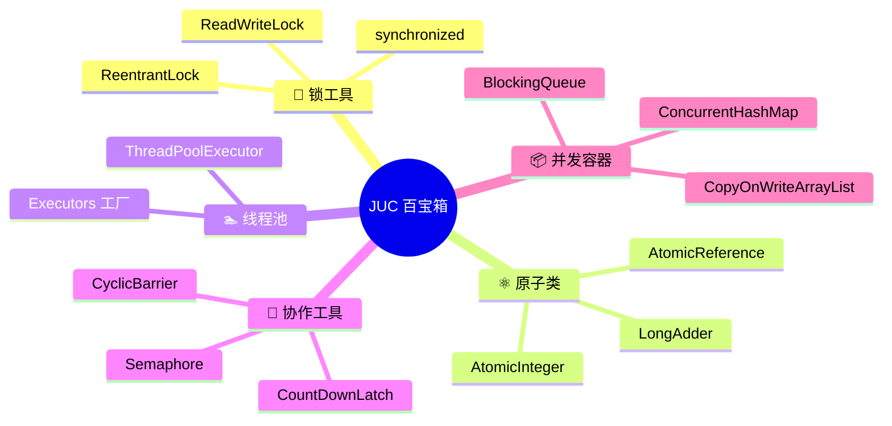
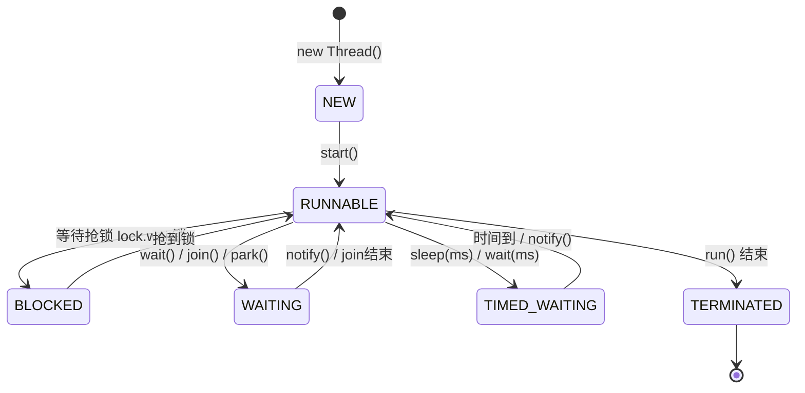
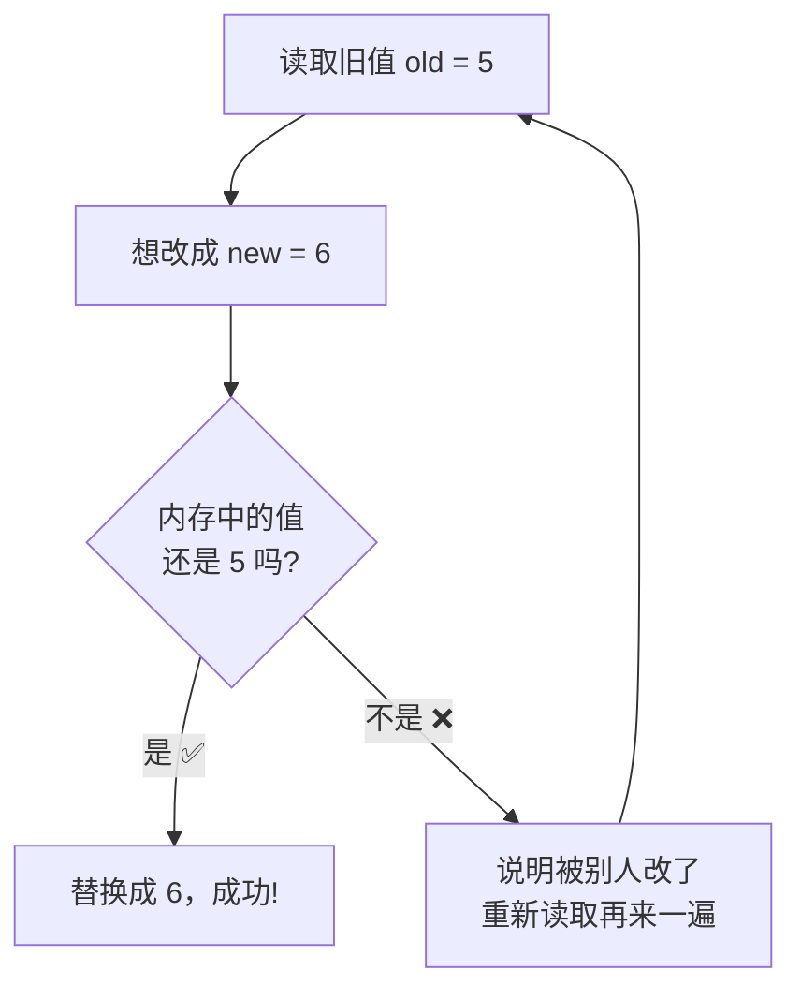
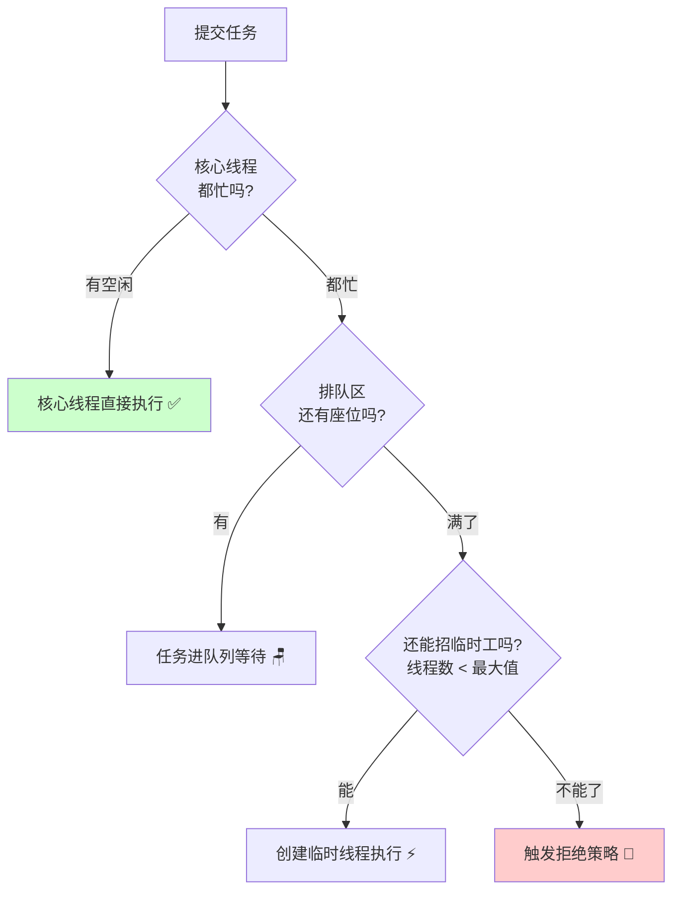
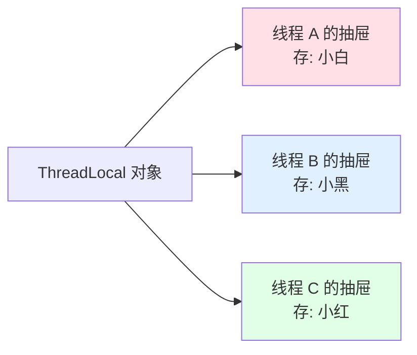
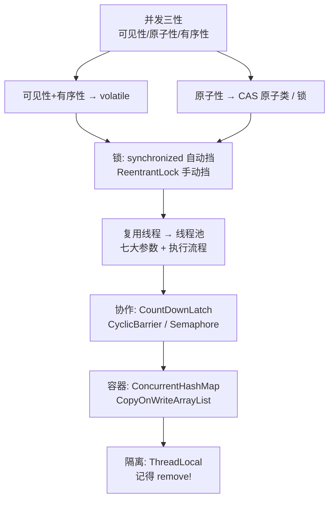

# 🎢 JUC 并发编程大冒险

> 嘿嘿～欢迎来到 JUC 小课堂！🌸
> JUC = `java.util.concurrent`，Java 并发编程的"百宝箱"！
> 多线程就像厨房里多个厨师同时做菜 🍳，配合好了效率起飞，配合不好就炸厨房！
> 今天带你从入门到线程池，一次理清并发编程的主线，冲鸭～ (๑•̀ㅂ•́)و✧

---

## 📖 目录

1. [JUC 是什么](#-juc-是什么)
2. [并发三性 —— 一切问题的根源](#-并发三性--一切问题的根源)
3. [线程创建的三种方式](#-线程创建的三种方式)
4. [线程的六种状态](#-线程的六种状态)
5. [synchronized 与 Lock](#-synchronized-与-lock)
6. [volatile —— 轻量级卫士](#-volatile--轻量级卫士)
7. [CAS 与原子类](#-cas-与原子类)
8. [线程池 —— 重中之重！](#-线程池--重中之重)
9. [并发协作三剑客](#-并发协作三剑客)
10. [并发容器](#-并发容器)
11. [ThreadLocal —— 线程私有小抽屉](#-threadlocal--线程私有小抽屉)
12. [总结与小抄](#-总结与小抄)

---

## 🗺️ JUC 是什么

**一句话理解**：JUC 是 JDK 官方提供的并发工具包，帮我们安全高效地玩转多线程，不用自己造轮子～🔧

先看看这个百宝箱里都有啥：



---

## 😱 并发三性 —— 一切问题的根源

学并发前必须知道"病根"在哪，所有工具都是为了治这三种病～

| 三性 | 通俗理解 | 生病表现 | 治病药方 |
|------|---------|---------|---------|
| 👀 **可见性** | 一个线程改了值，别人看不见 | 线程 A 改完 flag，线程 B 还读到旧值，死循环 | `volatile`、锁 |
| ⚛️ **原子性** | 操作要嘛全做完，要嘛没做过 | 1000 个线程各加 1 次，结果不是 1000 | 锁、`Atomic` 类 |
| 📏 **有序性** | 代码执行顺序不被乱来 | 指令重排导致对象"半成品"被用到 | `volatile`、锁 |

```java
// 经典翻车现场：可见性问题 💀
public class VisibilityDemo {
    static boolean flag = true;   // 没加 volatile，坑来了！

    public static void main(String[] args) throws InterruptedException {
        new Thread(() -> {
            while (flag) { }      // 线程可能永远读到旧值 true，出不来！
        }).start();
        Thread.sleep(1000);
        flag = false;             // 主线程改成 false，但上面线程"看不见"
    }
}

// 解药：volatile boolean flag = true;  ✅
```

> 💡 病因：每个线程有自己的**工作内存**（CPU 缓存），不会立马把修改刷回主内存，别人自然看不到～

---

## 🧵 线程创建的三种方式

### 方式对比

| 方式 | 特点 | 适用场景 |
|------|------|---------|
| ① 继承 `Thread` | 简单直接，但占用了继承名额 | 简单 demo |
| ② 实现 `Runnable` | 不占继承名额，任务与线程分离 | **最常用** ⭐ |
| ③ 实现 `Callable` | **有返回值 + 能抛异常** | 需要拿结果时 |

```java
// ① 继承 Thread
class MyThread extends Thread {
    @Override
    public void run() { System.out.println("方式一跑起来了~"); }
}
new MyThread().start();

// ② 实现 Runnable（Lambda 写法超清爽 ✨）
new Thread(() -> System.out.println("方式二跑起来了~")).start();

// ③ 实现 Callable —— 有返回值！
FutureTask<Integer> futureTask = new FutureTask<>(() -> {
    Thread.sleep(1000);
    return 42;                              // 返回计算结果
});
new Thread(futureTask).start();
Integer result = futureTask.get();          // 阻塞等待结果
System.out.println("算出来啦：" + result);
```

> ⚠️ 小提醒：启动线程永远用 `start()`，不是 `run()`！`run()` 只是普通方法调用，还是在原线程执行～

---

## 🔄 线程的六种状态

线程的一生起起落落，全在 `Thread.State` 这个枚举里：



| 状态 | 通俗理解 |
|------|---------|
| `NEW` | 新生婴儿 👶，还没调用 start() |
| `RUNNABLE` | 就绪/运行中，随时可能被 CPU 宠幸 |
| `BLOCKED` | 排队等锁中 🚪，锁被别人拿着 |
| `WAITING` | 无限期等待 ⏳，等别人来唤醒 |
| `TIMED_WAITING` | 限时等待 ⏰，睡够时间自己醒 |
| `TERMINATED` | 跑完谢幕 🎬，任务结束 |

---

## 🔐 synchronized 与 Lock

### synchronized —— 关键字级老将

**一句话理解**：给代码块上锁，同一时刻只有一个线程能进，其他线程门口排队～

```java
// 经典问题：卖票超卖 💥
public class Ticket implements Runnable {
    private int tickets = 100;

    @Override
    public void run() {
        while (true) {
            // synchronized 三种用法：
            // 1. 同步代码块（锁对象）
            synchronized (this) {
                if (tickets > 0) {
                    System.out.println(Thread.currentThread().getName() + " 卖出第 " + tickets-- + " 张票");
                } else break;
            }
        }
    }
}

// 2. 同步方法（锁 this）
public synchronized void sell() { ... }

// 3. 静态同步方法（锁 Class 对象）
public static synchronized void sellStatic() { ... }
```

### ReentrantLock —— API 级新秀

```java
import java.util.concurrent.locks.ReentrantLock;

ReentrantLock lock = new ReentrantLock();

public void sell() {
    lock.lock();                 // 手动上锁
    try {
        // 业务代码
    } finally {
        lock.unlock();           // 手动解锁，必须放 finally！⚠️
    }
}
```

### 两者对比

| 对比项 | synchronized 😎 | ReentrantLock 🚀 |
|--------|-----------------|------------------|
| 📦 层面 | JVM 关键字 | JDK API 类 |
| 🔓 释放锁 | 自动释放（出代码块） | **手动 unlock（放 finally）** |
| ⏰ 尝试获取 | 不支持 | `tryLock()` 拿不到就算了 |
| ⏳ 超时获取 | 不支持 | `tryLock(3, SECONDS)` 等 3 秒 |
| 🔗 公平锁 | 非公平 | 可选公平（排队）`new ReentrantLock(true)` |
| 📖 读写分离 | 不支持 | `ReadWriteLock` 读读共享 |
| 💡 使用建议 | **简单场景优先** | 需要高级功能时用 |

> 💡 记忆技巧：synchronized 像"自动挡"🚗 省心，ReentrantLock 像"手动挡"🏎️ 可控但得自己操心！

---

## 🌬️ volatile —— 轻量级卫士

**一句话理解**：`volatile` 是"最轻量的同步手段"，保证**可见性 + 有序性**，但**不保证原子性**！

```java
volatile boolean flag = false;   // 修改立刻对其他线程可见 ✅

// 但它管不了复合操作！下面是反面教材 ⚠️
volatile int count = 0;
count++;   // 实际是三步：读 → +1 → 写回。多线程并发依然会丢数据！
```

### volatile vs synchronized

| 对比项 | volatile | synchronized |
|--------|----------|--------------|
| 👀 可见性 | ✅ | ✅ |
| ⚛️ 原子性 | ❌ | ✅ |
| 📏 有序性 | ✅（禁止指令重排） | ✅ |
| 🚫 阻塞 | 不会阻塞 | 会阻塞排队 |
| ⚖️ 性能 | 轻快 | 相对重 |
| 🎯 典型场景 | 状态标志位、双重检查锁 | 复合操作、临界区 |

---

## ⚛️ CAS 与原子类

### CAS 是什么？

**CAS = Compare And Swap（比较并交换）**

**一句话理解**：改值前先看一眼"还是不是我刚才看到的样子"，没人动过我才改，动过就重试！👀



```java
// AtomicInteger 底层就是 CAS
AtomicInteger count = new AtomicInteger(0);
count.incrementAndGet();   // 原子性 +1，比 synchronized 轻快多了 ✨
count.compareAndSet(0, 10); // 期望是 0 才改成 10
```

### CAS 的两个小毛病

| 毛病 | 说明 | 解药 |
|------|------|------|
| 😵 自旋开销 | 一直失败就一直重试，CPU 空转 | `LongAdder` 分段累加（高并发计数首选）|
| 🎭 ABA 问题 | 值从 A→B→A，CAS 以为没变过 | `AtomicStampedReference` 加版本号 |

> 💡 ABA 通俗版：你以为奶茶没人喝过 🧋，其实被人喝光又重新倒满了一模一样的！（加个"版本号吸管"就知道动没动过啦）

---

## 🏊 线程池 —— 重中之重！

### 为什么需要线程池？

**一句话理解**：线程创建销毁很"费钱"，线程池就像"共享单车"🚲 —— 提前备好，随借随还，反复利用！

### ThreadPoolExecutor 七大参数

```java
public ThreadPoolExecutor(
    int corePoolSize,        // ① 核心线程数：正式员工，长期在岗
    int maximumPoolSize,     // ② 最大线程数：正式 + 临时工的上限
    long keepAliveTime,      // ③ 临时工存活时间：没事干多久被裁
    TimeUnit unit,           // ④ 时间单位
    BlockingQueue<Runnable> workQueue,  // ⑤ 任务排队区：候客大厅
    ThreadFactory threadFactory,        // ⑥ 线程工厂：给线程起名发工牌
    RejectedExecutionHandler handler    // ⑦ 拒绝策略：忙不过来怎么办
)
```

生活化理解 —— 像一家餐厅 🍜：

| 参数 | 餐厅角色 |
|------|---------|
| corePoolSize | 正式员工（2 个厨师） |
| maximumPoolSize | 最多可临时加派人手（共 5 个厨师） |
| workQueue | 等餐区座椅（顾客先坐着排队） |
| keepAliveTime | 临时工闲多久后走人 |
| handler | 店都挤爆了的应对方案（拒客/外挂/...） |

### 任务提交的执行流程



> ⚠️ 注意顺序！是 **核心线程 → 队列 → 临时线程**，不是"先加满线程再排队"！这是超高频面试考点！

### 四大拒绝策略

| 策略 | 行为 | 通俗理解 |
|------|------|---------|
| `AbortPolicy`（默认） | 抛异常 | 直接喊"本店容不下了！" 😤 |
| `CallerRunsPolicy` | 提交者自己跑 | 老板亲自端盘子 😂 |
| `DiscardPolicy` | 悄悄丢弃 | 假装没看见新任务 🙈 |
| `DiscardOldestPolicy` | 丢最老的 | 把等最久的客人请走 🚶 |

### 正确创建线程池

```java
// ❌ 不推荐：Executors 工厂方法有坑！
// newFixedThreadPool 用无界队列 → 任务堆积爆内存 OOM
// newCachedThreadPool 最大线程数无限 → 线程爆炸 OOM

// ✅ 推荐：手动创建，参数自己掌控！
ThreadPoolExecutor executor = new ThreadPoolExecutor(
        2,                                      // 核心线程 2
        5,                                      // 最大线程 5
        60L, TimeUnit.SECONDS,                  // 临时工闲 60 秒走人
        new ArrayBlockingQueue<>(10),           // 队列最多排 10 个
        new ThreadPoolExecutor.CallerRunsPolicy() // 拒绝策略
);

executor.execute(() -> System.out.println("干活啦~"));
executor.shutdown();                            // 用完记得优雅关闭
```

> 💡 阿里巴巴 Java 开发手册明确说：**不要用 Executors 创建线程池，手动 new ThreadPoolExecutor**，面试官最爱问这个！

---

## 🧰 并发协作三剑客

### ① CountDownLatch —— 倒计时门栓 🚪

**一句话理解**：main 线程蹲在门口，等 N 个小伙伴都干完活（countDown 到 0），才开门继续走～

```java
CountDownLatch latch = new CountDownLatch(3);   // 等 3 个人

for (int i = 1; i <= 3; i++) {
    new Thread(() -> {
        System.out.println(Thread.currentThread().getName() + " 干完活了");
        latch.countDown();                       // 完成计数 -1
    }).start();
}

latch.await();                                   // 阻塞等待，直到计数归 0
System.out.println("大家都到齐了，开会！🎉");
```

### ② CyclicBarrier —— 循环栅栏 🚧

**一句话理解**：人到齐了才开会，人没到齐都在门口等；会开完还能"循环"用！

```java
CyclicBarrier barrier = new CyclicBarrier(3, () ->
        System.out.println("3 人到齐，开始聚餐！🍽️"));  // 人齐后执行

for (int i = 1; i <= 3; i++) {
    new Thread(() -> {
        System.out.println(Thread.currentThread().getName() + " 到达集合点");
        try { barrier.await(); }                 // 等其他人到齐
        catch (Exception e) { e.printStackTrace(); }
    }).start();
}
```

### ③ Semaphore —— 信号灯 🔦

**一句话理解**：只有 N 个"通行证"，抢到的线程才能干活（限流神器）～

```java
Semaphore semaphore = new Semaphore(3);          // 只有 3 个车位 🅿️

for (int i = 1; i <= 6; i++) {
    new Thread(() -> {
        try {
            semaphore.acquire();                 // 抢车位（拿不到就等）
            System.out.println(Thread.currentThread().getName() + " 抢到车位，停车中~");
            Thread.sleep(2000);
        } catch (InterruptedException e) {
            e.printStackTrace();
        } finally {
            semaphore.release();                 // 让出车位
        }
    }).start();
}
// 6 辆车抢 3 个车位，每次最多 3 辆同时停 ✨
```

### 三剑客对比

| 工具 | 语义 | 能否复用 | 典型场景 |
|------|------|---------|---------|
| CountDownLatch | 等 N 个任务完成 | **一次性** | 主线程汇总子任务结果 |
| CyclicBarrier | N 个线程互相等齐 | **可循环** | 多线程分阶段计算 |
| Semaphore | 限制同时访问数 | 可循环 | 限流、连接数控制 |

---

## 📦 并发容器

HashMap 多线程会死循环、ArrayList 并发 add 会丢数据？并发容器来救命！

| 容器 | 接替谁 | 原理 | 适用场景 |
|------|--------|------|---------|
| `ConcurrentHashMap` | HashMap | CAS + synchronized 锁单个桶 | **并发 Map 首选** ⭐ |
| `CopyOnWriteArrayList` | ArrayList | 写时复制：改的时候复制新数组 | **读多写少**（如监听器列表） |
| `ConcurrentLinkedQueue` | LinkedList | CAS 无锁链表 | 高并发单端队列 |
| `ArrayBlockingQueue` | - | 数组 + 锁的有界阻塞队列 | 生产者消费者模型 |
| `LinkedBlockingQueue` | - | 链表阻塞队列 | 线程池默认队列 |
| `ConcurrentHashMap` 之外的懒人选项 `Hashtable` | - | 整表一把锁，性能差 | ❌ 别用了！ |

```java
// ConcurrentHashMap：多线程安全读写，放心用 ✅
ConcurrentHashMap<String, Integer> map = new ConcurrentHashMap<>();
map.put("小白", 18);

// CopyOnWriteArrayList：读不锁、写复制，读多写少场景真香
CopyOnWriteArrayList<String> list = new CopyOnWriteArrayList<>();

// BlockingQueue：生产者-消费者神器
BlockingQueue<String> queue = new ArrayBlockingQueue<>(5);
queue.put("包子");      // 队列满则阻塞等待
String item = queue.take();  // 队列空则阻塞等待
```

> 💡 ConcurrentHashMap 进化史：JDK 7 用"分段锁"（Segment，默认 16 段），JDK 8 简化为 **CAS + synchronized 锁单个桶头节点**，锁粒度更细，并发更高！

---

## 🗄️ ThreadLocal —— 线程私有小抽屉

**一句话理解**：给每个线程发一个"私人抽屉"，各存各的互不干扰，绝对没有并发问题～

```java
// 经典用途：保存用户登录信息，当前线程内随处可取
ThreadLocal<String> userHolder = new ThreadLocal<>();

userHolder.set("小白");                     // 线程 A 存"小白"
System.out.println(userHolder.get());      // 同一线程取到"小白"

userHolder.remove();                        // 用完记得清理！⚠️
```



> ⚠️ 重要提醒：**用完必须 `remove()`**！尤其在**线程池**里，线程是复用的，不清理的话：
> 1. 内存泄漏：ThreadLocalMap 的 value 一直被引用
> 2. 脏数据：下一个用户可能读到上一个用户的信息！😱

---

## 🎀 总结与小抄

### 知识地图回顾



### 面试高频题速答卡 📌

| 问题 | 一句话答案 |
|------|-----------|
| synchronized 和 Lock 区别？ | 自动挡 vs 手动挡；Lock 支持 tryLock、超时、公平锁 |
| volatile 干嘛的？ | 保证可见性 + 禁止指令重排，**不保证原子性** |
| CAS 是什么？ | 比较并交换，无锁乐观思想；注意自旋开销和 ABA |
| 线程池执行流程？ | 核心线程 → 队列 → 非核心线程 → 拒绝策略 |
| 为什么不用 Executors？ | 无界队列/无限线程有 OOM 风险，手动创建可控 |
| ConcurrentHashMap 原理？ | JDK8 用 CAS + synchronized 锁单桶，粒度细 |
| ThreadLocal 注意啥？ | 线程池场景必须 finally 里 remove，防泄漏防脏数据 |

### 必记五条军规 ✊

1. **volatile ≠ 原子**，`count++` 该锁还得锁！
2. **手动创建线程池**，告别 Executors 工厂～
3. **ReentrantLock 解锁放 finally**，不然锁跑不掉 😤
4. **并发集合放心用**，ConcurrentHashMap 真香～
5. **ThreadLocal 用完 remove**，线程池里尤其重要！

---

> 🎉 恭喜通关 JUC！你已掌握 Java 并发的半壁江山～
> 下次面试官问并发题，微笑着把执行流程图"画"给他看 (¬‿¬)✨
> 想继续深挖 AQS 源码或虚拟线程的话，随时来找我哦，比心～ 💗
