# 🧠 JVM 虚拟机大冒险

> 嘿嘿～欢迎来到 JVM 小课堂！🌸
> JVM 是 Java "一次编写，到处运行"的终极秘密，也是面试的"天花板"考点！
> 内存结构、GC 回收、类加载三大主题，今天全部拿下！冲鸭～ (๑•̀ㅂ•́)و✧

---

## 📖 目录

1. [JVM 是什么](#-jvm-是什么)
2. [JVM 内存结构（重点）](#-jvm-内存结构重点)
3. [虚拟机栈详解](#-虚拟机栈详解)
4. [堆与分代](#-堆与分代)
5. [类加载机制](#-类加载机制)
6. [双亲委派机制（面试重点）](#-双亲委派机制面试重点)
7. [GC 垃圾回收（重点）](#-gc-垃圾回收重点)
8. [垃圾回收算法](#-垃圾回收算法)
9. [常见垃圾回收器](#-常见垃圾回收器)
10. [JVM 调优与常用工具](#-jvm-调优与常用工具)
11. [OOM 排查思路](#-oom-排查思路)
12. [总结与小抄](#-总结与小抄)

---

## 🤔 JVM 是什么

**一句话理解**：JVM 是运行 Java 字节码的"虚拟电脑"，你的 `.class` 文件在它肚子里执行！💻

### Java 从源码到运行的全流程

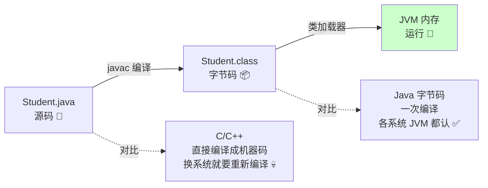

> 💡 跨平台秘密：**Windows/Linux/Mac 各有各的 JVM，但字节码是同一份** —— JVM 屏蔽了系统差异！

### JDK / JRE / JVM 三兄弟

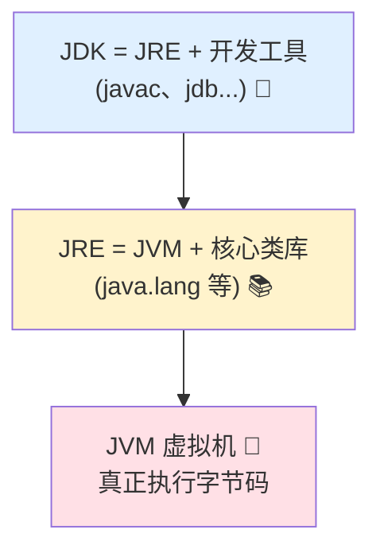

---

## 🏠 JVM 内存结构（重点）

**一句话理解**：JVM 内存 = 一栋大楼，不同区域住着不同的"住户"（数据）！🏢

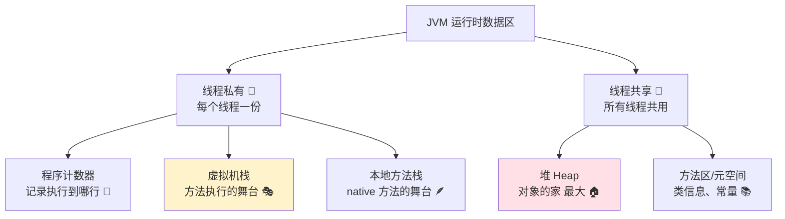

### 五大区域一览表

| 区域 | 线程 | 存什么 | 可能的异常 |
|------|:----:|--------|-----------|
| 程序计数器 | 私有 | 当前线程执行的字节码行号 | 唯一不会 OOM 的 🏆 |
| 虚拟机栈 | 私有 | **栈帧**（方法的局部变量表、操作数栈） | StackOverflowError |
| 本地方法栈 | 私有 | native 方法的栈帧 | StackOverflowError |
| **堆** | 共享 | **对象实例、数组**（GC 主战场） | OutOfMemoryError |
| **方法区** | 共享 | 类信息、常量、静态变量、JIT 编译代码 | OutOfMemoryError |

### 各区通俗理解 🏢

| 区域 | 类比 | 通俗解释 |
|------|------|---------|
| 程序计数器 | 书签 📖 | 线程切换回来时知道读到哪了 |
| 虚拟机栈 | 流水线工位 🎭 | 方法进来占个工位，干完走人 |
| 堆 | 大仓库 🏠 | new 出来的对象全堆这里（最大） |
| 方法区 | 图书馆 📚 | 类的"说明书"、常量都存这 |

> ⚠️ 方法区的变化：
> - JDK 7 及以前：方法区由"永久代"实现（在堆里，容易 OOM）
> - **JDK 8+：方法区由"元空间 Metaspace"实现（用本地内存），字符串常量池和静态变量移到了堆** ⭐

---

## 🎭 虚拟机栈详解

**一句话理解**：每调用一个方法，就往栈里压一个"栈帧"（方法的工作空间），方法结束就弹出！🗂️

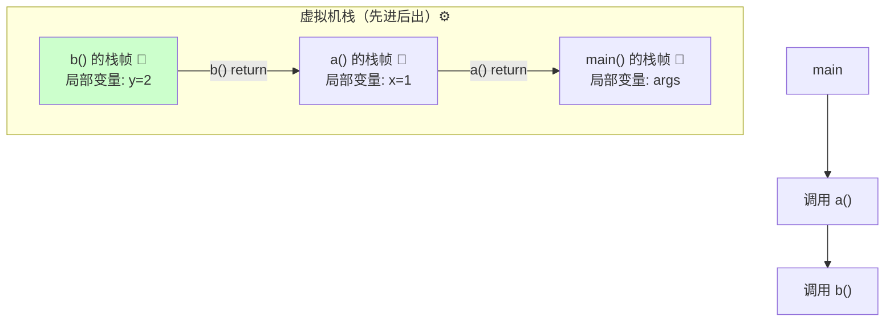

### 栈帧里有什么

| 组成 | 作用 |
|------|------|
| 局部变量表 | 存方法参数 + 局部变量 |
| 操作数栈 | 计算的临时工作台（如 `a+b` 的中间结果） |
| 动态链接 | 指向运行时常量池的方法引用 |
| 方法返回地址 | 方法干完活回到哪 |

### 两种栈异常

```java
// ① StackOverflowError：递归没出口，栈帧压爆了！💥
public void recursion() {
    recursion();              // 无限压栈 → StackOverflowError
}

// ② OutOfMemoryError：栈深度不够（-Xss 设置每个线程栈大小）
```

> 💡 面试常问：**栈溢出怎么排查？** 答：看异常堆栈顶的递归方法名，找到没写终止条件的递归！

---

## 🏠 堆与分代

**一句话理解**：几乎所有对象都住堆里，堆按"对象存活时间"分成新生代和老年代两块小区！🏘️

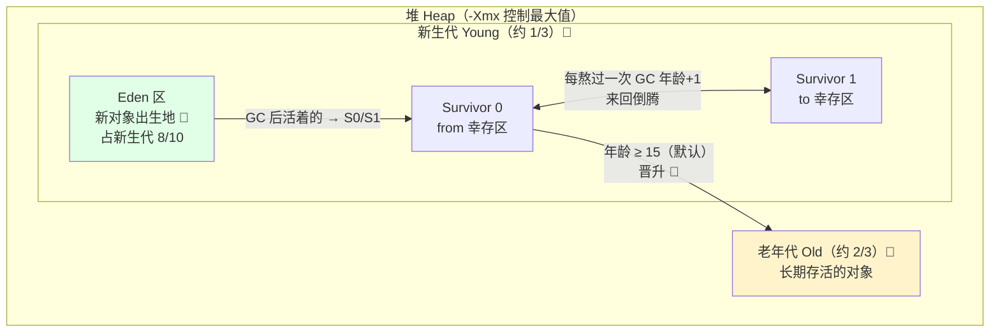

### 对象的一生 👶→🧑→👴

| 阶段 | 在哪 | 说明 |
|------|------|------|
| 出生 🍼 | Eden | new 出来先放 Eden |
| 小考验 🌱 | Survivor | Minor GC 后活下来 → S0/S1 来回倒腾，**每活一次年龄+1** |
| 退休 👴 | 老年代 | **年龄 ≥ 15**（4bit 上限）晋升 |
| 大对象 🐘 | 老年代 | 大对象直接进老年代（避免 Survivor 来回复制） |

### 两种 GC 名词

| 名称 | 回收哪 | 频率 | 速度 |
|------|--------|------|------|
| **Minor GC**（Young GC） | 新生代 | 频繁 | 快 ⚡ |
| **Full GC** | 整个堆 + 方法区 | 少 | **慢 💀（要尽量避免）** |

> ⚠️ Full GC 触发条件：老年代空间不足、元空间不足、System.gc() 等 —— **Full GC 频繁 = 系统卡顿的元凶**！

---

## 📚 类加载机制

**一句话理解**：.class 文件 → JVM 内存，要经历"加载→验证→准备→解析→初始化"五道工序！🏭

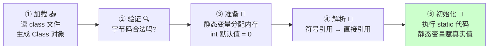

### 经典面试题：下面输出什么？

```java
public class Singleton {
    private static Singleton instance = new Singleton();   // ①
    private static int x = 0;                              // ②
    private static int y;                                  // ③

    private Singleton() {
        x++;         // 构造器执行时 y 还没被赋值
        y++;         // x=1, y=1（此刻 y 是默认值 0 参与计算）
    }

    public static void main(String[] args) {
        System.out.println(x);    // 0 ！① 执行后 y=1，但 ② 又把 x 覆盖回 0
        System.out.println(y);    // 1 ！③ 声明没有赋值语句，保留了构造器的成果
    }
}
```

> 💡 解题关键：**"准备"阶段给静态变量默认值，"初始化"阶段按代码顺序执行静态语句** —— ① 构造器先跑（x=1,y=1），② 把 x 覆盖成 0，③ 没有=号不再赋值～

### 类加载器有哪几个

| 加载器 | 负责 | 通俗理解 |
|--------|------|---------|
| Bootstrap 启动类加载器 | `JAVA_HOME/lib` 核心库 | 老祖宗（C++ 写的） |
| Extension 扩展类加载器 | `ext` 目录（8+ 改为 Platform） | 爷爷 |
| Application 应用类加载器 | 你写的 classpath | 爸爸（最常用） |
| 自定义加载器 | 随你定 | 儿子 |

---

## 👨‍👦 双亲委派机制（面试重点）

**一句话理解**：收到加载请求先"甩锅"给上级，上级加载不了自己再加载 —— 防止核心类被篡改！🛡️

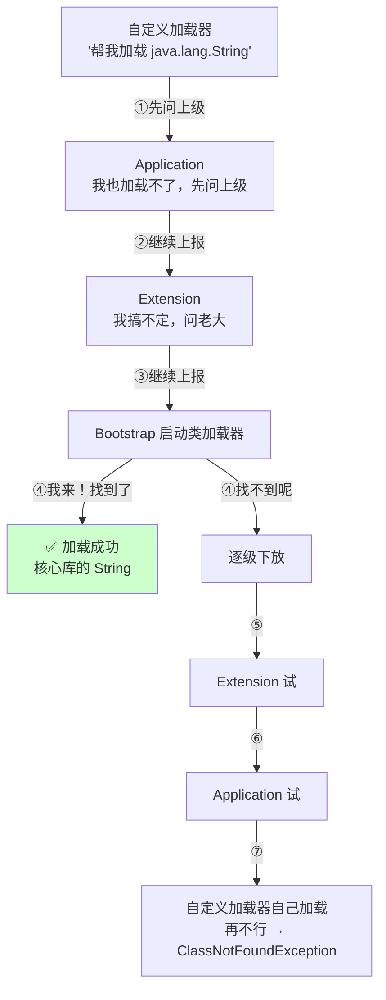

### 为什么要双亲委派？

| 好处 | 说明 |
|------|------|
| 🛡️ **安全** | 你自己写个 `java.lang.String` 想覆盖核心类？Bootstrap 优先加载正版的，你的假冒货没机会！ |
| 🚫 **防重复** | 同一个类只加载一次，保证类的全局唯一性 |

> 💡 面试答法：**"收到请求逐级向上委托，父加载器无法完成才自己加载"** —— 一句话 + 安全/防重复两个好处，满分！

---

## ♻️ GC 垃圾回收（重点）

### 怎么判断对象"死"了？

```java
// ① 引用计数法（JVM 不用！）：对象被引用+1，引用失效-1，为0就回收
//    致命缺陷：循环引用 A→B→B→A 永远数不到 0 💀

// ② 可达性分析（JVM 采用 ✅）：从 "GC Roots" 出发，引用链够不着的 = 垃圾
//    A → B → C，如果 A 没人引用了，整条链都是垃圾，一起回收！
```

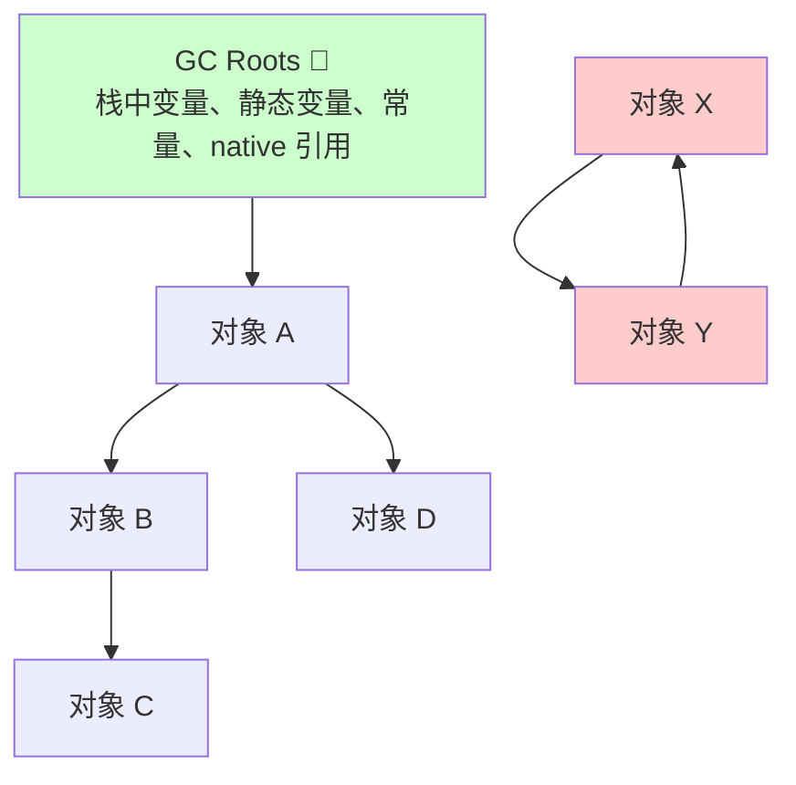

> 上图中 X 和 Y 互相引用但**够不着 GC Roots** → 判定为垃圾回收掉 ✅

### 四种引用（了解强度即可）

| 引用类型 | 回收时机 | 典型用途 |
|---------|---------|---------|
| 强引用 | **永不回收**（宁可 OOM） | `Object o = new Object()` |
| 软引用 SoftReference | **内存不足时**回收 | 缓存 |
| 弱引用 WeakReference | **下次 GC 必回收** | ThreadLocal 的 key |
| 虚引用 PhantomReference | 随时可能回收 | 堆外内存管理 |

---

## 🧹 垃圾回收算法

**一句话理解**：找到垃圾后怎么"扫走"，各有各的招！🧹

| 算法 | 思路 | 优点 | 缺点 | 用在哪 |
|------|------|------|------|--------|
| 标记-清除 | 标记垃圾 → 直接清 | 简单 | **内存碎片**、效率一般 | CMS |
| 标记-复制 | 活对象复制到另一半 → 整块清空 | **无碎片、高效** | 浪费一半空间 | **新生代** ⭐ |
| 标记-整理 | 活对象往一头挪 → 清边界外 | 无碎片 | 挪对象成本高 | **老年代** ⭐ |

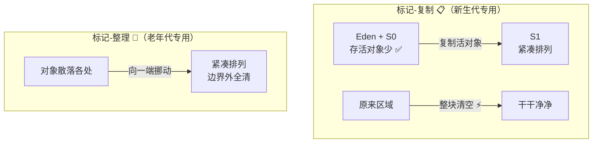

> 💡 为什么新生代用复制？因为**新生代对象 98% 活不过第一次 GC**，活的那一点点复制走超划算！
> 为什么老年代用整理？老年代存活率高，复制成本太大，挪一挪更划算～

---

## 🤖 常见垃圾回收器

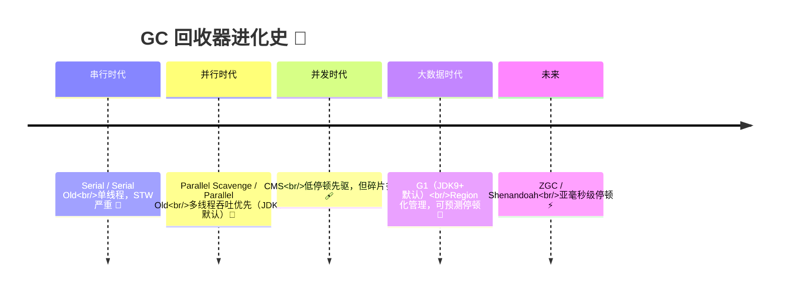

| 回收器 | 特点 | 适合 |
|--------|------|------|
| **Serial** | 单线程，STW | 客户端小内存 |
| **Parallel**（JDK8 默认） | 多线程并行，**吞吐量优先** | 后台计算型任务 |
| **CMS** | 并发标记清除，低停顿，**有碎片** | 老年代低延迟（已废弃）|
| **G1**（JDK9+ 默认）⭐ | 堆切成 2048 个 Region，**停顿时间可预测** | 大内存服务 ⭐ |
| **ZGC** | 着色指针，**停顿 < 1ms** | 超低延迟（JDK15+ 生产可用） |

> 💡 G1 核心思想：把大堆切成无数小格子（Region），每次只回收"垃圾最多"的格子（Garbage First 名字由来），优先保证用户设定的停顿目标！

---

## ⚙️ JVM 调优与常用工具

### 常用参数速查表

| 参数 | 作用 | 示例 |
|------|------|------|
| `-Xms` | 初始堆大小 | `-Xms512m` |
| `-Xmx` | 最大堆大小（**与 Xms 设一样，防抖动** ⭐） | `-Xmx2g` |
| `-Xmn` | 新生代大小 | `-Xmn1g` |
| `-Xss` | 线程栈大小 | `-Xss1m` |
| `-XX:MetaspaceSize` | 元空间初始大小 | `-XX:MetaspaceSize=256m` |
| `-XX:+UseG1GC` | 使用 G1 回收器 | |
| `-XX:MaxGCPauseMillis` | G1 目标停顿时间 | `=200` |
| `-XX:+HeapDumpOnOutOfMemoryError` | **OOM 时自动导出快照** ⭐ | 排查必备 |

```bash
# 生产常用组合拳 🥊
java -Xms4g -Xmx4g -Xss1m \
     -XX:MetaspaceSize=256m \
     -XX:+UseG1GC -XX:MaxGCPauseMillis=200 \
     -XX:+HeapDumpOnOutOfMemoryError \
     -XX:HeapDumpPath=/data/dump/ \
     -jar app.jar --spring.profiles.active=prod
```

### 调优基本思路

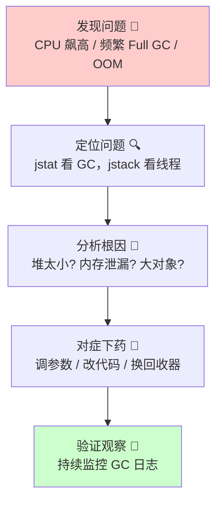

### 排查工具箱 🧰

| 工具 | 命令 | 干什么 |
|------|------|--------|
| jps | `jps -l` | 找出运行中的 Java 进程 |
| jstat | `jstat -gcutil pid 1000` | **每秒看 GC 情况** ⭐ |
| jstack | `jstack pid` | 看线程栈，**抓死锁/CPU 飙高** ⭐ |
| jmap | `jmap -dump:format=b,file=heap.hprof pid` | **导出堆快照**（OOM 排查）⭐ |
| MAT / VisualVM | 图形化 | 分析 dump 文件，找内存泄漏 |
| Arthas | `java -jar arthas-boot.jar` | **阿里神器**：在线诊断一切 🔥 |

```bash
# CPU 飙高排查三连 ⭐
top                     # 1. 找到吃 CPU 的进程 pid
top -Hp <pid>           # 2. 找到进程里吃 CPU 的线程 tid
printf '%x' <tid>       # 3. 线程号转 16 进制
jstack <pid> | grep -A 20 <hex_tid>   # 4. 在栈里找到对应线程在干嘛！
```

---

## 🚨 OOM 排查思路

### 常见 OOM 类型

| 报错 | 含义 | 常见原因 |
|------|------|---------|
| `java.lang.OutOfMemoryError: Java heap space` | 堆满了 | 内存泄漏 / 大对象 / 堆太小 |
| `OutOfMemoryError: GC overhead limit exceeded` | 98% 时间在 GC 却回收不了 | 堆快满死了 |
| `OutOfMemoryError: Metaspace` | 元空间满 | 动态类生成过多（CGLIB 滥用）|
| `OutOfMemoryError: unable to create new native thread` | 线程创建太多 | 线程池没限流 |

### 排查四步走

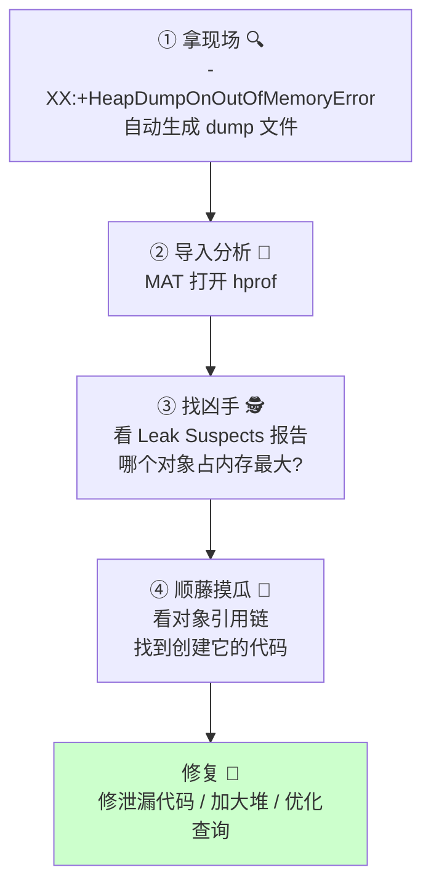

> 💡 经典泄漏案例：
> 1. **静态集合只加不删** → `static List` 无限膨胀
> 2. **ThreadLocal 用完不 remove** → 线程池场景脏数据堆积
> 3. **连接/流没关** → 未 try-with-resources
> 4. **一次查百万数据** → SQL 没有 limit

---

## 🎀 总结与小抄

### 知识地图回顾

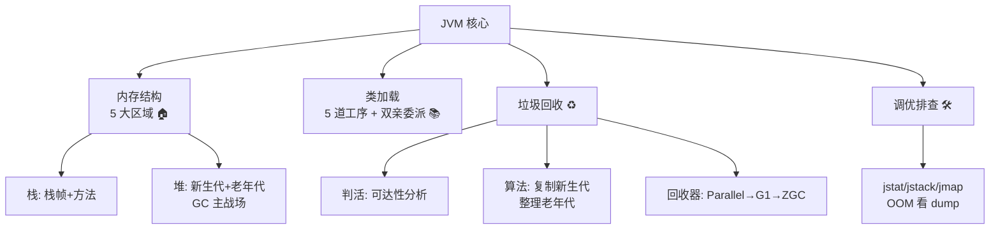

### 面试高频题速答卡 📌

| 问题 | 一句话答案 |
|------|-----------|
| JVM 内存分哪几块？ | 线程私有：程序计数器、虚拟机栈、本地方法栈；共享：堆、方法区 |
| 堆怎么分代？ | 新生代（Eden + S0 + S1）+ 老年代；对象 Eden 出生，年龄≥15 晋升 |
| 怎么判断对象可回收？ | 可达性分析：从 GC Roots 出发引用链够不着的就是垃圾（引用计数有循环引用缺陷）|
| 双亲委派是什么？ | 加载请求逐级上交父加载器，父级干不了再自己来；防核心类被篡改、防重复加载 |
| GC 算法有哪些？ | 标记-清除（有碎片）、标记-复制（新生代）、标记-整理（老年代）|
| Minor GC 和 Full GC 区别？ | 新生代回收快而频繁；Full GC 整堆+方法区慢，要尽量避免 |
| JDK 8 默认 GC？ | Parallel；JDK 9+ 默认 G1 |
| 栈溢出和堆溢出？ | StackOverflowError 递归无出口；OOM 堆满/泄漏，dump + MAT 排查 |

### 必记五条军规 ✊

1. **-Xms 和 -Xmx 设成一样大**，防止堆大小抖动影响性能！
2. **频繁 Full GC 是性能杀手** —— 用 jstat 盯住 FGC 列！
3. **OOM 排查三板斧**：HeapDumpOnOutOfMemoryError → MAT 分析 → 引用链定位！
4. **类加载背口诀**："加载验证准备解析初始化"，静态变量在准备阶段是默认值！
5. **生产环境必须配 Arthas**，线上问题排查神器！

---

> 🎉 恭喜通关 JVM！Java 三大终极 Boss（JUC 并发、JVM 虚拟机、Spring 框架）已全部击败！🏆
> 面试官问到内存结构、GC、双亲委派，直接把图画画出来惊艳全场～
> 接下来想学 Redis / 计算机网络 / MySQL 调优，随时来找我哦，比心～ 💗
