# ☕ Java 核心知识超全学习指南

> 嗨呀~ 欢迎来到 Java 的世界！☕ Java 是一门"一次编写，到处运行"的强类型语言，是后端开发的基石。这份指南会带你从基础到进阶，把 Java 核心知识一网打尽！准备好了吗？冲鸭！(ﾉ>ω<)ﾉ

---

## 📖 目录

- [一、Java 概述与环境](#一java-概述与环境)
- [二、基础语法](#二基础语法)
- [三、面向对象编程（OOP）](#三面向对象编程oop)
- [四、常用核心类](#四常用核心类)
- [五、集合框架（重点）](#五集合框架重点)
- [六、异常处理](#六异常处理)
- [七、多线程与并发（重灾区）](#七多线程与并发重灾区)
- [八、IO 流](#八io-流)
- [九、Java 8+ 新特性](#九java-8-新特性)
- [十、JVM 基础](#十jvm-基础)
- [十一、知识总结](#十一知识总结)

---

## 一、Java 概述与环境

### 1.1 Java 是什么？

> **Java** 是一门面向对象、跨平台、强类型的编程语言。核心口号：**Write Once, Run Anywhere（一次编写，到处运行）**。

### 1.2 跨平台原理 ☕

Java 能跨平台靠的是 **JVM（Java 虚拟机）**：

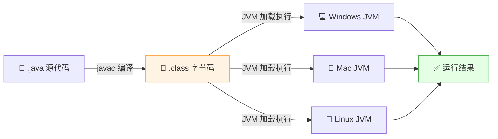

> 💡 **关键**：Java 跨平台是因为**不同系统装了不同的 JVM**，而 `.class` 字节码是通用的！

### 1.3 核心概念区分（常考）

| 概念 | 全称 | 说明 |
|:---:|:---|:---|
| **JVM** | Java Virtual Machine | Java 虚拟机，运行字节码 |
| **JRE** | Java Runtime Environment | 运行环境 = JVM + 核心类库（运行用） |
| **JDK** | Java Development Kit | 开发工具包 = JRE + 编译工具（开发用） |

关系：**JDK ⊃ JRE ⊃ JVM**

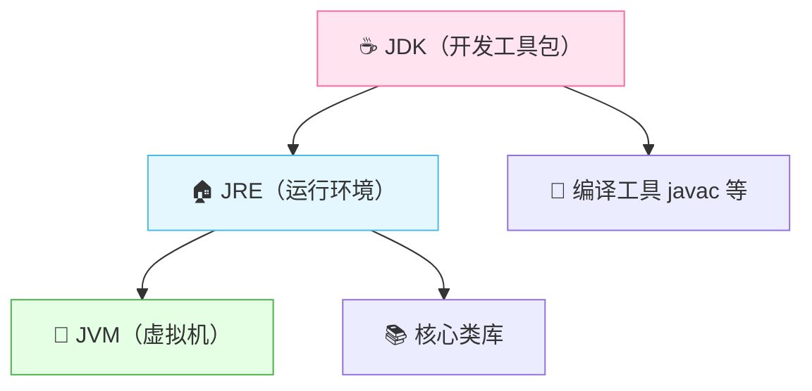

### 1.4 Java 三大版本

| 版本 | 全称 | 用途 |
|:---:|:---|:---|
| **JavaSE** | Standard Edition | 标准版，桌面/基础（学这个） |
| **JavaEE** | Enterprise Edition | 企业版，Web 后端开发 |
| **JavaME** | Micro Edition | 微型版，嵌入式（基本淘汰） |

---

## 二、基础语法

### 2.1 数据类型

Java 是**强类型语言**，每个变量必须声明类型。分两大类：

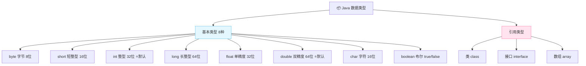

| 类型分类 | 类型 | 大小 | 取值范围 | 默认值 |
|:---:|:---:|:---:|:---|:---:|
| 整数 | byte | 1 字节 | -128 ~ 127 | 0 |
| | short | 2 字节 | -32768 ~ 32767 | 0 |
| | **int** ⭐ | 4 字节 | -2^31 ~ 2^31-1 | 0 |
| | long | 8 字节 | -2^63 ~ 2^63-1 | 0L |
| 浮点 | float | 4 字节 | ±3.4e38 | 0.0f |
| | **double** ⭐ | 8 字节 | ±1.8e308 | 0.0d |
| 字符 | char | 2 字节 | 0 ~ 65535 | '\u0000' |
| 布尔 | boolean | ~ | true / false | false |

> 🎀 **小贴士**：基本类型存**值**，引用类型存**地址（引用）**！

### 2.2 基本类型 vs 引用类型

```java
// 基本类型：存的是"值"本身
int a = 10;
int b = a;    // 把 a 的值 10 复制给 b
b = 20;       // 改 b 不影响 a
System.out.println(a);  // 还是 10

// 引用类型：存的是"地址"
int[] arr1 = {1, 2, 3};
int[] arr2 = arr1;   // 把 arr1 的地址复制给 arr2，指向同一个数组！
arr2[0] = 99;        // 改的是同一个数组
System.out.println(arr1[0]);  // 变成了 99！
```

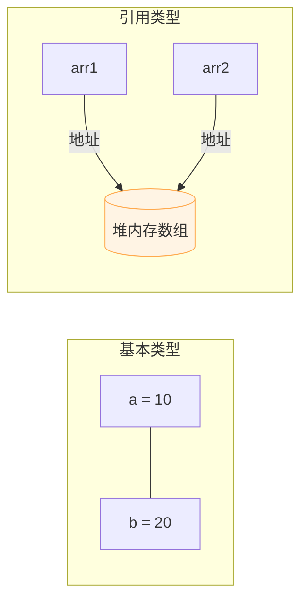

### 2.3 自动装箱拆箱

Java 为每个基本类型都提供了**包装类**（引用类型版本）：

| 基本类型 | 包装类 |
|:---:|:---:|
| int | Integer |
| long | Long |
| double | Double |
| char | Character |
| boolean | Boolean |
| ... | ... |

```java
// 自动装箱：基本类型 → 包装类
Integer i = 10;   // 实际：Integer.valueOf(10)

// 自动拆箱：包装类 → 基本类型
int n = i;        // 实际：i.intValue()
```

> ⚠️ **Integer 缓存坑**：`Integer` 在 -128~127 范围内有缓存，用 `==` 比较可能为 true，超出范围就 false！**包装类比较一律用 `.equals()`**！

```java
Integer a = 127;
Integer b = 127;
System.out.println(a == b);   // true（缓存）

Integer c = 128;
Integer d = 128;
System.out.println(c == d);   // false（超出缓存，新对象）
System.out.println(c.equals(d)); // true ✅ 推荐用 equals
```

### 2.4 关键字速查

| 关键字 | 作用 |
|:---:|:---|
| `final` | 修饰类不能继承、方法不能重写、变量不可变 |
| `static` | 静态的，属于类而非对象 |
| `abstract` | 抽象的，类不能实例化、方法需子类实现 |
| `synchronized` | 同步锁，保证线程安全 |
| `volatile` | 保证变量可见性，禁止指令重排 |
| `transient` | 序列化时忽略该字段 |
| `instanceof` | 判断对象是否属于某类型 |

---

## 三、面向对象编程（OOP）

### 3.1 三大特性

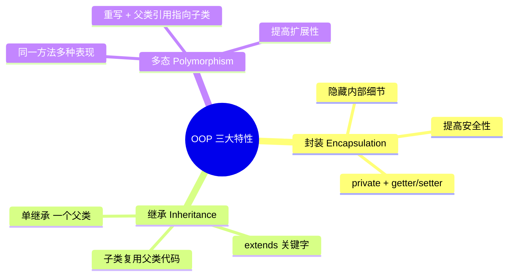

### 3.2 封装

> **封装** = 隐藏对象内部细节，对外提供公共访问方式。

```java
public class Person {
    private String name;   // 私有属性，外部不能直接访问
    
    // 提供 getter/setter
    public String getName() {
        return name;
    }
    public void setName(String name) {
        this.name = name;
    }
}
```

### 3.3 继承

> **继承** = 子类继承父类的属性和方法，实现代码复用。Java 是**单继承**（一个类只能有一个直接父类）。

```java
class Animal {
    String name;
    public void eat() {
        System.out.println(name + "在吃饭");
    }
}

// Dog 继承 Animal
class Dog extends Animal {
    public void bark() {
        System.out.println(name + "在汪汪叫");
    }
}

Dog dog = new Dog();
dog.name = "旺财";   // 继承来的属性
dog.eat();           // 继承来的方法
dog.bark();          // 自己的方法
```

### 3.4 多态 ⭐

> **多态** = 父类引用指向子类对象，同一个方法调用会表现出不同的行为。

**三个前提**：① 继承/实现 ② 方法重写 ③ 父类引用指向子类对象

```java
class Animal {
    public void speak() {
        System.out.println("动物叫");
    }
}
class Dog extends Animal {
    @Override
    public void speak() {
        System.out.println("汪汪汪");
    }
}
class Cat extends Animal {
    @Override
    public void speak() {
        System.out.println("喵喵喵");
    }
}

// 多态：父类引用 = 子类对象
Animal a1 = new Dog();
Animal a2 = new Cat();
a1.speak();  // 汪汪汪 —— 运行时看实际类型！
a2.speak();  // 喵喵喵
```

> 💡 **多态的本质**：编译看左边（父类），运行看右边（子类）。这就是**动态绑定**！

### 3.5 重载 vs 重写（常考易混）

| 对比项 | 重载 Overload | 重写 Override |
|:---|:---|:---|
| **发生位置** | 同一个类中 | 父子类之间 |
| **方法名** | 相同 | 相同 |
| **参数列表** | **必须不同** | **必须相同** |
| **返回值** | 无要求 | 相同或子类（协变） |
| **访问权限** | 无要求 | 不能比父类更严 |
| **作用** | 提供同名的不同方法 | 子类改写父类行为 |

```java
// 重载：同类中，方法名同，参数不同
class Calculator {
    public int add(int a, int b) { return a + b; }
    public double add(double a, double b) { return a + b; }  // 重载
}

// 重写：子类改写父类方法
class Animal {
    public void speak() {}
}
class Dog extends Animal {
    @Override
    public void speak() { System.out.println("汪汪"); }  // 重写
}
```

### 3.6 抽象类 vs 接口（高频面试题）⭐

| 对比项 | 抽象类 abstract | 接口 interface |
|:---|:---|:---|
| **关键字** | `abstract class` | `interface` |
| **继承/实现** | 单继承 `extends` | 多实现 `implements` |
| **成员变量** | 任意类型 | 默认 `public static final` |
| **方法** | 可有普通方法 | Java8 前全抽象，8+ 可有 default/static |
| **构造方法** | 有 | 没有 |
| **设计理念** | "是什么"（有共同本质） | "能做什么"（有能力契约） |

```java
// 抽象类：有共同本质的类
abstract class Animal {
    abstract void speak();   // 抽象方法，子类必须实现
    public void breathe() {  // 普通方法，子类直接用
        System.out.println("呼吸");
    }
}

// 接口：能力契约，可多实现
interface Flyable {
    void fly();
}
interface Swimmable {
    void swim();
}

// 一个类可以继承一个抽象类 + 实现多个接口
class Duck extends Animal implements Flyable, Swimmable {
    @Override
    void speak() { System.out.println("嘎嘎"); }
    @Override
    public void fly() { System.out.println("飞起来"); }
    @Override
    public void swim() { System.out.println("游起来"); }
}
```

### 3.7 static 与 final

| 修饰符 | 修饰类 | 修饰方法 | 修饰变量 |
|:---:|:---|:---|:---|
| **static** | ✗（内部类可以） | 类方法，通过类名调用 | 类变量，所有对象共享 |
| **final** | 不能被继承 | 不能被重写 | 常量，不可重新赋值 |

```java
public class Counter {
    static int count = 0;     // 类变量，所有对象共享
    final int MAX = 100;      // 常量，不可变
    
    public Counter() {
        count++;              // 每创建一个对象，count+1
    }
    
    public static int getCount() {  // 类方法，可直接 Counter.getCount()
        return count;
    }
}
```

---

## 四、常用核心类

### 4.1 String 详解 ⭐

> **String 是不可变类**（immutable），一旦创建不可修改。这是面试重点！

```java
String s = "hello";
s = s + " world";  // 看着像修改了，其实是创建了新对象！

// 底层 final 修饰
// private final char[] value;  // JDK8
// private final byte[] value;  // JDK9+ 优化
```

**为什么 String 不可变？**
1. **线程安全**：不可变天然线程安全
2. **HashCode 缓存**：hashCode 不会变，适合做 HashMap 的 key
3. **字符串常量池**：可以复用，节省内存

### 4.2 String vs StringBuilder vs StringBuffer

| 对比 | String | StringBuilder | StringBuffer |
|:---:|:---|:---|:---|
| **可变性** | 不可变 | 可变 | 可变 |
| **线程安全** | 安全（不可变） | 不安全 | 安全（synchronized） |
| **性能** | 拼接慢（建新对象） | 最快 | 较快 |
| **使用场景** | 少量字符串 | 单线程拼接 | 多线程拼接 |

```java
// ❌ 大量拼接用 String，会产生很多临时对象
String s = "";
for (int i = 0; i < 1000; i++) {
    s += i;  // 每次都创建新对象，性能差！
}

// ✅ 用 StringBuilder
StringBuilder sb = new StringBuilder();
for (int i = 0; i < 1000; i++) {
    sb.append(i);  // 在原对象上操作，高效！
}
String result = sb.toString();
```

### 4.3 常用工具类

| 类 | 用途 | 常用方法 |
|:---:|:---|:---|
| **Math** | 数学运算 | `abs()`, `max()`, `random()`, `sqrt()` |
| **Arrays** | 数组操作 | `sort()`, `toString()`, `asList()` |
| **Collections** | 集合操作 | `sort()`, `reverse()`, `shuffle()` |
| **Objects** | 对象操作 | `equals()`, `hashCode()`, `isNull()` |

---

## 五、集合框架（重点）

⭐ Java 集合是面试**必考**的重头戏！务必掌握。

### 5.1 集合框架全景图

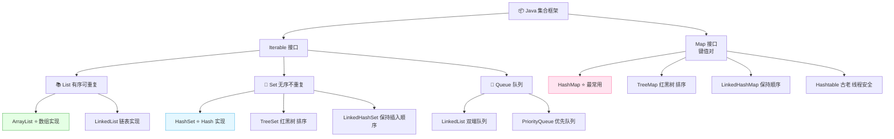

### 5.2 List 系列

**特点**：有序、可重复、可通过索引访问。

| 实现类 | 底层结构 | 查询 | 增删 | 特点 |
|:---:|:---|:---:|:---:|:---|
| **ArrayList** ⭐ | 数组 | O(1) 快 | O(n) 慢 | 默认容量 10，扩容 1.5 倍 |
| **LinkedList** | 双向链表 | O(n) 慢 | O(1) 快 | 同时是 Deque（双端队列） |

```java
List<String> list = new ArrayList<>();
list.add("Java");
list.add("Python");
list.add("Java");       // 允许重复
list.get(0);            // 按索引取：Java
list.remove(1);         // 删除索引1
list.size();            // 2
```

### 5.3 Set 系列

**特点**：无序（除 LinkedHashSet）、不重复。

| 实现类 | 底层结构 | 是否有序 | 是否允许 null |
|:---:|:---|:---:|:---:|
| **HashSet** ⭐ | HashMap | 无序 | 允许 1 个 |
| LinkedHashSet | LinkedHashMap | 插入顺序 | 允许 1 个 |
| TreeSet | 红黑树 | 自然排序 | 不允许 |

```java
Set<String> set = new HashSet<>();
set.add("Java");
set.add("Python");
set.add("Java");    // 重复，添加失败
System.out.println(set.size());  // 2
```

### 5.4 Map 系列（重中之重）⭐⭐

**HashMap 是面试绝对重点！**

| 实现类 | 底层结构 | 是否有序 | 线程安全 | null 键值 |
|:---:|:---|:---:|:---:|:---:|
| **HashMap** ⭐ | 数组+链表+红黑树 | 无序 | 不安全 | 允许 |
| LinkedHashMap | HashMap+链表 | 插入序 | 不安全 | 允许 |
| TreeMap | 红黑树 | 键排序 | 不安全 | 键不允许 |
| Hashtable | 数组+链表 | 无序 | 安全 | 不允许 |

### 5.5 HashMap 原理详解（面试高频）

#### 底层结构（JDK 8+）

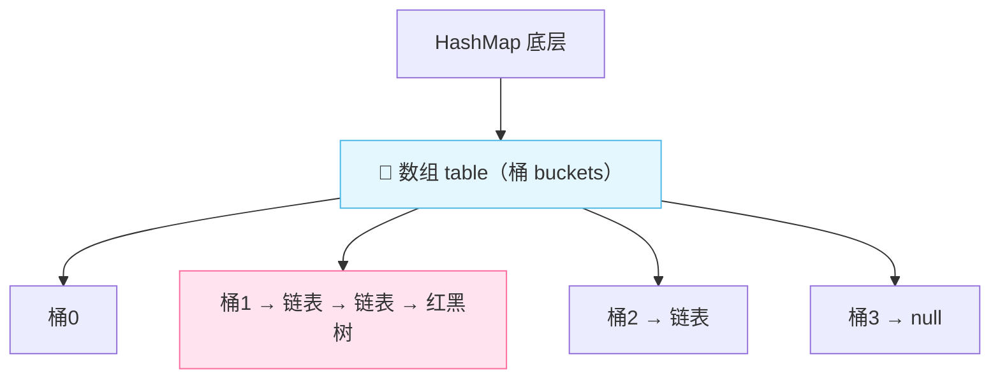

> **核心**：JDK8 的 HashMap = **数组 + 链表 + 红黑树**
> - 数组是主体，每个位置叫"桶"
> - 哈希冲突时，用链表存储（拉链法）
> - 链表长度 ≥8 且数组长度 ≥64 时，链表转红黑树（提升查询效率）
> - 红黑树节点 ≤6 时，退化回链表

#### put 流程

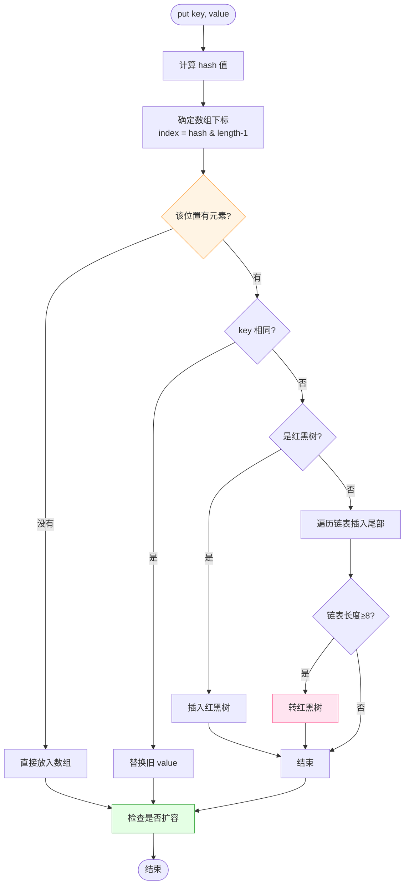

#### 核心参数

| 参数 | 默认值 | 说明 |
|:---|:---|:---|
| 初始容量 | 16 | 数组初始长度 |
| 负载因子 | 0.75 | 达到 75% 容量就扩容 |
| 树化阈值 | 8 | 链表长度≥8 尝试转树 |
| 退化阈值 | 6 | 红黑树节点≤6 转链表 |
| 最小树化容量 | 64 | 数组长度<64 时优先扩容而非树化 |

> 💡 **扩容**：每次扩容为原来的 **2 倍**（这样 hash & (n-1) 重新分布更均匀）。

### 5.6 集合的线程安全问题

```java
// ❌ ArrayList 线程不安全，多线程下可能丢数据
List<String> list = new ArrayList<>();

// ✅ 方式1：用 Vector（古老，加锁，性能差）
List<String> list1 = new Vector<>();

// ✅ 方式2：Collections 工具方法包装
List<String> list2 = Collections.synchronizedList(new ArrayList<>());

// ✅ 方式3：JUC 包的 CopyOnWriteArrayList（推荐）
List<String> list3 = new CopyOnWriteArrayList<>();
```

---

## 六、异常处理

### 6.1 异常体系

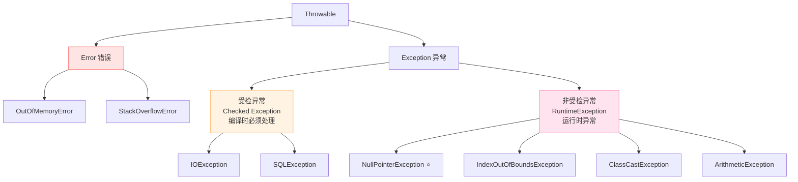

### 6.2 异常分类

| 类型 | 说明 | 例子 | 是否必须处理 |
|:---|:---|:---|:---:|
| **Error** | 严重错误，程序无法处理 | OOM、栈溢出 | 否（也处理不了） |
| **受检异常** | 编译器强制处理 | IOException、SQLException | ✅ 必须 try-catch/throws |
| **运行时异常** | 编程逻辑错误 | 空指针、数组越界 | 否 |

### 6.3 try-catch-finally

```java
try {
    // 可能抛异常的代码
    int result = 10 / 0;  // ArithmeticException
} catch (ArithmeticException e) {
    // 捕获并处理特定异常
    System.out.println("除零错误：" + e.getMessage());
} catch (Exception e) {
    // 捕获其他异常（父类异常放后面）
    System.out.println("其他错误");
} finally {
    // 无论是否异常都会执行（通常用于关闭资源）
    System.out.println("清理资源");
}

// JDK7+ try-with-resources（自动关闭实现了 AutoCloseable 的资源）
try (FileReader fr = new FileReader("a.txt")) {
    // 使用资源，无需手动 close
} catch (IOException e) {
    e.printStackTrace();
}
```

> 💡 **finally 不执行的唯一情况**：`System.exit(0)` 提前退出 JVM。

### 6.4 throw vs throws

| 对比 | throw | throws |
|:---|:---|:---|
| **位置** | 方法体内 | 方法签名后 |
| **作用** | 抛出异常对象 | 声明可能抛出的异常 |
| **个数** | 一次抛一个 | 可声明多个 |

```java
public void checkAge(int age) throws IllegalArgumentException {
    if (age < 0) {
        throw new IllegalArgumentException("年龄不能为负数");  // 主动抛出
    }
}
```

---

## 七、多线程与并发（重灾区）

⭐⭐ Java 并发是面试**重中之重**，也是难点！

### 7.1 线程 vs 进程

| 对比 | 进程 | 线程 |
|:---|:---|:---|
| **本质** | 程序运行实例 | 进程内的执行单元 |
| **资源** | 独立内存空间 | 共享进程内存 |
| **开销** | 大 | 小 |
| **通信** | 难（IPC） | 简单（共享内存） |
| **类比** | 一个工厂 | 工厂里的一个工人 |

### 7.2 创建线程的方式

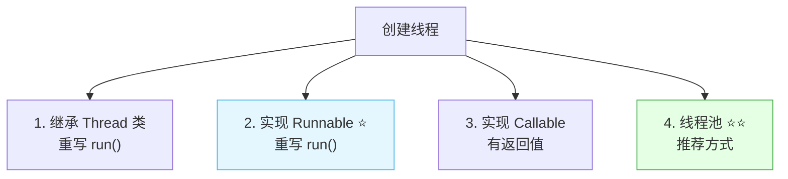

```java
// 方式1：继承 Thread（单继承局限）
class MyThread extends Thread {
    @Override
    public void run() {
        System.out.println("线程运行：" + Thread.currentThread().getName());
    }
}
new MyThread().start();

// 方式2：实现 Runnable（推荐，可多实现）
class MyRunnable implements Runnable {
    @Override
    public void run() {
        System.out.println("Runnable 运行");
    }
}
new Thread(new MyRunnable()).start();

// 方式3：Callable + Future（有返回值）
Callable<Integer> task = () -> {
    Thread.sleep(1000);
    return 42;
};
FutureTask<Integer> future = new FutureTask<>(task);
new Thread(future).start();
Integer result = future.get();  // 阻塞等待结果
```

> 💡 **start() vs run()**：`start()` 会创建新线程并执行 run()；直接调 `run()` 只是普通方法调用，不会新开线程！

### 7.3 线程生命周期

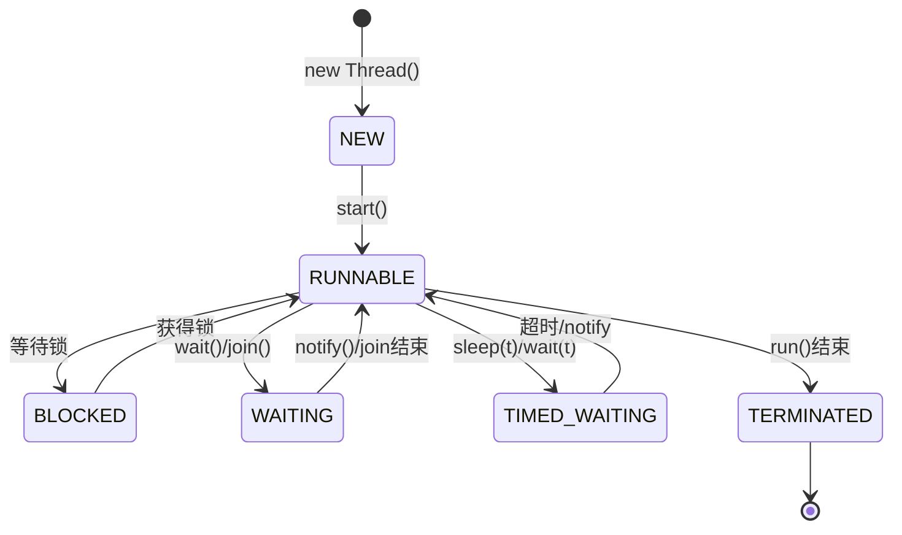

| 状态 | 说明 |
|:---|:---|
| **NEW** | 已创建但未 start |
| **RUNNABLE** | 可运行（可能在等 CPU） |
| **BLOCKED** | 等待获取锁 |
| **WAITING** | 无限等待（需被唤醒） |
| **TIMED_WAITING** | 限时等待 |
| **TERMINATED** | 执行结束 |

### 7.4 线程同步（synchronized）

> 多个线程操作共享数据时，会产生**线程安全**问题。`synchronized` 是最基本的解决方式。

```java
// 问题：卖票超卖
class Ticket implements Runnable {
    private int tickets = 100;
    
    @Override
    public void run() {
        while (tickets > 0) {
            // ❌ 多线程下 tickets 可能同时>0，导致超卖
            System.out.println(Thread.currentThread().getName() + " 卖出：" + tickets--);
        }
    }
}

// 解决：加 synchronized 锁
class SafeTicket implements Runnable {
    private int tickets = 100;
    
    @Override
    public void run() {
        while (true) {
            synchronized (this) {   // 加锁，同一时刻只有一个线程能进入
                if (tickets <= 0) break;
                System.out.println(Thread.currentThread().getName() + " 卖出：" + tickets--);
            }
        }
    }
}
```

### 7.5 synchronized vs Lock

| 对比 | synchronized | Lock（ReentrantLock） |
|:---|:---|:---|
| **类型** | 关键字（JVM 层） | API 层（java.util.concurrent） |
| **释放锁** | 自动（出代码块/异常） | 手动 `unlock()`（必须 finally） |
| **可中断** | 不可中断 | 可中断 `lockInterruptibly()` |
| **公平锁** | 非公平 | 可选公平/非公平 |
| **条件绑定** | 一个条件 `wait/notify` | 多个 Condition |

### 7.6 volatile 关键字

> **volatile** = 轻量级同步机制，保证**可见性**和**有序性**，但不保证**原子性**。

| 特性 | 是否保证 | 说明 |
|:---:|:---:|:---|
| 可见性 | ✅ | 一个线程修改，其他线程立即看到 |
| 有序性 | ✅ | 禁止指令重排序 |
| 原子性 | ❌ | `i++` 仍然不安全 |

```java
// 经典用法：双重检查单例
public class Singleton {
    private static volatile Singleton instance;  // volatile 防止指令重排
    
    public static Singleton getInstance() {
        if (instance == null) {                   // 第一次检查（提高性能）
            synchronized (Singleton.class) {
                if (instance == null) {            // 第二次检查（防止重复创建）
                    instance = new Singleton();   // 非原子操作，可能重排！
                }
            }
        }
        return instance;
    }
}
```

### 7.7 线程池（重点）⭐

> 线程池 = 管理线程的"池子"，避免频繁创建销毁线程，提高性能。

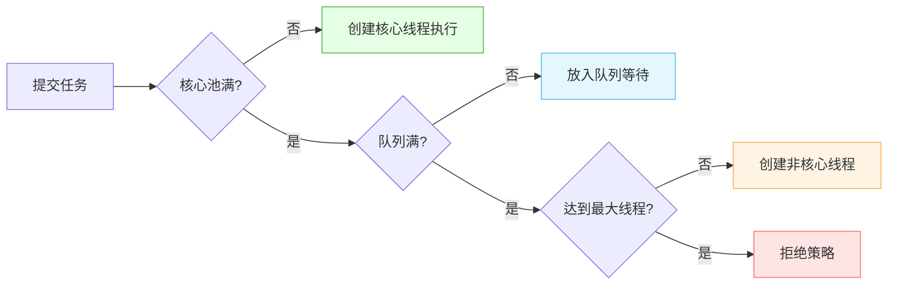

#### 七大核心参数

```java
public ThreadPoolExecutor(
    int corePoolSize,          // 1. 核心线程数
    int maximumPoolSize,      // 2. 最大线程数
    long keepAliveTime,        // 3. 非核心线程空闲存活时间
    TimeUnit unit,            // 4. 时间单位
    BlockingQueue<Runnable> workQueue,  // 5. 任务队列
    ThreadFactory threadFactory,        // 6. 线程工厂
    RejectedExecutionHandler handler     // 7. 拒绝策略
)
```

| 参数 | 说明 |
|:---|:---|
| 核心线程数 | 常驻线程数 |
| 最大线程数 | 能创建的最大线程数 |
| 存活时间 | 非核心线程的空闲存活时间 |
| 任务队列 | 存放待执行任务 |
| 线程工厂 | 创建线程的方式 |
| 拒绝策略 | 任务太多处理不过来怎么办 |

#### 四种拒绝策略

| 策略 | 行为 |
|:---|:---|
| **AbortPolicy**（默认） | 抛 RejectedExecutionException |
| CallerRunsPolicy | 由提交任务的线程执行 |
| DiscardPolicy | 直接丢弃，不报错 |
| DiscardOldestPolicy | 丢弃队列最老的任务，尝试添加新的 |

#### 使用示例

```java
// 推荐方式：手动创建线程池（阿里规范不建议用 Executors 工具方法）
ThreadPoolExecutor pool = new ThreadPoolExecutor(
    2,                      // 核心线程数
    5,                      // 最大线程数
    30, TimeUnit.SECONDS,   // 空闲存活时间
    new LinkedBlockingQueue<>(10),  // 任务队列容量10
    Executors.defaultThreadFactory(),
    new ThreadPoolExecutor.AbortPolicy()  // 拒绝策略
);

pool.execute(() -> {
    System.out.println("任务执行");
});

pool.shutdown();  // 关闭线程池
```

> ⚠️ **阿里规范**：禁止用 `Executors.newFixedThreadPool()` 等工具方法，因为它们用的是无界队列，可能导致 OOM！要手动创建 `ThreadPoolExecutor`。

### 7.8 并发工具包 JUC

| 工具 | 作用 |
|:---|:---|
| **CountDownLatch** | 倒计时锁存器，等待 N 个线程完成 |
| **CyclicBarrier** | 循环屏障，N 个线程相互等待 |
| **Semaphore** | 信号量，控制并发访问数 |
| **ConcurrentHashMap** | 线程安全的 HashMap |
| **CopyOnWriteArrayList** | 写时复制，读多写少场景 |
| **AtomicInteger** 等 | 原子类，无锁并发 |

---

## 八、IO 流

### 8.1 IO 流分类

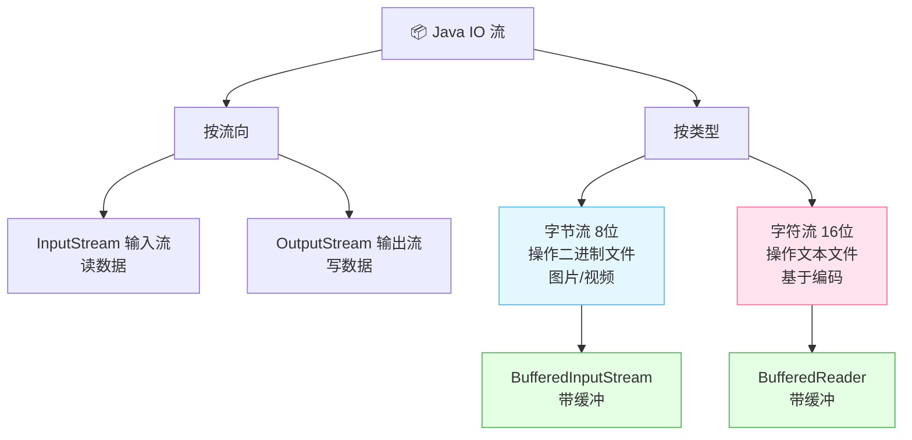

### 8.2 字节流 vs 字符流

| 对比 | 字节流 | 字符流 |
|:---|:---|:---|
| **单位** | 字节（byte） | 字符（char） |
| **底层** | 直接操作二进制 | 字节流 + 编码 |
| **适合** | 图片、视频等二进制 | 文本文件 |
| **基类** | InputStream/OutputStream | Reader/Writer |

### 8.3 读写文件示例

```java
// 字节流读写（适合二进制文件）
try (FileInputStream fis = new FileInputStream("a.jpg");
     FileOutputStream fos = new FileOutputStream("b.jpg")) {
    byte[] buffer = new byte[1024];
    int len;
    while ((len = fis.read(buffer)) != -1) {
        fos.write(buffer, 0, len);
    }
}

// 字符流读写（适合文本文件，带缓冲提高性能）
try (BufferedReader br = new BufferedReader(new FileReader("a.txt"));
     BufferedWriter bw = new BufferedWriter(new FileWriter("b.txt"))) {
    String line;
    while ((line = br.readLine()) != null) {
        bw.write(line);
        bw.newLine();
    }
}
```

### 8.4 序列化

> **序列化** = 把对象转成字节序列（存文件/网络传输）；**反序列化** = 把字节序列还原成对象。

```java
// 实现 Serializable 接口
class User implements Serializable {
    private static final long serialVersionUID = 1L;  // 版本号
    private String name;
    private transient String password;  // transient 不参与序列化
}

// 序列化
try (ObjectOutputStream oos = new ObjectOutputStream(new FileOutputStream("user.dat"))) {
    oos.writeObject(new User());
}

// 反序列化
try (ObjectInputStream ois = new ObjectInputStream(new FileInputStream("user.dat"))) {
    User user = (User) ois.readObject();
}
```

---

## 九、Java 8+ 新特性

### 9.1 Lambda 表达式 ⭐

> Lambda = 匿名函数，让代码更简洁，主要用于函数式接口。

```java
// 之前：匿名内部类
Runnable r1 = new Runnable() {
    @Override
    public void run() {
        System.out.println("运行");
    }
};

// Java8：Lambda
Runnable r2 = () -> System.out.println("运行");

// 集合排序
List<String> list = Arrays.asList("banana", "apple", "cherry");
list.sort((a, b) -> a.compareTo(b));       // Lambda
list.sort(String::compareTo);               // 方法引用，更简洁
```

### 9.2 函数式接口

> 只有一个抽象方法的接口，可用 `@FunctionalInterface` 标注。

| 内置接口 | 参数 | 返回 | 用途 |
|:---|:---|:---|:---|
| `Supplier<T>` | 无 | T | 生产者，提供数据 |
| `Consumer<T>` | T | void | 消费者，消费数据 |
| `Function<T,R>` | T | R | 转换 T→R |
| `Predicate<T>` | T | boolean | 判断条件 |

### 9.3 Stream API ⭐

> Stream = 对集合的流式函数式操作，代码优雅、可并行。

```java
List<String> names = Arrays.asList("Tom", "Jerry", "Alice", "Bob", "Tim");

// 需求：筛选以 T 开头的名字，转大写，收集到新 List
List<String> result = names.stream()
    .filter(n -> n.startsWith("T"))   // 过滤
    .map(String::toUpperCase)         // 转换
    .sorted()                         // 排序
    .collect(Collectors.toList());    // 收集
// 结果：[TIM, TOM]
```

#### 常用中间操作

| 方法 | 作用 |
|:---|:---|
| `filter()` | 过滤 |
| `map()` | 转换映射 |
| `sorted()` | 排序 |
| `distinct()` | 去重 |
| `limit(n)` | 取前 n 个 |
| `skip(n)` | 跳过前 n 个 |

#### 常用终止操作

| 方法 | 作用 |
|:---|:---|
| `collect()` | 收集成集合 |
| `forEach()` | 遍历 |
| `count()` | 计数 |
| `reduce()` | 归约 |
| `findFirst()` | 找第一个 |

### 9.4 Optional

> Optional = 优雅处理 null，避免 NPE。

```java
// ❌ 之前：手动判空
if (user != null) {
    if (user.getAddress() != null) {
        System.out.println(user.getAddress().getCity());
    }
}

// ✅ Optional 链式
Optional.ofNullable(user)
    .map(User::getAddress)
    .map(Address::getCity)
    .ifPresent(System.out::println);
```

### 9.5 新特性速览

| 版本 | 重要特性 |
|:---|:---|
| Java 8 | Lambda、Stream、Optional、接口 default 方法、新日期 API |
| Java 9 | 模块化、JShell |
| Java 11 | var 局部变量类型推断、HTTP Client |
| Java 17 | Record 类、密封类、模式匹配 |

```java
// var 类型推断（Java 11+）
var list = new ArrayList<String>();  // 编译器推断类型

// Record 类（Java 17+）—— 自动生成构造/getter/equals/hashCode
record Point(int x, int y) {}

Point p = new Point(1, 2);
p.x();  // 1
```

---

## 十、JVM 基础

### 10.1 JVM 运行时数据区

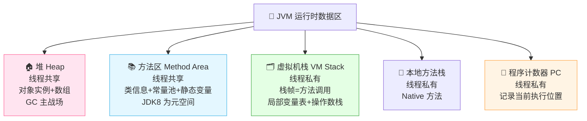

| 区域 | 线程共享 | 存什么 | 可能异常 |
|:---|:---:|:---|:---|
| **堆** | ✅ 共享 | 对象实例、数组 | OOM |
| **方法区（元空间）** | ✅ 共享 | 类信息、常量池、静态变量 | OOM |
| **虚拟机栈** | ❌ 私有 | 方法调用的栈帧 | StackOverflowError/OOM |
| **本地方法栈** | ❌ 私有 | Native 方法调用 | StackOverflowError/OOM |
| **程序计数器** | ❌ 私有 | 当前执行指令地址 | 不会出错 |

### 10.2 垃圾回收（GC）

#### 判断对象是否存活：可达性分析

> 从 **GC Roots** 出发，能到达的对象就是活的，到达不了的就是垃圾。

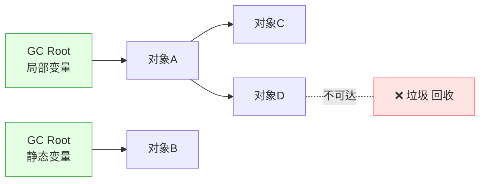

**GC Roots 包括**：
- 虚拟机栈中的局部变量
- 方法区的静态变量
- 方法区的常量
- 本地方法栈中的引用

#### 分代回收算法

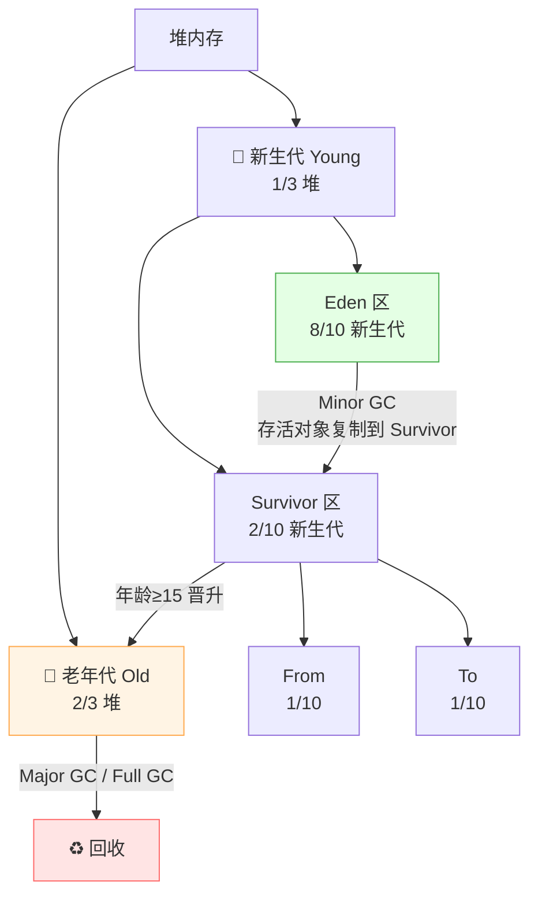

| 概念 | 说明 |
|:---|:---|
| 新生代 | 新创建的对象，Eden + 2 个 Survivor，Minor GC 频繁 |
| 老年代 | 存活较久的对象，Major GC/Full GC 较少 |
| Minor GC | 只清理新生代，频率高、速度快 |
| Full GC | 清理整个堆，频率低、速度慢、应尽量避免 |

#### 常见垃圾回收器

| 回收器 | 特点 | 适合 |
|:---|:---|:---|
| Serial | 单线程，最古老 | 客户端/小应用 |
| Parallel | 多线程，吞吐量优先 | 后台计算 |
| CMS | 低延迟，并发标记清除 | 对响应时间敏感 |
| **G1** ⭐ | 分区域，可预测停顿 | 大堆、服务端 |
| **ZGC** | 超低延迟 | 超大堆、低延迟 |

---

## 十一、知识总结

最后用思维导图把所有知识点串起来 📝✨：

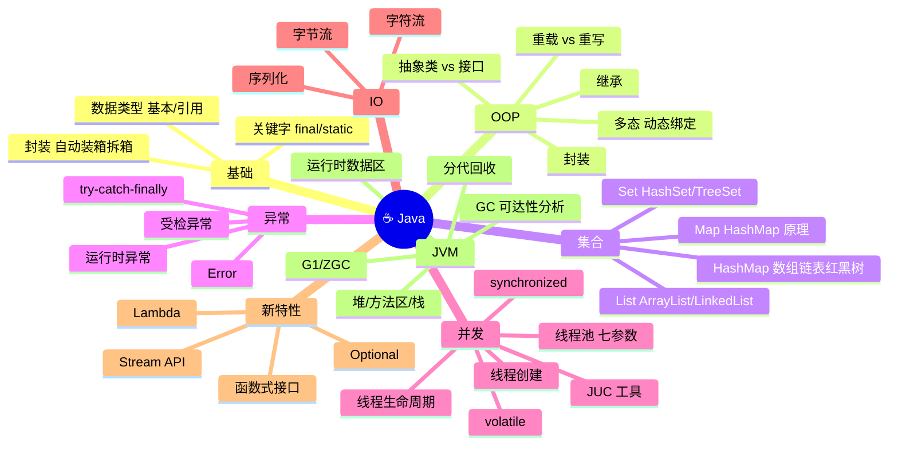

### 🎯 核心要点速记

1. **跨平台靠 JVM**：源码→字节码→JVM 执行，JDK ⊃ JRE ⊃ JVM。
2. **基本类型存值，引用类型存地址**；Integer 有缓存（-128~127），比较用 equals。
3. **OOP 三大特性**：封装、继承、多态（动态绑定）。
4. **重载**同类同方法名不同参数；**重写**子类改写父类方法。
5. **抽象类**"是什么"（单继承）；**接口**"能做什么"（多实现）。
6. **String 不可变**，拼接多用 **StringBuilder**。
7. **HashMap** = 数组+链表+红黑树，扩容 2 倍，负载因子 0.75。
8. **集合线程安全**用 CopyOnWriteArrayList / ConcurrentHashMap。
9. **多线程创建**优先用 Runnable/线程池，start() 才新开线程。
10. **synchronized** 自动锁，**Lock** 手动锁更灵活；**volatile** 保证可见性不保证原子性。
11. **线程池**手动创建 ThreadPoolExecutor，七大参数，禁用 Executors 工具方法。
12. **Stream API** 让集合操作更优雅：filter→map→collect。
13. **JVM 内存**：堆（对象）、方法区/元空间（类信息）、栈（方法调用）、PC（指令）。
14. **GC**：可达性分析判断存活，分代回收（新生代复制、老年代标记整理）。

---

> 🌸 哇~ 恭喜你把 Java 核心知识学完啦！Java 体系庞大，但抓住基础语法、OOP、集合、并发、JVM 这几条主线，就能融会贯通啦！多写代码多思考，你会越来越强的！加油鸭！(ง •_•)ง💖
