# 🌐 JavaWeb 完全学习指南

> 哈喽呀~ 欢迎来到 JavaWeb 的学习世界！✨ 这里是让你从零开始搞懂 JavaWeb 的超详细笔记，准备好了吗？Let's Go！🚀

---

## 📖 目录

- [一、JavaWeb 概述](#一javaweb-概述)
- [二、Web 基础知识](#二web-基础知识)
- [三、Tomcat 服务器](#三tomcat-服务器)
- [四、Servlet 核心技术](#四servlet-核心技术)
- [五、JSP 技术](#五jsp-技术)
- [六、Session 与 Cookie 会话管理](#六session-与-cookie-会话管理)
- [七、Filter 过滤器](#七filter-过滤器)
- [八、Listener 监听器](#八listener-监听器)
- [九、JDBC 数据库操作](#九jdbc-数据库操作)
- [十、MVC 设计模式](#十mvc-设计模式)
- [十一、AJAX 与 JSON](#十一ajax-与-json)

---

## 一、JavaWeb 概述

### 1.1 什么是 JavaWeb？🤔

JavaWeb 就是用 **Java 语言来开发 Web 应用程序**的技术！

简单来说：用户通过浏览器（前端）发请求 → Java 程序在服务器端处理 → 返回结果给浏览器展示。就这么简单~ 😊

### 1.2 软件架构两大流派

| 对比项 | C/S 架构（Client/Server） | B/S 架构（Browser/Server） |
|:-----:|:-----------------------:|:-------------------------:|
| **客户端** | 需要安装专门的客户端软件 | 只需要浏览器，无需安装 |
| **维护升级** | 需要每个客户端都升级 | 只需升级服务器端 |
| **性能** | 较高 | 相对较低 |
| **开发成本** | 较高 | 较低 |
| **典型例子** | QQ、微信 PC 版 | 淘宝、京东网页版 |

> 💡 **JavaWeb 主要采用 B/S 架构**，这也是目前 Web 开发的主流方式哦~

### 1.3 JavaWeb 技术体系总览

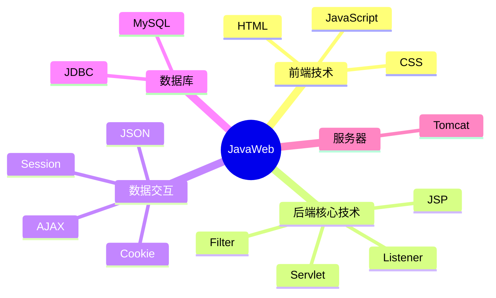

---

## 二、Web 基础知识

### 2.1 HTTP 协议简介 🌍

HTTP（HyperText Transfer Protocol，超文本传输协议）就是浏览器和服务器之间"沟通的语言"。

**核心特点：**

- **无状态**：服务器不记得你之前来过没（每次请求都是独立的）
- **基于 TCP/IP**：可靠的传输协议
- **默认端口**：HTTP 是 `80`，HTTPS 是 `443`

### 2.2 HTTP 请求方式对比 ⚔️

| 方式 | 用途 | 参数位置 | 安全性 | 有长度限制 |
|:----:|:----:|:--------:|:------:|:----------:|
| **GET** | 获取资源 | URL 后面拼接 | ❌ 较低（参数可见） | ✅ 是 |
| **POST** | 提交数据 | 请求体（body）中 | ✅ 相对较高 | ❌ 无 |
| **PUT** | 更新资源 | 请求体 | ✅ 相对较高 | ❌ 无 |
| **DELETE** | 删除资源 | URL 中 | ❌ 较低 | ✅ 是 |

### 2.3 HTTP 请求与响应结构

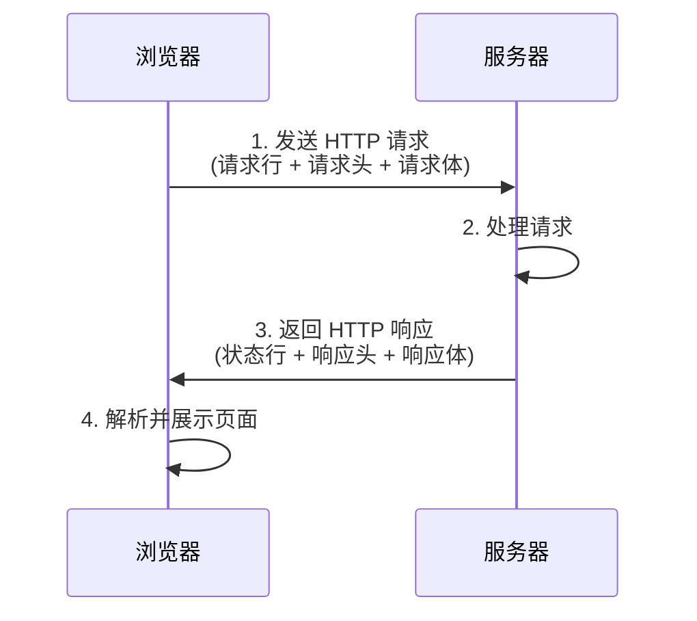

**请求报文示例：**
```
GET /hello?name=xiaoming HTTP/1.1        ← 请求行（方式 URL 协议版本）
Host: localhost:8080                      ← 请求头
User-Agent: Mozilla/5.0
Accept: text/html
                                          ← 空行（头和体的分隔）
name=xiaoming                             ← 请求体（POST 才有）
```

### 2.4 常见 HTTP 状态码 🚦

| 状态码 | 含义 | 说明 |
|:------:|:----:|:-----|
| **200** | OK ✅ | 请求成功 |
| **302** | Found 🔄 | 重定向 |
| **304** | Not Modified 📦 | 使用缓存 |
| **404** | Not Found 🔍 | 资源不存在 |
| **405** | Method Not Allowed 🚫 | 请求方式不支持 |
| **500** | Server Error 💥 | 服务器内部错误 |

> 🎯 记忆小口诀：**2xx 成功，3xx 跳转，4xx 客户端错了，5xx 服务器炸了**

---

## 三、Tomcat 服务器

### 3.1 Tomcat 是什么？🐱

Tomcat 是一个开源的 **Web 服务器**（更准确地说是 Servlet 容器），用来运行 JavaWeb 程序的。

你可以把它理解成一个"服务员"，负责接收浏览器的请求，交给 Java 程序处理，再把结果送回去~ 🍽️

### 3.2 Tomcat 目录结构 📂

| 目录 | 作用 |
|:---:|:-----|
| `bin/` | 存放启动和关闭 Tomcat 的脚本 |
| `conf/` | 存放配置文件（`server.xml` 最重要） |
| `lib/` | 存放 Tomcat 运行所需的 jar 包 |
| `logs/` | 存放日志文件 |
| `webapps/` | **存放我们的 Web 应用（重要！）** |
| `work/` | 存放 JSP 编译后的文件 |

### 3.3 Web 应用标准目录结构

```
MyWebApp/                    ← Web 应用根目录（项目名）
├── META-INF/                ← 元数据信息
├── WEB-INF/                 ← 核心目录（外部无法直接访问）
│   ├── classes/             ← 存放编译后的 .class 文件
│   ├── lib/                 ← 存放项目所需的 jar 包
│   └── web.xml              ← Web 应用配置文件（核心！）
├── html/css/js/             ← 静态资源
└── index.html               ← 首页
```

### 3.4 IDEA 中配置 Tomcat

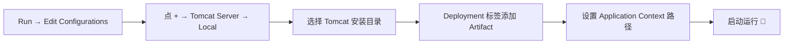

---

## 四、Servlet 核心技术

### 4.1 Servlet 是什么？⚡

> Servlet 是 JavaWeb 的 **三大组件之一**，也是最核心的技术！

简单说：Servlet 就是一个运行在服务器端的 **Java 小程序**，专门用来处理浏览器的请求并作出响应。

### 4.2 Servlet 体系结构

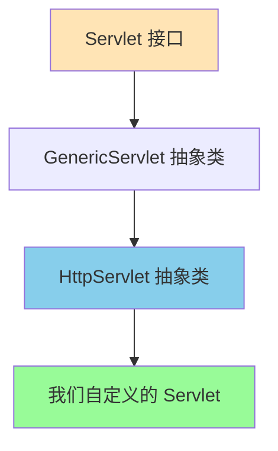

> 💡 **日常开发**：我们一般继承 `HttpServlet`，重写 `doGet()` 和 `doPost()` 方法就行啦~

### 4.3 Servlet 生命周期 🔄

这是面试必考点哦！Servlet 从创建到销毁会经历三个阶段：

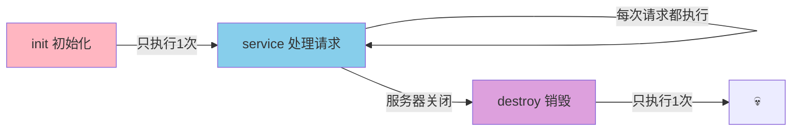

| 方法 | 执行时机 | 执行次数 | 作用 |
|:----:|:--------:|:--------:|:-----|
| `init()` | Servlet 创建时 | 1 次 | 初始化操作 |
| `service()` | 每次收到请求 | 多次 | 分发请求（根据方式调用 doGet/doPost） |
| `destroy()` | 服务器正常关闭 | 1 次 | 释放资源 |

### 4.4 第一个 Servlet 程序 ✏️

**方式一：传统 web.xml 配置方式**

```java
@WebServlet("/hello")  // 注解方式配置访问路径
public class HelloServlet extends HttpServlet {
    
    @Override
    protected void doGet(HttpServletRequest request, HttpServletResponse response) 
            throws ServletException, IOException {
        // 1. 设置响应编码（防止中文乱码）
        response.setContentType("text/html;charset=UTF-8");
        
        // 2. 获取输出流，向浏览器输出内容
        PrintWriter writer = response.getWriter();
        writer.write("<h1>Hello JavaWeb! 你好呀~ 🎉</h1>");
    }
    
    @Override
    protected void doPost(HttpServletRequest request, HttpServletResponse response) 
            throws ServletException, IOException {
        // POST 请求交给 GET 处理（常见做法）
        this.doGet(request, response);
    }
}
```

**方式二：web.xml 配置方式（了解）**

```xml
<servlet>
    <servlet-name>HelloServlet</servlet-name>
    <servlet-class>com.demo.HelloServlet</servlet-class>
</servlet>
<servlet-mapping>
    <servlet-name>HelloServlet</servlet-name>
    <url-pattern>/hello</url-pattern>
</servlet-mapping>
```

### 4.5 HttpServletRequest —— 接收请求数据 📥

Request 对象就是用来"接收"浏览器发来的数据的！

| 常用方法 | 功能 |
|:--------|:-----|
| `getParameter("name")` | 获取单个参数值 |
| `getParameterValues("name")` | 获取多个同名参数值（如复选框） |
| `setCharacterEncoding("UTF-8")` | **解决 POST 请求中文乱码**（要在获取参数前设置！） |
| `getRequestDispatcher("路径").forward(req, resp)` | 请求转发 |
| `setAttribute("key", value)` | 存储数据到 request 域 |
| `getAttribute("key")` | 从 request 域获取数据 |
| `getMethod()` | 获取请求方式（GET/POST） |

**接收表单数据示例：**

```java
@Override
protected void doPost(HttpServletRequest request, HttpServletResponse response) 
        throws ServletException, IOException {
    // 1. 设置编码（必须放在最前面！）
    request.setCharacterEncoding("UTF-8");
    
    // 2. 获取表单参数
    String username = request.getParameter("username");
    String password = request.getParameter("password");
    String[] hobbies = request.getParameterValues("hobby"); // 多选框
    
    System.out.println("用户名：" + username);
    System.out.println("密码：" + password);
}
```

> ⚠️ **GET 请求乱码解决**：修改 `tomcat/conf/server.xml` 中的 Connector，添加 `URIEncoding="UTF-8"`

### 4.6 HttpServletResponse —— 发送响应数据 📤

Response 对象就是用来"发送"数据给浏览器的！

| 常用方法 | 功能 |
|:--------|:-----|
| `setContentType("text/html;charset=UTF-8")` | **设置响应类型和编码（解决输出中文乱码）** |
| `getWriter()` | 获取字符输出流（输出文本） |
| `getOutputStream()` | 获取字节输出流（输出文件/图片） |
| `sendRedirect("路径")` | 重定向 |

### 4.7 请求转发 vs 重定向 🔄

这是重点中的重点！面试必考！对比表要记牢~

| 对比项 | 请求转发 forward | 重定向 redirect |
|:------:|:----------------:|:---------------:|
| **请求次数** | **1 次** | **2 次** |
| **地址栏变化** | ❌ 不变 | ✅ 变成新地址 |
| **数据共享** | ✅ 共享 request 域数据 | ❌ 不共享 |
| **能不能访问外部** | ❌ 只能访问服务器内部 | ✅ 可以访问外部资源 |
| **代码写法** | `request.getRequestDispatcher().forward()` | `response.sendRedirect()` |

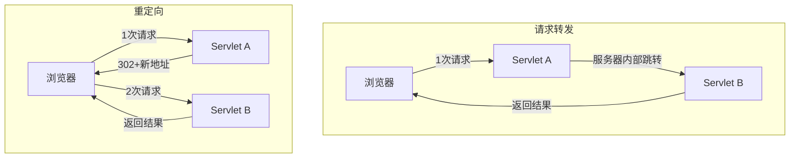

```java
// 请求转发（一次请求）
request.getRequestDispatcher("/bServlet").forward(request, response);

// 重定向（两次请求，路径要加项目名！）
response.sendRedirect(request.getContextPath() + "/bServlet");
```

> 🌸 **一句话记忆**：转发是"服务器自己找人帮忙"（1次），重定向是"让浏览器自己去找别人"（2次）

### 4.8 Servlet 的生命周期注解配置（Servlet 3.0+）

```java
@WebServlet(
    urlPatterns = "/user",           // 访问路径
    loadOnStartup = 1,               // 启动时创建（默认第一次访问创建）
    initParams = {                   // 初始化参数
        @WebInitParam(name = "encoding", value = "UTF-8")
    }
)
```

---

## 五、JSP 技术

### 5.1 JSP 是什么？📄

JSP（JavaServer Pages）就是在 **HTML 中嵌入 Java 代码** 的技术。

本质上：JSP 最终会被翻译成一个 Servlet！所以 JSP 也是一种 Servlet~ 🤯

### 5.2 JSP 的本质执行过程

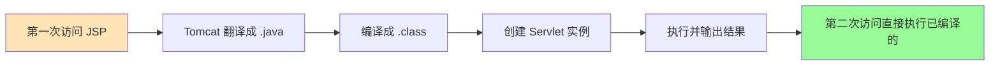

### 5.3 JSP 三大脚本元素 ✏️

| 语法 | 格式 | 作用 |
|:----:|:----:|:-----|
| **代码脚本** | `<% Java 代码 %>` | 写普通 Java 语句 |
| **输出脚本** | `<%= 表达式 %>` | 输出数据到页面（等价于 out.print） |
| **声明脚本** | `<%! 声明 %>` | 定义成员变量和方法 |

```jsp
<%-- 这是 JSP 注释 --%>
<%-- ============================ --%>
<%! 
    // 声明脚本：定义成员变量
    private int count = 0;
%>

<%
    // 代码脚本：写 Java 逻辑
    String name = "小明";
    count++;
    List<String> list = new ArrayList<>();
    list.add("语文");
    list.add("数学");
%>

<%-- 输出脚本：把数据输出到页面 --%>
<h1>你好，<%= name %>！</h1>
<p>你是第 <%= count %> 位访客~ 🎈</p>
```

### 5.4 JSP 三大指令 📋

| 指令 | 语法 | 作用 |
|:----:|:----:|:-----|
| **page** | `<%@ page ... %>` | 配置页面属性（编码、导入包等） |
| **include** | `<%@ include file="..." %>` | 静态包含（编译期合并） |
| **taglib** | `<%@ taglib ... %>` | 引入标签库（如 JSTL） |

```jsp
<%@ page language="java" contentType="text/html; charset=UTF-8" 
         pageEncoding="UTF-8" import="java.util.*" %>
<%@ taglib prefix="c" uri="http://java.sun.com/jsp/jstl/core" %>
```

### 5.5 JSP 九大内置对象 🎯

这 9 个对象在 JSP 中 **直接就能用**，不用创建！

| 对象 | 类型 | 作用域 | 说明 |
|:----:|:----:|:------:|:-----|
| `request` | HttpServletRequest | request | 请求对象 |
| `response` | HttpServletResponse | page | 响应对象 |
| `session` | HttpSession | session | 会话对象 |
| `application` | ServletContext | application | 全局应用对象 |
| `page` | Object(this) | page | 当前页面对象 |
| `pageContext` | PageContext | page | 页面上下文 |
| `out` | JspWriter | page | 输出对象 |
| `config` | ServletConfig | page | 配置对象 |
| `exception` | Throwable | page | 异常对象（ isErrorPage 才有） |

### 5.6 四大作用域 🌐

| 作用域 | 对象 | 范围 | 生命周期 |
|:------:|:----:|:----:|:---------|
| **page** | pageContext | 当前页面 | 当前页面执行完就没了 |
| **request** | request | 一次请求 | 请求转发链中共享 |
| **session** | session | 一次会话 | 浏览器不关一直有（默认30分钟） |
| **application** | application | 整个应用 | 服务器不关一直有（所有用户共享） |

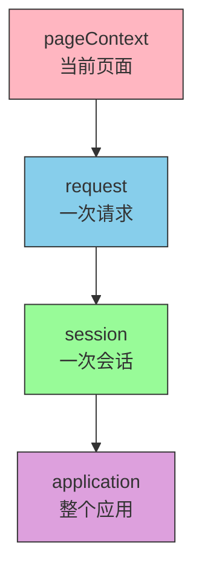

> 🌸 范围从小到大：`page < request < session < application`

### 5.7 EL 表达式 ✨

EL（Expression Language）是更简洁的数据获取方式，**代替 `<%= %>`**！

```jsp
<%-- 老方式：麻烦 --%>
<%= request.getAttribute("name") %>

<%-- EL 表达式：简洁！会自动从四个域中查找 --%>
${name}

<%-- 指定域查找 --%>
${requestScope.name}
${sessionScope.user.username}  <%-- 获取对象的属性 --%>
${list[0]}                      <%-- 获取 List --%>
${map.key}                      <%-- 获取 Map --%>

<%-- EL 运算 --%>
${empty list}    <%-- 判断是否为空 --%>
${1 + 2}         <%-- 算术运算 --%>
${a > b}         <%-- 比较运算 --%>
```

### 5.8 JSTL 标签库 🏷️

JSTL（JSP Standard Tag Library）用标签代替 Java 代码，让 JSP 页面更清爽！

**常用核心标签：**

```jsp
<%@ taglib prefix="c" uri="http://java.sun.com/jsp/jstl/core" %>

<%-- if 判断 --%>
<c:if test="${not empty user}">
    <p>欢迎你，${user.name}！</p>
</c:if>

<%-- choose 多条件分支 --%>
<c:choose>
    <c:when test="${score >= 90}">
        <p>优秀！🌟</p>
    </c:when>
    <c:when test="${score >= 60}">
        <p>及格</p>
    </c:when>
    <c:otherwise>
        <p>不及格 😢</p>
    </c:otherwise>
</c:choose>

<%-- forEach 循环遍历 --%>
<c:forEach items="${userList}" var="user" varStatus="vs">
    <tr>
        <td>${vs.count}</td>     <%-- 序号从1开始 --%>
        <td>${user.name}</td>
        <td>${user.age}</td>
    </tr>
</c:forEach>
```

---

## 六、Session 与 Cookie 会话管理

### 6.1 为什么需要会话技术？🤔

HTTP 是 **无状态协议**——服务器不记得你是谁！

比如你登录后，点击其他页面，服务器又不知道你登录过了……这就尴尬了😅

**会话技术** 就是用来"记住用户"的！有两种方式：Cookie 和 Session。

### 6.2 Cookie 🍪

> Cookie 是 **保存在浏览器端** 的小数据（每次请求会自动带上）

**特点：**
- 存储在浏览器端（客户端）
- 大小限制约 **4KB**
- 有安全隐患（用户可以查看/篡改）
- 默认会话级别（浏览器关闭就没了），可设置存活时间

```java
// 1. 创建 Cookie
Cookie cookie = new Cookie("username", "xiaoming");

// 2. 设置存活时间（单位：秒）
cookie.setMaxAge(60 * 60 * 24 * 7);  // 保存7天
// cookie.setMaxAge(-1);  // 默认，浏览器关闭就没了
// cookie.setMaxAge(0);   // 立即删除！

// 3. 设置有效路径（只有访问该路径才带上）
cookie.setPath("/");

// 4. 发送给浏览器（响应）
response.addCookie(cookie);

// ========== 获取 Cookie ==========
Cookie[] cookies = request.getCookies();
if (cookies != null) {
    for (Cookie c : cookies) {
        String name = c.getName();
        String value = c.getValue();
        System.out.println(name + " : " + value);
    }
}
```

### 6.3 Session 🎫

> Session 是 **保存在服务器端** 的数据，基于 Cookie 实现

**特点：**
- 存储在服务器端
- 没有大小限制（但不能存太多，占服务器内存）
- 相对安全
- 默认存活时间 **30 分钟**

```java
// 1. 获取 Session（没有会自动创建）
HttpSession session = request.getSession();

// 2. 存数据
session.setAttribute("user", userObject);

// 3. 取数据
Object user = session.getAttribute("user");

// 4. 移除数据
session.removeAttribute("user");

// 5. 销毁 Session（退出登录常用）
session.invalidate();
```

### 6.4 Cookie vs Session 大对比 ⚔️

| 对比项 | Cookie 🍪 | Session 🎫 |
|:------:|:---------:|:----------:|
| **存储位置** | 浏览器（客户端） | 服务器（服务端） |
| **数据大小** | 有限制（~4KB） | 无限制 |
| **数据类型** | 只能存字符串 | 可以存任意对象 |
| **安全性** | ❌ 较低 | ✅ 较高 |
| **生命周期** | 可设置 | 默认30分钟 |
| **依赖关系** | 独立 | **依赖 Cookie**（JSESSIONID） |

### 6.5 Session 的工作原理 🔄

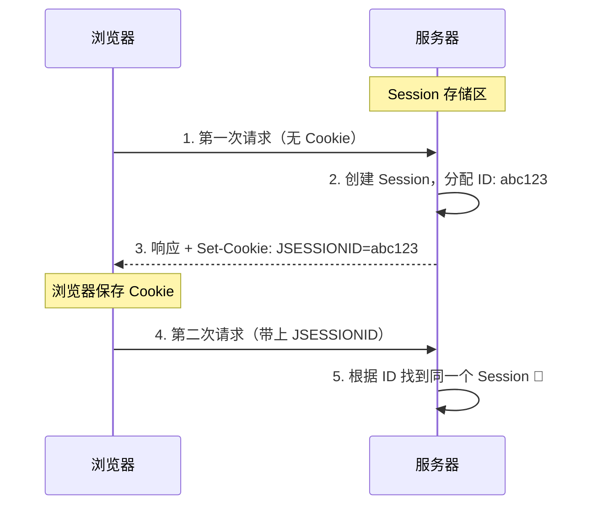

> 💡 **关键点**：Session 之所以能识别"同一个用户"，是因为浏览器每次请求都带上了 `JSESSIONID` 这个 Cookie！

---

## 七、Filter 过滤器

### 7.1 Filter 是什么？🛡️

Filter（过滤器）就像门口的保安，在请求到达 Servlet **之前** 和响应离开 **之后** 进行拦截处理。

**常见用途：**
- 登录权限验证（没登录不让访问）
- 统一编码处理（解决乱码）
- 敏感词汇过滤
- 日志记录

### 7.2 Filter 的工作流程

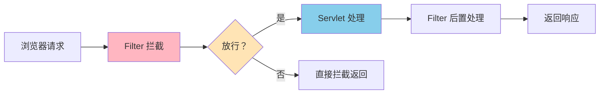

### 7.3 编写一个过滤器 ✏️

```java
@WebFilter("/*")  // 拦截所有请求
public class LoginFilter implements Filter {
    
    @Override
    public void init(FilterConfig filterConfig) throws ServletException {
        System.out.println("过滤器初始化~ 🔧");
    }
    
    @Override
    public void doFilter(ServletRequest request, ServletResponse response, 
                         FilterChain chain) throws IOException, ServletException {
        HttpServletRequest req = (HttpServletRequest) request;
        HttpServletResponse resp = (HttpServletResponse) response;
        
        // 1. 放行前的处理（请求到达 Servlet 前）
        System.out.println("请求被拦截了~ 检查中...");
        
        // 2. 【核心】放行！必须调用，否则请求到不了 Servlet
        chain.doFilter(request, response);
        
        // 3. 放行后的处理（Servlet 响应后）
        System.out.println("请求处理完毕~ ✅");
    }
    
    @Override
    public void destroy() {
        System.out.println("过滤器销毁了~ 💀");
    }
}
```

### 7.4 过滤器拦截路径配置 📍

```java
@WebFilter("/user/*")        // 拦截 /user/ 开头的所有请求
@WebFilter("*.jsp")          // 拦截所有 JSP 请求
@WebFilter("/*")             // 拦截所有请求
@WebFilter({"/user", "/admin"}) // 拦截多个路径
```

### 7.5 过滤器链（多个过滤器）🔗

多个过滤器会形成一条"链"，按顺序执行：

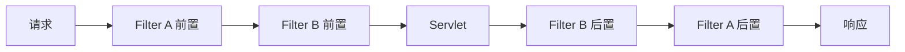

> 🌸 **执行顺序**：类似"栈"结构——前置按顺序执行，后置反序执行！

---

## 八、Listener 监听器

### 8.1 Listener 是什么？👂

监听器就像一个"间谍"👀，专门监听某些事件的发生，然后做相应处理。

### 8.2 三大类监听器

| 类型 | 监听内容 | 对应接口 |
|:----:|:--------:|:--------:|
| **域对象监听** | 创建/销毁 | ServletContextListener、HttpSessionListener 等 |
| **属性变化监听** | 添加/替换/删除属性 | ServletContextAttributeListener 等 |
| **Session 相关** | 绑定/钝化/激活 | HttpSessionBindingListener 等 |

### 8.3 示例：监听应用启动

```java
@WebListener
public class MyAppListener implements ServletContextListener {
    
    @Override
    public void contextInitialized(ServletContextEvent sce) {
        // 应用启动时执行（服务器启动）
        System.out.println("Web 应用启动啦~ 🎉");
        
        // 常见用途：初始化全局配置
        ServletContext context = sce.getServletContext();
        context.setAttribute("onlineCount", 0);
    }
    
    @Override
    public void contextDestroyed(ServletContextEvent sce) {
        // 应用销毁时执行（服务器关闭）
        System.out.println("Web 应用关闭了~ 👋");
    }
}
```

---

## 九、JDBC 数据库操作

### 9.1 JDBC 是什么？🗄️

JDBC（Java Database Connectivity）是 Java 操作数据库的 **标准 API**。

简单说：就是用 Java 代码来增删改查数据库~ 💾

### 9.2 JDBC 核心步骤（6步走）

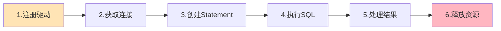

### 9.3 完整代码示例

```java
public class JdbcDemo {
    
    public static void main(String[] args) {
        Connection conn = null;
        Statement stmt = null;
        ResultSet rs = null;
        
        try {
            // 1. 注册驱动（MySQL 5 可省略，会自动加载）
            Class.forName("com.mysql.cj.jdbc.Driver");
            
            // 2. 获取连接
            String url = "jdbc:mysql://localhost:3306/mydb?useSSL=false&serverTimezone=UTC";
            String user = "root";
            String password = "123456";
            conn = DriverManager.getConnection(url, user, password);
            
            // 3. 创建 Statement（容易 SQL 注入，不推荐！）
            stmt = conn.createStatement();
            
            // 4. 执行 SQL
            String sql = "SELECT * FROM users";
            rs = stmt.executeQuery(sql);  // 查询用 executeQuery
            // 增删改用 stmt.executeUpdate(sql)
            
            // 5. 处理结果
            while (rs.next()) {
                int id = rs.getInt("id");
                String name = rs.getString("name");
                int age = rs.getInt("age");
                System.out.println(id + " - " + name + " - " + age);
            }
            
        } catch (Exception e) {
            e.printStackTrace();
        } finally {
            // 6. 释放资源（顺序：后开的先关 rs → stmt → conn）
            try { if (rs != null) rs.close(); } catch (Exception e) {}
            try { if (stmt != null) stmt.close(); } catch (Exception e) {}
            try { if (conn != null) conn.close(); } catch (Exception e) {}
        }
    }
}
```

### 9.4 PreparedStatement（推荐使用！）⭐

PreparedStatement 解决了 Statement 的 **SQL 注入** 问题，而且效率更高！

```java
// ✅ 推荐：使用 PreparedStatement
String sql = "SELECT * FROM users WHERE username = ? AND password = ?";
PreparedStatement pstmt = conn.prepareStatement(sql);

// 设置参数（索引从 1 开始）
pstmt.setString(1, username);   // 替换第1个 ?
pstmt.setString(2, password);   // 替换第2个 ?

ResultSet rs = pstmt.executeQuery();
```

| 对比项 | Statement | PreparedStatement |
|:------:|:---------:|:-----------------:|
| **SQL 注入** | ❌ 有风险 | ✅ 安全（预编译） |
| **效率** | 较低 | ✅ 较高（可缓存） |
| **参数设置** | 字符串拼接 | ✅ 使用 `?` 占位符 |

### 9.5 JDBC 工具类封装 🛠️

每次都写那一堆代码太麻烦了！我们封装一个工具类：

```java
public class JDBCUtil {
    private static String url;
    private static String user;
    private static String password;
    
    // 静态代码块：类加载时执行一次，读取配置
    static {
        try {
            Properties props = new Properties();
            props.load(JDBCUtil.class.getClassLoader()
                       .getResourceAsStream("jdbc.properties"));
            String driver = props.getProperty("driver");
            url = props.getProperty("url");
            user = props.getProperty("user");
            password = props.getProperty("password");
            Class.forName(driver);  // 注册驱动
        } catch (Exception e) {
            e.printStackTrace();
        }
    }
    
    /** 获取连接 */
    public static Connection getConnection() throws SQLException {
        return DriverManager.getConnection(url, user, password);
    }
    
    /** 释放资源 */
    public static void close(ResultSet rs, Statement stmt, Connection conn) {
        try { if (rs != null) rs.close(); } catch (Exception e) {}
        try { if (stmt != null) stmt.close(); } catch (Exception e) {}
        try { if (conn != null) conn.close(); } catch (Exception e) {}
    }
}
```

配置文件 `jdbc.properties`：
```properties
driver=com.mysql.cj.jdbc.Driver
url=jdbc:mysql://localhost:3306/mydb?useSSL=false&serverTimezone=UTC
user=root
password=123456
```

---

## 十、MVC 设计模式

### 10.1 什么是 MVC？🏗️

MVC 是一种软件设计思想，把程序分成三层：

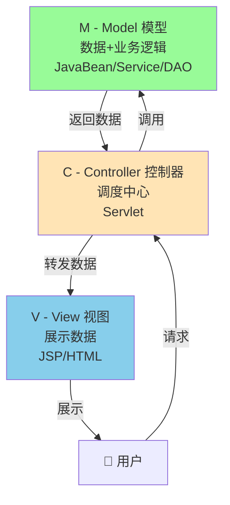

| 层级 | 名称 | 职责 | 对应技术 |
|:----:|:----:|:-----|:---------|
| **M** | Model | 处理数据和业务逻辑 | JavaBean、DAO、Service |
| **V** | View | 负责展示界面 | JSP、HTML、CSS |
| **C** | Controller | 接收请求、调度、返回 | Servlet |

### 10.2 为什么要分层？🤔

> 分层的好处：**各司其职，降低耦合，便于维护**

举个生活中的例子 🌰：
- **Model** = 后厨厨师（做菜）
- **View** = 菜单/餐桌（展示菜品）
- **Controller** = 服务员（接单、传话、上菜）

服务员不用会做菜，厨师不用会端盘子，分工明确，效率高！

### 10.3 三层架构

实际开发中，常常把 MVC 细化为"三层架构"：

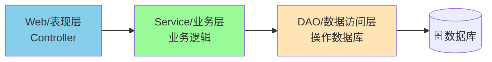

---

## 十一、AJAX 与 JSON

### 11.1 AJAX 是什么？📡

AJAX（Asynchronous JavaScript And XML）= **异步的 JavaScript 通信技术**

**最大好处：** 可以在不刷新整个页面的情况下，和服务器交换数据！用户体验大幅提升~ ✨

### 11.2 同步 vs 异步

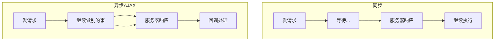

### 11.3 原生 AJAX 示例

```javascript
// 1. 创建 XMLHttpRequest 对象
var xhr = new XMLHttpRequest();

// 2. 设置回调函数（服务器响应时触发）
xhr.onreadystatechange = function() {
    if (xhr.readyState == 4 && xhr.status == 200) {
        // 5. 处理响应数据
        var result = xhr.responseText;
        console.log("收到数据：" + result);
        document.getElementById("result").innerHTML = result;
    }
};

// 3. open(方式, URL, 是否异步)
xhr.open("GET", "/checkUsername?name=xiaoming", true);

// 4. 发送请求
xhr.send();
```

### 11.4 jQuery 简化 AJAX ✨

用 jQuery 一行代码搞定，简单多了！

```javascript
// GET 请求
$.get("/checkUsername", {name: "xiaoming"}, function(data) {
    console.log(data);
}, "json");

// POST 请求
$.post("/login", {username: "admin", password: "123"}, function(data) {
    console.log(data);
}, "json");

// 完整版（最灵活）
$.ajax({
    url: "/login",
    type: "POST",
    data: {username: "admin", password: "123"},
    dataType: "json",
    success: function(data) {
        console.log("成功：" + data);
    },
    error: function() {
        console.log("请求失败 😢");
    }
});
```

### 11.5 JSON 数据格式 📋

JSON（JavaScript Object Notation）是轻量级的 **数据交换格式**，现在是前后端通信的标准！

```json
{
    "name": "小明",
    "age": 18,
    "hobbies": ["唱歌", "跳舞", "编程"],
    "isStudent": true,
    "girlfriend": null,
    "address": {
        "city": "北京",
        "street": "朝阳路"
    }
}
```

| 对比项 | JSON | XML |
|:------:|:----:|:---:|
| **体积** | ✅ 小 | ❌ 大 |
| **可读性** | ✅ 好 | ✅ 好 |
| **解析速度** | ✅ 快 | ❌ 慢 |
| **复杂结构** | 一般 | ✅ 好 |

### 11.6 Java 中处理 JSON（Jackson 工具）

```java
// 导入 Jackson 依赖
// jackson-core, jackson-databind, jackson-annotations

// ========== Java 对象 → JSON 字符串 ==========
ObjectMapper mapper = new ObjectMapper();
User user = new User("小明", 18);
String json = mapper.writeValueAsString(user);
// 输出: {"name":"小明","age":18}

// ========== JSON 字符串 → Java 对象 ==========
String jsonStr = "{\"name\":\"小红\",\"age\":20}";
User user2 = mapper.readValue(jsonStr, User.class);

// ========== Java List → JSON ==========
List<User> list = new ArrayList<>();
list.add(new User("小明", 18));
list.add(new User("小红", 20));
String jsonList = mapper.writeValueAsString(list);
// 输出: [{"name":"小明","age":18},{"name":"小红","age":20}]
```

---

## 🎯 总结：JavaWeb 学习路线

```mermaid
graph LR
    A[HTML/CSS/JS<br/>前端基础] --> B[HTTP 协议<br/>通信基础]
    B --> C[Tomcat<br/>服务器]
    C --> D[Servlet<br/>核心技术]
    D --> E[JSP + EL + JSTL<br/>页面技术]
    E --> F[Cookie + Session<br/>会话技术]
    F --> G[Filter + Listener<br/>高级组件]
    G --> H[JDBC<br/>数据库]
    H --> I[MVC + 三层架构<br/>项目规范]
    I --> J[AJAX + JSON<br/>前后端交互]
    J --> K[框架学习<br/>Spring/SpringMVC/MyBatis]
    
    style A fill:#FFE4B5
    style D fill:#87CEEB
    style K fill:#98FB98
```

> 🌟 **学习建议**：JavaWeb 是 Java 后端开发的基础！把 Servlet、JSP、Session 这些核心技术吃透，后面学 Spring 等框架就会轻松很多很多！加油呀~ 💪💕

---

> 📝 **笔记到此结束啦**~ 希望这份笔记对你有帮助！有不懂的地方随时来问哦~ 加油，未来的 Java 大佬！🚀✨
