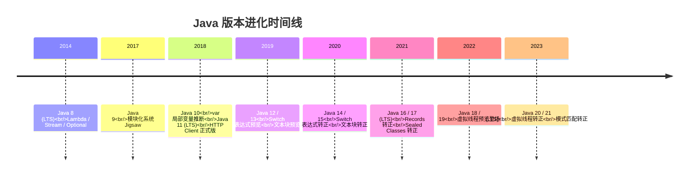
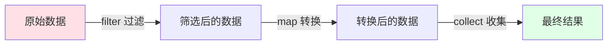
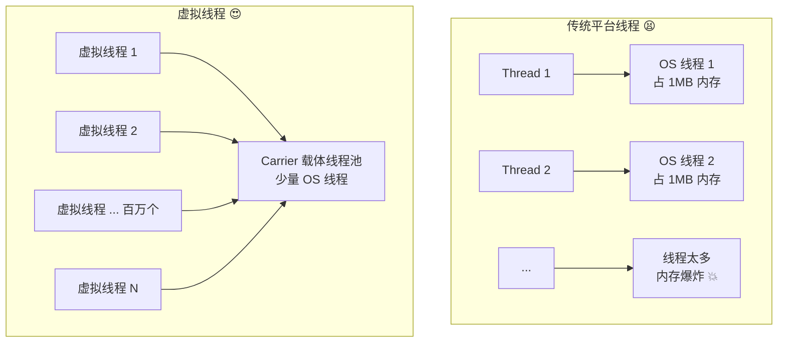
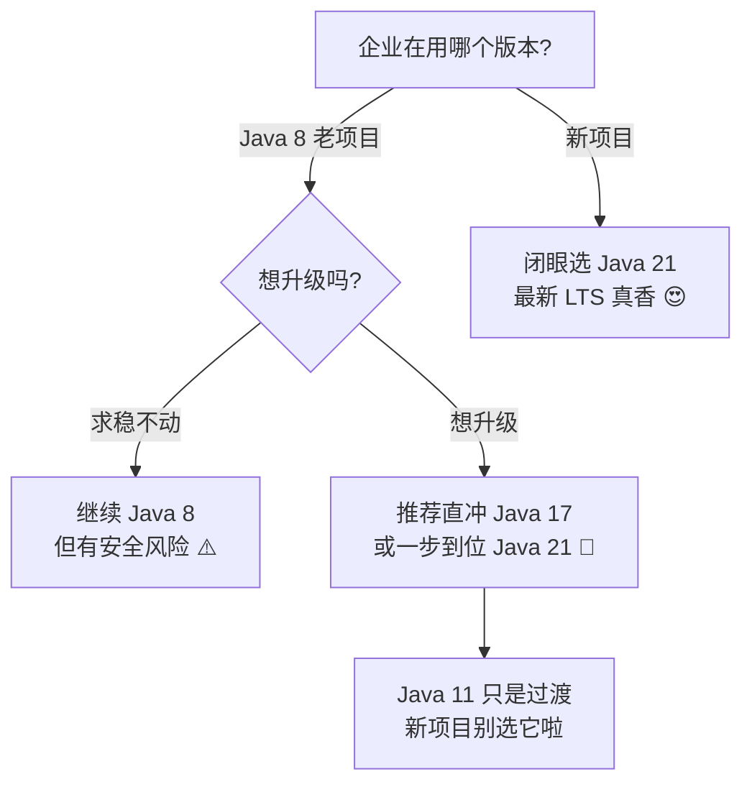

# 🚀 Java 多版本特性大冒险

> 嘿嘿～欢迎来到 Java 版本进化史的小课堂！🌸
> Java 从 8 到 21 走过了超多版本的迭代，每个版本都藏着不少好东西。
> 今天带你一次看个明白，保证通俗易懂不绕弯子！跟着我冲鸭～ (๑•̀ㅂ•́)و✧

***

## 📖 目录

1. [版本全景图](#-版本全景图)
2. [LTS 版本是什么](#-lts-版本是什么)
3. [Java 8 —— 奠基神作](#-java-8--奠基神作2014)
4. [Java 9 \~ 11 —— 模块化与实用工具](#-java-9--11--模块化与实用工具)
5. [Java 12 \~ 17 —— 语法大现代化](#-java-12--17--语法大现代化)
6. [Java 18 \~ 21 —— 并发革命](#-java-18--21--并发革命)
7. [全版本特性速查表](#-全版本特性速查表)
8. [企业版本怎么选](#-企业版本怎么选)
9. [总结与小抄](#-总结与小抄)

***

## 🗺️ 版本全景图

先用一张时间线图看看 Java 这些年都经历了什么～



> 💡 小贴士：从 Java 9 开始，版本发布节奏变成了 **每 6 个月一个小版本**，每 2 年出一个 LTS 长期支持版～

***

## 🏷️ LTS 版本是什么

LTS = **Long Term Support（长期支持版本）**，可以理解为"官方承诺管很久的版本"🍼

| 对比项     | 普通版本          | LTS 版本     |
| ------- | ------------- | ---------- |
| 📅 更新支持 | 6 个月          | 8\~10 年以上  |
| 🏢 企业使用 | 基本不用          | 主流选择       |
| 🔧 修复维护 | 短期            | 长期提供补丁     |
| 🌟 代表版本 | 9、10、12、13... | 8、11、17、21 |

> 直白说：**普通版本像季抛隐形眼镜，LTS 像耐用款眼镜**👓，企业生产环境基本只用 LTS！

***

## 🌟 Java 8 —— 奠基神作（2014）

> Java 8 是历史上最最最重要的版本，没有之一！直到今天很多公司还停留在 Java 8 呢～它带来了函数式编程的春天气息 🌸

### 1️⃣ Lambda 表达式

**一句话理解**：把"啰嗦的匿名内部类"压缩成"一行小代码"，代码瞬间瘦身成功！✂️

```java
// 旧写法：匿名内部类，又臭又长 😫
Runnable r1 = new Runnable() {
    @Override
    public void run() {
        System.out.println("跑起来啦~");
    }
};

// Lambda 写法：清爽！😌
Runnable r2 = () -> System.out.println("跑起来啦~");
```

### 2️⃣ Stream API —— 数据流水线

**一句话理解**：像工厂流水线一样处理数据，过滤、映射、汇总一气呵成 🏭

```java
List<String> names = Arrays.asList("小明", "小红", "小刚", "小美");

// 找出名字带"小"的，转成大写，收集成列表
List<String> result = names.stream()
        .filter(n -> n.startsWith("小"))
        .map(String::toUpperCase)
        .collect(Collectors.toList());
```

流水线处理流程如下～



### 3️⃣ Optional —— 告别 NPE

**一句话理解**：给可能为 null 的值套个"安全包装盒"，逼你先检查再使用 📦

```java
// 以前：一不小心就 NullPointerException 崩溃 💥
// 现在：
Optional<String> name = Optional.ofNullable(getName());

name.ifPresent(n -> System.out.println("名字是：" + n));
String result = name.orElse("默认名字"); // 为空就用默认值
```

### 4️⃣ 接口默认方法

**一句话理解**：接口也能有带方法体的默认实现了，再也不怕加方法把实现类搞崩 😎

```java
interface Animal {
    void eat();  // 抽象方法，子类必须实现

    // 默认方法，子类白捡一个功能
    default void breathe() {
        System.out.println("呼吸呼吸~");
    }
}
```

### 5️⃣ 新日期时间 API

**一句话理解**：老 `Date` 又难用又线程不安全，新的 `LocalDateTime` 优雅又靠谱 📅

```java
LocalDate date = LocalDate.now();              // 今天
LocalTime time = LocalTime.now();              // 现在几点
LocalDateTime dt = LocalDateTime.now();        // 日期 + 时间
LocalDate nextWeek = date.plusWeeks(1);        // 一周后
String formatted = dt.format(DateTimeFormatter.ofPattern("yyyy-MM-dd HH:mm:ss"));
```

***

## 🧩 Java 9 \~ 11 —— 模块化与实用工具

### Java 9（2017）：模块化系统 Jigsaw 🧱

**一句话理解**：给项目装上"隔断墙"，代码按模块划分，谁能用谁、谁不能碰，管得明明白白～

```java
// module-info.java
module com.miao.app {
    requires java.sql;                 // 我需要用 java.sql 模块
    exports com.miao.api;              // 只对外暴露 api 包
}
```

> 同时还有 JShell（命令行交互工具）和 `List.of()` 集合工厂方法等小甜点 🍬

```java
// Java 9 之前创建不可变集合要写一堆，现在一行搞定
List<String> list = List.of("A", "B", "C");
```

### Java 10（2018）：var 局部变量推断

**一句话理解**：右边类型那么明显，左边就别再写一遍啦，用 `var` 让编译器自己猜 👀

```java
// 左边一长串类型看得头晕 😵
Map<String, List<Integer>> map1 = new HashMap<String, List<Integer>>();

// var 简洁清爽 😍（注意：Java 10 泛型还不能省右边，Java 7 开始可以钻石语法）
var map2 = new HashMap<String, List<Integer>>();
```

> ⚠️ 注意：`var` 只能用于**局部变量**，成员变量、方法参数都不行哦～

### Java 11（2018，LTS）：HTTP Client 转正 🌐

**一句话理解**：取代老旧的 `HttpURLConnection`，内置 HTTP 客户端还支持 HTTP/2！

```java
HttpClient client = HttpClient.newHttpClient();
HttpRequest request = HttpRequest.newBuilder()
        .uri(URI.create("https://api.example.com/hello"))
        .GET()
        .build();

HttpResponse<String> response = client.send(request, HttpResponse.BodyHandlers.ofString());
System.out.println(response.body());
```

还有 String 新增的实用小方法：

```java
"  hello  ".strip();        // 去首尾空格（比 trim 更懂 Unicode）
"ha".repeat(3);             // "hahaha" 
"hi\nworld".lines().count();// 统计行数
```

> 🎁 彩蛋：Java 11 开始可以直接 `java Hello.java` 运行单文件，不用先编译啦！

***

## ✨ Java 12 \~ 17 —— 语法大现代化

> 这几个版本是 Java 语法"整容"最厉害的时期，代码越写越短，幸福感飙升 📈

### Java 14：Switch 表达式转正 🔀

**一句话理解**：老 switch 又啰嗦又容易忘 break，新写法像三元表达式一样丝滑～

```java
// 旧写法：忘写 break 就翻车 🚗💥
switch (day) {
    case MONDAY:
    case TUESDAY:
        result = "工作日";
        break;
    default:
        result = "其他";
}

// 新写法：箭头语法 + 直接返回值，优雅！✨
String result = switch (day) {
    case MONDAY, TUESDAY, WEDNESDAY, THURSDAY, FRIDAY -> "工作日";
    case SATURDAY, SUNDAY -> "周末啦~";
    default -> "未知";
};
```

### Java 15：文本块转正 📝

**一句话理解**：写 JSON、SQL、HTML 不用再拼接字符串和 `\n` 了，三引号一包搞定！

```java
// 以前写 JSON：折磨 😭
String json1 = "{\n" +
        "  \"name\": \"小白\",\n" +
        "  \"age\": 18\n" +
        "}";

// 文本块：所见即所得 😍
String json2 = """
        {
          "name": "小白",
          "age": 18
        }
        """;
```

### Java 16：Record 类转正 📋

**一句话理解**：一行顶几十行！自动生成构造器、getter、equals、hashCode、toString，专为"纯数据类"而生！

```java
// 以前：一个数据类要写几十行样板代码 😮‍💨
// 现在：一行搞定！
public record Point(int x, int y) { }

// 用起来超自然
Point p = new Point(1, 2);
System.out.println(p.x());       // 1
System.out.println(p);           // Point[x=1, y=2]
```

### Java 16：instanceof 模式匹配 🎭

**一句话理解**：判断类型和强转类型一次搞定，不用"先 instanceof 再强制转换"两步走～

```java
// 旧写法：判断 + 强转，两步好麻烦 😩
if (obj instanceof String) {
    String s = (String) obj;
    System.out.println(s.length());
}

// 新写法：一步到位！🎉
if (obj instanceof String s) {
    System.out.println(s.length());  // s 直接能用
}
```

### Java 17（LTS）：Sealed Classes 密封类 🔒

**一句话理解**：谁可以继承我，我说了算！精确控制继承关系，配合 switch 模式匹配更搭～

```java
// 只允许 Circle 和 Square 继承 Shape
public sealed interface Shape permits Circle, Square { }

public record Circle(double radius) implements Shape { }
public record Square(double side) implements Shape { }
```

> Java 17 是继 8、11 之后最重要的 LTS 版本，也是**从 Java 8 升级的首选跳板**哦～

***

## 🚄 Java 18 \~ 21 —— 并发革命

### Java 21（LTS）：虚拟线程 —— 超重磅！💥

**一句话理解**：创建百万个线程不再是梦！像写普通同步代码一样简单，却拥有异步的吞吐量！



```java
// 创建虚拟线程，简单到离谱！
Thread vt = Thread.ofVirtual().start(() -> {
    System.out.println("我是虚拟线程，超轻量~");
});

// 或者用 ExecutorService
try (var executor = Executors.newVirtualThreadPerTaskExecutor()) {
    for (int i = 0; i < 100_000; i++) {   // 十万个线程也扛得住！
        executor.submit(() -> {
            Thread.sleep(1000);
            return "done";
        });
    }
}
```

| 对比项      | 平台线程    | 虚拟线程                 |
| -------- | ------- | -------------------- |
| 💾 内存占用  | 约 1MB   | 约 几百字节               |
| 🔢 可创建数量 | 数千级     | **百万级**              |
| 🍃 管理方   | 操作系统    | JVM                  |
| 🎯 适用场景  | CPU 密集型 | **IO 密集型**（网络请求、数据库） |

### Java 21：switch 模式匹配转正 🎯

**一句话理解**：switch 可以按"类型 + 条件"来匹配了，和 Record、Sealed Classes 组队起飞～

```java
String describe(Object obj) {
    return switch (obj) {
        case Integer i when i > 0 -> "正整数: " + i;   // 带条件守卫！
        case Integer i -> "非正整数: " + i;
        case String s -> "字符串: " + s;
        case Point(int x, int y) -> "坐标点: " + x + "," + y;  // Record 模式
        case null -> "是 null 哦";                       // 连 null 都能处理
        default -> "不知道是啥";
    };
}
```

### Java 21：Record Patterns 记录模式 🧩

**一句话理解**：解构 Record 就像剥糖果纸，一层层直接取出里面的值～

```java
// 直接把 Point 里的 x、y "拆"出来
if (obj instanceof Point(int x, int y)) {
    System.out.println("x = " + x + ", y = " + y);
}

// 嵌套解构也不怕
record Line(Point start, Point end) { }
if (obj instanceof Line(Point(var x1, var y1), Point(var x2, var y2))) {
    System.out.println("从 " + x1 + "," + y1 + " 到 " + x2 + "," + y2);
}
```

### Java 21：Sequenced Collections 有序集合 📚

**一句话理解**：List 终于有统一的"拿第一个 / 最后一个元素"的方法啦！

```java
List<Integer> list = new ArrayList<>(List.of(1, 2, 3, 4, 5));
list.getFirst();          // 1
list.getLast();           // 5
list.reversed();          // [5, 4, 3, 2, 1]
```

***

## 📋 全版本特性速查表

一张表看全所有重点，收藏就完事了！📌

| 版本          | 年份   |  类型 | ⭐ 核心特性                                                       |
| ----------- | ---- | :-: | ------------------------------------------------------------ |
| **Java 8**  | 2014 | LTS | Lambda、Stream API、Optional、接口默认方法、新日期 API                    |
| Java 9      | 2017 |  -  | 模块化 Jigsaw、JShell、`List.of()` 工厂方法                           |
| Java 10     | 2018 |  -  | `var` 局部变量推断                                                 |
| **Java 11** | 2018 | LTS | HttpClient 转正、`String.strip()/repeat()`、单文件运行                |
| Java 12/13  | 2019 |  -  | Switch 表达式（预览）、文本块（预览）                                       |
| Java 14     | 2020 |  -  | **Switch 表达式转正**、Records（预览）、更智能的 NPE 提示                     |
| Java 15     | 2020 |  -  | **文本块转正**、Sealed Classes（预览）                                 |
| Java 16     | 2021 |  -  | **Records 转正**、**instanceof 模式匹配转正**                         |
| **Java 17** | 2021 | LTS | **Sealed Classes 转正**、伪随机数增强                                 |
| Java 18     | 2022 |  -  | 默认 UTF-8 编码、简易 Web 服务器                                       |
| Java 19/20  | 2022 |  -  | 虚拟线程（预览）、结构化并发（孵化）                                           |
| **Java 21** | 2023 | LTS | **虚拟线程转正**、switch 模式匹配、Record Patterns、Sequenced Collections |

> 🌟 加粗版本 = 必须重点掌握！LTS 版本 = 企业标配！

***

## 🏢 企业版本怎么选

选版本就像选手机套餐，按需选择才不浪费～📱



| 场景              | 推荐版本             | 理由                          |
| --------------- | ---------------- | --------------------------- |
| 🆕 全新项目         | **Java 21**      | 虚拟线程 + 最新语法，面向未来            |
| 🔄 Java 8 老项目升级 | **Java 17 → 21** | 生态已成熟，Spring Boot 3 最低要求 17 |
| 🏦 超保守传统企业      | Java 8 / 11      | 存量系统庞大，改动成本高                |

> ⚠️ 划重点：**Spring Boot 3.x 最低要求 Java 17**！所以想用最新 Spring 生态，17 是入场券🎫

***

## 🎀 总结与小抄

最后送上一张"新语法速记卡"，贴在显示器旁边随时瞄一眼～

### 样板代码瘦身进化史 ✂️

```java
// ① 匿名内部类 → Lambda
new Thread(() -> System.out.println("go")).start();

// ② 繁琐类型 → var
var list = new ArrayList<String>();

// ③ 数据类样板 → Record
record User(String name, int age) { }

// ④ 先判断再强转 → instanceof 模式
if (obj instanceof String s) { use(s); }

// ⑤ 老式 switch → Switch 表达式
String r = switch (code) { case 200 -> "OK"; default -> "??"; };

// ⑥ 字符串拼接 → 文本块
String json = """
    {"name": "小白"}
    """;

// ⑦ 笨重线程 → 虚拟线程
Thread.startVirtualThread(() -> doIo());
```

### 记住这三句话就够啦 💡

1. **Java 8 是地基**：Lambda + Stream 是现代 Java 的起点，必须吃透！
2. **Java 17 是跳板**：语法现代化集大成者，Spring Boot 3 的入场券～
3. **Java 21 是未来**：虚拟线程改写高并发游戏规则，新项目无脑冲！

***

> 🎉 恭喜你把 Java 8 → 21 的进化史全部拿下啦！
> 下次面试官问"Java 新版本有什么特性"，直接把这张速查表甩给他～ (¬‿¬)✨
> 学习路上有问题随时来找我哦，比心～ 💗

