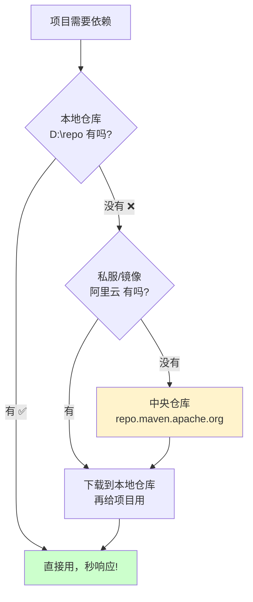
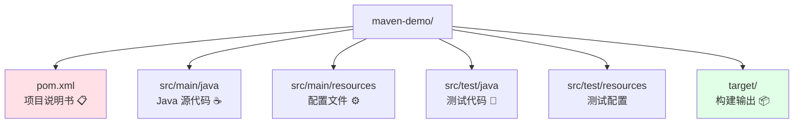
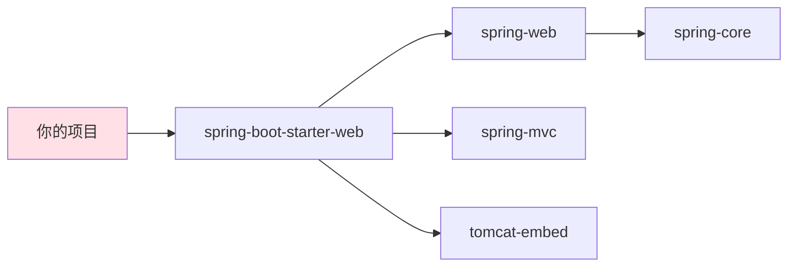
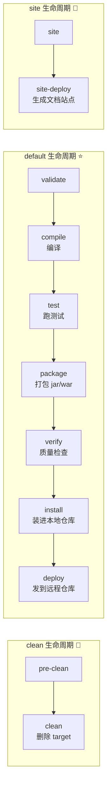
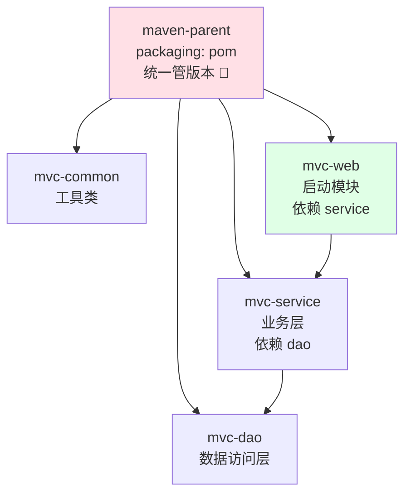
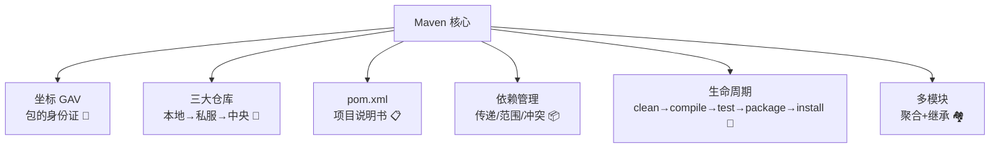

# 🏗️ Maven 构建工具大冒险

> 嘿嘿～欢迎来到 Maven 小课堂！🌸
> Maven 是 Java 世界的"超级大管家"，帮你管依赖、管构建、管项目结构，一站搞定！
> 再也不用满网找 jar 包手动导入了，冲鸭～ (๑•̀ㅂ•́)و✧

---

## 📖 目录

1. [Maven 是什么](#-maven-是什么)
2. [安装与配置](#-安装与配置)
3. [核心概念一：坐标](#-核心概念一坐标)
4. [核心概念二：三大仓库](#-核心概念二三大仓库)
5. [标准目录结构](#-标准目录结构)
6. [pom.xml 详解](#-pomxml-详解)
7. [依赖管理](#-依赖管理)
8. [生命周期与常用命令](#-生命周期与常用命令)
9. [多模块项目](#-多模块项目)
10. [常见问题排查](#-常见问题排查)
11. [总结与小抄](#-总结与小抄)

---

## 🤔 Maven 是什么

**一句话理解**：Maven 是 Java 的**项目构建 + 依赖管理**工具，管"jar 包从哪来、项目怎么打包、结构长啥样"三件套 📦

### 没有 Maven 的黑暗时代 🌑

| 痛点 | 具体表现 |
|------|---------|
| 😫 手动下 jar | 官网到处找包，版本还容易下错 |
| 📀 jar 包管理乱 | lib 文件夹塞几百个 jar，跟着项目走 |
| 🔄 依赖地狱 | A 要 C 的 1.0，B 要 C 的 2.0，打架了！ |
| 🧱 构建全靠手 | 编译、测试、打包每个项目写一遍脚本 |

### 有 Maven 的光明时代 ☀️

```xml
<!-- 想用啥，写段配置，jar 包自动飞过来！ -->
<dependency>
    <groupId>org.springframework.boot</groupId>
    <artifactId>spring-boot-starter-web</artifactId>
    <version>3.2.0</version>
</dependency>
```

> 💡 同类竞品：Gradle（Android 主力，Kotlin 语法）。Java 后端圈 Maven 依然是主流～

---

## 🛠️ 安装与配置

### 安装步骤

1. 官网下载 → 解压到本地（如 `D:\apache-maven-3.9.6`）
2. 配置环境变量 `MAVEN_HOME` + `Path`
3. 验证：终端执行 `mvn -v` 能出版本信息就 OK ✅

### 关键配置：settings.xml

位置：`MAVEN_HOME/conf/settings.xml`（或 `~/.m2/settings.xml`）

**① 配置本地仓库路径**（jar 包存哪）：

```xml
<localRepository>D:\repo</localRepository>
```

**② 配置阿里云镜像**（中央仓库在国外，慢到怀疑人生，必须换！⚡）：

```xml
<mirror>
    <id>aliyunmaven</id>
    <mirrorOf>*</mirrorOf>
    <name>阿里云公共仓库</name>
    <url>https://maven.aliyun.com/repository/public</url>
</mirror>
```

**③ 配置 JDK 默认版本**：

```xml
<profile>
    <id>jdk-17</id>
    <activation>
        <activeByDefault>true</activeByDefault>
        <jdk>17</jdk>
    </activation>
    <properties>
        <maven.compiler.source>17</maven.compiler.source>
        <maven.compiler.target>17</maven.compiler.target>
    </properties>
</profile>
```

---

## 🏷️ 核心概念一：坐标

**一句话理解**：坐标 = jar 包在 Maven 世界的"身份证号"，全球唯一 🪪

坐标三要素，俗称 **GAV**：

```xml
<groupId>com.alibaba</groupId>      <!-- 组织/公司：域名倒写 -->
<artifactId>fastjson</artifactId>   <!-- 项目名 -->
<version>2.0.43</version>           <!-- 版本号 -->
```

| 要素 | 通俗理解 | 示例 |
|------|---------|------|
| `groupId` | 姓氏（哪家公司） | `com.alibaba` |
| `artifactId` | 名字（哪个项目） | `fastjson` |
| `version` | 年龄（哪个版本） | `2.0.43` |

> 💡 有了 GAV，去 https://mvnrepository.com 搜任何包，复制依赖直接粘到 pom.xml 就能用！

---

## 🏪 核心概念二：三大仓库

**一句话理解**：jar 包住在"仓库"里，Maven 按顺序去找：**本地没有 → 找私服/远程 → 还没有 → 中央仓库下载存到本地**～



| 仓库 | 位置 | 特点 |
|------|------|------|
| 🏠 本地仓库 | 自己电脑的文件夹 | 第一顺位，找到即用 |
| 🏢 私服 | 公司内网（Nexus/阿里云镜像） | 快 + 可存公司内部包 |
| 🌍 中央仓库 | Maven 官方 | 全世界最全，但国外访问慢 |

> 💡 关键理解：**下载一次，终身受用**！jar 会缓存在本地仓库，下次别的项目直接复用～

---

## 📁 标准目录结构

Maven 信奉 **"约定优于配置"** —— 大家都用同一套目录，谁也不用瞎折腾！



```text
maven-demo
├── pom.xml                  # 核心！项目的"户口本"
├── src
│   ├── main
│   │   ├── java             # 放 .java 源码（如 com/xxx/App.java）
│   │   └── resources        # 放 application.yml、mybatis.xml 等
│   └── test
│       ├── java             # 放测试代码
│       └── resources        # 测试配置
└── target                   # mvn 编译打包的产物都在这（可随时删）
```

---

## 📋 pom.xml 详解

pom.xml 是项目的"总说明书"，逐层拆解看～ 🔍

```xml
<?xml version="1.0" encoding="UTF-8"?>
<project xmlns="http://maven.apache.org/POM/4.0.0">
    <!-- POM 模型版本，固定写 4.0.0 -->
    <modelVersion>4.0.0</modelVersion>

    <!-- ① 本项目坐标 -->
    <groupId>com.miao</groupId>
    <artifactId>my-project</artifactId>
    <version>1.0.0</version>
    <packaging>jar</packaging>   <!-- jar / war / pom -->

    <!-- ② 属性：统一管理版本号，一处改处处生效 ✨ -->
    <properties>
        <maven.compiler.source>17</maven.compiler.source>
        <maven.compiler.target>17</maven.compiler.target>
        <project.build.sourceEncoding>UTF-8</project.build.sourceEncoding>
        <spring.version>6.1.2</spring.version>
    </properties>

    <!-- ③ 依赖：项目要用哪些 jar -->
    <dependencies>
        <dependency>
            <groupId>org.springframework</groupId>
            <artifactId>spring-core</artifactId>
            <version>${spring.version}</version>   <!-- 引用属性 -->
        </dependency>
    </dependencies>

    <!-- ④ 构建：插件配置 -->
    <build>
        <plugins>
            <plugin>
                <groupId>org.apache.maven.plugins</groupId>
                <artifactId>maven-compiler-plugin</artifactId>
                <version>3.11.0</version>
            </plugin>
        </plugins>
    </build>
</project>
```

| 标签 | 作用 | 必填吗 |
|------|------|--------|
| `groupId / artifactId / version` | 项目坐标 | ✅ |
| `packaging` | 打包类型：jar（默认）/ war / pom | 默认 jar |
| `properties` | 版本号、编码统一管理 | 建议 |
| `dependencies` | 依赖列表 | 看情况 |
| `dependencyManagement` | 只管版本号，不实际引入（父 pom 常用） | 父子项目用 |
| `parent` | 继承父 pom | Spring Boot 项目必有 |
| `modules` | 聚合子模块 | 多模块项目用 |

---

## 📦 依赖管理

### 依赖传递

**一句话理解**：A 依赖 B，B 依赖 C，那 A 也能用 C —— 依赖会"自动传染" 🦠



> 这就是为什么只引一个 starter，一堆 jar 全来了～

### scope 依赖范围

依赖在不同"阶段/位置"是否生效，由 scope 控制：

| scope | 编译 | 测试 | 运行 | 打包进 war | 典型例子 |
|-------|:----:|:----:|:----:|:----------:|---------|
| `compile`（默认） | ✅ | ✅ | ✅ | ✅ | spring-core |
| `provided` | ✅ | ✅ | ❌ | ❌ | servlet-api（Tomcat 自带）|
| `runtime` | ❌ | ✅ | ✅ | ✅ | JDBC 驱动 |
| `test` | ❌ | ✅ | ❌ | ❌ | junit |
| `system` | ✅ | ✅ | ❌ | ❌ | 本地 jar（不推荐）|
| `import` | - | - | - | - | 只能在 dependencyManagement 用，导入 BOM |

```xml
<dependency>
    <groupId>junit</groupId>
    <artifactId>junit</artifactId>
    <scope>test</scope>    <!-- 只在测试时用，不进最终包 -->
</dependency>
```

### 依赖冲突与解决

**冲突从哪来**：两条传递路径引入了同一个包的不同版本，Maven 只能选一个！

```text
你的项目 → A → log4j 1.2.12
你的项目 → B → log4j 1.2.17   ← 版本打架了！⚔️
```

**Maven 的默认仲裁规则**：

1. **路径最短优先**：A→X(1.0) 两跳 vs B→C→X(2.0) 三跳 → 选 1.0
2. **路径相同时，先声明优先**：pom 里谁写前面听谁的

**人工干预：exclusions 排除法** ✂️

```xml
<dependency>
    <groupId>com.xxx</groupId>
    <artifactId>B</artifactId>
    <exclusions>
        <!-- 把 B 带进来的旧版 log4j 掐掉，留 A 那条路的 -->
        <exclusion>
            <groupId>log4j</groupId>
            <artifactId>log4j</artifactId>
        </exclusion>
    </exclusions>
</dependency>
```

**更优雅：dependencyManagement 锁版本** 🔒

```xml
<dependencyManagement>
    <dependencies>
        <dependency>
            <groupId>log4j</groupId>
            <artifactId>log4j</artifactId>
            <version>1.2.17</version>   <!-- 全项目统一用这版！ -->
        </dependency>
    </dependencies>
</dependencyManagement>
```

> 💡 排查冲突神器：`mvn dependency:tree` 打印依赖树，谁带进来的旧包一目了然 🌲

---

## 🔄 生命周期与常用命令

### 三大生命周期

Maven 有三套独立生命周期，每套按顺序执行（**执行后面的会自动带上前面的**）：



| 命令 | 干什么 | 使用频率 |
|------|--------|:-------:|
| `mvn clean` | 删除 target 目录 | ⭐⭐⭐ |
| `mvn compile` | 编译 main 代码 | ⭐⭐⭐ |
| `mvn test` | 编译 + 跑测试 | ⭐⭐ |
| `mvn package` | 打包成 jar / war | ⭐⭐⭐ |
| `mvn install` | 打包并装入本地仓库 | ⭐⭐⭐ |
| `mvn deploy` | 发布到远程仓库/私服 | ⭐⭐ |
| `mvn clean package` | 清理 + 打包（最常用组合拳） | ⭐⭐⭐⭐⭐ |
| `mvn dependency:tree` | 打印依赖树，查冲突 | ⭐⭐⭐ |

> 💡 记忆技巧：**clean、compile、test、package、install、deploy** 就是"扫地 → 做菜 → 试吃 → 装盒 → 入库 → 出货"一整套流程 🍱

---

## 🏘️ 多模块项目

项目大了要拆分，Maven 用 **聚合 + 继承** 管理全家桶～

### 典型结构



### 父 pom：聚合 + 版本管理

```xml
<groupId>com.miao</groupId>
<artifactId>maven-parent</artifactId>
<version>1.0.0</version>
<packaging>pom</packaging>          <!-- 父工程必须是 pom！ -->

<modules>
    <module>mvc-common</module>     <!-- 聚合：一键构建所有子模块 -->
    <module>mvc-dao</module>
    <module>mvc-service</module>
    <module>mvc-web</module>
</modules>

<dependencyManagement>              <!-- 只定版本，子模块引依赖不用写版本号 -->
    <dependencies>
        <dependency>
            <groupId>com.miao</groupId>
            <artifactId>mvc-common</artifactId>
            <version>1.0.0</version>
        </dependency>
    </dependencies>
</dependencyManagement>
```

### 子 pom：继承父工程

```xml
<parent>
    <groupId>com.miao</groupId>
    <artifactId>maven-parent</artifactId>
    <version>1.0.0</version>
</parent>

<artifactId>mvc-service</artifactId>

<dependencies>
    <dependency>
        <groupId>com.miao</groupId>
        <artifactId>mvc-common</artifactId>
        <!-- 不用写版本号，爹已锁定 ✨ -->
    </dependency>
</dependencies>
```

### 聚合 vs 继承

| 概念 | 作用 | 关键配置 |
|------|------|---------|
| 🔗 聚合 | 一条命令构建所有模块 | 父 pom 的 `<modules>` |
| 👨‍👧 继承 | 子项目复用父项目的配置和版本锁定 | 子 pom 的 `<parent>` |

> 💡 两者通常搭配使用：聚合管"一起构建"，继承管"统一版本"，双剑合璧 ⚔️

---

## 🩹 常见问题排查

| 症状 | 原因 | 药方 💊 |
|------|------|--------|
| 下载卡住/超时 ⏳ | 默认中央仓库在国外 | settings.xml 配阿里云镜像 |
| 红色依赖下不下来 ❌ | 网络中断产生 `.lastUpdated` 残留 | 删除本地仓库对应文件夹重新下载 |
| 编码乱码 🔤 | 编码不一致 | properties 配 UTF-8 |
| 依赖冲突报错 ⚔️ | 同一包多版本打架 | `mvn dependency:tree` + exclusions |
| 爆"找不到符号" 🫥 | IDEA 缓存抽风 | 右键项目 → Maven → Reload Project |
| jar 打不进包 📦 | scope 写成 provided/test | 检查依赖范围 |

---

## 🎀 总结与小抄

### 知识地图回顾



### 必记五条军规 ✊

1. **装完 Maven 先配阿里云镜像**，下载速度起飞 ✈️
2. **版本号集中在 properties/dependencyManagement**，一处改处处生效！
3. **scope 很重要**：test 不进包、provided 容器提供、runtime 只运行时用
4. **冲突先跑 `mvn dependency:tree`**，再决定 exclude 谁
5. **最常用命令 `mvn clean package`**，IDEA 里就是那个小 m 图标 🖱️

### 常用速查 📌

| 想做什么 | 怎么做 |
|---------|--------|
| 找 jar 坐标 | mvnrepository.com 搜索 |
| 看依赖谁带进来的 | `mvn dependency:tree` |
| 强制更新依赖 | `mvn clean install -U` |
| 跳过测试打包 | `mvn clean package -DskipTests` |
| IDEA 刷新项目 | Maven 面板 → Reload All Maven Projects |

---

> 🎉 恭喜通关 Maven！从此告别手动导 jar 的原始生活～
> 记住 Maven 的核心就俩字：**管包**（依赖管理）和 **管建**（构建生命周期）(¬‿¬)✨
> 想了解 Gradle 对比、Nexus 私服搭建，或者继续下一个知识点，随时来找我哦，比心～ 💗
