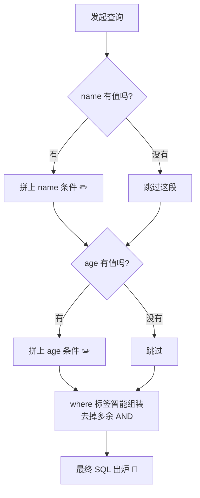
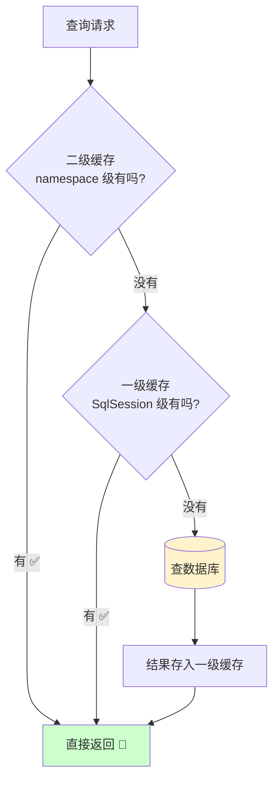

# 🌉 MyBatis 持久层框架大冒险

> 嘿嘿～欢迎来到 MyBatis 小课堂！🌸
> 还记得 JDBC 里那些繁琐的样板代码吗？MyBatis 就是来解放你的超级英雄！
> 它帮你管连接、管参数、管结果映射，你只管写 SQL～冲鸭！(๑•̀ㅂ•́)و✧

***

## 📖 目录

1. [MyBatis 是什么](#-mybatis-是什么)
2. [快速入门](#-快速入门)
3. [执行流程与核心组件](#-执行流程与核心组件)
4. [配置文件 mybatis-config.xml](#-配置文件-mybatis-configxml)
5. [映射文件 Mapper XML](#-映射文件-mapper-xml)
6. [#{} 与 \${} 的爱恨情仇](#-与-的爱恨情仇)
7. [动态 SQL —— 灵魂技能](#-动态-sql--灵魂技能)
8. [结果映射 resultMap](#-结果映射-resultmap)
9. [注解开发](#-注解开发)
10. [缓存机制](#-缓存机制)
11. [MyBatis-Plus 懒人神器](#-mybatis-plus-懒人神器)
12. [总结与小抄](#-总结与小抄)

***

## 🤔 MyBatis 是什么

**一句话理解**：MyBatis 是一款**半自动化 ORM 框架** —— SQL 你来写，脏活它来干！🧹

### ORM 是什么？

ORM = Object Relational Mapping（对象关系映射）

**一句话理解**：数据库的表 ↔ Java 的类，自动"翻译"的魔法转换器 🪄

| 数据库       | Java 世界     |
| --------- | ----------- |
| 表 table   | 类 class     |
| 字段 column | 属性 field    |
| 一行记录 row  | 一个对象 object |

### 持久层技术对比

| 技术              | SQL 谁写 | 特点              | 一句话点评           |
| --------------- | :----: | --------------- | --------------- |
| 原生 JDBC         |   你写   | 样板代码地狱 😭       | 地基，得懂           |
| **MyBatis**     | **你写** | SQL 与代码分离，半自动 ⭐ | **SQL 可控，国内主流** |
| Hibernate / JPA |  框架生成  | 全自动，面向对象        | 国外流行，SQL 不可控    |
| MyBatis-Plus    |  基本不写  | MyBatis 增强      | 起步快，复杂查询还得写 SQL |

> 💡 国内互联网公司为啥爱 MyBatis？**SQL 完全自己掌控**，方便调优！业务复杂、并发高的场景就靠它～

***

## 🚀 快速入门

### ① 添加依赖

```xml
<dependencies>
    <dependency>
        <groupId>org.mybatis</groupId>
        <artifactId>mybatis</artifactId>
        <version>3.5.13</version>
    </dependency>
    <dependency>
        <groupId>com.mysql</groupId>
        <artifactId>mysql-connector-j</artifactId>
        <version>8.0.33</version>
    </dependency>
</dependencies>
```

### ② 核心配置 mybatis-config.xml

```xml
<?xml version="1.0" encoding="UTF-8" ?>
<!DOCTYPE configuration PUBLIC "-//mybatis.org//DTD Config 3.0//EN"
        "http://mybatis.org/dtd/mybatis-3-config.dtd">
<configuration>
    <environments default="development">
        <environment id="development">
            <transactionManager type="JDBC"/>          <!-- 事务管理器 -->
            <dataSource type="POOLED">                  <!-- 连接池 -->
                <property name="driver" value="com.mysql.cj.jdbc.Driver"/>
                <property name="url" value="jdbc:mysql://localhost:3306/mydb"/>
                <property name="username" value="root"/>
                <property name="password" value="123456"/>
            </dataSource>
        </environment>
    </environments>
    <mappers>
        <mapper resource="mapper/StudentMapper.xml"/>  <!-- 注册映射文件 -->
    </mappers>
</configuration>
```

### ③ 实体类 + Mapper 接口

```java
// 实体类：和数据库表一一对应
public class Student {
    private Integer id;
    private String name;
    private Integer age;
    // 省略 getter/setter（或直接用 record / Lombok @Data ✨）
}
```

```java
// Mapper 接口：不用写实现类！MyBatis 会动态代理生成
public interface StudentMapper {
    List<Student> selectAll();
    Student selectById(Integer id);
    int insert(Student student);
}
```

### ④ 映射文件 StudentMapper.xml

```xml
<?xml version="1.0" encoding="UTF-8" ?>
<!DOCTYPE mapper PUBLIC "-//mybatis.org//DTD Mapper 3.0//EN"
        "http://mybatis.org/dtd/mybatis-3-mapper.dtd">
<!-- namespace 绑定对应的 Mapper 接口（全限定名）-->
<mapper namespace="com.miao.mapper.StudentMapper">

    <select id="selectAll" resultType="com.miao.entity.Student">
        SELECT * FROM student
    </select>

    <select id="selectById" resultType="com.miao.entity.Student">
        SELECT * FROM student WHERE id = #{id}
    </select>

    <insert id="insert" parameterType="com.miao.entity.Student">
        INSERT INTO student(name, age) VALUES(#{name}, #{age})
    </insert>
</mapper>
```

### ⑤ 跑起来！

```java
public class Demo {
    public static void main(String[] args) throws Exception {
        // 1. 加载配置，建造 SqlSessionFactory（工厂只建一次）
        InputStream in = Resources.getResourceAsStream("mybatis-config.xml");
        SqlSessionFactory factory = new SqlSessionFactoryBuilder().build(in);

        // 2. 开一个 SqlSession（相当于一次数据库会话）
        try (SqlSession session = factory.openSession()) {
            // 3. 拿到 Mapper 接口的代理对象
            StudentMapper mapper = session.getMapper(StudentMapper.class);

            // 4. 像调普通方法一样执行 SQL！
            List<Student> students = mapper.selectAll();
            students.forEach(System.out::println);

            mapper.insert(new Student(null, "小白", 18));
            session.commit();      // 增删改要手动提交事务！⚠️
        }
    }
}
```

***

## 🔄 执行流程与核心组件

```mermaid
flowchart TD
    A["Mapper 接口方法调用<br/>selectAll"] --> B["动态代理拦截<br/>找到同名 SQL"]
    B --> C["SqlSession<br/>会话门面"]
    C --> D["Executor 执行器<br/>真正干活"]
    D --> E["解析 SQL + 替换参数<br/>&#35;{id} → ?"]
    E --> F["JDBC 底层<br/>PreparedStatement"]
    F --> G[("数据库")]
    G --> H["ResultSet 结果集"]
    H --> I["按 resultType<br/>映射成对象"]
    I --> J["返回 List&lt;Student&gt; ✅"]
    style A fill:#ffe0e6
    style J fill:#e0ffe6
```



| 组件                         | 通俗理解         | 生命周期             |
| -------------------------- | ------------ | ---------------- |
| `SqlSessionFactoryBuilder` | 一次性工匠，建完工厂就走 | 方法局部             |
| `SqlSessionFactory`        | 大工厂，全局唯一 👑  | 应用级别             |
| `SqlSession`               | 一次会话/一笔订单    | 请求/方法级别，**用完必关** |
| `Mapper 接口`                | 你的专属遥控器 🎮   | SqlSession 内     |

> 💡 日常开发中，Spring Boot + mybatis-spring-boot-starter 全自动管理这些对象，`@Autowired` 直接注入 Mapper 用就行～

***

## ⚙️ 配置文件 mybatis-config.xml

常用配置项速览（注意**顺序敏感**，标签乱序会报错！）：

```xml
<configuration>
    <properties resource="db.properties"/>       <!-- ① 引入外部配置 -->

    <settings>                                     <!-- ② 全局设置 -->
        <setting name="mapUnderscoreToCamelCase" value="true"/>
        <!-- 驼峰映射神器：数据库 user_name → Java userName 自动对应 ✨ -->
        <setting name="cacheEnabled" value="true"/>
        <!-- 开启二级缓存 -->
    </settings>

    <typeAliases>                                  <!-- ③ 起别名，少写包名 -->
        <package name="com.miao.entity"/>
        <!-- StudentMapper.xml 里就能直接写 resultType="Student" -->
    </typeAliases>

    <environments default="development">...</environments>
    <mappers>
        <package name="com.miao.mapper"/>          <!-- ④ 扫描整个包的 Mapper -->
    </mappers>
</configuration>
```

***

## 📄 映射文件 Mapper XML

### 增删改查标签一览

| 标签         | 用途 | 常用属性                                               |
| ---------- | -- | -------------------------------------------------- |
| `<select>` | 查询 | `id`、`resultType`、`resultMap`、`parameterType`      |
| `<insert>` | 新增 | `useGeneratedKeys="true" keyProperty="id"` 回填自增 id |
| `<update>` | 修改 | 同上                                                 |
| `<delete>` | 删除 | 同上                                                 |

```xml
<!-- 插入并回填自增主键：插入后 id 自动塞回对象里 ✨ -->
<insert id="insert" useGeneratedKeys="true" keyProperty="id">
    INSERT INTO student(name, age) VALUES(#{name}, #{age})
</insert>
```

### 参数传递的几种姿势

| 接口写法                                                  | XML 取值             | 说明              |
| ----------------------------------------------------- | ------------------ | --------------- |
| `f(Integer id)`                                       | `#{id}`            | 单个参数随意取         |
| `f(@Param("name") String n, @Param("age") Integer a)` | `#{name}` `#{age}` | 多参数必须 @Param 起名 |
| `f(Student s)`                                        | `#{name}` `#{age}` | 对象直接点属性         |
| `f(Map<String, Object> map)`                          | `#{key}`           | Map 按 key 取     |
| `f(List<Integer> ids)`                                | `foreach` 遍历       | 配合批量操作          |

```java
// 多参数场景：强烈建议加 @Param，否则 XML 里只能用 arg0/param1 这种丑名字
List<Student> selectByNameAndAge(@Param("name") String name, @Param("age") Integer age);
```

***

## 💘 #{} 与 \${} 的爱恨情仇

**超高频面试题！** 两者都是占位符，但性格完全不同～

| 对比项       | `#{}` 😇                   | `${}` 😈               |
| --------- | -------------------------- | ---------------------- |
| 底层实现      | `PreparedStatement`，`?` 占位 | 字符串直接**拼接**进 SQL       |
| 🔒 SQL 注入 | **天然防注入** ✅                | 有注入风险 ❌                |
| 📦 使用场景   | 传**值**（日常 99% 场景）          | 传**表名/列名/order by 字段** |
| 预编译       | 支持，性能好                     | 不支持                    |

```java
// #{}：安全，值会被当参数处理
SELECT * FROM student WHERE name = #{name}
// → SELECT * FROM student WHERE name = ?  （预编译，安全 ✅）

// ${}：直接拼字符串，黑客最爱
SELECT * FROM student WHERE name = '${name}'
// 输入 ' OR '1'='1 → SQL 被篡改！💀
```

> ✅ 军规：**默认永远用** **`#{}`**！只有动态表名、动态排序字段这种"没法预编译"的场景才用 `${}`，且必须在代码层白名单校验！

***

## 🎭 动态 SQL —— 灵魂技能

**一句话理解**：根据条件"拼"出不同的 SQL —— 参数给了就加这段，没给就跳过，超灵活！🤸

### 常用标签速览

| 标签                        | 作用                         | 类比          |
| ------------------------- | -------------------------- | ----------- |
| `<if test="...">`         | 条件成立才拼接                    | Java 的 if   |
| `<where>`                 | 智能加 WHERE + 去掉开头多余的 AND/OR | 贴心小管家       |
| `<set>`                   | 智能加 SET + 去掉末尾多余的逗号        | 同上          |
| `<choose/when/otherwise>` | 多选一                        | switch-case |
| `<foreach>`               | 遍历集合                       | for 循环      |
| `<trim>`                  | 自定义前后缀处理                   | 万能修剪器       |
| `<sql> + <include>`       | 抽取复用 SQL 片段                | 方法抽取        |

### 多条件查询（if + where）

**需求**：姓名、年龄传了哪个就按哪个查，都没传就查全部～

```xml
<select id="selectByCondition" resultType="Student">
    SELECT * FROM student
    <where>                       <!-- 有条件才生成 WHERE，并自动去掉开头 AND -->
        <if test="name != null and name != ''">
            AND name LIKE CONCAT('%', #{name}, '%')
        </if>
        <if test="age != null">
            AND age = #{age}
        </if>
    </where>
</select>
```



### 动态更新（set）

**需求**：只更新传了值的字段，别把没传的字段刷成 null！

```xml
<update id="update">
    UPDATE student
    <set>                         <!-- 智能加 SET，并去掉末尾多余逗号 -->
        <if test="name != null">name = #{name},</if>
        <if test="age != null">age = #{age},</if>
    </set>
    WHERE id = #{id}
</update>
```

### 批量查询（foreach）⭐

**需求**：`WHERE id IN (1, 3, 5, 7)`

```xml
<select id="selectByIds" resultType="Student">
    SELECT * FROM student WHERE id IN
    <foreach collection="ids"      <!-- 遍历的集合 -->
             item="id"             <!-- 每项的变量名 -->
             open="("              <!-- 开始符号 -->
             separator=","         <!-- 分隔符 -->
             close=")">            <!-- 结束符号 -->
        #{id}
    </foreach>
</select>
```

```java
// 拼出来的效果：SELECT * FROM student WHERE id IN (1, 3, 5, 7)
List<Student> list = mapper.selectByIds(Arrays.asList(1, 3, 5, 7));
```

### 多选一（choose）

```xml
<select id="select" resultType="Student">
    SELECT * FROM student
    <where>
        <choose>                                   <!-- 命中一个就退出 -->
            <when test="name != null">name = #{name}</when>
            <when test="age != null">age = #{age}</when>
            <otherwise>1 = 1</otherwise>           <!-- 都不中走这里 -->
        </choose>
    </where>
</select>
```

### SQL 片段复用

```xml
<sql id="baseColumns">id, name, age</sql>

<select id="selectAll" resultType="Student">
    SELECT <include refid="baseColumns"/> FROM student   <!-- 复用 ✨ -->
</select>
```

***

## 🗺️ 结果映射 resultMap

### 什么时候需要它？

**当列名和属性名对不上**（驼峰开关没开、或复杂关联查询）时，手动指定"谁对应谁"：

```xml
<!-- 数据库 user_name ↔ Java userName -->
<resultMap id="studentMap" type="Student">
    <id column="id" property="id"/>               <!-- 主键用 id 标签 -->
    <result column="user_name" property="userName"/>
    <result column="age" property="age"/>
</resultMap>

<select id="selectAll" resultMap="studentMap">    <!-- 注意：用的是 resultMap -->
    SELECT * FROM student
</select>
```

> 💡 懒人方案：settings 里开 `mapUnderscoreToCamelCase=true`，下划线自动转驼峰，简单场景就不用写 resultMap 啦～

### 一对一关联（association）

**场景**：学生 ↔ 学生证，一个学生有一张证 🎫

```xml
<resultMap id="studentWithCard" type="Student">
    <id column="id" property="id"/>
    <result column="name" property="name"/>
    <!-- 一对一用 association -->
    <association property="card" javaType="Card">
        <id column="cid" property="id"/>
        <result column="cardNo" property="cardNo"/>
    </association>
</resultMap>
```

### 一对多关联（collection）

**场景**：班级 ↔ 学生，一个班有很多学生 👨‍👩‍👧‍👦

```xml
<resultMap id="classWithStudents" type="Clazz">
    <id column="cid" property="id"/>
    <result column="cname" property="name"/>
    <!-- 一对多用 collection -->
    <collection property="students" ofType="Student">
        <id column="sid" property="id"/>
        <result column="sname" property="name"/>
    </collection>
</resultMap>
```

| 标签              | 关系        | Java 类型                              |
| --------------- | --------- | ------------------------------------ |
| `<association>` | 一对一 / 多对一 | 对象 `private Card card;`              |
| `<collection>`  | 一对多 / 多对多 | 集合 `private List<Student> students;` |

***

## ✍️ 注解开发

简单 SQL 用注解写在接口上，连 XML 都省了～

```java
public interface StudentMapper {

    @Select("SELECT * FROM student WHERE id = #{id}")
    Student selectById(Integer id);

    @Insert("INSERT INTO student(name, age) VALUES(#{name}, #{age})")
    int insert(Student student);

    @Update("UPDATE student SET name = #{name} WHERE id = #{id}")
    int update(Student student);

    @Delete("DELETE FROM student WHERE id = #{id}")
    int delete(Integer id);

    // 动态 SQL 也有注解版（<script> 标签包起来）
    @Select("<script>SELECT * FROM student" +
            "<where><if test='name != null'>AND name = #{name}</if></where>" +
            "</script>")
    List<Student> selectByCondition(@Param("name") String name);
}
```

| 方式     | 优点                     | 缺点           | 建议              |
| ------ | ---------------------- | ------------ | --------------- |
| XML 映射 | 动态 SQL 强大、SQL 集中管理、有高亮 | 文件多          | **复杂 SQL 用它** ⭐ |
| 注解     | 简单直观、少一个文件             | 复杂 SQL 写起来难受 | 简单 CRUD 用它      |

> 💡 实际项目常见混搭：简单查询注解一把梭，复杂动态 SQL 回归 XML～

***

## 🧊 缓存机制

**一句话理解**：同样的查询懒得每次都跑数据库？结果先"存起来"，下次直接拿！⚡



| 对比项     | 一级缓存                       | 二级缓存                   |
| ------- | -------------------------- | ---------------------- |
| 📍 作用范围 | **SqlSession** 内           | **namespace**（Mapper）级 |
| 🔘 默认状态 | **默认开启**                   | 默认关闭，需手动配              |
| 🧹 失效时机 | sqlSession 关闭/commit/执行增删改 | 执行增删改                  |
| 🏢 分布式  | 单会话有效                      | 单机有效（集群要靠 Redis）       |

```xml
<!-- 二级缓存开启三步走 -->
<!-- ① mybatis-config.xml -->
<setting name="cacheEnabled" value="true"/>

<!-- ② Mapper.xml 加一行 -->
<cache/>

<!-- ③ 实体类实现 Serializable 接口 -->
```

> ⚠️ 实际生产中，MyBatis 自带缓存用得少（多节点部署各缓存各的，数据不一致），一般直接上 **Redis** 做分布式缓存～

***

## 🚀 MyBatis-Plus 懒人神器

**一句话理解**：MyBatis 的"增强包"，只做增强不做改变 —— 单表 CRUD 连 SQL 都不用写了！😱

```xml
<dependency>
    <groupId>com.baomidou</groupId>
    <artifactId>mybatis-plus-boot-starter</artifactId>
    <version>3.5.5</version>
</dependency>
```

```java
// 继承 BaseMapper，白捡一大堆方法！
public interface StudentMapper extends BaseMapper<Student> { }

// 直接开用 ——
Student s = studentMapper.selectById(1);          // 按主键查
studentMapper.insert(new Student());              // 插入
studentMapper.updateById(student);                // 按主键改
studentMapper.deleteById(5);                      // 按主键删

// 条件构造器：优雅拼条件
List<Student> list = studentMapper.selectList(
        new LambdaQueryWrapper<Student>()
                .like(Student::getName, "小")
                .ge(Student::getAge, 18)
                .orderByDesc(Student::getAge));
```

> 💡 进阶还有：代码生成器、分页插件、乐观锁插件、逻辑删除（`@TableLogic`）等全家桶功能～

***

## 🎀 总结与小抄

### 知识地图回顾

```mermaid
flowchart TD
    A["MyBatis 核心"] --> B["配置<br/>mybatis-config.xml ⚙️"]
    A --> C["映射<br/>Mapper 接口 + XML 📄"]
    A --> D["占位符<br/>&#35;{} 安全 / ${} 危险 💘"]
    A --> E["动态 SQL<br/>if/where/foreach 🎭"]
    A --> F["结果映射<br/>resultMap 关联查询 🗺️"]
    A --> G["缓存<br/>一级默认 / 二级手动 🧊"]
    A --> H["增强<br/>MyBatis-Plus 🚀"]
```



### 面试高频题速答卡 📌

| 问题                 | 一句话答案                                                  |
| ------------------ | ------------------------------------------------------ |
| `#{}` 和 `${}` 区别？  | `#{}` 预编译防注入（传值）；`${}` 字符串拼接（传表名/排序字段，需白名单）            |
| Mapper 接口为什么不用实现类？ | **JDK 动态代理**，方法名+命名空间定位 XML 里的 SQL                     |
| 动态 SQL 有哪些标签？      | if、where、set、choose、foreach、trim、sql/include           |
| 一级二级缓存区别？          | 一级 SqlSession 级默认开；二级 namespace 级手动开，增删改都失效            |
| MyBatis 执行流程？      | 接口调用 → 代理找 SQL → SqlSession → Executor → JDBC → 结果映射返回 |
| MyBatis vs JPA？    | 半自动（SQL 可控、好调优）vs 全自动（开发快、SQL 不可控）                     |

### 必记五条军规 ✊

1. **占位符默认** **`#{}`**，`${}` 只用于动态表名/排序字段！
2. **多参数必须** **`@Param`** **起名**，不然 XML 里找不到值～
3. **开启驼峰映射** `mapUnderscoreToCamelCase`，少写一堆 resultMap！
4. **SqlSession 用完关闭**（整合 Spring 后自动管理，但原理要懂）～
5. **复杂查询写 XML**，简单 CRUD 用注解或 MyBatis-Plus～

***

> 🎉 恭喜通关 MyBatis！从 JDBC 的"手搓时代"正式迈入"框架时代"啦～
> 面试官再问 `#{}` 和 `${}`，微微一笑：预编译与拼接的区别，注入与安全的天平 (¬‿¬)✨
> 想继续 Spring / SpringBoot / Redis，随时来找我哦，比心～ 💗

