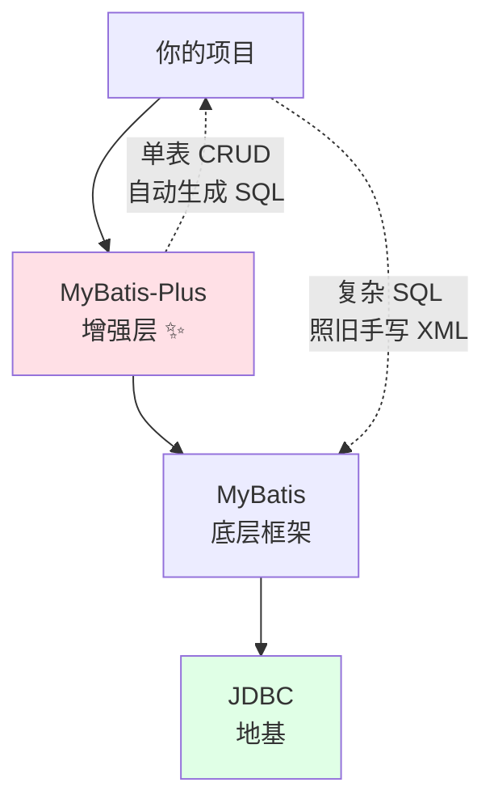
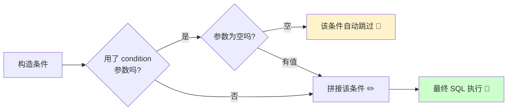
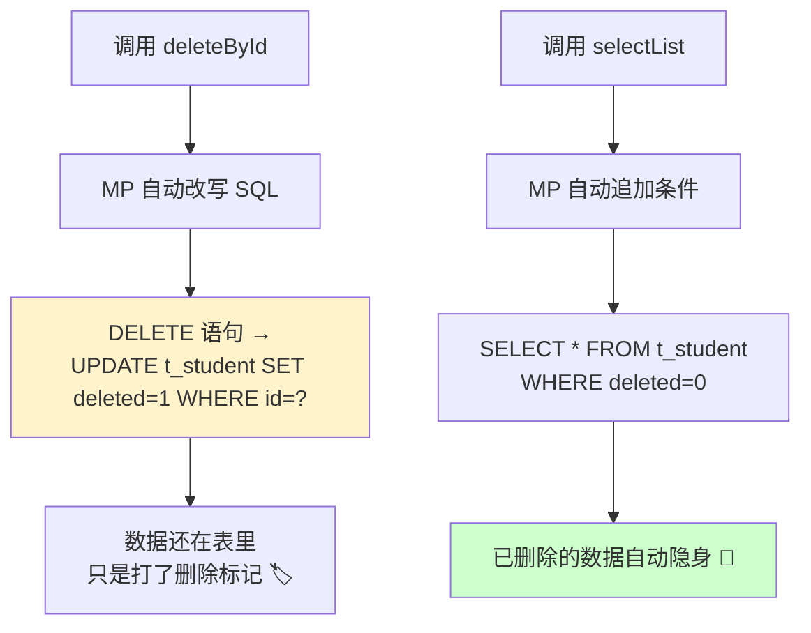
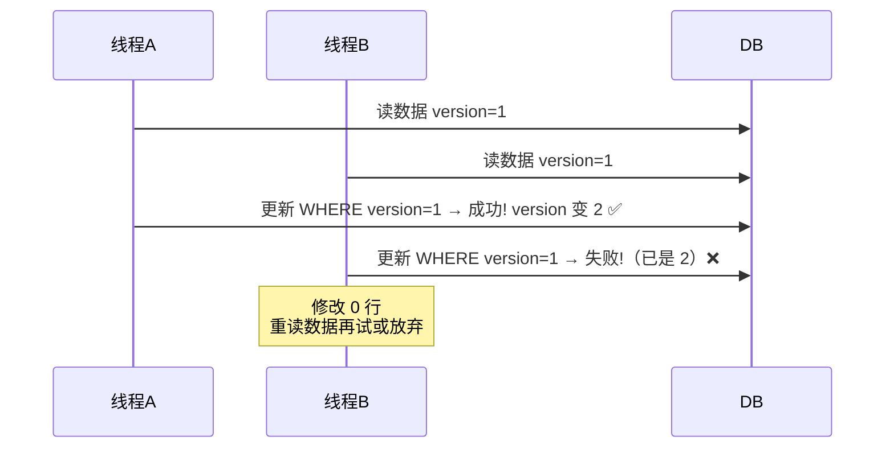
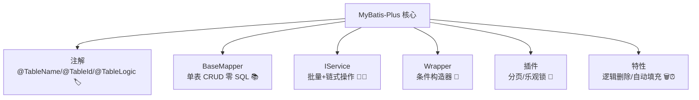

# ⚡ MyBatis-Plus 增强神器大冒险

> 嘿嘿～欢迎来到 MyBatis-Plus 小课堂！🌸
> 上节课 MyBatis 还要手写 SQL？MP 直接说："单表增删改查，我全包了！"
> 只做增强、不做改变 —— 这就是国产开源之光 MP 的底气！冲鸭～ (๑•̀ㅂ•́)و✧

***

## 📖 目录

1. [MyBatis-Plus 是什么](#-mybatis-plus-是什么)
2. [快速入门](#-快速入门)
3. [常用注解](#-常用注解)
4. [BaseMapper 通用 CRUD](#-basemapper-通用-crud)
5. [IService 服务层](#-iservice-服务层)
6. [条件构造器 Wrapper](#-条件构造器-wrapper)
7. [分页插件](#-分页插件)
8. [逻辑删除](#-逻辑删除)
9. [乐观锁插件](#-乐观锁插件)
10. [自动填充](#-自动填充)
11. [总结与小抄](#-总结与小抄)

***

## 🤔 MyBatis-Plus 是什么

**一句话理解**：MyBatis-Plus（简称 MP）是 MyBatis 的**增强工具** —— 不改变 MyBatis 本身，只让它变得更强！💪

### 和 MyBatis 的关系



| 对比项     | MyBatis                 | MyBatis-Plus       |
| ------- | ----------------------- | ------------------ |
| 单表 CRUD | 每个方法写 XML/注解            | **内置通用方法，零 SQL** ⚡ |
| 分页      | 手写 LIMIT 或 PageHelper   | **内置分页插件**         |
| 逻辑删除    | 每条 SQL 加 `is_deleted=0` | **注解一贴，全局生效**      |
| 乐观锁     | 自己实现                    | **插件支持**           |
| 复杂多表查询  | ✅ 手写                    | ✅ **照样手写**（不冲突！）   |

> 💡 核心理念：**"单表操作它包办，复杂查询你写 XML"**，两者无缝混用，这就是 MP 的优雅之处～

***

## 🚀 快速入门

### ① 添加依赖（Spring Boot 项目）

```xml
<!-- 注意：引入 MP 后不要再单独引 mybatis，否则版本冲突！ -->
<dependency>
    <groupId>com.baomidou</groupId>
    <artifactId>mybatis-plus-boot-starter</artifactId>
    <version>3.5.5</version>
</dependency>
```

### ② 配置数据源 + yml

```yaml
spring:
  datasource:
    url: jdbc:mysql://localhost:3306/mydb?useSSL=false&serverTimezone=Asia/Shanghai
    username: root
    password: 123456

mybatis-plus:
  configuration:
    log-impl: org.apache.ibatis.logging.stdout.StdOutImpl   # 打印 SQL，开发必备 🔍
    map-underscore-to-camel-case: true                      # 驼峰映射（默认已开）
  global-config:
    db-config:
      logic-delete-field: deleted        # 全局逻辑删除字段名
      logic-delete-value: 1              # 删除标记
      logic-not-delete-value: 0          # 未删除标记
```

### ③ 实体类 + Mapper

```java
@TableName("student")              // 表名和类名不一致时指定
public class Student {
    @TableId(type = IdType.AUTO)    // 主键，自增策略
    private Long id;
    private String name;            // 自动映射到 name 列
    private Integer age;
    private String userEmail;       // 自动映射到 user_email 列（驼峰）
}
```

```java
// 继承 BaseMapper，泛型写实体类 → 瞬间白捡 20+ 个方法！🎁
@Mapper
public interface StudentMapper extends BaseMapper<Student> {
    // 什么都不用写！单表 CRUD 全有了！
    // 需要复杂 SQL 时，照常写方法 + XML，和 MyBatis 一模一样～
}
```

### ④ 测试跑起来

```java
@Autowired
private StudentMapper studentMapper;

@Test
void testQuickStart() {
    Student s = studentMapper.selectById(1L);      // 查：没写过一行 SQL！
    System.out.println(s);

    studentMapper.insert(new Student());           // 增
    studentMapper.deleteById(2L);                  // 删
    studentMapper.updateById(s);                   // 改
}
```

***

## 🏷️ 常用注解

| 注解                           | 用在哪  | 作用           | 示例                                 |
| ---------------------------- | ---- | ------------ | ---------------------------------- |
| `@TableName("t_student")`    | 类    | 指定表名         | 类名 ≠ 表名时必加                         |
| `@TableId(type = ...)`       | 主键字段 | 主键策略         | AUTO 自增 / ASSIGN\_ID 雪花 / INPUT 手动 |
| `@TableField("name")`        | 普通字段 | 指定列名 / 特殊处理  | 列名对不上时用                            |
| `@TableField(exist = false)` | 字段   | 该属性**不是表字段** | 临时计算、DTO 属性                        |
| `@TableLogic`                | 字段   | 标记逻辑删除字段     | 删除变 UPDATE                         |
| `@Version`                   | 字段   | 乐观锁版本号       | 配合乐观锁插件                            |

```java
@TableName("t_student")
public class Student {
    @TableId(type = IdType.ASSIGN_ID)   // 雪花算法生成分布式 ID
    private Long id;

    @TableField("s_name")               // 数据库列叫 s_name
    private String name;

    @TableField(exist = false)          // 数据库没这列，别乱映射！
    private String tempInfo;

    @Version                            // 乐观锁版本号
    private Integer version;

    @TableLogic                         // 逻辑删除标记
    private Integer deleted;
}
```

> 💡 主键策略小知识：`ASSIGN_ID` 用**雪花算法**生成 19 位数字 ID，不依赖数据库自增，**分库分表友好**，是 MP 默认策略～

***

## 📚 BaseMapper 通用 CRUD

继承 BaseMapper 后白捡的方法清单（泛型 T = Student）：

| 方法                                       | 作用                  | 对应 SQL                       |
| ---------------------------------------- | ------------------- | ---------------------------- |
| `insert(T entity)`                       | 插入                  | INSERT                       |
| `deleteById(id)`                         | 按 id 删              | DELETE ... WHERE id=?        |
| `deleteBatchIds(idList)`                 | 批量删                 | DELETE ... WHERE id IN (...) |
| `deleteById(entity)` / `delete(wrapper)` | 条件删                 | 带 version/条件删除               |
| `updateById(T entity)`                   | 按 id 更新（null 字段不更新） | UPDATE ... SET 非 null 字段     |
| `update(T entity, wrapper)`              | 条件更新                | UPDATE ... WHERE 条件          |
| `selectById(id)`                         | 按 id 查              | SELECT ... WHERE id=?        |
| `selectBatchIds(idList)`                 | 批量查                 | SELECT ... WHERE id IN (...) |
| `selectList(wrapper)`                    | 条件查列表               | SELECT ... WHERE 条件          |
| `selectOne(wrapper)`                     | 查单条                 | 适合唯一条件                       |
| `selectCount(wrapper)`                   | 计数                  | SELECT COUNT(\*)             |
| `selectPage(page, wrapper)`              | 分页查                 | 配合分页插件                       |

```java
// 随便感受几个 ——
Student s = studentMapper.selectById(1L);

List<Student> list = studentMapper.selectBatchIds(Arrays.asList(1L, 2L, 3L));

Long count = studentMapper.selectCount(null);   // wrapper 传 null = 无条件（查全部）

// updateById 的特性：只更新非 null 字段（动态 set 的感觉～）
Student s = new Student();
s.setId(1L);
s.setAge(20);                              // 只设置了 age
studentMapper.updateById(s);               // → UPDATE t_student SET age=20 WHERE id=1
                                           // name 为 null 不会被更新成 null ✅
```

***

## 🧑‍💼 IService 服务层

**一句话理解**：MP 规定了一套"三层架构标准姿势"，Service 层也有现成方法 + 更贴心的批量操作～

### 标准写法

```java
// ① Service 接口：继承 IService
public interface StudentService extends IService<Student> { }

// ② Service 实现类：继承 ServiceImpl，指明 Mapper 和实体
@Service
public class StudentServiceImpl
        extends ServiceImpl<StudentMapper, Student>
        implements StudentService { }
```

```java
// ③ 使用 —— IService 比 BaseMapper 更强大
studentService.save(student);                       // 单条插入
studentService.saveBatch(list);                     // 批量插入（重点优化！⚡）
studentService.saveOrUpdate(student);               // 有 id 更新，没 id 插入
studentService.removeById(1L);                      // 删除
studentService.updateById(student);                 // 更新
studentService.getById(1L);                         // 单查
studentService.listByIds(ids);                      // 批量查

// 链式调用（LambdaQueryChainWrapper）—— 丝滑到不行 ✨
List<Student> result = studentService.lambdaQuery()
        .like(Student::getName, "小")
        .ge(Student::getAge, 18)
        .list();

// 链式更新
studentService.lambdaUpdate()
        .eq(Student::getAge, 18)
        .set(Student::getAge, 19)
        .update();
```

### BaseMapper vs IService

| 对比项             | BaseMapper（DAO 层） | IService（Service 层） |
| --------------- | ----------------- | ------------------- |
| 📍 所在层          | Mapper 接口         | Service 类           |
| 📦 批量操作         | 无原生批量插入           | `saveBatch` 批量入库 ⭐  |
| 📦 saveOrUpdate | 无                 | ✅ 有                 |
| 🧩 链式查询         | 无                 | `lambdaQuery()` ✨   |
| 💡 使用建议         | 简单场景直接用           | 业务层规范用              |

***

## 🎯 条件构造器 Wrapper

**一句话理解**：Wrapper 就是"SQL 条件的 Java 写法" —— 用方法链拼 WHERE 条件，类型安全还不容易写错！🔗

### 两种 Wrapper 怎么选

| 类型                      | 写法                                 | 特点                     |
| ----------------------- | ---------------------------------- | ---------------------- |
| `QueryWrapper<T>`       | 字符串列名 `.eq("name", "小白")`          | 简单直接，但列名写错**编译不报错** ⚠️ |
| `LambdaQueryWrapper<T>` | 方法引用 `.eq(Student::getName, "小白")` | 列名来自实体，**改名编译期就发现** ✅  |

```java
// Lambda 版（推荐！重构友好～）
LambdaQueryWrapper<Student> wrapper = new LambdaQueryWrapper<>();
wrapper.like(Student::getName, "小")           // name LIKE '%小%'
       .ge(Student::getAge, 18)                // age >= 18
       .orderByDesc(Student::getId);           // ORDER BY id DESC

List<Student> list = studentMapper.selectList(wrapper);
```

### 常用条件方法速查

| 方法                           | SQL 对应                    | 说明          |
| ---------------------------- | ------------------------- | ----------- |
| `.eq(field, val)`            | `= val`                   | 等于          |
| `.ne(field, val)`            | `<> val`                  | 不等于         |
| `.gt / .ge / .lt / .le`      | `> >= < <=`               | 比较          |
| `.between(f, v1, v2)`        | `BETWEEN v1 AND v2`       | 区间          |
| `.like(f, v)`                | `LIKE '%v%'`              | 模糊全包含       |
| `.likeLeft / .likeRight`     | `LIKE '%v'` / `LIKE 'v%'` | 左/右模糊       |
| `.in(f, list)`               | `IN (...)`                | 集合包含        |
| `.isNull / .isNotNull`       | `IS NULL` / `IS NOT NULL` | 判空          |
| `.orderByDesc / .orderByAsc` | `ORDER BY ... DESC/ASC`   | 排序          |
| `.select(...)`               | SELECT 指定列                | 查询部分字段      |
| `.last("LIMIT 1")`           | 拼在 SQL 末尾                 | 有注入风险，慎用 ⚠️ |

### 条件判断小技巧：condition 参数 ⭐

**需求**：参数传了才加条件，没传就忽略 —— 动态 SQL 的 Wrapper 版！

```java
// 第一个参数是 boolean：true 才拼接这个条件 ✨
String name = "小白";   // 假设来自前端
Integer age = null;     // 前端没传

LambdaQueryWrapper<Student> wrapper = new LambdaQueryWrapper<Student>()
        .like(StringUtils.isNotBlank(name), Student::getName, name)  // name 有值 → 拼接
        .eq(age != null, Student::getAge, age);                      // age 为 null → 忽略

// 生成的 SQL：SELECT * FROM t_student WHERE name LIKE '%小白%'
```

### OR 和 AND 嵌套

```java
// 需求：(name = '小白' AND age = 18) OR (name = '小黑')
LambdaQueryWrapper<Student> wrapper = new LambdaQueryWrapper<>();
wrapper.and(w -> w.eq(Student::getName, "小白").eq(Student::getAge, 18))
       .or(w -> w.eq(Student::getName, "小黑"));
// → WHERE (name = '小白' AND age = 18) OR (name = '小黑')
```



***

## 📄 分页插件

**一句话理解**：MP 内置分页插件，配好拦截器，传个 Page 对象就自动拼 LIMIT，还能拿到总条数！📑

### ① 注册拦截器（必做！否则分页失效）

```java
@Configuration
public class MybatisPlusConfig {

    @Bean
    public MybatisPlusInterceptor mybatisPlusInterceptor() {
        MybatisPlusInterceptor interceptor = new MybatisPlusInterceptor();
        // 添加分页插件，指定数据库类型
        interceptor.addInnerInterceptor(
                new PaginationInnerInterceptor(DbType.MYSQL));
        return interceptor;
    }
}
```

### ② 使用分页

```java
@Test
void testPage() {
    // 参数：当前页码、每页条数
    Page<Student> page = new Page<>(1, 10);          // 第 1 页，每页 10 条

    Page<Student> result = studentMapper.selectPage(page,
            new LambdaQueryWrapper<Student>().ge(Student::getAge, 18));

    System.out.println("总条数：" + result.getTotal());        // 例如 35
    System.out.println("总页数：" + result.getPages());        // 4
    System.out.println("当前页数据：" + result.getRecords());  // List<Student>
    System.out.println("当前页码：" + result.getCurrent());
}
```

> 💡 原理：插件拦截 SQL，自动改写成 `LIMIT 0, 10` 并追加一条 `COUNT(*)` 查询，总共两条 SQL 搞定分页～

### 自定义 SQL 也想分页？

方法参数带上 `Page` 对象，XML 照常写，MP 自动分页：

```java
Page<Student> selectCustom(Page<Student> page, @Param("age") Integer age);
```

```xml
<select id="selectCustom" resultType="Student">
    SELECT * FROM t_student WHERE age > #{age}
    <!-- 不用写 LIMIT！插件自动拼 -->
</select>
```

***

## 🗑️ 逻辑删除

**一句话理解**：数据是宝贝不能真删！删除时只是把 `deleted` 字段改成 1，查询时自动过滤掉 —— 数据还在，只是"隐身"了 🫥



### 使用三步走

```java
// ① 实体类加 @TableLogic（或全局配置 logic-delete-field）
@TableLogic
private Integer deleted;    // 0=未删除 1=已删除

// ② yml 全局配置（推荐，不用每个实体都标）
# mybatis-plus.global-config.db-config:
#   logic-delete-field: deleted
#   logic-delete-value: 1
#   logic-not-delete-value: 0

// ③ 照常调用"删除"方法
studentMapper.deleteById(1L);
// 实际执行：UPDATE t_student SET deleted=1 WHERE id=1 AND deleted=0
```

> ⚠️ 注意：逻辑删除后，**unique 唯一索引会踩坑**（删除的手机号再注册提示重复）—— 实战常见方案是把唯一索引改成 `(phone, deleted)` 联合索引～

***

## 🔢 乐观锁插件

**一句话理解**：给数据配个"版本号"，谁改谁带新版本 —— 版本对不上说明被人抢先改了，放弃本次修改！🏇



### 使用步骤

```java
// ① 实体类加 @Version
@Version
private Integer version;

// ② 注册乐观锁插件（和分页插件放一起）
@Bean
public MybatisPlusInterceptor mybatisPlusInterceptor() {
    MybatisPlusInterceptor interceptor = new MybatisPlusInterceptor();
    interceptor.addInnerInterceptor(new PaginationInnerInterceptor(DbType.MYSQL));
    interceptor.addInnerInterceptor(new OptimisticLockerInnerInterceptor()); // 乐观锁
    return interceptor;
}

// ③ 必须先查再改（version 从查出来的对象带过去）
Student s = studentMapper.selectById(1L);   // 查到 version=1
s.setAge(25);
studentMapper.updateById(s);
// 实际执行：UPDATE t_student SET age=25, version=2
//           WHERE id=1 AND version=1   ← 版本不对就更新 0 行
```

| 锁类型    | 思想              | 适用场景           |
| ------ | --------------- | -------------- |
| 😤 悲观锁 | "肯定有人跟我抢"，先锁死再说 | 写多读少、强一致       |
| 😊 乐观锁 | "应该没人抢"，改时校验版本  | **读多写少**，MP 采用 |

***

## 🤖 自动填充

**一句话理解**：`create_time`、`update_time` 这种字段不想每次手动 set？配置自动填充，插入/更新时 MP 自动帮你填 ⏰

### ① 实体类标记

```java
public class Student {
    // ... 其他字段

    @TableField(fill = FieldFill.INSERT)          // 插入时填充
    private LocalDateTime createTime;

    @TableField(fill = FieldFill.INSERT_UPDATE)   // 插入和更新都填充
    private LocalDateTime updateTime;
}
```

### ② 实现填充处理器

```java
@Component
public class MyMetaObjectHandler implements MetaObjectHandler {

    @Override
    public void insertFill(MetaObject metaObject) {
        this.strictInsertFill(metaObject, "createTime", LocalDateTime.class, LocalDateTime.now());
        this.strictInsertFill(metaObject, "updateTime", LocalDateTime.class, LocalDateTime.now());
    }

    @Override
    public void updateFill(MetaObject metaObject) {
        this.strictUpdateFill(metaObject, "updateTime", LocalDateTime.class, LocalDateTime.now());
    }
}
```

> 从此 `insert` / `updateById` 时，时间字段全自动填好，再也不怕忘写时间戳啦～✨

***

## 🎀 总结与小抄

### 知识地图回顾



### 面试高频题速答卡 📌

| 问题               | 一句话答案                                      |
| ---------------- | ------------------------------------------ |
| MP 和 MyBatis 关系？ | MP 是 MyBatis 增强，不改变不侵入；单表零 SQL，复杂查询照样写 XML |
| BaseMapper 原理？   | 启动时扫描实体注解（表名/主键/字段），反射生成 SQL 注入到 MyBatis   |
| updateById 特性？   | 只更新非 null 字段（类似动态 set）                     |
| 分页原理？            | 拦截器改写 SQL 拼 LIMIT + 追加 COUNT 查询            |
| 逻辑删除原理？          | DELETE 改写成 UPDATE 标记字段，SELECT 自动过滤已删       |
| 乐观锁实现？           | @Version + 插件，更新时校验版本号，不匹配则更新 0 行          |
| Wrapper 推荐哪种？    | Lambda 版，方法引用防列名写错，重构友好                    |

### 必记五条军规 ✊

1. **引入 MP 就别再单独引 MyBatis**，版本冲突警告 ⚠️
2. **分页必须注册拦截器**，忘了配置分页直接失效！
3. **Wrapper 优先 Lambda 版**，`condition` 参数实现动态条件～
4. **乐观锁必须先查再改**，version 要从查出的对象带过去！
5. **`last()`** **有注入风险**，拼接用户输入禁止使用！

### 开发提速三件套 🚀

```java
// 万能查询模板
List<Student> list = studentService.lambdaQuery()
        .like(StringUtils.isNotBlank(name), Student::getName, name)
        .eq(age != null, Student::getAge, age)
        .orderByDesc(Student::getCreateTime)
        .list();

// 分页模板
Page<Student> page = studentService.lambdaQuery()
        .page(new Page<>(current, size));

// 批量插入
studentService.saveBatch(list, 500);   // 每批 500 条
```

***

> 🎉 恭喜通关 MyBatis-Plus！至此持久层三部曲 JDBC → MyBatis → MP 全部集齐！
> 单表交给 MP，复杂 SQL 写 XML，这才是工程上的"既要又要"哲学 (¬‿¬)✨
> 接下来想学 Spring / SpringBoot / Redis，随时来找我哦，比心～ 💗

