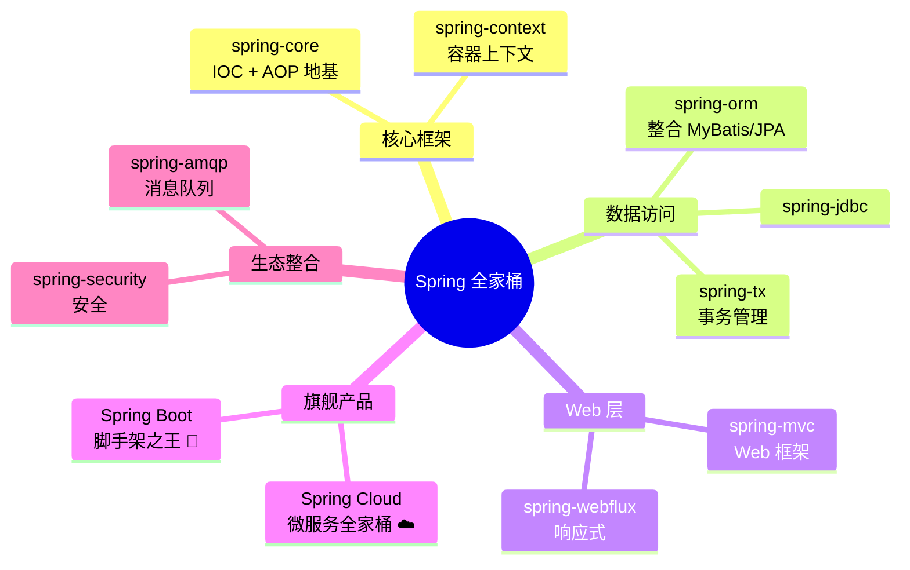
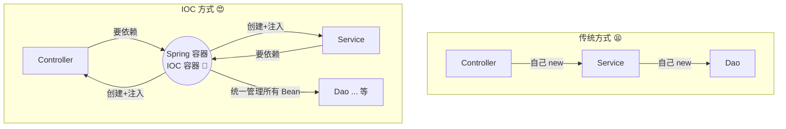
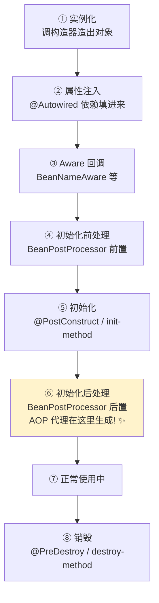
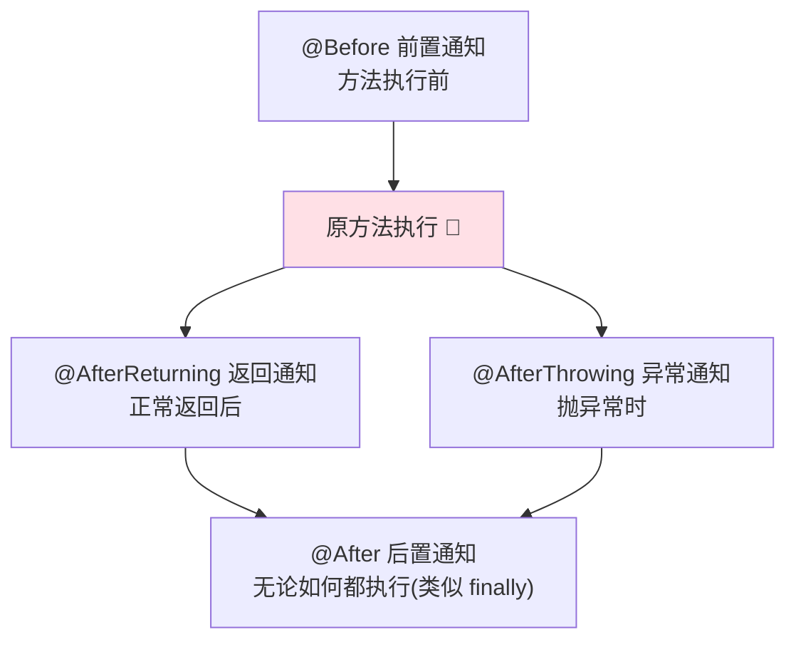
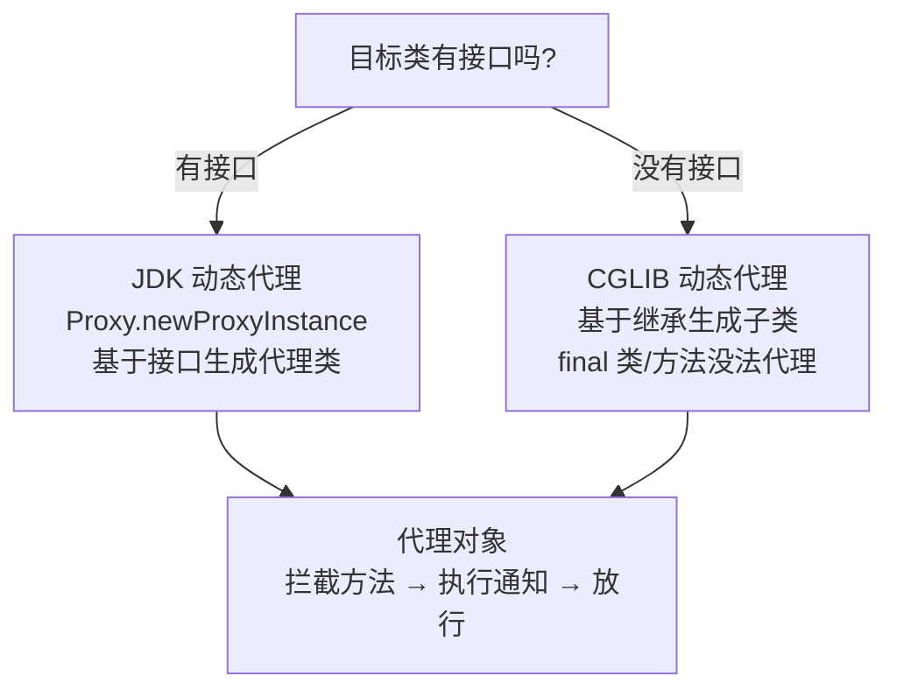
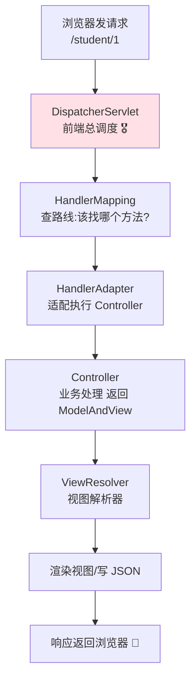
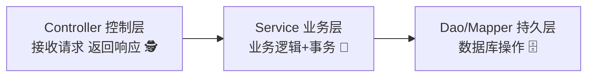
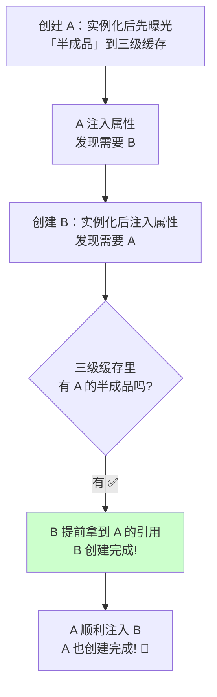
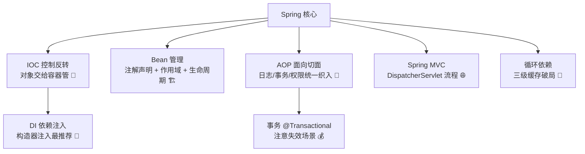

# 🍃 Spring 框架大冒险

> 嘿嘿～欢迎来到 Spring 小课堂！🌸
> Spring 是 Java 后端世界的"绝对王者"，没有它就没有现在的 Java 生态！
> 两大核心绝技：**IOC 控制反转** + **AOP 面向切面**，今天全部拿下！冲鸭～ (๑•̀ㅂ•́)و✧

***

## 📖 目录

1. [Spring 是什么](#-spring-是什么)
2. [IOC 控制反转](#-ioc-控制反转)
3. [依赖注入 DI 的几种方式](#-依赖注入-di-的几种方式)
4. [Bean 的创建三种方式](#-bean-的创建三种方式)
5. [常用注解大全](#-常用注解大全)
6. [Bean 作用域与生命周期](#-bean-作用域与生命周期)
7. [AOP 面向切面编程](#-aop-面向切面编程)
8. [事务管理 @Transactional](#-事务管理-transactional)
9. [Spring MVC 请求流程](#-spring-mvc-请求流程)
10. [循环依赖问题](#-循环依赖问题)
11. [总结与小抄](#-总结与小抄)

***

## 🤔 Spring 是什么

**一句话理解**：Spring 是一个**轻量级开源框架**，核心使命是 —— **帮你创建和管理对象、解耦代码**，让开发只专注业务！🛠️

### Spring 全家桶一览



### Spring 解决了什么痛？

| 没有 Spring 😫   | 有 Spring 😍        |
| -------------- | ------------------ |
| 对象自己 new，耦合死死的 | 容器创建对象，**IOC 解耦**  |
| 日志、事务等代码到处复制   | **AOP 统一处理**，业务更纯净 |
| 依赖关系变了到处改代码    | **DI 自动装配**，改配置就行  |
| 整合第三方框架费劲      | 万物皆可整合的"胶水层"       |

***

## 🎁 IOC 控制反转

### 传统方式的痛

**需求**：Controller 需要 Service，Service 需要 Dao...

```java
// 传统 new 对象：上层牢牢控制着对象的"生杀大权" 😫
public class StudentController {
    // 自己 new：Controller 和 StudentService 焊死了！
    private StudentService service = new StudentService();

    // 想换实现类？只能改代码重新编译 💀
    // 对象的创建、组装、销毁全要自己操心
}
```

### IOC 来救场

**IOC = Inversion of Control（控制反转）**

**一句话理解**：对象的创建权从"你自己 new"**反转**给"Spring 容器"，你要用的时候伸手要就行！🎁



生活化类比：**以前吃饭自己做菜（买菜洗菜做饭全自己来），现在点外卖 —— 饭店（容器）做好送上门，你只管吃**！🍱

### IOC 容器是什么？

**一句话理解**：IOC 容器 = 一个超大的"对象仓库 + 管家"，启动时把所有 Bean 创建好存起来，谁需要就分配给谁～

| 容器接口                 | 通俗理解                        | 常用实现        |
| -------------------- | --------------------------- | ----------- |
| `BeanFactory`        | 基础版容器（懒加载）                  | 用得少         |
| `ApplicationContext` | **增强版容器**（启动即加载 + 国际化 + 事件） | **日常都用它** ⭐ |

***

## 💉 依赖注入 DI 的几种方式

**DI = Dependency Injection（依赖注入）**

**一句话理解**：DI 是 IOC 的**实现方式** —— 容器把依赖"注射"进你的类里，就像打针一样精准！💉

### 三种注入姿势

```java
// ① 字段注入：最省事，但 Idea 会黄牌警告 ⚠️（不利于测试）
@Service
public class StudentService {
    @Autowired
    private StudentDao studentDao;
}

// ② Setter 注入：灵活可变，但依赖可能漏注入
@Service
public class StudentService {
    private StudentDao studentDao;

    @Autowired
    public void setStudentDao(StudentDao studentDao) {
        this.studentDao = studentDao;
    }
}

// ③ 构造器注入：官方最推荐！⭐⭐⭐
// 依赖不可变(final)、不为 null、方便单元测试 mock
@Service
public class StudentService {
    private final StudentDao studentDao;

    // 只有一个构造器时，@Autowired 都可以省略 ✨
    public StudentService(StudentDao studentDao) {
        this.studentDao = studentDao;
    }
}
```

| 方式        | 优点            | 缺点            | 建议       |
| --------- | ------------- | ------------- | -------- |
| 字段注入      | 写得爽           | 不能 final、不好测试 | 少用 ⚠️    |
| Setter 注入 | 可选依赖、可变       | 忘调就 null      | 可选依赖用    |
| **构造器注入** | 强依赖、final、好测试 | 参数多时略啰嗦       | **首选** ⭐ |

### @Autowired vs @Resource

| 对比项     | @Autowired              | @Resource           |
| ------- | ----------------------- | ------------------- |
| 🏠 出身   | Spring 提供               | JDK 标准（JSR-250）     |
| 📤 匹配规则 | **先按类型**，多个再按名字         | **先按名字**，找不到再按类型    |
| 🔗 配套注解 | `@Qualifier("名字")` 指定名字 | `name = "xxx"` 直接指定 |
| 💡 建议   | Spring 项目用它             | 不依赖 Spring 的场景用     |

```java
// 同类型有多个 Bean 时（比如多个 DataSource）：
@Autowired
@Qualifier("mysqlDataSource")     // 用 @Qualifier 指定名字
private DataSource dataSource;
```

***

## 🏗️ Bean 的创建三种方式

### ① XML 配置（远古时代 🦕）

```xml
<bean id="studentService" class="com.miao.service.StudentService">
    <property name="studentDao" ref="studentDao"/>
</bean>
```

### ② 注解扫描（主流时代 ⭐）

```java
// ① 在类上标注解
@Service
public class StudentService { }

// ② 配置扫描包（XML 或注解）
@ComponentScan("com.miao")   // 或 XML: <context:component-scan base-package="com.miao"/>
```

### ③ @Bean 方法（第三方类专用 🔧）

**一句话理解**：第三方 jar 里的类你没法加 @Component，就在配置类里写方法手动造！

```java
@Configuration                       // 标记这是配置类
public class AppConfig {

    @Bean                            // 方法返回值放进容器，Bean 名默认=方法名
    public RestTemplate restTemplate() {
        return new RestTemplate();
    }
}
```

***

## 📚 常用注解大全

### Bean 声明注解（效果相同，语义不同）

| 注解            | 用在哪层      | 语义           |
| ------------- | --------- | ------------ |
| `@Component`  | 通用        | 通用组件         |
| `@Service`    | Service 层 | 业务逻辑         |
| `@Repository` | Dao 层     | 数据访问（附带异常转换） |
| `@Controller` | Web 层     | 控制器          |
| `@Bean`       | 配置类方法     | 第三方对象        |

> 💡 后四个本质上都是 @Component 的"马甲"，分开写纯粹是**语义清晰**，一眼知道这类是干嘛的～

### 其他高频注解

| 注解                               | 作用                |
| -------------------------------- | ----------------- |
| `@Configuration`                 | 配置类（替代 XML）       |
| `@ComponentScan`                 | 扫描包路径             |
| `@Scope("prototype")`            | 指定作用域             |
| `@PostConstruct` / `@PreDestroy` | 初始化 / 销毁回调        |
| `@Value("${key}")`               | 注入配置值             |
| `@Primary`                       | 同类型多个 Bean 时的默认首选 |
| `@Lazy`                          | 懒加载，用到才创建         |

```java
@Value("${app.name:默认名}")      // 支持 EL 表达式 + 默认值
private String appName;
```

***

## 🔄 Bean 作用域与生命周期

### 五大作用域

| 作用域             | 说明               | 场景        |
| --------------- | ---------------- | --------- |
| `singleton`（默认） | 容器中**只有一个**实例    | 99% 的场景 ⭐ |
| `prototype`     | **每次获取都 new 一个** | 有状态的 Bean |
| `request`       | 每个 HTTP 请求一个     | Web 环境    |
| `session`       | 每个会话一个           | Web 环境    |
| `application`   | 整个 Web 应用一个      | Web 环境    |

```java
@Scope("prototype")    // 不写默认就是 singleton
@Service
public class CacheHolder { }
```

> ⚠️ 经典陷阱：**singleton Bean 注入 prototype Bean 时，prototype 只会被注入一次**！因为 singleton 只初始化一回，里面的"prototype"也跟着定格了～

### Bean 生命周期（面试高频！）



```java
@Component
public class MyBean {

    @PostConstruct     // 初始化后自动调用（依赖已注入完毕）
    public void init() {
        System.out.println("我准备好啦！");
    }

    @PreDestroy        // 容器关闭销毁前调用
    public void close() {
        System.out.println("我要下线了，拜拜~");
    }
}
```

> 💡 冷知识：**AOP 代理对象就是 BeanPostProcessor 在"初始化后"这一步偷偷换上去的**！这也解释了为啥事务注解有时会失效～

***

## 🔪 AOP 面向切面编程

### AOP 是什么？

**一句话理解**：把日志、事务、权限这种"到处都要写"的重复代码抽出来，**在不改原代码的情况下统一织入**！🗡️

生活化类比：**自来水公司不会给每家每户单独造水管，而是铺一条主管道统一送水** —— AOP 就是那条主管道！🚰

### 核心概念（用"保安"来理解）

| 术语                | 英文          | 通俗理解               |
| ----------------- | ----------- | ------------------ |
| **切面 Aspect**     | `@Aspect`   | 保安小队（封装好的整体方案）     |
| **连接点 JoinPoint** | -           | 可以插手的所有方法（小区所有出入口） |
| **切点 Pointcut**   | `@Pointcut` | 实际拦截的方法（今天只管北门）    |
| **通知 Advice**     | `@Before` 等 | 保安要做的具体动作（查体温？登记？） |
| **织入 Weaving**    | -           | 把保安派到岗位上的过程        |

### 动手写一个日志切面

```java
@Aspect                    // 声明这是一个切面
@Component                 // 交给容器管理
public class LogAspect {

    // 定义切点：拦截 service 包下所有类的所有方法
    @Pointcut("execution(* com.miao.service.*.*(..))")
    public void servicePointcut() { }

    // 环绕通知：最强通知，包裹整个方法
    @Around("servicePointcut()")
    public Object around(ProceedingJoinPoint pjp) throws Throwable {
        long start = System.currentTimeMillis();
        String method = pjp.getSignature().getName();   // 方法名

        Object result = pjp.proceed();                  // 放行执行原方法 ⭐

        long cost = System.currentTimeMillis() - start;
        System.out.println(method + " 执行耗时：" + cost + "ms");
        return result;                                  // 返回原方法结果
    }
}
```

### 五种通知



| 通知                | 时机            | 典型用途       |
| ----------------- | ------------- | ---------- |
| `@Before`         | 方法**前**       | 权限校验、参数检查  |
| `@AfterReturning` | 正常返回**后**     | 处理返回值      |
| `@AfterThrowing`  | 抛异常**时**      | 记录异常日志     |
| `@After`          | 最终（finally）   | 资源清理       |
| `@Around`         | **包裹前后**（最强）⭐ | 日志耗时、事务、限流 |

### 常见切点表达式

```java
// execution(修饰符 返回值 包名.类名.方法名(参数))
execution(* com.miao.service.*.*(..))
//        ↑        ↑           ↑ ↑   ↑
//      任意返回值  包下所有类  所有方法 任意参数

@annotation(com.miao.anno.LogRecord)   // 拦截标了自定义注解的方法（最常用！⭐）
within(com.miao.service.*)             // 拦截整个包
```

### AOP 底层实现：两种动态代理



| 对比项          | JDK 动态代理 | CGLIB                  |
| ------------ | -------- | ---------------------- |
| 🧬 原理        | 实现接口     | 继承目标类                  |
| 🎯 要求        | 必须有接口    | 类和方法不能是 final          |
| ⚙️ Spring 默认 | 有接口时用它   | 无接口时用它（Boot 默认全 CGLIB） |

> 💡 AOP 应用场景：**事务 @Transactional、日志记录、权限控制、接口限流、性能监控** —— Spring 事务本身就是 AOP 玩得最 6 的代表！

***

## 💰 事务管理 @Transactional

### 声明式事务

**一句话理解**：以前 JDBC 手写 commit/rollback，现在**一个注解搞定**，AOP 在背后帮你开启、提交、回滚！🎀

```java
@Service
public class TransferService {

    @Transactional                     // 开启事务，出异常自动回滚
    public void transfer(Long from, Long to, Double money) {
        accountDao.minusMoney(from, money);   // 扣钱
        // int x = 1 / 0;                     // 出异常 → 自动回滚，谁的钱都没丢 ✅
        accountDao.addMoney(to, money);       // 加钱
    }
}
```

### 七大传播行为（重点记前三个！）

**传播行为**：一个事务方法被另一个事务方法调用时，事务怎么"传递"？

| 传播行为            | 通俗理解                |  使用频率 |
| --------------- | ------------------- | :---: |
| `REQUIRED`（默认）  | 有事务就加入，没有就新建        | ⭐⭐⭐⭐⭐ |
| `REQUIRES_NEW`  | 我要新开一个事务，把外层挂起      |  ⭐⭐⭐  |
| `NESTED`        | 嵌套事务，外层回滚我死，我回滚外层不死 |   ⭐⭐  |
| `SUPPORTS`      | 有事务就加入，没有就非事务跑      |   ⭐⭐  |
| `NOT_SUPPORTED` | 挂起事务，非事务方式跑         |   ⭐   |
| `MANDATORY`     | 必须有事务，没有就报错         |   ⭐   |
| `NEVER`         | 必须没事务，有就报错          |   ⭐   |

```java
@Transactional(propagation = Propagation.REQUIRES_NEW)  // 记日志必须独立事务
public void saveLog() { }
```

### 事务失效八大场景（高频面试题！🔥）

| # | 失效场景                   | 原因                       |
| - | ---------------------- | ------------------------ |
| 1 | **同类内部方法调用**           | this 调用不走代理对象，注解白贴       |
| 2 | 方法不是 public            | 代理只拦 public 方法           |
| 3 | 异常被 try-catch 吞了       | 代理感知不到异常                 |
| 4 | 默认只回滚 RuntimeException | 受检异常（如 IOException）默认不回滚 |
| 5 | 类没被 Spring 管理          | 没有 Bean 就没有代理            |
| 6 | 多线程调用                  | 事务绑定 ThreadLocal，跨线程失效   |
| 7 | 数据库引擎不支持               | MyISAM 不支持事务             |
| 8 | 传播行为设错                 | NOT\_SUPPORTED 之类主动放弃事务  |

```java
@Service
public class OrderService {

    public void a() {
        this.b();    // ❌ 失效！this 是原始对象，不是代理！
    }

    @Transactional
    public void b() { }
}

// ✅ 解法一：注入自己再调用
@Autowired
private OrderService self;
public void a() { self.b(); }     // 走代理，事务生效！

// ✅ 解法二：拆到另一个类中去调用
```

```java
// 回滚受检异常的两种解法：
@Transactional(rollbackFor = Exception.class)     // ① 全部异常都回滚（推荐！）
public void doIt() throws IOException { }

// ② 手动标记回滚
TransactionAspectSupport.currentTransactionStatus().setRollbackOnly();
```

***

## 🌐 Spring MVC 请求流程

**一句话理解**：Spring MVC 是 Spring 的 Web 模块，负责接收 HTTP 请求、调用业务、返回响应～



前后端分离时代，Controller 直接返回 JSON：

```java
@RestController                          // = @Controller + @ResponseBody
@RequestMapping("/student")
public class StudentController {

    @Autowired
    private StudentService studentService;

    @GetMapping("/{id}")
    public Student getById(@PathVariable Long id) {      // 路径参数
        return studentService.getById(id);               // 自动转 JSON
    }

    @GetMapping
    public List<Student> list(@RequestParam(defaultValue = "1") Integer page) {  // 查询参数
        return studentService.list(page);
    }

    @PostMapping
    public String create(@RequestBody Student student) { // JSON 请求体
        studentService.save(student);
        return "OK";
    }
}
```

### 三层架构回顾



***

## 🔗 循环依赖问题

### 什么是循环依赖？

A 依赖 B，B 又依赖 A —— 鸡生蛋蛋生鸡，谁都创建不出来了！🐔🥚

### Spring 怎么破？三级缓存！



| 缓存                         | 存什么                | 通俗理解          |
| -------------------------- | ------------------ | ------------- |
| 一级缓存 singletonObjects      | **成品** Bean        | 完整可用的对象 ✅     |
| 二级缓存 earlySingletonObjects | **半成品** Bean（提前曝光） | 提前给别人的引用      |
| 三级缓存 singletonFactories    | Bean **工厂**（能造代理）  | 为了 AOP 提前生成代理 |

> 💡 记住结论：
>
> 1. 三级缓存核心目的：**解决循环依赖 + 兼容 AOP 代理的正确生成**
> 2. **构造器注入的循环依赖无解**（半成品都没曝光就卡住了）→ Spring 直接报错
> 3. prototype 作用域的循环依赖也**无解**（不入缓存）
> 4. Spring Boot 2.6+ **默认禁止循环依赖**，出现就报错，推荐用 @Lazy 打破僵局

***

## 🎀 总结与小抄

### 知识地图回顾



### 面试高频题速答卡 📌

| 问题                       | 一句话答案                                 |
| ------------------------ | ------------------------------------- |
| IOC 是什么？                 | 控制反转：对象创建权从程序员交给容器，解耦                 |
| IOC 和 DI 关系？             | IOC 是思想，DI（依赖注入）是实现手段                 |
| @Autowired vs @Resource？ | Spring 的按类型优先 vs JDK 的按名字优先           |
| Bean 生命周期？               | 实例化→属性注入→Aware→前置→初始化→后置(AOP代理)→使用→销毁 |
| AOP 是什么？                 | 横切关注点抽离，动态代理织入，不改原代码增强功能              |
| JDK 代理 vs CGLIB？         | 接口代理 vs 继承子类代理，final 是 CGLIB 死穴       |
| 事务失效场景？                  | 同类自调用、非 public、异常被吞、默认不回滚受检异常         |
| 循环依赖怎么解决？                | 三级缓存提前曝光半成品；构造器注入无解                   |

### 必记五条军规 ✊

1. **构造器注入是官方推荐**，字段注入看着爽但要少用！
2. **事务同类自调用必失效**，注入自己或拆类解决！
3. **@Transactional 记得加** **`rollbackFor = Exception.class`**！
4. **AOP 代理在 BeanPostProcessor 后置阶段生成**，理解它就理解事务失效！
5. **多实现类冲突**：@Primary 定默认，@Qualifier 点名要！

***

> 🎉 恭喜通关 Spring！你已经掌握 Java 后端最核心的框架心法～
> IOC 管"对象从哪来"，AOP 管"功能怎么加"，这两招吃透，SpringBoot 就是小蛋糕 🍰
> 接下来想学 SpringBoot / SpringMVC 细节 / Redis，随时来找我哦，比心～ 💗

