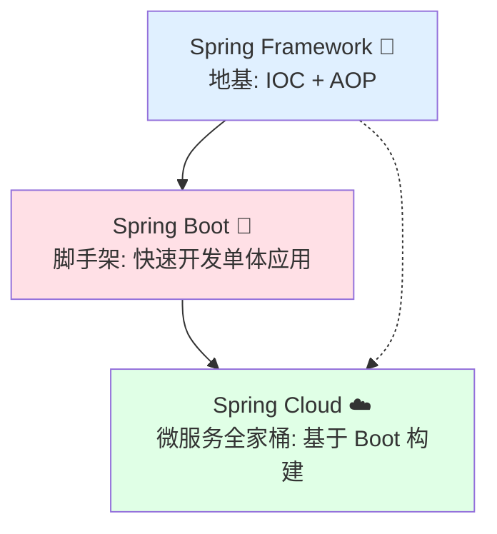
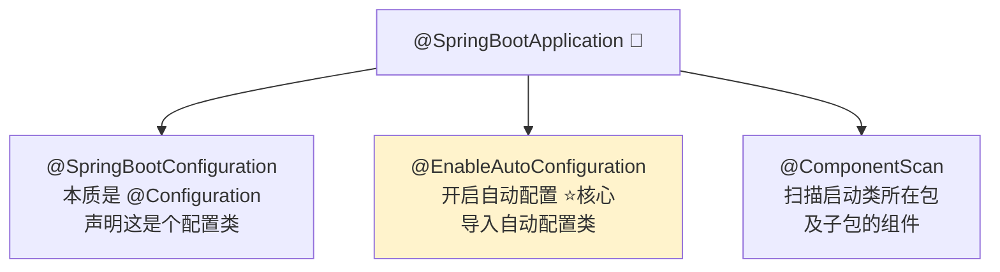
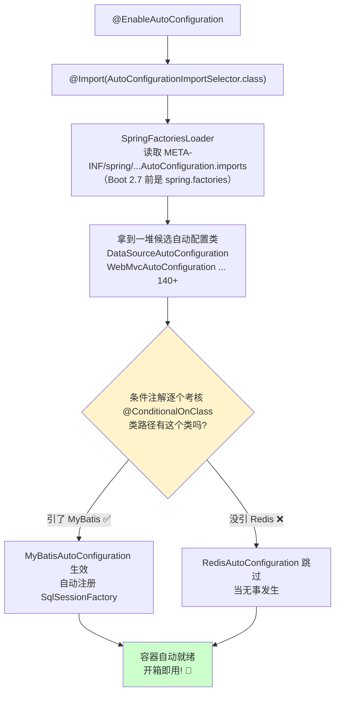
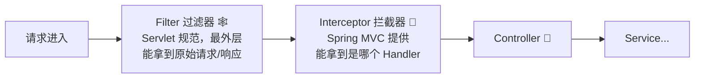
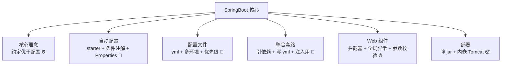

# 🚀 SpringBoot 快速开发大冒险

> 嘿嘿～欢迎来到 SpringBoot 小课堂！🌸
> 还记得 Spring 时代写到手抽的 XML 配置吗？SpringBoot 喊出"约定优于配置"！
> 一个注解启动项目、零 XML、内嵌服务器，开发体验直接起飞！冲鸭～ (๑•̀ㅂ•́)و✧

---

## 📖 目录

1. [SpringBoot 是什么](#-springboot-是什么)
2. [快速体验 HelloWorld](#-快速体验-helloworld)
3. [核心注解 @SpringBootApplication](#-核心注解-springbootapplication)
4. [自动配置原理（面试重点）](#-自动配置原理面试重点)
5. [配置文件详解](#-配置文件详解)
6. [多环境配置](#-多环境配置)
7. [整合第三方框架](#-整合第三方框架)
8. [Web 开发常用组件](#-web-开发常用组件)
9. [全局异常处理](#-全局异常处理)
10. [自定义 Starter（进阶）](#-自定义-starter进阶)
11. [打包部署](#-打包部署)
12. [总结与小抄](#-总结与小抄)

---

## 🤔 SpringBoot 是什么

**一句话理解**：SpringBoot 不是新框架，而是 Spring 的**"快速脚手架"** —— 帮你把配置全做好，拿来就用！🛠️

### Spring 的配置地狱有多惨 😫

| 痛点 | 具体表现 |
|------|---------|
| 📜 XML 写到手软 | 整合一个 MyBatis：数据源、SqlSessionFactory、扫描器...一堆 Bean |
| 📦 依赖版本打架 | spring 5.x 配 mybatis 3.5 还是 3.4？版本兼容靠玄学 |
| 🌳 外部 Tomcat | 每次部署都要打 war、装服务器、改配置 |
| ⏱️ 搭环境半天起 | 项目还没写一行业务，配置先搞两小时 |

### SpringBoot 四大神器 ✨

| 特性 | 通俗理解 |
|------|---------|
| 🤖 **自动配置** | 你引了啥依赖，它就自动配啥，贴心到家 |
| 📦 **Starter 起步依赖** | 一个依赖 = 一套全家桶，版本兼容官方兜底 |
| 🖥️ **内嵌服务器** | Tomcat 打进 jar 里，java -jar 直接跑 |
| ⚙️ **Actuator 监控** | 生产指标一键查看 |

### Spring 三兄弟的关系



> 🍔 汉堡类比：Spring 是面粉（基础），SpringBoot 是做好的汉堡坯（拿来就能加料），SpringCloud 是连锁餐厅（多店协作）！

---

## 🎮 快速体验 HelloWorld

### 两种创建方式

1. **官网生成**：start.spring.io 勾勾选选下载 zip（国内可用 https://start.aliyun.com ⚡）
2. **IDEA 创建**：New Project → Spring Initializr → 勾选依赖 → 完事！

### 项目长这样

```text
hello-demo
├── pom.xml                        # 继承 spring-boot-starter-parent，版本自动管理
└── src/main
    ├── java/com/miao/hello
    │   └── HelloApplication.java  # 启动类（万物起点）
    └── resources
        ├── application.yml        # 核心配置文件
        ├── static/                # 静态资源
        └── templates/             # 模板页面
```

### 一个文件跑起来

```java
@SpringBootApplication          // 灵魂注解，下面细讲
public class HelloApplication {
    public static void main(String[] args) {
        SpringApplication.run(HelloApplication.class, args);   // 一行启动！
    }
}

@RestController
@RequestMapping("/hello")
class HelloController {
    @GetMapping
    public String hello() {
        return "Hello SpringBoot! 🎉";
    }
}
```

浏览器访问 `http://localhost:8080/hello` —— 完事！没有一行 XML，没有装 Tomcat，就是这么快！⚡

### pom.xml 有啥特别的

```xml
<parent>
    <groupId>org.springframework.boot</groupId>
    <artifactId>spring-boot-starter-parent</artifactId>
    <version>3.2.0</version>
    <!-- 父工程帮你锁了几百个依赖的版本，再也不用怕版本冲突！ -->
</parent>

<dependencies>
    <dependency>
        <groupId>org.springframework.boot</groupId>
        <artifactId>spring-boot-starter-web</artifactId>
        <!-- 一个 starter = web + mvc + tomcat + jackson 一整套，版本号都不用写！ -->
    </dependency>
</dependencies>
```

---

## 🏷️ 核心注解 @SpringBootApplication

启动类头上这个注解其实是"三合一合体"：



| 组成注解 | 作用 | 通俗理解 |
|---------|------|---------|
| `@SpringBootConfiguration` | 声明配置类 | 我家的大户口本 |
| `@EnableAutoConfiguration` | **开启自动配置** | 智能管家上岗 ⭐ |
| `@ComponentScan` | 扫描组件 | 管家挨家挨户登记 Bean |

> ⚠️ 经典坑：**启动类必须放在最外层包**！因为默认只扫描启动类所在包及子包，放到深处会导致别的 Bean 扫不到（报 NoSuchBeanDefinitionException）～

---

## 🧠 自动配置原理（面试重点）

**一句话理解**：SpringBoot 偷看你的 pom.xml —— 发现你引了什么依赖，就把对应的配置类请进来干活！🕵️

### 完整流程拆解



### 关键三问（面试这么答）

| 问题 | 答案要点 |
|------|---------|
| 自动配置怎么实现的？ | @EnableAutoConfiguration → 加载 imports 文件中的配置类 → **条件注解筛选** → 符合条件的注册为 Bean |
| 怎么知道配了哪些？ | 启动加 `--debug` 查看条件评估报告；配置类都在 `spring-boot-autoconfigure` 包里 |
| 怎么覆盖默认配置？ | 配置类上有 `@EnableConfigurationProperties(XxxProperties.class)`，改 yml 就行 |

### 条件注解家族

| 注解 | 生效条件 |
|------|---------|
| `@ConditionalOnClass` | 类路径**存在**指定类 |
| `@ConditionalOnMissingClass` | 类路径**不存在**指定类 |
| `@ConditionalOnMissingBean` | 容器**没有**该 Bean（用户没自己配才生效）|
| `@ConditionalOnProperty` | 配置文件有指定属性 |
| `@ConditionalOnWebApplication` | 是 Web 环境 |

### 配置绑定：XxxProperties

```java
// 以 DataSourceProperties 为例（源码简化）
@ConfigurationProperties(prefix = "spring.datasource")   // 绑定 yml 前缀
public class DataSourceProperties {
    private String url;
    private String username;
    private String password;
    // 所以你写 spring.datasource.url=xxx 就能改掉默认配置！
}
```

```yaml
# 你在 yml 里写的每个配置，本质都是在覆盖某个 XxxProperties 类的属性～
spring:
  datasource:
    url: jdbc:mysql://localhost:3306/mydb
    username: root
    password: 123456
```

> 💡 一句话总结自动配置：**"引依赖 → 条件注解筛选 → 配置类生效 → 绑定 yml 属性 → Bean 进容器"** —— 想覆盖默认值？改 yml 就行！

---

## 📄 配置文件详解

### yml 语法（主流选择）

```yaml
# 冒号后面必须有空格！用缩进表示层级（只允许空格，不允许 Tab）
server:
  port: 8080                    # 基础类型

spring:
  datasource:
    url: jdbc:mysql://localhost:3306/mydb
    username: root
    password: 123456

myapp:
  name: 小白的应用
  servers:                      # 数组/list
    - 192.168.1.1
    - 192.168.1.2
  user:                         # 对象/map
    name: admin
    age: 18
```

### 配置文件优先级（高 → 低）

| 优先级 | 位置 |
|:------:|------|
| 1️⃣ | `config/application.yml`（jar 同级 config 目录） |
| 2️⃣ | `application.yml`（jar 同级） |
| 3️⃣ | classpath 下 `config/application.yml` |
| 4️⃣ | classpath 下 `application.yml`（src/main/resources，日常开发用的） |

### @Value vs @ConfigurationProperties

```java
// ① @Value：一个一个取，麻烦但支持 SpEL
@Value("${myapp.name}")
private String name;

// ② @ConfigurationProperties：整个对象批量绑定（推荐！⭐）
@Component
@ConfigurationProperties(prefix = "myapp")   // yml 里 myapp 下的一锅端
@Data
public class MyAppProperties {
    private String name;
    private List<String> servers;
}
```

| 对比项 | @Value | @ConfigurationProperties |
|--------|--------|--------------------------|
| 绑定 | 单个属性 | **批量绑定** |
| 松散绑定 | ❌ | ✅（user-name → userName） |
| SpEL 表达式 | ✅ | ❌ |
| 校验 | ❌ | ✅（@Validated） |
| 建议 | 偶尔取一个 | **配置类统一管理** ⭐ |

---

## 🌗 多环境配置

**一句话理解**：开发用 8080、测试连测试库、生产连生产库 —— 三套环境三个文件，一键切换！🔀

```yaml
# application.yml（主配置：指定用哪个环境）
spring:
  profiles:
    active: dev          # 激活 dev 环境
```

```yaml
# application-dev.yml（开发环境）
server:
  port: 8080
spring:
  datasource:
    url: jdbc:mysql://localhost:3306/dev_db
```

```yaml
# application-prod.yml（生产环境）
server:
  port: 80
spring:
  datasource:
    url: jdbc:mysql://prod-server:3306/prod_db
```

**切换环境的 N 种姿势**：

```bash
# ① 改主配置 active（最常用）
# ② 命令行参数（部署时切换，不用改代码！）
java -jar app.jar --spring.profiles.active=prod

# ③ IDEA 启动参数
# Program arguments: --spring.profiles.active=dev

# ④ 虚拟机参数
# VM options: -Dspring.profiles.active=test
```

> 💡 单文件写法也有（不推荐，文件太乱）：yml 里用 `---` 分隔 + `spring.config.activate.on-profile: dev`

---

## 🔗 整合第三方框架

**一句话理解**：SpringBoot 时代整合 = **引 starter + 写 yml**，两步完事！✌️

### 整合 MyBatis-Plus

```xml
<dependency>
    <groupId>com.baomidou</groupId>
    <artifactId>mybatis-plus-boot-starter</artifactId>
    <version>3.5.5</version>
</dependency>
```

```yaml
spring:
  datasource:                       # 写好连接信息，自动配置直接生效
    url: jdbc:mysql://localhost:3306/mydb?serverTimezone=Asia/Shanghai
    username: root
    password: 123456
    driver-class-name: com.mysql.cj.jdbc.Driver
mybatis-plus:
  configuration:
    log-impl: org.apache.ibatis.logging.stdout.StdOutImpl   # 开发期打印 SQL
```

### 整合 Redis

```xml
<dependency>
    <groupId>org.springframework.boot</groupId>
    <artifactId>spring-boot-starter-data-redis</artifactId>
</dependency>
```

```yaml
spring:
  data:
    redis:
      host: localhost
      port: 6379
      password: 123456
```

```java
@Autowired
private StringRedisTemplate redisTemplate;   // 自动配好了，直接用！

@Test
void testRedis() {
    redisTemplate.opsForValue().set("name", "小白");
    System.out.println(redisTemplate.opsForValue().get("name"));
}
```

> 💡 套路总结：**引 starter → 查官方文档写 yml → 注入模板类使用**。所有框架整合都是这个味儿～

---

## 🌐 Web 开发常用组件

### 统一返回结果

```java
@Data
public class Result<T> {
    private Integer code;
    private String msg;
    private T data;

    public static <T> Result<T> ok(T data) {
        Result<T> r = new Result<>();
        r.code = 200; r.msg = "success"; r.data = data;
        return r;
    }

    public static <T> Result<T> error(String msg) {
        Result<T> r = new Result<>();
        r.code = 500; r.msg = msg;
        return r;
    }
}
```

### 拦截器 vs 过滤器



```java
// 拦截器：登录校验经典用法
@Component
public class LoginInterceptor implements HandlerInterceptor {

    @Override
    public boolean preHandle(HttpServletRequest request,
                             HttpServletResponse response,
                             Object handler) {
        String token = request.getHeader("token");
        if (token == null) {
            response.setStatus(401);            // 没登录，拦截！
            return false;
        }
        return true;                            // 放行
    }
}

// 注册拦截器
@Configuration
public class WebConfig implements WebMvcConfigurer {
    @Autowired
    private LoginInterceptor loginInterceptor;

    @Override
    public void addInterceptors(InterceptorRegistry registry) {
        registry.addInterceptor(loginInterceptor)
                .addPathPatterns("/**")                      // 拦所有
                .excludePathPatterns("/login", "/register"); // 放行登录注册
    }
}
```

| 对比项 | Filter 过滤器 | Interceptor 拦截器 |
|--------|--------------|-------------------|
| 🏠 出身 | Servlet 规范 | Spring MVC |
| 🌊 作用范围 | 所有请求 | 只拦 Controller 方法 |
| 🎁 能拿到 Bean | 麻烦 | ✅ 随便注入 |
| 🎯 典型场景 | 编码、跨域、XSS 过滤 | **登录校验、权限、日志** |

### 参数校验

```xml
<dependency>
    <groupId>org.springframework.boot</groupId>
    <artifactId>spring-boot-starter-validation</artifactId>
</dependency>
```

```java
@Data
public class UserDTO {
    @NotBlank(message = "用户名不能为空")
    private String username;

    @Min(value = 0, message = "年龄不合法")
    private Integer age;

    @Email(message = "邮箱格式不对哦")
    private String email;
}

@PostMapping("/user")
public Result create(@Valid @RequestBody UserDTO dto) { ... }
```

---

## 🚨 全局异常处理

**一句话理解**：不想每个接口都 try-catch？@RestControllerAdvice 全局兜底，异常统一格式返回！🛡️

```java
@RestControllerAdvice                       // 全局异常处理器
public class GlobalExceptionHandler {

    // 业务异常
    @ExceptionHandler(BusinessException.class)
    public Result<Void> handleBiz(BusinessException e) {
        return Result.error(e.getMessage());
    }

    // 参数校验异常
    @ExceptionHandler(MethodArgumentNotValidException.class)
    public Result<Void> handleValid(MethodArgumentNotValidException e) {
        String msg = e.getBindingResult().getFieldErrors().get(0).getDefaultMessage();
        return Result.error(msg);
    }

    // 兜底：所有未知异常
    @ExceptionHandler(Exception.class)
    public Result<Void> handleAll(Exception e) {
        log.error("系统异常", e);
        return Result.error("系统繁忙，请稍后再试~");   // 生产环境别暴露堆栈！
    }
}
```

---

## 🧩 自定义 Starter（进阶）

**一句话理解**：想让自己的功能包也享受"引依赖即用"的待遇？把功能做成 starter！🎁

### 标准命名规范

| 类型 | 命名 | 示例 |
|------|------|------|
| 官方 | `spring-boot-starter-xxx` | spring-boot-starter-web |
| 第三方 | `xxx-spring-boot-starter` | mybatis-plus-boot-starter |

### 制作三步走

```text
hello-spring-boot-starter（工程名）
├── ① 自动配置类
├── ② 属性绑定类
└── ③ META-INF/spring/org.springframework.boot.autoconfigure.AutoConfiguration.imports
```

```java
// ① 功能类
public class HelloService {
    public String sayHello(String name) { return "你好呀, " + name; }
}

// ② 自动配置类（条件装配）
@AutoConfiguration
@ConditionalOnClass(HelloService.class)
@EnableConfigurationProperties(HelloProperties.class)
public class HelloAutoConfiguration {

    @Bean
    @ConditionalOnMissingBean               // 用户没自己配，我才配
    public HelloService helloService() {
        return new HelloService();
    }
}
```

```text
③ resources/META-INF/spring/
org.springframework.boot.autoconfigure.AutoConfiguration.imports
文件内容一行：
com.miao.hello.HelloAutoConfiguration
```

> 打个 jar 发到仓库，别人引入依赖 → `@Autowired HelloService` 直接用 —— 这就是 starter 的魔法！✨

---

## 📦 打包部署

### 打包

```xml
<build>
    <plugins>
        <plugin>
            <groupId>org.springframework.boot</groupId>
            <artifactId>spring-boot-maven-plugin</artifactId>
            <!-- 关键：把所有依赖打进一个"胖 jar"，可执行！ -->
        </plugin>
    </plugins>
</build>
```

```bash
mvn clean package -DskipTests     # 打包
```

### 部署运行

```bash
# 方式一：命令行直跑（内嵌 Tomcat，无需安装服务器！）
java -jar hello-demo-1.0.0.jar

# 方式二：指定环境 + 内存参数（生产常用）
java -Xms512m -Xmx1024m -jar app.jar --spring.profiles.active=prod

# 方式三：后台运行 + 日志
nohup java -jar app.jar > app.log 2>&1 &
```

### 常用运维参数

| 参数 | 作用 |
|------|------|
| `--server.port=9090` | 启动时改端口 |
| `--spring.profiles.active=prod` | 切环境 |
| `--debug` | 打印自动配置报告（排查必备 🔍） |
| `-Xms512m -Xmx1024m` | JVM 堆内存 |

---

## 🎀 总结与小抄

### 知识地图回顾



### 面试高频题速答卡 📌

| 问题 | 一句话答案 |
|------|-----------|
| SpringBoot 是什么？ | Spring 脚手架：自动配置 + Starter + 内嵌服务器，简化开发 |
| SpringBoot 优点？ | 独立运行、内嵌容器、无需 XML、生产级监控、starter 简化依赖 |
| @SpringBootApplication 组成？ | 三合一：@SpringBootConfiguration + @EnableAutoConfiguration + @ComponentScan |
| 自动配置原理？ | @EnableAutoConfiguration 加载 imports 文件配置类，@ConditionalOnXxx 按条件筛选后注册 Bean |
| Starter 原理？ | 官方/第三方把功能+自动配置打包，引入依赖即触发条件装配开箱即用 |
| yml 和 properties 区别？ | 同功能不同写法；yml 层级清晰、支持多文档块，主流选择 |
| 配置优先级？ | 命令行 > config 目录 > classpath；高优先级覆盖低的 |

### 必记五条军规 ✊

1. **启动类放最外层包**，不然组件扫不到报错！
2. **覆盖默认配置改 yml 就行**，本质是覆盖 XxxProperties 属性～
3. **生产环境切换用命令行参数**，不改动打包产物！
4. **全局异常 + 统一返回**是项目标配，Controller 不写 try-catch！
5. **排查自动配置加 `--debug`**，条件评估报告一目了然～

---

> 🎉 恭喜通关 SpringBoot！Spring 全家桶的主线任务已经全部完成～
> 从此引个 starter 就敢说"我整合过 XXX"，这就是脚手架时代的自信 (¬‿¬)✨
> 接下来想学 Redis / SpringCloud 微服务 / 项目实战，随时来找我哦，比心～ 💗
