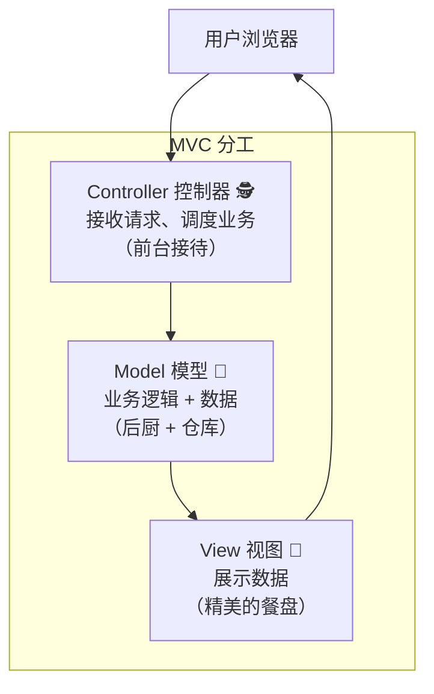
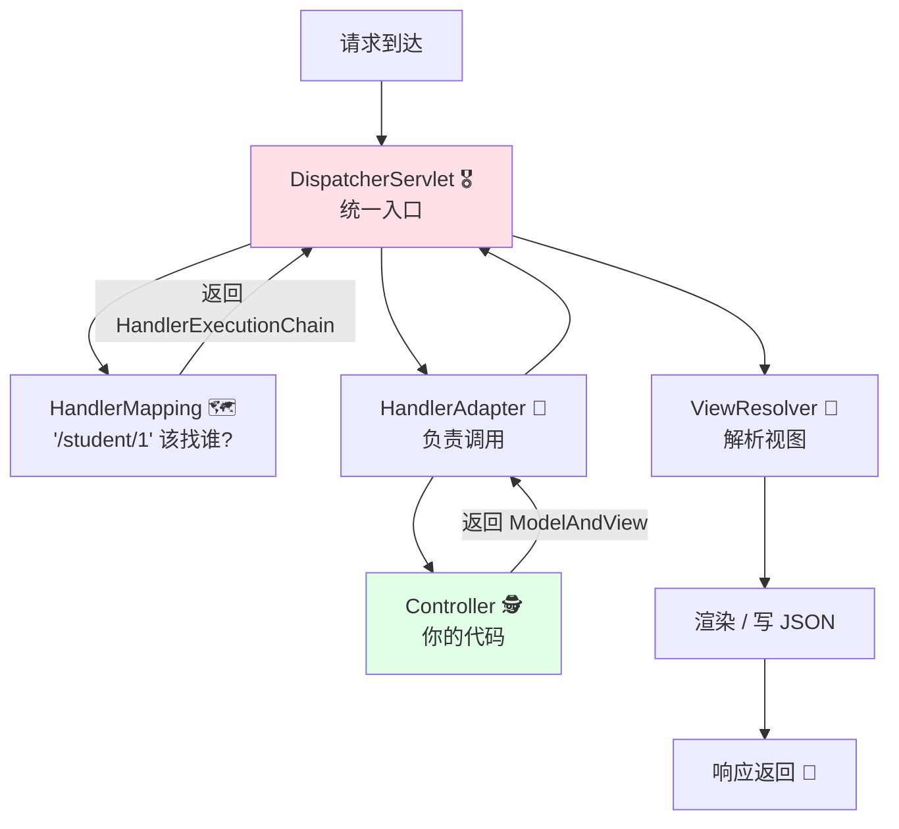
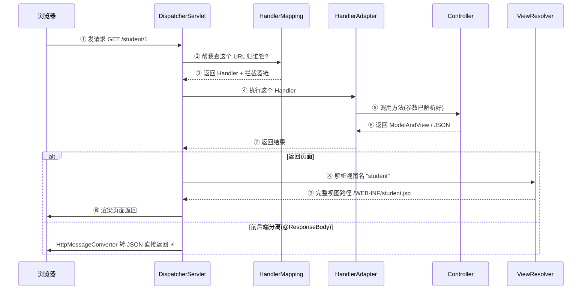
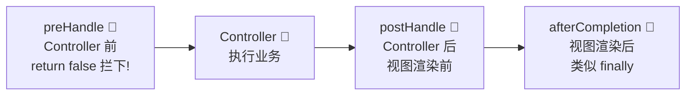
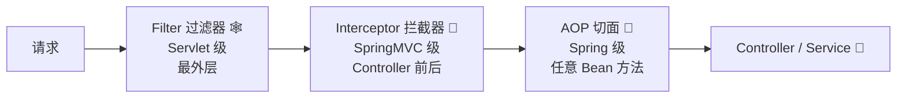
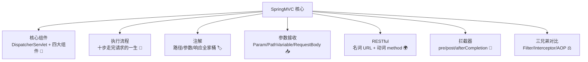

# 🎬 SpringMVC 框架大冒险

> 嘿嘿～欢迎来到 SpringMVC 小课堂！🌸
> 每次浏览器敲下 URL 到页面返回数据，背后都是 SpringMVC 在忙前忙后！
> 今天把"请求的一生"完整看明白，面试流程题再也不怕！冲鸭～ (๑•̀ㅂ•́)و✧

---

## 📖 目录

1. [SpringMVC 是什么](#-springmvc-是什么)
2. [核心组件介绍](#-核心组件介绍)
3. [完整请求处理流程（面试重点）](#-完整请求处理流程面试重点)
4. [常用注解大全](#-常用注解大全)
5. [参数接收的各种姿势](#-参数接收的各种姿势)
6. [数据响应方式](#-数据响应方式)
7. [RESTful 风格](#-restful-风格)
8. [拦截器](#-拦截器)
9. [全局异常处理](#-全局异常处理)
10. [过滤器 vs 拦截器 vs AOP](#-过滤器-vs-拦截器-vs-aop)
11. [总结与小抄](#-总结与小抄)

---

## 🤔 SpringMVC 是什么

**一句话理解**：SpringMVC 是 Spring 家族的 **Web 层框架**，专门负责"接收 HTTP 请求 → 处理 → 返回响应"这一段！🌐

### 先懂 MVC 模式

MVC 是一种"分工思想"，把代码按职责拆成三块：



| 角色 | 职责 | 前后端分离时代 |
|------|------|---------------|
| Controller | 接请求、调 Service、返结果 | **SpringMVC 负责** ⭐ |
| Model | 业务与数据 | Service + Mapper |
| View | 展示 | **前端 Vue/React 负责**（后端只返 JSON） |

### SpringMVC 的进化史

| 时代 | 技术 | 痛点 |
|------|------|------|
| 🦕 远古 | Servlet + JSP | 每个 Servlet 一个类，web.xml 写爆 |
| 🚗 进化 | Struts2 | 配置繁琐、性能一般 |
| 🚀 现在 | **SpringMVC** | 注解驱动、天然整合 Spring、主流标配 |

> 💡 一句话：**Servlet 是地基，SpringMVC 是建立在地基上的智能大厦** —— 底层依然是 Servlet（DispatcherServlet 本身就是个 Servlet）！

---

## 🧩 核心组件介绍

SpringMVC 是"团队作战"，认识这些核心成员：

| 组件 | 通俗理解 | 干什么 |
|------|---------|--------|
| 🎖️ `DispatcherServlet` | **前端控制器（总调度）** | 所有请求的统一入口，指挥全场 |
| 🗺️ `HandlerMapping` | 查号台 | 根据URL找到对应的 Controller 方法 |
| 🔌 `HandlerAdapter` | 适配器 | 负责真正调用 Handler 方法 |
| 🕵️ `Handler` | 干活的 | 你写的 Controller 方法 |
| 🎨 `ViewResolver` | 视图解析器 | 把逻辑视图名解析成真实页面（前后端分离用得少） |

### 一图看懂团队协作



> 💡 为什么要这么绕？因为** DispatcherServlet 统一入口**的设计，让权限校验、异常处理、参数解析都能标准化地插入 —— 这就是"前端控制器模式"的威力！

---

## 🔄 完整请求处理流程（面试重点）

**面试必考题：说一说 SpringMVC 的执行流程！** 背下这个时序就是满分答案～ 📝



### 口语化记忆版 🎵

> ①请求进门找**总调度** → ②总调度问**查号台**谁管这事 → ③拿到地址派**适配器**去调 → ④**Controller** 干完活交结果 → ⑤需要页面就找**视图解析器**，返 JSON 就直接走人～

| 步骤 | 组件 | 动作 |
|:----:|------|------|
| 1 | DispatcherServlet | 接收所有请求 |
| 2-3 | HandlerMapping | 根据 URL 匹配 Handler（含拦截器链）|
| 4 | HandlerAdapter | 执行 Handler（解析参数、调用方法）|
| 5-6 | Controller | 业务处理，返回 ModelAndView |
| 7 | HandlerAdapter | 把结果交回 DispatcherServlet |
| 8-9 | ViewResolver | 视图名 → 具体页面 |
| 10 | DispatcherServlet | 渲染视图 / 直接输出 JSON |

---

## 🏷️ 常用注解大全

### Controller 相关注解

| 注解 | 作用 | 示例 |
|------|------|------|
| `@Controller` | 标记控制层组件 | 返回视图 |
| `@RestController` | = @Controller + @ResponseBody | **前后端分离标配** ⭐ |
| `@RequestMapping` | 类/方法上映射 URL | 支持指定 method |
| `@GetMapping` / `@PostMapping` | GET/POST 快捷方式 | 等价 method=GET |
| `@PutMapping` / `@DeleteMapping` | PUT/DELETE | RESTful 用 |

### 参数相关注解 ⭐

| 注解 | 接收什么 | 位置 |
|------|---------|------|
| `@RequestParam` | **查询参数** ?name=小白 | URL 问号后 |
| `@PathVariable` | **路径参数** /student/{id} | URL 路径里 |
| `@RequestBody` | **JSON 请求体** | 请求体（POST/PUT）|
| `@RequestHeader` | 请求头 | header |
| `@CookieValue` | Cookie 值 | cookie |

### 组合示例

```java
@RestController
@RequestMapping("/student")               // 类级：统一前缀
public class StudentController {

    // GET /student/1  → 路径参数
    @GetMapping("/{id}")
    public Result getById(@PathVariable Long id) {
        return Result.ok(studentService.getById(id));
    }

    // GET /student/search?name=小白&age=18 → 查询参数
    @GetMapping("/search")
    public Result search(@RequestParam String name,
                         @RequestParam(required = false) Integer age) {
        return Result.ok(studentService.search(name, age));
    }

    // POST /student + JSON body → 请求体
    @PostMapping
    public Result save(@RequestBody StudentDTO dto) {
        studentService.save(dto);
        return Result.ok(null);
    }
}
```

---

## 📥 参数接收的各种姿势

### 一表看全

| 前端传参方式 | 后端接收方式 | 示例 |
|-------------|-------------|------|
| `?name=小白` | `@RequestParam String name` | GET 查询串 |
| `/student/1` | `@PathVariable Long id` | RESTful 路径 |
| JSON body | `@RequestBody Student s` | POST/PUT 请求体 |
| 表单 `name=小白&age=18` | `Student s`（直接对象收） | 表单提交 |
| 多个同名参数 `ids=1&ids=2` | `Long[] ids` 或 `List<Long> ids` | 批量删除 |

```java
// ① 普通参数：名字对上自动绑定（不写注解也行）
@GetMapping("/a")
public String a(String name, Integer age) { ... }
// → /a?name=小白&age=18

// ② 对象接收：表单/查询参数直接怼进对象属性（属性名一致）
@GetMapping("/b")
public String b(StudentQuery query) { ... }
// → /b?name=小白&age=18 → query.getName()=小白

// ③ 数组/集合接收
@DeleteMapping("/c")
public String c(Long[] ids) { ... }
// → /c?ids=1&ids=2&ids=3

// ④ JSON 接收（必须 @RequestBody，前端要设 Content-Type: application/json）
@PostMapping("/d")
public String d(@RequestBody Student student) { ... }

// ⑤ 日期处理
@GetMapping("/e")
public String e(@DateTimeFormat(pattern = "yyyy-MM-dd") LocalDate date) { ... }

// ⑥ 接收请求头 / cookie
@GetMapping("/f")
public String f(@RequestHeader("token") String token,
                @CookieValue("JSESSIONID") String sessionId) { ... }
```

### @RequestParam vs @PathVariable

| 对比 | @RequestParam | @PathVariable |
|------|---------------|---------------|
| 数据位置 | `?key=value` | `/student/1` 中的 1 |
| 可选性 | `required=false` 可选 | 必须在路径里 |
| 典型场景 | 搜索、分页 | 按 id 查/改/删（RESTful）|

```java
// 同一个功能两种风格：
@GetMapping("/student?id=1")           // 传统风格 → @RequestParam
@GetMapping("/student/{id}")           // RESTful 风格 → @PathVariable
```

---

## 📤 数据响应方式

### 两种响应姿势

```java
// ① 返回 JSON（前后端分离主流 ⭐）
@RestController                            // 或方法上加 @ResponseBody
public class ApiController {
    @GetMapping("/user")
    public User getUser() {
        return new User("小白", 18);       // HttpMessageConverter 自动转 JSON
    }
}

// ② 返回视图（传统服务端渲染，模板引擎）
@Controller
public class PageController {
    @GetMapping("/index")
    public String index(Model model) {
        model.addAttribute("msg", "hello");   // 放数据
        return "index";                        // 返回视图名 → /templates/index.html
    }
}
```

| 方式 | 适用 | 关键 |
|------|------|------|
| JSON（@ResponseBody） | **前后端分离** Vue/React | Jackson 转 JSON |
| 视图（ModelAndView） | 服务端渲染 Thymeleaf | ViewResolver 解析 |

> 💡 @ResponseBody 的原理：方法返回值交给 **HttpMessageConverter**（默认 Jackson），转成 JSON 写入响应体 —— 这就是为什么加个注解就能自动返 JSON～

---

## 🌍 RESTful 风格

**一句话理解**：RESTful 是一种 URL 设计规范 —— **用 URL 表示资源、用 HTTP 方法表示动作**！📐

| 操作 | 传统风格（动作全靠 URL）| RESTful（URL 是名词，动作靠 method）|
|------|----------------------|--------------------------------|
| 查全部 | GET /getAllStudent | GET /students |
| 查一个 | GET /getStudentById?id=1 | GET /students/1 |
| 新增 | POST /addStudent | POST /students |
| 修改 | POST /updateStudent | PUT /students/1 |
| 删除 | GET /deleteStudent?id=1 | DELETE /students/1 |

```java
@RestController
@RequestMapping("/students")              // 资源名用复数名词
public class StudentController {

    @GetMapping                            // GET /students
    public Result list() { ... }

    @GetMapping("/{id}")                   // GET /students/1
    public Result getById(@PathVariable Long id) { ... }

    @PostMapping                           // POST /students
    public Result save(@RequestBody StudentDTO dto) { ... }

    @PutMapping("/{id}")                   // PUT /students/1
    public Result update(@PathVariable Long id, @RequestBody StudentDTO dto) { ... }

    @DeleteMapping("/{id}")                // DELETE /students/1
    public Result delete(@PathVariable Long id) { ... }
}
```

> ⚠️ 小坑：HTML 表单只支持 GET/POST！想发 PUT/DELETE 要用 ajax 或在表单里加隐藏参数 `_method`（HiddenHttpMethodFilter）～

---

## 🚧 拦截器

**一句话理解**：拦截器像地铁安检 —— 请求进 Controller 前先过一遍检查，不通不过就拦下！🚇

### 三个拦截时机



### 完整实现（登录校验经典案例）

```java
@Component
public class LoginInterceptor implements HandlerInterceptor {

    // ① 前置：Controller 执行前（最常用！返回 false 直接拦截）
    @Override
    public boolean preHandle(HttpServletRequest request,
                             HttpServletResponse response,
                             Object handler) {
        String token = request.getHeader("token");
        if (token == null || !JwtUtil.verify(token)) {
            response.setStatus(401);           // 未登录，拦截！
            return false;
        }
        return true;                           // 放行
    }

    // ② 后置：Controller 之后、视图渲染之前
    @Override
    public void postHandle(HttpServletRequest request, HttpServletResponse response,
                           Object handler, ModelAndView modelAndView) { }

    // ③ 完成后：整个请求结束后（类似 finally，清理资源）
    @Override
    public void afterCompletion(HttpServletRequest request, HttpServletResponse response,
                                Object handler, Exception ex) { }
}
```

### 注册拦截器（必须！不注册等于白写）

```java
@Configuration
public class WebConfig implements WebMvcConfigurer {

    @Autowired
    private LoginInterceptor loginInterceptor;

    @Override
    public void addInterceptors(InterceptorRegistry registry) {
        registry.addInterceptor(loginInterceptor)
                .addPathPatterns("/**")                      // 拦截所有
                .excludePathPatterns("/login", "/register", // 放行登录注册
                        "/static/**");                       // 放行静态资源
    }
}
```

---

## 🚨 全局异常处理

**一句话理解**：Controller 抛异常没人管？@RestControllerAdvice 全局接住，统一格式优雅返回！🛡️

```java
@RestControllerAdvice                     // 全局异常处理器
@Slf4j
public class GlobalExceptionHandler {

    // 业务异常：精确捕获
    @ExceptionHandler(BusinessException.class)
    public Result<Void> handleBiz(BusinessException e) {
        log.warn("业务异常: {}", e.getMessage());
        return Result.error(e.getMessage());
    }

    // 参数校验异常
    @ExceptionHandler(MethodArgumentNotValidException.class)
    public Result<Void> handleValid(MethodArgumentNotValidException e) {
        String msg = e.getBindingResult().getFieldError().getDefaultMessage();
        return Result.error(msg);          // 返回第一条校验错误信息
    }

    // 兜底：未知异常
    @ExceptionHandler(Exception.class)
    public Result<Void> handleUnknown(Exception e) {
        log.error("系统异常", e);           // 日志记详细堆栈
        return Result.error("系统繁忙~");   // 用户看友好提示（别暴露堆栈!）
    }
}
```

---

## ⚖️ 过滤器 vs 拦截器 vs AOP

三兄弟都能"增强请求处理"，但管辖范围不同：



| 对比项 | Filter 过滤器 | Interceptor 拦截器 | AOP 切面 |
|--------|--------------|-------------------|----------|
| 🏠 技术 | Servlet 规范 | SpringMVC | 动态代理 |
| 🌊 范围 | **所有请求**（含静态资源） | 只拦 Controller | 任意 Bean 方法 |
| 🎁 注入 Bean | 麻烦 | ✅ 随便注入 | ✅ 随便注入 |
| 🎯 典型场景 | 编码、跨域、XSS | **登录校验、权限** | 事务、日志、限流 |
| 📏 粒度 | 粗 | 中 | 细（到方法）|

> 💡 选择口诀：**编码跨域用 Filter，登录权限用 Interceptor，事务日志用 AOP**～

---

## 🎀 总结与小抄

### 知识地图回顾



### 面试高频题速答卡 📌

| 问题 | 一句话答案 |
|------|-----------|
| SpringMVC 执行流程？ | DispatcherServlet 收请求 → HandlerMapping 找 Handler → HandlerAdapter 执行 → 返回 ModelAndView → ViewResolver 解析 → 渲染/返 JSON |
| DispatcherServlet 是什么？ | 前端控制器，统一请求入口，本质是个 Servlet |
| @RequestParam vs @PathVariable？ | 收 ?key=value 查询参数 vs 收 URL 路径里的值 |
| @RequestBody 什么时候用？ | 接收 JSON 请求体（POST/PUT），配合 Content-Type: application/json |
| 拦截器两个核心方法？ | preHandle（前，false 拦截）+ afterCompletion（后，finally 语义）|
| 拦截器和过滤器区别？ | Servlet 规范拦所有请求 vs SpringMVC 只拦 Handler 且能注入 Bean |
| RESTful 是什么？ | URL 表示资源（名词复数），HTTP 方法表示操作（GET/POST/PUT/DELETE）|

### 必记五条军规 ✊

1. **执行流程是面试必考**，跟着时序图背三遍！
2. **JSON 交互三件套**：@RestController + @RequestBody + @ResponseBody！
3. **拦截器写完必须注册**，不注册等于白写～
4. **按 id 的增删改查用 @PathVariable**，搜索分页用 @RequestParam！
5. **全局异常 + 统一 Result** 是项目标配，别在 Controller 里 try-catch！

### 一个 Controller 模板走天下 📝

```java
@RestController
@RequestMapping("/api/students")
public class StudentController {

    @Autowired
    private StudentService studentService;

    @GetMapping                    // 查全部
    public Result<List<Student>> list() { return Result.ok(studentService.list()); }

    @GetMapping("/{id}")           // 查单个
    public Result<Student> getById(@PathVariable Long id) { return Result.ok(studentService.getById(id)); }

    @PostMapping                   // 新增
    public Result<Void> save(@Validated @RequestBody StudentDTO dto) {
        studentService.save(dto);
        return Result.ok(null);
    }

    @PutMapping("/{id}")           // 修改
    public Result<Void> update(@PathVariable Long id, @RequestBody StudentDTO dto) {
        studentService.update(id, dto);
        return Result.ok(null);
    }

    @DeleteMapping("/{id}")        // 删除
    public Result<Void> delete(@PathVariable Long id) {
        studentService.removeById(id);
        return Result.ok(null);
    }
}
```

---

> 🎉 恭喜通关 SpringMVC！从此"请求的一生"在你眼里全程透明～
> 面试官再问执行流程，把时序图背出来直接惊艳全场 (¬‿¬)✨
> 接下来想学 Redis / SpringCloud / 网络，随时来找我哦，比心～ 💗
