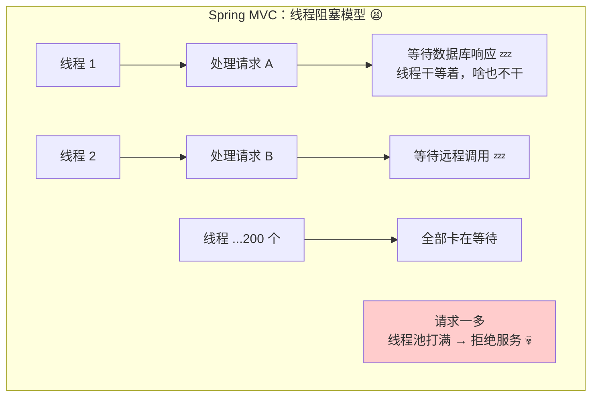
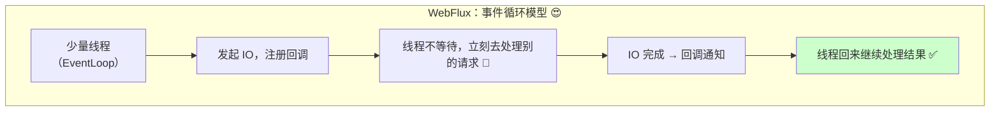
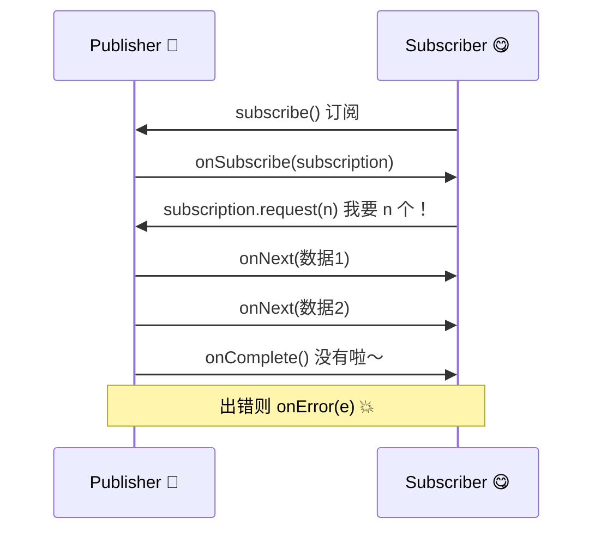
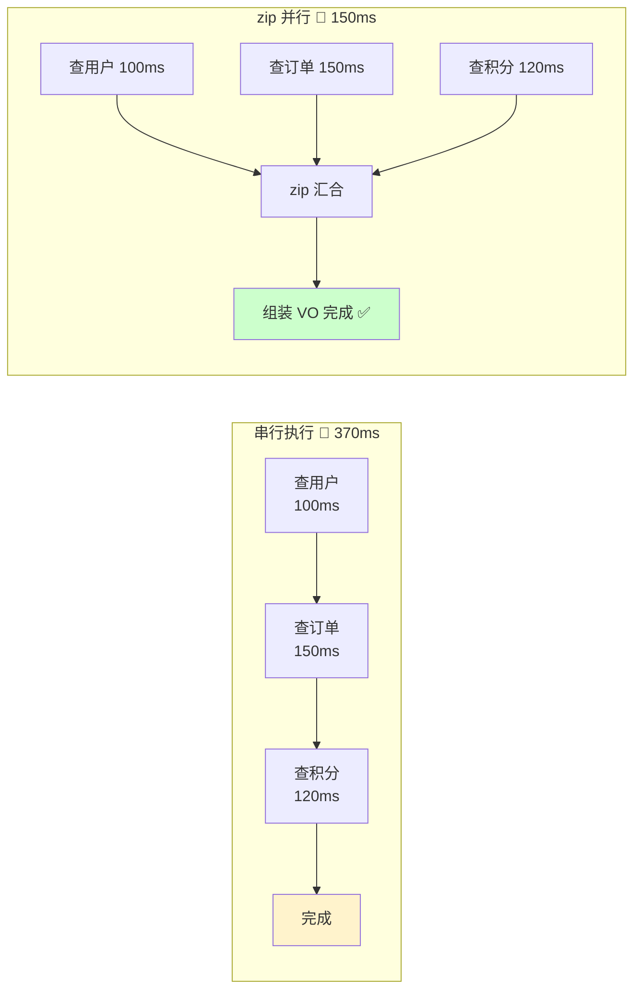
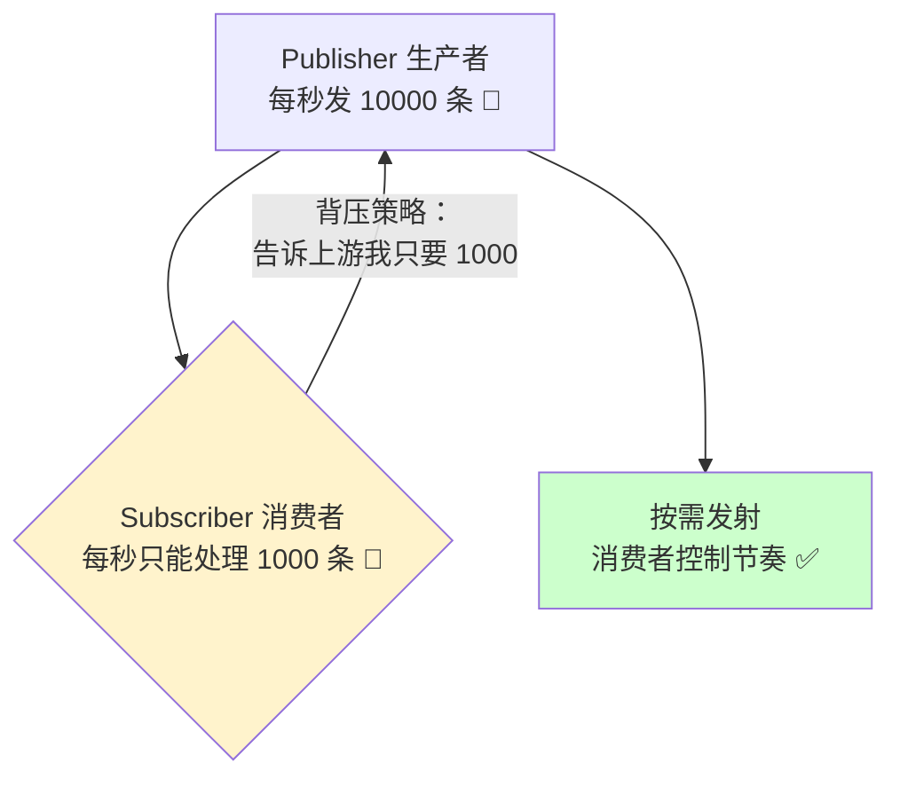
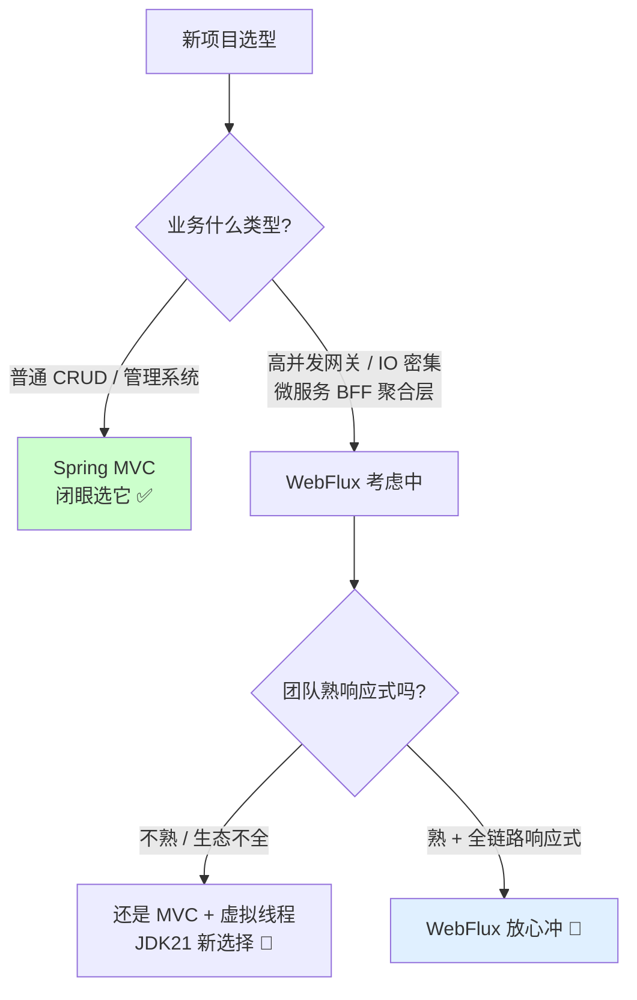
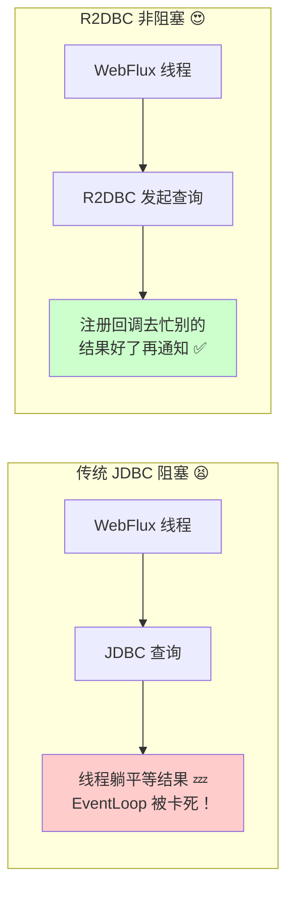
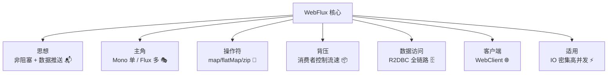

# 🌊 Spring WebFlux 响应式编程大冒险

> 嘿嘿～欢迎来到 WebFlux 小课堂！🌸
> Spring MVC 是"一个请求占一个线程"的老实人，WebFlux 是"少量线程玩转十万请求"的魔术师！
> 今天揭开响应式编程的神秘面纱，冲鸭～ (๑•̀ㅂ•́)و✧

---

## 📖 目录

1. [为什么需要 WebFlux](#-为什么需要-webflux)
2. [响应式编程核心思想](#-响应式编程核心思想)
3. [Mono 与 Flux 双主角](#-mono-与-flux-双主角)
4. [Reactor 常用操作符](#-reactor-常用操作符)
5. [背压 Backpressure](#-背压-backpressure)
6. [WebFlux vs Spring MVC](#-webflux-vs-spring-mvc)
7. [快速入门：注解式开发](#-快速入门注解式开发)
8. [函数式端点 RouterFunction](#-函数式端点-routerfunction)
9. [响应式数据访问 R2DBC](#-响应式数据访问-r2dbc)
10. [适用场景与避坑指南](#-适用场景与避坑指南)
11. [总结与小抄](#-总结与小抄)

---

## 🤔 为什么需要 WebFlux

**一句话理解**：传统 MVC 每个请求绑死一个线程，线程等 IO 时就"躺平睡觉"白白浪费；WebFlux 让线程"等待时不睡觉，去服务别的请求"！🧵

### Spring MVC 的烦恼



> 💡 真相：Web 应用的耗时大头是 **IO 等待**（数据库、HTTP 调用、Redis），CPU 计算只占零头。线程睡觉 = 资源浪费！

### WebFlux 的解法



**一句话总结**：MVC 是"一人一桌等上菜"，WebFlux 是"一个服务员管所有桌，菜好了叫号"🍜

---

## 💡 响应式编程核心思想

**一句话理解**：不是"立刻给我结果"，而是"结果好了再通知我"—— 把**拉**变成**推**！📬

### 命令式 vs 响应式对比

| 对比项 | 命令式（传统） | 响应式（WebFlux） |
|--------|--------------|------------------|
| 🎣 获取数据 | 主动拉取，等到为止 | 订阅后，数据到了推送给你 |
| 🧵 线程模型 | 一请求一线程，IO 时阻塞 | 少量线程，IO 时去干别的 |
| ⏰ 数据时机 | 调用即返回结果 | 返回"未来的承诺"（Publisher） |
| 🔗 代码风格 | 同步顺序执行 | 操作符流水线声明 |
| 📊 适合场景 | CPU 密集、简单业务 | **IO 密集、高并发网关/API** |

```java
// 命令式：站在原地等披萨 🍕（线程阻塞）
List<User> users = userDao.findAll();      // 等 100ms
List<Order> orders = orderDao.findByUser(); // 再等 100ms

// 响应式：下单后去干别的，披萨好了送上门 🛵
Flux<User> users = userDao.findAll();      // 立刻返回，没查呢！
Mono<List<Order>> orders = ...;            // 只是个"承诺"
// 真正执行是在"订阅"的那一刻！
```

### Reactive Streams 四兄弟

响应式流的接口规范（Java 9 已收编为 `java.util.concurrent.Flow`）：

| 接口 | 角色 | 通俗理解 |
|------|------|---------|
| `Publisher<T>` | 数据生产者 | 披萨店 🍕 |
| `Subscriber<T>` | 数据消费者 | 你（等吃的人）|
| `Subscription` | 订阅关系 | 订单小票（可取消）|
| `Processor<T,R>` | 既生产又消费 | 外卖小哥 🛵 |



---

## 🎭 Mono 与 Flux 双主角

WebFlux 基于 **Reactor** 框架，两大主角必须认识！

| 主角 | 含义 | 类比 | 示例 |
|------|------|------|------|
| `Mono<T>` | **0~1 个**数据的异步序列 | 单曲循环 🎵 | 查一个用户 |
| `Flux<T>` | **0~N 个**数据的异步序列 | 歌单 📃 | 查用户列表 |

```java
// Mono：0 或 1 个元素
Mono<String> mono = Mono.just("小白");
Mono<User> user = webClient.get().uri("/user/1")
        .retrieve().bodyToMono(User.class);

// Flux：0 到 N 个元素
Flux<String> flux = Flux.just("小明", "小红", "小刚");
Flux<User> users = webClient.get().uri("/users")
        .retrieve().bodyToFlux(User.class);

// 空 Mono 和错误
Mono.empty();          // 空空如也
Mono.error(new RuntimeException("炸了"));  // 错误流 💥
```

### 重要心法：不订阅不执行！⭐

```java
Mono<String> mono = Mono.just("hello")
        .map(s -> { 
            System.out.println("我执行了吗？");
            return s.toUpperCase();
        });

// ⚠️ 到这里什么都没打印！mono 只是个"菜谱"，还没"开火"！
mono.subscribe(System.out::println);   // 订阅 → 开火 → 打印 HELLO 🔥
```

---

## 🔧 Reactor 常用操作符

像 Stream 一样用流水线处理数据，但它们是**异步非阻塞**的！

### 操作符速查表

| 操作符 | 作用 | 类比 |
|--------|------|------|
| `map` | 同步转换数据 | 单词翻译 📖 |
| `flatMap` | **异步转换**（返回 Mono/Flux） | 翻译 + 查词典 🌐 |
| `filter` | 过滤 | 筛子 ⛏️ |
| `zip` | 合并多个流，一一配对 | 拉链 🤐 |
| `merge` | 合并多个流，交错输出 | 汇流成河 🌊 |
| `concat` | 顺序拼接，先1后2 | 排队进场 🚶 |
| `delay` | 延迟发射 | 定时炸弹 ⏰ |
| `onErrorResume` | 出错兜底 | 备用轮胎 🛞 |
| `retry` | 失败重试 | 不抛弃不放弃 💪 |
| `timeout` | 超时控制 | 等你 3 秒 ⏳ |

### map vs flatMap（高频面试题！）

```java
// map：同步转换，一对一
Mono<String> name = Mono.just(1)
        .map(id -> "用户" + id);        // Mono["用户1"]

// flatMap：异步转换，返回的 Mono/Flux 会被"拍平"
Mono<User> user = Mono.just(1)
        .flatMap(id -> userDao.findById(id));  // 内部也是 Mono<User>

// ⚠️ 在 map 里返回 Mono 会变成 Mono<Mono<User>> 套娃！必须用 flatMap 拍平
```

### 流水线实战

```java
Flux.just("xiaoming", "xiaohong", "xiaogang")
        .filter(name -> name.startsWith("xiao"))   // 过滤
        .map(String::toUpperCase)                    // 转大写
        .flatMap(this::queryUserByName)              // 异步查库
        .timeout(Duration.ofSeconds(3))              // 3 秒超时
        .onErrorResume(e -> Mono.empty())            // 出错返回空
        .subscribe(u -> log.info("查到：{}", u));
```

### 并行调用神器：zip ⚡

```java
// 需求：同时查用户基本信息 + 订单 + 积分（并行，总耗时 = 最慢的那个）
Mono<User> userMono = userService.getUser(1L);        // 100ms
Mono<List<Order>> orderMono = orderService.getOrders(1L);   // 150ms
Mono<Integer> pointMono = pointService.getPoints(1L);       // 120ms

Mono<UserVO> voMono = Mono.zip(userMono, orderMono, pointMono)
        .map(tuple -> {
            UserVO vo = new UserVO();
            vo.setUser(tuple.getT1());      // 第 1 个结果
            vo.setOrders(tuple.getT2());    // 第 2 个结果
            vo.setPoints(tuple.getT3());    // 第 3 个结果
            return vo;
        });
// 并行执行约 150ms，串行要 370ms！🚀
```



---

## 🔄 背压 Backpressure

**一句话理解**：生产者发货太快，消费者来不及拆快递怎么办？—— 告诉生产者"慢点发"！📦



| 背压策略 | 行为 | 场景 |
|---------|------|------|
| `BUFFER`（默认） | 缓存所有数据 | 内存够用 |
| `DROP` | 丢弃处理不过来的 | 允许丢（如日志采样）|
| `LATEST` | 只保留最新一条 | 实时行情、股价 |
| `ERROR` | 直接报错 | 不能丢不能等的严格场景 |

```java
flux.onBackpressureDrop(dropped -> log.warn("丢弃：{}", dropped))
    .onBackpressureBuffer(1000)   // 缓冲区 1000
    ...
```

> 💡 WebFlux 的 HTTP 场景下背压由框架协商，**流式大文件、消息推送**等场景才会明显感知～

---

## ⚖️ WebFlux vs Spring MVC

| 对比项 | Spring MVC | Spring WebFlux |
|--------|-----------|----------------|
| 🧵 线程模型 | 一请求一线程（Servlet 阻塞） | 少量 EventLoop 线程 |
| 📦 底层 | Servlet（Tomcat） | **Reactor + Netty** |
| 🔗 返回值 | `User` / `List<User>` | `Mono<User>` / `Flux<User>` |
| 🧩 依赖 | spring-boot-starter-web | spring-boot-starter-**webflux** |
| ⏱ 高并发 IO | 线程池容易打满 | 少量线程扛高并发 ⭐ |
| 📚 生态 | 无敌成熟（MyBatis/JPA 全支持） | 需要响应式全家桶（R2DBC）|
| 🧠 学习成本 | 低 | 高（调试像玄学 😵‍💫）|
| 🎯 定位 | 99% 项目的默认选择 | 特定场景的性能利器 |



> ⚠️ 划重点：**WebFlux 快的前提是全链路非阻塞**！中间用了一个阻塞的 JDBC，性能优势直接归零还倒贴 😅

---

## 🚀 快速入门：注解式开发

好消息：WebFlux 也支持 `@RestController` 注解式写法，和 MVC 长得几乎一样！

### ① 添加依赖

```xml
<dependency>
    <groupId>org.springframework.boot</groupId>
    <artifactId>spring-boot-starter-webflux</artifactId>
</dependency>
```

### ② 写 Controller（注意返回值是 Mono/Flux）

```java
@RestController
@RequestMapping("/users")
public class UserController {

    @Autowired
    private UserService userService;

    // 返回单个：Mono
    @GetMapping("/{id}")
    public Mono<User> getUser(@PathVariable Long id) {
        return userService.findById(id);   // 无需阻塞，直接把"承诺"返回
    }

    // 返回列表：Flux
    @GetMapping
    public Flux<User> listUsers() {
        return userService.findAll();
    }

    // 新增
    @PostMapping
    public Mono<User> create(@RequestBody Mono<User> userMono) {
        return userService.save(userMono);   // 参数也可以是 Mono！
    }
}
```

> 💡 框架自动订阅返回的 Mono/Flux，并把结果序列化成 JSON —— 你只管组装流水线，订阅这件事 Spring 帮你干！

---

## 🧩 函数式端点 RouterFunction

WebFlux 的另一种风格：像搭积木一样声明路由，轻量又灵活～

```java
@Configuration
public class UserRouter {

    @Bean
    public RouterFunction<ServerResponse> userRoutes(UserHandler handler) {
        return RouterFunctions.route()
                .GET("/users/{id}", RequestPredicates.accept(MediaType.APPLICATION_JSON),
                        handler::getUser)
                .GET("/users", handler::listUsers)
                .POST("/users", handler::createUser)
                .build();
    }
}

@Component
public class UserHandler {

    public Mono<ServerResponse> getUser(ServerRequest request) {
        Long id = Long.valueOf(request.pathVariable("id"));
        return ServerResponse.ok()
                .contentType(MediaType.APPLICATION_JSON)
                .body(userService.findById(id), User.class);
    }
}
```

| 风格 | 适合 | 特点 |
|------|------|------|
| 注解式 `@GetMapping` | 大多数业务 | 和 MVC 写法接近，上手快 |
| 函数式 `RouterFunction` | 轻量网关、定制路由 | 无注解魔法，显式组合 |

---

## 🗄️ 响应式数据访问 R2DBC

JDBC 是**阻塞**的（线程等查询结果），全链路非阻塞得换 **R2DBC**（Reactive Relational Database Connectivity）！



### Spring Data R2DBC 使用

```xml
<dependency>
    <groupId>org.springframework.boot</groupId>
    <artifactId>spring-boot-starter-data-r2dbc</artifactId>
</dependency>
<dependency>
    <groupId>io.asyncer</groupId>
    <artifactId>r2dbc-mysql</artifactId>
    <scope>runtime</scope>
</dependency>
```

```yaml
spring:
  r2dbc:
    url: r2dbc:mysql://localhost:3306/mydb
    username: root
    password: 123456
```

```java
// 继承 ReactiveCrudRepository，方法签名全是 Mono/Flux！
public interface StudentRepository extends ReactiveCrudRepository<Student, Long> {
    Flux<Student> findByAgeGreaterThan(Integer age);
}

// Service 里链式编排
public Flux<Student> getAdultStudents() {
    return studentRepository.findByAgeGreaterThan(18)
            .delayElements(Duration.ofMillis(100));   // 还能慢慢吐数据（流式）～
}
```

| 组件 | 阻塞版 | 响应式版 |
|------|--------|---------|
| 数据库 | JDBC / JPA / MyBatis | **R2DBC** / Spring Data R2DBC |
| Redis | Lettuce（也支持响应式）| `ReactiveRedisTemplate` |
| HTTP 客户端 | RestTemplate | **WebClient** |
| MongoDB | MongoTemplate | `ReactiveMongoTemplate` |

### WebClient：响应式 HTTP 客户端 ⭐

```java
WebClient client = WebClient.builder().baseUrl("https://api.example.com").build();

// GET 查单个
Mono<User> user = client.get()
        .uri("/users/{id}", 1L)
        .retrieve()
        .onStatus(HttpStatus::isError, resp ->
                Mono.error(new BizException("调用失败：" + resp.statusCode())))
        .bodyToMono(User.class);

// POST 提交
Mono<Order> order = client.post()
        .uri("/orders")
        .bodyValue(newOrder)
        .retrieve()
        .bodyToMono(Order.class);
```

> 💡 就算项目用 MVC，也强烈推荐用 **WebClient** 替代 RestTemplate —— 非阻塞、支持流式、链式调用超优雅 ✨

---

## 🚧 适用场景与避坑指南

### ✅ 适合 WebFlux 的场景

| 场景 | 原因 |
|------|------|
| 🌉 API 网关 / BFF 聚合层 | 大量 IO 转发，不吃 CPU |
| 📡 SSE / 流式推送 | 天生擅长"慢慢吐数据" |
| 🔄 微服务间高并发调用 | 少量线程扛海量请求 |
| 📊 实时数据管道 | 背压控制数据流速 |

### ❌ 不适合的场景

| 场景 | 原因 |
|------|------|
| 🧮 CPU 密集计算（报表/算法） | 响应式只优化 IO，计算该慢还是慢 |
| 🏢 老项目改造 + 团队不熟 | 学习成本 > 收益，别为难自己 |
| 🗄️ 依赖全是阻塞组件 | 一颗老鼠屎坏一锅粥（阻塞拖垮 EventLoop）|

### 新手必踩的坑 ⚠️

```java
// ① 坑：在流水线里调用阻塞方法 → EventLoop 卡死！💀
.flatMap(id -> {
    User u = blockingJdbcDao.findById(id);    // ❌ 阻塞调用
    return Mono.just(u);
})
// 解药：换成 R2DBC，或 .subscribeOn(Schedulers.boundedElastic()) 隔离

// ② 坑：忘记订阅 → 代码根本没执行！
userService.findById(1L);                       // ❌ 只定义没执行
userService.findById(1L).subscribe();           // ✅ 订阅才执行

// ③ 坑：滥用 block() → 退化成阻塞
User u = userService.findById(1L).block();      // ⚠️ 慎用！阻塞当前线程
// 解药：block 只能在测试 / main 方法里用，WebFlux 链路中禁止！

// ④ 坑：map 里返回 Mono → 套娃
.map(id -> userDao.findById(id))               // ❌ Mono<Mono<User>>
.flatMap(id -> userDao.findById(id))           // ✅ Mono<User>
```

---

## 🎀 总结与小抄

### 知识地图回顾



### 面试高频题速答卡 📌

| 问题 | 一句话答案 |
|------|-----------|
| WebFlux 和 MVC 区别？ | MVC 一请求一线程阻塞式；WebFlux 基于 Reactor+Netty，少量 EventLoop 线程非阻塞处理 |
| Mono 和 Flux 区别？ | Mono 发射 0~1 个元素，Flux 发射 0~N 个元素 |
| map 和 flatMap 区别？ | map 同步转换一对一；flatMap 异步转换并"拍平"返回的 Mono/Flux |
| 什么是背压？ | 消费者通过 request(n) 告知处理能力，让生产者按需发射，防止被撑爆 |
| WebFlux 为什么快？ | IO 等待时不阻塞线程，少量线程服务海量连接（前提：全链路非阻塞）|
| WebFlux 能用 MyBatis 吗？ | 能跑但阻塞（不推荐），非阻塞要用 R2DBC；或混用 MVC 思路 |

### 必记五条军规 ✊

1. **不订阅不执行**，Mono/Flux 只是"菜谱"，subscribe 才"开火"！
2. **全链路非阻塞**，一个阻塞 JDBC 就能让 WebFlux 优势归零！
3. **异步转换用 flatMap**，map 里返回 Mono 会套娃！
4. **WebFlux 链路中禁用 block()**，退化成阻塞还占着 EventLoop！
5. **普通项目选 MVC**，网关/高并发 IO 聚合层再上 WebFlux（JDK21 虚拟线程也是新选择）～

---

> 🎉 恭喜通关 WebFlux！从此"响应式"三个字对你不再是玄学～
> 记住核心就一句话：**线程不睡觉，等待时间去服务别人** (¬‿¬)✨
> 想继续 Netty 源码、虚拟线程对比、Redis 高并发，随时来找我哦，比心～ 💗
