# 🌱 Spring 原理与源码超全学习指南

> 嗨呀\~ 欢迎来到 Spring 的世界！🌸 Spring 是 Java 后端面试和开发的"必考题"，源码看着吓人，其实理清脉络后超有意思的！这份指南会用大白话带你从原理到源码，把 Spring 揉碎了喂给你。准备好了吗？冲鸭！(ﾉ>ω<)ﾉ

***

## 📖 目录

- [一、Spring 是什么？核心思想](#一spring-是什么核心思想)
- [二、IoC 容器原理（控制反转）](#二ioc-容器原理控制反转)
- [三、Bean 的生命周期（重灾区）](#三bean-的生命周期重灾区)
- [四、循环依赖与三级缓存（面试高频）](#四循环依赖与三级缓存面试高频)
- [五、AOP 原理（面向切面编程）](#五aop-原理面向切面编程)
- [六、Spring 事务原理](#六spring-事务原理)
- [七、Spring MVC 请求处理流程](#七spring-mvc-请求处理流程)
- [八、Spring 常用扩展点](#八spring-常用扩展点)
- [九、Spring 启动流程源码概览](#九spring-启动流程源码概览)
- [十、知识总结](#十知识总结)

***

## 一、Spring 是什么？核心思想

### 1.1 一句话定义

> **Spring** 是一个轻量级的 Java 企业级开发框架，核心是 **IoC 容器** 和 **AOP**，帮你管理对象、解耦代码。

### 1.2 两大核心思想 🎯

|       核心思想      | 全称                                          | 一句话解释                      | 解决什么问题         |
| :-------------: | :------------------------------------------ | :------------------------- | :------------- |
| 🔄 **IoC / DI** | Inversion of Control / Dependency Injection | 对象的创建和依赖关系交给 Spring 管理     | 解耦，不用自己 new 对象 |
|    ✂️ **AOP**   | Aspect Oriented Programming                 | 在不改动业务代码的情况下加上额外功能（如日志、事务） | 避免"非业务代码"到处重复  |

### 1.3 没有 Spring 之前，代码有多痛？😂

```java
// 传统写法：对象之间强耦合，自己 new
public class OrderService {
    // 直接 new，换实现要改代码，耦合度高
    private UserDao userDao = new UserDaoImpl();
    
    public void createOrder() {
        userDao.save();
    }
}
```

有了 Spring 之后 👇

```java
// Spring 写法：把依赖"注入"进来，不关心具体实现
@Service
public class OrderService {
    @Autowired  // Spring 自动注入，解耦！
    private UserDao userDao;
    
    public void createOrder() {
        userDao.save();
    }
}
```

> 💡 **核心变化**：从"我自己 new 对象" → "Spring 帮我创建并注入对象"，这就是 **控制反转（IoC）**——对象的控制权"反转"了，从你手里转到了 Spring 容器！

***

## 二、IoC 容器原理（控制反转）

### 2.1 什么是 IoC 容器？

IoC 容器就是 Spring 的"大管家" 🏠，它负责：

- **创建**对象（Bean）
- **管理**对象的依赖关系（DI 依赖注入）
- **管理**对象的整个生命周期

### 2.2 两大核心容器

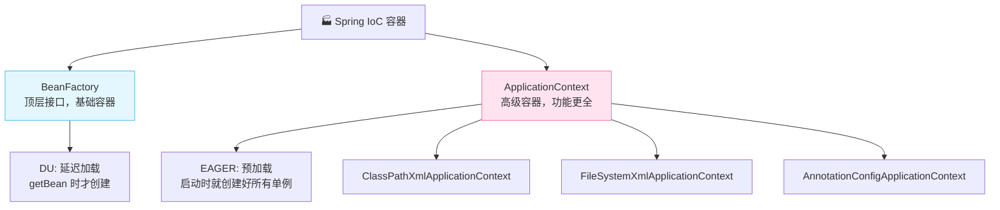

| 对比项      | 🏚️ BeanFactory   | 🏠 ApplicationContext   |
| :------- | :---------------- | :---------------------- |
| **定位**   | 顶层基础接口            | BeanFactory 的子接口，功能增强   |
| **加载时机** | 懒加载（lazy），用的时候才创建 | 预加载（eager），启动时创建单例 Bean |
| **功能**   | 基础的 Bean 管理       | + 事件发布、国际化、注解支持等        |
| **使用场景** | 资源受限环境            | 日常开发**都用这个**            |

> 🎀 平时说的"Spring 容器"默认就是 **ApplicationContext**，BeanFactory 是它的"老祖宗"接口。

### 2.3 IoC 的工作流程

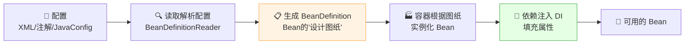

### 2.4 关键概念：BeanDefinition

**BeanDefinition（BD）** 是理解源码的钥匙 🔑！

> BeanDefinition 是 Bean 的"设计图纸"/"配方"，记录了 Bean 的类名、作用域、属性、初始化方法等信息。容器是**先有图纸，再按图纸造对象**。

```java
// BeanDefinition 简化理解
class BeanDefinition {
    String beanClassName;   // 类名：com.example.UserService
    String scope;           // 作用域：singleton/prototype
    boolean lazyInit;       // 是否懒加载
    // ... 属性、构造参数、初始化/销毁方法等
}
```

### 2.5 三种配置方式演进

|      方式      | 写法                                   | 评价     |
| :----------: | :----------------------------------- | :----- |
|   📄 XML 配置  | `<bean id="..." class="..."/>`       | 老古董，啰嗦 |
|    🔧 注解配置   | `@Component` `@Service` `@Autowired` | 主流，简洁  |
| ☕ JavaConfig | `@Configuration` + `@Bean`           | 灵活，推荐  |

```java
// JavaConfig 示例
@Configuration
public class AppConfig {
    @Bean
    public UserDao userDao() {
        return new UserDaoImpl();  // 方法返回值就是 Bean
    }
}
```

***

## 三、Bean 的生命周期（重灾区）

⭐ 这是面试**必问**的重灾区！务必背熟！Bean 的生命周期指的是一个 Bean 从**出生到死亡**的全过程。

### 3.1 完整生命周期流程图

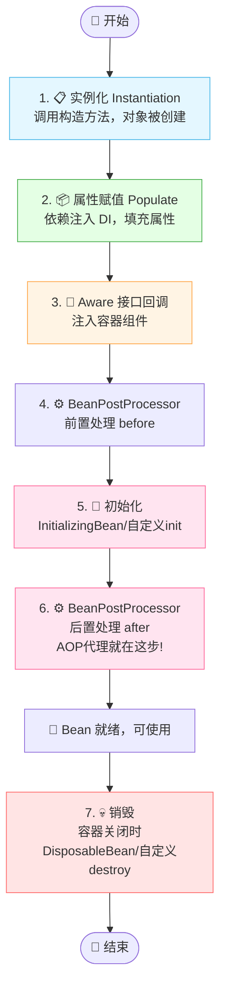

### 3.2 各阶段详解（记忆口诀：实例 → 赋值 → 初始化 → 销毁）

#### ① 实例化

- 容器通过**反射**调用构造方法，把对象 new 出来。
- 这时对象还只是个"毛坯房"，属性都是空的。

#### ② 属性赋值（依赖注入）

- 执行 `@Autowired`、`@Value` 等注入，把依赖填进去。
- 相当于给"毛坯房"添置家具。

#### ③ Aware 接口回调

- 如果 Bean 实现了 Aware 接口，Spring 会把容器内部组件注入给它。
- 常见：`BeanNameAware`（注入 Bean 名字）、`ApplicationContextAware`（注入容器）。

```java
@Component
public class MyBean implements ApplicationContextAware {
    private ApplicationContext ctx;
    
    @Override
    public void setApplicationContext(ApplicationContext ctx) {
        this.ctx = ctx;  // Spring 自动调用，注入容器引用
    }
}
```

#### ④ BeanPostProcessor 前置处理

- 执行 `postProcessBeforeInitialization()`，**所有 Bean** 初始化前都会走这里。

#### ⑤ 初始化

按顺序执行：

1. `@PostConstruct` 注解方法
2. `InitializingBean` 的 `afterPropertiesSet()`
3. 自定义 `init-method` 方法

```java
@Component
public class MyBean implements InitializingBean {
    @PostConstruct           // 1. 最先执行
    public void init1() {}
    
    @Override
    public void afterPropertiesSet() {  // 2. 其次
        // 初始化逻辑
    }
    
    // 3. @Bean(initMethod="xxx") 指定的方法最后
}
```

#### ⑥ BeanPostProcessor 后置处理 ⭐

- 执行 `postProcessAfterInitialization()`。
- **重点**：**AOP 的动态代理就是在这里生成的！** 在初始化后，把原始对象包装成代理对象。

#### ⑦ 销毁

容器关闭时，按顺序：

1. `@PreDestroy` 注解方法
2. `DisposableBean` 的 `destroy()`
3. 自定义 `destroy-method`

### 3.3 核心代码（BeanPostProcessor）

```java
// BeanPostProcessor 接口：Bean 生命周期的"守门员"
public interface BeanPostProcessor {
    // 初始化【前】调用
    default Object postProcessBeforeInitialization(Object bean, String beanName) {
        return bean;
    }
    // 初始化【后】调用 —— AOP 代理在这里产生！
    default Object postProcessAfterInitialization(Object bean, String beanName) {
        return bean;
    }
}
```

> 💡 **面试速记**：实例化 → 属性赋值 → Aware → 前置处理 → 初始化 → **后置处理(AOP代理)** → 使用 → 销毁。

***

## 四、循环依赖与三级缓存（面试高频）

⭐⭐ 这是 Spring 源码最经典的面试题！几乎必问！

### 4.1 什么是循环依赖？

> 两个 Bean 互相依赖，A 依赖 B，B 又依赖 A，形成"死循环"。

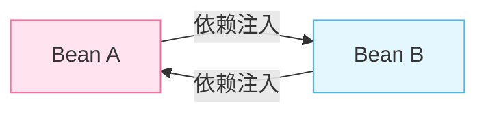

```java
@Component
class A {
    @Autowired B b;  // A 依赖 B
}
@Component
class B {
    @Autowired A a;  // B 依赖 A —— 死循环！
}
```

### 4.2 Spring 怎么解决？（三级缓存）

Spring 用 **三级缓存（三个 Map）** 解决**单例**作用域下、**属性注入**产生的循环依赖。

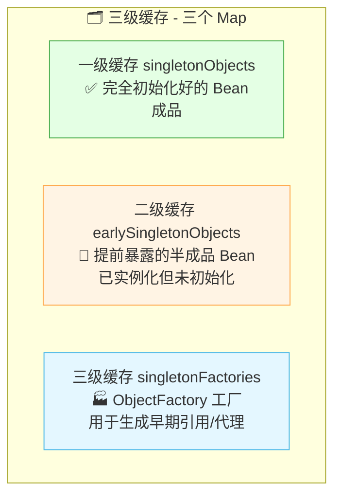

| 缓存级别 | 名称                      | 存什么                                   |
| :--: | :---------------------- | :------------------------------------ |
|  一级  | `singletonObjects`      | **成品** Bean（完整初始化好的）                  |
|  二级  | `earlySingletonObjects` | **半成品** Bean（提前暴露的早期引用）               |
|  三级  | `singletonFactories`    | **工厂** ObjectFactory（用来生成早期引用，可能产生代理） |

### 4.3 解决过程图解（以 A↔B 为例）

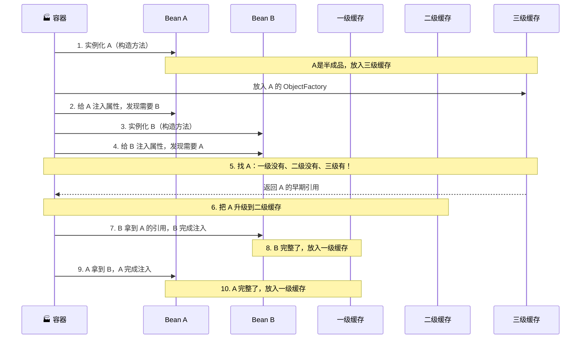

### 4.4 为什么需要三级而不是两级？

关键在于 **AOP 代理**！🤔

- 如果只有两级缓存，当 B 需要 A 时，会直接拿到 A 的**原始对象**。
- 但如果 A 需要被 AOP 代理，B 应该拿到的是 **A 的代理对象**，不是原始对象！
- 三级缓存存的是 **ObjectFactory（工厂）**，调用它才会**判断是否需要代理、并生成代理**。这样能保证 B 拿到的 A 始终是正确的（代理或原始）。

> 💡 **一句话**：三级缓存是为了在循环依赖场景下，**保证拿到的对象是 AOP 代理后的对象**。二级缓存则是为了在多次循环依赖时，避免重复创建代理。

### 4.5 哪些循环依赖 Spring 解决不了？

| 场景                | 能否解决 | 原因                 |
| :---------------- | :--: | :----------------- |
| 单例 + 属性注入（setter） |  ✅ 能 | 三级缓存机制             |
| 单例 + 构造器注入        | ❌ 不能 | 实例化阶段就需要对方，而对方还没创建 |
| prototype 原型作用域   | ❌ 不能 | 原型不缓存，无法提前暴露       |

```java
// ❌ 构造器注入的循环依赖，Spring 也无能为力！
@Component
class A {
    public A(B b) {}  // 构造时就需要 B
}
@Component
class B {
    public B(A a) {}  // 构造时就需要 A —— 启动直接报错！
}
```

***

## 五、AOP 原理（面向切面编程）

### 5.1 AOP 是什么？

> **AOP（Aspect Oriented Programming）** = 面向切面编程，把"横切关注点"（日志、事务、权限等）从业务代码中抽离出来，统一管理。

生活化理解：你想给所有方法加日志，如果每个方法都手写 `System.out.println`，太累还容易漏。AOP 让你**写一次，自动应用到所有方法**！✂️

### 5.2 AOP 核心术语（别被名字吓到）

|    术语   | 英文        | 大白话解释                   | 例子                                 |
| :-----: | :-------- | :---------------------- | :--------------------------------- |
|  **切面** | Aspect    | 你要统一做的那个"横切功能"          | 日志功能、事务功能                          |
| **连接点** | JoinPoint | 程序执行的某个点（Spring 中指方法执行） | 某个方法被调用时                           |
|  **切点** | Pointcut  | "哪些方法要被增强"的匹配规则         | `execution(* com.example.*.*(..))` |
|  **通知** | Advice    | "在什么时候做什么"（前置/后置等）      | 方法前打日志                             |
|  **织入** | Weaving   | 把切面应用到目标对象的过程           | Spring 用动态代理完成                     |

### 5.3 五种通知类型

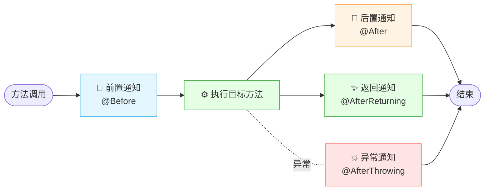

|  通知  | 注解                | 执行时机                    |
| :--: | :---------------- | :---------------------- |
| 前置通知 | `@Before`         | 目标方法**执行前**             |
| 后置通知 | `@After`          | 目标方法**执行后**（无论成功失败）     |
| 返回通知 | `@AfterReturning` | 方法**正常返回后**             |
| 异常通知 | `@AfterThrowing`  | 方法**抛异常后**              |
| 环绕通知 | `@Around`         | **包围**整个方法（最强大，能控制是否执行） |

### 5.4 AOP 代码示例

```java
@Aspect         // 声明这是一个切面
@Component
public class LogAspect {

    // 切点：匹配 service 包下所有方法
    @Pointcut("execution(* com.example.service.*.*(..))")
    public void servicePointcut() {}

    @Before("servicePointcut()")
    public void beforeLog(JoinPoint jp) {
        System.out.println("【日志】方法开始：" + jp.getSignature().getName());
    }

    @AfterReturning(pointcut = "servicePointcut()", returning = "result")
    public void afterReturnLog(JoinPoint jp, Object result) {
        System.out.println("【日志】方法返回：" + result);
    }

    // 环绕通知 = 前后都能控制，最强大
    @Around("servicePointcut()")
    public Object around(ProceedingJoinPoint pjp) throws Throwable {
        System.out.println("环绕-前");
        Object result = pjp.proceed();  // 执行目标方法
        System.out.println("环绕-后");
        return result;
    }
}
```

### 5.5 AOP 底层原理：动态代理

Spring AOP 的本质就是 **动态代理**！根据目标对象是否实现接口，选择两种代理方式：

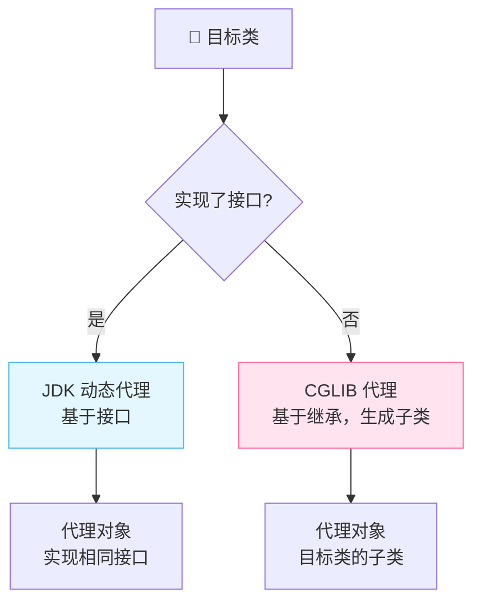

| 对比项           | JDK 动态代理  | CGLIB 代理           |
| :------------ | :-------- | :----------------- |
| **原理**        | 基于接口，反射调用 | 基于继承，生成子类          |
| **要求**        | 目标类必须实现接口 | 不需要接口，但不能是 final 类 |
| **性能**        | 创建快，调用稍慢  | 创建慢，调用快            |
| **Spring 默认** | 有接口时优先用   | 无接口时用              |

### 5.6 JDK 动态代理示例

```java
// JDK 动态代理：必须实现 InvocationHandler
public class MyProxy implements InvocationHandler {
    private Object target;  // 被代理的目标对象

    public MyProxy(Object target) {
        this.target = target;
    }

    // 生成代理对象
    public Object getProxy() {
        return Proxy.newProxyInstance(
            target.getClass().getClassLoader(),
            target.getClass().getInterfaces(),
            this
        );
    }

    @Override
    public Object invoke(Object proxy, Method method, Object[] args) throws Throwable {
        System.out.println("【前置】" + method.getName());
        Object result = method.invoke(target, args);  // 调用原方法
        System.out.println("【后置】执行完毕");
        return result;
    }
}
```

> 💡 **AOP 与 Bean 生命周期关系**：AOP 代理是在 Bean 生命周期的\*\*第⑥步（BeanPostProcessor 后置处理）\*\*生成的！由 `AbstractAutoProxyCreator` 这个 BeanPostProcessor 完成。

***

## 六、Spring 事务原理

### 6.1 Spring 事务的本质

Spring 事务**本质就是 AOP 的应用**！`@Transactional` 注解就是给方法套了一层事务增强。

### 6.2 编程式 vs 声明式

|     方式    | 写法                               | 特点         |
| :-------: | :------------------------------- | :--------- |
|    编程式    | 手写 `transactionManager.commit()` | 灵活但啰嗦，侵入业务 |
| **声明式** ⭐ | `@Transactional` 注解              | 无侵入，主流方式   |

```java
@Service
public class OrderService {
    
    @Transactional   // 声明式事务，自动开启/提交/回滚
    public void createOrder() {
        orderDao.insert(order);
        stockDao.reduce(stock);  // 如果这里抛异常，上面也会回滚
        accountDao.deduct(money);
    }
}
```

### 6.3 事务工作原理（AOP + 动态代理）

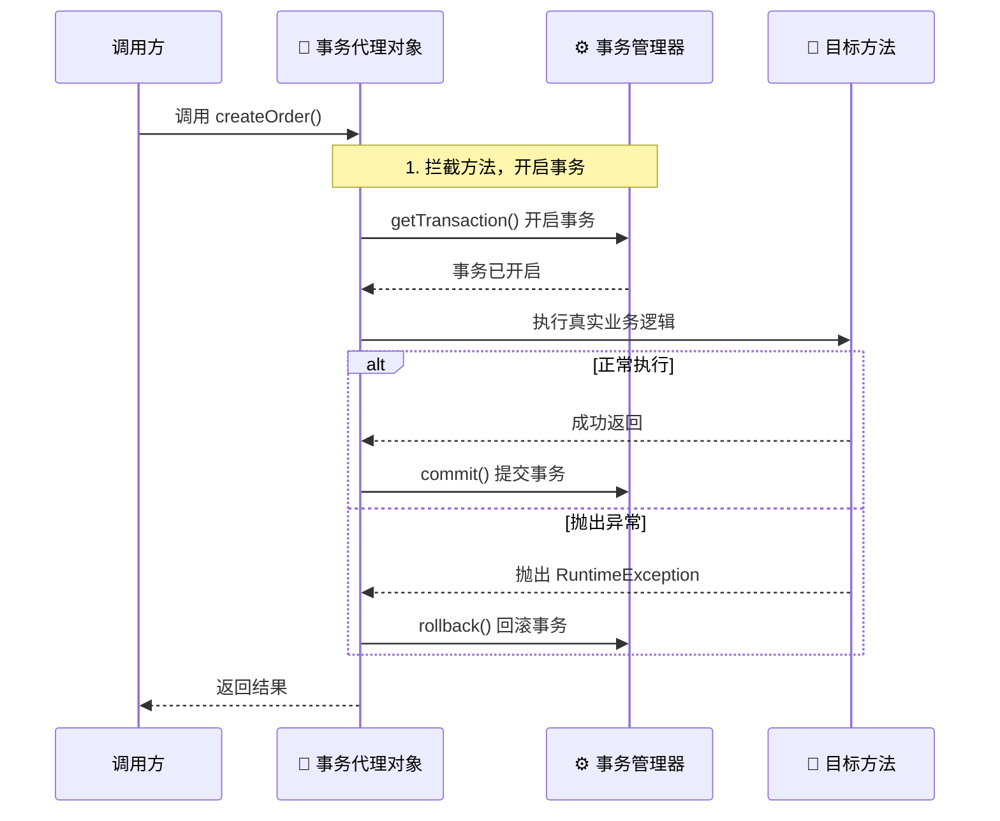

> 💡 **核心**：`@Transactional` 生效是因为 Spring 用 AOP 创建了代理对象，在方法前后加了"开启事务 / 提交 / 回滚"的逻辑。

### 6.4 七种事务传播行为

事务传播行为 = 一个事务方法被另一个事务方法调用时，该怎么处理事务。

| 传播行为              | 说明              | 大白话           |
| :---------------- | :-------------- | :------------ |
| **REQUIRED**（默认）⭐ | 有事务就加入，没有就新建    | 随大流，没队就自己建队   |
| **REQUIRES\_NEW** | 不管有没有，都新建一个独立事务 | 我要单干，开新事务挂起旧的 |
| **NESTED**        | 嵌套事务，外层回滚则内层也回滚 | 大队套小队，大队没小队也没 |
| SUPPORTS          | 有事务就加入，没有就非事务运行 | 随缘，有就参加没有就算   |
| NOT\_SUPPORTED    | 以非事务方式运行，挂起当前事务 | 我不参与事务        |
| MANDATORY         | 必须在事务中运行，否则报错   | 强制要求有事务       |
| NEVER             | 不能在事务中运行，否则报错   | 强制要求无事务       |

### 6.5 ⚠️ @Transactional 失效的常见坑

**面试常问！** `@Transactional` 失效的根因几乎都是"没走代理"：

| 失效场景               | 原因                     | 解决办法                                          |
| :----------------- | :--------------------- | :-------------------------------------------- |
| **自调用**（同类中方法调方法）  | `this.xxx()` 不走代理      | 注入自己 / 用 AopContext                           |
| 方法非 `public`       | AOP 默认只代理 public 方法    | 改成 public                                     |
| 默认不回滚**检查异常**      | 默认只回滚 RuntimeException | `@Transactional(rollbackFor=Exception.class)` |
| 异常被 `try-catch` 吞了 | 代理方法感知不到异常             | catch 后手动 throw                               |
| 类没被 Spring 管理      | 不是 Bean，自然没代理          | 加 `@Service` 等注解                              |

```java
@Service
public class OrderService {
    
    @Transactional
    public void methodA() {
        // ❌ 自调用：this 调用不走代理，事务失效！
        this.methodB();
    }
    
    @Transactional
    public void methodB() {
        // 事务不会生效
    }
}
```

***

## 七、Spring MVC 请求处理流程

### 7.1 核心组件

| 组件                    | 作用                         |
| :-------------------- | :------------------------- |
| **DispatcherServlet** | 前端控制器，所有请求的入口（总调度）         |
| **HandlerMapping**    | 根据 URL 找到对应的 Controller 方法 |
| **HandlerAdapter**    | 适配并执行 Controller 方法        |
| **ViewResolver**      | 解析视图（前后端分离时基本不用）           |

### 7.2 完整请求流程

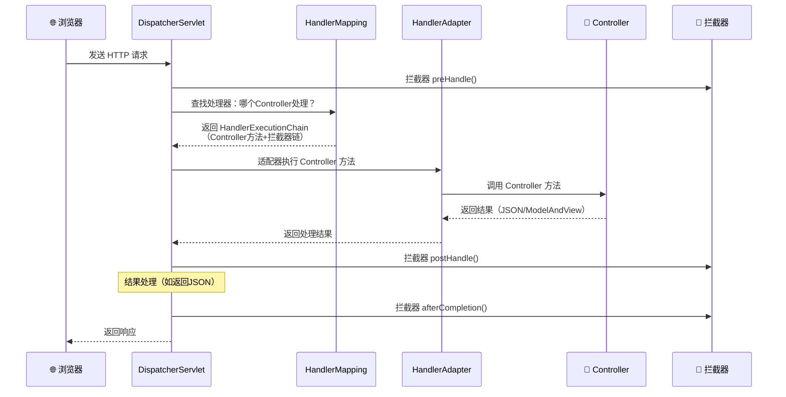

### 7.3 流程速记（9 大步骤）

```
1. 用户请求 → DispatcherServlet
2. DispatcherServlet → HandlerMapping 查找处理器
3. 返回 HandlerExecutionChain（处理器 + 拦截器）
4. DispatcherServlet → HandlerAdapter 执行处理器
5. HandlerAdapter → 调用 Controller 方法
6. Controller 返回结果（ModelAndView / JSON）
7. 结果处理（视图解析 or 直接写 JSON）
8. 拦截器后置处理
9. 返回响应给用户
```

> 🎀 现在前后端分离开发，第 7 步多是直接用 `@RestController` 返回 JSON，不走 ViewResolver 啦\~

***

## 八、Spring 常用扩展点

Spring 提供了很多扩展点，让我们能"插手"容器的运作。掌握这些才算真正懂 Spring！

### 8.1 核心扩展点一览

| 扩展点                                   | 作用                      | 触发时机           |
| :------------------------------------ | :---------------------- | :------------- |
| **BeanPostProcessor**                 | 对所有 Bean 的初始化前后做处理      | 每个 Bean 初始化前后  |
| **BeanFactoryPostProcessor**          | 对 BeanDefinition（图纸）做处理 | 所有 BD 加载完、实例化前 |
| **InitializingBean / @PostConstruct** | Bean 初始化时执行自定义逻辑        | Bean 属性注入完成后   |
| **ApplicationContextAware**           | 注入容器引用                  | Aware 回调阶段     |
| **SmartInitializingSingleton**        | 所有单例 Bean 创建完成后执行       | 单例预热完成时        |
| **ApplicationListener**               | 监听容器事件                  | 事件发布时          |

### 8.2 BeanFactoryPostProcessor vs BeanPostProcessor

容易混淆！看这张图就懂 👇

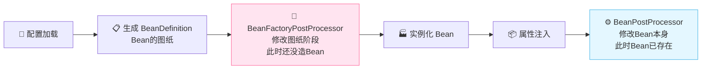

| 对比       | BeanFactoryPostProcessor | BeanPostProcessor |
| :------- | :----------------------- | :---------------- |
| **操作对象** | BeanDefinition（图纸）       | Bean 实例（成品）       |
| **触发时机** | Bean 实例化**之前**           | Bean 初始化**前后**    |
| **类比**   | 修改"设计图纸"                 | 给"产品"做加工          |

### 8.3 代码示例

```java
// BeanFactoryPostProcessor：在 Bean 创建前修改图纸
@Component
public class MyBeanFactoryPostProcessor implements BeanFactoryPostProcessor {
    @Override
    public void postProcessBeanFactory(ConfigurableListableBeanFactory factory) {
        // 可以修改 BeanDefinition，比如改类名、加属性
        BeanDefinition bd = factory.getBeanDefinition("userService");
        System.out.println("修改图纸：" + bd.getBeanClassName());
    }
}

// BeanPostProcessor：在每个 Bean 初始化前后动手脚
@Component
public class MyBeanPostProcessor implements BeanPostProcessor {
    @Override
    public Object postProcessBeforeInitialization(Object bean, String name) {
        System.out.println("初始化前：" + name);
        return bean;
    }
    @Override
    public Object postProcessAfterInitialization(Object bean, String name) {
        System.out.println("初始化后：" + name);
        return bean;  // 这里可以返回代理对象
    }
}
```

***

## 九、Spring 启动流程源码概览

### 9.1 整体启动流程

以 `AnnotationConfigApplicationContext` 为例：

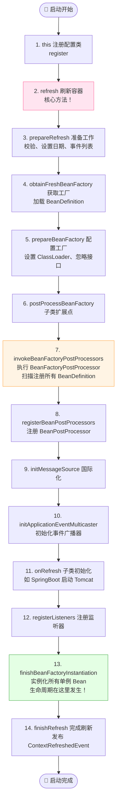

### 9.2 refresh() 核心步骤（最经典的 13 步）

`AbstractApplicationContext.refresh()` 是 Spring 最核心的方法，面试可能让你说流程！

```java
public void refresh() throws BeansException, IllegalStateException {
    // 1. 准备刷新：校验、设置标志位
    prepareRefresh();
    // 2. 获取 BeanFactory，加载 BeanDefinition
    ConfigurableListableBeanFactory beanFactory = obtainFreshBeanFactory();
    // 3. 配置 BeanFactory（ClassLoader、忽略接口等）
    prepareBeanFactory(beanFactory);
    // 4. 子类扩展点（空实现，留给子类）
    postProcessBeanFactory(beanFactory);
    // 5. ⭐ 执行 BeanFactoryPostProcessor，扫描注册所有 BD
    invokeBeanFactoryPostProcessors(beanFactory);
    // 6. ⭐ 注册 BeanPostProcessor
    registerBeanPostProcessors(beanFactory);
    // 7. 初始化消息源（国际化 i18n）
    initMessageSource();
    // 8. 初始化事件广播器
    initApplicationEventMulticaster();
    // 9. 子类初始化（SpringBoot 在此启动内嵌 Tomcat）
    onRefresh();
    // 10. 注册事件监听器
    registerListeners();
    // 11. ⭐⭐ 实例化所有单例 Bean（Bean 生命周期发生地）
    finishBeanFactoryInitialization(beanFactory);
    // 12. 完成刷新，发布事件
    finishRefresh();
}
```

### 9.3 getBean 核心流程（实例化 Bean）

`getBean/doGetBean` 是创建 Bean 的入口，核心逻辑在 `createBean`：

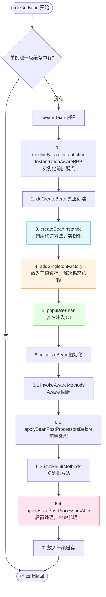

> 💡 **getBean 三级缓存查询顺序**：一级 → 二级 → 三级。三级找到后，生成的早期对象会"升级"到二级缓存。

***

## 十、知识总结

最后用思维导图把所有知识点串起来，复习巩固 📝✨：

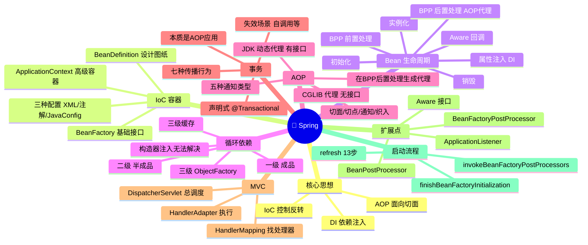

### 🎯 核心要点速记

1. **Spring 两大核心**：IoC（管对象）+ AOP（加功能）。
2. **IoC 容器** = ApplicationContext，先有 BeanDefinition（图纸）再造 Bean。
3. **Bean 生命周期 7 步**：实例化 → 属性注入 → Aware → 前置处理 → 初始化 → 后置处理 → 销毁。
4. **AOP 代理在 Bean 后置处理（第6步）生成**。
5. **循环依赖**靠三级缓存解决，核心是为 AOP 代理服务；构造器注入和 prototype 无法解决。
6. **AOP 本质**是动态代理：有接口用 JDK，无接口用 CGLIB。
7. **事务**是 AOP 的应用，`@Transactional` 失效多因"没走代理"（自调用最常见）。
8. **MVC 核心入口**是 DispatcherServlet，HandlerMapping 找处理器，HandlerAdapter 执行。
9. **refresh()** 是启动核心方法，最重要两步：执行 BeanFactoryPostProcessor（注册 BD）+ finishBeanFactoryInitialization（实例化 Bean）。
10. **getBean 查缓存顺序**：一级（成品）→ 二级（半成品）→ 三级（工厂）。

***

> 🌸 哇\~ 恭喜你把 Spring 的核心原理和源码脉络学完啦！Spring 源码看着庞大，但抓住 IoC 容器、Bean 生命周期、AOP、三级缓存这几条主线，就能融会贯通啦！多翻几遍源码，你会越来越有感觉的！加油鸭！(ง •\_•)ง💖

