# 🏗️ Django 框架详解

> 哈喽呀～欢迎来到 Django 的专属课堂！🌟 Django 是 Python 界"全家桶"级别的框架，ORM、Admin、认证、表单全都自带！这一篇带你把它从头到尾学个明白～出发！(๑•̀ㅂ•́)و✧

---

## 🗺️ Django 知识全景图

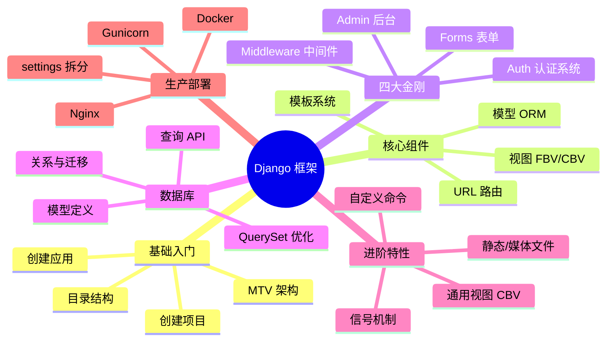

---

## 📑 目录

- [一、Django 简介：Web 界的"瑞士军刀"](#一django-简介web-界的瑞士军刀)
- [二、快速开始：创建项目与应用](#二快速开始创建项目与应用)
- [三、URL 路由系统](#三url-路由系统)
- [四、视图：FBV 与 CBV](#四视图fbv-与-cbv)
- [五、模板系统](#五模板系统)
- [六、模型与 ORM（上）：定义与迁移](#六模型与-orm上定义与迁移)
- [七、模型与 ORM（下）：查询进阶](#七模型与-orm下查询进阶)
- [八、Admin 后台管理](#八admin-后台管理)
- [九、表单系统 Forms](#九表单系统-forms)
- [十、用户认证系统 Auth](#十用户认证系统-auth)
- [十一、中间件 Middleware](#十一中间件-middleware)
- [十二、静态文件与媒体文件](#十二静态文件与媒体文件)
- [十三、通用视图 CBV 实战](#十三通用视图-cbv-实战)
- [十四、部署上线](#十四部署上线)
- [十五、知识总结](#十五知识总结)

---

## 一、Django 简介：Web 界的"瑞士军刀" 🇨🇭

### 1.1 Django 是什么？

Django 诞生于 2005 年（比 Flask 早 5 年），是一个**重量级全栈框架**，口号是：

> **"The web framework for perfectionists with deadlines"**
> （给有截止日期的完美主义者设计的框架）

> 🎀 通俗说：Django 把 Web 开发需要的东西**全打包**了——数据库、后台、登录、表单、安全防护……开箱即用，特别适合"赶工期还要做得好"的项目！

### 1.2 自带的"全家桶"功能

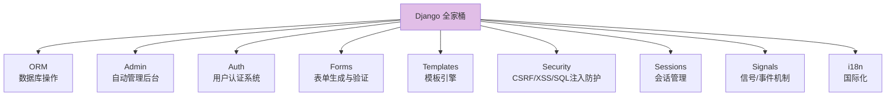

| 组件 | 作用 | 装第三方库吗？ |
| :--- | :--- | :---: |
| ORM | 用 Python 操作数据库 | ❌ 自带 |
| Admin | 自动生成管理后台 | ❌ 自带 |
| Auth | 注册/登录/权限 | ❌ 自带 |
| Forms | 表单验证 + HTML 生成 | ❌ 自带 |
| 安全防护 | CSRF/XSS/SQL 注入 | ❌ 自带 |

### 1.3 MTV 架构

> 大家常说 MVC，Django 用的是自己的 MTV，本质一样只是叫法不同～

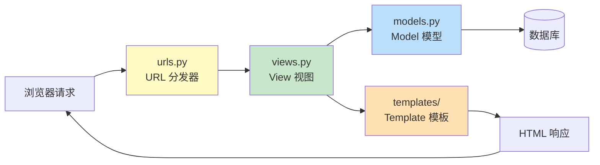

| Django (MTV) | 传统 MVC | 职责 |
| :--- | :--- | :--- |
| **Model** | Model | 定义数据结构，操作数据库 |
| **Template** | View | 展示页面（HTML） |
| **View** | Controller | 处理业务逻辑，连接 M 和 T |

### 1.4 Django vs Flask

| 对比 | Django 🏗️ | Flask 🌸 |
| :--- | :--- | :--- |
| 体积 | 大而全 | 小而美 |
| 上手难度 | 较陡（约定多） | 平缓 |
| 内置 Admin | ✅ 有 | ❌ 无 |
| 灵活性 | 约定优先 | 自由组装 |
| 适合项目 | 中大型、企业级 | 小型、API、原型 |

---

## 二、快速开始：创建项目与应用 🚀

### 2.1 安装与创建

```bash
# —— 安装 ——
pip install django

# —— 查看版本 ——
python -m django --version

# —— 创建项目（会生成 mysite 文件夹）——
django-admin startproject mysite

# —— 进入项目，创建应用 ——
cd mysite
python manage.py startapp blog
```

> 💡 **项目 vs 应用**：
> - **项目（Project）** = 整个网站（一台电脑）
> - **应用（App）** = 功能模块（键盘、屏幕等零件）
> - 一个项目可以装多个应用，一个应用也能装到多个项目～

### 2.2 目录结构详解

```text
mysite/
├── manage.py              ← 神奇的管理脚本（各种命令入口）
├── mysite/                ← 项目配置包
│   ├── __init__.py
│   ├── settings.py        ← 全局配置中心 ⭐
│   ├── urls.py            ← 根路由
│   ├── asgi.py            ← 异步部署入口
│   └── wsgi.py            ← 同步部署入口
└── blog/                  ← 你创建的应用
    ├── __init__.py
    ├── admin.py           ← Admin 后台配置
    ├── apps.py            ← 应用配置
    ├── migrations/        ← 数据库迁移文件（自动生成）
    │   └── __init__.py
    ├── models.py          ← 数据模型 ⭐
    ├── tests.py           ← 单元测试
    └── views.py           ← 视图函数 ⭐
```

| 文件 | 作用 | 使用频率 |
| :--- | :--- | :---: |
| `settings.py` | 数据库、应用列表、密钥等配置 | ⭐⭐⭐ |
| `urls.py` | URL 路由入口 | ⭐⭐⭐ |
| `models.py` | 定义数据表 | ⭐⭐⭐ |
| `views.py` | 写业务逻辑 | ⭐⭐⭐ |
| `admin.py` | 配置后台 | ⭐⭐ |
| `migrations/` | 数据库变更记录 | ⭐⭐ |

### 2.3 注册应用（必做！）

```python
# mysite/settings.py

INSTALLED_APPS = [
    "django.contrib.admin",        # Django 自带应用
    "django.contrib.auth",         # 用户认证
    "django.contrib.contenttypes",
    "django.contrib.sessions",
    "django.contrib.messages",
    "django.contrib.staticfiles",
    "blog",                        # ← 加上你的应用！
]
```

> ⚠️ **新手常犯错误**：创建了应用忘记注册到 `INSTALLED_APPS`，结果模型不生效、模板找不到……一定要记得加！

### 2.4 启动开发服务器

```bash
python manage.py runserver
# 默认 http://127.0.0.1:8000

# 指定端口
python manage.py runserver 8080

# 监听所有网卡（局域网可访问）
python manage.py runserver 0.0.0.0:8000
```

看到这个就成功啦：

```text
Django version 5.x, using settings 'mysite.settings'
Starting development server at http://127.0.0.1:8000/
Quit the server with CTRL-BREAK.
```

### 2.5 manage.py 常用命令

| 命令 | 作用 |
| :--- | :--- |
| `runserver` | 启动开发服务器 |
| `startapp 应用名` | 创建应用 |
| `makemigrations` | 生成迁移文件 |
| `migrate` | 执行数据库迁移 |
| `createsuperuser` | 创建管理员账号 |
| `shell` | 进入交互式 ORM 环境 |
| `dbshell` | 进入数据库命令行 |
| `test` | 运行测试 |
| `collectstatic` | 收集静态文件（部署用） |
| `flush` | 清空数据库（慎用！） |

---

## 三、URL 路由系统 🛣️

### 3.1 基本配置

```python
# mysite/urls.py（根路由）
from django.contrib import admin
from django.urls import path
from blog import views          # 导入应用视图

urlpatterns = [
    path("admin/", admin.site.urls),          # Django 自带后台
    path("", views.index, name="index"),      # 首页
    path("about/", views.about),              # 关于页
]
```

### 3.2 路由分发（include）

> 每个应用管自己的路由，根路由只做"转发"——项目大了也不乱！

```python
# mysite/urls.py（根路由）
from django.contrib import admin
from django.urls import path, include

urlpatterns = [
    path("admin/", admin.site.urls),
    path("blog/", include("blog.urls")),       # /blog/* 交给 blog 应用
    path("shop/", include("shop.urls")),       # /shop/* 交给 shop 应用
]
```

```python
# blog/urls.py（应用路由，需自己创建）
from django.urls import path
from . import views

urlpatterns = [
    path("", views.article_list, name="list"),           # /blog/
    path("articles/", views.article_list, name="list"),  # /blog/articles/
    path("article/<int:pk>/", views.article_detail, name="detail"),
]
```

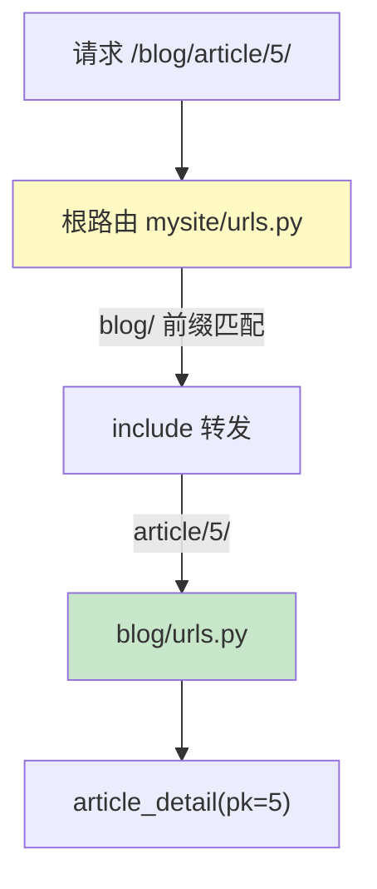

### 3.3 路径转换器

```python
urlpatterns = [
    path("articles/<int:year>/", views.year_archive),     # 整数
    path("articles/<int:year>/<int:month>/", views.month_archive),
    path("user/<str:username>/", views.user_detail),      # 字符串（不含 /）
    path("file/<path:subpath>/", views.file_view),        # 含 / 的路径
    path("uuid/<uuid:id>/", views.uuid_view),             # UUID
    path("slug/<slug:article_slug>/", views.slug_view),   # slug（字母数字-下划线）
]
```

| 转换器 | 匹配规则 | 示例 |
| :---: | :--- | :--- |
| `int` | 正整数 | `/article/123/` |
| `str` | 非空字符串（不含 `/`） | `/user/小明/` |
| `slug` | slug 格式（字母数字`-` `_`） | `/my-article-title/` |
| `uuid` | UUID 格式 | `/uuid/1234-.../` |
| `path` | 任意路径（含 `/`） | `/files/a/b/c.txt/` |

### 3.4 re_path：正则路由（灵活）

```python
from django.urls import re_path

urlpatterns = [
    # 匹配 4 位年份，如 /2026/
    re_path(r"^articles/(?P<year>[0-9]{4})/$", views.year_archive),

    # 匹配用户名（字母数字下划线 3~20 位）
    re_path(r"^user/(?P<username>\w{3,20})/$", views.user_detail),
]
```

### 3.5 命名路由与反向解析

```python
# —— 命名 ——
path("article/<int:pk>/", views.article_detail, name="detail")
#                                        ↑ 给路由起名 ↑

# —— 在 Python 中反解析 URL ——
from django.urls import reverse
reverse("detail", kwargs={"pk": 5})          # "/article/5/"
reverse("blog:list")                          # 应用名:路由名（带命名空间）

# —— 在模板中反解析 ——
<a href="">{{ article.title }}</a>
```

> 💡 **为什么要用 url 标签？** 路由改了（如 `/article/5/` → `/posts/5/`），所有 `` 自动更新，而写死路径的链接全挂！

### 3.6 URL 命名空间（app_name）

```python
# blog/urls.py
app_name = "blog"       # 应用命名空间

urlpatterns = [
    path("", views.list, name="list"),
]

# 模板中使用（带命名空间前缀，防止不同应用路由重名冲突）

```

---

## 四、视图：FBV 与 CBV 👀

### 4.1 FBV：函数视图（直观）

```python
# blog/views.py
from django.http import HttpResponse, JsonResponse
from django.shortcuts import render, get_object_or_404

# —— 最简单的视图 ——
def index(request):
    return HttpResponse("你好，Django！")

# —— 返回模板 ——
def article_list(request):
    articles = Article.objects.all()
    return render(request, "blog/list.html", {"articles": articles})
    #                                 模板路径 ↑      传给模板的数据 ↑

# —— 返回 JSON ——
def api_data(request):
    return JsonResponse({"code": 0, "msg": "ok"})

# —— 查不到就 404 ——
def article_detail(request, pk):
    article = get_object_or_404(Article, pk=pk)
    return render(request, "blog/detail.html", {"article": article})
```

### 4.2 判断请求方法

```python
from django.http import HttpResponseNotAllowed

def article_edit(request, pk):
    if request.method == "GET":
        # 显示编辑页面
        article = get_object_or_404(Article, pk=pk)
        return render(request, "blog/edit.html", {"article": article})

    elif request.method == "POST":
        # 处理提交
        title = request.POST.get("title")
        content = request.POST.get("content")
        # ...保存逻辑
        return redirect("blog:detail", pk=pk)

    return HttpResponseNotAllowed(["GET", "POST"])   # 其他方法不允许
```

### 4.3 FBV vs CBV

| 对比 | FBV 函数视图 | CBV 类视图 |
| :--- | :--- | :--- |
| 写法 | 一个函数 | 一个类 |
| 判断 method | 手写 if/else | 自动分发到 get()/post() |
| 代码复用 | 靠装饰器/函数 | 靠继承 ⭐ |
| 适合场景 | 简单逻辑 | CRUD、通用场景 |

### 4.4 CBV：类视图（优雅）

```python
# blog/views.py
from django.views import View

class ArticleView(View):
    def get(self, request):
        articles = Article.objects.all()
        return render(request, "blog/list.html", {"articles": articles})

    def post(self, request):
        # 处理 POST（不用写 if 判断啦！）
        title = request.POST.get("title")
        Article.objects.create(title=title)
        return redirect("blog:list")

# blog/urls.py
path("articles/", ArticleView.as_view()),   # 注意要 as_view()！
```

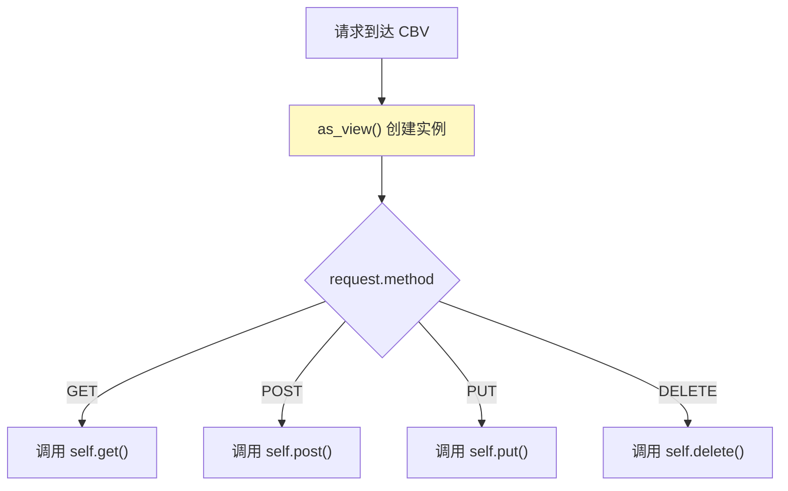

### 4.5 request 对象常用属性

```python
def my_view(request):
    # —— 基本信息 ——
    request.method            # "GET" / "POST"
    request.path              # "/blog/articles/"
    request.get_full_path()   # "/blog/articles/?page=2"
    request.META              # 请求头信息（大字典）
    request.user              # 当前登录用户（Auth 系统）
    request.is_secure()       # 是否 HTTPS

    # —— GET 数据 ——
    request.GET.get("page", 1)         # 查询字符串 ?page=1
    request.GET.getlist("tags")        # 同名多值

    # —— POST 数据 ——
    request.POST.get("username")
    request.POST.getlist("hobbies")

    # —— 文件 ——
    request.FILES.get("avatar")        # 上传的文件

    # —— Cookie / Session ——
    request.COOKIES.get("username")
    request.session.get("user_id")
```

| 属性 | 说明 | 示例 |
| :--- | :--- | :--- |
| `request.method` | 请求方法 | `"POST"` |
| `request.GET` | 查询字符串 | `?page=2` |
| `request.POST` | 表单数据 | form 提交 |
| `request.FILES` | 上传文件 | `<input type="file">` |
| `request.user` | 当前用户 | `request.user.username` |
| `request.session` | 会话 | `request.session["key"]` |

---

## 五、模板系统 🎨

### 5.1 模板查找路径约定

```text
blog/                        ← 应用
├── templates/               ← 应用级模板目录（要自己建）
│   └── blog/                ← 建议再套一层应用名（防冲突）
│       ├── base.html
│       └── article_list.html
```

> 💡 Django 会去 `INSTALLED_APPS` 里每个应用的 `templates/` 找模板。**再套一层应用名文件夹**（如 `blog/`）是官方推荐，防止不同应用的 `list.html` 打架～

### 5.2 基本语法

```html
<!-- ① 变量 -->
<h1>{{ article.title }}</h1>
<p>作者：{{ article.author.username }}</p>     <!-- 支持点语法取属性 -->

<!-- ② 标签 -->

    <p>欢迎，{{ user.username }}！</p>

    <p>管理员好～</p>

    <a href="/login/">请登录</a>



    <li>{{ forloop.counter }}. {{ article.title }}</li>   <!-- forloop 是内置变量 -->
                                                <!-- 列表为空时 -->
    <li>暂无文章</li>


<!-- ③ 注释 -->
{# 单行注释 #}

    多行注释


<!-- ④ url 反解析 -->
<a href="">查看详情</a>

<!-- ⑤ with 起别名 -->

    <p>{{ author_name }}</p>

```

| 语法 | 作用 | 示例 |
| :---: | :--- | :--- |
| `{{ 变量 }}` | 输出变量 | `{{ title }}` |
| `` | 逻辑控制 | ``、`` |
| `{{ x\|过滤器 }}` | 处理数据 | `{{ name\|upper }}` |
| `{# 注释 #}` | 注释 | 不输出 |
| `` | 反解析路由 | `` |

**forloop 内置变量**：

| 变量 | 含义 |
| :--- | :--- |
| `forloop.counter` | 当前序号（从 1 开始） |
| `forloop.counter0` | 当前序号（从 0 开始） |
| `forloop.first` | 是否第一个 |
| `forloop.last` | 是否最后一个 |
| `forloop.parentloop` | 外层循环的 forloop |

### 5.3 常用过滤器

```html
<!-- 大小写 -->
{{ "hello"|upper }}               → HELLO
{{ "HELLO"|lower }}               → hello
{{ "hello world"|title }}         → Hello World

<!-- 长度与默认值 -->
{{ articles|length }}             → 10
{{ user.nickname|default:"匿名" }}  → 没有昵称时显示"匿名"

<!-- 日期格式化（超常用！）-->
{{ article.created_at|date:"Y-m-d H:i" }}   → 2026-08-11 14:30
{{ article.created_at|date:"Y年m月d日" }}     → 2026年08月11日
{{ article.created_at|timesince }}           → 3 小时前

<!-- 数字与文本 -->
{{ price|floatformat:2 }}         → 保留 2 位小数
{{ content|truncatechars:50 }}    → 截断 50 字符（...结尾）
{{ content|truncatewords:20 }}    → 截断 20 个单词
{{ text|linebreaks }}             → 换行转 <p><br/>
{{ html_string|safe }}            → 标记安全（不转义，慎用！）
{{ "a,b,c"|cut:"," }}             → abc（删除指定字符）
{{ my_list|join:"、" }}           → 用 、拼接

<!-- 链式使用 -->
{{ article.title|truncatechars:20|upper }}
```

### 5.4 模板继承

**templates/blog/base.html（父模板）**：

```html
<!DOCTYPE html>
<html>
<head>
    <title>我的网站</title>
</head>
<body>
    <nav>
        <a href="">首页</a>
        
            <span>{{ user.username }}</span>
        
    </nav>

    
        <p>默认内容</p>
    

        <!-- 空块：给需要 JS 的页面用 -->

    <footer>© 2026</footer>
</body>
</html>
```

**templates/blog/article_list.html（子模板）**：

```html


文章列表 - 我的网站


    <h1>文章列表</h1>
    
        <div>{{ article.title }}</div>
    



    <script src="..."></script>      <!-- 只有这个页面需要 JS -->

```

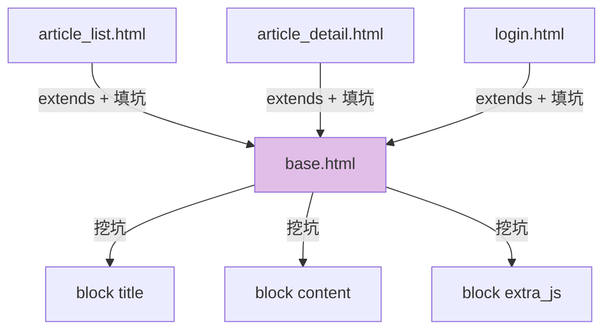

### 5.5 包含与静态文件标签

```html
<!-- include：嵌入其他模板 -->


<!-- load：加载第三方标签库（如 static）-->

<link rel="stylesheet" href="">

```

---

## 六、模型与 ORM（上）：定义与迁移 🗄️

### 6.1 数据库配置

```python
# mysite/settings.py

# 默认是 SQLite（零配置，适合学习）
DATABASES = {
    "default": {
        "ENGINE": "django.db.backends.sqlite3",
        "NAME": BASE_DIR / "db.sqlite3",
    }
}

# 换成 MySQL（需 pip install mysqlclient 或 pymysql）
DATABASES = {
    "default": {
        "ENGINE": "django.db.backends.mysql",
        "NAME": "mydb",              # 数据库名
        "USER": "root",
        "PASSWORD": "123456",
        "HOST": "127.0.0.1",
        "PORT": "3306",
        "OPTIONS": {"charset": "utf8mb4"},
    }
}
```

### 6.2 定义模型

```python
# blog/models.py
from django.db import models

class Article(models.Model):
    """文章模型 —— 一个类对应一张表，一个属性对应一个字段"""

    # Django 自动加自增主键 id，不用自己写！

    title = models.CharField(max_length=100, verbose_name="标题")
    slug = models.SlugField(max_length=100, unique=True)
    content = models.TextField(verbose_name="正文")
    price = models.DecimalField(max_digits=8, decimal_places=2, default=0)
    views = models.IntegerField(default=0)
    is_published = models.BooleanField(default=False)
    created_at = models.DateTimeField(auto_now_add=True)     # 创建时自动填
    updated_at = models.DateTimeField(auto_now=True)          # 每次保存自动更新
    publish_date = models.DateField(null=True, blank=True)    # 可以为空

    class Meta:
        db_table = "blog_article"           # 指定表名
        ordering = ["-created_at"]          # 默认排序（- 表示倒序）
        verbose_name = "文章"
        verbose_name_plural = verbose_name

    def __str__(self):
        return self.title                   # 后台/打印时显示的名称
```

### 6.3 常用字段类型

| 字段 | 数据库类型 | 用途 | 示例 |
| :--- | :--- | :--- | :--- |
| `CharField(max_length=N)` | VARCHAR | 短文本 | 标题、用户名 |
| `TextField()` | TEXT | 长文本 | 文章正文 |
| `IntegerField()` | INT | 整数 | 浏览量 |
| `FloatField()` | FLOAT | 浮点 | 评分 |
| `DecimalField(max_digits, decimal_places)` | DECIMAL | **精确小数（金额！）** | 价格 |
| `BooleanField()` | BOOL | 布尔 | 是否发布 |
| `DateField()` | DATE | 日期 | 生日 |
| `DateTimeField()` | DATETIME | 日期时间 | 创建时间 |
| `EmailField()` | VARCHAR | 邮箱（带验证） | 邮箱 |
| `URLField()` | VARCHAR | 链接（带验证） | 主页 |
| `SlugField()` | VARCHAR | URL 友好字符串 | `my-article` |
| `UUIDField()` | CHAR(32) | UUID | 订单号 |
| `FileField(upload_to=)` | VARCHAR | 文件路径 | 附件 |
| `ImageField(upload_to=)` | VARCHAR | 图片 | 头像 |

### 6.4 字段常用参数

| 参数 | 说明 | 示例 |
| :--- | :--- | :--- |
| `null=True` | 数据库允许为 NULL | `models.CharField(null=True)` |
| `blank=True` | 表单允许为空 | 和 null 不同！ |
| `default=值` | 默认值 | `default=0` |
| `unique=True` | 唯一约束 | `unique=True` |
| `db_index=True` | 建索引 | 查询更快 |
| `verbose_name` | 说明文字 | 后台显示用 |
| `choices` | 可选值 | 见下例 |
| `auto_now_add` | 创建时自动填时间 | `auto_now_add=True` |
| `auto_now` | 保存时自动更新时间 | `auto_now=True` |

```python
class Order(models.Model):
    class Status(models.TextChoices):        # Django 3.0+ 定义可选值
        PENDING = "pending", "待支付"
        PAID = "paid", "已支付"
        CANCELLED = "cancelled", "已取消"

    status = models.CharField(
        max_length=20,
        choices=Status.choices,
        default=Status.PENDING,
    )

# 使用：
order.get_status_display()      # "已支付"（显示中文！）
```

> 💡 **null vs blank 的区别**（面试常问！）：
> - `null=True` → **数据库层面**允许 NULL
> - `blank=True` → **表单验证层面**允许不填
> - 字符串字段（CharField/TextField）惯例：用 `blank=True` 存空串 `""`，不要用 null

### 6.5 模型关系

```python
class Author(models.Model):
    name = models.CharField(max_length=50)

class Category(models.Model):
    name = models.CharField(max_length=50)

class Article(models.Model):
    title = models.CharField(max_length=100)

    # —— 一对多（外键）：多篇文章属于一个作者 ——
    author = models.ForeignKey(
        Author,
        on_delete=models.CASCADE,       # 作者删除时，文章也删除
        related_name="articles",        # 反向查询名：author.articles
    )

    # —— 多对多：文章可以在多个分类 ——
    categories = models.ManyToManyField(Category, related_name="articles")

    # —— 一对一：一篇扩展信息 ——
    # detail = models.OneToOneField(ArticleDetail, on_delete=models.CASCADE)
```

**on_delete 选项**（外键被删时怎么办）：

| 选项 | 行为 |
| :--- | :--- |
| `models.CASCADE` | 级联删除（跟着删） |
| `models.PROTECT` | 阻止删除（报错） |
| `models.SET_NULL` | 置为 NULL（要 null=True） |
| `models.SET_DEFAULT` | 设为默认值 |
| `models.DO_NOTHING` | 什么都不做（危险） |

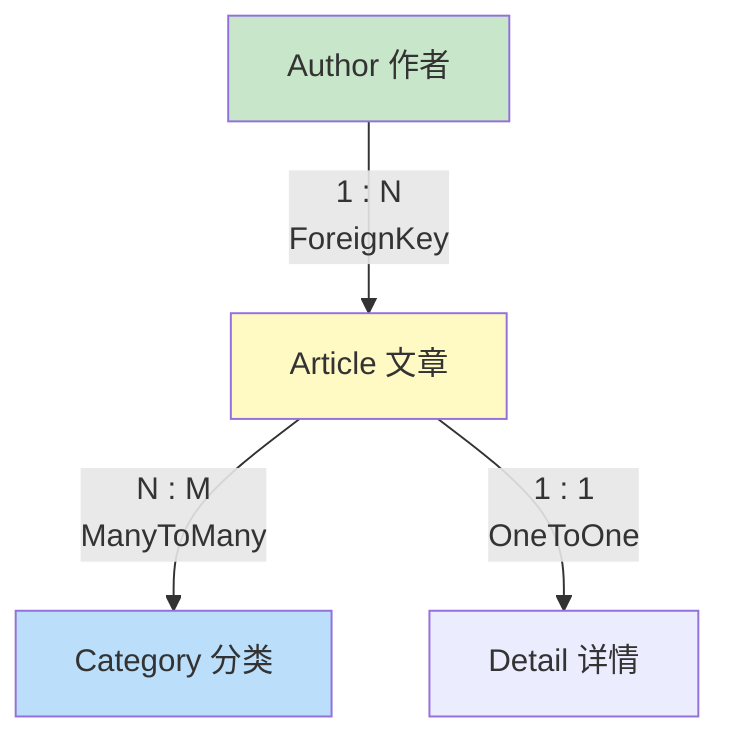

### 6.6 数据库迁移（重要！）

> 修改模型后，必须"两步走"同步数据库！

```bash
# —— 第一步：生成迁移文件（检测 models.py 变化，生成脚本）——
python manage.py makemigrations
# Migrations for 'blog':
#   blog/migrations/0001_initial.py
#     - Create model Article

# —— 第二步：执行迁移（真正在数据库建表/改表）——
python manage.py migrate
# Applying blog.0001_initial... OK

# —— 其他常用命令 ——
python manage.py makemigrations blog          # 只针对某个应用
python manage.py sqlmigrate blog 0001         # 查看生成的 SQL（不执行）
python manage.py showmigrations               # 查看迁移状态
```

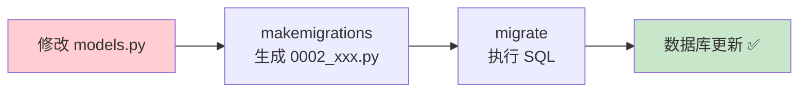

> ⚠️ **开发小贴士**：迁移文件要提交到 Git！这样团队成员拉代码后 `migrate` 一下，数据库结构就同步了～

---

## 七、模型与 ORM（下）：查询进阶 🔍

### 7.1 增删改查基础

```python
from blog.models import Article, Author

# —— 增 Create ——
article = Article.objects.create(title="第一篇", content="内容...")

article2 = Article(title="第二篇")     # 先创建对象
article2.save()                        # 再保存（两步走）

# 批量创建
Article.objects.bulk_create([
    Article(title="文章3"),
    Article(title="文章4"),
])

# —— 查 Read ——
Article.objects.all()                              # 全部
Article.objects.get(pk=1)                          # 精确查一条（没有/多条都报错！）
Article.objects.filter(is_published=True)          # 条件查询（返回 QuerySet）
Article.objects.exclude(author_id=1)               # 排除条件
Article.objects.first()                            # 第一条
Article.objects.last()                             # 最后一条
Article.objects.count()                            # 数量
Article.objects.exists()                           # 是否存在
Article.objects.order_by("-created_at")            # 排序
Article.objects.order_by("views", "-created_at")   # 多字段排序

# —— 改 Update ——
article = Article.objects.get(pk=1)
article.title = "新标题"
article.save()                                     # 保存单个对象

Article.objects.filter(is_published=False).update(is_published=True)
#                                                  # 批量更新（一条 SQL，快！）

# —— 删 Delete ——
Article.objects.get(pk=1).delete()                 # 删除单条
Article.objects.filter(views=0).delete()           # 批量删除
```

### 7.2 查询条件（双下划线魔法 __）

```python
# —— 比较 ——
Article.objects.filter(views__gt=100)         # > 100
Article.objects.filter(views__gte=100)        # >= 100
Article.objects.filter(views__lt=100)         # < 100
Article.objects.filter(views__lte=100)        # <= 100

# —— 包含 ——
Article.objects.filter(title__contains="Python")    # LIKE '%Python%'
Article.objects.filter(title__icontains="python")   # 忽略大小写
Article.objects.filter(title__startswith="如何")     # LIKE '如何%'
Article.objects.filter(title__endswith="教程")       # LIKE '%教程'

# —— 成员 ——
Article.objects.filter(pk__in=[1, 2, 3])      # id 在列表中
Article.objects.filter(pk__range=[1, 10])     # 范围（1~10）

# —— 时间 ——
Article.objects.filter(created_at__year=2026)
Article.objects.filter(created_at__month=8)
Article.objects.filter(created_at__day=11)
Article.objects.filter(created_at__gte="2026-08-01")
Article.objects.filter(created_at__date=datetime.date(2026, 8, 11))

# —— 空值 ——
Article.objects.filter(publish_date__isnull=True)      # 为 NULL
Article.objects.exclude(publish_date__isnull=True)     # 不为 NULL

# —— 关联查询（跨表！）——
Article.objects.filter(author__name="小明")      # 文章作者叫小明
Article.objects.filter(author__age__gt=18)       # 作者大于 18 岁
Author.objects.filter(articles__title__contains="Python")  # 反向查
```

> 💡 **双下划线 `__` 是 Django ORM 的灵魂**：
> - 字段`__`条件 = 查询条件（`views__gt`）
> - 字段`__`关联字段 = 跨表查询（`author__name`）
> - 一个双下划线，学会所有查询！

### 7.3 QuerySet：惰性查询与链式调用

```python
# QuerySet 是"懒"的 —— 创建时不下发 SQL，用到时才查！
qs = Article.objects.filter(views__gt=100)    # 此时不查数据库
qs = qs.filter(is_published=True)             # 还是不查
qs = qs.order_by("-created_at")[:10]          # 还是不查！

for article in qs:                             # 这一刻才真正执行 SQL！
    print(article.title)

# —— 链式调用像流水线 ——
articles = (Article.objects
    .filter(is_published=True)
    .exclude(views=0)
    .select_related("author")            # 优化：连表查（见下节）
    .order_by("-created_at")
    .only("title", "created_at")[:10])
```

| QuerySet 特性 | 说明 |
| :--- | :--- |
| **惰性** | 创建时不查库，迭代/print/list 时才查 |
| **可链式** | filter().exclude().order_by() |
| **可切片** | `qs[:10]`（转成 LIMIT 10） |
| **可缓存** | 同一个 QuerySet 遍历第二次，用缓存 |

### 7.4 Q 对象：复杂条件（OR / NOT）

```python
from django.db.models import Q

# —— 默认 filter 多条件是 AND ——
Article.objects.filter(is_published=True, views__gt=100)
# WHERE is_published = TRUE AND views > 100

# —— 用 Q 实现 OR ——
Article.objects.filter(Q(title__contains="Python") | Q(title__contains="Django"))
# WHERE title LIKE '%Python%' OR title LIKE '%Django%'

# —— 用 Q 实现 NOT ——
Article.objects.filter(~Q(views=0))          # views != 0

# —— 混合使用 ——
Article.objects.filter(
    Q(views__gt=100) & ~Q(is_published=False) | Q(author_id=1)
)

# —— Q 动态组合（搜索功能常用）——
keyword = "Python"
qs = Article.objects.filter(
    Q(title__icontains=keyword) |
    Q(content__icontains=keyword) |
    Q(author__name__icontains=keyword)
)
```

### 7.5 F 对象：字段间比较

```python
from django.db.models import F

# 需求：把所有文章浏览量 +1
# ❌ 普通做法（有并发问题！）
for article in Article.objects.all():
    article.views += 1
    article.save()

# ✅ F 对象（一条 SQL，原子操作）
Article.objects.update(views=F("views") + 1)
# UPDATE blog_article SET views = views + 1

# 字段间比较：浏览量大于点赞数的文章
Article.objects.filter(views__gt=F("likes"))
```

### 7.6 聚合与分组

```python
from django.db.models import Count, Sum, Avg, Max, Min

# —— 聚合（返回字典）——
Article.objects.aggregate(
    total=Count("id"),
    avg_views=Avg("views"),
    max_views=Max("views"),
)
# {'total': 100, 'avg_views': 56.7, 'max_views': 999}

# —— 分组 annotate（每个作者的文章数）——
authors = Author.objects.annotate(article_count=Count("articles"))
for author in authors:
    print(author.name, author.article_count)

# —— 分组 + 过滤 ——
Author.objects.annotate(article_count=Count("articles")).filter(article_count__gt=5)
```

### 7.7 性能优化：N+1 问题

```python
# —— ❌ N+1 问题：101 条 SQL！ ——
articles = Article.objects.all()          # 1 条 SQL
for article in articles:                   # 循环 100 次，每次 1 条 SQL
    print(article.author.name)             # 每次都查一遍作者表！

# —— ✅ select_related：外键用连表查询（1 条 SQL）——
articles = Article.objects.select_related("author")
for article in articles:
    print(article.author.name)             # 不再额外查询！

# —— ✅ prefetch_related：多对多/反向用两次查询 ——
articles = Article.objects.prefetch_related("categories")
for article in articles:
    print(article.categories.all())        # 只查 2 次，不随文章数增长！

# —— ✅ only / defer：只查需要的字段 ——
Article.objects.only("title", "created_at")   # 只查这几列
Article.objects.defer("content")               # 排除大字段（正文很长时）

# —— ✅ values / values_list：不创建对象，直接拿字典/元组 ——
Article.objects.values("title", "views")
# <QuerySet [{'title': 'xx', 'views': 10}, ...]>
Article.objects.values_list("title", flat=True)
# <QuerySet ['标题1', '标题2', ...]>
```

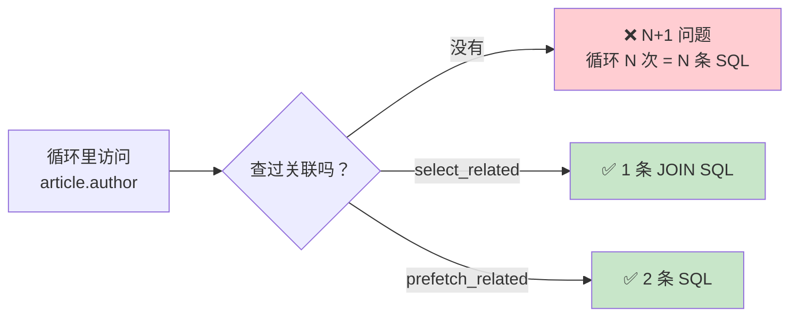

### 7.8 事务

```python
from django.db import transaction

# —— 方式 1：装饰器 ——
@transaction.atomic
def create_order():
    order = Order.objects.create(...)
    OrderItem.objects.create(...)
    Stock.objects.update(...)      # 中间任何一步出错，全部回滚！

# —— 方式 2：with 语句（推荐，范围清晰）——
def transfer(from_id, to_id, amount):
    with transaction.atomic():
        Account.objects.filter(id=from_id).update(balance=F("balance") - amount)
        Account.objects.filter(id=to_id).update(balance=F("balance") + amount)
        # 两个 update 要么都成功，要么都失败！

# —— 保存点（嵌套事务）——
with transaction.atomic():
    do_thing_1()
    savepoint = transaction.savepoint()
    try:
        do_thing_2()
    except Exception:
        transaction.savepoint_rollback(savepoint)   # 只回滚 thing_2
```

---

## 八、Admin 后台管理 ⚡

> Admin 是 Django 的"杀手锏"——写几行配置，就拥有一个专业的数据管理后台！

### 8.1 三步开启后台

```bash
# ① 同步数据库（第一次会自动建 admin 相关表）
python manage.py migrate

# ② 创建超级管理员
python manage.py createsuperuser
# Username: admin
# Email: admin@example.com
# Password: ********

# ③ 启动服务器，访问 /admin
python manage.py runserver
# 浏览器打开 http://127.0.0.1:8000/admin/
```

### 8.2 注册模型到后台

```python
# blog/admin.py
from django.contrib import admin
from .models import Article, Author

# —— 方式 1：最简单 ——
admin.site.register(Article)

# —— 方式 2：配置化（推荐！）——
@admin.register(Article)
class ArticleAdmin(admin.ModelAdmin):
    # 列表页显示哪些字段
    list_display = ["title", "author", "views", "is_published", "created_at"]

    # 可点击进入编辑的字段
    list_display_links = ["title"]

    # 右侧筛选栏（按字段筛选）
    list_filter = ["is_published", "created_at"]

    # 搜索框（可搜索的字段，支持关联 author__name）
    search_fields = ["title", "content", "author__name"]

    # 分页：每页条数
    list_per_page = 20

    # 可直接在列表页编辑的字段（不用进编辑页）
    list_editable = ["is_published"]

    # 默认排序
    ordering = ["-created_at"]

    # 时间导航条（按年/月/日快速跳转）
    date_hierarchy = "created_at"

# 注册 Author
admin.site.register(Author)
```

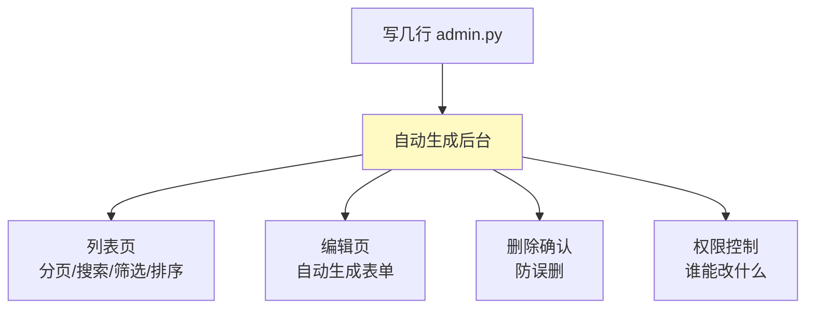

### 8.3 进阶配置

```python
@admin.register(Article)
class ArticleAdmin(admin.ModelAdmin):
    # —— 编辑页字段布局 ——
    fields = ["title", "slug", "content", "author"]           # 单栏
    # 或分组显示：
    fieldsets = [
        ("基本信息", {"fields": ["title", "slug"]}),
        ("内容", {"fields": ["content", "categories"]}),
        ("高级", {
            "fields": ["is_published", "publish_date"],
            "classes": ["collapse"],          # 默认折叠
        }),
    ]

    # —— 保存时自动填当前用户（比如作者 = 登录的管理员）——
    def save_model(self, request, obj, form, change):
        if not change:              # 新增时（不是修改）
            obj.author = request.user
        super().save_model(request, obj, form, change)

    # —— 列表页自定义列（方法也能当列！）——
    @admin.display(description="操作", ordering="views")
    def view_count(self, obj):
        return f"{obj.views} 次浏览"
    list_display = ["title", "view_count"]

    # —— 批量操作 ——
    actions = ["make_published"]

    @admin.action(description="标记为已发布")
    def make_published(self, request, queryset):
        queryset.update(is_published=True)
```

### 8.4 Inline：关联编辑

> 编辑文章时顺便编辑评论？Inline 让你在同一个页面编辑关联模型！

```python
class CommentInline(admin.TabularInline):     # StackedInline 是堆叠样式
    model = Comment
    extra = 1                                  # 空白行数

@admin.register(Article)
class ArticleAdmin(admin.ModelAdmin):
    inlines = [CommentInline]                  # 文章页内嵌评论编辑
```

> 💡 **Admin 能帮你做的事**：客户突然要看数据、运营要改配置、测试要造数据——不用写一行前端代码，后台全搞定！这也是 Django 在企业界流行的原因之一～

---

## 九、表单系统 Forms 📝

### 9.1 为什么要用 Forms？

| 手写表单 | 用 Forms |
| :--- | :--- |
| 手写 HTML `<input>` | 自动生成 HTML ✅ |
| 手写验证 if/else | 自动验证 ✅ |
| 手动显示错误 | 错误信息自动管理 ✅ |
| 自己防 CSRF | `` 自动防护 ✅ |

### 9.2 定义表单

```python
# blog/forms.py（需自己创建）
from django import forms

class ContactForm(forms.Form):
    name = forms.CharField(
        label="姓名",
        max_length=50,
        required=True,
        widget=forms.TextInput(attrs={"class": "form-control", "placeholder": "请输入姓名"}),
    )
    email = forms.EmailField(label="邮箱")
    message = forms.CharField(
        label="留言",
        widget=forms.Textarea(attrs={"rows": 5}),
    )
    age = forms.IntegerField(label="年龄", min_value=0, max_value=150)
```

### 9.3 视图中使用

```python
# blog/views.py
from django.shortcuts import render, redirect
from .forms import ContactForm

def contact(request):
    if request.method == "POST":
        form = ContactForm(request.POST)          # 用提交的数据填充表单
        if form.is_valid():                        # 自动验证所有字段！
            # 验证通过，取清洗后的数据
            name = form.cleaned_data["name"]
            email = form.cleaned_data["email"]
            # ... 发送邮件等处理
            return redirect("blog:index")
        # 验证失败：form 里带着错误信息，继续渲染即可
    else:
        form = ContactForm()                       # GET 请求：空表单

    return render(request, "blog/contact.html", {"form": form})
```

**模板渲染**：

```html
<!-- templates/blog/contact.html -->
<form method="POST">
                  <!-- 必须！防 CSRF 攻击 -->

    {{ form.as_p }}               <!-- 最简单：每个字段一段 <p> -->

    <!-- 或者逐个字段定制 -->
    {{ form.name.label_tag }}
    {{ form.name }}
    
        <span style="color:red;">{{ form.name.errors.0 }}</span>   <!-- 错误信息 -->
    

    <button type="submit">提交</button>
</form>
```

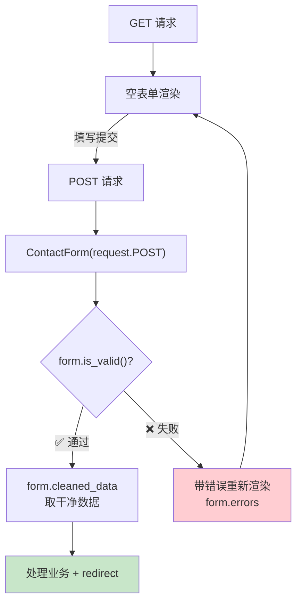

### 9.4 ModelForm：从模型生成表单

> 模型已经定义过字段了，表单还要再写一遍？ModelForm 自动从模型生成！

```python
# blog/forms.py
from django import forms
from .models import Article

class ArticleForm(forms.ModelForm):
    class Meta:
        model = Article
        fields = ["title", "content", "categories", "is_published"]   # 包含哪些字段
        # fields = "__all__"                    # 全部字段
        # exclude = ["views"]                   # 排除某些字段
        labels = {"title": "标题", "content": "正文"}
        widgets = {
            "content": forms.Textarea(attrs={"rows": 10}),
        }

    # 自定义验证（字段级）
    def clean_title(self):
        title = self.cleaned_data["title"]
        if "敏感词" in title:
            raise forms.ValidationError("标题包含敏感词！")
        return title

    # 自定义验证（跨字段）
    def clean(self):
        cleaned_data = super().clean()
        is_published = cleaned_data.get("is_published")
        content = cleaned_data.get("content")
        if is_published and not content:
            raise forms.ValidationError("发布状态必须有正文！")
        return cleaned_data
```

```python
# 视图中使用：创建和编辑共用一个表单
from django.shortcuts import render, redirect, get_object_or_404

def article_create(request):
    if request.method == "POST":
        form = ArticleForm(request.POST)
        if form.is_valid():
            article = form.save()             # 直接存数据库！
            return redirect("blog:detail", pk=article.pk)
    else:
        form = ArticleForm()
    return render(request, "blog/article_form.html", {"form": form})

def article_edit(request, pk):
    article = get_object_or_404(Article, pk=pk)
    if request.method == "POST":
        form = ArticleForm(request.POST, instance=article)   # 绑定已有对象
        if form.is_valid():
            form.save()                                       # 更新！
            return redirect("blog:detail", pk=article.pk)
    else:
        form = ArticleForm(instance=article)                  # 表单填旧数据
    return render(request, "blog/article_form.html", {"form": form})
```

### 9.5 Form vs ModelForm

| 对比 | Form | ModelForm |
| :--- | :--- | :--- |
| 字段来源 | 手动定义 | 从 Model 自动生成 |
| 保存数据 | 手动 `Model.objects.create()` | `form.save()` 一行搞定 |
| 适用场景 | 联系我们、搜索等无表场景 | 增删改模型数据 |

---

## 十、用户认证系统 Auth 🔐

> Django 自带完整用户系统：注册、登录、登出、权限、密码加密全都封装好啦！

### 10.1 User 模型

```python
# Django 内置的 User 模型自带这些字段：
# username  用户名
# password  密码（自动加密存储！）
# email     邮箱
# first_name / last_name
# is_active     是否激活
# is_staff      能否登录 Admin
# is_superuser  超级管理员
# groups / user_permissions  权限组

# —— 视图中使用 ——
def my_view(request):
    user = request.user            # 当前登录用户

    user.is_authenticated          # 是否已登录（AnonymousUser 时为 False）
    user.username                  # 用户名
    user.is_staff                  # 是否员工
    user.check_password("123456")  # 校验密码
```

### 10.2 注册用户

```python
from django.contrib.auth.models import User
from django.contrib.auth.hashers import make_password

# —— 方法 1：create_user（自动加密密码！）——
user = User.objects.create_user(
    username="xiaoming",
    email="xm@test.com",
    password="123456",           # 自动哈希，不要用 create()！
)

# —— 方法 2：用 UserCreationForm（内置注册表单）——
from django.contrib.auth.forms import UserCreationForm

def register(request):
    if request.method == "POST":
        form = UserCreationForm(request.POST)
        if form.is_valid():
            form.save()
            return redirect("login")
    else:
        form = UserCreationForm()
    return render(request, "register.html", {"form": form})
```

> ⚠️ **千万别用** `User.objects.create(password="123456")`——密码会**明文**存储！必须用 `create_user()` 或 `set_password()`。

### 10.3 登录与登出

```python
from django.contrib.auth import authenticate, login, logout

# —— 登录 ——
def login_view(request):
    if request.method == "POST":
        username = request.POST.get("username")
        password = request.POST.get("password")

        # 验证用户名密码（返回 User 或 None）
        user = authenticate(request, username=username, password=password)

        if user is not None:
            login(request, user)          # 写入 session，完成登录！
            return redirect("index")
        else:
            return render(request, "login.html", {"error": "用户名或密码错误"})

    return render(request, "login.html")

# —— 登出 ——
def logout_view(request):
    logout(request)                       # 清除 session
    return redirect("index")
```

```python
# —— 用内置视图更省事（urls.py）——
from django.contrib.auth import views as auth_views

urlpatterns = [
    # 自动提供登录页逻辑（模板路径可自定义）
    path("login/", auth_views.LoginView.as_view(template_name="login.html"), name="login"),
    path("logout/", auth_views.LogoutView.as_view(), name="logout"),
    path("password-change/", auth_views.PasswordChangeView.as_view(), name="password_change"),
]
```

### 10.4 登录限制（保护页面）

```python
from django.contrib.auth.decorators import login_required
from django.contrib.auth.mixins import LoginRequiredMixin

# —— FBV 用装饰器 ——
@login_required                        # 未登录自动跳转到 settings.LOGIN_URL
def my_profile(request):
    return render(request, "profile.html")

# —— CBV 用 Mixin ——
class ProfileView(LoginRequiredMixin, View):
    def get(self, request):
        return render(request, "profile.html")

# —— 权限要求 ——
from django.contrib.admin.views.decorators import staff_member_required

@staff_member_required                 # 只有 is_staff=True 才能访问
def admin_dashboard(request):
    ...

# —— 视图内手动检查 ——
def secret(request):
    if not request.user.is_authenticated:
        return redirect("login")
    if not request.user.is_superuser:
        return HttpResponse("403 禁止访问", status=403)
    return render(request, "secret.html")
```

```python
# settings.py 配置
LOGIN_URL = "/login/"        # 未登录时跳转的地址
LOGIN_REDIRECT_URL = "/"     # 登录成功后跳转
LOGOUT_REDIRECT_URL = "/"    # 登出后跳转
```

### 10.5 认证流程图

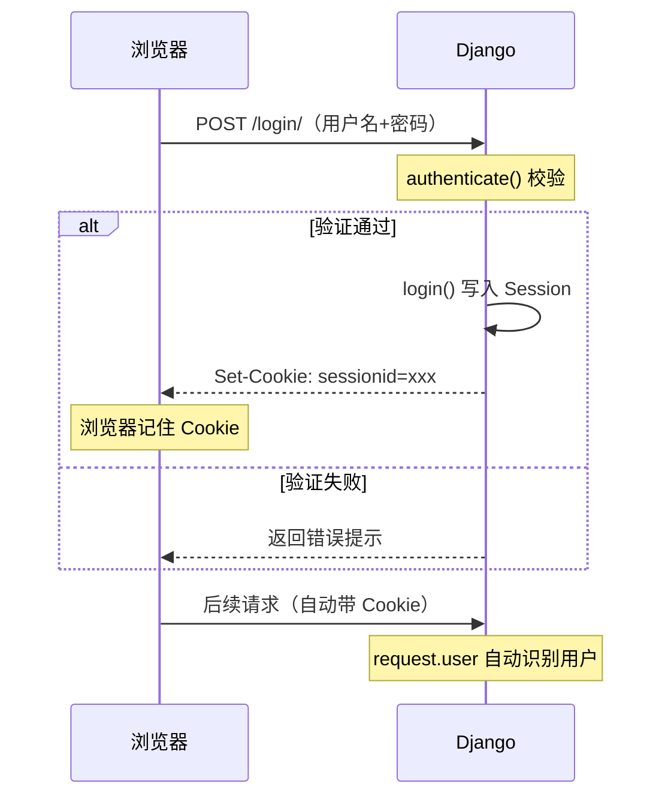

---

## 十一、中间件 Middleware 🧅

### 11.1 什么是中间件？

> 中间件是请求/响应的"处理链"——每个请求先穿过所有中间件到达视图，响应再穿回来。适合做统一处理：日志、认证、限流……

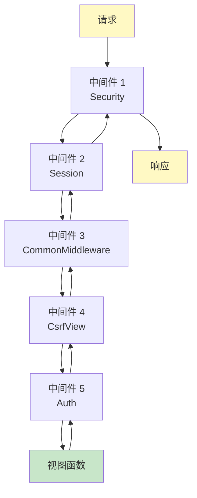

### 11.2 默认中间件

```python
# settings.py
MIDDLEWARE = [
    "django.middleware.security.SecurityMiddleware",        # 安全相关
    "django.contrib.sessions.middleware.SessionMiddleware", # Session 处理
    "django.middleware.common.CommonMiddleware",            # 通用处理（URL 尾斜杠）
    "django.middleware.csrf.CsrfViewMiddleware",            # CSRF 防护
    "django.contrib.auth.middleware.AuthenticationMiddleware",  # request.user
    "django.contrib.messages.middleware.MessageMiddleware", # 消息框架
    "django.middleware.clickjacking.XFrameOptionsMiddleware",  # 防点击劫持
]
```

### 11.3 自定义中间件

```python
# mysite/middleware.py
import time
from django.utils.deprecation import MiddlewareMixin

class TimingMiddleware(MiddlewareMixin):
    """统计每个请求的耗时"""

    def process_request(self, request):
        # 请求进入（视图之前）
        request.start_time = time.time()

    def process_response(self, request, response):
        # 响应返回（视图之后）
        duration = time.time() - getattr(request, "start_time", time.time())
        print(f"{request.path} 耗时 {duration:.3f}s")
        return response          # 必须返回 response！

    def process_view(self, request, view_func, view_args, view_kwargs):
        # 视图函数执行前（路由匹配后）
        print(f"即将执行视图：{view_func.__name__}")

    def process_exception(self, request, exception):
        # 视图抛异常时
        print(f"出错了：{exception}")
        # 返回 HttpResponse 会接管响应；返回 None 继续抛
```

```python
# settings.py 注册
MIDDLEWARE = [
    ...
    "mysite.middleware.TimingMiddleware",     # 加在最后
]
```

### 11.4 中间件方法执行时机

| 方法 | 执行时机 | 返回值影响 |
| :--- | :--- | :--- |
| `process_request` | 请求进入，路由匹配前 | 返回响应则中断流程 |
| `process_view` | 路由匹配后、视图执行前 | 返回响应则跳过视图 |
| `process_response` | 视图执行后（**一定执行**） | 必须返回 response |
| `process_exception` | 视图抛异常时 | 返回响应则处理掉异常 |
| `process_template_response` | 视图返回 TemplateResponse 时 | 可修改模板 |

---

## 十二、静态文件与媒体文件 🖼️

### 12.1 两种文件的区别

| 类型 | 是什么 | 谁的 | 示例 |
| :--- | :--- | :--- | :--- |
| **静态文件 static** | 开发者准备的 | 你写的 | CSS、JS、logo |
| **媒体文件 media** | 用户上传的 | 用户传的 | 头像、附件 |

### 12.2 静态文件配置

```text
blog/
├── static/               ← 应用级静态目录（要自己建）
│   └── blog/
│       └── css/style.css
```

```python
# settings.py（默认已有）
STATIC_URL = "/static/"                     # URL 前缀
STATICFILES_DIRS = [BASE_DIR / "static"]    # 全局静态文件夹（自己加）
```

**模板中使用**：

```html

<link rel="stylesheet" href="">

```

### 12.3 媒体文件（用户上传）配置

```python
# settings.py
MEDIA_URL = "/media/"                                  # URL 前缀
MEDIA_ROOT = BASE_DIR / "media"                        # 存储路径

# mysite/urls.py —— 开发环境让 Django 能访问媒体文件
from django.conf import settings
from django.conf.urls.static import static

urlpatterns = [
    ...
]

if settings.DEBUG:
    urlpatterns += static(settings.MEDIA_URL, document_root=settings.MEDIA_ROOT)
```

**模型中使用**：

```python
class UserProfile(models.Model):
    user = models.OneToOneField(User, on_delete=models.CASCADE)
    avatar = models.ImageField(upload_to="avatars/%Y/%m/", blank=True)
    #                                              ↑ 上传到 media/avatars/2026/08/xxx.jpg
    resume = models.FileField(upload_to="resumes/", blank=True)
```

```python
# 表单 + 视图处理上传
def upload_avatar(request):
    if request.method == "POST":
        form = ProfileForm(request.POST, request.FILES)    # 别忘 request.FILES！
        if form.is_valid():
            form.save()
    ...

# 模板中显示图片
      <!-- 自动带 /media/ 前缀 -->
```

> ⚠️ ImageField 需要 Pillow 库：`pip install Pillow`

---

## 十三、通用视图 CBV 实战 ⚡

> 通用视图 = Django 预写好的"模板代码"——列表页、详情页、增删改，几行配置搞定！

### 13.1 常用通用视图

| 通用视图 | 作用 | 对应方法 |
| :--- | :--- | :--- |
| `ListView` | 列表页 | GET |
| `DetailView` | 详情页 | GET |
| `CreateView` | 创建页 | GET（表单）+ POST（保存） |
| `UpdateView` | 编辑页 | GET + POST |
| `DeleteView` | 删除页 | GET（确认）+ POST（删除） |
| `TemplateView` | 纯静态页 | GET |

### 13.2 ListView：列表页

```python
# blog/views.py
from django.views.generic import ListView
from .models import Article

class ArticleListView(ListView):
    model = Article                                    # 查哪个模型
    template_name = "blog/article_list.html"           # 模板路径
    context_object_name = "articles"                   # 模板里的变量名
    paginate_by = 10                                   # 每页 10 条（自动分页！）

    def get_queryset(self):                            # 自定义查询
        qs = super().get_queryset()
        keyword = self.request.GET.get("q")
        if keyword:
            qs = qs.filter(title__icontains=keyword)
        return qs
```

```html
<!-- blog/article_list.html -->

    <div>{{ article.title }}</div>


<!-- 分页（ListView 自动提供 page_obj）-->

    
        <a href="?page={{ page_obj.previous_page_number }}">上一页</a>
    
    <span>第 {{ page_obj.number }} / {{ paginator.num_pages }} 页</span>
    
        <a href="?page={{ page_obj.next_page_number }}">下一页</a>
    

```

### 13.3 DetailView：详情页

```python
from django.views.generic import DetailView

class ArticleDetailView(DetailView):
    model = Article
    template_name = "blog/article_detail.html"
    context_object_name = "article"
    # URL 里的 <int:pk> 自动用于查询！

# urls.py
path("article/<int:pk>/", ArticleDetailView.as_view(), name="detail"),
```

### 13.4 CreateView / UpdateView / DeleteView

```python
from django.views.generic.edit import CreateView, UpdateView, DeleteView
from django.urls import reverse_lazy
from .models import Article
from .forms import ArticleForm

class ArticleCreateView(CreateView):
    model = Article
    form_class = ArticleForm            # 用哪个表单
    template_name = "blog/article_form.html"

    def form_valid(self, form):         # 验证通过时
        form.instance.author = self.request.user    # 自动填作者
        return super().form_valid(form)

class ArticleUpdateView(UpdateView):
    model = Article
    form_class = ArticleForm
    template_name = "blog/article_form.html"

class ArticleDeleteView(DeleteView):
    model = Article
    template_name = "blog/article_confirm_delete.html"
    success_url = reverse_lazy("blog:list")    # 删除成功跳转（删除没有 pk 了，用 lazy）
```

```python
# urls.py —— 增删改查全部到位！
urlpatterns = [
    path("", ArticleListView.as_view(), name="list"),
    path("article/<int:pk>/", ArticleDetailView.as_view(), name="detail"),
    path("article/new/", ArticleCreateView.as_view(), name="create"),
    path("article/<int:pk>/edit/", ArticleUpdateView.as_view(), name="edit"),
    path("article/<int:pk>/delete/", ArticleDeleteView.as_view(), name="delete"),
]
```

### 13.5 FBV vs CBV 代码量对比

```python
# —— 同样的"创建文章"功能 ——

# FBV 版本（约 10 行）
def article_create(request):
    if request.method == "POST":
        form = ArticleForm(request.POST)
        if form.is_valid():
            article = form.save()
            return redirect("blog:detail", pk=article.pk)
    else:
        form = ArticleForm()
    return render(request, "blog/article_form.html", {"form": form})

# CBV 版本（4 行）
class ArticleCreateView(CreateView):
    model = Article
    form_class = ArticleForm
    template_name = "blog/article_form.html"
```

---

## 十四、部署上线 🚀

### 14.1 settings 拆分（工程化）

```text
mysite/
├── settings/
│   ├── __init__.py
│   ├── base.py        ← 公共配置
│   ├── dev.py         ← 开发配置（DEBUG=True）
│   └── prod.py        ← 生产配置（DEBUG=False）
```

```python
# settings/dev.py
from .base import *

DEBUG = True
ALLOWED_HOSTS = []

# settings/prod.py
from .base import *

DEBUG = False                                # 生产必须关！
ALLOWED_HOSTS = ["example.com", "www.example.com"]
SECRET_KEY = os.environ.get("DJANGO_SECRET_KEY")   # 环境变量读密钥

# 使用方式：
# python manage.py runserver --settings=mysite.settings.dev
# gunicorn mysite.wsgi:application  （wsgi.py 里改引用 prod）
```

### 14.2 部署清单

| 步骤 | 命令/操作 |
| :--- | :--- |
| ① 关闭 DEBUG | `DEBUG = False` |
| ② 配置 ALLOWED_HOSTS | 添加你的域名 |
| ③ 收集静态文件 | `python manage.py collectstatic` |
| ④ 数据库迁移 | `python manage.py migrate` |
| ⑤ Gunicorn 启动 | `gunicorn -w 4 -b 127.0.0.1:8000 mysite.wsgi` |
| ⑥ Nginx 代理 | 转发 + 托管静态文件 |

### 14.3 Gunicorn 启动

```bash
pip install gunicorn

gunicorn -w 4 -b 127.0.0.1:8000 mysite.wsgi:application
#         ↑       ↑            ↑
#     4 个进程  监听端口     wsgi 文件

# 完整参数
gunicorn \
    -w 4 \
    -b 127.0.0.1:8000 \
    --timeout 60 \
    --access-logfile - \
    --error-logfile - \
    mysite.wsgi:application
```

### 14.4 Nginx 配置

```nginx
server {
    listen 80;
    server_name example.com;

    # 静态文件（collectstatic 收集后的）
    location /static/ {
        alias /var/www/mysite/staticfiles/;
        expires 30d;
    }

    # 媒体文件（用户上传的）
    location /media/ {
        alias /var/www/mysite/media/;
    }

    # 其他请求转给 Gunicorn
    location / {
        proxy_pass http://127.0.0.1:8000;
        proxy_set_header Host $host;
        proxy_set_header X-Real-IP $remote_addr;
        proxy_set_header X-Forwarded-Proto $scheme;
    }
}
```

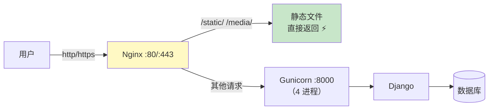

### 14.5 Docker 部署

```dockerfile
FROM python:3.12-slim

ENV PYTHONDONTWRITEBYTECODE=1 \
    PYTHONUNBUFFERED=1

WORKDIR /app

COPY requirements.txt .
RUN pip install --no-cache-dir -r requirements.txt gunicorn

COPY . .

RUN python manage.py collectstatic --noinput

EXPOSE 8000

CMD ["gunicorn", "-w", "4", "-b", "0.0.0.0:8000", "mysite.wsgi:application"]
```

---

## 十五、知识总结 📌

### Django 核心知识图

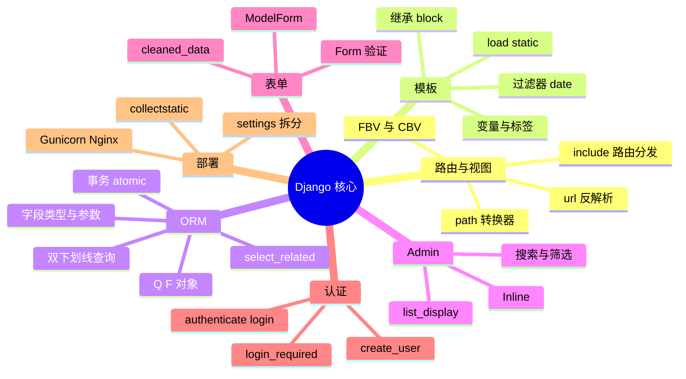

### 高频操作速查表

| 需求 | 写法 |
| :--- | :--- |
| 创建项目 | `django-admin startproject mysite` |
| 创建应用 | `python manage.py startapp blog` |
| 生成迁移 | `python manage.py makemigrations` |
| 执行迁移 | `python manage.py migrate` |
| 条件查询 | `Model.objects.filter(字段__条件=值)` |
| 或查询 | `filter(Q(A) \| Q(B))` |
| 自增字段 | `update(views=F("views") + 1)` |
| 避免循环查询 | `select_related("外键")` |
| 渲染模板 | `render(request, "x.html", {...})` |
| 查不到404 | `get_object_or_404(Model, pk=pk)` |
| 反解析URL | `reverse("app:name")` / `` |
| 登录保护 | `@login_required` |
| 表单保存 | `form.save()` |

### Django vs Flask 总对比

| 对比项 | Django 🏗️ | Flask 🌸 |
| :--- | :--- | :--- |
| Admin 后台 | ✅ 内置 | ❌ 需扩展 |
| ORM | ✅ Django ORM | SQLAlchemy |
| 用户系统 | ✅ 内置 Auth | Flask-Login |
| 表单验证 | ✅ Forms | Flask-WTF |
| 路由方式 | urls.py 集中管理 | 装饰器就近 |
| 学习曲线 | 陡 | 缓 |
| 就业场景 | 大厂后端、传统企业 | 创业公司、API |

### 学习路线建议

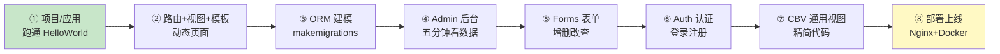

> 🎀 呼～Django 的完整体系都收入囊中啦！🎉 从"全家桶介绍"到 ORM 双下划线魔法，再到 Admin 杀手锏和部署上线，你已经具备用 Django 独立开发中大型项目的能力了！和 [Flask.md](file:///d:/A-H2H/Python/Flask.md)、[PythonWeb.md](file:///d:/A-H2H/Python/PythonWeb.md) 对照着看，理解会更深哦～快动手建个项目试试吧！(◍•ᴗ•◍)❤


