# 🌸 Flask 框架详解

> 哈喽呀～欢迎来到 Flask 的专属课堂！🌟 这一篇我们专攻 Flask 框架本身，从安装到部署、从路由到数据库，一次学个透！准备好的话，出发！(๑•̀ㅂ•́)و✧

---

## 🗺️ Flask 知识全景图

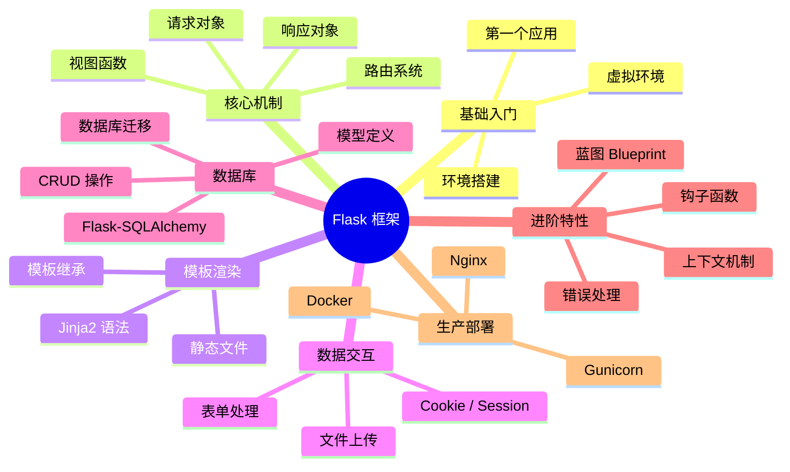

---

## 📑 目录

- [一、Flask 简介：为什么它这么受欢迎？](#一flask-简介为什么它这么受欢迎)
- [二、环境搭建：工欲善其事必先利其器](#二环境搭建工欲善其事必先利其器)
- [三、快速上手：第一个 Flask 应用](#三快速上手第一个-flask-应用)
- [四、路由系统详解](#四路由系统详解)
- [五、请求与响应](#五请求与响应)
- [六、模板引擎 Jinja2](#六模板引擎-jinja2)
- [七、静态文件管理](#七静态文件管理)
- [八、表单处理与文件上传](#八表单处理与文件上传)
- [九、Cookie 与 Session](#九cookie-与-session)
- [十、数据库：Flask-SQLAlchemy](#十数据库flask-sqlalchemy)
- [十一、钩子函数与上下文](#十一钩子函数与上下文)
- [十二、蓝图 Blueprint：大型项目模块化](#十二蓝图-blueprint大型项目模块化)
- [十三、错误处理与日志](#十三错误处理与日志)
- [十四、项目实战：迷你博客](#十四项目实战迷你博客)
- [十五、部署上线](#十五部署上线)

---

## 一、Flask 简介：为什么它这么受欢迎？ 🌟

### 1.1 Flask 是什么？

Flask 是一个用 Python 写的**轻量级 Web 框架**（微框架），2010 年由 Armin Ronacher 开发。

> 🎀 **"微框架"不是说功能少**，而是说核心精简——只保留最核心的功能，其他都通过"扩展"按需安装！就像买手机裸机，想要什么配件自己配～

### 1.2 Flask 的特点

| 特点 | 说明 |
| :--- | :--- |
| **轻量** | 核心只有路由 + 模板 + 请求响应，几行代码就能跑 |
| **灵活** | 想用什么数据库、什么前端，全都你说了算 |
| **生态丰富** | 海量扩展：SQLAlchemy、Login、WTF、Migrate... |
| **文档友好** | 官方文档清晰，中文资料超多 |
| **入门简单** | 一小时就能写出自己的第一个网站 |

### 1.3 Flask 适合做什么？

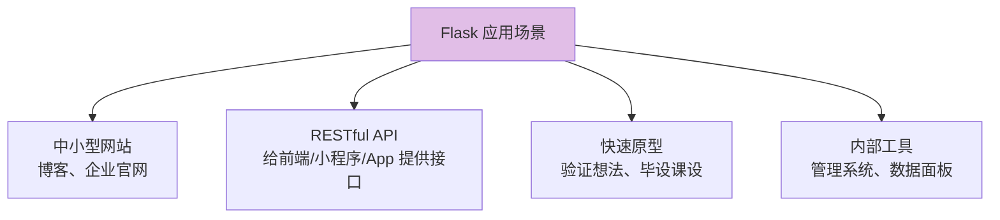

---

## 二、环境搭建：工欲善其事必先利其器 🔧

### 2.1 为什么需要虚拟环境？

> 每个项目可能需要**不同版本**的库，全装在一起会"打架"！虚拟环境就是给每个项目一个独立的"房间"～

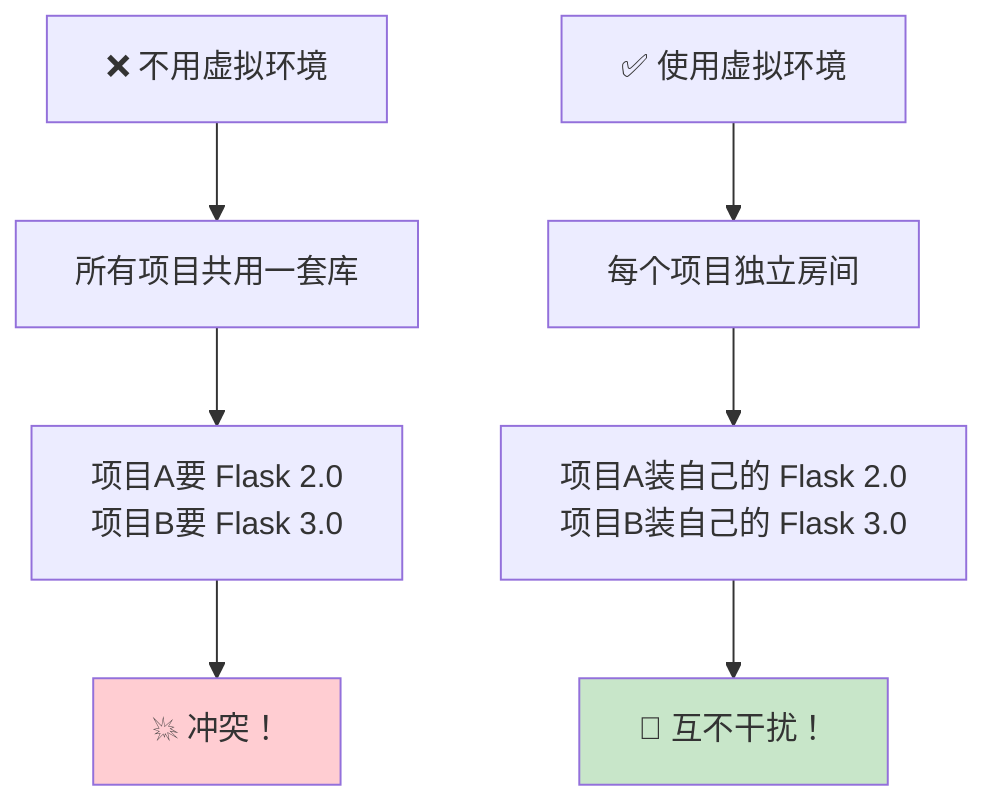

### 2.2 创建虚拟环境并安装 Flask

```bash
# —— 创建虚拟环境（在项目文件夹里执行）——
python -m venv venv

# —— 激活虚拟环境 ——
# Windows (PowerShell)：
venv\Scripts\Activate.ps1
# Windows (CMD)：
venv\Scripts\activate.bat
# macOS / Linux：
source venv/bin/activate

# 激活成功后，命令行前面会出现 (venv) 标志
# (venv) D:\my_project>

# —— 安装 Flask ——
pip install flask

# —— 查看安装了什么 ——
pip list
# Flask        3.0.x
# Werkzeug     3.0.x   ← WSGI 工具库
# Jinja2       3.1.x   ← 模板引擎
# click        8.1.x   ← 命令行工具
# ...

# —— 退出虚拟环境 ——
deactivate
```

### 2.3 推荐的项目工具

```bash
# —— 用 requirements.txt 记录依赖（方便别人安装）——
pip freeze > requirements.txt     # 导出依赖清单
pip install -r requirements.txt   # 一键安装所有依赖

# —— 现代替代方案（可选了解）——
# pipenv：pip + virtualenv 二合一
# uv：超快的新一代包管理器
# poetry：依赖管理 + 打包发布
```

---

## 三、快速上手：第一个 Flask 应用 🚀

### 3.1 三行核心代码

```python
from flask import Flask

app = Flask(__name__)     # 创建 Flask 应用实例

@app.route("/")           # 路由：把 URL "/" 绑定到下面的函数
def index():              # 视图函数
    return "Hello Flask!" # 返回响应内容

if __name__ == "__main__":
    app.run(debug=True)   # 启动开发服务器
```

运行 `python app.py` 后：

```text
 * Debug mode: on
 * Running on http://127.0.0.1:5000
```

浏览器访问 `http://127.0.0.1:5000`，就能看到 **Hello Flask!** 啦～🎉

### 3.2 代码逐行解析

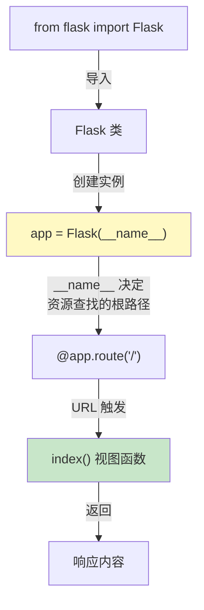

| 代码 | 作用 | 说明 |
| :--- | :--- | :--- |
| `Flask(__name__)` | 创建应用实例 | `__name__` 是当前模块名，Flask 用它定位模板/静态文件 |
| `@app.route("/")` | 注册路由 | 访问 `/` 时执行下面的函数 |
| `app.run(debug=True)` | 启动服务器 | debug 模式：改代码自动重启 + 显示报错详情 |

> ⚠️ **debug=True 只能用于开发**！生产环境必须关闭（会泄露源码和密码哦）。

### 3.3 debug 模式的两大福利

```python
# 福利 1：修改代码后自动重启服务器，不用手动 Ctrl+C
# 福利 2：浏览器显示超详细的报错信息（堆栈、变量值），方便调试

app.run(debug=True)

# 等价写法（旧版本）
app.debug = True
app.run()
```

### 3.4 修改监听地址和端口

```python
app.run(
    host="0.0.0.0",     # 监听所有网卡（局域网可访问）
    port=8080,          # 端口号，默认 5000
    debug=True,
)

# 局域网内其他设备访问：http://你的IP:8080
```

---

## 四、路由系统详解 🛣️

> 路由是 Flask 的核心——它决定"哪个 URL 执行哪个函数"。

### 4.1 基本路由

```python
@app.route("/")               # 根路径
def index():
    return "首页"

@app.route("/about")          # 固定路径
def about():
    return "关于我们"

@app.route("/help/me")        # 多级路径
def help_me():
    return "帮助页面"
```

### 4.2 变量规则（动态路由）

```python
# —— 字符串变量（默认类型）——
@app.route("/user/<username>")
def show_user(username):
    return f"用户：{username}"
# 访问 /user/小明 → "用户：小明"

# —— 整数变量 ——
@app.route("/post/<int:post_id>")
def show_post(post_id):
    return f"文章编号：{post_id}"
# 访问 /post/123 → "文章编号：123"
# 访问 /post/abc → 404！（只匹配数字）

# —— 浮点数变量 ——
@app.route("/price/<float:amount>")
def show_price(amount):
    return f"价格：{amount}"
# 访问 /price/9.99 → "价格：9.99"

# —— 路径变量（可以包含斜杠）——
@app.route("/path/<subpath>")
def show_subpath(subpath):
    return f"子路径：{subpath}"
# 访问 /path/a/b/c → "子路径：a/b/c"
```

**转换器对比表**：

| 转换器 | 匹配规则 | 示例 URL | 匹配结果 |
| :---: | :--- | :--- | :--- |
| `<name>`（默认） | 不含 `/` 的文本 | `/user/小明` | ✅ |
| `<int:id>` | 整数 | `/post/123` | ✅（`/post/abc` ❌） |
| `<float:num>` | 浮点数（含小数点） | `/price/9.99` | ✅ |
| `<path:p>` | 含 `/` 的任意路径 | `/files/a/b.txt` | ✅ |

### 4.3 指定 HTTP 方法

```python
from flask import request

@app.route("/login", methods=["GET", "POST"])   # 默认只有 GET
def login():
    if request.method == "POST":
        return "处理登录请求"
    return "显示登录页面"
```

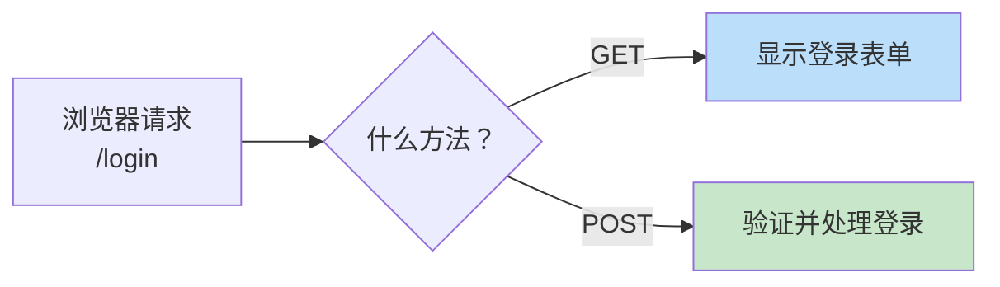

### 4.4 URL 生成：url_for()

> 不要把 URL 写死！用 `url_for()` 通过**函数名**反向生成 URL，改路由时不用改模板里的链接～

```python
from flask import Flask, url_for

app = Flask(__name__)

@app.route("/")
def index():
    return "首页"

@app.route("/user/<username>")
def profile(username):
    return f"{username} 的主页"

with app.test_request_context():
    print(url_for("index"))                    # "/"
    print(url_for("profile", username="小明"))  # "/user/小明"
    print(url_for("profile", username="小红"))  # "/user/小红"
    print(url_for("index", page=2))            # "/?page=2"（多余参数变查询字符串）
    print(url_for("static", filename="style.css"))  # "/static/style.css"
```

| 写法 | 优点 |
| :--- | :--- |
| ❌ `href="/user/小明"` | 改路由后链接全部失效 |
| ✅ `href="{{ url_for('profile', username='小明') }}"` | 改路由自动更新 |

### 4.5 唯一 URL / 重定向行为

```python
@app.route("/project/")     # 带斜杠
def projects():
    return "项目列表"
# 访问 /project → 自动重定向到 /project/（308）

@app.route("/about")        # 不带斜杠
def about():
    return "关于"
# 访问 /about/ → 404！（反过来不行哦）
```

> 💡 **规律**：路由定义**带斜杠** → 访问不带斜杠会自动补上；路由定义**不带斜杠** → 访问带斜杠直接 404。

---

## 五、请求与响应 📨

### 5.1 request 对象：获取请求数据

> `request` 是一个全局代理对象，视图函数里直接用，Flask 会自动填充当前请求的数据。

```python
from flask import Flask, request

app = Flask(__name__)

@app.route("/info")
def info():
    # —— 基本信息 ——
    method = request.method                  # 请求方法："GET" / "POST"
    url = request.url                        # 完整 URL
    path = request.path                      # 路径部分
    remote_addr = request.remote_addr        # 客户端 IP

    # —— 请求头 ——
    ua = request.headers.get("User-Agent")   # 浏览器信息
    token = request.headers.get("Authorization")

    # —— 查询字符串（?name=小明&age=18）——
    name = request.args.get("name")          # '小明'
    age = request.args.get("age", type=int)  # 18（带类型转换）
    page = request.args.get("page", 1, type=int)  # 默认值 1

    return f"方法:{method} 路径:{path} 名字:{name}"
```

### 5.2 各种方式获取 POST 数据

```python
# ① 表单提交（Content-Type: application/x-www-form-urlencoded）
@app.route("/form", methods=["POST"])
def handle_form():
    username = request.form.get("username")     # 单个值
    hobbies = request.form.getlist("hobbies")   # 多个同名值（复选框）

# ② JSON 提交（Content-Type: application/json）——前后端分离主流
@app.route("/json", methods=["POST"])
def handle_json():
    data = request.get_json()                   # 解析为字典
    # 或
    data = request.get_json(silent=True)        # 解析失败返回 None，不报错
    username = data.get("username")

# ③ 原始数据
@app.route("/raw", methods=["POST"])
def handle_raw():
    raw = request.data                          # 原始字节
    text = request.get_data(as_text=True)       # 原始文本

# ④ 文件上传（multipart/form-data）
@app.route("/upload", methods=["POST"])
def handle_upload():
    file = request.files.get("avatar")          # 对应 <input name="avatar">
    if file:
        file.save(f"uploads/{file.filename}")   # 保存文件
    return "上传成功"
```

| 数据来源 | 获取方法 | 典型场景 |
| :--- | :--- | :--- |
| 查询字符串 | `request.args.get()` | 搜索、分页 |
| HTML 表单 | `request.form.get()` | 传统网页登录 |
| JSON 请求体 | `request.get_json()` | 前后端分离 API |
| 文件 | `request.files.get()` | 头像上传 |
| 请求头 | `request.headers.get()` | Token 认证 |
| Cookie | `request.cookies.get()` | 读取用户信息 |

### 5.3 返回响应的四种方式

```python
from flask import Flask, render_template, jsonify, redirect, url_for, make_response

app = Flask(__name__)

# —— ① 返回字符串（自动包装成响应）——
@app.route("/text")
def text():
    return "纯文本"

# —— ② 返回元组：(内容, 状态码) 或 (内容, 状态码, 响应头) ——
@app.route("/created")
def created():
    return "创建成功", 201
    # return "创建成功", 201, {"Content-Type": "text/plain; charset=utf-8"}

# —— ③ 返回模板渲染结果 ——
@app.route("/page")
def page():
    return render_template("index.html", title="首页")

# —— ④ 返回 JSON（API 常用）——
@app.route("/api/user")
def api_user():
    return jsonify({"name": "小明", "age": 18})
    # 自动设置 Content-Type: application/json
```

### 5.4 make_response：精细控制响应

```python
from flask import make_response

@app.route("/custom")
def custom():
    response = make_response("自定义响应", 200)

    # —— 设置响应头 ——
    response.headers["X-Custom-Header"] = "hello"

    # —— 设置 Cookie ——
    response.set_cookie(
        "username", "小明",
        max_age=3600,          # 有效期 1 小时（秒）
        httponly=True,         # JS 无法读取（防 XSS）
        # secure=True,         # 仅 HTTPS 传输
    )

    # —— 删除 Cookie ——
    # response.delete_cookie("username")

    return response
```

### 5.5 重定向

```python
from flask import redirect, url_for, abort

# —— 基本重定向 ——
@app.route("/old-page")
def old_page():
    return redirect("/new-page")              # 302 临时重定向

# —— 通过函数名重定向（推荐）——
@app.route("/go-home")
def go_home():
    return redirect(url_for("index"))         # 跳转到 index 函数对应的 URL

# —— 307 保留请求方法的重定向 ——
@app.route("/moved", methods=["POST"])
def moved():
    return redirect("/new-location", code=307)

# —— 中断请求（直接报错）——
@app.route("/secret")
def secret():
    abort(403)                                # 直接返回 403 禁止访问
    # abort(404, description="页面不存在")
```

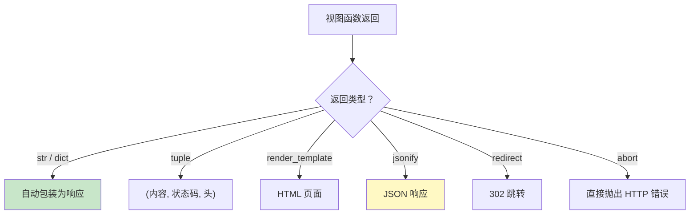

---

## 六、模板引擎 Jinja2 🎨

> 模板 = 带"占位符"的 HTML。Jinja2 负责把 Python 数据填进占位符，生成最终页面。

### 6.1 项目结构约定

```text
my_project/
├── app.py
├── templates/           ← 模板文件（HTML）必须放这里！
│   ├── base.html
│   ├── index.html
│   └── user/
│       └── profile.html
└── static/              ← 静态文件（CSS/JS/图片）必须放这里！
    ├── css/
    │   └── style.css
    └── js/
        └── main.js
```

> 💡 Flask 默认在 `templates` 文件夹找模板、在 `static` 文件夹找静态文件，这是约定，不要改名～

### 6.2 基本语法三件套

```python
# app.py —— 传数据给模板
from flask import Flask, render_template

app = Flask(__name__)

@app.route("/")
def index():
    return render_template(
        "index.html",
        title="我的博客",                    # 单个变量
        user={"name": "小明", "vip": True},  # 字典
        articles=["文章1", "文章2", "文章3"], # 列表
    )
```

```html
<!-- templates/index.html -->
<!DOCTYPE html>
<html>
<head>
    <title>{{ title }}</title>          <!-- ① {{ }} 输出变量 -->
</head>
<body>
    <h1>{{ title }}</h1>
    <p>欢迎你，{{ user.name }}</p>

    <!-- ②  控制语句：if -->
    
        <span style="color:gold;">VIP 用户 👑</span>
    
        <span>普通用户</span>
    

    <!-- ③  控制语句：for -->
    <ul>
    
        <li>第 {{ loop.index }} 篇：{{ article }}</li>  <!-- loop.index 是序号 -->
                                              <!-- 列表为空时执行 -->
        <li>还没有文章哦～</li>
    
    </ul>

    <p>共 {{ articles | length }} 篇文章</p>            <!-- | 是过滤器 -->
</body>
</html>
```

| 语法 | 名称 | 作用 |
| :---: | :--- | :--- |
| `{{ 变量 }}` | 变量输出 | 把数据显示在页面上 |
| `` | 控制语句 | if / for 等逻辑 |
| `{# 注释 #}` | 注释 | 不输出到页面 |
| `{{ x \| filter }}` | 过滤器 | 处理数据 |

### 6.3 常用过滤器

```html
<!-- 大小写转换 -->
{{ "hello" | upper }}              → HELLO
{{ "HELLO" | lower }}              → hello
{{ "hello world" | title }}        → Hello World
{{ "hello" | capitalize }}         → Hello

<!-- 长度与默认值 -->
{{ [1, 2, 3] | length }}           → 3
{{ name | default("匿名用户") }}     → name 不存在时显示"匿名用户"

<!-- 数字处理 -->
{{ 3.14159 | round(2) }}           → 3.14
{{ 1000000 | int }}                → 1000000

<!-- 文本处理 -->
{{ "hello" | reverse }}            → olleh
{{ "abcdef" | truncate(3) }}       → ab...
{{ "<b>加粗</b>" | safe }}          → 加粗（不转义 HTML，慎用！）

<!-- 链式使用（流水线） -->
{{ "hello world" | title | reverse }} → Dlrow Olleh
```

| 过滤器 | 作用 | 示例结果 |
| :---: | :--- | :--- |
| `upper` / `lower` | 转大写/小写 | `HELLO` / `hello` |
| `length` | 长度 | `3` |
| `default(值)` | 空值时用默认值 | `匿名用户` |
| `round(n)` | 保留 n 位小数 | `3.14` |
| `join("、")` | 列表拼接 | `文章1、文章2` |
| `safe` | 标记 HTML 安全 | 加粗显示 |
| `truncate(n)` | 截断字符串 | `ab...` |

### 6.4 模板继承：告别重复代码！

> 每个页面都有导航栏、页脚，总不能每个都复制一遍吧？用**继承**——写一个"父模板"，子模板只填"坑"！

**templates/base.html（父模板）**：

```html
<!DOCTYPE html>
<html>
<head>
    <title>默认标题</title>
</head>
<body>
    <!-- 导航栏：所有页面共享 -->
    <nav>
        <a href="/">首页</a> | <a href="/about">关于</a>
    </nav>

    <!-- 坑 1：主内容区，子模板来填 -->
    
        <p>默认内容（子模板不填就显示这个）</p>
    

    <!-- 页脚：所有页面共享 -->
    <footer>© 2026 我的网站</footer>
</body>
</html>
```

**templates/index.html（子模板）**：

```html
              <!-- ① 声明继承谁 -->

首页 - 我的博客   <!-- ② 填坑：标题 -->

                    <!-- ③ 填坑：内容 -->
    <h1>欢迎来到首页！</h1>

```

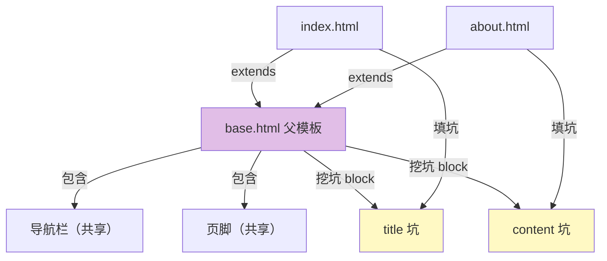

**块内追加内容 super()**：

```html



    {{ super() }}            <!-- 先保留父模板的默认内容 -->
    <p>再追加我的内容</p>

```

### 6.5 模板中包含其他模板

```html
<!-- 包含评论组件 -->


<!-- 带参数的宏（类似函数）—— templates/macros.html -->

    <input type="{{ type }}" name="{{ name }}" value="{{ value }}">


<!-- 使用宏 -->

{{ input('username') }}
{{ input('password', type='password') }}
```

---

## 七、静态文件管理 🖼️

### 7.1 静态文件夹约定

```text
static/
├── css/style.css
├── js/main.js
└── img/logo.png
```

### 7.2 在模板中引用静态文件

```html
<!-- ✅ 推荐：用 url_for 生成路径 -->
<link rel="stylesheet" href="{{ url_for('static', filename='css/style.css') }}">
<script src="{{ url_for('static', filename='js/main.js') }}"></script>


<!-- ❌ 不推荐：写死路径（项目结构变了就全挂）-->
<link rel="stylesheet" href="/static/css/style.css">
```

### 7.3 自定义静态文件夹位置（可选）

```python
app = Flask(
    __name__,
    static_folder="assets",        # 改静态文件夹名
    static_url_path="/assets",     # 改访问路径前缀
    template_folder="views",       # 改模板文件夹名
)
# 访问：/assets/css/style.css
```

---

## 八、表单处理与文件上传 📝

### 8.1 原生表单处理

**templates/login.html**：

```html
<form method="POST" action="/login">
    <!-- CSRF 防护（后面 Flask-WTF 会讲） -->
    <input type="text" name="username" placeholder="用户名">
    <input type="password" name="password" placeholder="密码">
    <!-- 复选框：同名多选 -->
    <input type="checkbox" name="hobby" value="编程"> 编程
    <input type="checkbox" name="hobby" value="游戏"> 游戏
    <button type="submit">登录</button>

    
        <p style="color:red;">{{ error }}</p>
    
</form>
```

**app.py**：

```python
from flask import Flask, request, render_template, redirect, url_for

app = Flask(__name__)

@app.route("/login", methods=["GET", "POST"])
def login():
    error = None
    if request.method == "POST":
        username = request.form.get("username", "").strip()
        password = request.form.get("password", "")
        hobbies = request.form.getlist("hobby")   # ['编程', '游戏']

        # —— 简单验证 ——
        if not username:
            error = "用户名不能为空！"
        elif not password:
            error = "密码不能为空！"
        else:
            # 验证通过，跳转
            return redirect(url_for("index"))

    # GET 请求 或 验证失败 → 显示表单
    return render_template("login.html", error=error)
```

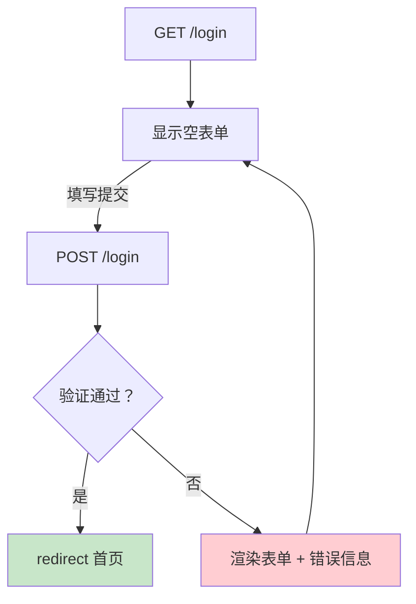

### 8.2 文件上传完整示例

```python
import os
from flask import Flask, request, render_template, redirect, url_for
from werkzeug.utils import secure_filename

app = Flask(__name__)
app.config["UPLOAD_FOLDER"] = "uploads"
app.config["MAX_CONTENT_LENGTH"] = 5 * 1024 * 1024   # 限制 5MB（超出返回 413）

ALLOWED_EXTENSIONS = {"png", "jpg", "jpeg", "gif", "pdf"}

def allowed_file(filename):
    # 检查扩展名是否合法
    return "." in filename and filename.rsplit(".", 1)[1].lower() in ALLOWED_EXTENSIONS

@app.route("/upload", methods=["GET", "POST"])
def upload():
    if request.method == "POST":
        file = request.files.get("file")

        # —— 三重校验 ——
        if not file or file.filename == "":
            return "没有选择文件！"
        if not allowed_file(file.filename):
            return "文件类型不允许！"
        if len(file.read()) > 5 * 1024 * 1024:
            return "文件太大！"

        file.seek(0)   # 上面的 read() 移动了指针，要复位

        # —— 安全保存（secure_filename 防止恶意文件名）——
        filename = secure_filename(file.filename)
        os.makedirs(app.config["UPLOAD_FOLDER"], exist_ok=True)
        file.save(os.path.join(app.config["UPLOAD_FOLDER"], filename))
        return redirect(url_for("uploaded", filename=filename))

    return render_template("upload.html")
```

```python
@app.errorhandler(413)
def too_large(e):
    return "文件太大啦！（限制 5MB）", 413
```

> ⚠️ **安全要点**：
> - 用 `secure_filename()` 清洗文件名（`../../etc/passwd` → `etc_passwd`）
> - 校验扩展名白名单，不要校验黑名单
> - 限制文件大小（`MAX_CONTENT_LENGTH`）

### 8.3 Flask-WTF：更优雅的表单（选学）

```bash
pip install flask-wtf
```

```python
from flask import Flask, render_template
from flask_wtf import FlaskForm
from wtforms import StringField, PasswordField, SubmitField
from wtforms.validators import DataRequired, Length, EqualTo

app = Flask(__name__)
app.config["SECRET_KEY"] = "your-secret-key"   # CSRF 需要密钥

class RegisterForm(FlaskForm):
    username = StringField("用户名", validators=[
        DataRequired(message="必填！"),
        Length(min=2, max=20, message="长度 2~20 位"),
    ])
    password = PasswordField("密码", validators=[DataRequired()])
    confirm = PasswordField("确认密码", validators=[
        DataRequired(),
        EqualTo("password", message="两次密码不一致！"),
    ])
    submit = SubmitField("注册")

@app.route("/register", methods=["GET", "POST"])
def register():
    form = RegisterForm()
    if form.validate_on_submit():       # 自动验证 + CSRF 检查
        return f"注册成功：{form.username.data}"
    return render_template("register.html", form=form)
```

```html
<!-- templates/register.html —— 自动生成 HTML + 错误提示 -->
<form method="POST">
    {{ form.hidden_tag() }}              <!-- CSRF token，必须有！ -->
    {{ form.username.label }} {{ form.username() }}
    
        <span style="color:red">{{ error }}</span>
    
    {{ form.submit() }}
</form>
```

---

## 九、Cookie 与 Session 🍪

### 9.1 操作 Cookie

```python
from flask import Flask, request, make_response

app = Flask(__name__)

# —— 设置 Cookie ——
@app.route("/set-cookie")
def set_cookie():
    response = make_response("Cookie 已设置！")
    response.set_cookie(
        "username", "小明",
        max_age=3600,        # 1 小时后过期（不设则关闭浏览器失效）
        httponly=True,       # 禁止 JS 读取（防 XSS 偷 Cookie）
        # secure=True,       # 仅 HTTPS 传输（生产开启）
    )
    return response

# —— 读取 Cookie ——
@app.route("/get-cookie")
def get_cookie():
    username = request.cookies.get("username", "游客")
    return f"你好，{username}！"

# —— 删除 Cookie ——
@app.route("/del-cookie")
def del_cookie():
    response = make_response("Cookie 已删除！")
    response.delete_cookie("username")
    return response
```

### 9.2 Session：Flask 内置会话

> Flask 的 Session 很特别——数据**加密后存在 Cookie 里**（不是存服务器），所以必须设置 SECRET_KEY！

```python
from flask import Flask, session, redirect, url_for, request

app = Flask(__name__)
app.config["SECRET_KEY"] = "换成一串随机长字符串！"   # 必须设置！

# —— 模拟登录：写入 Session ——
@app.route("/login", methods=["POST"])
def login():
    username = request.form.get("username")
    session["username"] = username        # 像 dict 一样直接存
    return redirect(url_for("profile"))

# —— 读取 Session ——
@app.route("/profile")
def profile():
    username = session.get("username")    # 没有则返回 None
    if username is None:
        return redirect(url_for("login_page"))   # 未登录踢回登录页
    return f"欢迎回来，{username}！"

# —— 退出登录：清除 Session ——
@app.route("/logout")
def logout():
    session.pop("username", None)         # 删除某个键
    # session.clear()                     # 清空全部
    return "已退出登录～"
```

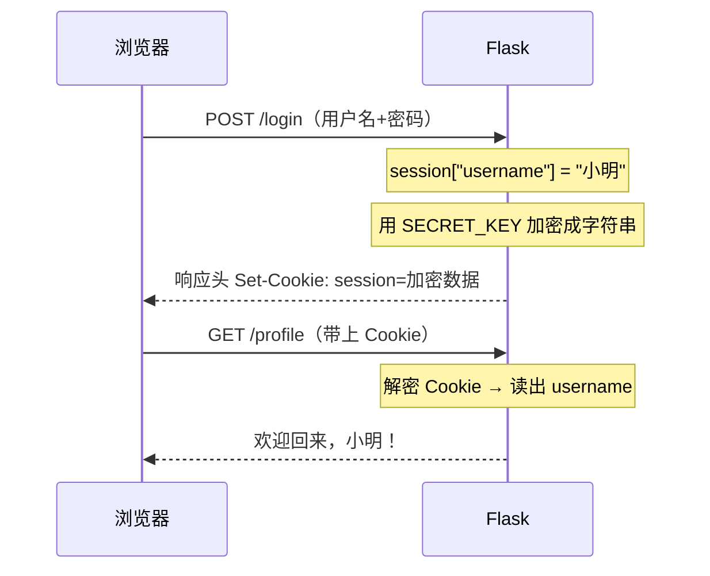

| 对比 | Cookie | Session（Flask 默认实现） |
| :--- | :--- | :--- |
| 存储位置 | 浏览器 | **也是浏览器**（加密后放 Cookie 里） |
| 安全性 | 明文可改 | 加密签名，篡改会失效 ✅ |
| 大小限制 | ~4KB | 同样受 Cookie 限制 |
| 依赖 | 无 | 需要 SECRET_KEY |
| 大量数据 | 不适合 | 不适合（要换服务端存储） |

> 💡 如果 Session 数据量大（如购物车），建议换 **Flask-Session** 扩展（存 Redis/数据库）。

### 9.3 生成安全密钥

```python
import secrets
print(secrets.token_hex(32))   # 生成 64 位随机字符串
# 'a1b2c3d4e5f6...' → 复制到 SECRET_KEY
```

> ⚠️ SECRET_KEY 绝不能提交到 Git！用环境变量管理：
> `app.config["SECRET_KEY"] = os.environ.get("SECRET_KEY", "dev-only")`

---

## 十、数据库：Flask-SQLAlchemy 🗄️

### 10.1 安装与配置

```bash
pip install flask-sqlalchemy
```

```python
from flask import Flask
from flask_sqlalchemy import SQLAlchemy

app = Flask(__name__)

# —— 数据库连接配置 ——
app.config["SQLALCHEMY_DATABASE_URI"] = "sqlite:///app.db"
# MySQL 写法："mysql+pymysql://用户名:密码@localhost:3306/数据库名"
# PostgreSQL 写法："postgresql://用户名:密码@localhost/dbname"

app.config["SQLALCHEMY_TRACK_MODIFICATIONS"] = False   # 关闭追踪（省内存）

db = SQLAlchemy(app)     # 创建 db 实例
```

### 10.2 定义模型（Model = 表）

```python
class User(db.Model):
    __tablename__ = "users"            # 指定表名（不写则用类名小写）

    id = db.Column(db.Integer, primary_key=True)              # 主键自增
    username = db.Column(db.String(50), unique=True, nullable=False)
    email = db.Column(db.String(120), unique=True)
    age = db.Column(db.Integer, default=0)
    created_at = db.Column(db.DateTime, default=datetime.utcnow)
    active = db.Column(db.Boolean, default=True)

    def __repr__(self):                 # 打印时的显示格式
        return f"<User {self.username}>"
```

**常用列类型与约束**：

| 类型 | 数据库对应 | 说明 |
| :--- | :--- | :--- |
| `db.Integer` | INT | 整数 |
| `db.String(50)` | VARCHAR(50) | 定长字符串 |
| `db.Text` | TEXT | 长文本 |
| `db.Float` | FLOAT | 浮点数 |
| `db.Boolean` | BOOL | 布尔 |
| `db.DateTime` | DATETIME | 日期时间 |
| `db.Numeric(10,2)` | DECIMAL | 精确小数（金额用！） |

| 约束参数 | 说明 |
| :--- | :--- |
| `primary_key=True` | 主键 |
| `unique=True` | 唯一 |
| `nullable=False` | 非空 |
| `default=值` | 默认值 |
| `index=True` | 建索引（查询更快） |

### 10.3 创建表 + 增删改查

```python
# —— 创建所有表（在应用上下文中执行）——
with app.app_context():
    db.create_all()
```

```python
# —— 增 Create ——
user = User(username="小明", email="xm@test.com", age=18)
db.session.add(user)              # 添加到会话（还没写库）
db.session.add_all([              # 批量添加
    User(username="小红", age=22),
    User(username="小刚", age=25),
])
db.session.commit()               # 提交事务（真正写入！）
print(user.id)                    # 提交后才有 id

# —— 查 Read ——
User.query.get(1)                                 # 按主键查（旧写法）
db.session.get(User, 1)                           # 按主键查（新写法 ✅）
User.query.all()                                 # 全部
User.query.filter_by(username="小明").first()     # 等值条件，取第一条
User.query.filter(User.age > 20).all()           # 表达式条件
User.query.filter(User.username.like("%明%")).all()  # 模糊查询
User.query.order_by(User.age.desc()).all()       # 排序
User.query.limit(10).all()                       # 限制条数
User.query.count()                               # 计数
User.query.get_or_404(1)                         # 查不到直接 404

# —— 链式组合（像流水线）——
users = (User.query
    .filter(User.age > 18, User.active == True)  # 多条件 AND
    .order_by(User.age.desc())
    .limit(5)
    .all())

# —— 改 Update ——
user = User.query.filter_by(username="小明").first()
user.age = 20
db.session.commit()

# —— 删 Delete ——
user = User.query.get(1)
db.session.delete(user)
db.session.commit()

# —— 出错回滚 ——
try:
    db.session.commit()
except Exception:
    db.session.rollback()        # 出错撤销本次事务
```

### 10.4 表关系

```python
# —— 一对多：一个作者 → 多篇文章 ——
class Author(db.Model):
    id = db.Column(db.Integer, primary_key=True)
    name = db.Column(db.String(50))
    # 关系：通过 author.articles 访问所有文章
    articles = db.relationship("Article", backref="author", lazy=True)

class Article(db.Model):
    id = db.Column(db.Integer, primary_key=True)
    title = db.Column(db.String(100))
    author_id = db.Column(db.Integer, db.ForeignKey("author.id"))  # 外键
    # backref="author" 让 article.author 能直接拿到作者对象

# 使用：
author = Author(name="小明")
db.session.add(author)
db.session.commit()

article = Article(title="第一篇", author_id=author.id)
db.session.add(article)
db.session.commit()

print(author.articles)           # [<Article 第一篇>]（正查）
print(article.author.name)       # 小明（反查）

# —— 多对多：学生 ↔ 课程 ——
enrollments = db.Table("enrollments",
    db.Column("student_id", db.Integer, db.ForeignKey("student.id")),
    db.Column("course_id", db.Integer, db.ForeignKey("course.id")),
)

class Student(db.Model):
    id = db.Column(db.Integer, primary_key=True)
    name = db.Column(db.String(50))
    courses = db.relationship("Course", secondary=enrollments,
                              backref=db.backref("students", lazy="dynamic"))

class Course(db.Model):
    id = db.Column(db.Integer, primary_key=True)
    name = db.Column(db.String(50))

# student.courses.all() → 学生的所有课程
# course.students.all() → 课程的所有学生
```

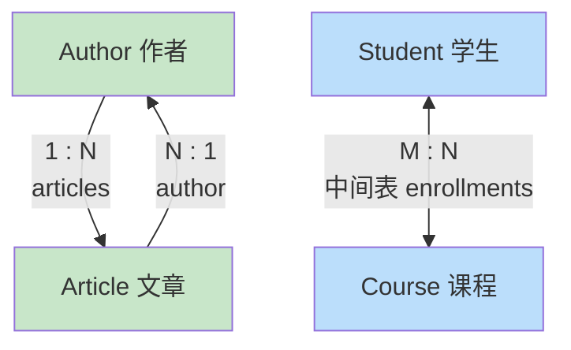

### 10.5 数据库迁移 Flask-Migrate

> 表已经建好，后来加了字段怎么办？不能删库重建啊！用 **Migrate** 自动生成"变更脚本"～

```bash
pip install flask-migrate
```

```python
from flask_migrate import Migrate

migrate = Migrate(app, db)    # 绑定 app 和 db
```

```bash
# —— 初始化（只需一次，生成 migrations 文件夹）——
flask db init

# —— 检测模型变化，生成迁移脚本 ——
flask db migrate -m "add age column to users"

# —— 执行迁移（真正改表）——
flask db upgrade

# —— 回退一步 ——
flask db downgrade
```

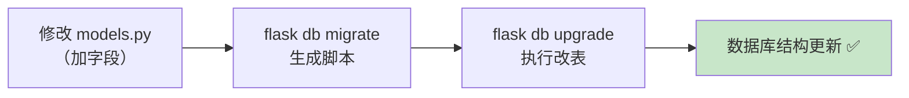

---

## 十一、钩子函数与上下文 🪝

### 11.1 钩子：请求前后的"拦截器"

> 钩子让你在请求的不同阶段插入公共逻辑——比如统一验证登录、记录日志～

```python
from flask import Flask, request, g

app = Flask(__name__)

# —— ① 请求开始前（无参数）——
@app.before_request
def before():
    print("每个请求前都会执行～")
    # 可以在这里做登录校验：
    # if not session.get("user") and request.path != "/login":
    #     return redirect("/login")   # 返回响应会中断请求！

# —— ② 请求结束后（有响应参数，必须返回响应）——
@app.after_request
def after(response):
    print("每个请求后执行（成功或报错都执行）")
    response.headers["X-Powered-By"] = "Flask"
    return response          # 必须返回 response！

# —— ③ 视图函数抛异常时（未被处理时）——
@app.teardown_request
def teardown(exception):
    print("请求结束，可以清理资源～")
    # 即使出错也会执行（exception 是错误对象）

# —— ④ 每次应用上下文销毁时 ——
@app.teardown_appcontext
def teardown_app(exception):
    print("应用上下文销毁～关闭数据库连接等")
```

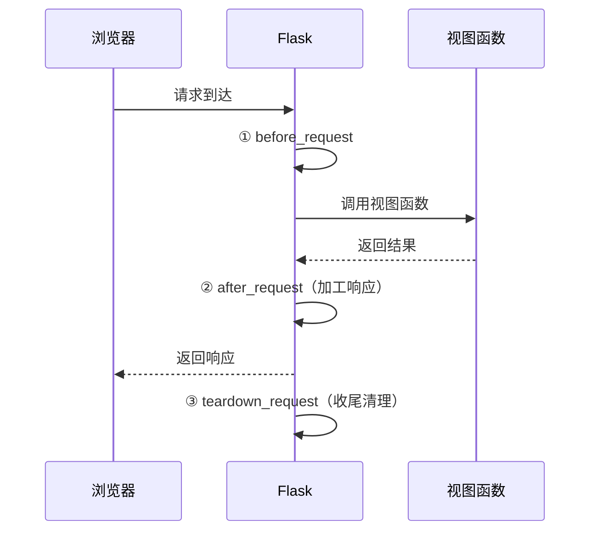

### 11.2 g 对象：请求内的"共享变量"

> `g` 是一个全局临时对象，**在一次请求的生命周期内**共享数据（每个请求独立）～

```python
from flask import g

@app.before_request
def load_current_user():
    # 请求开始时查出用户，存到 g
    g.user = User.query.filter_by(username=session.get("user")).first()

@app.route("/profile")
def profile():
    # 任何视图函数里都能直接用
    return f"当前用户：{g.user.username}"

@app.route("/articles")
def articles():
    # 这里也能用（同一次请求内）
    return f"{g.user.username} 的文章"
```

### 11.3 两种上下文

| 上下文 | 对象 | 说明 |
| :--- | :--- | :--- |
| **应用上下文** | `current_app`、`g` | 当前应用实例、请求级共享变量 |
| **请求上下文** | `request`、`session` | 当前请求数据、会话数据 |

```python
from flask import current_app

@app.route("/config")
def show_config():
    # current_app：当前运行的应用实例（比直接引用全局 app 更好）
    db_uri = current_app.config["SQLALCHEMY_DATABASE_URI"]
    return f"数据库：{db_uri}"
```

> ⚠️ **常见报错**："Working outside of application context"——在视图函数**外面**用了 `request`/`current_app`。解决办法：包一层 `with app.app_context():` 或 `with app.test_request_context():`

---

## 十二、蓝图 Blueprint：大型项目模块化 🧩

### 12.1 为什么要用蓝图？

> 所有路由都堆在 app.py 里，几百个路由后就是灾难……蓝图 = 把路由按"功能模块"分组管理！

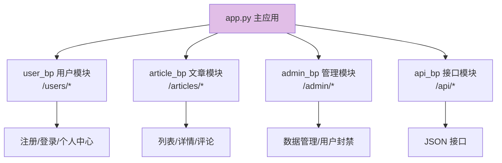

### 12.2 标准项目结构

```text
my_project/
├── app.py                      ← 主程序（创建 app、注册蓝图）
├── blueprints/
│   ├── __init__.py
│   ├── user_bp.py              ← 用户蓝图
│   └── article_bp.py           ← 文章蓝图
├── models.py                   ← 数据模型
├── templates/
│   ├── base.html
│   ├── user/
│   │   └── login.html
│   └── article/
│       └── list.html
└── static/
```

### 12.3 创建与注册蓝图

**blueprints/user_bp.py**：

```python
from flask import Blueprint, render_template, request, redirect, url_for

# 蓝图三要素：名称、模块名、URL 前缀
user_bp = Blueprint("user", __name__, url_prefix="/users")

@user_bp.route("/")                    # 实际路径：/users/
def user_list():
    return "用户列表"

@user_bp.route("/<int:user_id>")       # 实际路径：/users/123
def user_detail(user_id):
    return f"用户 {user_id} 的资料"

@user_bp.route("/login", methods=["GET", "POST"])   # /users/login
def login():
    if request.method == "POST":
        # 处理登录...
        return redirect(url_for("user.user_list"))   # ⚠️ 蓝图内跳转要带蓝图名！
    return render_template("user/login.html")
```

**app.py**：

```python
from flask import Flask
from blueprints.user_bp import user_bp
from blueprints.article_bp import article_bp

app = Flask(__name__)

app.register_blueprint(user_bp)              # 注册用户蓝图
app.register_blueprint(article_bp, url_prefix="/articles")  # 也可以在这指定前缀

if __name__ == "__main__":
    app.run(debug=True)
```

### 12.4 蓝图内 url_for 语法变化

```python
# ❌ 之前（全局唯一函数名）
url_for("user_list")

# ✅ 蓝图后要加蓝图名前缀
url_for("user.user_list")        # 蓝图名.函数名
url_for("article.detail", article_id=1)
```

### 12.5 蓝图也可以有模板/静态文件

```python
user_bp = Blueprint(
    "user",
    __name__,
    url_prefix="/users",
    template_folder="templates/user",   # 蓝图专属模板文件夹
    static_folder="static/user",        # 蓝图专属静态文件夹
)
```

---

## 十三、错误处理与日志 🚨

### 13.1 自定义错误页面

```python
from flask import Flask, render_template

app = Flask(__name__)

# —— 404 页面 ——
@app.errorhandler(404)
def page_not_found(e):
    # e 是错误对象，e.description 是描述
    return render_template("404.html"), 404     # 必须返回状态码！

# —— 500 页面 ——
@app.errorhandler(500)
def internal_error(e):
    db.session.rollback()     # 数据库错误时回滚事务
    return render_template("500.html"), 500

# —— 自定义 HTTPException（如 403、405 等统一处理）——
from werkzeug.exceptions import HTTPException

@app.errorhandler(HTTPException)
def handle_http_exception(e):
    return render_template("error.html", code=e.code, message=e.description), e.code

# —— 捕获所有未处理的普通异常 ——
@app.errorhandler(Exception)
def handle_exception(e):
    app.logger.error(f"服务器错误：{e}", exc_info=True)   # 记日志
    return "服务器开小差了，稍后再试～", 500
```

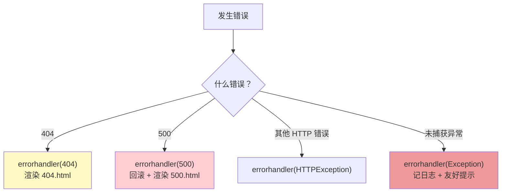

### 13.2 日志记录

```python
import logging

# —— 配置日志 ——
logging.basicConfig(
    level=logging.INFO,
    format="%(asctime)s [%(levelname)s] %(message)s",
    handlers=[
        logging.FileHandler("app.log", encoding="utf-8"),   # 写文件
        logging.StreamHandler(),                            # 输出到控制台
    ],
)

# —— 使用（Flask 内置 app.logger）——
app.logger.info("服务器启动")
app.logger.warning("配置项缺失，使用默认值")

@app.route("/pay")
def pay():
    app.logger.info(f"用户 {session.get('user')} 发起支付")
    try:
        # do_something()
        app.logger.info("支付成功")
    except Exception as e:
        app.logger.error(f"支付失败：{e}", exc_info=True)   # exc_info 记录堆栈
    return "ok"
```

| 级别 | 用途 |
| :---: | :--- |
| `debug()` | 调试细节（开发用） |
| `info()` | 正常运行信息 |
| `warning()` | 警告（不影响运行） |
| `error()` | 出错（功能受影响） |
| `critical()` | 严重错误（系统濒临崩溃） |

---

## 十四、项目实战：迷你博客 ✍️

> 综合运用前面所有知识，做一个能发文章的迷你博客！

### 14.1 项目结构

```text
mini_blog/
├── app.py
├── models.py
├── blueprints/
│   ├── __init__.py
│   ├── auth_bp.py        ← 登录/登出
│   └── article_bp.py     ← 文章增删改查
├── templates/
│   ├── base.html
│   ├── login.html
│   ├── article_list.html
│   └── article_detail.html
└── static/
```

### 14.2 models.py

```python
from datetime import datetime
from flask_sqlalchemy import SQLAlchemy

db = SQLAlchemy()

class User(db.Model):
    __tablename__ = "users"
    id = db.Column(db.Integer, primary_key=True)
    username = db.Column(db.String(50), unique=True, nullable=False)
    password = db.Column(db.String(200), nullable=False)
    articles = db.relationship("Article", backref="author", lazy=True)

class Article(db.Model):
    __tablename__ = "articles"
    id = db.Column(db.Integer, primary_key=True)
    title = db.Column(db.String(100), nullable=False)
    content = db.Column(db.Text)
    created_at = db.Column(db.DateTime, default=datetime.now)
    author_id = db.Column(db.Integer, db.ForeignKey("users.id"))
```

### 14.3 app.py

```python
from flask import Flask
from models import db
from blueprints.auth_bp import auth_bp
from blueprints.article_bp import article_bp

def create_app():
    app = Flask(__name__)
    app.config["SECRET_KEY"] = "dev-secret-key"
    app.config["SQLALCHEMY_DATABASE_URI"] = "sqlite:///blog.db"

    db.init_app(app)                      # 初始化数据库
    app.register_blueprint(auth_bp)
    app.register_blueprint(article_bp)

    with app.app_context():
        db.create_all()                   # 建表

    return app

app = create_app()

if __name__ == "__main__":
    app.run(debug=True)
```

### 14.4 blueprints/auth_bp.py

```python
from flask import Blueprint, render_template, request, redirect, url_for, session
from models import db, User

auth_bp = Blueprint("auth", __name__)

@auth_bp.route("/login", methods=["GET", "POST"])
def login():
    error = None
    if request.method == "POST":
        username = request.form.get("username", "")
        password = request.form.get("password", "")

        user = User.query.filter_by(username=username).first()
        if user and user.password == password:        # 实际项目要哈希比对！
            session["user_id"] = user.id              # 记住登录状态
            session["username"] = user.username
            return redirect(url_for("article.list"))
        error = "用户名或密码错误！"
    return render_template("login.html", error=error)

@auth_bp.route("/logout")
def logout():
    session.clear()
    return redirect(url_for("auth.login"))
```

### 14.5 blueprints/article_bp.py

```python
from flask import Blueprint, render_template, request, redirect, url_for, session, abort
from models import db, Article

article_bp = Blueprint("article", __name__)

@article_bp.route("/")
def list():
    articles = Article.query.order_by(Article.created_at.desc()).all()
    return render_template("article_list.html", articles=articles)

@article_bp.route("/article/<int:article_id>")
def detail(article_id):
    article = Article.query.get_or_404(article_id)    # 查不到自动 404
    return render_template("article_detail.html", article=article)

@article_bp.route("/article/new", methods=["GET", "POST"])
def create():
    # —— 登录检查 ——
    if "user_id" not in session:
        return redirect(url_for("auth.login"))

    if request.method == "POST":
        title = request.form.get("title", "").strip()
        content = request.form.get("content", "")
        if not title:
            return render_template("article_edit.html", error="标题不能为空")

        article = Article(
            title=title,
            content=content,
            author_id=session["user_id"],
        )
        db.session.add(article)
        db.session.commit()
        return redirect(url_for("article.detail", article_id=article.id))

    return render_template("article_edit.html", error=None)

@article_bp.route("/article/<int:article_id>/delete", methods=["POST"])
def delete(article_id):
    if "user_id" not in session:
        abort(403)
    article = Article.query.get_or_404(article_id)
    if article.author_id != session["user_id"]:       # 只能删自己的！
        abort(403)
    db.session.delete(article)
    db.session.commit()
    return redirect(url_for("article.list"))
```

### 14.6 templates/base.html

```html
<!DOCTYPE html>
<html>
<head>
    <title>迷你博客</title>
</head>
<body>
    <nav>
        <a href="{{ url_for('article.list') }}">首页</a>
        
            <span>你好，{{ session['username'] }}</span>
            <a href="{{ url_for('article.create') }}">写文章</a>
            <a href="{{ url_for('auth.logout') }}">退出</a>
        
            <a href="{{ url_for('auth.login') }}">登录</a>
        
    </nav>
    <hr>
    
</body>
</html>
```

### 14.7 templates/article_list.html

```html



    <h1>全部文章</h1>
    
        <div>
            <h2><a href="{{ url_for('article.detail', article_id=article.id) }}">{{ article.title }}</a></h2>
            <p>作者：{{ article.author.username }} | {{ article.created_at.strftime('%Y-%m-%d') }}</p>
        </div>
    
        <p>还没有文章，快去写一篇吧～</p>
    

```

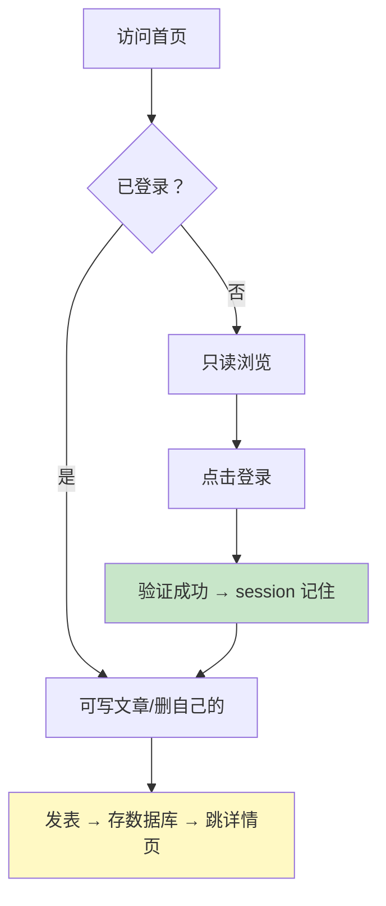

---

## 十五、部署上线 🚀

### 15.1 开发 vs 生产

| 场景 | 服务器 | 说明 |
| :--- | :--- | :--- |
| 开发 | `app.run(debug=True)` | 自动重启、详细报错 |
| 生产 | Gunicorn / uWSGI | 多进程、稳定、扛并发 |

### 15.2 Gunicorn 部署（Linux）

```bash
pip install gunicorn

# —— 启动：4 个工作进程 ——
gunicorn -w 4 -b 0.0.0.0:8000 "app:app"
#         ↑       ↑                ↑
#     进程数   监听地址        文件名:Flask实例名

# —— 常用参数 ——
gunicorn \
    -w 4 \                        # 工作进程数（建议 2×CPU+1）
    -b 0.0.0.0:8000 \             # 监听地址
    --timeout 30 \                # 请求超时
    --access-logfile access.log \ # 访问日志
    --error-logfile error.log \   # 错误日志
    "app:app"
```

> ⚠️ Windows 上 Gunicorn 不能直接用，可用 `waitress` 替代：
> `pip install waitress` → `waitress-serve --port=8000 app:app`

### 15.3 Nginx 反向代理

```nginx
# /etc/nginx/sites-available/myapp
server {
    listen 80;
    server_name example.com;

    # 转发给 Gunicorn
    location / {
        proxy_pass http://127.0.0.1:8000;
        proxy_set_header Host $host;
        proxy_set_header X-Real-IP $remote_addr;
        proxy_set_header X-Forwarded-For $proxy_add_x_forwarded_for;
    }

    # 静态文件直接返回（不经过 Flask，更快！）
    location /static/ {
        alias /var/www/myapp/static/;
        expires 30d;              # 缓存 30 天
    }
}
```

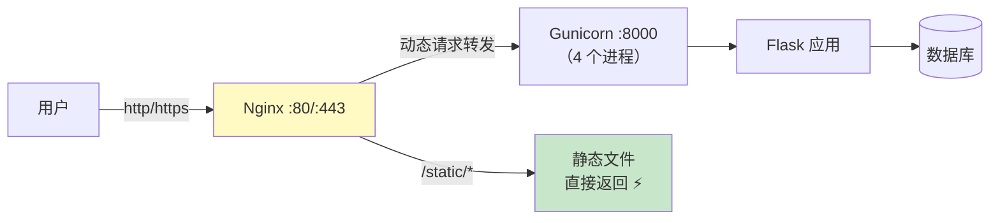

### 15.4 Docker 部署

```dockerfile
# Dockerfile
FROM python:3.12-slim

WORKDIR /app

COPY requirements.txt .
RUN pip install --no-cache-dir -r requirements.txt gunicorn

COPY . .

# 非 root 用户运行（更安全）
RUN useradd -m appuser && chown -R appuser /app
USER appuser

EXPOSE 8000

CMD ["gunicorn", "-w", "4", "-b", "0.0.0.0:8000", "app:app"]
```

```bash
docker build -t myflask .
docker run -d -p 8000:8000 --name flask-app myflask
```

### 15.5 上线检查清单 ✅

| 检查项 | 说明 |
| :--- | :--- |
| ✅ 关闭 debug | 生产环境 `debug=False` |
| ✅ SECRET_KEY 环境变量 | 不要写死在代码里 |
| ✅ 密码哈希存储 | `werkzeug.security.generate_password_hash` |
| ✅ HTTPS | Let's Encrypt 免费证书 |
| ✅ 日志持久化 | 记录访问 + 错误日志 |
| ✅ 数据库备份 | 定时 mysqldump / sqlite 备份 |
| ✅ 依赖锁定 | requirements.txt 固定版本 |

---

## 📌 知识总结

### Flask 核心知识图

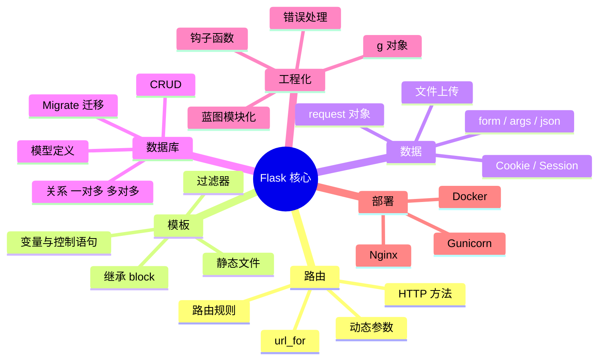

### 高频 API 速查表

| 需求 | 写法 |
| :--- | :--- |
| 取查询参数 | `request.args.get("page", 1, type=int)` |
| 取表单数据 | `request.form.get("username")` |
| 取 JSON | `request.get_json()` |
| 返回 JSON | `jsonify({...})` |
| 渲染模板 | `render_template("x.html", data=data)` |
| 重定向 | `redirect(url_for("index"))` |
| 报 404 | `abort(404)` |
| 存 Session | `session["key"] = value` |
| 查一条数据 | `Model.query.filter_by(...).first()` |
| 提交数据库 | `db.session.commit()` |

### 学习路线建议

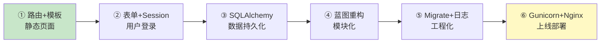

> 🎀 呼～Flask 的完整知识体系都装进小脑袋啦！🎉 从"Hello Flask"到迷你博客再到部署上线，你已经掌握了独立开发 Web 项目的全部基础！配合 [PythonWeb.md](file:///d:/A-H2H/Python/PythonWeb.md) 的框架对比知识，快去动手做一个自己的小项目吧～实践出真知！(◍•ᴗ•◍)❤


