# 📈 Matplotlib 数据可视化

> 哈喽呀～欢迎来到数据可视化的世界！🌟 一图胜千言——学会 Matplotlib，让你的数据开口说话！出发！(๑•̀ㅂ•́)و✧

---

## 🗺️ 知识全景图

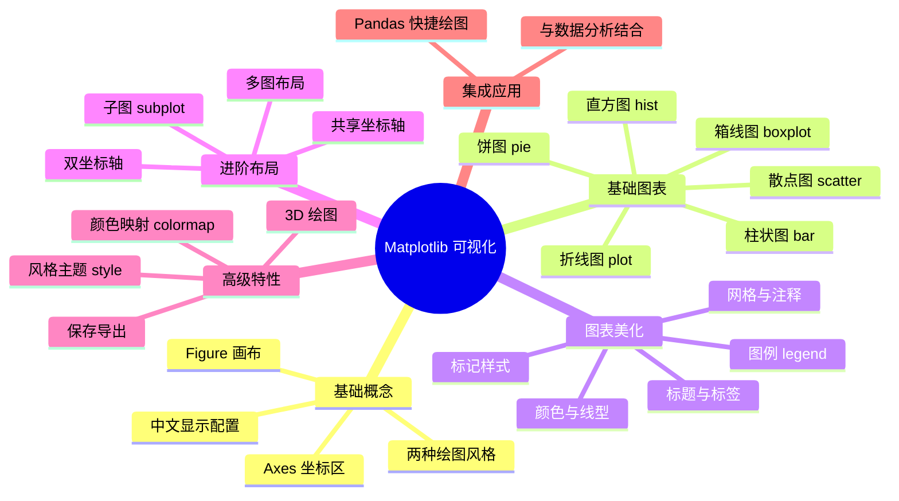

---

## 📑 目录

- [一、Matplotlib 简介](#一matplotlib-简介)
- [二、核心概念与入门](#二核心概念与入门)
- [三、中文显示配置（必学！）](#三中文显示配置必学)
- [四、折线图](#四折线图)
- [五、柱状图](#五柱状图)
- [六、散点图](#六散点图)
- [七、直方图与密度图](#七直方图与密度图)
- [八、饼图](#八饼图)
- [九、箱线图与小提琴图](#九箱线图与小提琴图)
- [十、图表美化大全](#十图表美化大全)
- [十一、子图与多图布局](#十一子图与多图布局)
- [十二、高级特性](#十二高级特性)
- [十三、Pandas 快捷绘图](#十三pandas-快捷绘图)
- [十四、综合实战：可视化大屏](#十四综合实战可视化大屏)
- [十五、知识总结](#十五知识总结)

---

## 一、Matplotlib 简介 🎨

### 1.1 什么是 Matplotlib？

Matplotlib 是 Python **最基础、最常用**的绘图库，2003 年由 John Hunter 创建。

> 🎀 通俗理解：Matplotlib 就像数据界的"画板"——把枯燥的数字变成直观的图表，一眼看出规律！Seaborn、Pandas 绘图都建立在它之上～

### 1.2 为什么它这么重要？

| 优势 | 说明 |
| :--- | :--- |
| 一切的基础 | Seaborn/Pandas 绘图底层都是它 |
| 高度自定义 | 图表每个细节都能改 |
| 生态无敌 | 论文、报告、数据科学的标配 |
| 免费开源 | 随便用 |

### 1.3 图表选择指南

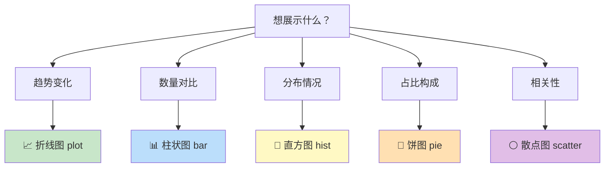

### 1.4 安装

```bash
pip install matplotlib

# 验证
python -c "import matplotlib; print(matplotlib.__version__)"
```

---

## 二、核心概念与入门 🏗️

### 2.1 两种绘图风格

```python
import matplotlib.pyplot as plt
import numpy as np

# —— 风格 1： pyplot 快捷式（适合快速画图）——
plt.plot([1, 2, 3], [4, 5, 6])
plt.title("快速画图")
plt.show()

# —— 风格 2： 面向对象式（推荐！适合复杂图表）——
fig, ax = plt.subplots()          # 创建画布和坐标区
ax.plot([1, 2, 3], [4, 5, 6])
ax.set_title("面向对象")
plt.show()
```

> 💡 **建议**：简单图用 pyplot 式，正式图表统一用面向对象式（本笔记以面向对象为主）！

### 2.2 Figure 与 Axes

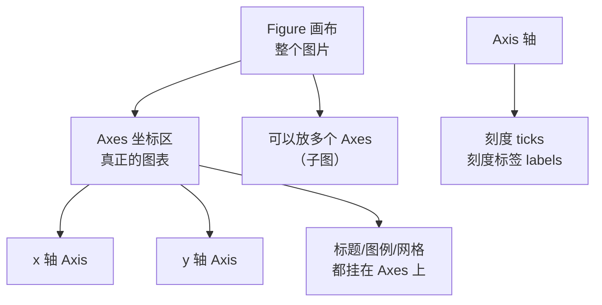

```python
import matplotlib.pyplot as plt

# —— 层级关系 ——
fig = plt.figure()                # 画布（一张白纸）
fig.suptitle("总标题")             # 画布级标题

ax = fig.add_subplot()            # 添加坐标区
ax.set_title("子图标题")           # 坐标区级标题
ax.set_xlabel("x 轴")
ax.set_ylabel("y 轴")

# —— 记忆口诀 ——
# Figure = 相框（决定图片大小）
# Axes = 照片（真正的图表内容）
# Axis = 照片里的边框（坐标轴）
```

| 概念 | 中文 | 说明 |
| :--- | :--- | :--- |
| `Figure` | 画布 | 整张图片，包含所有元素 |
| `Axes` | 坐标区 | 一张图（可以有多个） |
| `Axis` | 坐标轴 | x/y 轴对象 |
| `plt` | pyplot 接口 | 快捷方式，自动管理 |

### 2.3 第一个完整图表

```python
import matplotlib.pyplot as plt
import numpy as np

# —— 准备数据 ——
x = np.linspace(0, 10, 100)
y = np.sin(x)

# —— 创建图表 ——
fig, ax = plt.subplots(figsize=(8, 4))    # 画布大小 8×4 英寸

ax.plot(x, y, label="sin(x)")             # 画线
ax.set_title("正弦曲线")                   # 标题
ax.set_xlabel("x")                        # x 轴标签
ax.set_ylabel("sin(x)")                   # y 轴标签
ax.legend()                               # 图例
ax.grid(True, alpha=0.3)                  # 网格（透明度 0.3）

plt.tight_layout()                        # 自动调整边距
plt.show()                                # 显示
```

---

## 三、中文显示配置（必学！）🇨🇳

> 不配置的话，中文会显示成方框 ❗ 每次绘图前先跑这段！

### 3.1 通用配置（Windows/Mac/Linux）

```python
import matplotlib.pyplot as plt
import matplotlib

# —— Windows（SimHei 黑体）——
plt.rcParams["font.sans-serif"] = ["SimHei"]

# —— Mac ——
# plt.rcParams["font.sans-serif"] = ["Arial Unicode MS"]

# —— Linux ——
# plt.rcParams["font.sans-serif"] = ["WenQuanYi Micro Hei"]

# —— 解决负号显示为方框 ——
plt.rcParams["axes.unicode_minus"] = False

# —— 验证 ——
plt.figure()
plt.title("中文测试：销售额 📊")
plt.show()
```

### 3.2 查看系统可用字体

```python
from matplotlib.font_manager import FontManager

fonts = sorted([f.name for f in FontManager().ttflist])
# 打印看有没有中文字体
for f in fonts:
    if "Hei" in f or "Song" in f or "Kai" in f or "CN" in f:
        print(f)
# 常见：SimHei、Microsoft YaHei、SimSun、KaiTi
```

### 3.3 一劳永逸：配置文件

```python
# 查看配置文件位置
import matplotlib
print(matplotlib.matplotlib_fname())
# 修改该文件里的 font.sans-serif 和 axes.unicode_minus 即可
```

---

## 四、折线图 📈

> 展示**趋势变化**的最佳选择——时间序列、函数曲线都靠它！

### 4.1 基础折线图

```python
import matplotlib.pyplot as plt
import numpy as np

plt.rcParams["font.sans-serif"] = ["SimHei"]
plt.rcParams["axes.unicode_minus"] = False

# —— 模拟数据：一周气温 ——
days = ["周一", "周二", "周三", "周四", "周五", "周六", "周日"]
high = [32, 35, 33, 30, 28, 29, 31]
low = [22, 24, 23, 20, 18, 19, 21]

fig, ax = plt.subplots(figsize=(8, 4))

ax.plot(days, high, marker="o", label="最高温")
ax.plot(days, low, marker="s", label="最低温")

ax.set_title("一周气温变化")
ax.set_xlabel("日期")
ax.set_ylabel("温度 (°C)")
ax.legend()
ax.grid(True, alpha=0.3)

plt.tight_layout()
plt.show()
```

### 4.2 线条样式大全

```python
x = np.linspace(0, 10, 50)

fig, ax = plt.subplots(figsize=(8, 5))

# —— 颜色 color + 线型 linestyle + 线宽 linewidth ——
ax.plot(x, np.sin(x), color="red", linestyle="-",  linewidth=2, label="实线")
ax.plot(x, np.cos(x), color="green", linestyle="--", linewidth=2, label="虚线")
ax.plot(x, x*0.1, color="blue", linestyle="-.", linewidth=2, label="点划线")
ax.plot(x, np.sin(x+2), color="orange", linestyle=":", linewidth=2, label="点线")

ax.legend()
plt.show()
```

| 元素 | 选项 | 示例 |
| :--- | :--- | :--- |
| 颜色 | `red` `blue` `#FF5733` `r` | `color="red"` |
| 线型 | `-` `--` `-.` `:` | `linestyle="--"` |
| 线宽 | 数字 | `linewidth=2` |
| 标记 | `o` `s` `^` `*` `D` `+` | `marker="o"` |
| 标记大小 | 数字 | `markersize=8` |

### 4.3 标记样式速查

```text
"."  点          ","  像素点     "o"  圆圈      "v"  倒三角
"^"  上三角      "<"  左三角     ">"  右三角    "1"  三叉
"s"  方块        "p"  五边形     "*"  星星      "h"  六边形
"+"  加号        "x"  叉叉       "D"  菱形      "d"  细菱形
```

### 4.4 填充区域

```python
x = np.linspace(0, 10, 100)
y = np.sin(x)

fig, ax = plt.subplots()
ax.plot(x, y, color="steelblue")
ax.fill_between(x, y, 0, where=(y > 0), alpha=0.3, color="steelblue", label="正值区域")
ax.fill_between(x, y, 0, where=(y < 0), alpha=0.3, color="salmon", label="负值区域")
ax.legend()
plt.show()
# 常用于：置信区间、盈亏区间展示
```

---

## 五、柱状图 📊

> 展示**数量对比**——各类别数据一目了然！

### 5.1 基础柱状图

```python
import matplotlib.pyplot as plt

plt.rcParams["font.sans-serif"] = ["SimHei"]

products = ["手机", "电脑", "平板", "耳机", "手表"]
sales = [850, 620, 430, 1200, 380]

fig, ax = plt.subplots(figsize=(8, 4))

bars = ax.bar(products, sales, color="skyblue", edgecolor="navy")

# —— 在柱顶标数值 ——
ax.bar_label(bars, fmt="%d", padding=3)

ax.set_title("各类产品销量")
ax.set_ylabel("销量（台）")
plt.tight_layout()
plt.show()
```

### 5.2 横向柱状图（类别名长时用）

```python
fig, ax = plt.subplots(figsize=(8, 4))
bars = ax.barh(products, sales, color="mediumpurple")   # barh = bar horizontal
ax.bar_label(bars, fmt="%d", padding=3)
ax.set_title("各类产品销量（横向）")
ax.set_xlabel("销量（台）")
plt.show()
```

### 5.3 分组柱状图与堆叠柱状图

```python
import numpy as np

cities = ["北京", "上海", "广州", "深圳"]
q1 = [300, 350, 280, 320]
q2 = [340, 330, 300, 360]

x = np.arange(len(cities))       # [0, 1, 2, 3]
width = 0.35                     # 柱宽

fig, axes = plt.subplots(1, 2, figsize=(13, 4))

# —— ① 分组柱状图（并排）——
axes[0].bar(x - width/2, q1, width, label="Q1", color="skyblue")
axes[0].bar(x + width/2, q2, width, label="Q2", color="salmon")
axes[0].set_xticks(x)
axes[0].set_xticklabels(cities)
axes[0].set_title("分组柱状图")
axes[0].legend()

# —— ② 堆叠柱状图（叠加）——
axes[1].bar(cities, q1, label="Q1", color="skyblue")
axes[1].bar(cities, q2, bottom=q1, label="Q2", color="salmon")   # bottom 累加
axes[1].set_title("堆叠柱状图")
axes[1].legend()

plt.tight_layout()
plt.show()
```

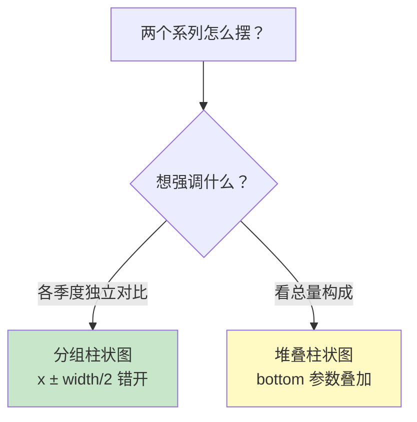

### 5.4 正负柱状图（盈亏展示）

```python
months = ["1月", "2月", "3月", "4月", "5月", "6月"]
profit = [20, -15, 35, -8, 42, 28]

fig, ax = plt.subplots()
colors = ["green" if p > 0 else "red" for p in profit]    # 正绿负红
bars = ax.bar(months, profit, color=colors)
ax.axhline(y=0, color="black", linewidth=0.8)             # 0 基准线
ax.bar_label(bars, fmt="%d")
ax.set_title("月度盈亏")
plt.show()
```

---

## 六、散点图 ⚪

> 展示**两个变量的关系**——正相关？负相关？一眼看穿！

### 6.1 基础散点图

```python
import matplotlib.pyplot as plt
import numpy as np

np.random.seed(42)
plt.rcParams["font.sans-serif"] = ["SimHei"]
plt.rcParams["axes.unicode_minus"] = False

# —— 模拟数据：身高体重 ——
height = np.random.normal(170, 8, 100)
weight = height * 0.6 + np.random.normal(0, 5, 100)   # 正相关

fig, ax = plt.subplots(figsize=(7, 5))
ax.scatter(height, weight, alpha=0.6, color="teal", edgecolors="black")

ax.set_title("身高与体重的关系")
ax.set_xlabel("身高 (cm)")
ax.set_ylabel("体重 (kg)")
ax.grid(True, alpha=0.3)
plt.show()
```

### 6.2 气泡图：用大小和颜色表示更多信息

```python
# —— 三维信息：x=广告费, y=销量, size=城市规模, color=区域 ——
np.random.seed(0)
ad_cost = np.random.uniform(10, 100, 50)
sales = ad_cost * 2 + np.random.normal(0, 30, 50)
city_size = np.random.uniform(50, 500, 50)
region = np.random.choice(["华东", "华南", "华北"], 50)

colors = {"华东": "tomato", "华南": "steelblue", "华北": "gold"}

fig, ax = plt.subplots(figsize=(8, 5))

for r, color in colors.items():
    mask = region == r
    ax.scatter(ad_cost[mask], sales[mask],
               s=city_size[mask],              # s = 气泡大小
               c=color, alpha=0.6, label=r,
               edgecolors="gray", linewidths=0.5)

ax.set_title("广告投入与销量关系（气泡=城市规模）")
ax.set_xlabel("广告费（万元）")
ax.set_ylabel("销量（件）")
ax.legend(title="区域")
plt.show()
```

### 6.3 相关性直观对照

```python
np.random.seed(1)
x = np.random.uniform(0, 10, 100)

fig, axes = plt.subplots(1, 3, figsize=(14, 4))

# 正相关
axes[0].scatter(x, x + np.random.normal(0, 1, 100), color="green", alpha=0.6)
axes[0].set_title("正相关 ↗")

# 负相关
axes[1].scatter(x, -x + np.random.normal(0, 1, 100), color="red", alpha=0.6)
axes[1].set_title("负相关 ↘")

# 无相关
axes[2].scatter(x, np.random.uniform(0, 10, 100), color="gray", alpha=0.6)
axes[2].set_title("无相关 →")

plt.tight_layout()
plt.show()
```

---

## 七、直方图与密度图 📶

> 展示**数据分布**——数据集中在哪？有没有偏态？

### 7.1 基础直方图

```python
import matplotlib.pyplot as plt
import numpy as np

np.random.seed(42)
plt.rcParams["font.sans-serif"] = ["SimHei"]

# —— 模拟 1000 人的考试成绩 ——
scores = np.random.normal(75, 10, 1000)

fig, ax = plt.subplots(figsize=(8, 4))
ax.hist(scores, bins=20, color="skyblue", edgecolor="white")

ax.axvline(scores.mean(), color="red", linestyle="--",
           label=f"平均分 {scores.mean():.1f}")
ax.set_title("考试成绩分布")
ax.set_xlabel("分数")
ax.set_ylabel("人数")
ax.legend()
plt.show()
```

### 7.2 bins 参数详解

```python
fig, axes = plt.subplots(1, 3, figsize=(14, 4))

for i, bins in enumerate([5, 20, 50]):
    axes[i].hist(scores, bins=bins, color="mediumpurple", edgecolor="white")
    axes[i].set_title(f"bins={bins}")

plt.tight_layout()
plt.show()
# bins 太少 → 太粗糙；太多 → 太琐碎。一般 10~30 之间
```

| bins 值 | 效果 |
| :---: | :--- |
| 太小（5） | 组距太宽，丢失细节 |
| 合适（20） | 平滑显示分布 ⭐ |
| 太大（100） | 锯齿明显，噪音多 |

### 7.3 归一化与累积直方图

```python
fig, axes = plt.subplots(1, 2, figsize=(12, 4))

# —— 归一化：显示"概率密度"而不是数量 ——
axes[0].hist(scores, bins=30, density=True, color="lightgreen", edgecolor="white")
axes[0].set_title("归一化直方图（density=True）")

# —— 累积直方图：看"低于 x 分的人占比" ——
axes[1].hist(scores, bins=30, cumulative=True, density=True,
             color="lightsalmon", edgecolor="white")
axes[1].axhline(0.5, color="red", linestyle="--", label="50% 分位")
axes[1].set_title("累积分布图")
axes[1].legend()

plt.tight_layout()
plt.show()
```

---

## 八、饼图 🥧

> 展示**占比构成**——各部分占多少，一目了然！

### 8.1 基础饼图

```python
import matplotlib.pyplot as plt

plt.rcParams["font.sans-serif"] = ["SimHei"]

labels = ["手机", "电脑", "平板", "配件"]
revenue = [45, 25, 18, 12]

fig, ax = plt.subplots(figsize=(6, 6))
ax.pie(revenue, labels=labels, autopct="%.1f%%",   # 显示百分比
       startangle=90)                              # 起始角度
ax.set_title("营收构成")
plt.show()
```

### 8.2 饼图美化

```python
fig, ax = plt.subplots(figsize=(7, 6))

explode = [0.05, 0, 0, 0]            # 突出第一块（手机）
colors = ["#FF6B6B", "#4ECDC4", "#FFE66D", "#95E1D3"]

wedges, texts, autotexts = ax.pie(
    revenue,
    labels=labels,
    autopct="%.1f%%",
    startangle=90,
    explode=explode,                 # 分离强调块
    colors=colors,
    shadow=True,                     # 阴影
    pctdistance=0.75,                # 百分比文字距圆心位置
    wedgeprops={"edgecolor": "white", "linewidth": 2},   # 白色描边
)

# 百分比文字加粗变白
for t in autotexts:
    t.set_fontweight("bold")
    t.set_color("white")

ax.set_title("营收构成（突出手机业务）")
ax.axis("equal")                     # 保证是正圆！
plt.show()
```

### 8.3 环形图（更现代的风格）

```python
fig, ax = plt.subplots(figsize=(6, 6))

ax.pie(revenue, labels=labels, autopct="%.1f%%",
       startangle=90,
       colors=colors,
       wedgeprops={"width": 0.4,         # 环形宽度（1 是实心）
                   "edgecolor": "white"})

ax.text(0, 0, "总营收\n100%", ha="center", va="center", fontsize=14)
ax.set_title("环形图：营收构成")
plt.show()
```

> 💡 **饼图使用建议**：
> - 分类不超过 6 个（太多看不清）
> - 想强调某块用 `explode`
> - 现代报告更推荐**环形图**（甜甜圈图）

---

## 九、箱线图与小提琴图 🎻

> 展示**统计分布与异常值**——五数概括可视化！

### 9.1 箱线图怎么看？

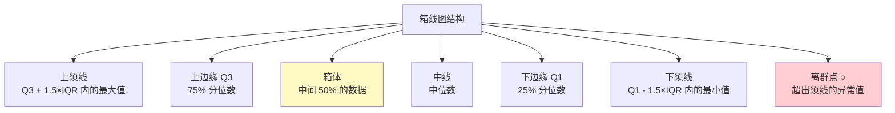

### 9.2 基础箱线图

```python
import matplotlib.pyplot as plt
import numpy as np

np.random.seed(42)
plt.rcParams["font.sans-serif"] = ["SimHei"]

# —— 模拟三个部门的工资 ——
dept_a = np.random.normal(10000, 2000, 100)
dept_b = np.random.normal(12000, 3000, 100)
dept_c = np.random.normal(9000, 1500, 100)

fig, ax = plt.subplots(figsize=(8, 5))
box = ax.boxplot([dept_a, dept_b, dept_c],
                 labels=["技术部", "销售部", "行政部"],
                 patch_artist=True,              # 允许填充颜色
                 showmeans=True)                 # 显示均值点

# —— 每个箱体不同颜色 ——
for patch, color in zip(box["boxes"], ["skyblue", "salmon", "lightgreen"]):
    patch.set_facecolor(color)

ax.set_title("各部门工资分布")
ax.set_ylabel("工资（元）")
ax.grid(True, axis="y", alpha=0.3)
plt.show()
```

### 9.3 水平箱线图 + 突出异常值

```python
fig, ax = plt.subplots(figsize=(8, 4))
ax.boxplot([dept_a, dept_b, dept_c],
           labels=["技术部", "销售部", "行政部"],
           vert=False,                           # 水平放置
           flierprops={"marker": "o", "markerfacecolor": "red",
                       "markersize": 6})         # 异常值样式
ax.set_title("工资分布（红点=异常值）")
plt.show()
```

### 9.4 小提琴图：箱线图 + 密度

```python
fig, axes = plt.subplots(1, 2, figsize=(12, 4.5))

# —— 小提琴图 ——
parts = axes[0].violinplot([dept_a, dept_b, dept_c], showmedians=True)
for pc in parts["bodies"]:
    pc.set_facecolor("mediumpurple")
    pc.set_alpha(0.7)
axes[0].set_xticks([1, 2, 3])
axes[0].set_xticklabels(["技术部", "销售部", "行政部"])
axes[0].set_title("小提琴图：胖的地方数据多")

# —— 箱线 + 散点组合（看原始分布）——
axes[1].boxplot([dept_a, dept_b, dept_c], labels=["技术部", "销售部", "行政部"])
for i, data in enumerate([dept_a, dept_b, dept_c], start=1):
    y = data
    x = np.random.normal(i, 0.04, len(y))        # 抖动防止重叠
    axes[1].scatter(x, y, alpha=0.4, s=10, color="navy")

axes[1].set_title("箱线图 + 原始散点")
plt.tight_layout()
plt.show()
```

| 图表 | 优势 | 适用场景 |
| :--- | :--- | :--- |
| 箱线图 | 简洁、易看出异常值 | 快速统计对比 |
| 小提琴图 | 显示分布形状 | 看数据集中区域 |
| 箱线+散点 | 统计+原始数据 | 数据量不大时最直观 |

---

## 十、图表美化大全 ✨

### 10.1 标题、标签、图例

```python
fig, ax = plt.subplots(figsize=(8, 4))
ax.plot([1, 2, 3], [4, 5, 6], label="数据A")

# —— 标题（可设置字号、颜色、位置）——
ax.set_title("主标题", fontsize=16, fontweight="bold", color="navy", pad=15)

# —— 坐标轴标签 ——
ax.set_xlabel("时间", fontsize=12, color="gray")
ax.set_ylabel("数值", fontsize=12)

# —— 图例（位置、列数、圆角边框）——
ax.legend(loc="upper left",          # best/upper right/lower left/center...
          fontsize=10,
          framealpha=0.9,            # 图例框透明度
          shadow=True)

# —— 坐标范围 ——
ax.set_xlim(0, 4)
ax.set_ylim(0, 8)
```

### 10.2 图例位置速查

| loc 值 | 位置 |
| :--- | :--- |
| `"best"` | 自动找空地（默认）⭐ |
| `"upper right"` | 右上 |
| `"upper left"` | 左上 |
| `"lower right"` | 右下 |
| `"lower left"` | 左下 |
| `"center"` | 中央 |
| `"outside upper right"` | 图外右上（新版） |

### 10.3 网格与参考线

```python
fig, ax = plt.subplots(figsize=(8, 4))
ax.plot([1, 2, 3, 4], [3, 5, 2, 6])

# —— 网格 ——
ax.grid(True, linestyle="--", alpha=0.5, color="gray")

# —— 只显示 y 轴网格 ——
ax.grid(True, axis="y")

# —— 水平参考线（如平均线、目标线）——
ax.axhline(y=4, color="red", linestyle="--", label="目标线")

# —— 垂直参考线 ——
ax.axvline(x=2.5, color="green", linestyle=":")

# —— 参考区域（如正常范围）——
ax.axhspan(4, 5, alpha=0.2, color="green", label="正常区间")

ax.legend()
plt.show()
```

### 10.4 文字注释

```python
fig, ax = plt.subplots(figsize=(8, 4))
x = [1, 2, 3, 4, 5]
y = [2, 4, 3, 5, 4]
ax.plot(x, y, marker="o")

# —— 每个点标数值 ——
for xi, yi in zip(x, y):
    ax.annotate(f"{yi}", (xi, yi), textcoords="offset points",
                xytext=(0, 10), ha="center")   # 向上偏移10像素

# —— 箭头标注重点 ——
ax.annotate(
    "最高点！",
    xy=(4, 5),                    # 箭头指向的点
    xytext=(4.3, 4.2),            # 文字位置
    arrowprops={"arrowstyle": "->", "color": "red"},
    fontsize=12, color="red",
)

# —— 任意位置加文字 ——
ax.text(1.2, 4.8, "数据来自模拟", fontsize=9, color="gray")
plt.show()
```

### 10.5 坐标轴刻度自定义

```python
import numpy as np

fig, ax = plt.subplots(figsize=(8, 4))
x = np.linspace(0, 10, 100)
ax.plot(x, np.sin(x))

# —— 自定义刻度 ——
ax.set_xticks([0, 2, 4, 6, 8, 10])
ax.set_xticklabels(["零", "二", "四", "六", "八", "十"], rotation=45)

# —— 数值格式化（y 轴显示百分比）——
from matplotlib.ticker import PercentFormatter, FuncFormatter
ax.yaxis.set_major_formatter(PercentFormatter(1.0))

# —— 自定义格式函数（千分位）——
ax.yaxis.set_major_formatter(FuncFormatter(lambda v, _: f"{v:,.1f}"))

# —— 对数坐标（数据跨度大时）——
# ax.set_yscale("log")

# —— 反转轴（排名从高到低）——
# ax.invert_yaxis()
plt.show()
```

### 10.6 风格主题

```python
import matplotlib.pyplot as plt

# —— 查看所有内置风格 ——
print(plt.style.available)
# ['seaborn-v0_8', 'ggplot', 'bmh', 'dark_background',
#  'fivethirtyeight', 'classic', ...]

# —— 使用风格 ——
plt.style.use("ggplot")              # 全局设置

# —— 临时使用（with 语法，不影响全局）——
with plt.style.context("dark_background"):
    plt.plot([1, 2, 3], [4, 5, 4])
    plt.title("暗黑主题")
    plt.show()

# —— 常用风格推荐 ——
# seaborn-v0_8     : 统计图表风，现代清爽 ⭐
# ggplot           : R 语言 ggplot2 风格
# fivethirtyeight  : FiveThirtyEight 新闻网站风格
# dark_background  : 暗黑模式（酷炫大屏）
```

---

## 十一、子图与多图布局 🖼️

### 11.1 subplots：规则网格（最常用）

```python
import matplotlib.pyplot as plt
import numpy as np

plt.rcParams["font.sans-serif"] = ["SimHei"]

x = np.linspace(0, 10, 100)

# —— 2×2 网格，画布 12×8 ——
fig, axes = plt.subplots(2, 2, figsize=(12, 8))

# axes 是二维数组，用索引访问
axes[0, 0].plot(x, np.sin(x), color="steelblue")
axes[0, 0].set_title("sin(x)")

axes[0, 1].plot(x, np.cos(x), color="salmon")
axes[0, 1].set_title("cos(x)")

axes[1, 0].plot(x, np.tan(x), color="mediumpurple")
axes[1, 0].set_ylim(-5, 5)                    # tan 要限制范围
axes[1, 0].set_title("tan(x)")

axes[1, 1].plot(x, x**2, color="gold")
axes[1, 1].set_title("x²")

fig.suptitle("四个三角/幂函数", fontsize=14)    # 总标题
plt.tight_layout()
plt.show()
```

### 11.2 一行多列 / 一列多行

```python
# —— 一行三列 ——
fig, axes = plt.subplots(1, 3, figsize=(15, 4))   # axes 是一维数组
for i, ax in enumerate(axes):
    ax.plot(x, np.sin(x + i))
    ax.set_title(f"相位移 {i}")

# —— 一列两行（共享 x 轴）——
fig, axes = plt.subplots(2, 1, figsize=(8, 6), sharex=True)   # sharex 共享！
axes[0].plot(x, np.sin(x))
axes[0].set_title("上面")
axes[1].plot(x, np.cos(x))
axes[1].set_title("下面（共享x轴刻度）")
plt.tight_layout()
plt.show()
```

### 11.3 add_subplot 与 GridSpec

```python
# —— add_subplot：经典写法（行, 列, 第几个）——
fig = plt.figure(figsize=(10, 6))

ax1 = fig.add_subplot(2, 2, 1)     # 2行2列的第1个
ax2 = fig.add_subplot(2, 2, 2)     # 第2个
ax3 = fig.add_subplot(2, 2, 3)     # 第3个
ax4 = fig.add_subplot(2, 2, 4)     # 第4个

# —— GridSpec：不规则布局（某个图占多格）——
from matplotlib.gridspec import GridSpec

fig = plt.figure(figsize=(10, 6))
gs = GridSpec(2, 3, figure=fig)          # 2行3列的网格

ax_top = fig.add_subplot(gs[0, :])       # 第一行占满3列（大图）
ax_left = fig.add_subplot(gs[1, 0])      # 第二行第1格
ax_mid = fig.add_subplot(gs[1, 1])       # 第二行第2格
ax_right = fig.add_subplot(gs[1, 2])     # 第二行第3格

ax_top.set_title("横向大图")
ax_left.set_title("小图1")
plt.tight_layout()
plt.show()
```

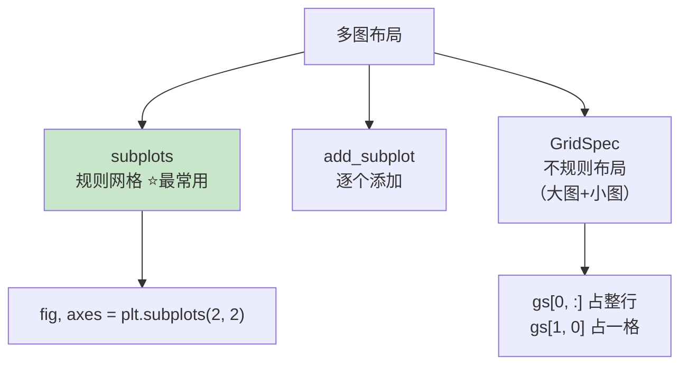

### 11.4 双 y 轴（量纲不同的两组数据）

```python
# —— 需求：温度（°C）和降雨量（mm）画在一张图 ——
months = range(1, 13)
temp = [2, 5, 12, 20, 26, 30, 33, 32, 27, 19, 10, 4]
rain = [10, 20, 35, 50, 70, 120, 180, 150, 80, 45, 25, 15]

fig, ax1 = plt.subplots(figsize=(9, 5))

# —— 左轴：温度折线 ——
line1 = ax1.plot(months, temp, color="red", marker="o", label="温度")
ax1.set_xlabel("月份")
ax1.set_ylabel("温度 (°C)", color="red")
ax1.tick_params(axis="y", labelcolor="red")       # 刻度也变红

# —— 右轴：降雨柱状 ——
ax2 = ax1.twinx()                                  # 共享 x，创建双胞胎 y 轴
bar2 = ax2.bar(months, rain, alpha=0.3, color="blue", label="降雨量")
ax2.set_ylabel("降雨量 (mm)", color="blue")

# —— 合并图例 ——
lines = line1 + [bar2]
labels = [l.get_label() for l in lines]
ax1.legend(lines, labels, loc="upper left")

ax1.set_title("月度温度与降雨量")
plt.show()
```

### 11.5 颜色条 colorbar

```python
# 散点 + colorbar：第三维用颜色表示
np.random.seed(42)
x = np.random.rand(100)
y = np.random.rand(100)
value = x + y       # 颜色深浅代表值大小

fig, ax = plt.subplots(figsize=(8, 6))
sc = ax.scatter(x, y, c=value, cmap="viridis", s=100)
fig.colorbar(sc, ax=ax, label="数值")            # 添加颜色条
ax.set_title("带颜色条的散点图")
plt.show()
```

---

## 十二、高级特性 🚀

### 12.1 颜色映射 colormap

```python
import matplotlib.pyplot as plt
import numpy as np

# —— 常用 colormap ——
cmaps = ["viridis", "plasma", "coolwarm", "RdYlGn", "Blues", "jet"]

data = np.random.rand(10, 10)

fig, axes = plt.subplots(2, 3, figsize=(14, 7))
for ax, cmap in zip(axes.flat, cmaps):
    im = ax.imshow(data, cmap=cmap)
    ax.set_title(cmap)
    fig.colorbar(im, ax=ax)

plt.tight_layout()
plt.show()
```

| colormap | 特点 | 适用场景 |
| :--- | :--- | :--- |
| `viridis` | 紫→绿→黄，感知均匀 | 默认首选 ⭐ |
| `coolwarm` | 蓝→红 | 冷热对比 |
| `RdYlGn` | 红→黄→绿 | 低→高（如涨跌） |
| `Blues` | 单色渐变 | 强调程度 |
| `jet` | 彩虹 | ⚠️ 不推荐（感知不均） |

### 12.2 保存与导出

```python
fig, ax = plt.subplots()
ax.plot([1, 2, 3], [4, 5, 6])

# —— 保存（必须在 show 之前！）——
fig.savefig("mychart.png", dpi=300,              # 分辨率
            bbox_inches="tight",                 # 自动裁掉空白
            facecolor="white")                   # 背景色

# —— 支持格式 ——
fig.savefig("chart.pdf")        # PDF（论文投稿）
fig.savefig("chart.svg")        # SVG（矢量，网页用）
fig.savefig("chart.jpg")        # JPG
fig.savefig("chart.png", transparent=True)   # 透明背景 PNG

# —— 显示前保存 vs 显示后 ——
plt.show()                       # show 后 fig 被清空，保存会得到空图！
```

> ⚠️ **顺序口诀**：先 `savefig` 再 `show`！

### 12.3 3D 绘图

```python
from mpl_toolkits.mplot3d import Axes3D   # noqa（导入即可激活）

fig = plt.figure(figsize=(10, 7))
ax = fig.add_subplot(111, projection="3d")    # 创建 3D 坐标区

# —— 3D 曲面：z = sin(√(x²+y²)) ——
x = np.linspace(-5, 5, 50)
y = np.linspace(-5, 5, 50)
X, Y = np.meshgrid(x, y)                      # 网格化
Z = np.sin(np.sqrt(X**2 + Y**2))

surf = ax.plot_surface(X, Y, Z, cmap="viridis", alpha=0.9)
fig.colorbar(surf, shrink=0.5)
ax.set_title("3D 曲面图")
ax.set_xlabel("X")
ax.set_ylabel("Y")
ax.set_zlabel("Z")
plt.show()
```

```python
# —— 3D 散点 ——
np.random.seed(42)
fig = plt.figure(figsize=(8, 6))
ax = fig.add_subplot(111, projection="3d")

xs = np.random.rand(100)
ys = np.random.rand(100)
zs = np.random.rand(100)
values = xs + ys + zs

ax.scatter(xs, ys, zs, c=values, cmap="plasma", s=50)
ax.set_title("3D 散点图")
plt.show()
```

### 12.4 动画（选学）

```python
from matplotlib.animation import FuncAnimation

fig, ax = plt.subplots(figsize=(8, 4))
x = np.linspace(0, 2*np.pi, 100)
line, = ax.plot(x, np.sin(x))

def update(frame):
    line.set_ydata(np.sin(x + frame / 10))    # 每帧移动相位
    return line,

ani = FuncAnimation(fig, update, frames=100, interval=50, blit=True)
ani.save("wave.gif", writer="pillow")          # 保存为 GIF
plt.show()
```

---

## 十三、Pandas 快捷绘图 🐼

> Pandas 内置了 `.plot()`——DataFrame 直接画图，超方便！

### 13.1 基本用法

```python
import pandas as pd
import matplotlib.pyplot as plt

plt.rcParams["font.sans-serif"] = ["SimHei"]

df = pd.DataFrame({
    "月份": ["1月", "2月", "3月", "4月", "5月", "6月"],
    "销量": [120, 150, 130, 180, 160, 200],
    "利润": [30, 45, 35, 60, 50, 70],
})

# —— 一行画折线图 ——
df.plot(x="月份", y="销量", kind="line", marker="o", title="月度销量")

# —— 多列一起画 ——
df.plot(x="月份", y=["销量", "利润"], kind="line", marker="o")
plt.show()
```

### 13.2 kind 参数一览

```python
# kind 决定图表类型
df.plot(x="月份", y="销量", kind="bar")        # 柱状图
df.plot(x="月份", y="销量", kind="barh")       # 横向柱状图
df.plot(y="销量", kind="hist")                 # 直方图
df.plot(x="销量", y="利润", kind="scatter")    # 散点图
df.plot(y="销量", kind="box")                  # 箱线图
df.plot(y=["销量"], kind="area")               # 面积图
df.plot(y="销量", kind="pie")                  # 饼图
```

| kind | 图表 | 对应 Matplotlib |
| :--- | :--- | :--- |
| `line` | 折线图（默认） | `ax.plot()` |
| `bar` / `barh` | 柱状图 | `ax.bar()` |
| `hist` | 直方图 | `ax.hist()` |
| `box` | 箱线图 | `ax.boxplot()` |
| `scatter` | 散点图 | `ax.scatter()` |
| `area` | 面积图 | `ax.fill_between()` |
| `pie` | 饼图 | `ax.pie()` |

### 13.3 搭配 Matplotlib 精修

```python
# —— Pandas 画图 + ax 精修（黄金组合）——
fig, ax = plt.subplots(figsize=(9, 5))

df.plot(x="月份", y=["销量", "利润"],
        kind="bar", ax=ax,                     # 传入自己的 ax！
        color=["skyblue", "salmon"],
        edgecolor="navy", width=0.8)

ax.set_title("月度销量与利润对比", fontsize=14)
ax.set_ylabel("数值")
ax.grid(True, axis="y", alpha=0.3)
ax.legend(loc="upper left")

for container in ax.containers:               # 柱顶标数值
    ax.bar_label(container, fmt="%d", padding=2, fontsize=8)

plt.tight_layout()
plt.savefig("pandas_chart.png", dpi=150)
plt.show()
```

### 13.4 时间序列直接画

```python
import numpy as np

# —— 时间索引 DataFrame 画图最爽 ——
ts = pd.DataFrame({
    "销量": np.random.randint(80, 120, 60).cumsum(),
}, index=pd.date_range("2026-07-01", periods=60))

ts.plot(figsize=(10, 4), title="累计销量趋势", legend=True)
plt.show()
# x 轴日期自动格式化，超省心！
```

---

## 十四、综合实战：可视化大屏 💼

> 用一份销售数据，做出专业级多图报表！

### 14.1 数据准备

```python
import numpy as np
import pandas as pd
import matplotlib.pyplot as plt

# —— 全局配置（写一次管全局）——
plt.rcParams["font.sans-serif"] = ["SimHei"]
plt.rcParams["axes.unicode_minus"] = False
plt.style.use("seaborn-v0_8")

np.random.seed(42)

# —— 模拟一年销售数据 ——
dates = pd.date_range("2026-01-01", periods=365, freq="D")
df = pd.DataFrame({
    "日期": dates,
    "城市": np.random.choice(["北京", "上海", "广州", "深圳"], 365),
    "产品": np.random.choice(["A", "B", "C"], 365, p=[0.5, 0.3, 0.2]),
    "销售额": np.random.gamma(5, 500, 365).round(),
    "利润": np.random.normal(800, 300, 365).round(),
})
df["月份"] = df["日期"].dt.month
```

### 14.2 大屏布局设计

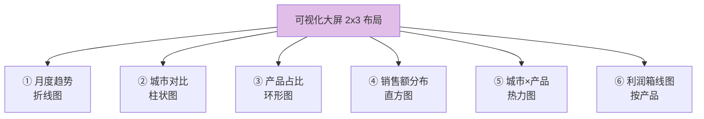

### 14.3 完整代码

```python
fig = plt.figure(figsize=(16, 10))
gs = fig.add_gridspec(2, 3, hspace=0.35, wspace=0.3)

fig.suptitle("2026 年度销售数据大屏 📊", fontsize=18, fontweight="bold")

# ========== ① 月度销售趋势（折线图）==========
ax1 = fig.add_subplot(gs[0, 0])
monthly = df.groupby("月份")["销售额"].sum()
monthly.plot(ax=ax1, marker="o", color="steelblue")
ax1.set_title("月度销售趋势")
ax1.grid(True, alpha=0.3)

# ========== ② 城市销售额对比（柱状图）==========
ax2 = fig.add_subplot(gs[0, 1])
city = df.groupby("城市")["销售额"].sum().sort_values()
bars = city.plot(ax=ax2, kind="barh", color="mediumpurple")
ax2.set_title("城市销售额排名")
ax2.bar_label(bars.containers[0], fmt="%.0f", padding=3, fontsize=8)

# ========== ③ 产品占比（环形图）==========
ax3 = fig.add_subplot(gs[0, 2])
product = df.groupby("产品")["销售额"].sum()
ax3.pie(product, labels=product.index, autopct="%.1f%%",
        colors=["#FF6B6B", "#4ECDC4", "#FFE66D"],
        wedgeprops={"width": 0.4, "edgecolor": "white"},
        startangle=90)
ax3.set_title("产品销售额占比")

# ========== ④ 销售额分布（直方图）==========
ax4 = fig.add_subplot(gs[1, 0])
ax4.hist(df["销售额"], bins=30, color="skyblue", edgecolor="white")
ax4.axvline(df["销售额"].mean(), color="red", linestyle="--",
            label=f"均值 {df['销售额'].mean():.0f}")
ax4.set_title("单笔销售额分布")
ax4.legend()

# ========== ⑤ 城市×产品 交叉热力图 ==========
ax5 = fig.add_subplot(gs[1, 1])
pivot = df.pivot_table(values="销售额", index="城市",
                       columns="产品", aggfunc="sum")
im = ax5.imshow(pivot.values, cmap="YlOrRd")
ax5.set_xticks(range(len(pivot.columns)))
ax5.set_xticklabels(pivot.columns)
ax5.set_yticks(range(len(pivot.index)))
ax5.set_yticklabels(pivot.index)
# 格子里标数值
for i in range(len(pivot.index)):
    for j in range(len(pivot.columns)):
        ax5.text(j, i, f"{pivot.values[i, j]/10000:.0f}万",
                 ha="center", va="center", fontsize=9)
ax5.set_title("城市×产品 销售热力图")
fig.colorbar(im, ax=ax5, shrink=0.8)

# ========== ⑥ 各产品利润分布（箱线图）==========
ax6 = fig.add_subplot(gs[1, 2])
data_box = [df[df["产品"] == p]["利润"] for p in ["A", "B", "C"]]
box = ax6.boxplot(data_box, labels=["A", "B", "C"], patch_artist=True)
for patch, color in zip(box["boxes"], ["#FF6B6B", "#4ECDC4", "#FFE66D"]):
    patch.set_facecolor(color)
ax6.set_title("各产品利润分布")
ax6.grid(True, axis="y", alpha=0.3)

plt.savefig("sales_dashboard.png", dpi=150, bbox_inches="tight")
plt.show()
```

### 14.4 大屏产出流程

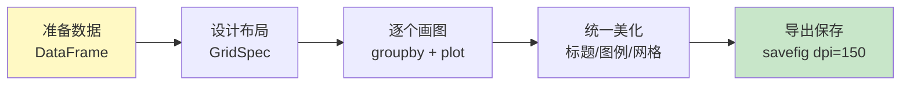

---

## 十五、知识总结 📌

### 核心知识图

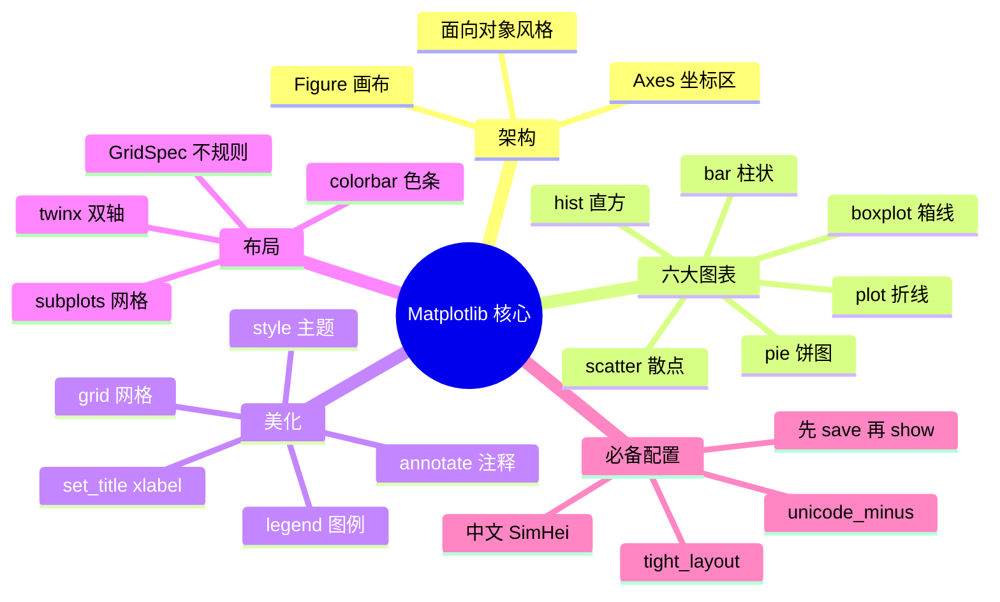

### 高频代码速查表

| 需求 | 写法 |
| :--- | :--- |
| 中文显示 | `plt.rcParams["font.sans-serif"]=["SimHei"]` |
| 负号正常 | `plt.rcParams["axes.unicode_minus"]=False` |
| 创建画布 | `fig, ax = plt.subplots(figsize=(8,4))` |
| 折线图 | `ax.plot(x, y, marker="o", label="A")` |
| 柱状图 | `ax.bar(cats, values)` / `barh` 横向 |
| 柱顶标数 | `ax.bar_label(bars, fmt="%d")` |
| 散点图 | `ax.scatter(x, y, s=大小, c=颜色)` |
| 直方图 | `ax.hist(data, bins=30)` |
| 饼图 | `ax.pie(vals, labels=, autopct="%.1f%%")` |
| 箱线图 | `ax.boxplot([d1, d2])` |
| 图例 | `ax.legend(loc="best")` |
| 参考线 | `ax.axhline(y=4)` / `ax.axvline(x=2)` |
| 注释 | `ax.annotate("文字", xy=(x,y))` |
| 子图网格 | `plt.subplots(2, 2)` |
| 双 y 轴 | `ax2 = ax1.twinx()` |
| 颜色条 | `fig.colorbar(sc)` |
| 保存图片 | `fig.savefig("x.png", dpi=300, bbox_inches="tight")` |
| Pandas画图 | `df.plot(x="a", y="b", kind="bar")` |
| 风格主题 | `plt.style.use("ggplot")` |
| 3D 图 | `fig.add_subplot(projection="3d")` |

### 常见坑与解决

| 坑 | 解决 |
| :--- | :--- |
| 中文显示方框 | 设置 `font.sans-serif` + `unicode_minus` |
| 保存的图片空白 | **先 savefig 再 show**！ |
| 子图标题重叠 | `plt.tight_layout()` |
| 图例挡住数据 | `legend(loc="best")` 或放图外 |
| 饼图变椭圆 | `ax.axis("equal")` |
| 双轴图例只有一个 | 手动合并 `lines` 和 `labels` |
| 保存后中文乱码 | savefig 加 `bbox_inches="tight"` |

### 图表选择决策图

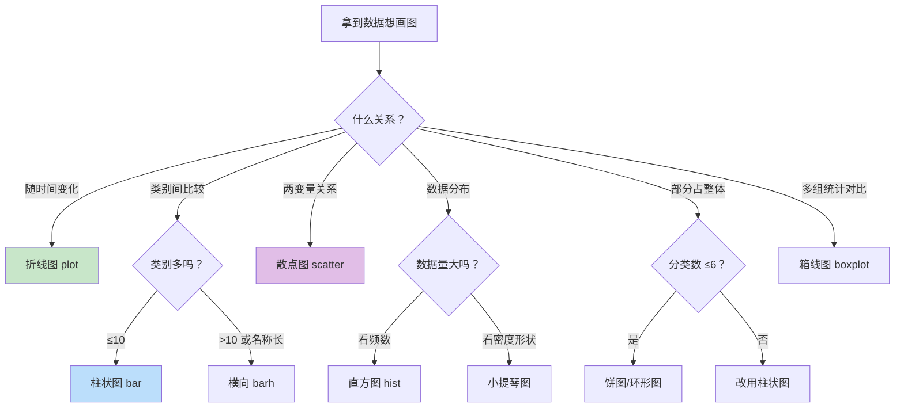

### 学习路线建议

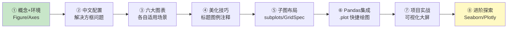

> 🎀 呼～Matplotlib 全套绘图秘籍到手啦！🎉 从 Figure/Axes 架构到六大图表，从美化技巧到大屏实战——你的数据现在可以"开口说话"了！配合 [Python数据分析.md](file:///d:/A-H2H/Python/Python数据分析.md) 的 Pandas 知识，分析+可视化双剑合璧！下一步可以探索 Seaborn（统计图表更美）或 Plotly（交互式图表）哦～快拿自己的数据画起来！(◍•ᴗ•◍)❤


