# 🔢 NumPy 数值计算

> 哈喽呀～欢迎来到 NumPy 的数字世界！🌟 它是 Python 科学计算的"地基"——Pandas、SciPy、机器学习全都站在它肩膀上！把它学透，数据处理速度起飞！(๑•̀ㅂ•́)و✧

---

## 🗺️ 知识全景图

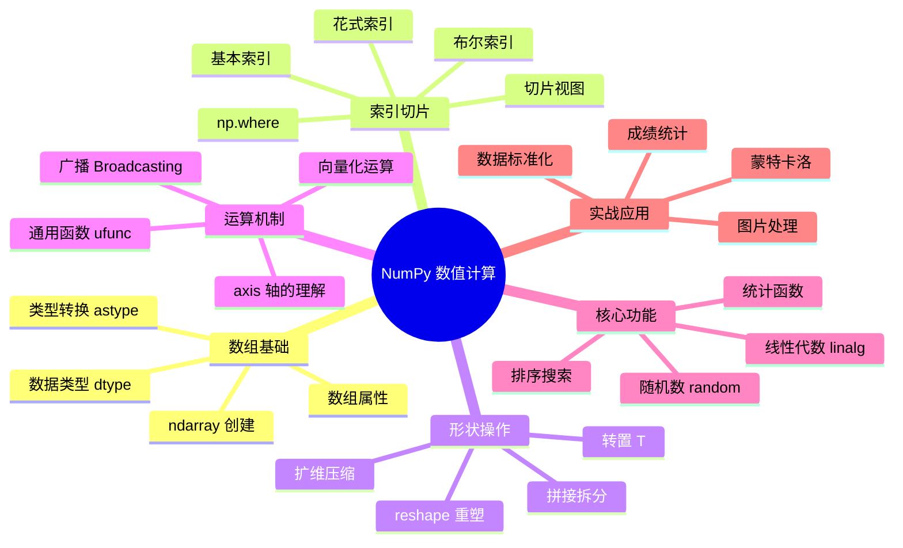

---

## 📑 目录

- [一、NumPy 简介](#一numpy-简介)
- [二、ndarray：核心数组对象](#二ndarray核心数组对象)
- [三、创建数组的 N 种方式](#三创建数组的-n-种方式)
- [四、数据类型 dtype](#四数据类型-dtype)
- [五、索引与切片](#五索引与切片)
- [六、形状操作](#六形状操作)
- [七、广播机制](#七广播机制)
- [八、数组运算与通用函数](#八数组运算与通用函数)
- [九、统计函数](#九统计函数)
- [十、排序与搜索](#十排序与搜索)
- [十一、随机数模块](#十一随机数模块)
- [十二、线性代数](#十二线性代数)
- [十三、处理 NaN 缺失值](#十三处理-nan-缺失值)
- [十四、综合实战](#十四综合实战)
- [十五、知识总结](#十五知识总结)

---

## 一、NumPy 简介 🌟

### 1.1 什么是 NumPy？

NumPy（Numerical Python）是 Python 科学计算的**基础包**，2005 年由 Travis Oliphant 创建。

核心提供：
- **ndarray**：多维数组对象（快！）
- **广播机制**：不同形状数组优雅运算
- **数学函数库**：对整个数组快速运算
- **线性代数、随机数、傅里叶变换**等工具

### 1.2 为什么需要 NumPy？（列表 vs 数组）

```python
import numpy as np
import time

# —— 同样的任务：100 万个数乘 2 ——
py_list = list(range(1_000_000))
np_arr = np.arange(1_000_000)

# Python 列表：循环 + 装箱
start = time.perf_counter()
result = [x * 2 for x in py_list]
print(f"列表: {time.perf_counter() - start:.3f}s")

# NumPy 数组：向量化
start = time.perf_counter()
result = np_arr * 2
print(f"数组: {time.perf_counter() - start:.3f}s")
# 数组通常快 10~100 倍！
```

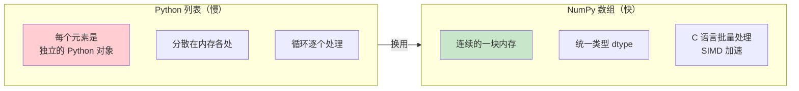

### 1.3 应用领域

| 领域 | 用 NumPy 做什么 |
| :--- | :--- |
| 数据分析 | Pandas 的底层引擎 |
| 机器学习 | 张量运算、数据预处理 |
| 图像处理 | 像素就是多维数组 |
| 科学计算 | 模拟、仿真、数值分析 |
| 量化金融 | 大批量行情计算 |

### 1.4 安装与导入

```bash
pip install numpy
```

```python
import numpy as np   # 全世界统一约定别名
print(np.__version__)
```

---

## 二、ndarray：核心数组对象 📦

### 2.1 创建第一个数组

```python
import numpy as np

# 从列表创建
a = np.array([1, 2, 3, 4, 5])
print(a)          # [1 2 3 4 5]
print(type(a))    # <class 'numpy.ndarray'>

# 二维（嵌套列表）
b = np.array([[1, 2, 3],
              [4, 5, 6]])
print(b)
# [[1 2 3]
#  [4 5 6]]
```

### 2.2 数组属性

```python
b = np.array([[1, 2, 3],
              [4, 5, 6]])

b.shape      # (2, 3)   → 2行3列
b.ndim       # 2        → 维度数量
b.size       # 6        → 元素总数
b.dtype      # int32    → 数据类型（Windows 默认 int32）
b.itemsize   # 4        → 每个元素字节数
b.nbytes     # 24       → 总字节数 = size × itemsize
b.T          # 转置（3行2列）
```

| 属性 | 含义 | 示例 |
| :--- | :--- | :--- |
| `shape` | 形状（各维度大小） | `(2, 3)` |
| `ndim` | 维度数 | `2` |
| `size` | 元素总数 | `6` |
| `dtype` | 元素类型 | `int32` |
| `nbytes` | 占用内存 | `24` |

### 2.3 维度直观理解

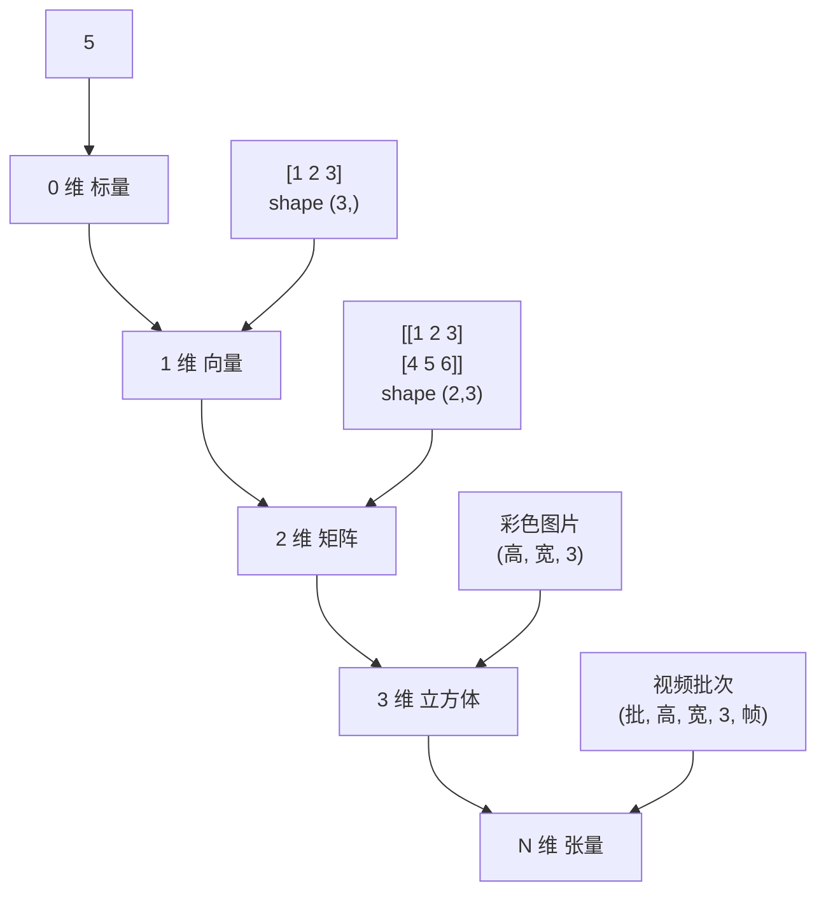

> 🎀 记忆：**shape 从外往里数括号**！`[[1,2],[3,4]]` 外层 2 个元素、内层各 2 个 → shape (2, 2)

---

## 三、创建数组的 N 种方式 🏗️

### 3.1 从现有数据创建

```python
import numpy as np

np.array([1, 2, 3])                  # 从列表
np.array((1, 2, 3))                  # 从元组
np.array([[1, 2], [3, 4]], dtype=float)   # 指定类型

np.asarray([1, 2, 3])                # 能转则转（已是数组就不复制）
np.array([1, 2, 3], copy=False)      # 尽量共享内存
```

### 3.2 固定值创建

```python
np.zeros(5)              # [0. 0. 0. 0. 0.]
np.zeros((2, 3))         # 2行3列全 0（注意传元组！）
np.ones((2, 2))          # 全 1
np.full((2, 2), 7)       # 全 7
np.full(3, "hi")         # 还能填字符串 ['hi' 'hi' 'hi']

np.zeros_like(a)         # 跟 a 同形状的全 0（复制形状神器）
np.ones_like(a)          # 同形状全 1
np.full_like(a, 9)       # 同形状全 9

np.eye(3)                # 3×3 单位矩阵（对角线 1）
np.identity(3)           # 同上
np.diag([1, 2, 3])       # 对角矩阵（给定对角元素）
np.arange(1, 10, 2)      # [1 3 5 7 9]  等差（类似 range）
np.linspace(0, 1, 5)     # [0. 0.25 0.5 0.75 1.]  等分（含两端！）
np.logspace(0, 2, 3)     # [1. 10. 100.]  对数等分
```

### 3.3 arange vs linspace 对比

| 函数 | 切分方式 | 特点 |
| :--- | :--- | :--- |
| `arange(start, stop, step)` | 按**步长** | 不含 stop |
| `linspace(start, stop, num)` | 按**份数** | **含 stop** ⭐ |

```python
np.arange(0, 1, 0.3)     # [0.  0.3  0.6  0.9]     浮点步长有精度坑！
np.linspace(0, 1, 4)     # [0.  0.333  0.666  1.]  精确等分 ✅
```

### 3.4 创建速查表

| 函数 | 用途 | 示例结果 |
| :--- | :--- | :--- |
| `zeros(n)` | 全 0 | `[0. 0. 0.]` |
| `ones(n)` | 全 1 | `[1. 1. 1.]` |
| `full(n, val)` | 全指定值 | `[7. 7. 7.]` |
| `eye(n)` | 单位矩阵 | 对角线 1 |
| `arange(a,b,s)` | 等差步长 | `[0 2 4]` |
| `linspace(a,b,n)` | 等分份数 | 精确 n 个点 |
| `empty(n)` | 未初始化（快） | 随机垃圾值 |

> ⚠️ `np.empty` 只是"不初始化"来提速，**内容是内存残留垃圾值**——用前必须赋值！

---

## 四、数据类型 dtype 🏷️

### 4.1 常见类型

| 类型 | 说明 | 范围/精度 |
| :--- | :--- | :--- |
| `bool_` | 布尔 | True/False |
| `int8/16/32/64` | 整数 | 位数越高范围越大 |
| `uint8` | 无符号整数 | 0~255（图片像素！） |
| `float16/32/64` | 浮点 | 32 常用，64 精度高 |
| `complex64/128` | 复数 | 科学计算 |
| `<U10` | Unicode 字符串 | 长度 10 |
| `object` | Python 对象 | 万能但慢 ⚠️ |

### 4.2 指定与转换类型

```python
import numpy as np

# —— 创建时指定 ——
a = np.array([1, 2, 3], dtype=np.float64)
b = np.array([1.7, 2.2], dtype=np.int32)    # 直接截断 → [1 2]

# —— astype 转换（返回新数组）——
a = np.array([1, 2, 3])
a.astype(float)           # [1. 2. 3.]
a.astype(str)             # ['1' '2' '3']
a.astype(bool)            # [ True True True]（0 是 False）

# —— 浮点转整数会截断（不是四舍五入！）——
np.array([2.9]).astype(int)     # [2] ❗
np.round([2.9]).astype(int)     # [3] ✅ 先 round 再转

# —— 查看类型 ——
a.dtype          # dtype('int32')
a.dtype.name     # 'int32'
```

### 4.3 类型提升规则

```python
# int + float → float（往"大"的提升）
np.array([1, 2]) + np.array([0.5, 0.5])   # [1.5 2.5]

# 小整数 + 大整数 → 大整数
# 不同类型运算，结果取"更通用"的类型
```

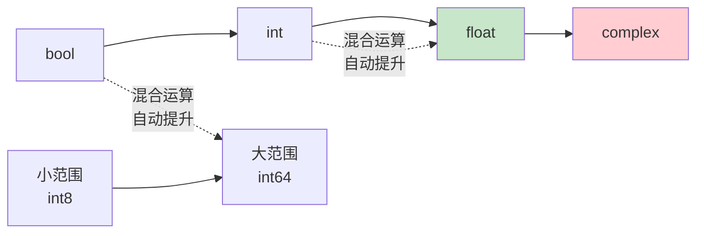

### 4.4 机器学习常用类型约定

```python
# 图片：uint8（0~255）
img = np.zeros((224, 224, 3), dtype=np.uint8)

# 神经网络权重：float32（省内存、GPU 友好）
weights = np.random.randn(100, 50).astype(np.float32)

# 标签：int64
labels = np.array([0, 1, 2, 1], dtype=np.int64)
```

---

## 五、索引与切片 🔍

### 5.1 基本索引

```python
import numpy as np

a = np.array([[10, 20, 30],
              [40, 50, 60],
              [70, 80, 90]])

a[0, 0]        # 10   第0行第0列
a[1, 2]        # 60
a[-1, -1]      # 90   负索引从后往前
a[1]           # [40 50 60]  整行
a[:, 1]        # [20 50 80]  整列（冒号=全部）
```

### 5.2 切片

```python
a = np.arange(12).reshape(3, 4)
# [[ 0  1  2  3]
#  [ 4  5  6  7]
#  [ 8  9 10 11]]

a[0:2, 1:3]     # 前2行、第1~2列
# [[1 2]
#  [5 6]]

a[::2, :]       # 隔行取（第0、2行）
a[:, ::2]       # 隔列取
a[::-1]         # 行倒序
a[::-1, ::-1]   # 180° 翻转

# 三维：图片切片
img = np.random.randint(0, 256, (100, 100, 3), dtype=np.uint8)
img[10:50, 20:80, 0]     # 裁剪区域 + 只取红色通道
img[:, :, ::-1]          # RGB → BGR（通道反序）
```

### 5.3 ⚠️ 切片是视图！不是副本！

```python
a = np.arange(5)     # [0 1 2 3 4]

b = a[1:4]           # 切片 → 视图（共享内存！）
b[0] = 99            # 改 b……

print(a)             # [ 0 99  2  3  4]  ← a 也被改了！❗

# —— 要副本就用 .copy() ——
c = a[1:4].copy()    # 独立的新内存
c[0] = 0
print(a)             # a 不受影响 ✅
```

```mermaid
graph TD
    A["切片 a&#91;1:4&#93;"] --> B{"拿到什么？"}
    B -->|"视图 View"| C["共享同一块内存<br/>改它 = 改原数组"]
    B -->|"副本 Copy"| D["独立新内存<br/>互不影响"]

    E["需要独立修改？<br/>用 .copy&#40;&#41;"] --> D

    style C fill:#ffcdd2
    style D fill:#c8e6c9
```

> 💡 为什么这么设计？**大数组切片时不用复制数据，快又省内存**！但改数据前想清楚～

### 5.4 花式索引（用数组当索引）

```python
a = np.array([10, 20, 30, 40, 50])

a[[0, 2, 4]]           # [10 30 50]   取指定位置
a[[4, 0, 4]]           # [50 10 50]   可重复、可乱序
a[np.array([0, 2]), ]  # 同上

# 二维花式索引：行列配对
b = np.arange(12).reshape(3, 4)
b[[0, 2], [1, 3]]      # [1, 11]  取 (0,1) 和 (2,3) 两个点 ❗

# 想取"行×列的组合"？用 ix_
b[np.ix_([0, 2], [1, 3])]
# [[ 1  3]
#  [ 9 11]]   第0、2行 × 第1、3列 的交叉

# ⚠️ 花式索引返回的是【副本】不是视图！
```

### 5.5 布尔索引（最常用！⭐）

```python
a = np.array([3, 8, 1, 9, 4, 7])

# —— 条件得到布尔数组 ——
a > 4                   # [False True False True False True]

# —— 用布尔数组筛选（True 的留下）——
a[a > 4]                # [8 9 7]

# —— 多条件（& 与 | 或 ~ 非，每个条件必须加括号！）——
a[(a > 3) & (a < 8)]    # [4 7]
a[(a < 2) | (a > 8)]    # [1 9]
a[~(a > 4)]             # [3 1 4]

# ⚠️ 不能用 and/or/not！它们是"单个值"的逻辑，数组要用 & | ~
```

```python
# —— 二维布尔索引 ——
b = np.arange(12).reshape(3, 4)
b[b > 6]                # [ 7  8  9 10 11]  拉平后返回
b[b % 2 == 0]           # 所有偶数

# —— 按行筛选（配合 any/all）——
b[(b > 5).any(axis=1)]  # 有元素>5 的行
b[(b < 3).all(axis=1)]  # 所有元素<3 的行

# —— 修改满足条件的值 ——
b[b > 6] = 0            # 大于6的都改成 0
b[b % 2 == 0] += 100    # 偶数都 +100
np.clip(b, 0, 10)       # 限制范围在 0~10
```

### 5.6 np.where：条件表达式

```python
a = np.array([3, 8, 1, 9, 4])

# —— 三元形式：满足取 x，否则取 y ——
np.where(a > 4, "大", "小")
# ['小' '大' '小' '大' '小']

# —— 实战：及格判断 ——
scores = np.array([55, 78, 92, 45, 88])
np.where(scores >= 60, "✅及格", "❌挂科")

# —— 只给条件：返回满足条件的【索引】——
np.where(a > 4)         # (array([1, 3]),)

# —— 提取正数的下标 ——
values = np.array([-2, 5, -1, 8, -3])
np.where(values > 0)[0]    # [1 3]
```

---

## 六、形状操作 🔧

### 6.1 reshape 重塑

```python
a = np.arange(12)

a.reshape(3, 4)       # 3行4列
a.reshape(2, 6)
a.reshape(12, 1)      # 列向量
a.reshape(-1)         # 拉平成一维（-1 自动算）
a.reshape(3, -1)      # 3行，列数自动 → 4列
a.reshape(-1, 2)      # 每行2个，行数自动 → 6行

# ⚠️ reshape 的元素总数必须能对上！12 = 3×4 = 2×6 ✅
# a.reshape(5, 2)     # ❌ 报错：cannot reshape

# reshape 返回视图（数据共享），
# resize 直接改原数组
a.resize(3, 4)        # 就地修改，无返回
```

> 🎀 `-1` 就是"我不关心，你（NumPy）自己算"！只能有一个 `-1`。

### 6.2 拉平：flatten / ravel

```python
b = np.arange(6).reshape(2, 3)

b.flatten()      # [0 1 2 3 4 5]  返回【副本】
b.ravel()        # [0 1 2 3 4 5]  返回【视图】（尽量）
b.reshape(-1)    # 同 ravel

# 实战：切片 channel
img = np.random.rand(4, 4, 3)
img[..., 0].flatten()     # 提取 R 通道并拉平
```

### 6.3 转置

```python
b = np.arange(6).reshape(2, 3)
# [[0 1 2]
#  [3 4 5]]

b.T                # 转置 → (3, 2)
# [[0 3]
#  [1 4]
#  [2 5]]

b.transpose()      # 同 .T
np.transpose(b, (1, 0))       # 指定轴顺序

# 三维转置：调换轴（深度学习常用！）
img = np.random.rand(32, 224, 224, 3)    # NHWC（TensorFlow 风格）
img.transpose(0, 3, 1, 2).shape          # (32, 3, 224, 224) NCHW（PyTorch 风格）
```

### 6.4 增加/压缩维度

```python
a = np.array([1, 2, 3])       # shape (3,)

# —— 增维（机器学习常需要）——
a[np.newaxis, :]              # (1, 3) 行向量
a[:, np.newaxis]              # (3, 1) 列向量 ⭐常用
a.reshape(3, 1)               # 同上
np.expand_dims(a, axis=0)     # (1, 3)
np.expand_dims(a, axis=1)     # (3, 1)

# —— 压维 ——
b = np.array([[1], [2], [3]])     # (3, 1)
np.squeeze(b)                     # (3,)  压掉长度为 1 的维度
```

```mermaid
graph LR
    A["[1 2 3]<br/>(3,)"] -->|"[", np.newaxis, "]"| B["[[1] [2] [3]]<br/>(3,1)"]
    A -->|"[np.newaxis, :]"| C["[[1 2 3]]<br/>(1,3)"]

    style B fill:#c8e6c9
```

### 6.5 拼接与拆分

```python
a = np.array([[1, 2], [3, 4]])
b = np.array([[5, 6]])

# —— 拼接 ——
np.concatenate([a, a], axis=0)          # 上下拼（行增加）
np.concatenate([a, a], axis=1)          # 左右拼（列增加）
np.vstack([a, a])                       # vertical 垂直 = axis 0
np.hstack([a, a])                       # horizontal 水平 = axis 1

# 维度不同也能拼：stack 系列会创建新轴
np.stack([a, a], axis=0).shape          # (2, 2, 2)  新增第0维
np.dstack([a, a]).shape                 # (2, 2, 2)  深度方向

# —— 拆分 ——
c = np.arange(12).reshape(3, 4)
np.split(c, 3, axis=0)          # 按行均分 3 份
np.hsplit(c, 2)                 # 按列均分 2 份
np.vsplit(c, 3)                 # 垂直拆
np.array_split(c, 2, axis=1)    # 不均分也行（最后一份少点）

# 按位置拆（不均等）
np.split(c, [1, 2], axis=0)     # 在第1、2行处切开 → 3 块
```

| 操作 | 函数 | 方向 |
| :--- | :--- | :--- |
| 上下拼 | `vstack` / `concatenate(axis=0)` | 行增加 |
| 左右拼 | `hstack` / `concatenate(axis=1)` | 列增加 |
| 新维度叠 | `stack(axis=n)` | 造新轴 |
| 上下拆 | `vsplit` | 按行切 |
| 左右拆 | `hsplit` | 按列切 |

---

## 七、广播机制 📡

> NumPy 最优雅的设计！形状不同的数组也能一起运算～

### 7.1 什么是广播？

当两个数组形状不同时，NumPy 自动**"复制扩展"较小的数组**，让它们形状匹配再运算——这个过程就是广播（Broadcasting）。

```python
import numpy as np

a = np.array([[1, 2, 3],
              [4, 5, 6]])      # shape (2, 3)

b = np.array([10, 20, 30])     # shape (3,)

a + b
# b 被"广播"成两行 [[10,20,30],[10,20,30]]
# [[11 22 33]
#  [14 25 36]]

c = np.array([[10],
              [20]])            # shape (2, 1)

a + c
# c 被"广播"成三列 [[10,10,10],[20,20,20]]
# [[11 12 13]
#  [24 25 26]]
```

### 7.2 广播规则（两条！）

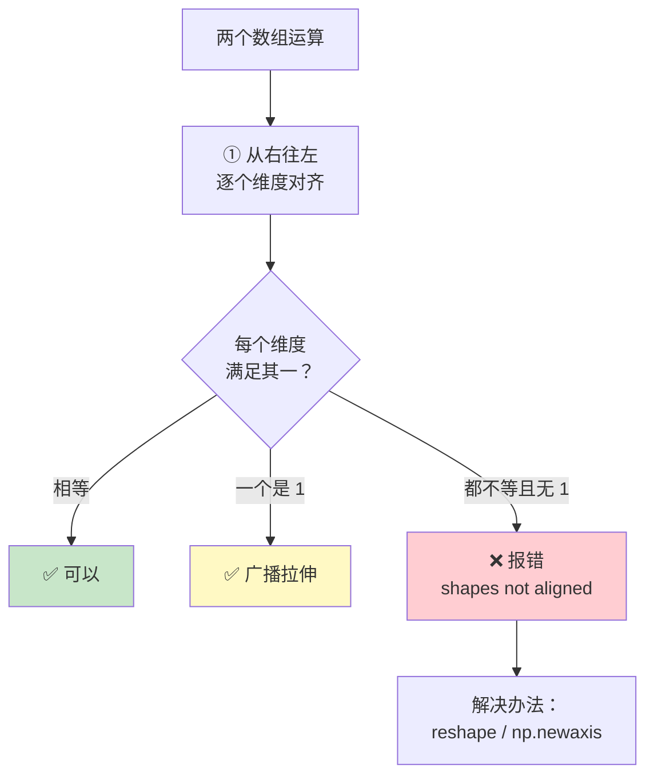

| 形状 A | 形状 B | 能广播吗？ | 结果 |
| :--- | :--- | :---: | :--- |
| (3, 4) | (3, 4) | ✅ 完全相同 | (3, 4) |
| (3, 4) | (4,) | ✅ 1维对齐 | (3, 4) |
| (3, 4) | (3, 1) | ✅ 有 1 拉伸 | (3, 4) |
| (3, 4) | (1, 4) | ✅ 有 1 拉伸 | (3, 4) |
| (3, 4) | (3,) | ❌ 3≠4 且无 1 | 报错！ |
| (3, 4) | (2, 4) | ❌ 3≠2 且无 1 | 报错！ |

### 7.3 广播实战案例

```python
# —— 案例 1：矩阵每行减去不同的数（数据标准化核心！）——
data = np.array([[170, 75],
                 [160, 50],
                 [180, 80]])        # 3个样本 (身高,体重)

mean = data.mean(axis=0)            # [170, 68.3] 每列均值
data - mean                         # (3,2) - (2,) → 广播成功 ✅

# —— 案例 2：经典报错与修复 ——
a = np.arange(3).reshape(3, 1)      # (3, 1) 列向量
b = np.arange(3)                    # (3,)   行向量
a + b                               # (3,1)+(3,) → (3,3) ✅
# [[0 1 2]
#  [1 2 3]
#  [2 3 4]]

# —— 案例 3：标量也是广播 ——
a = np.arange(5)
a * 2          # 2 被广播成 [2,2,2,2,2]
a > 2          # 比较运算也广播

# —— 案例 4：欧氏距离（机器学习经典）——
points = np.random.rand(5, 2)       # 5 个点 (x,y)
target = np.array([0.5, 0.5])

# 每个点到 target 的距离
dist = np.sqrt(((points - target) ** 2).sum(axis=1))
# points(5,2) - target(2,) → 广播逐行相减 ✅
```

### 7.4 广播报错怎么办？

```python
a = np.ones((3, 4))
b = np.arange(3)

# a + b   # ❌ ValueError: shapes (3,4) and (3,) not aligned

# —— 修复：手动调整形状 ——
b.reshape(3, 1) + a        # (3,1) + (3,4) → ✅ (3,4)
b[:, np.newaxis] + a       # 同上，更优雅

# —— 调试技巧：先看形状！ ——
print(a.shape, b.shape)    # (3, 4) (3,)
# 从右往左对齐：4 vs 3 → 不匹配 ❌
```

> 🎀 **广播心法**：想象两个数组的 shape **右对齐**，每一列要么相等、要么有 1（1 会被拉伸）、要么一边缺失（当作 1）！

---

## 八、数组运算与通用函数 ⚡

### 8.1 向量化思维（告别循环！）

```python
import numpy as np

# —— ❌ 错误示范：用 Python 循环 ——
result = []
for x in range(1000000):
    result.append(x ** 2 + 2 * x + 1)

# —— ✅ 正确姿势：向量化 ——
x = np.arange(1000000)
result = x ** 2 + 2 * x + 1       # 一行搞定，快几十倍
```

> 💡 **黄金法则**：能用 NumPy 运算解决的，绝不用 for 循环！

### 8.2 算术运算（逐元素）

```python
a = np.array([10, 20, 30])
b = np.array([1, 2, 3])

a + b       # [11 22 33]
a - b       # [ 9 18 27]
a * b       # [10 40 90]   ⚠️ 逐元素乘，不是矩阵乘！
a / b       # [10. 10. 10.]
a // b      # [10 10 10]   整除
a ** b      # [10 400 27000]  幂
a % b       # [0 0 0]      取模

# —— 复合赋值（就地修改，省内存）——
a += 1      # 等价 a = a + 1，但不新建数组
a *= 2
```

### 8.3 比较与逻辑运算

```python
a = np.array([3, 8, 1, 9])

a > 5               # [False True False True]
a == 8              # [False True False False]
np.equal(a, 8)      # 同上

# —— 数组间比较 ——
b = np.array([3, 0, 1, 2])
a > b               # [False True False True]  逐元素比！

# —— 逻辑运算（返回单个布尔）——
(a > 5).any()       # True   有任意一个 True
(a > 5).all()       # False  全部是 True 才 True
np.logical_and(a > 2, a < 9)   # [True True False False]
np.logical_or(a < 2, a > 8)
np.logical_not(a > 5)
```

### 8.4 数学函数（ufunc 通用函数）

```python
a = np.array([1, 4, 9, 16])

# —— 常用数学 ——
np.sqrt(a)          # [1. 2. 3. 4.]        平方根
np.abs([-1, 2, -3]) # [1 2 3]              绝对值
np.exp(a)           # e^x
np.log(a)           # 自然对数
np.log2(a)          # 以2为底
np.log10(a)         # 以10为底
np.sign([-5, 0, 3]) # [-1 0 1]             符号

# —— 三角函数 ——
angles = np.linspace(0, np.pi, 5)
np.sin(angles)
np.cos(angles)
np.tan(angles)
np.arcsin([0, 0.5, 1])     # 反三角

# —— 取整家族 ——
x = np.array([3.14, -2.7, 5.5, -0.2])
np.round(x)     # [ 3. -3.  6. -0.]   四舍五入（.5 取偶）
np.floor(x)     # [ 3. -3.  5. -1.]   向下取整
np.ceil(x)      # [ 4. -2.  6. -0.]   向上取整
np.trunc(x)     # [ 3. -2.  5. -0.]   截断（去掉小数）
np.rint(x)      # 同 round

# —— 近似与裁剪 ——
np.clip([1, 5, 10], 2, 8)      # [2 5 8]  限制在 2~8
```

### 8.5 聚合函数的 axis 详解 ⭐

```python
b = np.array([[1, 2, 3],
              [4, 5, 6],
              [7, 8, 9]])

b.sum()          # 45        全部加总
b.sum(axis=0)    # [12 15 18]  按列加（跨行）→ 结果 3 个
b.sum(axis=1)    # [ 6 15 24]  按行加（跨列）→ 结果 3 个
```

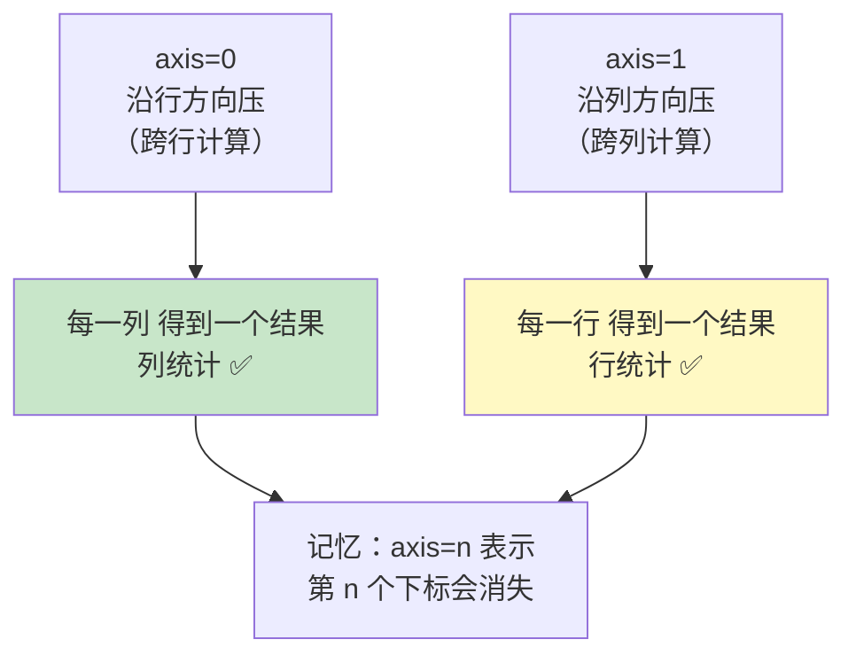

```python
# shape (3, 4) 的数组
# sum(axis=0) → 消失第0维 → shape (4,)
# sum(axis=1) → 消失第1维 → shape (3,)

# —— 三维同理 ——
c = np.random.rand(2, 3, 4)
c.sum(axis=0).shape    # (3, 4)
c.sum(axis=1).shape    # (2, 4)
c.sum(axis=2).shape    # (2, 3)
c.sum(axis=(0, 1)).shape   # (4,)  多轴一起压
```

---

## 九、统计函数 📊

### 9.1 基础统计

```python
import numpy as np

a = np.array([2, 5, 1, 8, 3, 9, 4])

a.sum()              # 32    总和
a.mean()             # 4.571 平均
a.median() if hasattr(a, 'median') else np.median(a)  # 4.0 中位数
np.median(a)         # 4.0   中位数（注意：是 np 函数！）
a.var()              # 方差（除以 n，总体方差）
a.std()              # 标准差
a.min(), a.max()     # 1, 9
a.argmin()           # 2   最小值的索引
a.argmax()           # 5   最大值的索引
a.ptp()              # 8   极差 max-min（peak to peak）
np.percentile(a, 75) # 6.5 75% 分位数
np.quantile(a, 0.5)  # 4.0  分位数（0~1 版本）

# —— 累积运算 ——
a.cumsum()           # [ 2  7  8 16 19 28 32]  累计和
a.cumprod()          # 累计积
```

### 9.2 二维统计实战

```python
scores = np.array([[85, 92, 78],      # 3个学生的3门成绩
                   [90, 88, 95],
                   [70, 75, 80]])

# —— 每门课的平均分（按列）——
scores.mean(axis=0)          # [81.67 85.   84.33]

# —— 每个学生的平均分（按行）——
scores.mean(axis=1)          # [85.   91.   75.  ]

# —— 每个学生最高的那门课的索引 ——
scores.argmax(axis=1)        # [1 2 1]

# —— 加权平均（配合广播）——
weights = np.array([0.4, 0.3, 0.3])
(scores * weights).sum(axis=1) / weights.sum()   # 每人加权分

# —— 标准分（Z-score 标准化）——
mean = scores.mean(axis=0)
std = scores.std(axis=0)
z_scores = (scores - mean) / std        # 广播！每列标准化
```

### 9.3 相关系数与协方差

```python
height = np.array([170, 165, 180, 175, 160])
weight = np.array([70, 55, 80, 68, 50])

np.corrcoef(height, weight)
# [[1.    0.97]
#  [0.97 1.  ]]     相关系数 0.97 → 高度正相关！

np.cov(height, weight)      # 协方差矩阵
```

---

## 十、排序与搜索 🔃

### 10.1 排序

```python
a = np.array([3, 1, 4, 1, 5, 9, 2, 6])

np.sort(a)              # [1 1 2 3 4 5 6 9]  返回新数组
np.sort(a)[::-1]        # 降序（先排再反转）

np.argsort(a)           # [1 3 6 0 2 4 7 5]  排序后的【索引】⭐

# —— argsort 经典应用：按成绩给学生排名 ——
names = np.array(["小明", "小红", "小刚", "小美"])
scores = np.array([85, 92, 78, 88])

order = np.argsort(scores)[::-1]      # 分数从高到低的索引
names[order]                          # ['小红' '小美' '小明' '小刚']

# —— 就地排序（改原数组）——
a.sort()                              # 无返回值，直接改 a

# —— 二维排序 ——
b = np.random.randint(0, 10, (3, 4))
np.sort(b, axis=0)          # 每列各自排序
np.sort(b, axis=1)          # 每行各自排序（默认）
np.sort(b, axis=None)       # 全部拉平排序

# —— 稳定排序 ——
np.sort(a, kind="stable")   # 相等元素保持原顺序
```

### 10.2 搜索

```python
a = np.array([2, 5, 1, 8, 3, 9, 4])

# —— 查找满足条件的数量 ——
(a > 4).sum()            # 3  个数（True 计为 1）
np.count_nonzero(a > 4)  # 3  同上

# —— 查找非零位置 ——
np.nonzero(a > 4)        # (array([1, 3, 5]),)  满足条件的索引
np.where(a > 4)          # 同上

# —— 去重 ——
np.unique([3, 1, 2, 3, 1])     # [1 2 3]
np.unique(a, return_counts=True)
# (array([1, 2, 3, 4, 5, 8, 9]), array([1, 1, 1, 1, 1, 1, 1]))

# —— 二分查找（数组必须已排序！）——
sorted_arr = np.sort(a)
np.searchsorted(sorted_arr, 4)   # 3 → 4 应插在索引 3 处

# —— 极值位置 ——
np.argmax(a)      # 5  最大值索引
np.argmin(a)      # 2  最小值索引
```

### 10.3 unique 统计频次（单词计数）

```python
words = np.array(["苹果", "香蕉", "苹果", "苹果", "香蕉", "梨"])

values, counts = np.unique(words, return_counts=True)
print(values)   # ['梨' '苹果' '香蕉']
print(counts)   # [1 3 2]

# —— 出现最多的 ——
values[np.argmax(counts)]     # '苹果'

# —— 组合成频次表 ——
for v, c in zip(values, counts):
    print(f"{v}: {c} 次")
```

---

## 十一、随机数模块 🎲

### 11.1 新旧 API 说明

> NumPy 1.17+ 推荐用 `np.random.default_rng()`（新一代 Generator），旧的全局函数仍可用～

```python
import numpy as np

# —— 新 API（推荐）——
rng = np.random.default_rng(seed=42)    # 创建生成器（种子固定可复现）

rng.random(5)              # [0, 1) 均匀分布
rng.integers(0, 10, 5)     # [0, 10) 随机整数
rng.normal(0, 1, 5)        # 正态分布
rng.choice([1, 2, 3], 2)   # 随机选择

# —— 旧 API（依然常见，很多老代码在用）——
np.random.seed(42)          # 固定全局种子
np.random.rand(5)           # [0, 1) 均匀
np.random.randint(0, 10, 5) # 随机整数
```

### 11.2 常用分布

```python
rng = np.random.default_rng(42)

# —— 均匀分布 ——
rng.random(3)                    # [0.63 0.03 0.69]   0~1
rng.uniform(10, 20, 3)           # 指定区间 10~20

# —— 正态分布（最重要！）——
rng.normal(0, 1, 3)              # 均值0，标准差1
rng.normal(170, 8, 100)          # 模拟身高：均值170，标准差8

# —— 随机整数 ——
rng.integers(1, 100, 5)          # [low, high) 5 个
rng.integers(1, 7, size=(3, 3))  # 3x3 掷骰子

# —— 随机选择 ——
rng.choice(["A", "B", "C"], 5)              # 有放回抽 5 个
rng.choice(["A", "B", "C"], 2, replace=False)   # 不放回
rng.choice([1, 2, 3], 5, p=[0.7, 0.2, 0.1])     # 带概率

# —— 打乱 ——
arr = np.arange(10)
rng.shuffle(arr)                  # 就地打乱
rng.permutation(10)               # 返回打乱的新排列
```

### 11.3 分布对照表

| 函数 | 分布 | 范围/参数 |
| :--- | :--- | :--- |
| `random(n)` | 均匀 | [0, 1) |
| `uniform(low, high, n)` | 均匀 | [low, high) |
| `integers(low, high, n)` | 整数均匀 | [low, high) |
| `normal(mu, sigma, n)` | **正态** ⭐ | 均值 μ，标准差 σ |
| `standard_normal(n)` | 标准正态 | μ=0, σ=1 |
| `binomial(n, p, size)` | 二项 | n 次试验概率 p |
| `poisson(lam, size)` | 泊松 | λ |
| `exponential(scale, size)` | 指数 | scale |
| `choice(a, n, p=)` | 自定义 | 可带概率 |

### 11.4 种子与可复现性

```python
# —— 为什么要 seed？——
# 随机数其实是"伪随机"——算法生成的
# 固定种子 → 每次跑结果一模一样（科研必备！）

rng1 = np.random.default_rng(seed=123)
rng2 = np.random.default_rng(seed=123)
print(rng1.random(3))    # [0.682 0.054 0.220]
print(rng2.random(3))    # [0.682 0.054 0.220]  完全一样 ✅

# 机器学习里常见用法
rng = np.random.default_rng(42)
indices = rng.permutation(len(data))     # 打乱样本索引
```

---

## 十二、线性代数 🧮

### 12.1 矩阵乘法（重点！）

```python
import numpy as np

a = np.array([[1, 2],
              [3, 4]])
b = np.array([[5, 6],
              [7, 8]])

# —— 三种矩阵乘法 ——
a @ b               # ⭐ 最推荐！
np.matmul(a, b)     # 同上
np.dot(a, b)        # 同上（二维时）
# [[19 22]
#  [43 50]]

# ⚠️ * 是逐元素乘，不是矩阵乘！
a * b               # [[ 5 12] [21 32]]  对应位置相乘
```

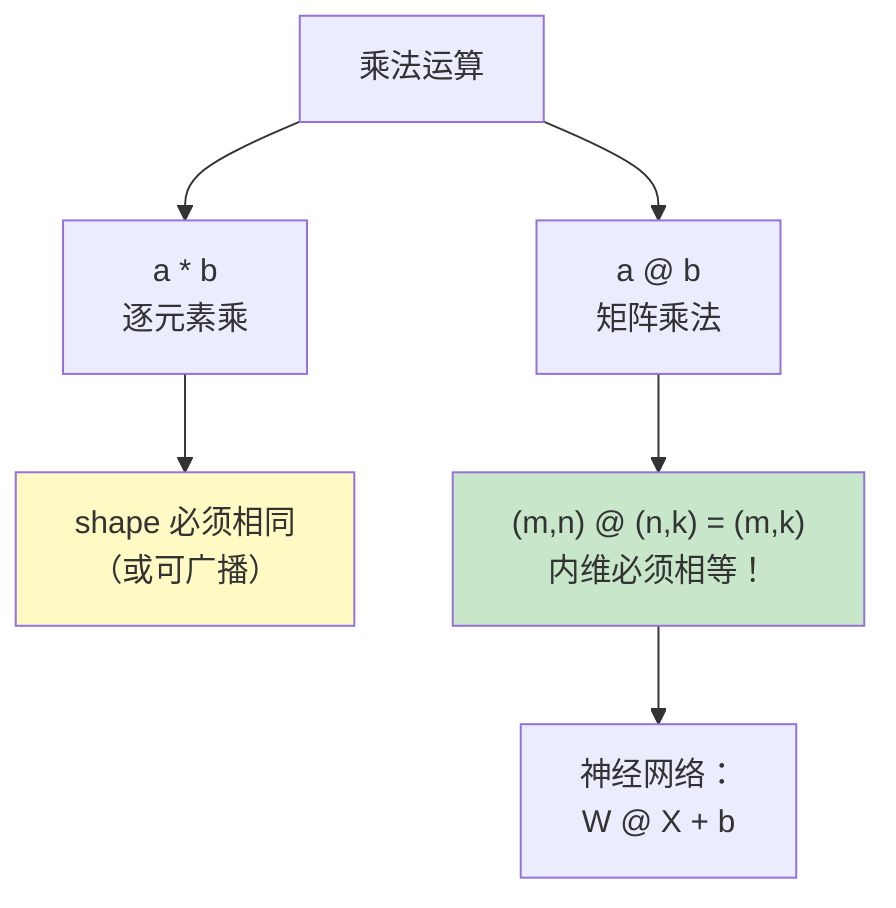

### 12.2 常用矩阵运算

```python
a = np.array([[1, 2],
              [3, 4]])

# —— 基础 ——
a.T                      # 转置
np.trace(a)              # 迹（对角线之和）= 5
np.linalg.det(a)         # 行列式 = -2
np.linalg.matrix_rank(a) # 秩 = 2
np.linalg.inv(a)         # 逆矩阵
np.linalg.pinv(a)        # 伪逆（奇异矩阵也能算）

# —— 对角线 ——
np.diag(a)               # [1 4]  取对角元素
np.diag([1, 2, 3])       # 生成对角矩阵

# —— 单位阵 ——
np.eye(3)
```

### 12.3 解线性方程组

```python
# 解方程组：
# 2x + y = 5
#  x + 3y = 10

A = np.array([[2, 1],
              [1, 3]])
b = np.array([5, 10])

x = np.linalg.solve(A, b)
print(x)     # [1. 3.]  → x=1, y=3 ✅

# 原理：x = A⁻¹ @ b（但 solve 更快更稳）
np.linalg.inv(A) @ b    # 同样结果
```

### 12.4 特征值与特征向量

```python
a = np.array([[4, 1],
              [2, 3]])

eigenvalues, eigenvectors = np.linalg.eig(a)

print(eigenvalues)     # [5. 2.]
print(eigenvectors)    # 每列是对应的特征向量

# —— 奇异值分解 SVD（PCA 降维的数学基础）——
U, S, V = np.linalg.svd(a)
# A = U @ diag(S) @ V

# —— 范数（机器学习正则化用到）——
v = np.array([3, 4])
np.linalg.norm(v)              # 5.0  L2 范数（默认）
np.linalg.norm(v, ord=1)       # 7.0  L1 范数
```

### 12.5 线性代数速查表

| 函数 | 功能 |
| :--- | :--- |
| `a @ b` | 矩阵乘法 |
| `a.T` | 转置 |
| `np.linalg.inv(a)` | 逆矩阵 |
| `np.linalg.det(a)` | 行列式 |
| `np.linalg.solve(A, b)` | 解 Ax=b |
| `np.linalg.eig(a)` | 特征分解 |
| `np.linalg.svd(a)` | SVD 分解 |
| `np.linalg.norm(v)` | 范数 |
| `np.trace(a)` | 迹 |
| `np.linalg.matrix_rank(a)` | 秩 |

---

## 十三、处理 NaN 缺失值 🕳️

### 13.1 NaN 的特性（传染性！）

```python
import numpy as np

a = np.array([1, 2, np.nan, 4])

a.dtype          # float64（只要有一个 NaN，整体变 float）
a + 1            # [ 2.  3. nan  5.]
a.sum()          # nan ❗ NaN 会传染！
a.mean()         # nan ❗
a.max()          # nan ❗

# NaN 和任何数比较都是 False
np.nan == np.nan      # False
np.nan > 0            # False
```

### 13.2 检测与安全统计

```python
# —— 检测 ——
np.isnan(a)             # [False False  True False]
np.isnan(a).sum()       # 1  缺失个数
~np.isnan(a)            # 非缺失掩码

# —— nansum 系列：忽略 NaN 的统计 ——
np.nansum(a)        # 7.0    忽略 NaN 求和
np.nanmean(a)       # 2.333  忽略 NaN 求均值
np.nanmax(a)        # 4.0
np.nanmin(a)        # 1.0
np.nanstd(a)        # 忽略 NaN 的标准差
np.nanargmax(a)     # 3

# —— 删除含 NaN 的行/元素 ——
a[~np.isnan(a)]         # [1. 2. 4.]  一维：直接筛

b = np.array([[1, 2, 3],
              [4, np.nan, 6],
              [7, 8, 9]])
b[~np.isnan(b).any(axis=1)]     # 删除含 NaN 的行
# [[1. 2. 3.]
#  [7. 8. 9.]]

# —— 填充 NaN ——
clean = np.where(np.isnan(b), 0, b)      # 用 0 填充

# 用列均值填充
col_mean = np.nanmean(b, axis=0)
mask = np.isnan(b)
b_filled = b.copy()
b_filled[mask] = np.take(col_mean, np.where(mask)[1])
```

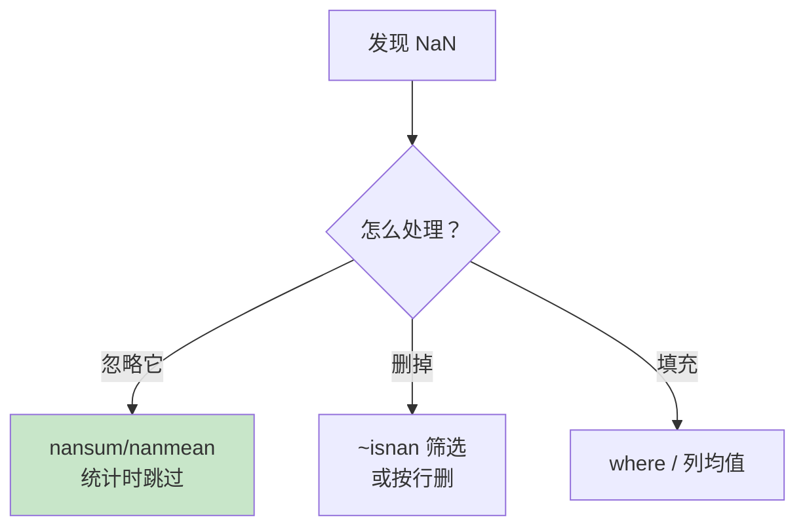

> ⚠️ 注意：整数数组放不进 NaN！`np.array([1, np.nan])` 会自动变成 float64～

---

## 十四、综合实战 💼

### 实战 1：学生成绩统计分析

```python
import numpy as np

# —— 5 个学生 × 4 门课 ——
scores = np.array([
    [85, 92, 78, 90],     # 小明
    [90, 88, 95, 85],     # 小红
    [70, 75, 80, 72],     # 小刚
    [95, 98, 92, 96],     # 学霸
    [60, 65, 70, 68],     # 学渣
])
students = np.array(["小明", "小红", "小刚", "学霸", "学渣"])
subjects = np.array(["语文", "数学", "英语", "物理"])

print("===== 成绩分析报告 =====")
print(f"全体平均分: {scores.mean():.2f}")
print(f"各科平均分: {scores.mean(axis=0)}")           # 按列
print(f"每人平均分: {scores.mean(axis=1).round(2)}")   # 按行

# —— 排名 ——
rank_order = np.argsort(scores.mean(axis=1))[::-1]
print(f"成绩排名: {students[rank_order]}")

# —— 每人最强科目 ——
best_subject = subjects[scores.argmax(axis=1)]
for s, sub in zip(students, best_subject):
    print(f"{s} 最擅长: {sub}")

# —— 偏科检测（标准差大 = 偏科）——
stds = scores.std(axis=1)
print(f"最偏科: {students[np.argmax(stds)]}")

# —— 及格/优秀统计 ——
print(f"90分以上个数: {(scores >= 90).sum()}")
print(f"不及格个数: {(scores < 60).sum()}")

# —— Z-score 标准化（每列）——
z = (scores - scores.mean(axis=0)) / scores.std(axis=0)
print(f"小红数学标准化分: {z[1, 1]:.2f}")   # 超过平均几个标准差
```

### 实战 2：图像处理（灰度图操作）

```python
import numpy as np

# —— 模拟一张 100x100 的灰度图（0~255）——
rng = np.random.default_rng(42)
img = rng.integers(0, 256, (100, 100), dtype=np.uint8)

# ====== 常见图像操作 ======

# —— 1. 反色（255 - 像素值）——
inverted = 255 - img

# —— 2. 裁剪（中心 50x50）——
cropped = img[25:75, 25:75]

# —— 3. 缩小一半（隔行隔列采样）——
downscaled = img[::2, ::2]

# —— 4. 旋转 90 度 ——
rotated = np.rot90(img)          # 逆时针
rotated_cw = img.T[::-1]         # 顺时针

# —— 6. 亮度调整 + 防溢出 ——
brighter = np.clip(img.astype(int) + 50, 0, 255).astype(np.uint8)
darker = np.clip(img.astype(int) - 50, 0, 255).astype(np.uint8)

# —— 7. 二值化（阈值分割）——
binary = np.where(img > 128, 255, 0).astype(np.uint8)

# —— 8. 水平/垂直翻转 ——
h_flip = img[:, ::-1]      # 左右翻
v_flip = img[::-1, :]      # 上下翻

# —— 9. 添加噪声（椒盐噪声）——
noisy = img.copy()
noise_mask = rng.random(img.shape) < 0.05     # 5% 的像素
noisy[noise_mask] = rng.choice([0, 255], noise_mask.sum())

# —— 10. 统计信息 ——
print(f"最亮: {img.max()}, 最暗: {img.min()}")
print(f"平均亮度: {img.mean():.1f}")
print(f"亮度标准差: {img.std():.1f}")
```

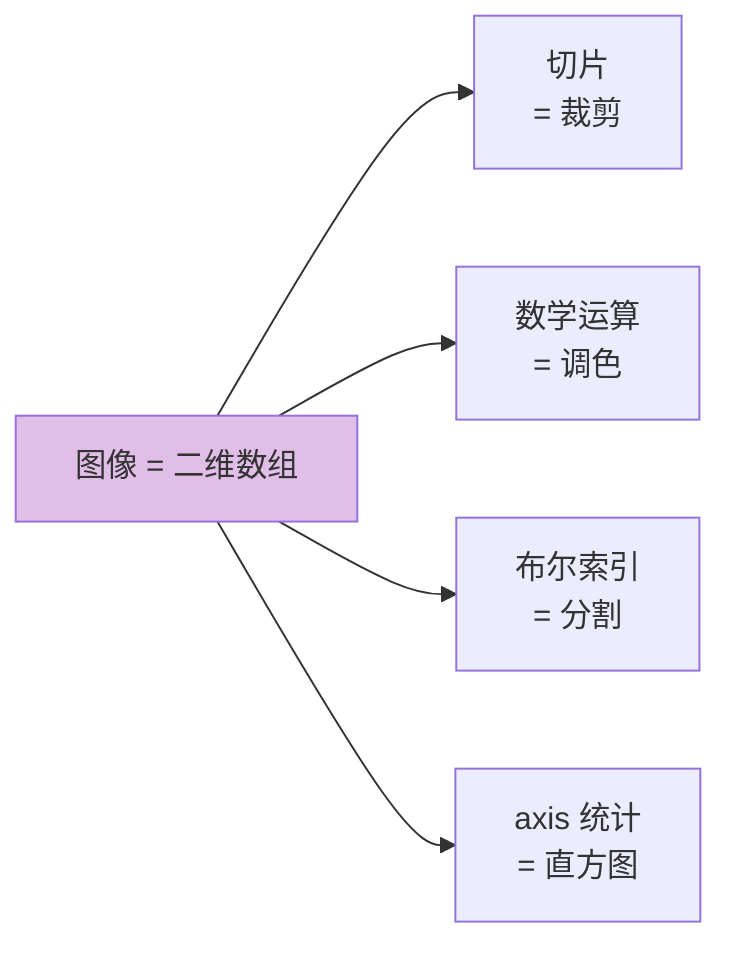

### 实战 3：蒙特卡洛估算 π

```python
import numpy as np

rng = np.random.default_rng(42)

# —— 原理：往 1×1 方块里撒点，落在 1/4 圆内的比例 ≈ π/4 ——
n = 1_000_000
x = rng.random(n)          # 均匀分布撒点
y = rng.random(n)

inside = (x**2 + y**2) < 1         # 距离原点 < 1 的点（布尔索引！）
pi_estimate = inside.sum() / n * 4  # 比例 × 4

print(f"估算 π ≈ {pi_estimate}")    # ≈ 3.1416
# 100 万次撒点，纯 NumPy 一行完成，不到 0.1 秒！
```

### 实战 4：KNN 思想——找最近的点

```python
import numpy as np

rng = np.random.default_rng(42)

# —— 100 个二维样本点 ——
points = rng.random((100, 2))

# —— 新来的点，找它最近的 3 个邻居 ——
target = np.array([0.5, 0.5])

# ① 计算所有点到 target 的欧氏距离（广播！）
distances = np.sqrt(((points - target) ** 2).sum(axis=1))

# ② argsort 找最近的 3 个索引
nearest_idx = np.argsort(distances)[:3]

print(f"最近的 3 个邻居：\n{points[nearest_idx]}")
print(f"对应距离：{distances[nearest_idx].round(3)}")
```

> 💡 这个思路就是 **KNN 机器学习算法**的核心！NumPy 几行代码就实现了～

---

## 十五、知识总结 📌

### 核心知识图

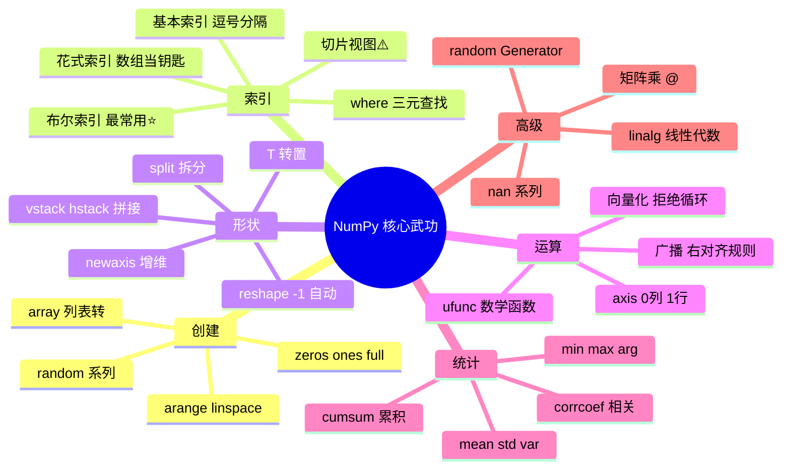

### 高频操作速查表

| 需求 | 写法 |
| :--- | :--- |
| 列表转数组 | `np.array(lst)` |
| 快速序列 | `np.arange(0, 10, 2)` / `np.linspace(0, 1, 5)` |
| 看形状 | `a.shape` / `a.ndim` / `a.dtype` |
| 改形状 | `a.reshape(-1)` / `a.reshape(3, 4)` |
| 条件筛选 | `a[a > 5]` |
| 多条件 | `a[(a>1) & (a<9)]` |
| 条件替换 | `np.where(cond, x, y)` |
| 列向量 | `a[:, np.newaxis]` |
| 上下拼 | `np.vstack([a, b])` |
| 矩阵乘 | `a @ b` |
| 每列均值 | `a.mean(axis=0)` |
| 每行求和 | `a.sum(axis=1)` |
| 排序索引 | `np.argsort(a)` |
| 去重 | `np.unique(a)` |
| 乱序 | `rng.permutation(n)` |
| 忽略NaN均值 | `np.nanmean(a)` |
| 标准化 | `(a - a.mean()) / a.std()` |
| 复制 | `a.copy()`（防视图陷阱） |

### 常见坑与避坑指南

| 坑 | 现象 | 解法 |
| :--- | :--- | :--- |
| 切片改了原数组 | 改切片，原数据变了 | 用 `.copy()` |
| `*` 当矩阵乘 | 结果不对 | 矩阵乘用 `@` |
| 多条件用 and | `ValueError: ambiguous` | 数组用 `& \| ~` + 括号 |
| axis 方向搞反 | 统计维度不对 | axis=0 压行（列统计）|
| reshape 总数不符 | cannot reshape | 检查 `size`，善用 `-1` |
| arange 浮点步长 | 个数不精确 | 用 `linspace` |
| int 数组放 NaN | 报错或变 float | NaN 只能放 float |
| nan 污染统计 | mean 返回 nan | 用 `np.nanmean` |
| empty 有垃圾值 | 随机数字 | 先初始化再使用 |
| astype 截断 | 2.9 变 2 | 先 `round` 再转 |

### 性能优化心法

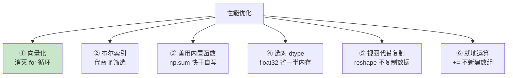

### 学习路线建议

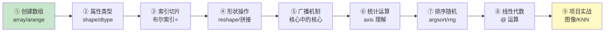

> 🎀 呼～NumPy 全套内功心法到手啦！🎉 从数组创建到广播机制，从布尔索引到矩阵运算，还有图像处理、蒙特卡洛、KNN 三个实战——你已经掌握了 Python 科学计算的"地基"！接下来学 [Python数据分析.md](file:///d:/A-H2H/Python/Python数据分析.md) 的 Pandas 会发现：原来 DataFrame 就是 NumPy 数组穿上索引的外衣～快去跑跑那些示例代码感受飞一般的速度吧！(◍•ᴗ•◍)❤


