# 🐼 Pandas 数据处理

> 哈喽呀～欢迎来到 Pandas 的表格世界！🌟 它是 Python 数据处理的"瑞士军刀"——像 Excel 一样直观，像数据库一样强大，代码量却少得惊人！冲鸭！(๑•̀ㅂ•́)و✧

***

## 🗺️ 知识全景图

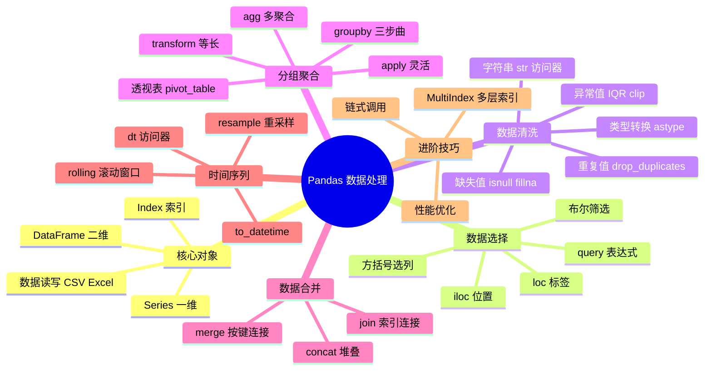

***

## 📑 目录

- [一、Pandas 简介](#一pandas-简介)
- [二、Series：一维数据](#二series一维数据)
- [三、DataFrame：二维表格](#三dataframe二维表格)
- [四、数据读写](#四数据读写)
- [五、数据选择与筛选](#五数据选择与筛选)
- [六、数据清洗](#六数据清洗)
- [七、数据变换与函数应用](#七数据变换与函数应用)
- [八、分组聚合 groupby](#八分组聚合-groupby)
- [九、数据合并](#九数据合并)
- [十、透视表与交叉表](#十透视表与交叉表)
- [十一、时间序列](#十一时间序列)
- [十二、多层索引 MultiIndex](#十二多层索引-multiindex)
- [十三、性能优化](#十三性能优化)
- [十四、综合实战：电商订单分析](#十四综合实战电商订单分析)
- [十五、知识总结](#十五知识总结)

***

## 一、Pandas 简介 🌟

### 1.1 什么是 Pandas？

Pandas（panel data + analysis）由 Wes McKinney 于 2008 年创建，是 Python **最流行的数据分析库**。

> 🎀 通俗理解：Pandas = **Excel 的代码版** + **SQL 的灵活版**——处理表格数据，它是王者！

### 1.2 核心优势

| 优势 | 说明                        |
| :- | :------------------------ |
| 直观 | DataFrame 就像电子表格          |
| 强大 | 读写/清洗/转换/聚合一条龙            |
| 高效 | 底层基于 NumPy，百万行轻松处理        |
| 生态 | 与 Matplotlib、sklearn 无缝衔接 |

### 1.3 数据分析工作流中的位置


### 1.4 安装与导入

```bash
pip install pandas openpyxl
```

```python
import pandas as pd
import numpy as np
print(pd.__version__)
```

***

## 二、Series：一维数据 📏

### 2.1 创建 Series

```python
import pandas as pd

# —— 从列表（自动生成索引 0,1,2...）——
s = pd.Series([85, 92, 78, 90])
# 0    85
# 1    92
# 2    78
# 3    90
# dtype: int64

# —— 指定索引（更像字典）——
s = pd.Series([85, 92, 78, 90], index=["语文", "数学", "英语", "物理"])
# 语文    85
# 数学    92
# 英语    78
# 物理    90

# —— 从字典创建（键→索引）——
s = pd.Series({"北京": 2100, "上海": 2400, "广州": 1800})

# —— 常用属性 ——
s.values      # 数组 [85 92 78 90]
s.index       # 索引对象
s.dtype       # 数据类型
s.name = "成绩"    # 起个名字
```

### 2.2 Series 与 ndarray、dict 的关系

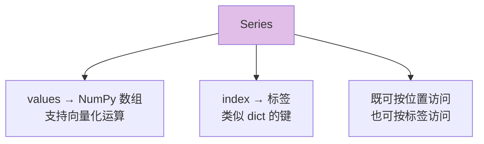

### 2.3 数据访问

```python
s = pd.Series([85, 92, 78, 90], index=["语文", "数学", "英语", "物理"])

# —— 按标签 ——
s["数学"]                    # 92
s.loc["数学"]                # 92（显式按标签，推荐）

# —— 按位置 ——
s.iloc[1]                   # 92（显式按位置，推荐）
s.iloc[0:2]                 # 前2个（位置切片不含尾）

# —— 标签切片（含尾！）——
s.loc["语文":"英语"]         # 语文数学英语 3 个

# —— 多值 ——
s[["语文", "物理"]]          # 选两个

# —— 布尔筛选 ——
s[s > 85]                   # 数学 92、物理 90
```

### 2.4 运算与统计

```python
# —— 与标量运算（保留索引）——
s + 5                       # 全部 +5
s * 2
np.sqrt(s)                  # NumPy 函数也能用

# —— 两个 Series 运算（索引自动对齐！）——
s1 = pd.Series([1, 2, 3], index=["a", "b", "c"])
s2 = pd.Series([10, 20, 30], index=["b", "c", "d"])
s1 + s2
# a     NaN   ← a 只有 s1 有
# b    12.0
# c    23.0
# d     NaN   ← d 只有 s2 有

# —— 统计 ——
s.mean(), s.max(), s.min(), s.sum()
s.idxmax()                  # 最大值的索引名："数学"
s.describe()                # 统计摘要
s.rank()                    # 排名
s.value_counts()            # 频次统计（超常用！）
```

***

## 三、DataFrame：二维表格 📋

### 3.1 创建 DataFrame

```python
import pandas as pd

# —— 方式 1：字典（键=列名，值=列数据）最常用 ——
df = pd.DataFrame({
    "姓名": ["小明", "小红", "小刚", "小美"],
    "年龄": [18, 22, 25, 20],
    "城市": ["北京", "上海", "北京", "广州"],
    "工资": [8000, 12000, 15000, 10000],
})
#   姓名  年龄  城市    工资
# 0 小明  18  北京   8000
# 1 小红  22  上海  12000
# 2 小刚  25  北京  15000
# 3 小美  20  广州  10000

# —— 方式 2：嵌套列表（可指定列名）——
pd.DataFrame([[1, "a"], [2, "b"]], columns=["数字", "字母"])

# —— 方式 3：字典列表 ——
pd.DataFrame([
    {"name": "小明", "age": 18},
    {"name": "小红", "age": 22},
])

# —— 方式 4：从 NumPy 数组 ——
pd.DataFrame(np.random.rand(3, 4), columns=list("ABCD"))
```

### 3.2 快速查看数据

```python
df.head()            # 前 5 行（可传数字）
df.tail()            # 后 5 行
df.sample(2)         # 随机抽 2 行
df.shape             # (4, 4) 行数列数
df.columns           # 列名
df.index             # 行索引
df.dtypes            # 每列类型
df.info()            # 概览：类型+非空统计 ⭐
df.describe()        # 数值列统计摘要 ⭐
df.describe(include="all")   # 包含文本列
```

| 方法           | 用途      | 使用时机     |
| :----------- | :------ | :------- |
| `head/tail`  | 看数据长相   | 刚读入时     |
| `info()`     | 类型+缺失概览 | 数据质量检查   |
| `describe()` | 分布统计    | 快速了解数值分布 |
| `shape`      | 规模      | 心里有数     |

### 3.3 列的增删改

```python
# ====== 增加列 ======
df["年终奖"] = df["工资"] * 2                    # 计算列
df.insert(1, "工号", ["E001", "E002", "E003", "E004"])   # 指定位置插入

# ====== 修改列 ======
df["工资"] = df["工资"] + 1000
df.rename(columns={"姓名": "name"}, inplace=True)
df.columns = ["A", "B", "C", "D"]               # 整体替换列名

# ====== 删除 ======
df.drop("年终奖", axis=1)                        # 删列
df.drop(columns=["年终奖", "工号"])               # 删多列（直观）
df.drop([0, 1])                                 # 删行（按索引）

# ====== 修改单个值 ======
df.loc[0, "年龄"] = 19
df.at[0, "年龄"] = 19                            # 访问单个值更快
```

### 3.4 排序

```python
# —— 按值排序 ——
df.sort_values("工资")                          # 升序
df.sort_values("工资", ascending=False)         # 降序
df.sort_values(["城市", "工资"],
               ascending=[True, False])         # 多列排序

# —— 按索引排序 ——
df.sort_index()

# —— 排名 ——
df["工资排名"] = df["工资"].rank(ascending=False)   # 降序排名
df["工资排名"] = df["工资"].rank(method="dense", ascending=False)  # 并列不跳号

# —— 常用 nlargest/nsmallest（比排序取头更快）——
df.nlargest(2, "工资")      # 工资最高的 2 行
df.nsmallest(2, "工资")     # 工资最低的 2 行
```

***

## 四、数据读写 💾

### 4.1 读取数据

```python
import pandas as pd

# ====== CSV ======
df = pd.read_csv("data.csv")
df = pd.read_csv("data.csv", encoding="gbk")            # 中文乱码试试 gbk
df = pd.read_csv("data.csv", index_col=0)               # 第0列作行索引
df = pd.read_csv("data.csv", nrows=1000)                # 只读前 N 行
df = pd.read_csv("data.csv", usecols=["姓名", "工资"])    # 只读指定列
df = pd.read_csv("data.csv", parse_dates=["日期"])        # 自动解析日期
df = pd.read_csv("data.csv", dtype={"手机号": str})       # 指定类型
df = pd.read_csv("data.csv", chunksize=10000)            # 分块读取（大文件！）

# ====== Excel（需要 openpyxl）======
df = pd.read_excel("data.xlsx")
df = pd.read_excel("data.xlsx", sheet_name="销售表")
df = pd.read_excel("data.xlsx", sheet_name=None)        # 读所有表→字典

# ====== 其他 ======
pd.read_json("data.json")
pd.read_sql("SELECT * FROM users", conn)
pd.read_html("https://xx.com/table")[0]                 # 网页表格
pd.read_parquet("data.parquet")                         # 大数据格式
```

### 4.2 写出数据

```python
# ====== CSV ======
df.to_csv("out.csv", index=False)                       # 不带行号！
df.to_csv("out.csv", index=False, encoding="utf-8-sig") # Excel 打开不乱码

# ====== Excel ======
df.to_excel("out.xlsx", index=False)

# —— 多工作表写入 ——
with pd.ExcelWriter("report.xlsx") as writer:
    df1.to_excel(writer, sheet_name="销售", index=False)
    df2.to_excel(writer, sheet_name="库存", index=False)

# ====== 其他 ======
df.to_json("out.json", orient="records", force_ascii=False)
df.to_parquet("out.parquet")     # 列式存储，大数据首选
df.to_html("out.html")
```

### 4.3 读写参数速查

| 场景      | 参数                     |
| :------ | :--------------------- |
| 中文乱码（读） | `encoding="gbk"`       |
| 中文乱码（写） | `encoding="utf-8-sig"` |
| 不写行号    | `index=False`          |
| 大文件预览   | `nrows=1000`           |
| 只要几列    | `usecols=[...]`        |
| 日期解析    | `parse_dates=[...]`    |
| 超大文件    | `chunksize=10000` 分块   |

***

## 五、数据选择与筛选 🎯

### 5.1 四种选择方式

```python
df = pd.DataFrame({
    "姓名": ["小明", "小红", "小刚", "小美"],
    "年龄": [18, 22, 25, 20],
    "城市": ["北京", "上海", "北京", "广州"],
    "工资": [8000, 12000, 15000, 10000],
})
```

| 方式       | 语法                  | 说明             |
| :------- | :------------------ | :------------- |
| `[]`     | `df["姓名"]`          | 选列（最常用）        |
| `loc`    | `df.loc[行标签, 列标签]`  | **按标签**（切片含尾）  |
| `iloc`   | `df.iloc[行位置, 列位置]` | **按位置**（切片不含尾） |
| `at/iat` | `df.at[0, "姓名"]`    | 取单个值（最快）       |

### 5.2 选列

```python
df["姓名"]                       # 单列 → Series
df[["姓名", "工资"]]              # 多列 → DataFrame（双括号！）

# —— 按类型选列 ——
df.select_dtypes(include="number")       # 所有数值列
df.select_dtypes(include="object")       # 所有文本列
df.select_dtypes(exclude="number")       # 排除数值列

# —— 按列名筛选（类似 usecols）——
df.filter(items=["姓名", "工资"])
df.filter(regex="^工")                   # 正则：以"工"开头的列
df.filter(like="名")                     # 包含"名"的列
```

### 5.3 loc 与 iloc

```python
# ====== loc：标签 ======
df.loc[0]                        # 行标签 0
df.loc[0:2]                      # 标签 0,1,2（含 2！）
df.loc[0:1, ["姓名", "工资"]]     # 行 + 列
df.loc[df["年龄"] > 20]          # 布尔条件 ⭐
df.loc[:, "姓名":"年龄"]          # 列切片（含尾）

# ====== iloc：位置 ======
df.iloc[0]                       # 第 0 行
df.iloc[0:2]                     # 前 2 行（不含 2）
df.iloc[0, 1]                    # 第0行第1列
df.iloc[:, 0:2]                  # 所有行，前 2 列
df.iloc[-1]                      # 最后一行
df.iloc[[0, 2]]                  # 第 0、2 行

# ====== 条件筛选（最实用！）======
df[df["城市"] == "北京"]                          # 单条件
df[(df["年龄"] > 18) & (df["工资"] > 10000)]      # 且（& 每个条件要括号）
df[(df["城市"] == "北京") | (df["工资"] > 12000)] # 或
df[~(df["城市"] == "北京")]                       # 非

# —— isin：多值匹配 ——
df[df["城市"].isin(["北京", "上海"])]

# —— between：区间 ——
df[df["年龄"].between(18, 22)]

# —— query：像 SQL 一样写（可读性好）——
df.query("年龄 > 20 and 工资 > 9000")
df.query("城市 in ['北京', '上海']")

# —— 字符串条件 ——
df[df["姓名"].str.contains("小")]
df[df["姓名"].str.startswith("小")]
```

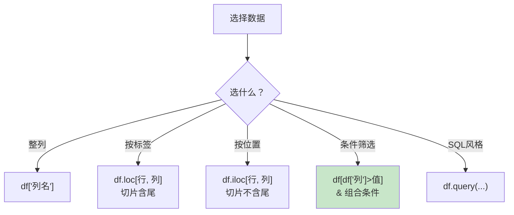

### 5.4 链式赋值警告（新手必坑！）

```python
# ❌ 错误写法：链式索引赋值（可能不生效+警告）
df[df["年龄"] > 20]["工资"] = 999      # SettingWithCopyWarning

# ✅ 正确写法 1：loc 一步到位
df.loc[df["年龄"] > 20, "工资"] = 999

# ✅ 正确写法 2：先 copy 再改
sub = df[df["年龄"] > 20].copy()
sub["工资"] = 999
```

> ⚠️ **口诀**：筛选后要修改，**要么 loc 一条龙，要么 .copy() 分两步**！

***

## 六、数据清洗 🧹

> 真实数据 80% 的时间都在清洗！这是数据分析师的基本功～

### 6.1 缺失值处理

```python
import pandas as pd
import numpy as np

df = pd.DataFrame({
    "姓名": ["小明", "小红", None, "小美"],
    "年龄": [18, np.nan, 25, 20],
    "工资": [8000, 12000, np.nan, np.nan],
})

# ====== 检测缺失 ======
df.isnull()              # 布尔表
df.isnull().sum()        # 每列缺失数 ⭐最常用
df.isna().sum()          # 同 isnull（别名）
df.isnull().mean()       # 每列缺失比例
df.notnull().sum()       # 每列非空数
df[df["年龄"].isnull()]  # 缺失行的位置

# ====== 删除缺失 ======
df.dropna()                        # 删除任何含缺失的行
df.dropna(subset=["工资"])          # 只看指定列的缺失
df.dropna(how="all")               # 全部为空才删
df.dropna(thresh=2)                # 至少2个非空才保留
df.dropna(axis=1)                  # 删除含缺失的列（慎用）

# ====== 填充缺失 ======
df.fillna(0)                                # 全部填 0
df["年龄"].fillna(df["年龄"].mean())         # 均值填充（数值常用）
df["年龄"].fillna(df["年龄"].median())       # 中位数（有异常值更稳）
df["姓名"].fillna("未知")                    # 文本默认值

# 前/后填充（时间序列常用）
df.fillna(method="ffill")          # 用前一个值填
df.fillna(method="bfill")          # 用后一个值填
df.ffill()                         # 新版简写

# 插值填充（连续数据）
df["年龄"].interpolate()            # 线性插值

# 按组填充（每组的均值分别填）
df["工资"] = df.groupby("城市")["工资"].transform(
    lambda x: x.fillna(x.mean())
)
```

| 策略     | 写法                    | 适用场景   |
| :----- | :-------------------- | :----- |
| 删除     | `dropna(subset=)`     | 缺失占比小  |
| 均值/中位数 | `fillna(x.mean())`    | 数值列    |
| 众数     | `fillna(x.mode()[0])` | 类别列    |
| 前向填充   | `ffill()`             | 时间序列   |
| 插值     | `interpolate()`       | 连续平滑数据 |
| 组内填充   | `groupby+transform`   | 分组数据   |

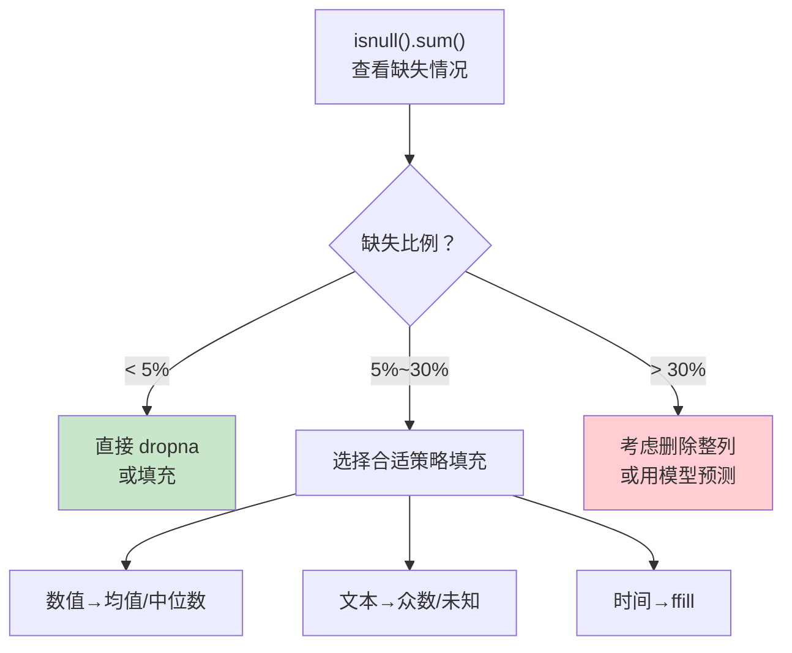

### 6.2 重复值处理

```python
df = pd.DataFrame({
    "姓名": ["小明", "小红", "小明", "小明"],
    "成绩": [90, 85, 90, 88],
})

# ====== 检测 ======
df.duplicated()                    # 标记重复行（首次出现不算）
df.duplicated().sum()              # 重复数量
df.duplicated(subset=["姓名"])      # 按指定列判重

# ====== 删除 ======
df.drop_duplicates()                       # 完全重复才删
df.drop_duplicates(subset=["姓名"])         # 姓名重复就删（保留第一条）
df.drop_duplicates(subset=["姓名"],
                   keep="last")             # 保留最后一条
df.drop_duplicates(ignore_index=True)      # 重排行号
```

### 6.3 异常值处理

```python
df = pd.DataFrame({"工资": [8000, 12000, 15000, 10000, 500000]})

# ====== 方法 1：IQR 四分位法（推荐！）======
Q1 = df["工资"].quantile(0.25)
Q3 = df["工资"].quantile(0.75)
IQR = Q3 - Q1
lower, upper = Q1 - 1.5 * IQR, Q3 + 1.5 * IQR

outliers = df[(df["工资"] < lower) | (df["工资"] > upper)]   # 找出异常
normal = df[(df["工资"] >= lower) & (df["工资"] <= upper)]    # 正常数据

# ====== 方法 2：3σ 原则 ======
mean, std = df["工资"].mean(), df["工资"].std()
mask = (df["工资"] - mean).abs() <= 3 * std

# ====== 方法 3：业务规则 ======
df = df[df["年龄"].between(0, 150)]        # 年龄 0~150

# ====== 处理方式 ======
df["工资"] = df["工资"].clip(lower, upper)  # 截断到边界
df["工资"] = df["工资"].mask(df["工资"] > upper, upper)  # 替换
```

### 6.4 类型转换

```python
df = pd.DataFrame({
    "价格": ["9.9", "19.9", "29.9"],
    "数量": ["10", "20", "30"],
    "日期": ["2026-08-01", "2026-08-02", "2026-08-03"],
    "是否VIP": ["是", "否", "是"],
})

# ====== 转数值 ======
df["价格"] = df["价格"].astype(float)
df["数量"] = pd.to_numeric(df["数量"])
df["数量"] = pd.to_numeric(df["数量"], errors="coerce")   # 转不了→NaN ✅

# ====== 转日期 ======
df["日期"] = pd.to_datetime(df["日期"])
df["日期"] = pd.to_datetime(df["日期"], format="%Y/%m/%d")

# ====== 转分类（省内存、有序）======
df["是否VIP"] = df["是否VIP"].astype("category")

# —— 有序分类（可排序比较）——
from pandas.api.types import CategoricalDtype
level_order = CategoricalDtype(["低", "中", "高"], ordered=True)
df["等级"] = df["等级"].astype(level_order)
df.sort_values("等级")            # 按等级排序 ✅

# ====== 数值转字符串（手机号防科学计数法）======
df["手机号"] = df["手机号"].astype(str)

# ====== 万能 apply 处理脏数据 ======
df["价格"] = df["价格"].astype(str).str.replace("¥", "").astype(float)
```

### 6.5 字符串处理 .str 访问器

```python
s = pd.Series(["  小明 ", "XiaoHong99", " xiaogang@QQ.com "])

# ====== 清洗 ======
s.str.strip()                     # 去首尾空格
s.str.lstrip() / s.str.rstrip()   # 去左/右
s.str.lower()                     # 转小写
s.str.upper()                     # 转大写
s.str.title()                     # 首字母大写

# ====== 查找判断 ======
s.str.contains("xia")             # 是否包含 → 布尔
s.str.startswith("x")
s.str.endswith(".com")
s.str.len()                       # 长度
s.str.count("o")                  # 计数

# ====== 提取与分割 ======
s.str.extract(r"(\d+)")           # 正则提取（返回 DataFrame）
s.str.split("@")                  # 分割→列表
s.str.split("@", expand=True)     # 分割→两列
s.str.split("@").str[0]           # 取第一部分
s.str.get(0)                      # 取第0个字符
s.str[:3]                         # 切片

# ====== 替换 ======
s.str.replace("QQ", "163", regex=False)
s.str.replace(r"\d+", "N")        # 正则替换

# ====== 链式组合（实际工作日常）======
cleaned = (s.str.strip()
            .str.lower()
            .str.replace("qq", "163"))
```

### 6.6 数据质量检查清单

```python
def check_data_quality(df):
    """数据质量体检报告"""
    print("=" * 40)
    print(f"数据规模: {df.shape[0]} 行 × {df.shape[1]} 列")
    print(f"重复行: {df.duplicated().sum()}")
    print(f"完全空的行: {df.dropna(how='all').shape[0] - df.shape[0] + df[df.isnull().all(axis=1)].shape[0]}")
    print("\n各列缺失率:")
    print((df.isnull().mean() * 100).round(2))
    print("\n各列类型:")
    print(df.dtypes)

check_data_quality(df)
```

***

## 七、数据变换与函数应用 🔄

### 7.1 map / apply / applymap / transform 对照

| 方法          | 应用对象               | 返回        | 典型场景              |
| :---------- | :----------------- | :-------- | :---------------- |
| `map`       | Series 逐元素         | Series    | 字典映射、函数           |
| `apply`     | Series 或 DataFrame | 灵活        | 行/列复杂逻辑           |
| `applymap`  | DataFrame 逐元素      | DataFrame | 全表格式化（新版本用 `map`） |
| `transform` | 保留形状               | 与原等长      | 组内标准化             |

```python
df = pd.DataFrame({
    "城市": ["北京", "上海", "广州"],
    "工资": [8000, 12000, 10000],
    "奖金": [1000, 3000, 2000],
})
```

### 7.2 map：映射

```python
# —— 字典映射（类别转编码）——
df["城市编码"] = df["城市"].map({"北京": 1, "上海": 2, "广州": 3})

# —— 函数映射 ——
df["工资翻倍"] = df["工资"].map(lambda x: x * 2)

# —— 查表映射（价格表）——
price_map = {"北京": 5000, "上海": 6000, "广州": 4500}
df["生活成本"] = df["城市"].map(price_map)
# map 找不到的键 → NaN（对比：replace 不动）
```

### 7.3 apply：行/列复杂逻辑

```python
# —— 列方向（对一列操作）——
df["税后"] = df["工资"].apply(lambda x: x * 0.9 if x > 10000 else x * 0.95)

# —— 行方向 axis=1（多列联动）——
def total_income(row):
    if row["城市"] == "北京":
        return row["工资"] + row["奖金"] * 1.5   # 北京奖金加成
    return row["工资"] + row["奖金"]

df["总收入"] = df.apply(total_income, axis=1)

# —— 对整列调用聚合 ——
df[["工资", "奖金"]].apply(np.sum, axis=0)      # 每列求和
df[["工资", "奖金"]].apply(np.mean, axis=1)     # 每行平均

# —— 返回多个值（生成多列）——
def min_max(x):
    return pd.Series([x.min(), x.max()], index=["min", "max"])
df[["工资"]].apply(min_max)
```

### 7.4 向量化优先原则

```python
# ❌ apply 循环（慢）
df["税后"] = df["工资"].apply(lambda x: x * 0.9)

# ✅ 向量化（快 10~100 倍！）
df["税后"] = df["工资"] * 0.9

# ✅ np.where（条件向量化）
df["级别"] = np.where(df["工资"] > 10000, "高薪", "普通")

# ✅ 多条件用 np.select
conditions = [
    df["工资"] >= 12000,
    df["工资"] >= 9000,
]
choices = ["高", "中"]
df["级别"] = np.select(conditions, choices, default="低")

# ✅ pd.cut（连续值分箱）
df["年龄段"] = pd.cut(df["年龄"],
                   bins=[0, 18, 30, 50, 100],
                   labels=["未成年", "青年", "中年", "老年"])

# ✅ pd.qcut（按分位数分箱）
df["工资档"] = pd.qcut(df["工资"], q=4,
                    labels=["低", "中低", "中高", "高"])
```

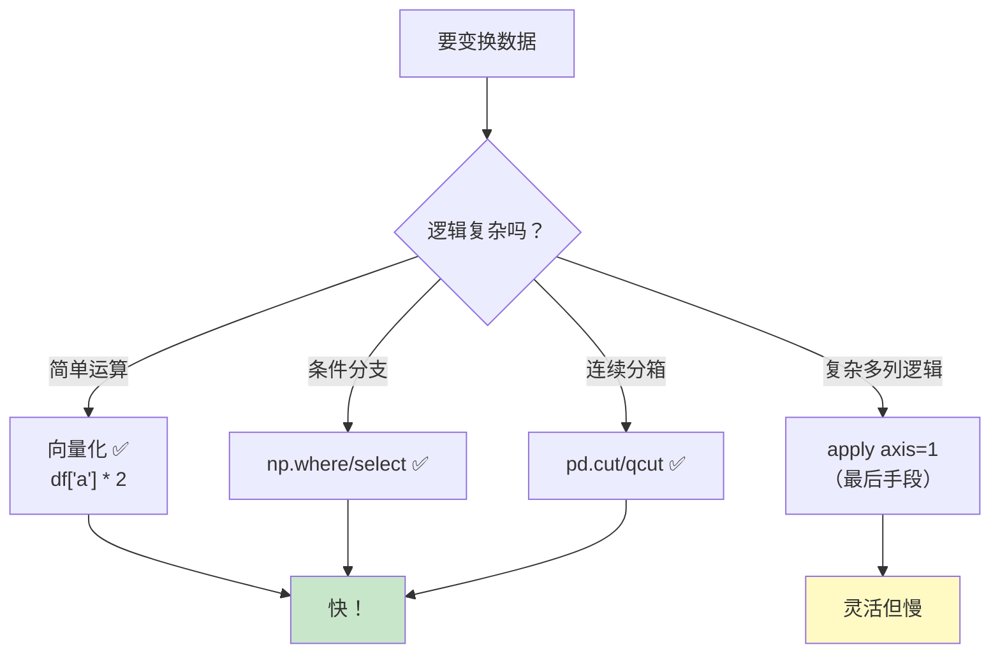

### 7.5 get\_dummies：类别转哑变量

```python
df = pd.DataFrame({"城市": ["北京", "上海", "北京"]})

# 机器学习前的类别编码
pd.get_dummies(df, columns=["城市"])
#    城市_上海  城市_北京
# 0    False     True
# 1    True      False
# 2    False     True

# 转成 0/1
pd.get_dummies(df, columns=["城市"], dtype=int)
```

***

## 八、分组聚合 groupby 📊

> groupby 是 Pandas 的"灵魂"！SQL 的 GROUP BY、Excel 的透视表，都是它！

### 8.1 分组三步曲

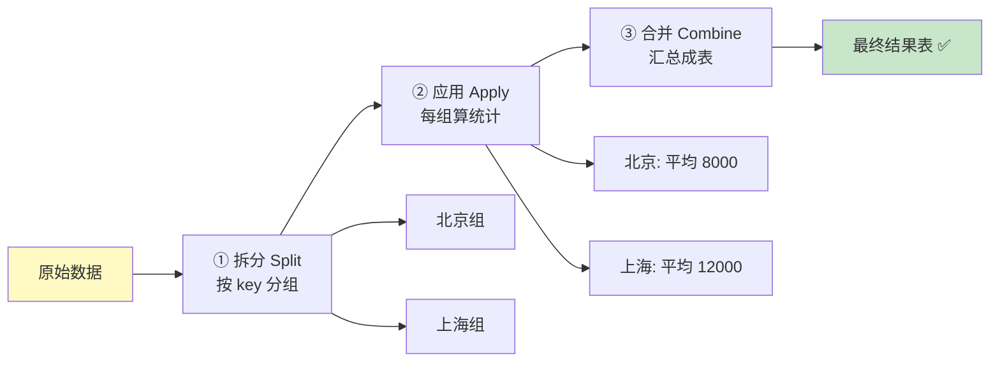

### 8.2 基本用法

```python
import pandas as pd

df = pd.DataFrame({
    "城市": ["北京", "上海", "北京", "广州", "上海"],
    "产品": ["A", "B", "A", "C", "B"],
    "销量": [100, 200, 150, 80, 300],
    "销售额": [5000, 8000, 7500, 4000, 12000],
})

# —— 单列分组 + 单聚合 ——
df.groupby("城市")["销售额"].sum()
# 上海    20000
# 北京    12500
# 广州     4000

# —— 单列分组 + 多聚合 ——
df.groupby("城市")["销售额"].agg(["sum", "mean", "max"])
#        sum    mean     max
# 上海  20000  10000.0  12000
# 北京  12500   6250.0   7500

# —— 多列分组 ——
df.groupby(["城市", "产品"])["销量"].sum()
# 城市  产品
# 北京  A      250
# 上海  B      500
# 广州  C       80

# —— 命名聚合（最推荐！结果列名清晰）——
df.groupby("城市").agg(
    总销量=("销量", "sum"),
    平均销售额=("销售额", "mean"),
    订单数=("销售额", "count"),
    最高单额=("销售额", "max"),
)
```

### 8.3 agg 多种用法

```python
# —— 不同列不同聚合 ——
df.groupby("城市").agg({
    "销量": "sum",
    "销售额": ["mean", "max"],      # 列出多个→多级列名
})

# —— 自定义函数 ——
df.groupby("城市")["销售额"].agg(lambda x: x.max() - x.min())   # 极差

# —— 混合：内置名 + 自定义 ——
df.groupby("城市")["销售额"].agg(
    ["sum", ("极差", lambda x: x.max() - x.min())]
)
```

### 8.4 groupby 对象的其他操作

```python
g = df.groupby("城市")

g.size()                     # 每组行数（含 NaN）
g.count()                    # 每组非空计数
g.first() / g.last()         # 首条/末条
g.mean() / g.sum() / g.max()

g.cumsum()                   # 组内累计
g.rank(method="dense")       # 组内排名
g.head(1)                    # 每组第一行（找每组最优！）

# —— 遍历分组 ——
for (city), group in df.groupby("城市"):
    print(f"{city}: {len(group)} 单, 共 {group['销售额'].sum()} 元")

# —— 取特定组 ——
g.get_group("北京")
```

### 8.5 transform：返回等长结果 ⭐

> 与 agg 的区别：agg 压缩为每组一行；**transform 保持原表行数**，把组统计"广播"回每一行！

```python
# —— 每行加上所属组的平均值 ——
df["城市均额"] = df.groupby("城市")["销售额"].transform("mean")
df["占组比"] = df["销售额"] / df["城市均额"]

#        城市  销售额  城市均额     占组比
# 0     北京   5000   6250.0  0.800000
# 1     上海   8000  10000.0  0.800000
# 2     北京   7500   6250.0  1.200000
# 3     广州   4000   4000.0  1.000000
# 4     上海  12000  10000.0  1.200000

# —— 组内标准化（数据分析常用）——
df["组内Z分"] = df.groupby("城市")["销售额"].transform(
    lambda x: (x - x.mean()) / x.std()
)

# —— 组内填充缺失 ——
df["销售额"] = df.groupby("城市")["销售额"].transform(
    lambda x: x.fillna(x.mean())
)
```

### 8.6 filter：过滤组

```python
# —— 只保留总销量 > 100 的城市 ——
df.groupby("城市").filter(lambda g: g["销量"].sum() > 100)

# —— 只保留订单数 >= 2 的城市 ——
df.groupby("城市").filter(lambda g: len(g) >= 2)
```

### 8.7 agg vs transform vs filter vs apply

| 方法           | 返回形状      | 场景       |
| :----------- | :-------- | :------- |
| `agg`        | 每组一行      | 汇总统计表    |
| `transform`  | **与原表等长** | 组内广播/标准化 |
| `filter`     | 整组的行      | 筛组       |
| `apply`      | 任意        | 万能但慢     |
| `size/count` | 每组一行      | 计数       |

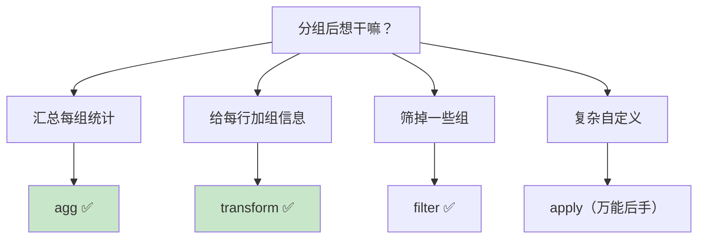

***

## 九、数据合并 🔗

### 9.1 merge：按关键列连接（像 SQL JOIN）

```python
import pandas as pd

df1 = pd.DataFrame({
    "工号": [1, 2, 3],
    "姓名": ["小明", "小红", "小刚"],
})
df2 = pd.DataFrame({
    "工号": [2, 3, 4],
    "部门": ["技术部", "销售部", "人事部"],
})

# —— 内连接 inner：两边都有才保留 ——
pd.merge(df1, df2, on="工号", how="inner")
#    工号  姓名   部门
# 0    2  小红  技术部
# 1    3  小刚  销售部

# —— 左连接 left：左表全保留 ⭐最常用 ——
pd.merge(df1, df2, on="工号", how="left")
#    工号  姓名   部门
# 0    1  小明   NaN     ← 右表没有→NaN
# 1    2  小红  技术部
# 2    3  小刚  销售部

# —— 右连接 right：右表全保留 ——
pd.merge(df1, df2, on="工号", how="right")

# —— 外连接 outer：全保留（并集）——
pd.merge(df1, df2, on="工号", how="outer")
#    工号  姓名   部门
# 0    1  小明   NaN
# 1    2  小红  技术部
# 2    3  小刚  销售部
# 3    4  NaN  人事部
```

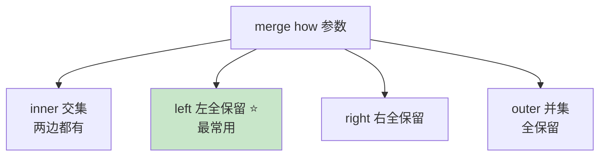

### 9.2 merge 进阶参数

```python
# —— 连接键列名不同 ——
pd.merge(df1, df2, left_on="工号", right_on="emp_id")

# —— 按索引连接 ——
pd.merge(df1, df2, left_index=True, right_index=True)

# —— 重名列自动加后缀 ——
pd.merge(df1, df2, on="工号", suffixes=("_左", "_右"))

# —— indicator 查看匹配来源（调试神器）——
pd.merge(df1, df2, on="工号", how="outer", indicator=True)
#    工号  姓名   部门     _merge
# 0    1  小明   NaN   left_only
# 1    2  小红  技术部        both
# 2    4  NaN  人事部  right_only

# —— validate 防止意外一对多 ——
pd.merge(df1, df2, on="工号", validate="one_to_one")
# 如果实际不是一对一会报错（数据校验）

# —— 找"只在左表有"的行（反连接思路）——
merged = pd.merge(df1, df2, on="工号", how="left", indicator=True)
only_left = merged[merged["_merge"] == "left_only"]
```

### 9.3 concat：物理堆叠

```python
df1 = pd.DataFrame({"A": [1, 2], "B": [3, 4]})
df2 = pd.DataFrame({"A": [5, 6], "B": [7, 8]})

# —— 上下拼（行增加）——
pd.concat([df1, df2])                    # 索引重复！
pd.concat([df1, df2], ignore_index=True) # 重排索引 ✅

# —— 左右拼（列增加）——
pd.concat([df1, df2], axis=1)

# —— 标记数据来源 ——
pd.concat([df1, df2], keys=["1月", "2月"])    # 多层索引

# —— join 参数：对不齐的列怎么办 ——
pd.concat([df1, df2], join="inner")      # 只保留共同列
pd.concat([df1, df2], join="outer")      # 全保留，缺的补 NaN（默认）

# —— append（已废弃，用 concat！）——
# df1.append(df2) ❌ FutureWarning
```

### 9.4 join：按索引连接的快捷方式

```python
# 适合索引对索引
df1.set_index("工号").join(df2.set_index("工号"), how="left")

# lsuffix/rsuffix 处理重名列
df1.join(df2, lsuffix="_左", rsuffix="_右")
```

### 9.5 merge vs concat 选择

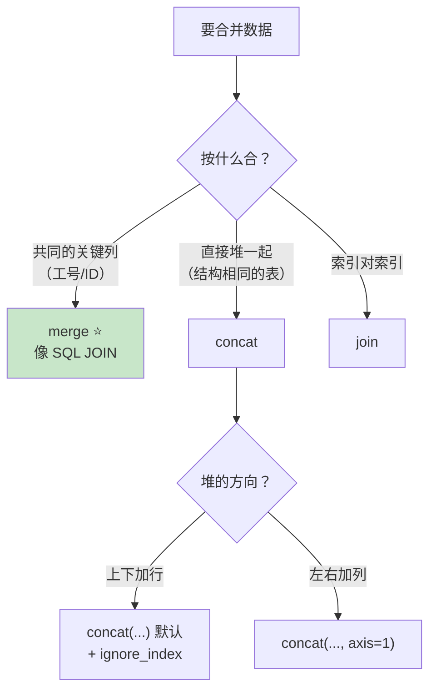

***

## 十、透视表与交叉表 📐

### 10.1 pivot\_table：Excel 数据透视表

```python
df = pd.DataFrame({
    "城市": ["北京", "北京", "上海", "上海", "广州"],
    "产品": ["A", "B", "A", "B", "A"],
    "销量": [100, 150, 200, 300, 80],
    "销售额": [5000, 7500, 8000, 12000, 4000],
})

# —— 行×列 交叉透视 ——
pd.pivot_table(df, values="销售额",
               index="城市", columns="产品",
               aggfunc="sum", fill_value=0)
# 产品      A      B
# 城市
# 上海   8000  12000
# 北京   5000   7500
# 广州   4000      0     ← fill_value 补 0

# —— 多层索引 + 多值 + 汇总 ——
pd.pivot_table(df,
    values=["销量", "销售额"],
    index=["城市"],
    columns=["产品"],
    aggfunc={"销量": "sum", "销售额": "mean"},
    fill_value=0,
    margins=True,           # 加 All 汇总行/列
    margins_name="总计",
)
```

| 参数           | 作用     | 示例      |
| :----------- | :----- | :------ |
| `values`     | 聚合的数值列 | `"销售额"` |
| `index`      | 行维度    | `"城市"`  |
| `columns`    | 列维度    | `"产品"`  |
| `aggfunc`    | 聚合函数   | `"sum"` |
| `fill_value` | 空值填充   | `0`     |
| `margins`    | 汇总行列   | `True`  |

### 10.2 crosstab：交叉计数

```python
df = pd.DataFrame({
    "性别": ["男", "女", "男", "女", "男"],
    "是否购买": ["是", "是", "否", "是", "否"],
})

# —— 纯计数 ——
pd.crosstab(df["性别"], df["是否购买"])
# 性别  否  是
# 女    0   2
# 男    2   1

# —— 占比（分析转化率）——
pd.crosstab(df["性别"], df["是否购买"], normalize="index")  # 按行
# 性别    否    是
# 女   0.00  1.00
# 男   0.67  0.33

pd.crosstab(df["性别"], df["是否购买"], margins=True)  # 带汇总

# —— 还能带值聚合 ——
pd.crosstab(df["城市"], df["产品"], values=df["销售额"],
            aggfunc="sum")
```

### 10.3 melt：宽表转长表（透视的逆操作）

```python
wide = pd.DataFrame({
    "城市": ["北京", "上海"],
    "Q1": [100, 200],
    "Q2": [150, 250],
})

# —— 宽变长 ——
long = pd.melt(wide, id_vars="城市",
               value_vars=["Q1", "Q2"],
               var_name="季度", value_name="销量")
#   城市 季度  销量
# 0 北京  Q1   100
# 1 上海  Q1   200
# 2 北京  Q2   150
# 3 上海  Q2   250

# 机器学习/可视化经常需要长表格式！
```


***

## 十一、时间序列 ⏰

### 11.1 日期创建与解析

```python
import pandas as pd

# —— 字符串转日期 ——
pd.to_datetime("2026-08-11")
pd.to_datetime("2026/08/11 14:30")
pd.to_datetime("2026年8月11日", format="%Y年%m月%d日")

# —— 批量转换（列）——
df["日期"] = pd.to_datetime(df["日期"])
df["日期"] = pd.to_datetime(df["日期"], errors="coerce")   # 转不了→NaT

# —— 日期范围 ——
pd.date_range("2026-08-01", "2026-08-07")              # 每天连续
pd.date_range("2026-08-01", periods=7)                 # 从头数 7 个
pd.date_range("2026-01-01", periods=12, freq="MS")     # 每月第一天
pd.date_range("2026-08-11", periods=5, freq="h")       # 每小时
```

|  频率  | 含义  |   频率  | 含义    |
| :--: | :-- | :---: | :---- |
|  `D` | 每天  |  `h`  | 每小时   |
|  `W` | 每周  | `min` | 每分钟   |
| `MS` | 月初  |  `ME` | 月末    |
| `QS` | 季初  |  `YE` | 年末    |
|  `B` | 工作日 |  `2D` | 每 2 天 |

### 11.2 dt 访问器：提取日期信息

```python
s = pd.Series(pd.to_datetime(
    ["2026-08-11 14:30:00", "2026-12-25 08:00:00"]))

s.dt.year            # 年
s.dt.month           # 月
s.dt.day             # 日
s.dt.hour            # 时
s.dt.minute          # 分
s.dt.dayofweek       # 星期几（0=周一）
s.dt.day_name()      # 星期名 Tuesday
s.dt.is_month_end    # 是否月末
s.dt.quarter         # 季度
s.dt.date            # 只取日期
s.dt.time            # 只取时间

# —— 实战派生特征 ——
df["年"] = df["日期"].dt.year
df["月份"] = df["日期"].dt.month
df["星期"] = df["日期"].dt.day_name()
df["是否周末"] = df["日期"].dt.dayofweek >= 5
df["小时"] = df["日期"].dt.hour

# —— 日期差 ——
today = pd.Timestamp("2026-08-11")
df["注册天数"] = (today - df["注册日期"]).dt.days
```

### 11.3 时间索引与区间选择

```python
ts = df.set_index("日期")            # 日期设为索引（时序标配）

# —— 区间选择超方便！——
ts.loc["2026-08-11"]                 # 某一天
ts.loc["2026-08-01":"2026-08-07"]    # 区间（含两端）
ts.loc["2026-08"]                    # 整个月！
ts.loc["2026"]                       # 整年！
ts["2026-08-01":"2026-08-15"]        # 也是区间

# —— between_time（时间序列专用）——
ts.between_time("09:00", "18:00")    # 只要工作时段
```

### 11.4 resample：重采样

```python
# 日期为索引的销量数据
daily = df.set_index("日期")["销售额"]

# —— 降频（聚合）：天 → 周/月 ——
daily.resample("W").sum()            # 周汇总
daily.resample("ME").sum()           # 月汇总
daily.resample("ME").agg(["sum", "mean", "count"])

# —— 升频（填充）：天 → 小时 ——
daily.resample("h").ffill()          # 前向填充
daily.resample("h").interpolate()    # 线性插值
```

### 11.5 rolling：滚动窗口

```python
# —— 移动平均（股价/销量趋势分析）——
df["7日均线"] = df["收盘价"].rolling(window=7).mean()
df["30日均线"] = df["收盘价"].rolling(window=30).mean()

# —— 其他窗口统计 ——
df["7日最大"] = df["销量"].rolling(7).max()
df["7日总和"] = df["销量"].rolling(7).sum()

# —— 累积运算 ——
df["累计销量"] = df["销量"].cumsum()
df["累计最大"] = df["销量"].cummax()

# —— 环比/同比增长 ——
df["环比"] = df["销量"].pct_change()            # 和上一行比
df["同比增长"] = df["销量"].pct_change(12)       # 和12行前比（月度数据）
df["比昨日"] = df["销量"].diff()                # 差值
```

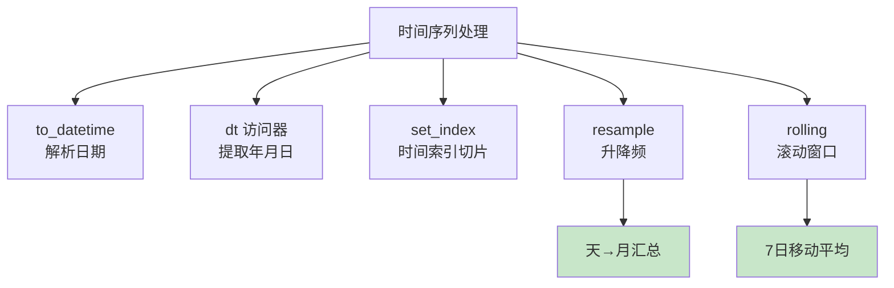

***

## 十二、多层索引 MultiIndex 🗂️

### 12.1 创建多层索引

```python
import pandas as pd

# —— 方式 1：set_index 多列 ——
df = pd.DataFrame({
    "城市": ["北京", "北京", "上海", "上海"],
    "产品": ["A", "B", "A", "B"],
    "销量": [100, 150, 200, 300],
})
df_mi = df.set_index(["城市", "产品"])
#             销量
# 城市 产品
# 北京 A      100
#      B      150
# 上海 A      200
#      B      300

# —— 方式 2：groupby 天然生成 ——
df.groupby(["城市", "产品"])["销量"].sum()   # 结果就是 MultiIndex
```

### 12.2 多层索引选择

```python
# —— loc 元组选择 ——
df_mi.loc["北京"]                # 北京的所有产品
df_mi.loc[("北京", "A")]         # 北京 A
df_mi.loc[["北京", "上海"]]      # 两个城市

# —— xs：跨层选择（超好用）——
df_mi.xs("A", level="产品")      # 所有城市的 A 产品
# 北京    100
# 上海    200

# —— 范围切片 ——
df_mi.sort_index().loc["北京":"上海"]

# —— 索引操作 ——
df_mi.reset_index()              # 还原为普通列
df_mi.swaplevel()                # 交换两层索引
df_mi.reorder_levels(["产品", "城市"])

# —— 分层排序（性能更好）——
df_mi.sort_index()               # 排序后切片更快
```

### 12.3 多层索引的透视表

```python
# groupby 多列的结果转成宽表
result = df.groupby(["城市", "产品"])["销量"].sum()
result.unstack()                 # 内层索引→列（宽表）
# 产品      A    B
# 城市
# 上海    200  300
# 北京    100  150

result.unstack().stack()         # 宽表→长表（逆操作）

# pivot_table 本质 = groupby + unstack
pd.pivot_table(df, values="销量",
               index="城市", columns="产品", aggfunc="sum")
```

***

## 十三、性能优化 ⚡

### 13.1 优化原则速览

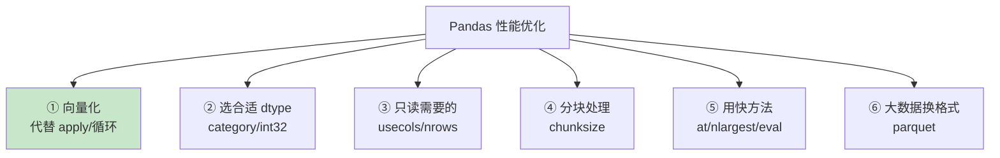

### 13.2 读取优化

```python
# —— 只读需要的列（快几倍！）——
df = pd.read_csv("big.csv", usecols=["日期", "销售额"])

# —— 指定类型（省内存 50%+）——
df = pd.read_csv("big.csv",
                 dtype={"城市": "category", "销量": "int32"})

# —— 分块处理超大文件 ——
chunks = pd.read_csv("big.csv", chunksize=100_000)
total = 0
for chunk in chunks:
    total += chunk["销售额"].sum()      # 边读边算，内存友好

# —— 只读部分行 ——
pd.read_csv("big.csv", nrows=10000)     # 预览
pd.read_csv("big.csv", skiprows=lambda i: i > 0 and i % 2)  # 跳行采样
```

### 13.3 计算优化

```python
# ====== ① 向量化优先 ======
# ❌ 慢 100 倍
df["c"] = df.apply(lambda r: r["a"] + r["b"], axis=1)
# ✅ 快
df["c"] = df["a"] + df["b"]

# ====== ② eval/query（大表更快）——
df.eval("总额 = 工资 + 奖金", inplace=True)     # 列运算
df.query("工资 > 10000 and 城市 == '北京'")      # 筛选
# 底层用 numexpr，大表提速明显

# ====== ③ category 类型 ======
# 重复文本多的列（如城市、性别）转 category
df["城市"] = df["城市"].astype("category")
# 内存省 90%+，groupby 更快

# ====== ④ 单值访问用 at/iat ======
df.at[0, "工资"]        # 比 df.loc[0, "工资"] 快
df.iat[0, 1]           # 按位置更快

# ====== ⑤ isin 代替多个 or ======
# ❌
df[(df["城市"]=="北京") | (df["城市"]=="上海") | ...]
# ✅
df[df["城市"].isin(["北京", "上海", "广州"])]
```

### 13.4 内存优化

```python
# —— 查看内存占用 ——
df.memory_usage(deep=True)          # 每列字节数
df.memory_usage(deep=True).sum() / 1024**2   # 总 MB

# —— 数值降型 ——
df["销量"].max()                    # 看最大值
df["销量"] = df["销量"].astype("int16")   # 值域小就降型

# —— 文本转 category ——
df["性别"] = df["性别"].astype("category")

# —— 大文件用 parquet ——
df.to_parquet("data.parquet")       # 比 csv 读取快 5~10 倍
pd.read_parquet("data.parquet")
```

***

## 十四、综合实战：电商订单分析 💼

> 综合运用全篇知识：清洗 → 分析 → 透视 → 时序 → 报告！

### 14.1 生成模拟数据（含脏数据）

```python
import pandas as pd
import numpy as np

np.random.seed(42)

n = 1000
df = pd.DataFrame({
    "订单号": [f"ORD{i:05d}" for i in range(n)],
    "日期": pd.date_range("2026-06-01", periods=n, freq="h"),
    "用户": np.random.choice(["小明", "小红", "小刚", "小美", "老王"], n),
    "城市": np.random.choice(["北京", "上海", "广州", "深圳"], n),
    "品类": np.random.choice(["数码", "服饰", "食品", "家居"], n, p=[0.3, 0.3, 0.25, 0.15]),
    "数量": np.random.randint(1, 5, n),
})
df["单价"] = df["品类"].map({"数码": 2999, "服饰": 299, "食品": 59, "家居": 599})
df["销售额"] = df["数量"] * df["单价"]

# ====== 故意弄脏 ======
df.loc[100, "城市"] = np.nan                # 缺失
df.loc[200, "数量"] = 100                    # 异常
df.loc[300, "销售额"] = -50                  # 负数
df = pd.concat([df, df.iloc[[5, 10]]])       # 重复行

print(f"原始数据: {df.shape}")
```

### 14.2 第一步：数据清洗

```python
# ====== 体检 ======
print("重复行:", df.duplicated().sum())
print("缺失值:\n", df.isnull().sum())

# ====== 清洗流水线 ======
clean = (
    df
    .drop_duplicates()                                    # ① 去重
    .dropna(subset=["城市"])                               # ② 删关键缺失
    .query("数量 > 0 and 数量 < 10 and 销售额 > 0")          # ③ 业务规则过滤
    .assign(                                              # ④ 派生新列
        月份=lambda x: x["日期"].dt.to_period("M").astype(str),
        星期=lambda x: x["日期"].dt.day_name(),
        时段=lambda x: pd.cut(x["日期"].dt.hour,
                            bins=[0, 6, 12, 18, 24],
                            labels=["凌晨", "上午", "下午", "晚上"]),
    )
    .reset_index(drop=True)
)
print(f"清洗后: {clean.shape}")
```


### 14.3 第二步：业务分析

```python
# ====== 分析 1：城市 × 品类 销售表现 ======
city_analysis = (clean
    .groupby("城市")
    .agg(总销售额=("销售额", "sum"),
         订单数=("订单号", "count"),
         客单价=("销售额", "mean"))
    .sort_values("总销售额", ascending=False)
)
print(city_analysis.round(2))

# ====== 分析 2：透视表看交叉 ======
pivot = pd.pivot_table(clean, values="销售额",
                       index="城市", columns="品类",
                       aggfunc="sum", fill_value=0, margins=True)
print(pivot)

# ====== 分析 3：用户排行（TOP3）======
top_users = (clean
    .groupby("用户")["销售额"].sum()
    .nlargest(3))
print("消费 TOP3:\n", top_users)

# ====== 分析 4：每个用户的消费占比（transform）======
clean["用户总额"] = clean.groupby("用户")["销售额"].transform("sum")
clean["占总比"] = (clean["销售额"] / clean["用户总额"] * 100).round(2)

# ====== 分析 5：时段分析 ======
hour_stats = clean.groupby("时段", observed=True).agg(
    订单数=("订单号", "count"),
    销售额=("销售额", "sum"),
)
print(hour_stats)
```

### 14.4 第三步：时间序列分析

```python
# ====== 按天重采样 ======
daily = clean.set_index("日期")["销售额"].resample("D").sum()

# ====== 7 日移动平均看趋势 ======
trend = pd.DataFrame({
    "每日销售额": daily,
    "7日均线": daily.rolling(7).mean(),
})

# ====== 日环比 ======
growth = daily.pct_change() * 100
best_day = growth.idxmax()
print(f"增长最快的一天: {best_day.date()} (+{growth.max():.1f}%)")

# ====== 星期效应 ======
weekday = clean.groupby("星期")["销售额"].mean().round(0)
weekday = weekday.reindex(
    ["Monday", "Tuesday", "Wednesday", "Thursday",
     "Friday", "Saturday", "Sunday"])
print("各星期平均销售额:\n", weekday)
```

### 14.5 第四步：输出报告

```python
# ====== 汇总 Excel 报告 ======
with pd.ExcelWriter("电商分析报告.xlsx") as writer:
    clean.to_excel(writer, sheet_name="清洗明细", index=False)
    city_analysis.to_excel(writer, sheet_name="城市分析")
    pivot.to_excel(writer, sheet_name="交叉透视")
    hour_stats.to_excel(writer, sheet_name="时段分析")
    trend.to_excel(writer, sheet_name="趋势分析")

# ====== 自动结论文本 ======
best_city = city_analysis.index[0]
best_cat = clean.groupby("品类")["销售额"].sum().idxmax()
print(f"""
╔══════════════════════════════════╗
║   📊 电商订单分析报告            ║
╠══════════════════════════════════╣
║ 清洗后订单: {len(clean)} 单
║ 总销售额: ¥{clean['销售额'].sum():,.0f}
║ 最优城市: {best_city}
║ 明星品类: {best_cat}
║ 高峰时段: {hour_stats['订单数'].idxmax()}
╚══════════════════════════════════╝
""")
```

### 14.6 完整分析流程图

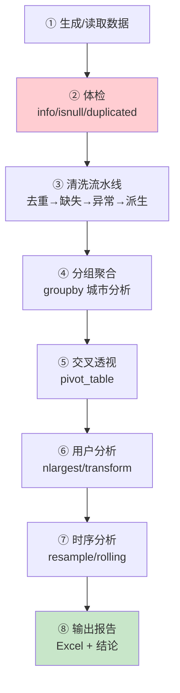

***

## 十五、知识总结 📌

### 核心知识图

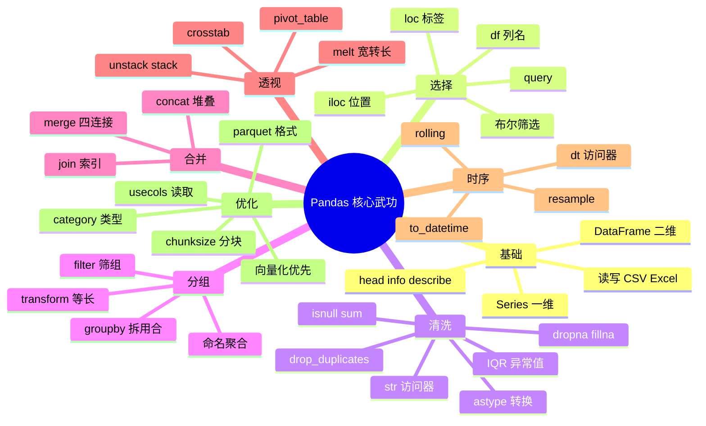

### 高频操作速查表

| 需求        | 写法                                                    |
| :-------- | :---------------------------------------------------- |
| 读 CSV     | `pd.read_csv("x.csv")`                                |
| 写 CSV 无行号 | `df.to_csv("x.csv", index=False)`                     |
| 看概况       | `df.info()` / `df.describe()`                         |
| 选列        | `df["列"]` / `df[["列1", "列2"]]`                        |
| 条件筛选      | `df[df["列"] > 5]`                                     |
| 多条件       | `df[(c1) & (c2)]`                                     |
| SQL 风格筛选  | `df.query("列 > 5 and 列2 == 'x'")`                     |
| 缺失统计      | `df.isnull().sum()`                                   |
| 填均值       | `df["列"].fillna(df["列"].mean())`                      |
| 去重        | `df.drop_duplicates(subset=["列"])`                    |
| 类型转换      | `pd.to_numeric(x, errors="coerce")`                   |
| 新增计算列     | `df["新"] = df["a"] * df["b"]`                         |
| 条件赋值      | `np.where(cond, x, y)`                                |
| 连续分箱      | `pd.cut(df["年龄"], bins, labels)`                      |
| 排序        | `df.sort_values("列", ascending=False)`                |
| Top N     | `df.nlargest(3, "列")`                                 |
| 分组汇总      | `df.groupby("k").agg(名=("v","sum"))`                  |
| 组内广播      | `df.groupby("k")["v"].transform("mean")`              |
| 按键连接      | `pd.merge(a, b, on="k", how="left")`                  |
| 上下拼接      | `pd.concat([a, b], ignore_index=True)`                |
| 透视表       | `pd.pivot_table(df, values, index, columns, aggfunc)` |
| 宽转长       | `pd.melt(df, id_vars, var_name, value_name)`          |
| 提取年份      | `df["日期"].dt.year`                                    |
| 按月汇总      | `df.resample("ME").sum()`                             |
| 移动平均      | `df["列"].rolling(7).mean()`                           |
| 环比        | `df["列"].pct_change()`                                |

### 常见坑与避坑指南

| 坑                      | 现象                      | 解法                              |
| :--------------------- | :---------------------- | :------------------------------ |
| SettingWithCopyWarning | 筛选后赋值可能失效               | `loc` 一步或 `.copy()`             |
| to\_csv 多一列            | Excel 打开有行号             | `index=False`                   |
| 中文乱码                   | 读取/写出乱码                 | 读 `gbk` / 写 `utf-8-sig`         |
| 多条件用 and               | `ValueError: ambiguous` | 数组用 `& \| ~` + 括号               |
| loc 切片含尾               | 和 Python 习惯不同           | 记住 loc 含尾、iloc 不含               |
| append 警告              | `df.append` 被弃用         | 改用 `pd.concat`                  |
| 转数值失败                  | 字符串里有符号                 | `.str.replace()` 清洗后再转          |
| 循环遍历慢                  | `for i in df.index`     | 向量化 / apply / itertuples        |
| merge 后变多              | 意外一对多                   | `validate="one_to_one"`         |
| groupby 列消失            | 分组列变成索引                 | `as_index=False` 或 reset\_index |

### 学习路线建议

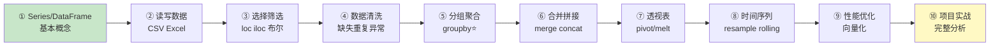

> 🎀 呼～Pandas 全套数据处理秘籍到手啦！🎉 从 Series/DataFrame 基础到 groupby 灵魂、透视表、时间序列，还有完整的电商分析实战——你现在可以独立完成一份数据分析项目了！配合 [NumPy.md](file:///d:/A-H2H/Python/NumPy.md) 打底、[Matplotlib.md](file:///d:/A-H2H/Python/Matplotlib.md) 画图，数据分析三件套凑齐！接下来找个真实数据集（Kaggle 有很多）练手吧～ (◍•ᴗ•◍)❤

