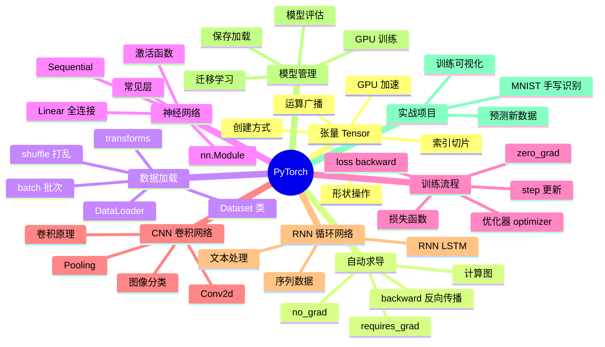
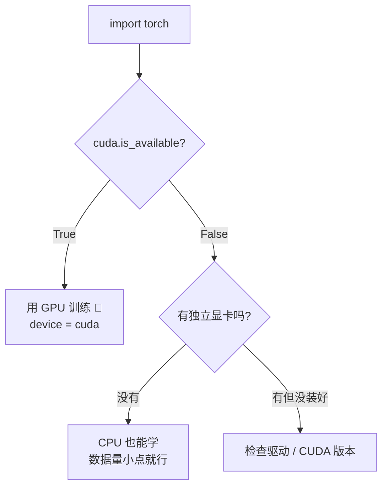
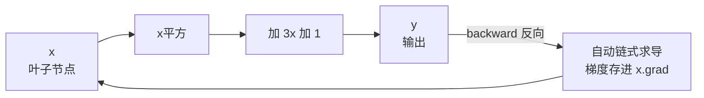
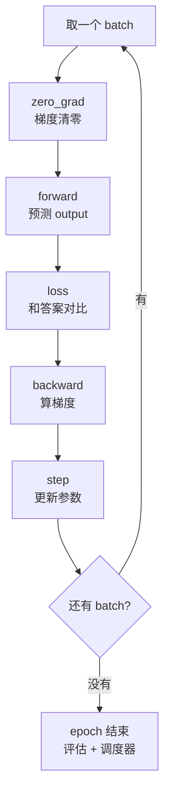
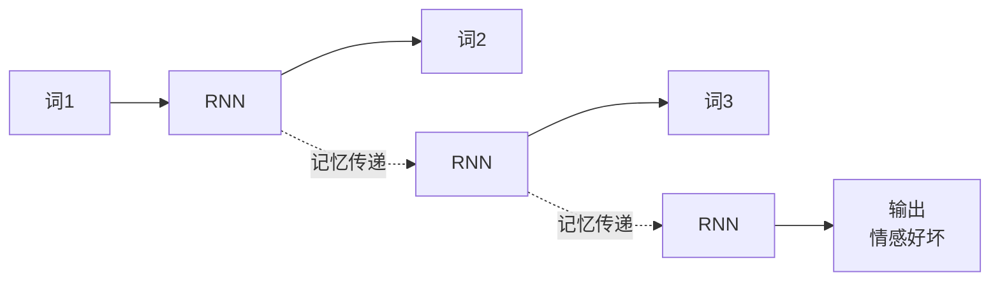
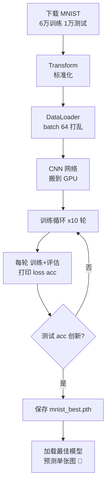
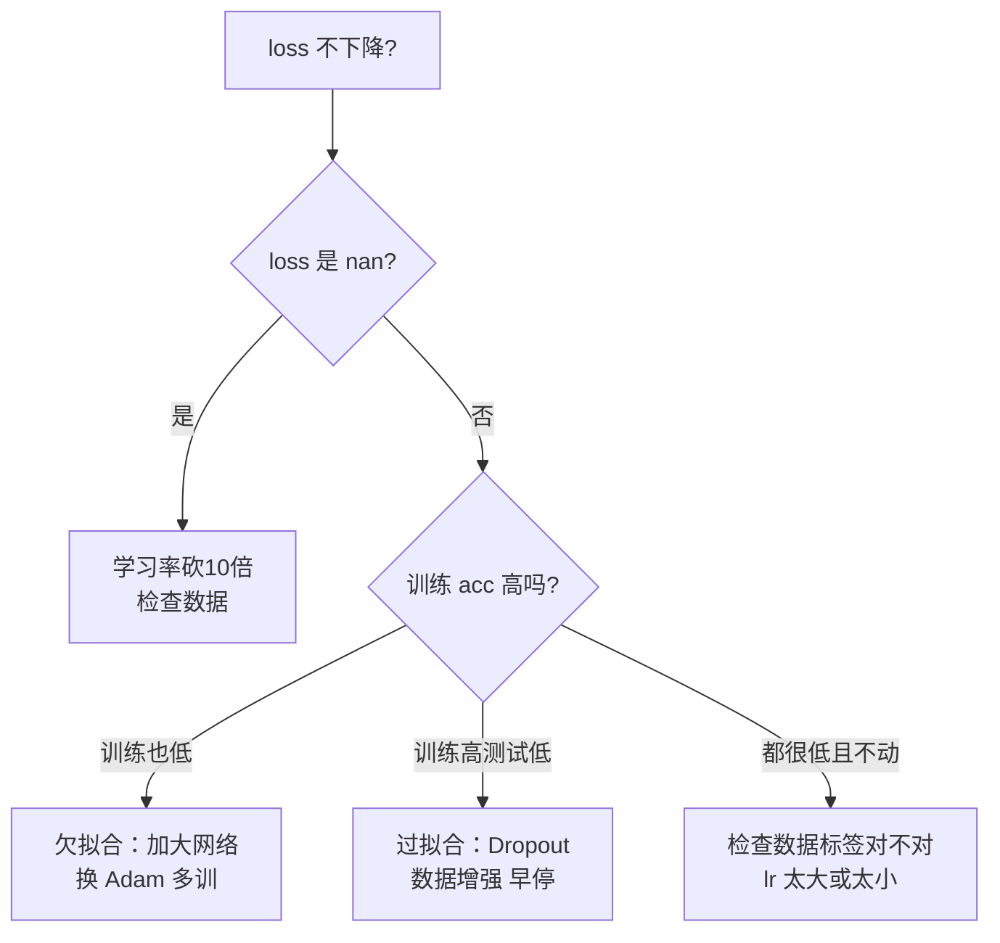

# 🔥 PyTorch 深度学习详解

> 哈喽呀～上一课学了机器学习，现在升级到深度学习！PyTorch 是学术圈和工业界的双料顶流——写起来像普通 Python，调试方便，还自带 GPU 加速！从张量基础一路打到 MNIST 手写识别实战，冲鸭！(≧∇≦)ﾉ

***

## 🗺️ 知识全景图



***

## 📑 目录

- [一、PyTorch 是什么](#一pytorch-是什么)
- [二、环境搭建](#二环境搭建)
- [三、张量 Tensor：一切的基础](#三张量-tensor一切的基础)
- [四、自动求导 Autograd](#四自动求导-autograd)
- [五、搭建神经网络 nn.Module](#五搭建神经网络-nnmodule)
- [六、数据加载 Dataset 与 DataLoader](#六数据加载-dataset-与-dataloader)
- [七、损失函数与优化器](#七损失函数与优化器)
- [八、标准训练流程](#八标准训练流程)
- [九、CNN 卷积神经网络](#九cnn-卷积神经网络)
- [十、RNN 循环神经网络](#十rnn-循环神经网络)
- [十一、GPU 训练与模型保存](#十一gpu-训练与模型保存)
- [十二、综合实战：MNIST 手写数字识别](#十二综合实战mnist-手写数字识别)
- [十三、常见坑与调优技巧](#十三常见坑与调优技巧)

***

## 一、PyTorch 是什么

### 1.1 一句话解释

**PyTorch = 一个灵活的深度学习框架** 🧠

深度学习 = 层数很多的神经网络。PyTorch 帮你搞定最难的数学（梯度计算），你只管像搭积木一样拼网络、喂数据、看结果！

### 1.2 PyTorch 在深度学习中的位置


### 1.3 PyTorch vs TensorFlow

| 对比项 | PyTorch | TensorFlow |
|--------|---------|------------|
| 代码风格 | 动态图，像写 Python ⭐ | 静态图（TF2 已改善）|
| 调试 | print 随便打，超方便 | 稍麻烦 |
| 学术界占有率 | 🏆 90%+ 新论文 | 较少 |
| 工业部署 | TorchServe 日渐成熟 | TF Serving 成熟 |
| 学习曲线 | 平缓 ⭐ | 稍陡 |
| 推荐度 | 新手首选 ⭐⭐⭐⭐⭐ | 老项目维护 |

### 1.4 核心组件一览

| 模块 | 作用 | 类比 |
|------|------|------|
| torch.Tensor | 多维数组 | numpy 数组 + GPU + 梯度 |
| autograd | 自动求导 | 自动算微分的计算器 |
| nn | 网络层 | 搭积木的零件库 |
| optim | 优化器 | 调整参数的老师 |
| DataLoader | 数据加载 | 喂数据的传送带 |

***

## 二、环境搭建 🛠️

### 2.1 安装

```bash
# CPU 版（简单，学习够用）
pip install torch torchvision

# GPU 版（NVIDIA 显卡，先去官网看 CUDA 命令）
# https://pytorch.org/get-started/locally/
pip install torch torchvision --index-url https://download.pytorch.org/whl/cu121
```

### 2.2 验证安装

```python
import torch

print(torch.__version__)            # 2.x.x
print(torch.cuda.is_available())    # True = GPU 可用！

# GPU 信息
if torch.cuda.is_available():
    print(torch.cuda.get_device_name(0))   # 显卡型号
    print(torch.cuda.device_count())       # GPU 数量
```

### 2.3 GPU 检查流程



***

## 三、张量 Tensor：一切的基础 📦

### 3.1 创建张量

```python
import torch
import numpy as np

# 从数据创建
x = torch.tensor([1, 2, 3])                    # 一维
m = torch.tensor([[1., 2.], [3., 4.]])         # 二维

# 常用工厂方法
torch.zeros(3, 4)                # 全 0
torch.ones(2, 3)                 # 全 1
torch.empty(2, 2)                # 未初始化（值随机）
torch.full((2, 2), 7)            # 全 7
torch.arange(0, 10, 2)           # tensor([0,2,4,6,8])
torch.linspace(0, 1, 5)          # 均分 5 份
torch.rand(2, 3)                 # 均匀分布随机
torch.randn(2, 3)                # 标准正态随机
torch.eye(3)                     # 单位矩阵

# numpy 互转（共享内存！改一个另一个也变）
arr = np.array([1.0, 2.0, 3.0])
t = torch.from_numpy(arr)        # numpy → tensor
back = t.numpy()                 # tensor → numpy
```

### 3.2 张量属性

```python
x = torch.randn(3, 4, 5)

x.shape          # torch.Size([3, 4, 5]) 形状
x.size()         # 同上
x.ndim           # 3 维度数
x.dtype          # torch.float32 数据类型
x.device         # cpu 还是 gpu
x.numel()        # 总元素个数 60
x.requires_grad  # 是否追踪梯度
```

### 3.3 数据类型转换

```python
x = torch.randn(3, 3)

x.int()            # 转整型（截断）
x.long()           # 转 int64（标签常用！）
x.float()          # 转 float32（默认）
x.double()         # 转 float64
x.bool()           # 转布尔

# 精度很重要：标签用 long，特征用 float
labels = torch.tensor([0, 1, 2]).long()
```

### 3.4 形状操作（高频！）

```python
x = torch.randn(2, 3)

x.reshape(3, 2)        # 重排形状
x.view(3, 2)           # 同上（要求内存连续）
x.view(-1)             # 拉平成一维（-1 自动算）
x.unsqueeze(0)         # 增维：(2,3) → (1,2,3) 加 batch 维常用！
x.unsqueeze(1)         # (2,3) → (2,1,3)
x.squeeze()            # 去掉所有为 1 的维度
x.transpose(0, 1)      # 交换两个维度
x.permute(2, 0, 1)     # 任意重排维度（图像 CHW→HWC）

# 拼接与拆分
a = torch.ones(2, 3)
b = torch.zeros(2, 3)
torch.cat([a, b], dim=0)      # 按行拼：(4, 3)
torch.cat([a, b], dim=1)      # 按列拼：(2, 6)
torch.stack([a, b], dim=0)    # 新维度堆叠：(2, 2, 3)

# 扩张
x.expand(2, -1, 3)     # 广播扩展（不复制内存）
x.repeat(2, 1)         # 复制扩张
```

### 3.5 索引与切片

```python
x = torch.arange(12).reshape(3, 4)
# tensor([[ 0,  1,  2,  3],
#         [ 4,  5,  6,  7],
#         [ 8,  9, 10, 11]])

x[0]           # 第 0 行 → [0,1,2,3]
x[0, 2]        # 第0行第2列 → tensor(2)
x[:, 1]        # 所有行的第1列
x[1:, :]       # 第1行往后
x[x > 5]       # 布尔掩码 → 所有大于5的元素

# 高级索引（注意：会创建新张量）
torch.where(x > 5, x, torch.zeros_like(x))   # 条件替换
```

### 3.6 运算与广播

```python
a = torch.tensor([1, 2, 3])
b = torch.tensor([4, 5, 6])

a + b          # tensor([5, 7, 9])
a * b          # 逐元素乘 [4, 10, 18]
a @ b          # 点积 tensor(32)
a.dot(b)       # 同上

m = torch.ones(2, 3)
n = torch.ones(3, 4)
m @ n                    # 矩阵乘法 (2,4)
torch.matmul(m, n)       # 同上，更通用

# 常用数学
x = torch.randn(3, 3)
x.sum()                 # 总和
x.sum(dim=0)            # 按列求和（消掉第0维）
x.mean(dim=1)           # 按行求均值
x.max(dim=1)            # 返回 (最大值, 索引)
x.argmax(dim=1)         # 最大值索引（分类预测常用！）
x.exp() / x.log() / x.abs()
x.clamp(0, 1)           # 裁剪到 0~1

# 广播规则：从后往前对齐，维度为 1 的自动扩展
# (2,3) + (3,) → (3,) 变 (1,3) 再变 (2,3) ✅
```

### 3.7 Tensor vs numpy 对照表

| 操作 | numpy | PyTorch |
|------|-------|---------|
| 创建 | np.array | torch.tensor |
| 形状 | arr.shape | x.shape |
| 重排 | arr.reshape | x.reshape / view |
| 矩阵乘 | a @ b | a @ b / matmul |
| 求和 | arr.sum(axis=0) | x.sum(dim=0) |
| 转置 | arr.T | x.T / transpose |
| 拼接 | np.concatenate | torch.cat |
| 随机 | np.random.rand | torch.rand |

> 💡 会 numpy 就等于会了一半 PyTorch！API 高度相似，注意 axis 换成 dim～

***

## 四、自动求导 Autograd 🎓

### 4.1 核心思想

> 训练神经网络需要算梯度。手推导数要命，PyTorch 说：**你只管写前向计算，梯度我自动算！**

```python
import torch

# requires_grad=True 开始追踪
x = torch.tensor(2.0, requires_grad=True)
y = x ** 2 + 3 * x + 1      # y = x² + 3x + 1

y.backward()                # 反向传播，自动算梯度

print(x.grad)               # dy/dx = 2x + 3 = 7.0 ✅
```

### 4.2 计算图原理



### 4.3 神经网络中的梯度

```python
# 一个迷你"网络"：w 和 b 是要学的参数
w = torch.tensor(1.0, requires_grad=True)
b = torch.tensor(0.0, requires_grad=True)

x = torch.tensor(3.0)        # 输入（不需要梯度）
y_target = torch.tensor(10.0) # 目标

# 前向计算
y_pred = w * x + b
loss = (y_pred - y_target) ** 2    # 损失

# 反向传播
loss.backward()
print(w.grad)    # dL/dw：告诉你 w 该往哪调
print(b.grad)    # dL/db

# 手动更新参数（优化器会自动做这事）
with torch.no_grad():            # 更新时不需要追踪梯度！
    w -= 0.1 * w.grad
    b -= 0.1 * b.grad
w.grad.zero_()                   # 清零，下次重新算
```

### 4.4 no_grad：省内存提速

```python
# 评估/推理时不需要梯度 → 用 no_grad 包起来
with torch.no_grad():
    output = model(x_test)     # 不建计算图，快且省内存！

# 另一种写法
@torch.no_grad()
def evaluate(model, data):
    return model(data)
```

### 4.5 梯度三大坑

| 坑 🕳️ | 后果 | 解决 💊 |
|------|------|--------|
| 忘了 zero_grad | 梯度累加，越训越歪 | 每轮 loss.backward() 前 optimizer.zero_grad() |
| 更新参数没包 no_grad | 报错 RuntimeError | with torch.no_grad(): 里更新 |
| 对非叶子节点取 grad | None | 用 retain_grad() 或看中间输出 |

***

## 五、搭建神经网络 nn.Module 🏗️

### 5.1 网络结构直觉


### 5.2 标准写法：继承 nn.Module

```python
import torch
import torch.nn as nn
import torch.nn.functional as F

class SimpleNet(nn.Module):

    def __init__(self):
        super().__init__()                    # 必须调父类初始化！
        # 定义层（有可学习参数的）
        self.fc1 = nn.Linear(784, 128)        # 输入784 → 输出128
        self.fc2 = nn.Linear(128, 64)
        self.fc3 = nn.Linear(64, 10)          # 10分类

    def forward(self, x):
        # 定义前向传播（数据怎么流）
        x = x.view(x.size(0), -1)             # 拉平 (B,784)
        x = F.relu(self.fc1(x))               # 全连接+激活
        x = F.relu(self.fc2(x))
        x = self.fc3(x)                       # 最后一层不加激活！
        return x                              # 交叉熵损失内部处理

model = SimpleNet()
print(model)          # 打印网络结构

# 测试前向传播（好习惯！）
dummy = torch.randn(32, 1, 28, 28)            # 32张图
out = model(dummy)
print(out.shape)      # torch.Size([32, 10]) ✅
```

### 5.3 Sequential 快捷写法

```python
model = nn.Sequential(
    nn.Linear(784, 128),
    nn.ReLU(),
    nn.Linear(128, 64),
    nn.ReLU(),
    nn.Linear(64, 10),
)
# 简单网络用它，复杂网络（多分支）用类定义
```

### 5.4 常用层速查

| 层 | 用途 | 关键参数 |
|----|------|---------|
| nn.Linear | 全连接 | in_features, out_features |
| nn.Conv2d | 二维卷积（图像）| in_ch, out_ch, kernel_size |
| nn.MaxPool2d | 最大池化 | kernel_size |
| nn.BatchNorm2d | 批归一化 | num_features |
| nn.Dropout | 随机失活 | p=0.5 |
| nn.LSTM | 长短期记忆 | input_size, hidden_size |
| nn.Embedding | 词嵌入 | num_embeddings, embedding_dim |

### 5.5 常用激活函数

| 激活函数 | 特点 | 用在哪 |
|---------|------|--------|
| ReLU | 简单高效，负数归零 | 隐藏层默认选它 ⭐ |
| Sigmoid | 压到 0~1 | 二分类输出 |
| Softmax | 变概率分布（和为1）| 多分类输出 |
| Tanh | 压到 -1~1 | RNN 内部 |

```python
F.relu(x)             # 最常用
torch.sigmoid(x)      # 二分类输出
F.softmax(x, dim=1)   # 多分类输出概率
F.leaky_relu(x, 0.01) # 解决"死神经元"
```

> ⚠️ 配合 CrossEntropyLoss 时，**最后一层不要加 Softmax**！损失函数内部会做（加了反而学不好）！

***

## 六、数据加载 Dataset 与 DataLoader 🔄

### 6.1 为什么要 DataLoader


> 一次喂全部数据：内存爆 + 学得慢；一条条喂：GPU 吃不饱。分批（batch）喂刚刚好！

### 6.2 自定义 Dataset

```python
from torch.utils.data import Dataset, DataLoader

class MyDataset(Dataset):
    """自定义数据集三件套：init / len / getitem"""

    def __init__(self, features, labels):
        self.x = torch.tensor(features, dtype=torch.float32)
        self.y = torch.tensor(labels, dtype=torch.long)

    def __len__(self):
        return len(self.x)                 # 数据总量

    def __getitem__(self, idx):
        return self.x[idx], self.y[idx]    # 取第 idx 条

# 使用
dataset = MyDataset(X_train, y_train)
loader = DataLoader(
    dataset,
    batch_size=64,        # 每批 64 条
    shuffle=True,         # 每 epoch 打乱（训练时 True！）
    num_workers=0,        # Windows 记得设 0，Linux 可加速
    drop_last=False,      # 不足一批的要不要丢弃
)

for x_batch, y_batch in loader:
    print(x_batch.shape)   # [64, 特征数]
    print(y_batch.shape)   # [64]
    break
```

### 6.3 内置数据集（torchvision）

```python
import torchvision
import torchvision.transforms as transforms

# 图像预处理管道
transform = transforms.Compose([
    transforms.ToTensor(),                        # PIL → tensor，0~1
    transforms.Normalize((0.1307,), (0.3081,)),   # 标准化
])

train_set = torchvision.datasets.MNIST(
    root="./data",          # 保存目录
    train=True,             # 训练集
    download=True,          # 没有就下载
    transform=transform,    # 预处理
)
test_set = torchvision.datasets.MNIST(
    root="./data", train=False, download=True, transform=transform)

train_loader = DataLoader(train_set, batch_size=64, shuffle=True)
test_loader = DataLoader(test_set, batch_size=1000, shuffle=False)

print(len(train_set))       # 60000
print(len(test_set))        # 10000
img, label = train_set[0]
print(img.shape)            # [1, 28, 28] 单通道 28x28
```

### 6.4 Dataset vs DataLoader 分工

| 组件 | 职责 | 类比 |
|------|------|------|
| Dataset | 定义"怎么取一条数据" | 货架上的商品 |
| DataLoader | 负责"批量和打乱" | 传送带 |

***

## 七、损失函数与优化器 ⚖️

### 7.1 常用损失函数

```python
import torch.nn as nn

# ===== 分类任务 =====
criterion = nn.CrossEntropyLoss()     # 多分类首选！（内部含 softmax）
# 标签必须 long 类型！预测是 logits（不加 softmax）

criterion = nn.BCELoss()              # 二分类（输出过 sigmoid）
criterion = nn.BCEWithLogitsLoss()    # 二分类更稳（推荐）

# ===== 回归任务 =====
criterion = nn.MSELoss()              # 均方误差
criterion = nn.L1Loss()               # 平均绝对误差
criterion = nn.SmoothL1Loss()         # 抗异常值
```

| 损失函数 | 任务 | 注意 |
|---------|------|------|
| CrossEntropyLoss | 多分类 ⭐ | 标签 long，不加 softmax |
| BCEWithLogitsLoss | 二分类 ⭐ | 标签 float 0/1 |
| MSELoss | 回归 | 标签和预测同形状 |

### 7.2 常用优化器

```python
import torch.optim as optim

optimizer = optim.SGD(model.parameters(), lr=0.01)            # 随机梯度下降
optimizer = optim.SGD(model.parameters(), lr=0.01,
                      momentum=0.9)                           # +动量，更快
optimizer = optim.Adam(model.parameters(), lr=0.001)          # 自适应 ⭐ 万金油
optimizer = optim.AdamW(model.parameters(), lr=0.001)         # Adam 改进版（大模型常用）
```

| 优化器 | 特点 | 场景 |
|--------|------|------|
| SGD + momentum | 稳，调好很强 | CNN 训练 |
| Adam | 免调参，收敛快 ⭐ | 默认首选 |
| AdamW | 权重衰减修正 | Transformer |

### 7.3 学习率调度器

```python
from torch.optim.lr_scheduler import StepLR, CosineAnnealingLR

scheduler = StepLR(optimizer, step_size=5, gamma=0.1)   # 每5轮 lr×0.1
scheduler = CosineAnnealingLR(optimizer, T_max=50)      # 余弦退火

# 训练循环里每个 epoch 结束调一次
for epoch in range(EPOCHS):
    train(...)
    scheduler.step()          # 更新学习率！
```


***

## 八、标准训练流程 🔁

### 8.1 万能训练模板（背下来！）

```python
def train_one_epoch(model, loader, criterion, optimizer, device):
    model.train()                              # 训练模式！
    total_loss, correct, total = 0, 0, 0

    for x, y in loader:
        x, y = x.to(device), y.to(device)      # 数据搬上 GPU

        optimizer.zero_grad()                  # 1. 梯度清零
        output = model(x)                      # 2. 前向传播
        loss = criterion(output, y)            # 3. 算损失
        loss.backward()                        # 4. 反向传播
        optimizer.step()                       # 5. 更新参数

        total_loss += loss.item()              # item() 取纯数字
        correct += (output.argmax(1) == y).sum().item()
        total += y.size(0)

    return total_loss / len(loader), correct / total
```

### 8.2 五步循环图解



### 8.3 评估函数

```python
@torch.no_grad()                     # 不需要梯度！
def evaluate(model, loader, criterion, device):
    model.eval()                     # 评估模式！（Dropout/BN 行为不同）
    total_loss, correct, total = 0, 0, 0

    for x, y in loader:
        x, y = x.to(device), y.to(device)
        output = model(x)
        loss = criterion(output, y)
        total_loss += loss.item()
        correct += (output.argmax(1) == y).sum().item()
        total += y.size(0)

    return total_loss / len(loader), correct / total
```

### 8.4 train() vs eval() 的区别

| 模式 | Dropout | BatchNorm |
|------|---------|-----------|
| model.train() | 随机失活生效 | 用当前 batch 统计量 |
| model.eval() | 全部启用 | 用训练时的全局统计量 |

> ⚠️ 忘切 eval() 是新手大坑：评估结果忽高忽低，还以为模型玄学——其实是 Dropout 还在乱扔神经元！

***

## 九、CNN 卷积神经网络 🖼️

### 9.1 为什么图像要用 CNN

| 方案 | 参数量 | 效果 |
|------|--------|------|
| 全连接（784→128） | 10 万+ | 把空间结构丢了 |
| CNN 卷积 | 数千 | 保留局部特征，懂"形状" ⭐ |

### 9.2 卷积原理图解


### 9.3 CNN 代码实战

```python
import torch.nn as nn
import torch.nn.functional as F

class CNN(nn.Module):
    def __init__(self):
        super().__init__()
        # 卷积块1：1通道 → 32通道
        self.conv1 = nn.Conv2d(1, 32, kernel_size=3, padding=1)
        # 28x28 → 池化后 14x14
        # 卷积块2：32 → 64通道
        self.conv2 = nn.Conv2d(32, 64, kernel_size=3, padding=1)
        # 14x14 → 池化后 7x7
        self.pool = nn.MaxPool2d(2, 2)
        self.fc1 = nn.Linear(64 * 7 * 7, 128)
        self.fc2 = nn.Linear(128, 10)
        self.dropout = nn.Dropout(0.25)       # 防过拟合

    def forward(self, x):
        # x: (B, 1, 28, 28)
        x = self.pool(F.relu(self.conv1(x)))   # → (B, 32, 14, 14)
        x = self.pool(F.relu(self.conv2(x)))   # → (B, 64, 7, 7)
        x = x.view(x.size(0), -1)              # 拉平 → (B, 64*7*7)
        x = F.relu(self.fc1(x))
        x = self.dropout(x)
        x = self.fc2(x)
        return x

model = CNN()
print(sum(p.numel() for p in model.parameters()), "个参数")
```

### 9.4 Conv2d 尺寸计算

```python
# 输出尺寸 = (输入 - 卷积核 + 2*padding) / stride + 1

# 28x28 图，kernel=3，padding=1 → (28-3+2)/1+1 = 28  尺寸不变
nn.Conv2d(1, 32, kernel_size=3, padding=1)

# kernel=5，padding=2 → 尺寸也不变
nn.Conv2d(1, 32, kernel_size=5, padding=2)

# 池化 2x2 → 尺寸减半：28 → 14
nn.MaxPool2d(2, 2)
```

| 参数 | 作用 | 常用值 |
|------|------|--------|
| kernel_size | 卷积核大小 | 3（配 padding=1 保尺寸）|
| padding | 边缘补零 | (k-1)/2 |
| stride | 步长 | 1（池化用 2）|
| in/out channels | 输入输出通道 | 逐层翻倍：32→64→128 |

***

## 十、RNN 循环神经网络 📝

### 10.1 序列数据的特点

> 文本、语音、股票——**有先后顺序**的数据！RNN 有"记忆"：当前输出依赖之前的信息～



### 10.2 LSTM 文本分类

```python
import torch
import torch.nn as nn

class LSTMClassifier(nn.Module):
    def __init__(self, vocab_size, embed_dim=128,
                 hidden_dim=128, num_classes=2):
        super().__init__()
        self.embedding = nn.Embedding(vocab_size, embed_dim)
        # 词ID → 词向量
        self.lstm = nn.LSTM(
            input_size=embed_dim,
            hidden_size=hidden_dim,
            num_layers=2,          # 两层堆叠
            batch_first=True,      # (B, seq, feature) 顺序！
            bidirectional=True,    # 双向：前后都看
        )
        self.fc = nn.Linear(hidden_dim * 2, num_classes)  # 双向×2

    def forward(self, x):
        # x: (B, seq_len) 词ID序列
        x = self.embedding(x)               # → (B, seq, embed)
        out, (h_n, c_n) = self.lstm(x)      # out: (B, seq, hidden*2)
        feat = out[:, -1, :]                # 取最后时刻的输出
        return self.fc(feat)
```

### 10.3 RNN 家族对比

| 模型 | 特点 | 适用 |
|------|------|------|
| RNN | 简单，记不长 | 短序列 |
| LSTM | 门控机制，记得远 ⭐ | 长文本 |
| GRU | LSTM 简化版，更快 | 折中选择 |
| Transformer | 注意力机制，并行快 | 现代大模型 ⭐⭐⭐ |

> 💡 现在文本任务大多用 Transformer（BERT/GPT 都是它），但理解 LSTM 有助于打基础～

***

## 十一、GPU 训练与模型保存 💾

### 11.1 GPU 训练三件套

```python
device = torch.device("cuda" if torch.cuda.is_available() else "cpu")

model = CNN().to(device)              # 1. 模型搬上 GPU

for x, y in train_loader:
    x, y = x.to(device), y.to(device) # 2. 每批数据搬上 GPU
    output = model(x)
    # 3. 计算都在 GPU 上，结果拿回来看用 .cpu()
```


### 11.2 模型保存与加载

```python
# ===== 方式一：保存全部（简单）=====
torch.save(model, "model_full.pth")
model = torch.load("model_full.pth")

# ===== 方式二：只存参数（推荐 ⭐）=====
torch.save(model.state_dict(), "model.pth")

model = CNN()                              # 先建结构
model.load_state_dict(torch.load("model.pth"))
model.eval()                               # 推理前切评估模式！

# ===== 保存训练现场（断点续训）=====
checkpoint = {
    "epoch": epoch,
    "model_state": model.state_dict(),
    "optimizer_state": optimizer.state_dict(),
    "best_acc": best_acc,
}
torch.save(checkpoint, "checkpoint.pth")

# 恢复
ckpt = torch.load("checkpoint.pth")
model.load_state_dict(ckpt["model_state"])
optimizer.load_state_dict(ckpt["optimizer_state"])
start_epoch = ckpt["epoch"]
```

| 方式 | 优点 | 缺点 |
|------|------|------|
| save(model) | 一行搞定 | 依赖代码路径，跨项目易错 |
| save(state_dict) ⭐ | 干净通用 | 要先建模型结构 |
| checkpoint | 可续训 | 文件稍大 |

### 11.3 迁移学习：站在巨人肩膀上

```python
import torchvision.models as models

# 加载预训练 ResNet（在 ImageNet 学过百万图片）
model = models.resnet18(weights=models.ResNet18_Weights.DEFAULT)

# 冻结特征提取层（不用学）
for param in model.parameters():
    param.requires_grad = False

# 替换最后的分类头（只学这部分！）
model.fc = nn.Linear(model.fc.in_features, 2)   # 改成猫狗2分类

# 只训练新的 fc 层 → 小数据也能训出好模型！
optimizer = torch.optim.Adam(model.fc.parameters(), lr=0.001)
```

***

## 十二、综合实战：MNIST 手写数字识别 ✍️

### 12.1 项目全流程

```text
mnist_project.py
├── 1. 超参数配置
├── 2. 数据加载与预处理
├── 3. 搭建 CNN 网络
├── 4. 训练 + 验证循环
├── 5. 保存最佳模型
├── 6. 测试集最终评估
└── 7. 预测单张图片
```

### 12.2 完整代码

```python
"""MNIST 手写数字识别：完整训练脚本"""
import torch
import torch.nn as nn
import torch.nn.functional as F
import torch.optim as optim
from torch.utils.data import DataLoader
import torchvision
import torchvision.transforms as transforms

# ===== 1. 超参数 =====
BATCH_SIZE = 64
EPOCHS = 10
LR = 0.001
DEVICE = torch.device("cuda" if torch.cuda.is_available() else "cpu")
print("使用设备:", DEVICE)

# ===== 2. 数据 =====
transform = transforms.Compose([
    transforms.ToTensor(),
    transforms.Normalize((0.1307,), (0.3081,)),
])

train_set = torchvision.datasets.MNIST(
    "./data", train=True, download=True, transform=transform)
test_set = torchvision.datasets.MNIST(
    "./data", train=False, download=True, transform=transform)

train_loader = DataLoader(train_set, batch_size=BATCH_SIZE, shuffle=True)
test_loader = DataLoader(test_set, batch_size=1000, shuffle=False)

# ===== 3. 网络 =====
class CNN(nn.Module):
    def __init__(self):
        super().__init__()
        self.conv1 = nn.Conv2d(1, 32, 3, padding=1)
        self.conv2 = nn.Conv2d(32, 64, 3, padding=1)
        self.pool = nn.MaxPool2d(2, 2)
        self.fc1 = nn.Linear(64 * 7 * 7, 128)
        self.fc2 = nn.Linear(128, 10)
        self.dropout = nn.Dropout(0.25)

    def forward(self, x):
        x = self.pool(F.relu(self.conv1(x)))     # (B,32,14,14)
        x = self.pool(F.relu(self.conv2(x)))     # (B,64,7,7)
        x = x.view(x.size(0), -1)
        x = F.relu(self.fc1(x))
        x = self.dropout(x)
        return self.fc2(x)

model = CNN().to(DEVICE)
criterion = nn.CrossEntropyLoss()
optimizer = optim.Adam(model.parameters(), lr=LR)

# ===== 4. 训练函数 =====
def train(model, loader):
    model.train()
    total_loss, correct = 0, 0
    for x, y in loader:
        x, y = x.to(DEVICE), y.to(DEVICE)
        optimizer.zero_grad()
        out = model(x)
        loss = criterion(out, y)
        loss.backward()
        optimizer.step()
        total_loss += loss.item()
        correct += (out.argmax(1) == y).sum().item()
    return total_loss / len(loader), correct / len(loader.dataset)

# ===== 5. 评估函数 =====
@torch.no_grad()
def evaluate(model, loader):
    model.eval()
    total_loss, correct = 0, 0
    for x, y in loader:
        x, y = x.to(DEVICE), y.to(DEVICE)
        out = model(x)
        total_loss += criterion(out, y).item()
        correct += (out.argmax(1) == y).sum().item()
    return total_loss / len(loader), correct / len(loader.dataset)

# ===== 6. 训练主循环 =====
best_acc = 0
for epoch in range(1, EPOCHS + 1):
    train_loss, train_acc = train(model, train_loader)
    test_loss, test_acc = evaluate(model, test_loader)

    print(f"Epoch {epoch:2d}/{EPOCHS} | "
          f"训练 loss={train_loss:.4f} acc={train_acc:.4f} | "
          f"测试 loss={test_loss:.4f} acc={test_acc:.4f}")

    if test_acc > best_acc:                     # 保存最佳模型
        best_acc = test_acc
        torch.save(model.state_dict(), "mnist_best.pth")
        print(f"  ↑ 新最佳！已保存 (acc={best_acc:.4f})")

# ===== 7. 加载最佳模型预测 =====
model.load_state_dict(torch.load("mnist_best.pth"))
model.eval()

img, label = test_set[0]                        # 取一张测试图
with torch.no_grad():
    out = model(img.unsqueeze(0).to(DEVICE))    # 加 batch 维！
    pred = out.argmax(1).item()
print(f"预测: {pred}，真实: {label}")
```

### 12.3 预期输出

```text
使用设备: cuda
Epoch  1/10 | 训练 loss=0.1903 acc=0.9421 | 测试 loss=0.0548 acc=0.9822
Epoch  2/10 | 训练 loss=0.0644 acc=0.9805 | 测试 loss=0.0367 acc=0.9878
...
Epoch 10/10 | 训练 loss=0.0187 acc=0.9942 | 测试 loss=0.0234 acc=0.9925
  ↑ 新最佳！已保存 (acc=0.9925)
预测: 7，真实: 7
```

### 12.4 训练流程全景图



***

## 十三、常见坑与调优技巧 🕳️

### 13.1 高频报错速查表

| 报错 | 原因 | 解决 💊 |
|------|------|--------|
| `expected scalar type Long` | 标签是 float | `y = y.long()` |
| `shape mismatch` | 层输入输出对不上 | print 每层 shape 排查 |
| `CUDA out of memory` | 显存不够 | 减 batch / 换小模型 / `torch.cuda.empty_cache()` |
| `loss = nan` | 学习率太大 / 数据有 nan | 降 lr / 检查数据 |
| `Expected all tensors on same device` | 模型在 GPU 数据在 CPU | 数据 `.to(device)` |
| loss 不下降 | lr 不合适 / 数据错 | 换 lr 10 倍试 / 检查标签 |
| 训练好测试差（过拟合） | 学太死 | Dropout / 数据增强 / 早停 |
| 训练准确率也低（欠拟合） | 学不动 | 加大网络 / 换 Adam / 多训几轮 |

### 13.2 过拟合对策清单

| 手段 | 用法 | 原理 |
|------|------|------|
| Dropout | nn.Dropout(0.5) | 随机关神经元，逼网络冗余学习 |
| 权重衰减 | Adam(weight_decay=1e-4) | 限制参数过大 |
| 数据增强 | 随机翻转/裁剪/旋转 | 免费扩数据 |
| 早停 | 验证集不涨就停 | 别学过头 |
| 减小网络 | 层数/宽度砍半 | 降低记忆容量 |

```python
# 数据增强示例（图像）
augment = transforms.Compose([
    transforms.RandomRotation(10),        # 随机旋转 ±10°
    transforms.RandomHorizontalFlip(),    # 随机水平翻转
    transforms.ToTensor(),
])
```

### 13.3 调参经验表

| 超参数 | 常用范围 | 调法 |
|--------|---------|------|
| 学习率 lr | 1e-4 ~ 1e-2 | 最重要！loss 不降就调它 |
| batch_size | 32 / 64 / 128 | 显存允许就大点 |
| epochs | 10 ~ 100 | 配合早停 |
| dropout | 0.2 ~ 0.5 | 过拟合才加 |
| hidden_dim | 64 / 128 / 256 | 从小开始加 |

### 13.4 训练不顺利排查流程



### 13.5 好习惯检查清单

| 检查项 | 说明 | 重要度 |
|--------|------|--------|
| forward 前测试 shape | dummy 数据跑一遍 | ⭐⭐⭐⭐⭐ |
| optimizer.zero_grad() | 每 batch 清梯度 | ⭐⭐⭐⭐⭐ |
| model.train() / eval() | 切换模式 | ⭐⭐⭐⭐⭐ |
| loss.item() 取数字 | 避免显存累积 | ⭐⭐⭐⭐ |
| 固定随机种子 | 结果可复现 | ⭐⭐⭐ |
| 打印中间 loss | 随时监控 | ⭐⭐⭐⭐ |
| 保存最佳模型 | 不是最后一轮 | ⭐⭐⭐⭐ |
| 评估用 no_grad | 省内存提速 | ⭐⭐⭐⭐ |

```python
# 固定随机种子模板
import torch, numpy as np, random

def set_seed(seed=42):
    torch.manual_seed(seed)
    torch.cuda.manual_seed_all(seed)
    np.random.seed(seed)
    random.seed(seed)
```

***

## 🎓 总结

> 恭喜点亮 PyTorch 技能树！(๑•̀ㅂ•́)و✧ 修炼路线回顾：


**核心心法** 📝
- **训练五步曲**刻进 DNA：zero_grad → forward → loss → backward → step
- 张量思维：随时 print shape，形状对了就成功一半
- **train/eval 模式**别忘切，**zero_grad** 别忘清
- 小项目先 Adam（lr=1e-3）跑通，再慢慢调优
- 图像用 CNN，序列用 LSTM/Transformer，表格还是随机森林😄

下一步可以玩 **迁移学习微调 ResNet**、**Transformer/BERT**，或者用 **Hugging Face** 调大模型——从调参侠到炼丹师的进阶之路已铺好！🔥💖
